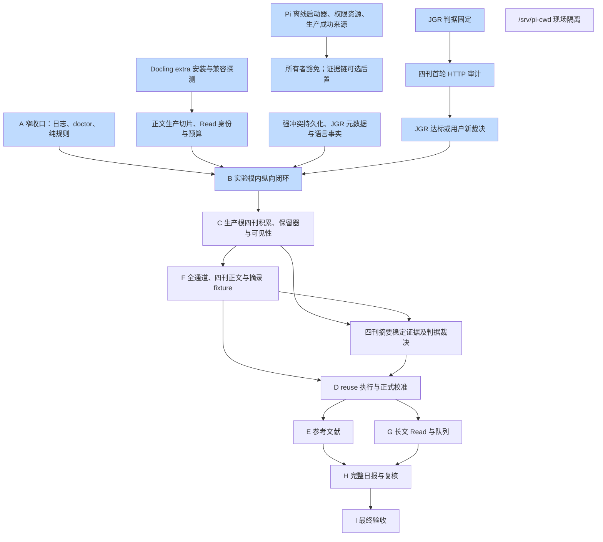

# PaperRadar 路线图

模块级计划与状态入口；目标要求见[规格](../intent/draft.md)，票级任务图以 GitHub 原生 sub-issue / blocked-by 为准。维护规则见[路线图维护](agents/roadmap.md)。

模块范围与完成判据以规格 §11 和[阶段 A 收口清单](verification/stage-a-closure.md#收口责任与未决项)为准；A1–A10 的历史离线结论不代表完整阶段 A 完成。

## 当前前沿

前沿按[维护规则](agents/roadmap.md)从下表推导：依赖全部已完成的「可规格化」模块，加上所有「已规格化」模块。

当前没有满足规则的前沿模块；下一承接为 [C](#module-c)，状态与依赖见[模块表](#模块)。
[B](#module-b) 的工程范围与最终冻结门禁生效条件见[收口台账](verification/stage-b-engineering-closure.md)，
所有者已签收的真实链与隔离恢复分别由该台账索引，证明范围仍按[规格 §11 B](../intent/draft.md#阶段-bjgr-feed-第一条真实纵向闭环)。

to-spec 发布前仍须按[tracker 规则](agents/issue-tracker.md)重查原生关系。`J` 的「已完成」仅指判据固定，不指审计通过。

## 模块图

节点 ID 保持稳定；职责与依赖按[规格 §11](../intent/draft.md#十一九阶段实施与验收)和 [ADR-0046](adr/0046-consolidate-pi-readiness-under-live.md)维护。图中着色只标是否完成，模块状态以下表为准；Live 与 B 的依赖取舍见 [ADR-0068](adr/0068-replace-live-prerequisites-with-explicit-owner-waiver.md)。

## 模块

所有模块的规格与完成判据均以[§11](../intent/draft.md#十一九阶段实施与验收)为准；B 及前置同时受[ADR-0036](adr/0036-isolate-stage-b-read-experiment.md)约束。现有边界从[收口证据索引](verification/stage-a-closure.md#证据索引与范围)进入对应 Contract；已发布的 spec issue 见模块表。

| ID | 模块 | 状态 | 依赖 | 执行方式 |
| --- | --- | --- | --- | --- |
| J | JGR 判据固定 | 已完成 | 无 | HITL |
| Audit | 四刊首轮 HTTP 审计 | 已完成（[首轮结论与移交](verification/exp-1-http-audit.md)；原计划 partial，不是四刊通过） | J | HITL |
| Source | JGR 达标或用户新裁决 | 已完成（[冻结判据 5/5](verification/exp-1-http-audit.md#jgr-逐成员核查)；仅此来源条件） | Audit | HITL |
| A | A 窄收口：日志、doctor、纯规则 | 已完成（[#120](https://github.com/MeteoBoy4/PaperRadar/issues/120)；[窄范围证据](verification/a-narrow-delivery.md)） | 无 | AFK |
| Pi | Pi 离线启动器、权限资源、生产成功来源 | 已完成（[#140](https://github.com/MeteoBoy4/PaperRadar/issues/140)；[独立工程覆盖与同次门禁判据](verification/issue-140-gate-followup.md)） | 无 | AFK |
| Cwd | /srv/pi-cwd 现场隔离验收 | 已取消（[职责并入 Live](adr/0046-consolidate-pi-readiness-under-live.md)，非验收通过） | 无 | HITL |
| Live | 所有者显式豁免；可选后置证据链 | 已完成（降范围：所有者豁免，ADR-0068；[#177](https://github.com/MeteoBoy4/PaperRadar/issues/177)；[独立工程覆盖](verification/issue-177-owner-waiver.md)） | Pi | HITL |
| Extra | Docling extra 安装与兼容探测 | 已完成（[#150](https://github.com/MeteoBoy4/PaperRadar/issues/150)；[工程覆盖与最终门禁判据](verification/issue-150-extra-delivery.md)；[历史收口回帖](https://github.com/MeteoBoy4/PaperRadar/issues/150#issuecomment-6611646055)） | 无 | AFK |
| Body | 正文生产切片、Read 身份与预算 | 已完成（[#155](https://github.com/MeteoBoy4/PaperRadar/issues/155)；[工程覆盖与最终门禁判据](verification/issue-165-body-read-closure.md)） | Extra | AFK |
| Feed | 强冲突持久化、JGR 元数据与语言事实 | 已完成（[#114](https://github.com/MeteoBoy4/PaperRadar/issues/114)；[离线工程证据](verification/issue-114-feed-delivery.md)） | 无 | AFK |
| B | B 实验根内纵向闭环 | 已完成（[#185](https://github.com/MeteoBoy4/PaperRadar/issues/185)；[工程收口与最终门禁条件](verification/stage-b-engineering-closure.md)，结论按该条件生效） | A、Body、Feed、Source | HITL |
| C | C 生产根四刊积累、保留器与可见性 | 未成形 | B | HITL |
| F | F 全通道、四刊正文与摘录 fixture | 未成形 | C | HITL |
| Abstract | 四刊摘要稳定证据及判据裁决 | 待裁决 | C、F | HITL |
| D | D reuse 执行与正式校准 | 未成形 | F、Abstract | HITL |
| E | E 参考文献 | 未成形 | D | AFK |
| G | G 长文 Read 与队列 | 未成形 | D | AFK |
| H | H 完整日报与复核 | 未成形 | E、G | AFK |
| I | I 最终验收 | 未成形 | H | HITL |

### 模块依据与完成判据

以下 Contract 链接描述现有边界，不宣称模块整体已实现；完成判据以所链规格阶段的入口、测试、真实验收及 DoD 为准。

| 模块 | 规格与完成判据 | 决策 | 当前公共边界 |
| --- | --- | --- | --- |
| J/Audit/Source | [§11 B](../intent/draft.md#阶段-bjgr-feed-第一条真实纵向闭环) | [ADR-0036](adr/0036-isolate-stage-b-read-experiment.md) | [fixture-audit](contracts/fixture-audit.md) |
| A | [§11 A](../intent/draft.md#阶段-a契约与可恢复数据底座) | [ADR-0006](adr/0006-model-processing-as-independent-facts.md)、[ADR-0037](adr/0037-allow-task-details-during-blind-calibration.md) | [doctor](contracts/doctor.md)、[运行日志](contracts/runtime-logging.md)、[共享规则](contracts/eligibility-visibility.md) |
| Pi/Live | [§11 B](../intent/draft.md#阶段-bjgr-feed-第一条真实纵向闭环)、[严格模式证据规格](https://github.com/MeteoBoy4/PaperRadar/issues/168) | [ADR-0026](adr/0026-control-pi-through-a-bounded-rpc-adapter.md)、[ADR-0068](adr/0068-replace-live-prerequisites-with-explicit-owner-waiver.md) | [pi-execution](contracts/pi-execution.md)、[pi-rpc](contracts/pi-rpc.md)、[doctor](contracts/doctor.md) |
| Extra | [§11 B](../intent/draft.md#阶段-bjgr-feed-第一条真实纵向闭环) | [ADR-0010](adr/0010-use-docling-as-the-only-body-parser.md) | [stage-inputs](contracts/stage-inputs.md)、[Docling 依赖探测](contracts/docling-runtime.md) |
| Body | [§11 B](../intent/draft.md#阶段-bjgr-feed-第一条真实纵向闭环) | [ADR-0036](adr/0036-isolate-stage-b-read-experiment.md) | [read-validation](contracts/read-validation.md)、[正文持久化](contracts/body-persistence.md)、[Read 任务](contracts/read-tasks.md)、[Read 执行](contracts/read-execution.md) |
| Feed | [§11 B](../intent/draft.md#阶段-bjgr-feed-第一条真实纵向闭环) | [ADR-0035](adr/0035-feed-derived-original-title-language-fact.md) | [paper-facts](contracts/paper-facts.md) |
| B | [§11 B](../intent/draft.md#阶段-bjgr-feed-第一条真实纵向闭环) | [ADR-0036](adr/0036-isolate-stage-b-read-experiment.md)、[ADR-0069](adr/0069-treat-stage-b-selection-as-owner-acceptance.md) | [B 工作流](contracts/stage-b-workflow.md)、[实验报告](contracts/reports.md)、[screening-tasks](contracts/screening-tasks.md) |
| C | [§11 C](../intent/draft.md#阶段-c四刊发现身份版本与来源) | [ADR-0030](adr/0030-paper-version-identity-and-source-observations.md) | [paper-facts](contracts/paper-facts.md) |
| F | [§11 F](../intent/draft.md#阶段-f全文取得与-docling-质量闭环) | [ADR-0032](adr/0032-relax-paper-acquisition-without-evading-access-controls.md) | [fixture-audit](contracts/fixture-audit.md) |
| Abstract | [§11 D](../intent/draft.md#阶段-d完整-screening-与盲评校准) | [ADR-0032](adr/0032-relax-paper-acquisition-without-evading-access-controls.md) | [fixture-audit](contracts/fixture-audit.md) |
| D | [§11 D](../intent/draft.md#阶段-d完整-screening-与盲评校准) | [ADR-0002](adr/0002-calibrate-before-automatic-fulltext-reading.md) | [config-projections](contracts/config-projections.md) |
| E | [§11 E](../intent/draft.md#阶段-eaccepted-rss-论文的一层参考文献) | [ADR-0015](adr/0015-delay-historical-enrichment-until-promotion.md) | [paper-facts](contracts/paper-facts.md) |
| G | [§11 G](../intent/draft.md#阶段-g正式精读与并列队列) | [ADR-0026](adr/0026-control-pi-through-a-bounded-rpc-adapter.md) | [read-validation](contracts/read-validation.md)、[正文持久化](contracts/body-persistence.md) |
| H | [§11 H](../intent/draft.md#阶段-h日常-cli-与只读报告) | [ADR-0018](adr/0018-keep-v1-markdown-reports-read-only.md) | [screening-tasks](contracts/screening-tasks.md) |
| I | [§11 I](../intent/draft.md#阶段-i无人值守nas-恢复与最终验收) | [ADR-0027](adr/0027-address-artifacts-by-content.md) | [backup-restore](contracts/backup-restore.md) |

### 模块承接索引

条目引用[阶段 A 收口清单](verification/stage-a-closure.md#原实施逐条处置)的 I/T/D 编号，原文措辞与下一责任节点以该冻结表为准；已完成模块的证明入口见[已完成](#已完成)，以下只保留后续消费责任。B 的受限实验结论不替代下游生产验收。

- A：I01、I10、I11、T06、T07、T16、T17、T22、D01、D03、D04 的窄范围证据见[覆盖台账](verification/a-narrow-delivery.md)；完整阶段 A 结论仍须按[收口安排](#收口安排)独立产出，由 I 聚合。
- Live：I04、I05、T05、T07、T08、T12 的可选后置现场证明保留原六格、正常刷新、nft/cgroup/resolver 与 AppArmor 判据。恢复该路径须所有者另行批准部署、重新采集／接收／激活；旧账本、inbox、intents、回执、归档和失败／停止历史保留。该路径不作为 B 执行前提，依据 [ADR-0068](adr/0068-replace-live-prerequisites-with-explicit-owner-waiver.md)与[执行契约](contracts/pi-execution.md)。
- C：I10、I12、I15、T01、T15–T19、T23、T24、T26；承接四刊生产采集扩展、保留器与未揭晓事实扩展、来源假设与语言约定核实、7 天复查／metadata_unobtainable 生命周期及完整 eligibility。保留器装配 waiting_calibration 与身份／合并链全部仍成立的隐藏条件，存活论文继承事实，再调用共享 visibility，并做消费者组合验证。纯人工 accepted 无 Screening 引用仍为 unknown，专用人工通道须独立扩展。依据：[元数据契约](contracts/feed-metadata.md)、[共享规则](contracts/eligibility-visibility.md)、[持久前置](contracts/body-persistence.md)与[ADR-0043](adr/0043-persist-body-prerequisites-before-stage-b.md)。
- F/Abstract：I09、I14、I15、T01、T10、T20、T26；承接[Docling 未覆盖范围](verification/exp-3-docling-probe.md#移交与仍未验范围)中的四刊、中文、复杂版式、正文／摘录 fixture、行间／行内公式分类、独立 item、无父源块类别及通用资源阈值。遵守[Extra 移交](verification/issue-150-extra-delivery.md#bodybf-承接)的 native ABI、模型缓存、解析及资源失败边界；单样本、双口径峰值和安装／依赖 passed 均不替代正式质量门槛。同一 PDF 多成功正文的当前性与[显式正文选择](contracts/body-persistence.md)沿用共享 Body 权威，旧核查及永久否决保留，不能按当前配置猜测三元组。
  与 C 共同承接[HTTP 新规则未完成项](verification/exp-1-http-audit-v2.md#b-前进方向与后续责任)：AIES Feed 202、dqkx 第 2 位协议重定向、Wiley 出版者 403 与 QJRMS `10.1002/qj.70349` 缺摘要。AIES/dqkx 后续遇到时另拟方案，保留两个 partial 计划、成员／失败与暂停位置，不盲目 resume。v2 字段误取与来源缺摘要分别判断；完成适用新计划后才登记 acquired fixture，最迟 D 正式预热冻结／首批校准前逐刊收口。
- D：I03、I06、I09、I12、I15、T04、T07–T10、T14–T17、T19、T20、T23、T24、T26；负责正式校准、reuse 与新展示面的未揭晓／揭晓、review/evaluation 接线。B 的公开 Prompt、实验建议及代接受不构成正式校准基线或标签。
- E：I07、T02、T03、T11、T24；参考文献发现及消费者组合继续遵守强身份、来源保留、共享资格与可见性边界。
- G：I03、I09、T04、T07–T10、T13、T17–T20、T24；扩展通用长文与普通 Read 队列，reduce 允许集合适用 Read v2 末次降级规则，评分理由始终整体拒绝；依据[Read 校验](contracts/read-validation.md)。
- H：I06、I12、T15–T17、T23、T24；负责完整日报、复核和诊断分支实际隐藏，承接 A3 历史证明未含的普通报告重建（[规格 §9.1](../intent/draft.md#91-本机一致性快照)）。I04、I05、T05、T07、T08、T12 的分项披露继续保留 unknown、原状态、时点与下一动作，共享片段不占论文容量；依据[准入收口台账](verification/issue-168-176-live-admission-closure.md)。按 [ADR-0042](adr/0042-accept-read-v2-with-final-attempt-degradation.md)展示受限内容警告及丢弃标记／每类计数，不将降级结果表述为已核对或已支撑。
- I：I13、T06、T17、T25、D02、D04；聚合各阶段验收，承接 A3 历史证明未含的任务续跑、NAS 与最终恢复。按[脱网回放](contracts/backup-restore.md#隔离脱网回放)独立评估原根／副本并行执行的外发授权、预算、租约和重复执行风险；本机内容闭包不代替跨副本 exactly-once 或 NAS。依 [ADR-0048](adr/0048-accept-bounded-request-observability.md)重新评估精确请求计数及其隐私／运行成本，近似下界与 unknown 不构成完整计数通过。
- A10 遗留：AMS 来源与四刊摘要稳定及附加区块语义接 C/F/Abstract，正文／PDF／Docling 接 F，生产导入接 C，NAS 接 I；首轮 AIES 为 202，不声称历史 AMS403 复现。来源见[实测证据](verification/exp-1-http-audit.md)，其他未验范围见[A10 继承缺口](verification/doc-unification-history.md#a10-继承缺口)。

后续执行入口从首次接线起显式注入所选根文件汇，并补对应执行入口守卫；库服务默认 NullSink。
E/G/H/I 各自补 deferred 概念与真实消费者组合，不从纯规则或 B 单样本继承生产资格。
依据：[运行日志](contracts/runtime-logging.md)、[共享规则](contracts/eligibility-visibility.md)和[doctor](contracts/doctor.md)。

### B 下游承接

以下承接来源为[B 工程收口](verification/stage-b-engineering-closure.md)，不扩大阶段 A 历史证明；
各节点继续承担前表的 I/T/D 原责任。

| 下一节点 | 承接责任 |
| --- | --- |
| C | 独立长期生产根；在保留器启用前导入[冻结暴露清单](contracts/exposure-export.md)，按规范 DOI 与双向权威关系保留排除，覆盖重复发现、版本变化和未来合并；实验结果不提升、不复用 |
| D | 完整确定性建议、reuse 执行与正式盲评校准；公开 Prompt 和 B 实验接受均不充当正式基线或盲评标签 |
| F | 四刊／中文／复杂正文与摘录 fixture、通用资源阈值及正文质量；B 的单样本及 MemAvailable 披露不替代这些判据 |
| G | 通用长文分块／reduce 与正常 Read 队列；超预算不得截断正文，延续逐阶段两次及显式 retry |
| H | 完整日报／复核与其他展示面；沿用五／三项容量、冻结成员和依据、受限内容警告、unknown／not_assessed 与共享 visibility |
| I | NAS、无人值守与最终恢复；重新评估原根／副本并行执行的外发授权、预算、租约和重复执行风险，本机内容回放不提供跨副本协调 |

## 待裁决

| 编号 | 问题 | 阻塞的模块 | 最迟闸门 | 裁决后位置与出处 |
| --- | --- | --- | --- | --- |
| DEC-1 | 四刊摘要稳定阈值与是否一律非截断；未达标的降级及披露 | Abstract、D | 验收前确定，最迟 D 正式预热冻结/首批校准前逐刊收口 | 规格 §4.3/§11；[收口未决项](verification/stage-a-closure.md#收口责任与未决项) |
| DEC-3 | 附加摘要区块消费语义 | C | C 消费前 | 规格 §4.3；[ADR-0036](adr/0036-isolate-stage-b-read-experiment.md#未豁免条件与证明边界) |

## 待探索

剩余探测见下表。Live 的可选现场复验责任见[模块承接索引](#模块承接索引)；既有探索的证明范围见[探索证据索引](verification/issue-167-index.md)，不将有限探索解释为六格或主机能力均已验证。

| 编号 | 问题 | 阻塞的模块 | 解决方式与出处 |
| --- | --- | --- | --- |
| EXP-4 | 四刊正文/摘录及 TDM/渲染/授权通道 | F、Abstract、D | live 探测；[收口未决项](verification/stage-a-closure.md#收口责任与未决项) |
| EXP-5 | 正式校准与 NAS 恢复 | D、I | live 探测；[收口未决项](verification/stage-a-closure.md#收口责任与未决项) |

## 用户须提供

后续阶段所需配置、Research Profile、模型／采样、认证与资料授权以[规格 §14](../intent/draft.md#十四上线前必须由用户提供的配置)为准；C 建立独立长期生产根，按其实际输入重新确认授权，不沿用 B 实验资料的授权范围或结果。
选样、合法 PDF 及版本归属、正文质量和正式盲评标签仍由所有者按各自闸门提供或确认。
选择可选 Live 证据链复验时，须重新批准采集窗口、接收及激活；模板、旧激活或准备资料齐备均不表示新执行已经通过。

## 未成形

下一承接为[模块表](#模块)中的 C；依赖完成不自动将模块提升为可规格化。
后续模块成形、单 spec、跨 spec 与共享资源串行统一执行[集成规则](agents/verification-scope.md)，
固定材料与覆盖依据见[集成台账](verification/scope-registry-integration.md)。

## 已完成

以下是[模块表](#模块)对应的证据入口；状态只在模块表维护，证明范围以原文为准。

| 模块 | spec issue | 验收依据 |
| --- | --- | --- |
| A1 | [#1](https://github.com/MeteoBoy4/PaperRadar/issues/1) | [验收证据](verification/offline-evidence.md#a1-独立结论)、[范围索引 E1](verification/stage-a-closure.md#证据索引与范围) |
| A2 | [#15](https://github.com/MeteoBoy4/PaperRadar/issues/15) | [验收证据](verification/offline-evidence.md)、[范围索引 E2](verification/stage-a-closure.md#证据索引与范围) |
| A3 | [#29](https://github.com/MeteoBoy4/PaperRadar/issues/29) | [验收证据](verification/offline-evidence.md)、[范围索引 E3](verification/stage-a-closure.md#证据索引与范围) |
| A4 | [#36](https://github.com/MeteoBoy4/PaperRadar/issues/36) | [验收证据](verification/a4-requirements.md)、[范围索引 E4](verification/stage-a-closure.md#证据索引与范围) |
| A5 | [#47](https://github.com/MeteoBoy4/PaperRadar/issues/47) | [验收证据](verification/offline-evidence.md)、[范围索引 E5](verification/stage-a-closure.md#证据索引与范围) |
| A6 | [#67](https://github.com/MeteoBoy4/PaperRadar/issues/67) | [验收证据](verification/a6-requirements.md)、[范围索引 E6](verification/stage-a-closure.md#证据索引与范围) |
| A7 | [#76](https://github.com/MeteoBoy4/PaperRadar/issues/76) | [验收证据](verification/a7-requirements.md)、[范围索引 E7](verification/stage-a-closure.md#证据索引与范围) |
| A8 | [#85](https://github.com/MeteoBoy4/PaperRadar/issues/85) | [验收证据](verification/a8-requirements.md)、[范围索引 E8](verification/stage-a-closure.md#证据索引与范围) |
| A9 | [#92](https://github.com/MeteoBoy4/PaperRadar/issues/92) | [验收证据](verification/offline-evidence.md)、[范围索引 E9](verification/stage-a-closure.md#证据索引与范围) |
| A10 | [#100](https://github.com/MeteoBoy4/PaperRadar/issues/100) | [验收证据](verification/a10-requirements.md)、[范围索引 E10](verification/stage-a-closure.md#证据索引与范围) |
| Feed | [#114](https://github.com/MeteoBoy4/PaperRadar/issues/114) | [离线工程证据](verification/issue-114-feed-delivery.md) |
| A 窄收口 | [#120](https://github.com/MeteoBoy4/PaperRadar/issues/120) | [独立工程覆盖与同次门禁判据](verification/a-narrow-delivery.md)；不等于完整阶段 A |
| [Live](#module-live) | [#177](https://github.com/MeteoBoy4/PaperRadar/issues/177) | [独立工程覆盖](verification/issue-177-owner-waiver.md)；[范围决策](adr/0068-replace-live-prerequisites-with-explicit-owner-waiver.md) |
| Pi | [#140](https://github.com/MeteoBoy4/PaperRadar/issues/140) | [独立工程覆盖与同次门禁判据](verification/issue-140-gate-followup.md)；现场证明由可选证据链承接 |
| Extra | [#150](https://github.com/MeteoBoy4/PaperRadar/issues/150) | [独立工程覆盖与最终门禁判据](verification/issue-150-extra-delivery.md)；Body/B/F 继续独立验收 |
| Body | [#155](https://github.com/MeteoBoy4/PaperRadar/issues/155) | [#165 工程覆盖与最终门禁判据](verification/issue-165-body-read-closure.md)；B/F/G/H 继续独立承接，真实单样本仍限 #164 |
| B | [#185](https://github.com/MeteoBoy4/PaperRadar/issues/185) | [工程范围、覆盖与最终门禁条件](verification/stage-b-engineering-closure.md)；[版式签收](verification/issue-204-live-layout-acceptance.md)、[真实链签收](verification/issue-205-live-chain-acceptance.md)、[隔离恢复签收](verification/issue-205-recovery-acceptance.md)各保留自己的范围 |

## 已取消

- [Cwd](#module-cwd)：独立交付职责由 Live 统一承担，节点 ID 保留；不是现场验收通过，依据 [ADR-0046](adr/0046-consolidate-pi-readiness-under-live.md)。

[#46](https://github.com/MeteoBoy4/PaperRadar/issues/46) 以 NOT_PLANNED 关闭；#36 已关闭；Windows 安全导出当前无交付计划，未实现/未验证 Windows 后端。原边界仍见[规格 §7.8](../intent/draft.md#78-pi-固定版本供给)。

## 收口安排

A 窄收口新增能力沿用 #114 先例：独立新测试模块作为工程证据，登记到 [A 窄收口覆盖台账](verification/a-narrow-delivery.md)，不计入历史固定分母、不新增既有 required 集合。历史台账和回执保持原字节与原证明范围；新增能力不得复用 A1–A10 历史结论，`stage_a_verified=false` 保持。机器可读新组注册机制见 [#126 集成台账](verification/scope-registry-integration.md)，测试预期清单与读者支持格式独立维护；是否、何时将 #114/#120 能力转为 required 组及完整 A 结论仍由 A 真正收口票决定。B 沿用此 D1 政策，集成与门禁执行[唯一规则](agents/verification-scope.md)（[#120 D1](https://github.com/MeteoBoy4/PaperRadar/issues/120#issuecomment-6520223100)）。

[阶段 A 收口清单](verification/stage-a-closure.md) 保留规格 §11 A 原实施/测试/DoD 的稳定序号、
历史证据与后续责任。A1–A10 通过不等于完整 A 通过。该收口清单是过渡清单；A 真正收口时
由收口实现票产出机器可读阶段结论，I 聚合。新增能力按上面的 D1 登记规则收口；
#111 未新增组、测试分母或通过字段。

## 并行安排

依据[规格 §10/§11](../intent/draft.md#十一九阶段实施与验收)：C 长期生产根积累与 F 可以并行，E/G 可在 D 工程完成后并行。所有最迟入口、先后约束和运行门禁以规格为准。

## 已移出板块索引

以下历史板块已整体移出本路线图：历史证明与裁决记录并入[迁入证据索引](verification/doc-unification-history.md)，参考文献预检结论移入规格；本节仅保留原锚点与去向，不维护内容副本。

- Read 恢复证据范围 → [迁入证据索引](verification/doc-unification-history.md#read-恢复证据范围)。
- 阶段 A 收口与 B 前置（#111，目标规格）→ [迁入证据索引](verification/doc-unification-history.md#阶段-a-收口与-b-前置111目标规格)。
- 文首记录的状态与出处 → [迁入证据索引](verification/doc-unification-history.md#文首记录的状态与出处)。
- 配置切片与底座验收范围 → [迁入证据索引](verification/doc-unification-history.md#配置切片与底座验收范围)。
- 历史决策更新的证明边界 → [迁入证据索引](verification/doc-unification-history.md#历史决策更新的证明边界)。
- 阶段输入历史证明范围 → [迁入证据索引](verification/doc-unification-history.md#阶段输入历史证明范围)。
- 整理中既有冲突的裁决结果 → [迁入证据索引](verification/doc-unification-history.md#整理中既有冲突的裁决结果)。
- 历史证据定位与审计入口 → [迁入证据索引](verification/doc-unification-history.md#历史证据定位与审计入口)。
- 参考文献预检状态（2026-10-25 只读预检，非基线记录对应票实测）→ [规格 §13.2](../intent/draft.md#132-参考文献样本)。

## 证据定位标签

本节只给出可检索标签与链接，具体证明内容均由所链证据维护。

- [E0 / 5274 passed / `a8a8ad87efb65bdf79719b6f093efe2a3c54f138` / `stage_a_verified=false`](verification/stage-a-closure.md#证据索引与范围)；[收口原基线 `cdf5c1f4f18c19eead77d78cab0e9fafe668ebf1`](verification/stage-a-closure.md)。
- [本机记录定位 `verification-runs/ab9a89500053400db1c07d40e180a064{,.terminal,.pytest,.a1,.a2,.a2-full,.a3,.a4,.a5,.a6,.a7,.a8,.a9,.a10}.json`](verification/doc-unification-history.md#历史证据定位与审计入口)。
- [审计收集选项 `--collect --json`](verification/stage-a-closure.md#本票验证口径)；[A1](../scripts/a1_scope.py)、[完整 A2](../scripts/a2_full_scope.py)、[A3](../scripts/a3_scope.py)、[A5](../scripts/a5_scope.py)、[A9](../scripts/a9_scope.py) scope；[A6 独立结论 67/75](verification/offline-evidence.md#a6-独立结论6775)。
- [#111 固定背景材料](https://github.com/MeteoBoy4/PaperRadar/blob/212e312/intent/discussions/阶段A剩余工作.md)（非规范来源）。

历史证据定位与审计入口的完整标签见[已移出板块索引](#已移出板块索引)与[迁入证据索引](verification/doc-unification-history.md#历史证据定位与审计入口)；A10 遗留承接见[模块承接索引](#模块承接索引)。
