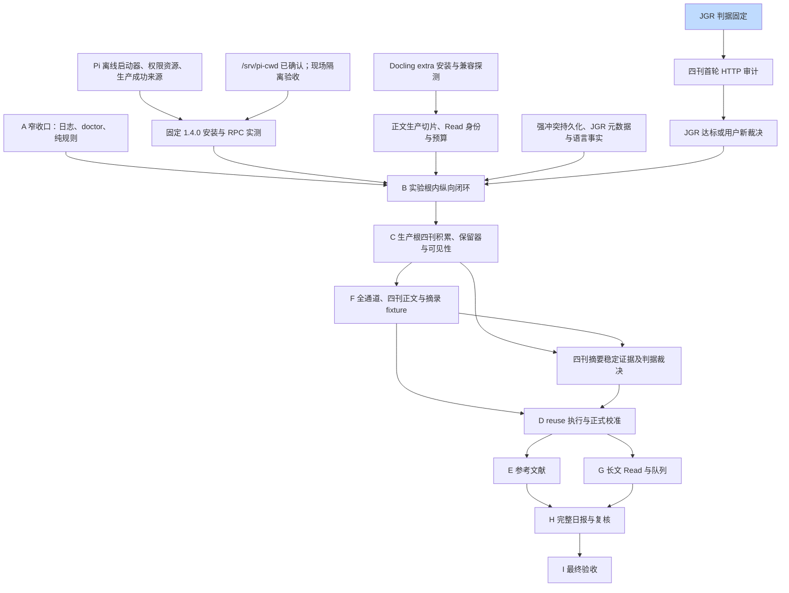

# PaperRadar 路线图

模块级计划与状态入口；目标要求见[规格](../intent/draft.md)，票级任务图以 GitHub 原生 sub-issue / blocked-by 为准。维护规则见[路线图维护](agents/roadmap.md)。

初稿依据基线 `91e5d02e199f1921ca8afd2b7bdb8f257e6264f3` 的规格 §11 和[阶段 A 收口清单](verification/stage-a-closure.md#收口责任与未决项)；本轮用户已确认三项旧表述同步；用户随后已确认本路线图的模块集合、状态及其余待裁决/待探索清单，合并前确认已完成；这是对清单与状态的认可，不表示其中待裁决问题已经裁决、待探索事项已经验证或 live 已就绪。A1–A10 的历史离线结论不代表完整阶段 A 完成。

## 当前前沿

前沿按[维护规则](agents/roadmap.md)从下表推导：依赖全部已完成的「可规格化」模块，加上所有「已规格化」模块。

to-spec 发布前仍须按[tracker 规则](agents/issue-tracker.md)重查原生关系。`J` 的「已完成」仅指判据固定，不指审计通过。

## 模块图

节点 ID 和边逐字沿用基线 §11；同名 ID 映射，无重命名。图中着色只标是否完成，模块状态以下表为准。

## 模块

所有模块的规格与完成判据均以[§11](../intent/draft.md#十一九阶段实施与验收)为准；B 及前置同时受[ADR-0036](adr/0036-isolate-stage-b-read-experiment.md)约束。现有边界从[收口证据索引](verification/stage-a-closure.md#证据索引与范围)进入对应 Contract；同次开放票查询未见这些生产模块的 spec issue。

| ID | 模块 | 状态 | 依赖 | 执行方式 |
| --- | --- | --- | --- | --- |
| J | JGR 判据固定 | 已完成 | 无 | HITL |
| Audit | 四刊首轮 HTTP 审计 | 待探索 | J | HITL |
| Source | JGR 达标或用户新裁决 | 待探索 | Audit | HITL |
| A | A 窄收口：日志、doctor、纯规则 | 可规格化 | 无 | AFK |
| Pi | Pi 离线启动器、权限资源、生产成功来源 | 可规格化 | 无 | AFK |
| Cwd | /srv/pi-cwd 现场隔离验收 | 待探索 | 无 | HITL |
| Live | 固定 1.4.0 安装与 RPC 实测 | 待探索 | Pi、Cwd | HITL |
| Extra | Docling extra 安装与兼容探测 | 待探索 | 无 | HITL |
| Body | 正文生产切片、Read 身份与预算 | 未成形 | Extra | AFK |
| Feed | 强冲突持久化、JGR 元数据与语言事实 | 可规格化 | 无 | AFK |
| B | B 实验根内纵向闭环 | 未成形 | A、Live、Body、Feed、Source | HITL |
| C | C 生产根四刊积累、保留器与可见性 | 未成形 | B | HITL |
| F | F 全通道、四刊正文与摘录 fixture | 未成形 | C | HITL |
| Abstract | 四刊摘要稳定证据及判据裁决 | 待裁决 | C、F | HITL |
| D | D reuse 执行与正式校准 | 未成形 | F、Abstract | HITL |
| E | E 参考文献 | 未成形 | D | AFK |
| G | G 长文 Read 与队列 | 未成形 | D | AFK |
| H | H 完整日报与复核 | 未成形 | E、G | AFK |
| I | I 最终验收 | 未成形 | H | HITL |

### 模块依据与完成判据

以下 Contract 链接描述现有边界，不宣称模块整体已实现；完成判据以所链规格阶段的入口、测试、真实验收及 DoD 为准。

| 模块 | 规格与完成判据 | 决策 | 当前公共边界 |
| --- | --- | --- | --- |
| J/Audit/Source | [§11 B](../intent/draft.md#阶段-bjgr-feed-第一条真实纵向闭环) | [ADR-0036](adr/0036-isolate-stage-b-read-experiment.md) | [fixture-audit](contracts/fixture-audit.md) |
| A | [§11 A](../intent/draft.md#阶段-a契约与可恢复数据底座) | [ADR-0006](adr/0006-model-processing-as-independent-facts.md) | [verification-status](contracts/verification-status.md) |
| Pi/Cwd/Live | [§11 B](../intent/draft.md#阶段-bjgr-feed-第一条真实纵向闭环) | [ADR-0026](adr/0026-control-pi-through-a-bounded-rpc-adapter.md) | [pi-rpc](contracts/pi-rpc.md) |
| Extra | [§11 B](../intent/draft.md#阶段-bjgr-feed-第一条真实纵向闭环) | [ADR-0010](adr/0010-use-docling-as-the-only-body-parser.md) | [stage-inputs](contracts/stage-inputs.md) |
| Body | [§11 B](../intent/draft.md#阶段-bjgr-feed-第一条真实纵向闭环) | [ADR-0036](adr/0036-isolate-stage-b-read-experiment.md) | [read-validation](contracts/read-validation.md) |
| Feed | [§11 B](../intent/draft.md#阶段-bjgr-feed-第一条真实纵向闭环) | [ADR-0035](adr/0035-feed-derived-original-title-language-fact.md) | [paper-facts](contracts/paper-facts.md) |
| B | [§11 B](../intent/draft.md#阶段-bjgr-feed-第一条真实纵向闭环) | [ADR-0036](adr/0036-isolate-stage-b-read-experiment.md) | [screening-tasks](contracts/screening-tasks.md) |
| C | [§11 C](../intent/draft.md#阶段-c四刊发现身份版本与来源) | [ADR-0030](adr/0030-paper-version-identity-and-source-observations.md) | [paper-facts](contracts/paper-facts.md) |
| F | [§11 F](../intent/draft.md#阶段-f全文取得与-docling-质量闭环) | [ADR-0032](adr/0032-relax-paper-acquisition-without-evading-access-controls.md) | [fixture-audit](contracts/fixture-audit.md) |
| Abstract | [§11 D](../intent/draft.md#阶段-d完整-screening-与盲评校准) | [ADR-0032](adr/0032-relax-paper-acquisition-without-evading-access-controls.md) | [fixture-audit](contracts/fixture-audit.md) |
| D | [§11 D](../intent/draft.md#阶段-d完整-screening-与盲评校准) | [ADR-0002](adr/0002-calibrate-before-automatic-fulltext-reading.md) | [config-projections](contracts/config-projections.md) |
| E | [§11 E](../intent/draft.md#阶段-eaccepted-rss-论文的一层参考文献) | [ADR-0015](adr/0015-delay-historical-enrichment-until-promotion.md) | [paper-facts](contracts/paper-facts.md) |
| G | [§11 G](../intent/draft.md#阶段-g正式精读与并列队列) | [ADR-0026](adr/0026-control-pi-through-a-bounded-rpc-adapter.md) | [read-validation](contracts/read-validation.md) |
| H | [§11 H](../intent/draft.md#阶段-h日常-cli-与只读报告) | [ADR-0018](adr/0018-keep-v1-markdown-reports-read-only.md) | [screening-tasks](contracts/screening-tasks.md) |
| I | [§11 I](../intent/draft.md#阶段-i无人值守nas-恢复与最终验收) | [ADR-0027](adr/0027-address-artifacts-by-content.md) | [backup-restore](contracts/backup-restore.md) |

### 模块承接索引

条目引用[阶段 A 收口清单](verification/stage-a-closure.md#原实施逐条处置)的 I/T/D 编号，原文措辞与下一责任节点以该冻结表为准（T、D 分别见其「原测试逐条处置」「原DoD逐条处置」）；责任涉及多个下游时全部保留，不以历史通过代替新消费者验收。各模块同时承接其中指向自己的阶段消费者义务。

- A：I01、I10、I11、T06、T07、T16、T17、T22、D01、D03、D04。
- Extra：I02；Pi/Cwd/Live：I04、I05、T05、T07、T08、T12。
- Audit/Source：I14、I15、T01、T26。
- Feed：I07，以及[强冲突与语言事实](../intent/draft.md#阶段-c四刊发现身份版本与来源)。
- Body/B：I03–I13、T02–T25、D02、D04 中的 B 消费者；另落实[StageInput C1](contracts/stage-inputs.md#c1-已知未决问题封面识别的论文元数据依赖)、EXP-6、EXP-7。
- C：I10、I12、I15、T01、T15–T19、T23、T24、T26。
- F/Abstract：I09、I14、I15、T01、T10、T20、T26。
- D：I03、I06、I09、I12、I15、T04、T07–T10、T14–T17、T19、T20、T23、T24、T26。
- G：I03、I09、T04、T07–T10、T13、T17–T20、T24。
- H：I06、I12、T15–T17、T23、T24；E 沿用 I07、T02、T03、T11、T24 的共同约束。
- I：I13、T06、T17、T25、D02、D04；聚合各阶段验收。

## 待裁决

| 编号 | 问题 | 阻塞的模块 | 最迟闸门 | 裁决后位置与出处 |
| --- | --- | --- | --- | --- |
| DEC-1 | 四刊摘要稳定阈值与是否一律非截断；未达标的降级及披露 | Abstract、D | 验收前确定，最迟 D 正式预热冻结/首批校准前逐刊收口 | 规格 §4.3/§11；[收口未决项](verification/stage-a-closure.md#收口责任与未决项) |
| DEC-2 | JGR 首轮任一判据不满足时的新裁决（条件触发） | Source、B | B 入口 | 规格 §11 B；[ADR-0036](adr/0036-isolate-stage-b-read-experiment.md#未豁免条件与证明边界) |
| DEC-3 | 附加摘要区块消费语义 | C | C 消费前 | 规格 §4.3；[ADR-0036](adr/0036-isolate-stage-b-read-experiment.md#未豁免条件与证明边界) |

## 待探索

| 编号 | 问题 | 阻塞的模块 | 解决方式与出处 |
| --- | --- | --- | --- |
| EXP-1 | 四刊首轮 HTTP 审计、JGR 达标情况 | Audit、Source、B | live 探测；[收口未决项](verification/stage-a-closure.md#收口责任与未决项) |
| EXP-2 | cwd 无资源/权限隔离、1.4.0 DERIVED 假设及实际参数 | Cwd、Live、B | live 探测；[收口未决项](verification/stage-a-closure.md#收口责任与未决项) |
| EXP-3 | Docling/Python 兼容、模型安装与样本质量 | Extra、Body、B | live 探测；[ADR-0036 样本与质量](adr/0036-isolate-stage-b-read-experiment.md#样本与质量) |
| EXP-4 | 四刊正文/摘录及 TDM/渲染/授权通道 | F、Abstract、D | live 探测；[收口未决项](verification/stage-a-closure.md#收口责任与未决项) |
| EXP-5 | 正式校准与 NAS 恢复 | D、I | live 探测；[收口未决项](verification/stage-a-closure.md#收口责任与未决项) |
| EXP-6 | `orig` 持久成员哈希的具体设计与落实（由 Body/B 首个真实正文生产者票决定并在该票落实，B 首个正文生产者前确定；F 不再承担） | Body、B，首个正文生产者前 | research／原型；[ADR-0036 样本与质量](adr/0036-isolate-stage-b-read-experiment.md#样本与质量) |
| EXP-7 | 证据/数值规则身份归属；仅后处理警告变化是否触发模型重跑须分析（最小 Read 票决定） | Body、B | research／原型；[ADR-0036 样本与质量](adr/0036-isolate-stage-b-read-experiment.md#样本与质量) |

## 用户须提供

配置清单仅见[规格 §14](../intent/draft.md#十四上线前必须由用户提供的配置)。`/srv/pi-cwd` 已确认，现场隔离仍未验；依据[收口未决项](verification/stage-a-closure.md#收口责任与未决项)。其他配置的就绪状态未记录，不从历史工程验收推定已提供。

## 未成形

[#112](https://github.com/MeteoBoy4/PaperRadar/issues/112) 的 Verification Scope 重构由用户在 #113 后重新梳理，未纳入本次模块图或实施范围。

Body、B 与 C–I 保持原阶段粒度，进一步规格化必须先核对各自入口、承接责任与待裁决项；依据[§11](../intent/draft.md#十一九阶段实施与验收)。

## 已完成

出处标签：A7-01（#77）严格解析、A7-02（#78）登记、A7-03（#79）领取、A7-04（#80）boundary 接收、A7-05（#81）value 接收、A7-06（#82）retry、A7-07（#83）恢复、A7-08（#84）验收，证明范围见下表 A7。

仅表示对应固定范围离线工程完成，证据范围以原文为准。

| 模块 | spec issue | 验收依据 |
| --- | --- | --- |
| A1 | [#1](https://github.com/MeteoBoy4/PaperRadar/issues/1) | [验收证据](verification/offline-evidence.md#a1-独立结论)、[范围索引 E1](verification/stage-a-closure.md#证据索引与范围) |
| A2 | [#15](https://github.com/MeteoBoy4/PaperRadar/issues/15) | [验收证据](verification/offline-evidence.md)、[范围索引 E2](verification/stage-a-closure.md#证据索引与范围) |
| A3 | [#29](https://github.com/MeteoBoy4/PaperRadar/issues/29) | [验收证据](verification/offline-evidence.md)、[范围索引 E3](verification/stage-a-closure.md#证据索引与范围) |
| A4 | [#36](https://github.com/MeteoBoy4/PaperRadar/issues/36) | [验收证据](verification/a4-requirements.md)、[范围索引 E4](verification/stage-a-closure.md#证据索引与范围) |
| A5 | [#47](https://github.com/MeteoBoy4/PaperRadar/issues/47) | [验收证据](verification/offline-evidence.md)、[范围索引 E5](verification/stage-a-closure.md#证据索引与范围) |
| A6 | [#67](https://github.com/MeteoBoy4/PaperRadar/issues/67) | [验收证据](verification/a6-requirements.md)、[范围索引 E6](verification/stage-a-closure.md#证据索引与范围) |
| A7 | [#76](https://github.com/MeteoBoy4/PaperRadar/issues/76) | [验收证据](verification/a7-requirements.md)、[范围索引 E7](verification/stage-a-closure.md#证据索引与范围) |
| A8 | [#85](https://github.com/MeteoBoy4/PaperRadar/issues/85) | [验收证据](verification/a8-requirements.md)、[范围索引 E8](verification/stage-a-closure.md#证据索引与范围) |
| A9 | [#92](https://github.com/MeteoBoy4/PaperRadar/issues/92) | [验收证据](verification/offline-evidence.md)、[范围索引 E9](verification/stage-a-closure.md#证据索引与范围) |
| A10 | [#100](https://github.com/MeteoBoy4/PaperRadar/issues/100) | [验收证据](verification/a10-requirements.md)、[范围索引 E10](verification/stage-a-closure.md#证据索引与范围) |

## 已取消

[#46](https://github.com/MeteoBoy4/PaperRadar/issues/46) 以 NOT_PLANNED 关闭；#36 已关闭；Windows 安全导出当前无交付计划，未实现/未验证 Windows 后端。原边界仍见[规格 §7.8](../intent/draft.md#78-pi-固定版本供给)。

## 收口安排

[阶段 A 收口清单](verification/stage-a-closure.md) 保留规格 §11 A 原实施/测试/DoD 的稳定序号、
历史证据与后续责任。A1–A10 通过不等于完整 A 通过。该收口清单是过渡清单；A 真正收口时
由收口实现票产出机器可读阶段结论，I 聚合。首张 A 收口实现票须确定新增能力 required 组与
全量 pytest 的验收登记规则，后续沿用；#111 未新增组、测试分母或通过字段。

## Read 恢复证据范围

历史证明范围仅见[迁入证据索引](verification/doc-unification-history.md#read-恢复证据范围)；本节不维护证据副本。

## 阶段 A 收口与 B 前置（#111，目标规格）

历史证明范围仅见[迁入证据索引](verification/doc-unification-history.md#阶段-a-收口与-b-前置111目标规格)；本节不维护证据副本。

## 文首记录的状态与出处

历史证明范围仅见[迁入证据索引](verification/doc-unification-history.md#文首记录的状态与出处)；本节不维护证据副本。

## 配置切片与底座验收范围

历史证明范围仅见[迁入证据索引](verification/doc-unification-history.md#配置切片与底座验收范围)；本节不维护证据副本。

## 并行安排与未验责任

依据[规格 §10/§11](../intent/draft.md#十一九阶段实施与验收)：Docling 探测、Pi 离线启动器与 A 窄收口可以并行；C 长期生产根积累与 F 可以并行，E/G 可在 D 工程完成后并行。所有最迟入口、先后约束和运行门禁以规格为准。

[规格 §9.1](../intent/draft.md#91-本机一致性快照)的 A3 历史证明不包含报告重建、任务续跑与 NAS；H 承接报告，I 承接续跑/NAS及最终恢复。

## 参考文献预检状态

后续注记（2026-10-25 只读预检）：两篇《大气科学》DOI 的 doiRA 返回 ISTIC，对 V1 注册机构链为 `agency_unsupported`；这不改写[规格 §13.2 表](../intent/draft.md#132-参考文献样本) 2026-09-13 的“Crossref 无记录”历史，也不是基线记录对应票的实测。

## 生产接线承接补充

Pi 承接启动器准入；Live 承接首次实际供给/RPC与预检；Body/B 最小 Read 票承接输入身份、任务/预算/租约/retry、analysis 持久化和证据规则身份；B 首张真实任务票同时承接 failures/retry、trace 组合及中文 help/退出码/恢复验证，不能后推到 H。A 先交纯规则，B 首次消费，C 扩展保留器与未揭晓事实。依据为下列主题规格及原 Contract 的既有责任段。

- Pi 生产启动器准入：由 pi 承接，依据[规格补充准入](../intent/draft.md#pi-生产启动器准入)及[pi-rpc](contracts/pi-rpc.md)。
- B 首次 Pi 生产接线：由 live 承接，依据[规格补充准入](../intent/draft.md#b-首次-pi-生产接线)及[pi-rpc](contracts/pi-rpc.md)。
- B 最小 Read 与正文消费：由 body 承接，依据[规格补充准入](../intent/draft.md#b-最小-read-与正文消费)及[read-validation](contracts/read-validation.md)。
- B Screening 产品接线：由 b 承接，依据[规格补充准入](../intent/draft.md#b-screening-产品接线)及[screening-tasks](contracts/screening-tasks.md)。

### 历史决策更新的证明边界

ADR-0023/0026 的原文更新只改目标文档，未改当时的配置编译 Contract、不可变快照、版本材料、代码及 Frozen Contract；该历史过程不证明配置映射、供给或执行验收。实际现状由 A2/A4/A8/A9 证据与对应 Contract 界定。

## 阶段输入历史证明范围

历史证明范围仅见[迁入证据索引](verification/doc-unification-history.md#阶段输入历史证明范围)；本节不维护证据副本。

## 整理中既有冲突的裁决结果

| 编号 | 冲突 | 影响与最迟闸门 | 出处及处理 |
| --- | --- | --- | --- |
| DOC-1 | orig 哈希覆盖原交 F 裁决，较新 B 前置要求首个正文生产者前明确 | Body/B，首个正文生产者前 | [规格 §4.10](../intent/draft.md#410-read-agent)与[ADR-0036](adr/0036-isolate-stage-b-read-experiment.md#样本与质量)；用户已裁决前移 Body/B 首个真实正文生产者票决定并落实，B 首个正文生产者前确定，F 不再承担；恢复后逐字节回查、真实恢复闭包及实验制品不可复用/不可提升均保留 |
| DOC-2 | README“真实网络来源尚未实现”与联网审计命令范围措辞不一致 | 文档现状说明，无新增生产资格 | [README](../README.md)；用户已确认限定为生产论文来源；联网审计能力不受影响 |
| DOC-3 | adapter-config 旧 cwd 待确认文字 | Pi/Live，首次发送 prompt 的 live 探测前 | 用户已确认同步 `/srv/pi-cwd`，无默认值显式提供、白名单仅此常量，现场无资源与权限隔离仍须实测 |

## 历史证据定位与审计入口

历史证明范围仅见[迁入证据索引](verification/doc-unification-history.md#历史证据定位与审计入口)；本节不维护证据副本。

## 证据定位标签

本节只给出可检索标签与链接，具体证明内容均由所链证据维护。

- [E0 / 5274 passed / `a8a8ad87efb65bdf79719b6f093efe2a3c54f138` / `stage_a_verified=false`](verification/stage-a-closure.md#证据索引与范围)；[收口原基线 `cdf5c1f4f18c19eead77d78cab0e9fafe668ebf1`](verification/stage-a-closure.md)。
- [本机记录定位 `verification-runs/ab9a89500053400db1c07d40e180a064{,.terminal,.pytest,.a1,.a2,.a2-full,.a3,.a4,.a5,.a6,.a7,.a8,.a9,.a10}.json`](verification/doc-unification-history.md#历史证据定位与审计入口)。
- [审计收集选项 `--collect --json`](verification/stage-a-closure.md#本票验证口径)；[A1](../scripts/a1_scope.py)、[完整 A2](../scripts/a2_full_scope.py)、[A3](../scripts/a3_scope.py)、[A5](../scripts/a5_scope.py)、[A9](../scripts/a9_scope.py) scope；[A6 独立结论 67/75](verification/offline-evidence.md#a6-独立结论6775)。
- [#111 固定背景材料](https://github.com/MeteoBoy4/PaperRadar/blob/212e312/intent/discussions/阶段A剩余工作.md)（非规范来源）。

A10 遗留的 AMS403 策略、四刊摘要稳定及附加区块语义由 Audit/Source、C/F/Abstract 承接；正文/PDF/Docling 接 Body/F，生产导入接 Feed/C，NAS 接 I。具体未验范围见[A10 继承缺口](verification/doc-unification-history.md#a10-继承缺口)。
