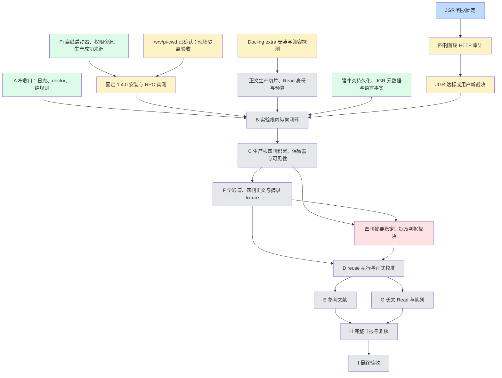

# PaperRadar 路线图

模块级计划与状态入口；目标要求见[规格](../intent/draft.md)，票级任务图以 GitHub 原生 sub-issue / blocked-by 为准。维护规则见[路线图维护](agents/roadmap.md)。

初稿依据基线 `91e5d02e199f1921ca8afd2b7bdb8f257e6264f3` 的规格 §11 和[阶段 A 收口清单](verification/stage-a-closure.md#收口责任与未决项)；模块集合、状态和未决清单待用户合并前确认。A1–A10 的历史离线结论不代表完整阶段 A 完成。

## 当前前沿

以下为基于文档的初稿判断，尚待核对已有模块票与用户确认。

A、Pi、Feed 可规格化；J 的判据已裁决，节点已完成仅指判据固定，不指审计通过。其依据均为[收口责任](verification/stage-a-closure.md#收口责任与未决项)与[§11 B 入口](../intent/draft.md#阶段-bjgr-feed-第一条真实纵向闭环)。本次只读核对开放 Issues，仅有 #112 与 #113，未见上述生产模块的开放 spec issue；to-spec 发布前仍须按[tracker 规则](agents/issue-tracker.md)重查原生关系。

## 模块图

节点 ID 和边逐字沿用基线 §11；同名 ID 映射，无重命名。

## 模块

所有模块的规格与完成判据均以[§11](../intent/draft.md#十一九阶段实施与验收)为准；B 及前置同时受[ADR-0036](adr/0036-isolate-stage-b-read-experiment.md)约束。现有边界从[收口证据索引](verification/stage-a-closure.md#证据索引与范围)进入对应 Contract；本次开放票查询未见这些生产模块的 spec issue。

| ID | 模块 | 状态 | 依赖 | 执行方式 |
| --- | --- | --- | --- | --- |
| J | JGR 判据固定 | 已完成 | 无 | HITL |
| Audit | 四刊首轮 HTTP 审计 | 待探索 | J | HITL |
| Source | JGR 达标或用户新裁决 | 待探索 | Audit | HITL |
| A | A 窄收口：日志、doctor、纯规则 | 可规格化 | 无 | AFK |
| Pi | Pi 离线启动器、权限资源、生产成功来源 | 可规格化 | 无 | AFK |
| Cwd | /srv/pi-cwd 现场隔离验收 | 待探索 | 无 | HITL |
| Live | 固定 1.4.0 安装与 RPC 实测 | 待探索 | Pi、Cwd | HITL |
| Extra | Docling extra 安装与兼容探测 | 待探索 | 无 | HITL |
| Body | 正文生产切片、Read 身份与预算 | 未成形 | Extra | AFK |
| Feed | 强冲突持久化、JGR 元数据与语言事实 | 可规格化 | 无 | AFK |
| B | B 实验根内纵向闭环 | 未成形 | A、Live、Body、Feed、Source | HITL |
| C | C 生产根四刊积累、保留器与可见性 | 未成形 | B | HITL |
| F | F 全通道、四刊正文与摘录 fixture | 未成形 | C | HITL |
| Abstract | 四刊摘要稳定证据及判据裁决 | 待裁决 | C、F | HITL |
| D | D reuse 执行与正式校准 | 未成形 | F、Abstract | HITL |
| E | E 参考文献 | 未成形 | D | AFK |
| G | G 长文 Read 与队列 | 未成形 | D | AFK |
| H | H 完整日报与复核 | 未成形 | E、G | AFK |
| I | I 最终验收 | 未成形 | H | HITL |

### 模块依据与完成判据

以下 Contract 链接描述现有边界，不宣称模块整体已实现；完成判据以所链规格阶段的入口、测试、真实验收及 DoD 为准。

| 模块 | 规格与完成判据 | 决策 | 当前公共边界 |
| --- | --- | --- | --- |
| J/Audit/Source | [§11 B](../intent/draft.md#阶段-bjgr-feed-第一条真实纵向闭环) | [ADR-0036](adr/0036-isolate-stage-b-read-experiment.md) | [fixture-audit](contracts/fixture-audit.md) |
| A | [§11 A](../intent/draft.md#阶段-a契约与可恢复数据底座) | [ADR-0006](adr/0006-model-processing-as-independent-facts.md) | [verification-status](contracts/verification-status.md) |
| Pi/Cwd/Live | [§11 B](../intent/draft.md#阶段-bjgr-feed-第一条真实纵向闭环) | [ADR-0026](adr/0026-control-pi-through-a-bounded-rpc-adapter.md) | [pi-rpc](contracts/pi-rpc.md) |
| Extra | [§11 B](../intent/draft.md#阶段-bjgr-feed-第一条真实纵向闭环) | [ADR-0010](adr/0010-use-docling-as-the-only-body-parser.md) | [stage-inputs](contracts/stage-inputs.md) |
| Body | [§11 B](../intent/draft.md#阶段-bjgr-feed-第一条真实纵向闭环) | [ADR-0036](adr/0036-isolate-stage-b-read-experiment.md) | [read-validation](contracts/read-validation.md) |
| Feed | [§11 B](../intent/draft.md#阶段-bjgr-feed-第一条真实纵向闭环) | [ADR-0035](adr/0035-feed-derived-original-title-language-fact.md) | [paper-facts](contracts/paper-facts.md) |
| B | [§11 B](../intent/draft.md#阶段-bjgr-feed-第一条真实纵向闭环) | [ADR-0036](adr/0036-isolate-stage-b-read-experiment.md) | [screening-tasks](contracts/screening-tasks.md) |
| C | [§11 C](../intent/draft.md#阶段-c四刊发现身份版本与来源) | [ADR-0030](adr/0030-paper-version-identity-and-source-observations.md) | [paper-facts](contracts/paper-facts.md) |
| F | [§11 F](../intent/draft.md#阶段-f全文取得与-docling-质量闭环) | [ADR-0032](adr/0032-relax-paper-acquisition-without-evading-access-controls.md) | [fixture-audit](contracts/fixture-audit.md) |
| Abstract | [§11 D](../intent/draft.md#阶段-d完整-screening-与盲评校准) | [ADR-0032](adr/0032-relax-paper-acquisition-without-evading-access-controls.md) | [fixture-audit](contracts/fixture-audit.md) |
| D | [§11 D](../intent/draft.md#阶段-d完整-screening-与盲评校准) | [ADR-0002](adr/0002-calibrate-before-automatic-fulltext-reading.md) | [config-projections](contracts/config-projections.md) |
| E | [§11 E](../intent/draft.md#阶段-eaccepted-rss-论文的一层参考文献) | [ADR-0015](adr/0015-delay-historical-enrichment-until-promotion.md) | [paper-facts](contracts/paper-facts.md) |
| G | [§11 G](../intent/draft.md#阶段-g正式精读与并列队列) | [ADR-0026](adr/0026-control-pi-through-a-bounded-rpc-adapter.md) | [read-validation](contracts/read-validation.md) |
| H | [§11 H](../intent/draft.md#阶段-h日常-cli-与只读报告) | [ADR-0018](adr/0018-keep-v1-markdown-reports-read-only.md) | [screening-tasks](contracts/screening-tasks.md) |
| I | [§11 I](../intent/draft.md#阶段-i无人值守nas-恢复与最终验收) | [ADR-0027](adr/0027-address-artifacts-by-content.md) | [backup-restore](contracts/backup-restore.md) |

### 模块承接索引

原文责任见下表，各模块同时承接其中指向自己的阶段消费者义务。

- A：I01、I10、I11、T06、T07、T16、T17、T22、D01、D03、D04。
- Extra：I02；Pi/Cwd/Live：I04、I05、T05、T07、T08、T12。
- Audit/Source：I14、I15、T01、T26。
- Feed：I07，以及[强冲突与语言事实](../intent/draft.md#阶段-c四刊发现身份版本与来源)。
- Body/B：I03–I13、T02–T25、D02、D04 中的 B 消费者；另落实[StageInput C1](contracts/stage-inputs.md#c1-已知未决问题封面识别的论文元数据依赖)、EXP-6、EXP-7。
- C：I10、I12、I15、T01、T15–T19、T23、T24、T26。
- F/Abstract：I09、I14、I15、T01、T10、T20、T26。
- D：I03、I06、I09、I12、I15、T04、T07–T10、T14–T17、T19、T20、T23、T24、T26。
- G：I03、I09、T04、T07–T10、T13、T17–T20、T24。
- H：I06、I12、T15–T17、T23、T24；E 沿用 I07、T02、T03、T11、T24 的共同约束。
- I：I13、T06、T17、T25、D02、D04；聚合各阶段验收。

### 承接责任

以下 45 条逐条引用冻结收口表的下一责任节点；责任涉及多个下游时全部保留，不以历史通过代替新消费者验收。I/T/D 标识定位原表对应行，原表标题锚点稳定。

| 来源 ID | 下游与承接责任（原文） |
| --- | --- |
| [I01](https://github.com/MeteoBoy4/PaperRadar/blob/91e5d02e199f1921ca8afd2b7bdb8f257e6264f3/docs/verification/stage-a-closure.md#L37) | A 后续能力沿用工程入口 |
| [I02](https://github.com/MeteoBoy4/PaperRadar/blob/91e5d02e199f1921ca8afd2b7bdb8f257e6264f3/docs/verification/stage-a-closure.md#L38) | B 前置独立票：安装/兼容/lockfile/模型；可并行 A |
| [I03](https://github.com/MeteoBoy4/PaperRadar/blob/91e5d02e199f1921ca8afd2b7bdb8f257e6264f3/docs/verification/stage-a-closure.md#L39) | B/D/G 实际消费与语义变更接线 |
| [I04](https://github.com/MeteoBoy4/PaperRadar/blob/91e5d02e199f1921ca8afd2b7bdb8f257e6264f3/docs/verification/stage-a-closure.md#L40) | B：1.4.0、真实成功来源、权限资源、/srv/pi-cwd 与 live |
| [I05](https://github.com/MeteoBoy4/PaperRadar/blob/91e5d02e199f1921ca8afd2b7bdb8f257e6264f3/docs/verification/stage-a-closure.md#L41) | B 首次固定 1.4.0 安装/RPC；保留 1.3.0 历史 |
| [I06](https://github.com/MeteoBoy4/PaperRadar/blob/91e5d02e199f1921ca8afd2b7bdb8f257e6264f3/docs/verification/stage-a-closure.md#L42) | B/D/H 消费同一权威 |
| [I07](https://github.com/MeteoBoy4/PaperRadar/blob/91e5d02e199f1921ca8afd2b7bdb8f257e6264f3/docs/verification/stage-a-closure.md#L43) | 各消费者逐片追加；不预建空表 |
| [I08](https://github.com/MeteoBoy4/PaperRadar/blob/91e5d02e199f1921ca8afd2b7bdb8f257e6264f3/docs/verification/stage-a-closure.md#L44) | B 真实内容与恢复闭包 |
| [I09](https://github.com/MeteoBoy4/PaperRadar/blob/91e5d02e199f1921ca8afd2b7bdb8f257e6264f3/docs/verification/stage-a-closure.md#L45) | B Read StageInput/预算/持久化，D reuse，F/G 扩展 |
| [I10](https://github.com/MeteoBoy4/PaperRadar/blob/91e5d02e199f1921ca8afd2b7bdb8f257e6264f3/docs/verification/stage-a-closure.md#L46) | A 合成事实/原因接口；B 首消费者，C 保留器 |
| [I11](https://github.com/MeteoBoy4/PaperRadar/blob/91e5d02e199f1921ca8afd2b7bdb8f257e6264f3/docs/verification/stage-a-closure.md#L47) | A 最小日志/doctor，B 前接线；不建遥测平台 |
| [I12](https://github.com/MeteoBoy4/PaperRadar/blob/91e5d02e199f1921ca8afd2b7bdb8f257e6264f3/docs/verification/stage-a-closure.md#L48) | B/C/D/H 随新增命令扩展 |
| [I13](https://github.com/MeteoBoy4/PaperRadar/blob/91e5d02e199f1921ca8afd2b7bdb8f257e6264f3/docs/verification/stage-a-closure.md#L49) | B 真实链恢复；I NAS |
| [I14](https://github.com/MeteoBoy4/PaperRadar/blob/91e5d02e199f1921ca8afd2b7bdb8f257e6264f3/docs/verification/stage-a-closure.md#L50) | A live，F 四刊正文/摘录 |
| [I15](https://github.com/MeteoBoy4/PaperRadar/blob/91e5d02e199f1921ca8afd2b7bdb8f257e6264f3/docs/verification/stage-a-closure.md#L51) | A 四刊首轮，JGR 判据阻断 B；C/F 补跑，D 前四刊收口 |
| [T01](https://github.com/MeteoBoy4/PaperRadar/blob/91e5d02e199f1921ca8afd2b7bdb8f257e6264f3/docs/verification/stage-a-closure.md#L57) | A live；C/F 新策略 |
| [T02](https://github.com/MeteoBoy4/PaperRadar/blob/91e5d02e199f1921ca8afd2b7bdb8f257e6264f3/docs/verification/stage-a-closure.md#L58) | 后续每片迁移/恢复 |
| [T03](https://github.com/MeteoBoy4/PaperRadar/blob/91e5d02e199f1921ca8afd2b7bdb8f257e6264f3/docs/verification/stage-a-closure.md#L59) | 后续保持不变量 |
| [T04](https://github.com/MeteoBoy4/PaperRadar/blob/91e5d02e199f1921ca8afd2b7bdb8f257e6264f3/docs/verification/stage-a-closure.md#L60) | B Read StageInput；D/G 消费 |
| [T05](https://github.com/MeteoBoy4/PaperRadar/blob/91e5d02e199f1921ca8afd2b7bdb8f257e6264f3/docs/verification/stage-a-closure.md#L61) | B 实际 Pi 协议/参数/完成条件 |
| [T06](https://github.com/MeteoBoy4/PaperRadar/blob/91e5d02e199f1921ca8afd2b7bdb8f257e6264f3/docs/verification/stage-a-closure.md#L62) | A doctor；B/I 实际调度 |
| [T07](https://github.com/MeteoBoy4/PaperRadar/blob/91e5d02e199f1921ca8afd2b7bdb8f257e6264f3/docs/verification/stage-a-closure.md#L63) | A 机制收口；B Screening/Read，D reuse，G map/reduce |
| [T08](https://github.com/MeteoBoy4/PaperRadar/blob/91e5d02e199f1921ca8afd2b7bdb8f257e6264f3/docs/verification/stage-a-closure.md#L64) | B live 与 Read；D reuse，G 长文 |
| [T09](https://github.com/MeteoBoy4/PaperRadar/blob/91e5d02e199f1921ca8afd2b7bdb8f257e6264f3/docs/verification/stage-a-closure.md#L65) | B/D/G 消费者 |
| [T10](https://github.com/MeteoBoy4/PaperRadar/blob/91e5d02e199f1921ca8afd2b7bdb8f257e6264f3/docs/verification/stage-a-closure.md#L66) | B Read StageInput，D/F/G 扩展 |
| [T11](https://github.com/MeteoBoy4/PaperRadar/blob/91e5d02e199f1921ca8afd2b7bdb8f257e6264f3/docs/verification/stage-a-closure.md#L67) | 后续版本化材料沿用 |
| [T12](https://github.com/MeteoBoy4/PaperRadar/blob/91e5d02e199f1921ca8afd2b7bdb8f257e6264f3/docs/verification/stage-a-closure.md#L68) | B 生产实例验收，历史材料不改 |
| [T13](https://github.com/MeteoBoy4/PaperRadar/blob/91e5d02e199f1921ca8afd2b7bdb8f257e6264f3/docs/verification/stage-a-closure.md#L69) | B/G 真实 Read 接线 |
| [T14](https://github.com/MeteoBoy4/PaperRadar/blob/91e5d02e199f1921ca8afd2b7bdb8f257e6264f3/docs/verification/stage-a-closure.md#L70) | B/D 两阶段/reuse 编排 |
| [T15](https://github.com/MeteoBoy4/PaperRadar/blob/91e5d02e199f1921ca8afd2b7bdb8f257e6264f3/docs/verification/stage-a-closure.md#L71) | B/C/D/H 随入口逐项验 |
| [T16](https://github.com/MeteoBoy4/PaperRadar/blob/91e5d02e199f1921ca8afd2b7bdb8f257e6264f3/docs/verification/stage-a-closure.md#L72) | A 合成纯规则；B 首接，C/D/H 实际隐藏 |
| [T17](https://github.com/MeteoBoy4/PaperRadar/blob/91e5d02e199f1921ca8afd2b7bdb8f257e6264f3/docs/verification/stage-a-closure.md#L73) | A 合成一致性；B trace，C/D/G/H/I 消费 |
| [T18](https://github.com/MeteoBoy4/PaperRadar/blob/91e5d02e199f1921ca8afd2b7bdb8f257e6264f3/docs/verification/stage-a-closure.md#L74) | B Read 指纹；C/G 版本任务 |
| [T19](https://github.com/MeteoBoy4/PaperRadar/blob/91e5d02e199f1921ca8afd2b7bdb8f257e6264f3/docs/verification/stage-a-closure.md#L75) | B/C/D/G 失效消费 |
| [T20](https://github.com/MeteoBoy4/PaperRadar/blob/91e5d02e199f1921ca8afd2b7bdb8f257e6264f3/docs/verification/stage-a-closure.md#L76) | B 正文/Read；F/D/G 摘录/reuse/长文 |
| [T21](https://github.com/MeteoBoy4/PaperRadar/blob/91e5d02e199f1921ca8afd2b7bdb8f257e6264f3/docs/verification/stage-a-closure.md#L77) | B 新持久化边界故障与恢复 |
| [T22](https://github.com/MeteoBoy4/PaperRadar/blob/91e5d02e199f1921ca8afd2b7bdb8f257e6264f3/docs/verification/stage-a-closure.md#L78) | A 全禁项合成 fixture；B 真实日志 |
| [T23](https://github.com/MeteoBoy4/PaperRadar/blob/91e5d02e199f1921ca8afd2b7bdb8f257e6264f3/docs/verification/stage-a-closure.md#L79) | B 真实日志；C/D/H 未揭晓消费者 |
| [T24](https://github.com/MeteoBoy4/PaperRadar/blob/91e5d02e199f1921ca8afd2b7bdb8f257e6264f3/docs/verification/stage-a-closure.md#L80) | B 及后续新命令随片验 |
| [T25](https://github.com/MeteoBoy4/PaperRadar/blob/91e5d02e199f1921ca8afd2b7bdb8f257e6264f3/docs/verification/stage-a-closure.md#L81) | B 新闭包，I NAS |
| [T26](https://github.com/MeteoBoy4/PaperRadar/blob/91e5d02e199f1921ca8afd2b7bdb8f257e6264f3/docs/verification/stage-a-closure.md#L82) | A 首轮；B JGR 门槛；C/F 补跑，D 前四刊 |
| [D01](https://github.com/MeteoBoy4/PaperRadar/blob/91e5d02e199f1921ca8afd2b7bdb8f257e6264f3/docs/verification/stage-a-closure.md#L88) | A 真正收口时验证完整新增范围 |
| [D02](https://github.com/MeteoBoy4/PaperRadar/blob/91e5d02e199f1921ca8afd2b7bdb8f257e6264f3/docs/verification/stage-a-closure.md#L89) | B 真实链，I 最终恢复 |
| [D03](https://github.com/MeteoBoy4/PaperRadar/blob/91e5d02e199f1921ca8afd2b7bdb8f257e6264f3/docs/verification/stage-a-closure.md#L90) | A 复用既有查询，区分缺失/非法/通过/未验收 |
| [D04](https://github.com/MeteoBoy4/PaperRadar/blob/91e5d02e199f1921ca8afd2b7bdb8f257e6264f3/docs/verification/stage-a-closure.md#L91) | B 起复用最终接口；首张 A 收口票定验收登记，A 真收口产机器结果，I 聚合 |

## 待裁决

| 编号 | 问题 | 阻塞的模块 | 最迟闸门 | 裁决后位置与出处 |
| --- | --- | --- | --- | --- |
| DEC-1 | 四刊摘要稳定阈值与是否一律非截断；未达标的降级及披露 | Abstract、D | 验收前确定，最迟 D 正式预热冻结/首批校准前逐刊收口 | 规格 §4.3/§11；[收口未决项](verification/stage-a-closure.md#收口责任与未决项) |
| DEC-2 | JGR 首轮任一判据不满足时的新裁决（条件触发） | Source、B | B 入口 | 规格 §11 B；[ADR-0036](adr/0036-isolate-stage-b-read-experiment.md#未豁免条件与证明边界) |
| DEC-3 | 附加摘要区块消费语义 | C | C 消费前 | 规格 §4.3；[ADR-0036](adr/0036-isolate-stage-b-read-experiment.md#未豁免条件与证明边界) |
| DEC-4 | DOC-1：orig 哈希覆盖 F/Body 责任表述是否按较新 B 前置同步 | Body、B | 首个正文生产者前 | [DOC-1](#整理中待确认的既有冲突)；裁决后同步规格 §4.10 与相关 Contract |
| DEC-5 | DOC-2：README 真实网络来源未实现是否明确限定生产论文来源 | 用户文档入口 | #113 合并前 | [DOC-2](#整理中待确认的既有冲突)；裁决后同步 README |
| DEC-6 | 旧 adapter-config 的 cwd 待确认文字是否按 #111 已确认值同步 | Pi、Live | 首次发送 prompt 的 live 探测前 | [配置 Contract](contracts/adapter-config.md#选择材料与版本)与[ADR-0026](adr/0026-control-pi-through-a-bounded-rpc-adapter.md)；同步 Contract，现场隔离仍须验收 |

## 待探索

| 编号 | 问题 | 阻塞的模块 | 解决方式与出处 |
| --- | --- | --- | --- |
| EXP-1 | 四刊首轮 HTTP 审计、JGR 达标情况 | Audit、Source、B | live 探测；[收口未决项](verification/stage-a-closure.md#收口责任与未决项) |
| EXP-2 | cwd 无资源/权限隔离、1.4.0 DERIVED 假设及实际参数 | Cwd、Live、B | live 探测；[收口未决项](verification/stage-a-closure.md#收口责任与未决项) |
| EXP-3 | Docling/Python 兼容、模型安装与样本质量 | Extra、Body、B | live 探测；[ADR-0036 样本与质量](adr/0036-isolate-stage-b-read-experiment.md#样本与质量) |
| EXP-4 | 四刊正文/摘录及 TDM/渲染/授权通道 | F、Abstract、D | live 探测；[收口未决项](verification/stage-a-closure.md#收口责任与未决项) |
| EXP-5 | 正式校准与 NAS 恢复 | D、I | live 探测；[收口未决项](verification/stage-a-closure.md#收口责任与未决项) |
| EXP-6 | `orig` 由哪个持久成员哈希覆盖（实施票决定） | Body、B，首个正文生产者前 | research／原型；[ADR-0036 样本与质量](adr/0036-isolate-stage-b-read-experiment.md#样本与质量) |
| EXP-7 | 证据/数值规则身份归属；仅后处理警告变化是否触发模型重跑须分析（最小 Read 票决定） | Body、B | research／原型；[ADR-0036 样本与质量](adr/0036-isolate-stage-b-read-experiment.md#样本与质量) |

## 用户须提供

配置清单仅见[规格 §14](../intent/draft.md#十四上线前必须由用户提供的配置)。`/srv/pi-cwd` 已确认，现场隔离仍未验；依据[收口未决项](verification/stage-a-closure.md#收口责任与未决项)。其他配置的就绪状态未记录，不从历史工程验收推定已提供。

## 未成形

[#112](https://github.com/MeteoBoy4/PaperRadar/issues/112) 的 Verification Scope 重构由用户在 #113 后重新梳理，未纳入本次模块图或实施范围。

Body、B 与 C–I 保持原阶段粒度，进一步规格化必须先核对各自入口、承接责任与待裁决项；依据[§11](../intent/draft.md#十一九阶段实施与验收)。

## 已完成

出处标签：A7-01（#77）严格解析、A7-02（#78）登记、A7-03（#79）领取、A7-04（#80）boundary 接收、A7-05（#81）value 接收、A7-06（#82）retry、A7-07（#83）恢复、A7-08（#84）验收，证明范围见下表 A7。

仅表示对应固定范围离线工程完成，证据范围以原文为准。

| 模块 | spec issue | 验收依据 |
| --- | --- | --- |
| A1 | [#1](https://github.com/MeteoBoy4/PaperRadar/issues/1) | [验收证据](verification/offline-evidence.md#a1-独立结论)、[范围索引 E1](verification/stage-a-closure.md#证据索引与范围) |
| A2 | [#15](https://github.com/MeteoBoy4/PaperRadar/issues/15) | [验收证据](verification/offline-evidence.md)、[范围索引 E2](verification/stage-a-closure.md#证据索引与范围) |
| A3 | [#29](https://github.com/MeteoBoy4/PaperRadar/issues/29) | [验收证据](verification/offline-evidence.md)、[范围索引 E3](verification/stage-a-closure.md#证据索引与范围) |
| A4 | [#36](https://github.com/MeteoBoy4/PaperRadar/issues/36) | [验收证据](verification/a4-requirements.md)、[范围索引 E4](verification/stage-a-closure.md#证据索引与范围) |
| A5 | [#47](https://github.com/MeteoBoy4/PaperRadar/issues/47) | [验收证据](verification/offline-evidence.md)、[范围索引 E5](verification/stage-a-closure.md#证据索引与范围) |
| A6 | [#67](https://github.com/MeteoBoy4/PaperRadar/issues/67) | [验收证据](verification/a6-requirements.md)、[范围索引 E6](verification/stage-a-closure.md#证据索引与范围) |
| A7 | [#76](https://github.com/MeteoBoy4/PaperRadar/issues/76) | [验收证据](verification/a7-requirements.md)、[范围索引 E7](verification/stage-a-closure.md#证据索引与范围) |
| A8 | [#85](https://github.com/MeteoBoy4/PaperRadar/issues/85) | [验收证据](verification/a8-requirements.md)、[范围索引 E8](verification/stage-a-closure.md#证据索引与范围) |
| A9 | [#92](https://github.com/MeteoBoy4/PaperRadar/issues/92) | [验收证据](verification/offline-evidence.md)、[范围索引 E9](verification/stage-a-closure.md#证据索引与范围) |
| A10 | [#100](https://github.com/MeteoBoy4/PaperRadar/issues/100) | [验收证据](verification/a10-requirements.md)、[范围索引 E10](verification/stage-a-closure.md#证据索引与范围) |

## 已取消

[#46](https://github.com/MeteoBoy4/PaperRadar/issues/46) 以 NOT_PLANNED 关闭；#36 已关闭；Windows 安全导出当前无交付计划，未实现/未验证 Windows 后端。原边界仍见[规格 §7.8](../intent/draft.md#78-pi-固定版本供给)。

## 收口安排

[阶段 A 收口清单](verification/stage-a-closure.md) 保留规格 §11 A 原实施/测试/DoD 的稳定序号、
历史证据与后续责任。A1–A10 通过不等于完整 A 通过。该收口清单是过渡清单；A 真正收口时
由收口实现票产出机器可读阶段结论，I 聚合。首张 A 收口实现票须确定新增能力 required 组与
全量 pytest 的验收登记规则，后续沿用；#111 未新增组、测试分母或通过字段。

## Read 恢复证据范围

#98 已以两份历史配置和中/英文、single/reduce 四份候选原字节验证[规格 §9.1](../intent/draft.md#91-本机一致性快照)所述隔离恢复与
再次搬迁。消费上下文由固定测试常量重建，不属于恢复产物，也不证明真实 PDF、
evidence-map 或正文选择；范围见 [Read 恢复说明](contracts/read-validation.md#恢复范围98)。

## 阶段 A 收口与 B 前置（#111，目标规格）

[#111](https://github.com/MeteoBoy4/PaperRadar/issues/111) 的文档更新没有交付或验收新增能力，A4 1.3.0 历史材料、A2 示例和历史结论保持不变；A1–A10 通过不等于完整 A 通过。历史范围见[A 收口清单](verification/stage-a-closure.md)。

A 窄收口、B 前置的当前承接责任见[模块表](#模块)和[承接索引](#模块承接索引)。安装探测与离线工程可并行，首次真实消费须先满足相应入口。

B 实验隔离、摘要入口、PDF 最低路径、质量与材料保管要求见[规格 §11 B](../intent/draft.md#阶段-bjgr-feed-第一条真实纵向闭环)及[ADR-0036](adr/0036-isolate-stage-b-read-experiment.md)；未来 Pi 升级要求见[规格 §7.8](../intent/draft.md#78-pi-固定版本供给)。

## 文首记录的状态与出处

以下仅索引基线文首的历史切片边界，已完成模块仍见 A1–A10 表；早期“后续”由后来的证据收口，不作为当前待办。目标要求以各链接正文为准。

| 原记录日期 | 出处 | 规则/证据归属 | 历史证明边界与承接 |
| --- | --- | --- | --- |
| 2026-10-11 | Pi 适配边界 | [docs/adr/0026-control-pi-through-a-bounded-rpc-adapter.md](adr/0026-control-pi-through-a-bounded-rpc-adapter.md) | §5、“我的决策”及有界 RPC；当次仅文档，代码/配置/登记版本/Frozen Contract 不变。 |
| 2026-10-12 | #26 供给方案 | [intent/draft.md#78-pi-固定版本供给](../intent/draft.md#78-pi-固定版本供给) | 固定版本供给、执行核对与恢复要求；当次不证明安装/RPC/校准通过。 |
| 2026-10-18 | 供给与升级裁决 | [intent/draft.md#78-pi-固定版本供给](../intent/draft.md#78-pi-固定版本供给) | D1–D5：新声明版本、无脱网重建承诺、三段正式版本、当前与最近三个旧安装、行为影响判定必填；当次不证明验收。 |
| 2026-10-22 | #67、#68、#69–#75 | [docs/adr/0030-paper-version-identity-and-source-observations.md](adr/0030-paper-version-identity-and-source-observations.md) | D1–D4/N1/N2、身份/Feed 回摆/冲突；A6 离线底座已注册，真实来源/parser/live/完整 A 未验。旧固定正文不覆盖后续裁决。 |
| 2026-10-23 | #76、#77–#80、#81、#82、#83、#84 | [docs/contracts/screening-tasks.md](contracts/screening-tasks.md) | 预算/派生三值适用性及 boundary/value、retry、查询、历史恢复/独立 A7；仅离线 test，screening CLI/paper trace 组合未交付；真实模型/完整 A 未验。语言来源后由 ADR-0035 裁决。 |
| 2026-10-24 | #85 D1–D4/P3 | [docs/adr/0026-control-pi-through-a-bounded-rpc-adapter.md](adr/0026-control-pi-through-a-bounded-rpc-adapter.md) | 首次 snapshot 语义/回执 snapshot 审计、A7 最终模型裁决、零 token 未知及 cwd 外发例外；真实 Pi/模型未验。 |
| 2026-10-25 | 获取方式裁决 | [docs/adr/0032-relax-paper-acquisition-without-evading-access-controls.md](adr/0032-relax-paper-acquisition-without-evading-access-controls.md) | §4.3/§4.8/§11 F/§13/§15；合法自动化与访问规避边界。策略可按真实审计另票调整；当次只改文档与两份 A9 文档哈希，业务代码/配置/Frozen Contract 不变。 |
| 未标日期 | #103 | [docs/contracts/fixture-audit.md#103-已交付的取得边界](contracts/fixture-audit.md#103-已交付的取得边界) | 计划/有界 HTTP/未安装通道/原子结算/只读查询/基本恢复；当时四刊选样/矩阵/resume/replay/独立验收待续，后由 #104–#108 收口；不证明 live/完整 A。 |
| 2026-10-26 | #102 | [docs/contracts/fixture-audit.md#pdf-字节事实与-backend-期望102](contracts/fixture-audit.md#pdf-字节事实与-backend-期望102) | 本机 PDF 字节/backend 期望与显式替换，旧字节/期望保留，新 SHA 不继承结果；不下载/不运行 Docling，不证明四刊正文/完整 A。 |
| 2026-10-26 | #104 | [docs/contracts/fixture-audit.md](contracts/fixture-audit.md) | 四刊固定选样/原位继续、整份 Feed/显式身份/类别、不按成败换样；当时后续矩阵/回放/独立门禁待续，后由 #105–#108 收口；真实审计未验。 |
| 2026-10-26 | #105 | [docs/contracts/fixture-audit.md](contracts/fixture-audit.md) | audit run、适用矩阵/主区块/截断/A6仲裁/真实分母、复用材料及原时间；complete 仅终态、查询不输出原摘要；当时回放/混合闭包/门禁待续，后由 #106–#108 收口。 |
| 2026-10-26 | #106 | [docs/contracts/fixture-audit.md](contracts/fixture-audit.md) | audit resume、冻结 v1 replay、服务 API 新 parser/差异；两类真实进程/事务故障/基本恢复离线验证，无运行时不宣称重解析；当时完整混合闭包/门禁待续，后由 #107/#108 收口。 |
| 2026-10-26 | #107 | [docs/contracts/fixture-audit.md](contracts/fixture-audit.md) | 单刊 Feed/整计划 abstract_audit、不可变汇总、真实 a704 五类非空升级/活跃 WAL 恢复；不联网/不自动继续，source_missing 单列、未引用制品合法；当时完整门禁由 #108 收口。 |
| 2026-10-26 | #107、#108 | [docs/verification/a10-requirements.md](verification/a10-requirements.md) | A10 完整需求台账/真实回执/十四份同次证据，直接前置 A1/完整 A2/A3/A6；其他必需组仍决定总门禁。仅 HTTP 离线，未验范围见路线图继承缺口。 |
| 2026-10-27 | 原题名语言裁决 | [docs/adr/0035-feed-derived-original-title-language-fact.md](adr/0035-feed-derived-original-title-language-fact.md) | 首发 Feed 归属 v1，只有《大气科学》中文；不做语言检测、false 仅非中文、无归属不得 value；当次只改文档/scope，自动派生/生产接线未交付。 |
| 2026-10-28 | #111 | [docs/adr/0036-isolate-stage-b-read-experiment.md](adr/0036-isolate-stage-b-read-experiment.md) | 七项初始确认与后续评论；实验根不复用不提升、JGR入口、Pi1.4.0、/srv/pi-cwd、Docling extra及CLI归属；当次只改目标文档/scope，历史A1–A10证明不变。 |
| 2026-10-24 | #92、#93、#94/#95、#96、#97、#98、#99 | [docs/contracts/read-validation.md](contracts/read-validation.md) | Read自有词汇/身份三元组/窄矩阵/阿拉伯数字/三种警告视图、配置/恢复/独立 A9；不证明真实Read/完整A。 |

### A10 继承缺口

[#108](https://github.com/MeteoBoy4/PaperRadar/issues/108) 的未验范围仍由 Audit/Source、C/F/Abstract、Feed/Body、I 承接：四刊实际审计、稳定性及 B 入口真实达标证据（JGR 判据已由 #111 固定）、完整摘要优先/额外区块的Screening语义、A6来源假设、AMS403策略、渲染/授权/正文/PDF/Docling/生产导入/NAS与完整阶段A；合法未来通道按新策略补跑。依据为[A10 未验台账](verification/a10-requirements.md)和[收口责任](verification/stage-a-closure.md#收口责任与未决项)。

#111 的[固定提交讨论文件](https://github.com/MeteoBoy4/PaperRadar/blob/212e312/intent/discussions/阶段A剩余工作.md)仅作非规范背景，七项初始确认来自该票 Further Notes。

D 承接配置投影边界未提供的完整校准变更审计、minor/major 分级与门禁；I 承接自动运行（见[规格 §11 I](../intent/draft.md#阶段-i无人值守nas-恢复与最终验收)）；依据[配置投影 Contract](contracts/config-projections.md#diff-结果与-cli)与[规格 §11 D](../intent/draft.md#阶段-d完整-screening-与盲评校准)。

## 配置切片与底座验收范围

A2-01 覆盖 Profile；A2-02 覆盖 models/boundary；A2-03 覆盖 topics/value；A2-04 覆盖 escalation/reuse；A2-05 覆盖 extraction；A2-06（#21）覆盖 Read 配置；该历史拆分的目标规则保留在[规格 §6](../intent/draft.md#六制品与目录契约)。

A2-07–A2-09 已交付期刊配置冻结、六投影/基线只读比较和配置事务并发中断恢复；
#26 的 adapter 配置及 #27 的历史快照发现也纳入完整配置验收。#25 在同一次完整
离线执行中追加独立 A2 结论，与 #12、A1、A2-01 共用 run_id 和证据哈希；迁移
revision 来自真实临时验收库，格式版本与固定合成材料逐项记录，正文与凭据不进入
验收摘要。固定覆盖和未验收项见 [离线证据](verification/offline-evidence.md)（`docs/verification/offline-evidence.md`）。
此结论只证明配置切片，不代表完整阶段 A、正式校准、阶段 B 或 live 验收通过。
#29/#35 在同次固定计划中另追加 A3 存储/恢复结论，绑定同次基础证据、A1、完整 A2、
实际执行回执、运行身份、真实临时库 revision、版本和固定材料哈希；缺失、少执行、
skip/deselect/collect-only、漂移或中断不能借历史成功通过。#36/#45 同次另追加必需 A4
供给生命周期结论，绑定 A1、完整 A2、A3、真实格式和固定执行范围。六份主要文件共享 run_id，
pytest 回执另行绑定；A2-01 仍为可选历史组。A3 不声明论文事实、指纹、任务/可见性、
报告重建、Pi/Docling、真实来源或 NAS 已验收，stage_a_verified/live_verified 恒 false。

### A7 历史验收绑定

2026-10-23：#82/#83 完成唯一 retry 父链、版本化安全查询及非空完整历史隔离恢复；
#84 以独立必需 A7 组绑定同次 A1、完整 A2、A3、A5、A6，A4 仍决定总门禁。
依据：[ADR-0031 补充裁决](adr/0031-screening-budget-and-derived-applicability.md#补充裁决)。

## 并行安排与未验责任

依据[规格 §10/§11](../intent/draft.md#十一九阶段实施与验收)：Docling 探测、Pi 离线启动器与 A 窄收口可以并行；C 长期生产根积累与 F 可以并行，E/G 可在 D 工程完成后并行。所有最迟入口、先后约束和运行门禁以规格为准。

[规格 §9.1](../intent/draft.md#91-本机一致性快照)的 A3 历史证明不包含报告重建、任务续跑与 NAS；H 承接报告，I 承接续跑/NAS及最终恢复。

## 参考文献预检状态

后续注记（2026-10-25 只读预检）：两篇《大气科学》DOI 的 doiRA 返回 ISTIC，对 V1 注册机构链为 `agency_unsupported`；这不改写[规格 §13.2 表](../intent/draft.md#132-参考文献样本) 2026-09-13 的“Crossref 无记录”历史，也不是基线记录对应票的实测。

## 生产接线承接补充

- Pi 生产启动器准入：由 pi 承接，依据[规格补充准入](../intent/draft.md#pi-生产启动器准入)及[pi-rpc](contracts/pi-rpc.md)。
- B 首次 Pi 生产接线：由 live 承接，依据[规格补充准入](../intent/draft.md#b-首次-pi-生产接线)及[pi-rpc](contracts/pi-rpc.md)。
- B 最小 Read 与正文消费：由 body 承接，依据[规格补充准入](../intent/draft.md#b-最小-read-与正文消费)及[read-validation](contracts/read-validation.md)。
- B Screening 产品接线：由 b 承接，依据[规格补充准入](../intent/draft.md#b-screening-产品接线)及[screening-tasks](contracts/screening-tasks.md)。

### 历史决策更新的证明边界

ADR-0023/0026 的原文更新只改目标文档，未改当时的配置编译 Contract、不可变快照、版本材料、代码及 Frozen Contract；该历史过程不证明配置映射、供给或执行验收。实际现状由 A2/A4/A8/A9 证据与对应 Contract 界定。

## 阶段输入历史证明范围

书目与供给身份仅通过封闭输入类型严格拒绝证明隔离，A5 当时没有论文事实模型，不宣称
“卷期页码更新到任务不重跑”已端到端验收；不为此创建 A4 安装记录。A2 的组件矩阵仍是
[配置投影契约](contracts/config-projections.md)权威，本切片只核对各阶段一个代表传播及 Read、
期刊 tier、adapter 审计版本和 screening thinking_level 的少量交叉变化。
#73 的[论文事实映射服务](contracts/paper-facts.md#8-当前查询历史重建与只读-cli)已在其独立测试中
覆盖真实登记、来源仲裁、人工修正和历史 revision/snapshot 的 boundary/value 输入重建。
该服务只读，规范载荷持久化已由 A7 任务层承担，完整任务资格和校准门禁仍未交付；A5 原固定范围及
当时的 NOT_ASSESSED 历史结论保持，最终 A6 已由 #75 登记，覆盖范围与单次判据见[离线 A6 结论](verification/offline-evidence.md#a6-独立结论6775)。
独立复现命令与验收边界见[离线证据说明](verification/offline-evidence.md)。
#53 单独交付时没有登记 A5 验收组；#54 追加独立 A5 结论后的历史 check-offline 输出七份
主要文件，另有实际 pytest 回执与终态；A6 注册时输出八份主要文件、总十份 JSON。
A7 登记时输出九份主要文件、总十一份 JSON，见
[当前离线证据](verification/offline-evidence.md)。固定范围及规格映射见
[独立 A5 结论](verification/offline-evidence.md#a5-独立结论4754)。
A5 通过仅声明四阶段输入计算、回放、比较和隔离恢复，不代表阶段 A、真实来源、RPC、
NAS 或自动精读通过。

## 整理中待确认的既有冲突

| 编号 | 冲突 | 影响与最迟闸门 | 出处及处理 |
| --- | --- | --- | --- |
| DOC-1 | orig 哈希覆盖原交 F 裁决，较新 B 前置要求首个正文生产者前明确 | Body/B，首个正文生产者前 | [规格 §4.10](../intent/draft.md#410-read-agent)与[ADR-0036](adr/0036-isolate-stage-b-read-experiment.md#样本与质量)；保留原文待用户裁决是否将旧 F 责任表述同步前移 |
| DOC-2 | README“真实网络来源尚未实现”与联网审计命令范围措辞不一致 | 文档现状说明，无新增生产资格 | [README](../README.md)；保留原句，待确认是否明确限定为生产论文来源 |

## 历史证据定位与审计入口

以下是证据的定位信息，不替代原记录，也不作为当前树通过结论：

- [阶段 A 收口台账原基线 `cdf5c1f4f18c19eead77d78cab0e9fafe668ebf1`](verification/stage-a-closure.md)。
- [E0：5274 passed 的历史证据索引，源码 `a8a8ad87efb65bdf79719b6f093efe2a3c54f138`](verification/stage-a-closure.md#证据索引与范围)。本机记录定位为 `verification-runs/ab9a89500053400db1c07d40e180a064{,.terminal,.pytest,.a1,.a2,.a2-full,.a3,.a4,.a5,.a6,.a7,.a8,.a9,.a10}.json`；未持有原文件的环境只能查看索引，不能声称已重跑。历史 `stage_a_verified=false` 不变。
- [A1 scope](../scripts/a1_scope.py)、[完整 A2 scope](../scripts/a2_full_scope.py)、[A3 scope](../scripts/a3_scope.py)、[A5 scope](../scripts/a5_scope.py)、[A9 scope](../scripts/a9_scope.py)；其他范围由[冻结收口证据索引](verification/stage-a-closure.md#证据索引与范围)导航。
- scope 默认审计不收集测试；需要独立核对分母时使用 `--collect --json`，该操作不执行测试体或发布结论。依据：[原审计口径](verification/stage-a-closure.md#本票验证口径)。
