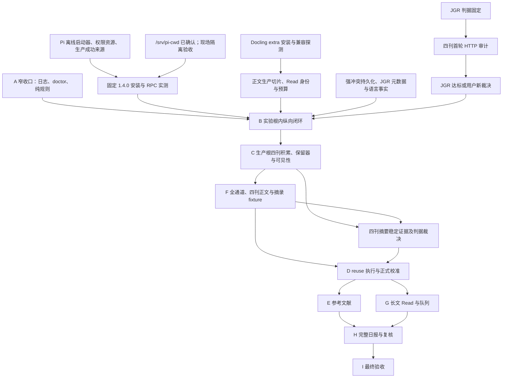

# 文档统一迁移台账（#113）

## 基线与范围

基线：`91e5d02e199f1921ca8afd2b7bdb8f257e6264f3`（开工时 main）。
依据 [Issue #113](https://github.com/MeteoBoy4/PaperRadar/issues/113)。本台账是迁移完成后冻结的记录，不进入 scope 绑定，不作为规范来源。

整理范围：`intent/draft.md`、`README.md`、`GLOSSARY.md`（只检查）、全部 `docs/adr/*.md`、全部 19 份 `docs/contracts/*.md`、`docs/verification/stage-a-closure.md`、`AGENTS.md`、`docs/agents/documentation.md`、`docs/agents/issue-tracker.md` 与新增文档。

原字节不动：`docs/verification/` 中除 `stage-a-closure.md` 外的既有文件；`verification-runs/`、`intent/discussions/`、`intent/review/`、`intent/archived_discussions/`、`examples/`、`fixtures/`、`tests/`、`src/`、`.agents/skills/` 的全部既有文件。scope 文件仅允许实际文档变更所需哈希重绑。

## 迁移单元

以下按源文件与基线位置排序；M 编号保持登记身份，不表示排序。后续整理单元同时保留中间原文，基线删除行由机械检查穷举覆盖。空白新文表示已合并到去处或状态外移；相应条目给出保留依据。

### M123

源：`README.md`，基线位置 3。处置：改写。

去处：[README.md#paperradar](../../README.md#paperradar)。

原文（逐字）：

````text
PaperRadar 是面向单个研究者的论文发现与研读流水线。当前仓库交付了工程入口、
````

新文：

````text
PaperRadar 是面向单个研究者的论文发现与研读流水线。当前仓库提供工程入口、
````

细节核对：现状口吻及责任引用整理；目标重复段合并至所链规格/ADR原规则，历史证据转路线图，数字/条件/否定不变。旧原文完整记录，未改嵌入台账。

### M124

源：`README.md`，基线位置 6。处置：改写。

去处：[README.md#paperradar](../../README.md#paperradar)。

原文（逐字）：

````text
只读漂移检查；另已交付 Profile、模型、主题、三阶段提示词/契约、复用升级参数、正文提取和 Read 配置快照的显式迁移、检查、编译与历史加载。
现已开放四种单文件制品与完整 extraction 集合的不可变内容寻址存储和完整校验回读。
已提供四类来源仲裁、人工字段修正、Feed 登记与发现的本地事实服务和只读 `paper show/trace`；
另已交付 boundary/value 的冻结任务、有限尝试、租约、成功接收、retry 与独立离线验收。
````

新文：

````text
只读漂移检查；另提供 Profile、模型、主题、三阶段提示词/契约、复用升级参数、正文提取和 Read 配置快照的显式迁移、检查、编译与历史加载。
提供四种单文件制品与完整 extraction 集合的不可变内容寻址存储和完整校验回读。
提供四类来源仲裁、人工字段修正、Feed 登记与发现的本地事实服务和只读 `paper show/trace`；
另提供 boundary/value 的冻结任务、有限尝试、租约、成功接收、retry 与独立离线验收。
````

细节核对：现状口吻及责任引用整理；目标重复段合并至所链规格/ADR原规则，历史证据转路线图，数字/条件/否定不变。旧原文完整记录，未改嵌入台账。

### M035

源：`README.md`，基线位置 12。处置：改写。

去处：[docs/contracts/read-validation.md#当前交付与命名](../../docs/contracts/read-validation.md#当前交付与命名)。

原文（逐字）：

````text
#93 已冻结 [Read 权威结构](docs/contracts/read-validation.md)，包含全部 18 个必填字段、
严格独立评分与 Read 自有价值词汇。#94 已交付原始 bytes 与只读可靠文本上下文的
公共校验、逐条数值诊断和带来源的警告视图；#95 已按字段接通受限证据矩阵，
#96 已交付同正文 reduce 允许集合，#97 已交付显式配置准入。
#98 已验证两份历史配置与四份候选原始字节的非空隔离恢复；固定消费上下文由测试
常量重建，范围见 [Read 恢复说明](docs/contracts/read-validation.md#恢复范围98)。
独立 A9 由 #99 推进，离线校验不授予生产 Read 或校准资格。
````

新文：

````text
[Read 权威结构与校验](docs/contracts/read-validation.md)提供全部 18 个必填字段、
严格独立评分与 Read 自有价值词汇，接收原始 bytes 与只读可靠文本上下文，
提供逐条数值诊断、带来源的警告视图、受限证据矩阵及同正文 reduce 允许集合检查，
支持显式配置准入。历史配置与候选原始字节的隔离恢复范围见
[Read 恢复说明](docs/contracts/read-validation.md#恢复范围98)。离线校验不授予生产 Read 或校准资格。
````

细节核对：现在时保留全部可用能力；#93–#99 出处已在 Read Contract 相关和路线图文首记录表。两份配置、四份候选、固定测试上下文的证据边界保留于路线图 Read 恢复证据范围及 Contract 恢复范围。

### M116

源：`README.md`，基线位置 24。处置：改写。

去处：[README.md#paperradar](../../README.md#paperradar)。

原文（逐字）：

````text
A8 已提供 [冻结调用描述与单次 RPC 协议](docs/contracts/pi-rpc.md)：从预算首次历史
语义与本次回执执行审计构造，仅支持 1.4.0 离线协议档案，系统指令与 user 消息分离。
boundary/value 完整候选经既有 A1/A7 同源接收，事件、消息副本、模型和用量有离线
边界证明。生产管道组件只包装已启动的独立进程组；Python 夹具已验证双管道背压、
超时、取消与整组回收。独立字节向量与合成协议测试不运行真实 Pi/模型；非空恢复与
独立 A8 验收仍按[逐项台账](docs/verification/a8-requirements.md)继续。Pi 强制追加的常量 cwd 例外
已由 #111 定为本机 `/srv/pi-cwd`；生产启动器须无默认值显式传入、仅白名单此值，并在任何 prompt live 探测前验证无资源/实际隔离；当前不授予生产执行或校准资格。
````

新文：

````text
提供 [冻结调用描述与单次 RPC 协议](docs/contracts/pi-rpc.md)：从预算首次历史
语义与本次回执执行审计构造，仅支持 1.4.0 离线协议档案，系统指令与 user 消息分离。
boundary/value 完整候选经既有 A1/A7 同源接收，事件、消息副本、模型和用量有离线
边界证明。生产管道组件只包装已启动的独立进程组；Python 夹具已验证双管道背压、
超时、取消与整组回收。独立字节向量与合成协议测试不运行真实 Pi/模型；非空恢复与
独立 A8 的证明范围见[逐项台账](docs/verification/a8-requirements.md)。Pi 强制追加的常量 cwd 例外
已由 #111 定为本机 `/srv/pi-cwd`；生产启动器须无默认值显式传入、仅白名单此值，并在任何 prompt live 探测前验证无资源/实际隔离；当前不授予生产执行或校准资格。
````

细节核对：所有协议/隔离/test边界保留；不把已交付A8说成待继续。

### M150

源：`README.md`，基线位置 463。处置：改写。

去处：[README.md#pi-固定供给](../../README.md#pi-固定供给)。

原文（逐字）：

````text
2026-10-18 用户裁决：本次 A4 接受导出所需的目录句柄、nofollow、硬链接不覆盖发布与 fsync
等安全文件能力边界，能力不足继续安全拒绝。#36 已关闭；
[#46](https://github.com/MeteoBoy4/PaperRadar/issues/46) 已以 NOT_PLANNED 关闭，
Windows 安全导出当前无交付计划，未实现/未验证 Windows 后端。
````

新文：

````text
导出要求目录句柄、nofollow、硬链接不覆盖发布与 fsync 等安全文件能力，能力不足安全拒绝。
当前没有实现或验证 Windows 安全导出后端；历史裁决与计划见[路线图](docs/roadmap.md#已取消)。
````

细节核对：最终审阅修正：仅拆分当前能力/未提供事实与计划责任，所有数值、拒绝与证明边界保留；后续要求由所链既有规格/路线图承接。

### M151

源：`README.md`，基线位置 579。处置：改写。

去处：[README.md#论文事实与-feed-发现的本地查询](../../README.md#论文事实与-feed-发现的本地查询)。

原文（逐字）：

````text
**首次真实 Feed 导入前必须补齐强冲突观察持久化和 parser 升级固定样本/关键字段损失回归（B 先交付 JGR 切片，C 扩展），
此前不得将本地拒绝路径直接作为生产写入。**详见[论文事实 Contract](docs/contracts/paper-facts.md)。
````

新文：

````text
本地拒绝路径不授予生产写入资格；生产前置与承接责任见[路线图 Feed](docs/roadmap.md#module-feed)及[论文事实 Contract](docs/contracts/paper-facts.md)。
````

细节核对：最终审阅修正：仅拆分当前能力/未提供事实与计划责任，所有数值、拒绝与证明边界保留；后续要求由所链既有规格/路线图承接。

### M100

源：`README.md`，基线位置 582。处置：改写。

去处：[README.md#论文事实与-feed-发现的本地查询](../../README.md#论文事实与-feed-发现的本地查询)。

原文（逐字）：

````text
A7 的 D1–D4 裁决和公共任务目标见[Screening 任务 Contract](docs/contracts/screening-tasks.md)
及[A7 规格对照与绑定台账](docs/verification/a7-requirements.md)。#77 已在原权威验证器
收紧重复 JSON 键和非有限常量；#78–#79 已交付任务登记、冻结回放、两次预算和租约，
boundary/value 筛选制品接收与三值适用性由 #80/#81 交付，#82 交付显式 retry、共享版本化查询与父链恢复；#83 补齐新进程隔离完整历史恢复，
#84 将这些能力注册为独立必需 A7 验收组。A7 暂不提供 screening CLI 或 paper trace 组合；原题名语言事实的
生产来源已由 [ADR-0035](docs/adr/0035-feed-derived-original-title-language-fact.md) 固定为首发 Feed 归属映射
（四刊中只有《大气科学》为中文），生产接线仍待 B；B 首张真实任务票同时交付 failures/retry 与 trace 组合，A7 的历史范围不变。
````

新文：

````text
A7 的 D1–D4 裁决和公共任务目标见[Screening 任务 Contract](docs/contracts/screening-tasks.md)
及[A7 规格对照与绑定台账](docs/verification/a7-requirements.md)。#77 已在原权威验证器
收紧重复 JSON 键和非有限常量；提供任务登记、冻结回放、两次预算和租约，
boundary/value 筛选制品接收与三值适用性由公共服务提供，并提供显式 retry、共享版本化查询与父链恢复；支持新进程隔离完整历史恢复，
这些能力纳入独立必需 A7 验收组。A7 暂不提供 screening CLI 或 paper trace 组合；原题名语言事实的
生产来源已由 [ADR-0035](docs/adr/0035-feed-derived-original-title-language-fact.md) 固定为首发 Feed 归属映射
（四刊中只有《大气科学》为中文），生产接线仍待 B；B 首张真实任务票同时交付 failures/retry 与 trace 组合，A7 的历史范围不变。
````

细节核对：去逐票交付时态，任务/预算/租约/两阶段/retry/恢复/验收能力及未提供边界原位保留；原issue出处见任务Contract相关。

### M153

源：`README.md`，基线位置 588。处置：改写。

去处：[README.md#论文事实与-feed-发现的本地查询](../../README.md#论文事实与-feed-发现的本地查询)。

原文（逐字）：

````text
（四刊中只有《大气科学》为中文），生产接线仍待 B；B 首张真实任务票同时交付 failures/retry 与 trace 组合，A7 的历史范围不变。
````

新文：

````text
（四刊中只有《大气科学》为中文），当前不提供生产接线；failures/retry 与 trace 组合的责任见[路线图 B](docs/roadmap.md#module-b)，A7 的历史范围不变。
````

细节核对：最终审阅修正：仅拆分当前能力/未提供事实与计划责任，所有数值、拒绝与证明边界保留；后续要求由所链既有规格/路线图承接。

### M125

源：`README.md`，基线位置 610。处置：改写。

去处：[README.md#screening-任务登记有限尝试与两阶段成功a7-02-至-a7-08](../../README.md#screening-任务登记有限尝试与两阶段成功a7-02-至-a7-08)。

原文（逐字）：

````text
旧回执精确重放不随最新代际改变。独立 A7 结论只证明这些离线任务能力；真实模型执行仍待后续切片。
````

新文：

````text
旧回执精确重放不随最新代际改变。独立 A7 结论只证明这些离线任务能力；当前不提供真实模型执行。
````

细节核对：现状口吻及责任引用整理；目标重复段合并至所链规格/ADR原规则，历史证据转路线图，数字/条件/否定不变。旧原文完整记录，未改嵌入台账。

### M117

源：`README.md`，基线位置 616。处置：改写。

去处：[README.md#screening-任务登记有限尝试与两阶段成功a7-02-至-a7-08](../../README.md#screening-任务登记有限尝试与两阶段成功a7-02-至-a7-08)。

原文（逐字）：

````text
来源取得（#103）：公共服务先冻结计划，再以有界 HTTP/通道接口取得并保存安全执行事实；`paper-radar audit list/show --database ... --json` 只读查询。默认只交付 http，其他通道显示未安装；显式 run 已由 #105 接通，resume/replay 已由 #106 接通；不代表真实来源审计已执行。
````

新文：

````text
来源取得：公共服务先冻结计划，再以有界 HTTP/通道接口取得并保存安全执行事实；`paper-radar audit list/show --database ... --json` 只读查询。默认只提供 http，其他通道显示未安装；提供显式 run 和 resume/replay；不代表真实来源审计已执行。
````

细节核对：只去逐票叙述，HTTP通道与未执行真实审计保持。

### M118

源：`README.md`，基线位置 618。处置：改写。

去处：[README.md#screening-任务登记有限尝试与两阶段成功a7-02-至-a7-08](../../README.md#screening-任务登记有限尝试与两阶段成功a7-02-至-a7-08)。

原文（逐字）：

````text
固定选样（#104）：公共服务按四刊原位次冻结前 N 个显式 journal-article 候选，保留未知/冲突/重复/不足和暂停历史；`audit show` 可只读查看成员依据。显式继续保持原 Feed/位次，摘要成败不影响成员。当前仍未执行四刊 live；摘要矩阵由 #105 交付，显式恢复继续由 #106 交付，完整混合历史恢复由后续票收口。
````

新文：

````text
固定选样：公共服务按四刊原位次冻结前 N 个显式 journal-article 候选，保留未知/冲突/重复/不足和暂停历史；`audit show` 可只读查看成员依据。显式继续保持原 Feed/位次，摘要成败不影响成员。当前仍未执行四刊 live；提供摘要矩阵、显式恢复继续和完整混合历史恢复，范围见[摘要审计 Contract](docs/contracts/fixture-audit.md)。
````

细节核对：固定选样/位次/禁止按结果换样与四刊live未验均保留；混合恢复依据Contract现状。

### M126

源：`README.md`，基线位置 620。处置：改写。

去处：[README.md#screening-任务登记有限尝试与两阶段成功a7-02-至-a7-08](../../README.md#screening-任务登记有限尝试与两阶段成功a7-02-至-a7-08)。

原文（逐字）：

````text
摘要矩阵（#105）：`paper-radar audit run --database DB --data-root ROOT --contact-email EMAIL --count 5 --json` 显式固定选样并执行适用路线；联系邮箱只用于请求标识，不保存。复用选样响应及原取得时间，题名/摘要分别调用 A6 仲裁；普通 show 只输出哈希、定位、截断信号及真实分母。原摘要通过显式服务 `read_audit_text` 读取。http 与未安装的适用渲染通道分列，official_api/repository 无适用目标；doiRA 不进入摘要命中分母。complete 只表示终态齐备，即使不足样本也不表示长期稳定或生产就绪。本票验证离线子集和基本恢复；完整门禁留 #108，不执行 live。
````

新文：

````text
摘要矩阵（#105）：`paper-radar audit run --database DB --data-root ROOT --contact-email EMAIL --count 5 --json` 显式固定选样并执行适用路线；联系邮箱只用于请求标识，不保存。复用选样响应及原取得时间，题名/摘要分别调用 A6 仲裁；普通 show 只输出哈希、定位、截断信号及真实分母。原摘要通过显式服务 `read_audit_text` 读取。http 与未安装的适用渲染通道分列，official_api/repository 无适用目标；doiRA 不进入摘要命中分母。complete 只表示终态齐备，即使不足样本也不表示长期稳定或生产就绪。此工程验证覆盖离线子集和基本恢复；完整门禁范围见[A10 台账](docs/verification/a10-requirements.md)，不证明 live。
````

细节核对：现状口吻及责任引用整理；目标重复段合并至所链规格/ADR原规则，历史证据转路线图，数字/条件/否定不变。旧原文完整记录，未改嵌入台账。

### M127

源：`README.md`，基线位置 633。处置：改写。

去处：[README.md#screening-任务登记有限尝试与两阶段成功a7-02-至-a7-08](../../README.md#screening-任务登记有限尝试与两阶段成功a7-02-至-a7-08)。

原文（逐字）：

````text
PDF/Docling/生产导入/NAS 与完整阶段 A 均待后续。未来合法获取方式按新策略另行交付。
````

新文：

````text
PDF/Docling/生产导入/NAS 与完整阶段 A 均未验证；承接见[路线图](docs/roadmap.md#模块承接索引)。
````

细节核对：现状口吻及责任引用整理；目标重复段合并至所链规格/ADR原规则，历史证据转路线图，数字/条件/否定不变。旧原文完整记录，未改嵌入台账。

### M013

源：`README.md`，基线位置 637。处置：合并。

去处：[docs/roadmap.md#阶段-a-收口与-b-前置111目标规格](../../docs/roadmap.md#阶段-a-收口与-b-前置111目标规格)。

原文（逐字）：

````text
## 阶段 A 收口与 B 前置（#111，目标规格）

[主方案 §11](intent/draft.md#十一九阶段实施与验收) 是统一阅读入口，与 GLOSSARY、ADR、
Contract 共同约束；[A 收口清单](docs/verification/stage-a-closure.md) 逐项区分历史离线证据与
剩余责任，A1–A10 通过不等于完整 A 通过。

B 按 [ADR-0036](docs/adr/0036-isolate-stage-b-read-experiment.md) 在独立实验数据根完成
固定 JGR 纵向链，结果不复用、不提升，暴露清单由 C 跨库导入排除正式校准。四刊先做首轮
摘要审计；JGR 至少 5 篇固定成员、各有已交付路线取得非疑似截断主摘要方可继续 B，其他刊
在 C/F 补跑，最迟 D 正式预热冻结/首个批次前逐刊收口。B 的 PDF 最低路径为人工合法附加，
TDM/授权/渲染留 F，单篇质量不豁免。真实冻结材料留本机，CI 仅用合成/脱敏材料。

A 窄收口负责日志、基础/配置 doctor 与 eligibility/visibility 纯规则；B 前置交付
Docling extra 兼容验证、首次 Pi 1.4.0 供给/生产接收、Feed/语言事实、正文与 Read 身份/预算。
安装探测与离线工程可并行，首次真实消费须先满足相应入口。以上均未因本文更新而交付或验收，
A4 1.3.0 历史材料、A2 示例和历史结论保持不变；未来 Pi 升级仍走 §7.8。

````

新文：

````text
V1 目标与判据见[规格](intent/draft.md)，当前前沿、阶段状态与后续责任见[路线图](docs/roadmap.md)。

````

细节核对：使用说明不变。状态与并行安排在路线图保留，规范内容合并至既有等价正文：规格 §11 B 的入口条件、实验数据根、最低 PDF 路径与本机材料要求，以及 ADR-0036 的“B 整条 Feed→Screening→人工决定→PDF→正文→Read→最小日报都在显式实验数据根内”“旧实验结果只作历史回查，不复用、不提升、不提供提升入口”“JGR 入口判据在审计前固定为 selected 至少 5 篇”“最迟 D 正式预热冻结/首个校准批次前四刊逐刊证明稳定”“普通离线测试仅用合成或脱敏材料”；未来升级保留规格 §7.8。数字、条件、否定与责任无变化，路线图通过链接引用，不复述目标规则。

### M152

源：`README.md`，基线位置 对应原小节的后续整理。处置：改写。

去处：[README.md#论文事实与-feed-发现的本地查询](../../README.md#论文事实与-feed-发现的本地查询)。

原文（逐字）：

````text
及[A7 规格对照与绑定台账](docs/verification/a7-requirements.md)。#77 已在原权威验证器
收紧重复 JSON 键和非有限常量；提供任务登记、冻结回放、两次预算和租约，
````

新文：

````text
及[A7 规格对照与绑定台账](docs/verification/a7-requirements.md)。原权威验证器
拒绝重复 JSON 键和非有限常量；提供任务登记、冻结回放、两次预算和租约，
````

细节核对：最终审阅修正：仅拆分当前能力/未提供事实与计划责任，所有数值、拒绝与证明边界保留；后续要求由所链既有规格/路线图承接。

### M119

源：`docs/adr/0023-separate-runtime-config-snapshots-from-calibration-baselines.md`，基线位置 9。处置：改写。

去处：[docs/adr/0023-separate-runtime-config-snapshots-from-calibration-baselines.md#区分运行配置快照阶段输入指纹和校准语义基线](../../docs/adr/0023-separate-runtime-config-snapshots-from-calibration-baselines.md#区分运行配置快照阶段输入指纹和校准语义基线)。

原文（逐字）：

````text
2026-10-11 补充（[ADR-0026](0026-control-pi-through-a-bounded-rpc-adapter.md)）：版本化的适配器语义进入相关配置投影，Screening/reuse 所用部分进入校准语义基线；纯 Read 部分只进入 Read 投影，共有行为按实际受影响阶段判断。Pi/adapter 版本与资源哈希保留执行审计依据，进程、临时会话与机器路径不进入语义投影。本次只更新目标规格，不改既有配置编译 Contract、不可变快照或版本材料；配置映射与必要持久化变更留待后续实现票。
````

新文：

````text
2026-10-11 补充（[ADR-0026](0026-control-pi-through-a-bounded-rpc-adapter.md)）：版本化的适配器语义进入相关配置投影，Screening/reuse 所用部分进入校准语义基线；纯 Read 部分只进入 Read 投影，共有行为按实际受影响阶段判断。Pi/adapter 版本与资源哈希保留执行审计依据，进程、临时会话与机器路径不进入语义投影。配置映射与持久化的现状见[配置 Contract](../contracts/config-projections.md)，承接责任见[路线图](../roadmap.md#module-b)。
````

细节核对：只外移当次未实现状态；同段语义投影、Read隔离、审计身份裁决逐字保留。历史配置实现状态见路线图A2。

### M120

源：`docs/adr/0026-control-pi-through-a-bounded-rpc-adapter.md`，基线位置 13。处置：改写。

去处：[docs/adr/0026-control-pi-through-a-bounded-rpc-adapter.md#通过有界-rpc-适配器控制-pi保留-paperradar-的接收权威](../../docs/adr/0026-control-pi-through-a-bounded-rpc-adapter.md#通过有界-rpc-适配器控制-pi保留-paperradar-的接收权威)。

原文（逐字）：

````text
本 ADR 记录目标架构，本次只更新文档；现有代码、版本化配置、快照与 Frozen Contract 不被改写。Pi 配置映射、权限约束、生产 Read 权威 Schema/验证器、恢复幂等与 fixtures 仍需在后续实现票中验收。研究临时 Read Schema 和已暴露样本不能冒充生产契约或正式盲评；正式采集时登记样本排除。可行性实测证明了接入方式，不证明生产质量、校准通过或自动精读资格。
````

新文：

````text
Pi 配置映射、权限约束、Read 权威 Schema/验证器、恢复幂等与 fixtures 的现状及承接见[路线图](../roadmap.md#模块承接索引)。研究临时 Read Schema 和已暴露样本不能冒充生产契约或正式盲评；正式采集时登记样本排除。可行性实测证明了接入方式，不证明生产质量、校准通过或自动精读资格。
````

细节核对：保留临时Schema/暴露样本不冒充生产或盲评、正式采集排除和可行性不证明质量等全部原决策；当次只文档状态已在路线图2026-10-11记录。

### M121

源：`docs/adr/0026-control-pi-through-a-bounded-rpc-adapter.md`，基线位置 27。处置：改写。

去处：[docs/adr/0026-control-pi-through-a-bounded-rpc-adapter.md#通过有界-rpc-适配器控制-pi保留-paperradar-的接收权威](../../docs/adr/0026-control-pi-through-a-bounded-rpc-adapter.md#通过有界-rpc-适配器控制-pi保留-paperradar-的接收权威)。

原文（逐字）：

````text
2026-10-18 补充（供给与升级决策，[主方案 §7.8](../../intent/draft.md)）：用户裁决每次 Pi 升级都必须新建适配器声明版本并重新登记，不允许以“仅审计版本”复用原语义材料原地改写 `pi_version`；V1 不承诺脱网重建执行环境，也不交付预存 npm/Node 制品；`pi_version` 保持严格三段正式版本，不支持预发布或四段版本；保留当前与最近三个旧安装，清理只能由用户先出计划再执行，且不删除当前、在途引用与最近验收通过的版本；每份供给清单必须记录升级的行为影响判定、依据与证据引用，后两者按“可能影响”处理。这些决策不改变“锁定版本不构成兼容性证明”，也不把安装树、`supply_id` 或审计版本提升为阶段语义；供给命令、安装器、清理与验收仍待后续实现。
````

新文：

````text
2026-10-18 补充（供给与升级决策，[主方案 §7.8](../../intent/draft.md)）：用户裁决每次 Pi 升级都必须新建适配器声明版本并重新登记，不允许以“仅审计版本”复用原语义材料原地改写 `pi_version`；V1 不承诺脱网重建执行环境，也不交付预存 npm/Node 制品；`pi_version` 保持严格三段正式版本，不支持预发布或四段版本；保留当前与最近三个旧安装，清理只能由用户先出计划再执行，且不删除当前、在途引用与最近验收通过的版本；每份供给清单必须记录升级的行为影响判定、依据与证据引用，后两者按“可能影响”处理。这些决策不改变“锁定版本不构成兼容性证明”，也不把安装树、`supply_id` 或审计版本提升为阶段语义；供给实现范围及未验责任见[路线图](../roadmap.md#module-live)。
````

细节核对：D1-D5补充裁决原文完整保留，仅移出当时待实现状态；当前供给工程已完成不等于生产兼容已验。

### M105

源：`docs/adr/0030-paper-version-identity-and-source-observations.md`，基线位置 3。处置：改写。

去处：[docs/adr/0030-paper-version-identity-and-source-observations.md#论文版本身份与来源观察仲裁](../../docs/adr/0030-paper-version-identity-and-source-observations.md#论文版本身份与来源观察仲裁)。

原文（逐字）：

````text
状态：已接受语义；#69–#74 已落地身份、Feed、四源仲裁、版本关系、输入映射及组合隔离恢复，#75 注册独立 A6 验收。依 [#67](https://github.com/MeteoBoy4/PaperRadar/issues/67) 用户 D1–D4 与 N1/N2 裁决，DOI 与版本一对一，Feed 回摆仅推进 last_seen，强身份冲突整笔拒绝业务事实，关系冲突保留观察/关系并等待合并。具体目标边界以 [论文事实 Contract](../contracts/paper-facts.md) 为准。
````

新文：

````text
状态：已接受语义；日期：原文未单列；依据：[基线裁决原文](https://github.com/MeteoBoy4/PaperRadar/blob/91e5d02e199f1921ca8afd2b7bdb8f257e6264f3/docs/adr/0030-paper-version-identity-and-source-observations.md)；补充／部分取代：[ADR-0036](0036-isolate-stage-b-read-experiment.md)。

原状态与裁决依据：已接受语义。依 [#67](https://github.com/MeteoBoy4/PaperRadar/issues/67) 用户 D1–D4 与 N1/N2 裁决，DOI 与版本一对一，Feed 回摆仅推进 last_seen，强身份冲突整笔拒绝业务事实，关系冲突保留观察/关系并等待合并。具体目标边界以 [论文事实 Contract](../contracts/paper-facts.md) 为准。
````

细节核对：统一状态索引；原状态行全部信息原样保留为原状态与裁决依据，不从实现日期推定接受日期。新增基线出处与已存在的补充关系反向指针。 #69–#75状态见路线图A6及文首状态索引。

### M122

源：`docs/adr/0030-paper-version-identity-and-source-observations.md`，基线位置 68。处置：改写。

去处：[docs/adr/0030-paper-version-identity-and-source-observations.md#论文版本身份与来源观察仲裁](../../docs/adr/0030-paper-version-identity-and-source-observations.md#论文版本身份与来源观察仲裁)。

原文（逐字）：

````text
本票没有真实 Feed 或解析器；阶段 C 强冲突观察持久化与 parser 升级固定样本回归仍是硬门禁。
````

新文：

````text
真实 Feed 或解析器的生产接线状态见[路线图](../roadmap.md#module-feed)；阶段 C 强冲突观察持久化与 parser 升级固定样本回归仍是硬门禁。
````

细节核对：去本票指代，真实来源未验已在路线图，原阶段C门禁及较新#111前移解释都保留，冲突不另裁决。

### M042

源：`docs/adr/0031-screening-budget-and-derived-applicability.md`，基线位置 3。处置：改写。

去处：[docs/adr/0031-screening-budget-and-derived-applicability.md#以-paper-阶段输入承载预算并派生筛选制品当前适用性](../../docs/adr/0031-screening-budget-and-derived-applicability.md#以-paper-阶段输入承载预算并派生筛选制品当前适用性)。

原文（逐字）：

````text
状态：已接受；依据 [#76 用户 D1–D4 裁决](https://github.com/MeteoBoy4/PaperRadar/issues/76#issuecomment-6356409213)，任务运行能力已由 #78–#83 实现，#84 登记独立离线验收与可信终态。预算与筛选制品的主体固定为同库 `(paper_id, stage, fingerprint)`，不同 Paper 不共享业务结果或次数，日期、版本 ID、请求来源、代际与配置标签都不进入 A5 语义载荷。这样输入回摆会回到既有预算；代价是将来论文合并必须另外决定预算合并，不能直接跨 Paper 复用。
````

新文：

````text
状态：已接受；依据 [#76 用户 D1–D4 裁决](https://github.com/MeteoBoy4/PaperRadar/issues/76#issuecomment-6356409213)；日期：原记录未单列；补充：[ADR-0035](0035-feed-derived-original-title-language-fact.md)（2026-10-27 原题名语言生产来源）。

预算与筛选制品的主体固定为同库 `(paper_id, stage, fingerprint)`，不同 Paper 不共享业务结果或次数，日期、版本 ID、请求来源、代际与配置标签都不进入 A5 语义载荷。这样输入回摆会回到既有预算；代价是将来论文合并必须另外决定预算合并，不能直接跨 Paper 复用。
````

细节核对：原状态、依据链接与预算决策完整保留；未虚构接受日期；#78–#84交付状态已在路线图历史记录中。增加ADR-0035反向指针。

### M106

源：`docs/adr/0031-screening-budget-and-derived-applicability.md`，基线位置 3。处置：改写。

去处：[docs/adr/0031-screening-budget-and-derived-applicability.md#以-paper-阶段输入承载预算并派生筛选制品当前适用性](../../docs/adr/0031-screening-budget-and-derived-applicability.md#以-paper-阶段输入承载预算并派生筛选制品当前适用性)。

原文（逐字）：

````text
状态：已接受；依据 [#76 用户 D1–D4 裁决](https://github.com/MeteoBoy4/PaperRadar/issues/76#issuecomment-6356409213)；日期：原记录未单列；补充：[ADR-0035](0035-feed-derived-original-title-language-fact.md)（2026-10-27 原题名语言生产来源）。
````

新文：

````text
状态：已接受；日期：原记录未单列；依据：[基线裁决原文](https://github.com/MeteoBoy4/PaperRadar/blob/91e5d02e199f1921ca8afd2b7bdb8f257e6264f3/docs/adr/0031-screening-budget-and-derived-applicability.md)；补充／部分取代：[ADR-0035](0035-feed-derived-original-title-language-fact.md)。

原状态与裁决依据：已接受；依据 [#76 用户 D1–D4 裁决](https://github.com/MeteoBoy4/PaperRadar/issues/76#issuecomment-6356409213)；日期：原记录未单列；补充：[ADR-0035](0035-feed-derived-original-title-language-fact.md)（2026-10-27 原题名语言生产来源）。
````

细节核对：统一状态索引；原状态行全部信息原样保留为原状态与裁决依据，不从实现日期推定接受日期。新增基线出处与已存在的补充关系反向指针。

### M046

源：`docs/adr/0031-screening-budget-and-derived-applicability.md`，基线位置 7。处置：改写。

去处：[docs/adr/0031-screening-budget-and-derived-applicability.md#以-paper-阶段输入承载预算并派生筛选制品当前适用性](../../docs/adr/0031-screening-budget-and-derived-applicability.md#以-paper-阶段输入承载预算并派生筛选制品当前适用性)。

原文（逐字）：

````text
D1 将原题名语言严格 bool 冻结于预算范围，不进 A5 指纹，retry 继承且不能更正；代价是误标暂无法纠正，真实 value 任务前必须另行裁决生产来源（已于 2026-10-27 裁决为首发 Feed 归属，见 [ADR-0035](0035-feed-derived-original-title-language-fact.md) 与文末补记）。D3 在原权威验证器拒绝任意层重复键及非有限 JSON 常量，保持单一 Schema 和业务接收权威。D4 推迟 CLI 和 paper trace 组合，交付服务层查询/retry，使未来生产调度决定实际产品交互。具体规则与仍未交付的生产边界见[任务 Contract](../contracts/screening-tasks.md)。
````

新文：

````text
D1 将原题名语言严格 bool 冻结于预算范围，不进 A5 指纹，retry 继承且不能更正；代价是误标暂无法纠正，真实 value 任务前必须另行裁决生产来源（已于 2026-10-27 裁决为首发 Feed 归属，见 [ADR-0035](0035-feed-derived-original-title-language-fact.md) 及状态行补充关系）。D3 在原权威验证器拒绝任意层重复键及非有限 JSON 常量，保持单一 Schema 和业务接收权威。D4 推迟 CLI 和 paper trace 组合，交付服务层查询/retry，使未来生产调度决定实际产品交互。具体规则与仍未交付的生产边界见[任务 Contract](../contracts/screening-tasks.md)。
````

细节核对：仅修正文末补记指代；D1/D3/D4原文不变。

### M043

源：`docs/adr/0031-screening-budget-and-derived-applicability.md`，基线位置 9。处置：改写。

去处：[docs/adr/0031-screening-budget-and-derived-applicability.md#补充裁决](../../docs/adr/0031-screening-budget-and-derived-applicability.md#补充裁决)。

原文（逐字）：

````text
2026-10-23：#80 实现 boundary 成功接收。派生映射复用 PaperFacts 独立只读一致视图，允许相对任务事实读取滞后；登记时命中引用持久化于请求，旧回执不被后续成功改写。成功发布与业务写事务分开，竞争失败允许完整未引用响应，生产消费者必须拒绝 test 来源。
````

新文：

````text
## 补充裁决

依据：[#80](https://github.com/MeteoBoy4/PaperRadar/issues/80)，2026-10-23。

派生映射复用 PaperFacts 独立只读一致视图，允许相对任务事实读取滞后；登记时命中引用持久化于请求，旧回执不被后续成功改写。成功发布与业务写事务分开，竞争失败允许完整未引用响应，生产消费者必须拒绝 test 来源。
````

细节核对：只去掉boundary交付句并将出处移到补充裁决依据；只读一致视图、滞后、旧回执、事务分离、竞争未引用响应及生产拒绝test来源均逐字保留；交付事实在路线图#80记录。

### M044

源：`docs/adr/0031-screening-budget-and-derived-applicability.md`，基线位置 11。处置：改写。

去处：[docs/adr/0031-screening-budget-and-derived-applicability.md#补充裁决](../../docs/adr/0031-screening-budget-and-derived-applicability.md#补充裁决)。

原文（逐字）：

````text
2026-10-23：#81 将相同成功提交和派生适用性扩展至 value。接收与恢复都从预算首次历史 snapshot 经 A5 严格回放及投影核对、value_prediction_context 到 A1 权威验证，不以当前主题或新请求配置替换。没有新增表、语言检测或两阶段编排；语言误标的限制仍按 D1 保留。
````

新文：

````text
依据：[#81](https://github.com/MeteoBoy4/PaperRadar/issues/81)，2026-10-23。

接收与恢复都从预算首次历史 snapshot 经 A5 严格回放及投影核对、value_prediction_context 到 A1 权威验证，不以当前主题或新请求配置替换。没有新增表、语言检测或两阶段编排；语言误标的限制仍按 D1 保留。
````

细节核对：只将value交付句外移至路线图#81记录；A5回放、投影、value_prediction_context、A1权威、旧配置与D1约束逐字保留。

### M045

源：`docs/adr/0031-screening-budget-and-derived-applicability.md`，基线位置 14。处置：改写。

去处：[docs/adr/0031-screening-budget-and-derived-applicability.md#补充裁决](../../docs/adr/0031-screening-budget-and-derived-applicability.md#补充裁决)。

原文（逐字）：

````text
2026-10-23：#82/#83 完成唯一 retry 父链、版本化安全查询及非空完整历史隔离恢复；
#84 以独立必需 A7 组绑定同次 A1、完整 A2、A3、A5、A6，A4 仍决定总门禁。
结论登记与 `.a7.json` 格式 1 的状态支持同提交交付，以固定源码/材料/分母、真实
pytest 回执和同次身份防止遗漏或历史成功补位。任务查询/原因格式单独固定，不扩大
四份 Frozen Contract；scope 不自绑定，最终运行标识保存在工作树外以免自哈希循环。
离线 test 来源的工程证明不能代替真实 RPC、语言事实的生产接线、完整资格、生产筛选或校准。
````

新文：

````text
依据：[#82](https://github.com/MeteoBoy4/PaperRadar/issues/82)、[#83](https://github.com/MeteoBoy4/PaperRadar/issues/83)、[#84](https://github.com/MeteoBoy4/PaperRadar/issues/84)，2026-10-23。

结论登记与 `.a7.json` 格式 1 的状态支持采用同提交绑定，以固定源码/材料/分母、真实
pytest 回执和同次身份防止遗漏或历史成功补位。任务查询/原因格式单独固定，不扩大
四份 Frozen Contract；scope 不自绑定，最终运行标识保存在工作树外以免自哈希循环。
离线 test 来源的工程证明不能代替真实 RPC、语言事实的生产接线、完整资格、生产筛选或校准。
````

细节核对：独立A7交付及依赖移路线图；固定源码/材料/分母、真实回执、同次身份、Frozen Contract边界、scope不自绑定与非live证明约束保留。仅同提交交付改为同提交绑定。

### M047

源：`docs/adr/0031-screening-budget-and-derived-applicability.md`，基线位置 21。处置：改写。

去处：[docs/adr/0035-feed-derived-original-title-language-fact.md#决策](../../docs/adr/0035-feed-derived-original-title-language-fact.md#决策)。

原文（逐字）：

````text
2026-10-27：原题名语言事实的生产来源已按用户裁决固定为首发 Feed 归属映射 v1（只有《大气科学》
为中文），见 [ADR-0035](0035-feed-derived-original-title-language-fact.md)。D1 的冻结、retry 不可更正、
不进 A5 指纹均不变；仍然未交付的是从 Feed 归属自动派生、策略版本持久化和任务登记集成。
````

新文：

````text
生产来源决策及 D1 不变边界见状态行所链 ADR-0035；从 Feed 归属自动派生、策略版本持久化和任务登记集成的承接责任见[路线图 Feed](../roadmap.md#module-feed)。
````

细节核对：重复决策合并至ADR-0035：原文“D1 留下的「生产来源」缺口，不改变其冻结于预算范围、retry 不可更正、不进入 A5 载荷或阶段指纹的结论。”及“从 Feed 归属自动派生、策略版本持久化与任务登记集成由后续生产接线票交付。”；未交付状态已在路线图2026-10-27记录。

### M107

源：`docs/adr/0035-feed-derived-original-title-language-fact.md`，基线位置 3。处置：改写。

去处：[docs/adr/0035-feed-derived-original-title-language-fact.md#按首发-feed-归属派生原题名语言事实](../../docs/adr/0035-feed-derived-original-title-language-fact.md#按首发-feed-归属派生原题名语言事实)。

原文（逐字）：

````text
状态：已接受；依据用户 2026-10-27 裁决。本记录补上 [ADR-0031](0031-screening-budget-and-derived-applicability.md)
D1 留下的「生产来源」缺口，不改变其冻结于预算范围、retry 不可更正、不进入 A5 载荷或阶段指纹的结论。
````

新文：

````text
状态：已接受；日期：2026-10-27；依据：[基线裁决原文](https://github.com/MeteoBoy4/PaperRadar/blob/91e5d02e199f1921ca8afd2b7bdb8f257e6264f3/docs/adr/0035-feed-derived-original-title-language-fact.md)；补充／部分取代：无另列关系；正文边界继续适用。

原状态与裁决依据：已接受；依据用户 2026-10-27 裁决。本记录补上 [ADR-0031](0031-screening-budget-and-derived-applicability.md)
D1 留下的「生产来源」缺口，不改变其冻结于预算范围、retry 不可更正、不进入 A5 载荷或阶段指纹的结论。
````

细节核对：统一状态索引；原状态行全部信息原样保留为原状态与裁决依据，不从实现日期推定接受日期。新增基线出处与已存在的补充关系反向指针。

### M108

源：`docs/adr/0036-isolate-stage-b-read-experiment.md`，基线位置 3。处置：改写。

去处：[docs/adr/0036-isolate-stage-b-read-experiment.md#将-b-的真实纵向实验隔离在独立数据根](../../docs/adr/0036-isolate-stage-b-read-experiment.md#将-b-的真实纵向实验隔离在独立数据根)。

原文（逐字）：

````text
状态：已接受，2026-10-28。依据 [#111 Further Notes 与全部后续确认](https://github.com/MeteoBoy4/PaperRadar/issues/111)：允许固定 JGR 样本在四刊正文 fixture 完成前做受限 Read，选择独立实验数据根，结果不复用、不提升。此举提前验证真实接口，同时保持 A7 的同库预算身份与正式校准边界；代价是 C 必须导入跨库暴露排除清单，生产日后处理同论文要从头执行。
````

新文：

````text
状态：已接受；日期：2026-10-28；依据：[基线裁决原文](https://github.com/MeteoBoy4/PaperRadar/blob/91e5d02e199f1921ca8afd2b7bdb8f257e6264f3/docs/adr/0036-isolate-stage-b-read-experiment.md)；补充／部分取代：无另列关系；正文边界继续适用。

原状态与裁决依据：已接受，2026-10-28。依据 [#111 Further Notes 与全部后续确认](https://github.com/MeteoBoy4/PaperRadar/issues/111)：允许固定 JGR 样本在四刊正文 fixture 完成前做受限 Read，选择独立实验数据根，结果不复用、不提升。此举提前验证真实接口，同时保持 A7 的同库预算身份与正式校准边界；代价是 C 必须导入跨库暴露排除清单，生产日后处理同论文要从头执行。
````

细节核对：统一状态索引；原状态行全部信息原样保留为原状态与裁决依据，不从实现日期推定接受日期。新增基线出处与已存在的补充关系反向指针。

### M012

源：`docs/adr/0036-isolate-stage-b-read-experiment.md`，基线位置 34。处置：改写。

去处：[docs/adr/0036-isolate-stage-b-read-experiment.md#未豁免条件与证明边界](../../docs/adr/0036-isolate-stage-b-read-experiment.md#未豁免条件与证明边界)。

原文（逐字）：

````text
证明范围只覆盖冻结样本与纵向链，不证明四刊正文质量、通用 Docling、正常生产 Read、校准或完整阶段 A。本次仅记录规范，未实现以上能力；阶段责任与历史证据见 [A 收口清单](../verification/stage-a-closure.md)。
````

新文：

````text
证明范围只覆盖冻结样本与纵向链，不证明四刊正文质量、通用 Docling、正常生产 Read、校准或完整阶段 A。阶段责任与历史证据见[路线图](../roadmap.md#module-b)。
````

细节核对：证明范围逐字原位保留；仅规范、未实现的状态见路线图 B 未成形及下方 #111 记录。阶段 A 收口证据由路线图继续链接。

### M033

源：`docs/contracts/adapter-config.md`，基线位置 4。处置：改写。

去处：[docs/contracts/adapter-config.md#pi-rpc-适配器配置](../../docs/contracts/adapter-config.md#pi-rpc-适配器配置)。

原文（逐字）：

````text
本票只登记配置事实，不安装 Pi/Node、不执行 RPC、不检查凭据或 provider 参数
````

新文：

````text
此配置边界只登记配置事实，不安装 Pi/Node、不执行 RPC、不检查凭据或 provider 参数
````

细节核对：仅将本票改为此配置边界；否定与能力范围不变。

### M058

源：`docs/contracts/artifact-store.md`，基线位置 4。处置：改写。

去处：[docs/contracts/artifact-store.md#不可变制品存储-contract-v1](../../docs/contracts/artifact-store.md#不可变制品存储-contract-v1)。

原文（逐字）：

````text
现已完成四种单文件制品与完整 extraction 多文件发布；自包含备份与隔离恢复也已交付，
````

新文：

````text
提供四种单文件制品与完整 extraction 多文件发布；也提供自包含备份与隔离恢复，
````

细节核对：仅将逐票交付口吻改为现状/职责；技术标识、数值、条件及否定保留。原issue出处见相关依据；嵌入表格原字节不变。

### M059

源：`docs/contracts/artifact-store.md`，基线位置 32。处置：改写。

去处：[docs/contracts/artifact-store.md#身份字段与固定词表](../../docs/contracts/artifact-store.md#身份字段与固定词表)。

原文（逐字）：

````text
A7-04 boundary 接收是 model_success_response 的首个业务消费者：唯一 payload 逐字
````

新文：

````text
boundary 接收消费 model_success_response：唯一 payload 逐字
````

细节核对：仅将逐票交付口吻改为现状/职责；技术标识、数值、条件及否定保留。原issue出处见相关依据；嵌入表格原字节不变。

### M060

源：`docs/contracts/artifact-store.md`，基线位置 40。处置：改写。

去处：[docs/contracts/artifact-store.md#身份字段与固定词表](../../docs/contracts/artifact-store.md#身份字段与固定词表)。

原文（逐字）：

````text
强制，不使用需要重建表才能演进的 DB CHECK 枚举。A3 本身不建立论文表、backup_runs 或自由业务 JSON 桶；#69 已实现的独立论文事实表与来源关联见[论文事实 Contract](paper-facts.md)。
````

新文：

````text
强制，不使用需要重建表才能演进的 DB CHECK 枚举。A3 本身不建立论文表、backup_runs 或自由业务 JSON 桶；独立论文事实表与来源关联见[论文事实 Contract](paper-facts.md)。
````

细节核对：仅将逐票交付口吻改为现状/职责；技术标识、数值、条件及否定保留。原issue出处见相关依据；嵌入表格原字节不变。

### M146

源：`docs/contracts/artifact-store.md`，基线位置 同节（本轮继续整理）。处置：改写。

去处：[docs/contracts/artifact-store.md#相关](../../docs/contracts/artifact-store.md#相关)。

原文（逐字）：

````text
[规格](../../intent/draft.md#任务阅读导航)；[ADR](../adr/)；[路线图模块与承接责任](../roadmap.md#模块承接索引)。
````

新文：

````text
[规格](../../intent/draft.md#六制品与目录契约)；[ADR-0027](../adr/0027-address-artifacts-by-content.md)；[路线图承接](../roadmap.md#module-body)。
````

细节核对：现状口吻及责任引用整理；目标重复段合并至所链规格/ADR原规则，历史证据转路线图，数字/条件/否定不变。旧原文完整记录，未改嵌入台账。

### M143

源：`docs/contracts/backup-restore.md`，基线位置 309。处置：改写。

去处：[docs/contracts/backup-restore.md#a7-03-尝试租约与失败闭包](../../docs/contracts/backup-restore.md#a7-03-尝试租约与失败闭包)。

原文（逐字）：

````text
完整成功/retry 跨域隔离恢复见 A7-07；真实模型、RPC、NAS 与 live 行为仍待后续验收。
````

新文：

````text
完整成功/retry 跨域隔离恢复见 A7-07；真实模型、RPC、NAS 与 live 行为未验收；承接见[路线图](../roadmap.md#模块承接索引)。
````

细节核对：现状口吻及责任引用整理；目标重复段合并至所链规格/ADR原规则，历史证据转路线图，数字/条件/否定不变。旧原文完整记录，未改嵌入台账。

### M154

源：`docs/contracts/backup-restore.md`，基线位置 355。处置：改写。

去处：[docs/contracts/backup-restore.md#a10-fixture-登记闭包](../../docs/contracts/backup-restore.md#a10-fixture-登记闭包)。

原文（逐字）：

````text
备份固定副本只读调用 FixtureAudit.validate_all，校验不可变声明原字节、解释与显式替换历史；恢复不读原声明或远端 URL。取得字节继续使用 ArtifactStore，当前 #101–#103 已接入声明、PDF 与来源取得闭包，后续票继续扩展成员、矩阵与恢复继续历史。共享 source_snapshot 的清理必须同时纳入论文与审计引用。
````

新文：

````text
备份固定副本只读调用 FixtureAudit.validate_all，校验不可变声明原字节、解释与显式替换历史；恢复不读原声明或远端 URL。取得字节继续使用 ArtifactStore，闭包包括声明、PDF、来源取得、成员、矩阵与恢复继续历史。共享 source_snapshot 的清理必须同时纳入论文与审计引用。
````

细节核对：最终审阅修正：仅拆分当前能力/未提供事实与计划责任，所有数值、拒绝与证明边界保留；后续要求由所链既有规格/路线图承接。

### M061

源：`docs/contracts/config-projections.md`，基线位置 14。处置：改写。

去处：[docs/contracts/config-projections.md#公共边界](../../docs/contracts/config-projections.md#公共边界)。

原文（逐字）：

````text
`config/service.py` 组织，CLI 只渲染受控结果。后续校准、诊断与阶段输入指纹可以直接
复用单快照能力，无需调用 diff 或读取数据库；本票不新增单快照 CLI。
````

新文：

````text
`config/service.py` 组织，CLI 只渲染受控结果。校准、诊断与阶段输入指纹消费者可以直接
复用单快照能力，无需调用 diff 或读取数据库；不提供单快照 CLI。
````

细节核对：仅将逐票交付口吻改为现状/职责；技术标识、数值、条件及否定保留。原issue出处见相关依据；嵌入表格原字节不变。

### M062

源：`docs/contracts/config-projections.md`，基线位置 146。处置：改写。

去处：[docs/contracts/config-projections.md#diff-结果与-cli](../../docs/contracts/config-projections.md#diff-结果与-cli)。

原文（逐字）：

````text
#23 原始接口只接受两个完整 64 位小写十六进制 ID，必填数据库路径。
#27 新增 `config snapshots list` 和 CLI 的唯一短前缀输入；便捷查询服务先解析为完整 ID，
````

新文：

````text
公共 diff 接口只接受两个完整 64 位小写十六进制 ID，必填数据库路径。
CLI 提供 `config snapshots list` 和 CLI 的唯一短前缀输入；便捷查询服务先解析为完整 ID，
````

细节核对：仅将逐票交付口吻改为现状/职责；技术标识、数值、条件及否定保留。原issue出处见相关依据；嵌入表格原字节不变。

### M034

源：`docs/contracts/config-projections.md`，基线位置 159。处置：改写。

去处：[docs/contracts/config-projections.md#diff-结果与-cli](../../docs/contracts/config-projections.md#diff-结果与-cli)。

原文（逐字）：

````text
保存快照不是启用；完整校准变更审计、minor/major 分级、门禁与自动运行由后续流程接入。
````

新文：

````text
保存快照不是启用；本边界不提供完整校准变更审计、minor/major 分级、门禁与自动运行，校准审计、分级与门禁由[路线图 D](../roadmap.md#module-d)承接，自动运行由[路线图 I](../roadmap.md#module-i)承接。
````

细节核对：快照不等于启用及未提供能力保留；依规格 §11 D/I，校准审计、分级与门禁责任归 D，自动运行责任归 I。

### M032

源：`docs/contracts/config-snapshots.md`，基线位置 5。处置：改写。

去处：[docs/contracts/config-snapshots.md#历史配置快照发现与引用27](../../docs/contracts/config-snapshots.md#历史配置快照发现与引用27)。

原文（逐字）：

````text
本票仅扩展 #23 的 CLI 输入与快照发现，不表示完整 A2 或阶段 A 已完成。
````

新文：

````text
本边界提供 CLI 输入与快照发现，不证明完整 A2 或阶段 A 通过。
````

细节核对：只改当前边界措辞，#23/#27 出处见相关；不证明范围原位保留。

### M063

源：`docs/contracts/config-snapshots.md`，基线位置 87。处置：改写。

去处：[docs/contracts/config-snapshots.md#中文-cli-与操作示例](../../docs/contracts/config-snapshots.md#中文-cli-与操作示例)。

原文（逐字）：

````text
#97 另覆盖显式 Read v1 的 `contract_schema.read` / `contract_manifest.read` 摘要及
````

新文：

````text
摘要及比较覆盖显式 Read v1 的 `contract_schema.read` / `contract_manifest.read` 摘要及
````

细节核对：仅将逐票交付口吻改为现状/职责；技术标识、数值、条件及否定保留。原issue出处见相关依据；嵌入表格原字节不变。

### M064

源：`docs/contracts/config-snapshots.md`，基线位置 91。处置：改写。

去处：[docs/contracts/config-snapshots.md#中文-cli-与操作示例](../../docs/contracts/config-snapshots.md#中文-cli-与操作示例)。

原文（逐字）：

````text
#98 另验证含/不含 Read 契约的双历史快照与候选原字节在阻断原根的新进程恢复，
````

新文：

````text
隔离恢复验证覆盖含/不含 Read 契约的双历史快照与候选原字节在阻断原根的新进程恢复，
````

细节核对：仅将逐票交付口吻改为现状/职责；技术标识、数值、条件及否定保留。原issue出处见相关依据；嵌入表格原字节不变。

### M065

源：`docs/contracts/extraction-config.md`，基线位置 10。处置：改写。

去处：[docs/contracts/extraction-config.md#正文提取配置a2-05--issue-20](../../docs/contracts/extraction-config.md#正文提取配置a2-05--issue-20)。

原文（逐字）：

````text
这些选择尚需阶段 F 四刊 fixture、重复确定性与资源检查，配置就绪不证明运行就绪。
````

新文：

````text
这些选择未经四刊 fixture、重复确定性与资源检查；责任见[路线图 F](../roadmap.md#module-f)，配置就绪不证明运行就绪。
````

细节核对：仅将逐票交付口吻改为现状/职责；技术标识、数值、条件及否定保留。原issue出处见相关依据；嵌入表格原字节不变。

### M066

源：`docs/contracts/extraction-config.md`，基线位置 39。处置：改写。

去处：[docs/contracts/extraction-config.md#受控工具链](../../docs/contracts/extraction-config.md#受控工具链)。

原文（逐字）：

````text
兼容或 fixture 已通过。本票不新增解析依赖，当前项目执行环境仍以 `uv.lock` 为准。
````

新文：

````text
兼容或 fixture 已通过。此配置边界不提供解析依赖，当前项目执行环境仍以 `uv.lock` 为准。
````

细节核对：仅将逐票交付口吻改为现状/职责；技术标识、数值、条件及否定保留。原issue出处见相关依据；嵌入表格原字节不变。

### M067

源：`docs/contracts/extraction-config.md`，基线位置 86。处置：改写。

去处：[docs/contracts/extraction-config.md#固定有效-policy](../../docs/contracts/extraction-config.md#固定有效-policy)。

原文（逐字）：

````text
公式增强只产生待核查候选。后续 adapter 必须将 orig、生成 text 和区域定位分开，
````

新文：

````text
公式增强只产生待核查候选。正文 adapter 必须将 orig、生成 text 和区域定位分开，
````

细节核对：仅将逐票交付口吻改为现状/职责；技术标识、数值、条件及否定保留。原issue出处见相关依据；嵌入表格原字节不变。

### M068

源：`docs/contracts/extraction-config.md`，基线位置 88。处置：改写。

去处：[docs/contracts/extraction-config.md#固定有效-policy](../../docs/contracts/extraction-config.md#固定有效-policy)。

原文（逐字）：

````text
不得支持主要发现、评分和复用建议；无法转写仍提供明确定位占位。本票不实现这些
````

新文：

````text
不得支持主要发现、评分和复用建议；无法转写仍提供明确定位占位。此配置边界不实现这些
````

细节核对：仅将逐票交付口吻改为现状/职责；技术标识、数值、条件及否定保留。原issue出处见相关依据；嵌入表格原字节不变。

### M069

源：`docs/contracts/extraction-config.md`，基线位置 112。处置：改写。

去处：[docs/contracts/extraction-config.md#公共语义与历史](../../docs/contracts/extraction-config.md#公共语义与历史)。

原文（逐字）：

````text
后续实际摘录或正文变化通过论文侧输入指纹影响消费者。校准门禁仍待后续实现。
````

新文：

````text
后续实际摘录或正文变化通过论文侧输入指纹影响消费者。此配置边界不提供校准门禁，承接见[路线图 D](../roadmap.md#module-d)。
````

细节核对：仅将逐票交付口吻改为现状/职责；技术标识、数值、条件及否定保留。原issue出处见相关依据；嵌入表格原字节不变。

### M070

源：`docs/contracts/extraction-config.md`，基线位置 122。处置：改写。

去处：[docs/contracts/extraction-config.md#校验错误](../../docs/contracts/extraction-config.md#校验错误)。

原文（逐字）：

````text
本次类型整理和校验器改名不改变合法材料的规范字节、快照身份或语义哈希；既有
````

新文：

````text
类型整理和校验器改名不改变合法材料的规范字节、快照身份或语义哈希；既有
````

细节核对：仅将逐票交付口吻改为现状/职责；技术标识、数值、条件及否定保留。原issue出处见相关依据；嵌入表格原字节不变。

### M147

源：`docs/contracts/extraction-config.md`，基线位置 同节（本轮继续整理）。处置：改写。

去处：[docs/contracts/extraction-config.md#相关](../../docs/contracts/extraction-config.md#相关)。

原文（逐字）：

````text
[规格](../../intent/draft.md#任务阅读导航)；[ADR](../adr/)；[路线图模块与承接责任](../roadmap.md#模块承接索引)。
````

新文：

````text
[规格](../../intent/draft.md#49-docling-正文提取)；[ADR-0025](../adr/0025-allow-local-formula-candidates-with-source-review.md)；[路线图承接](../roadmap.md#module-body)。
````

细节核对：现状口吻及责任引用整理；目标重复段合并至所链规格/ADR原规则，历史证据转路线图，数字/条件/否定不变。旧原文完整记录，未改嵌入台账。

### M096

源：`docs/contracts/fixture-audit.md`，基线位置 3。处置：改写。

去处：[docs/contracts/fixture-audit.md#fixture-注册与摘要审计-contract-v1](../../docs/contracts/fixture-audit.md#fixture-注册与摘要审计-contract-v1)。

原文（逐字）：

````text
本 Contract 落实 #100 评论裁决；权威注册格式为 `paper_radar.fixture_audit.models.FixtureDeclaration`，不加入 `CONTRACT_NAMES` 或五份 Frozen Contract。#101 交付声明登记、只读历史与基本恢复；#102 交付本机 PDF 字节及 backend 期望登记；路线执行、选样、矩阵及独立 A10 验收按 #103–#108 后续交付。当前不代表真实来源、Docling、模型或完整阶段 A 通过。
````

新文：

````text
权威注册格式为 `paper_radar.fixture_audit.models.FixtureDeclaration`，不加入 `CONTRACT_NAMES` 或五份 Frozen Contract。提供声明登记、只读历史、基本恢复、本机 PDF 字节与 backend 期望登记、路线执行、选样、矩阵及独立 A10 验收边界。工程验收不证明真实来源、Docling、模型或完整阶段 A 通过。
````

细节核对：仅将#100–#108进度改为当前提供能力；权威身份与全部未证明范围原位保留，issue依据见相关，逐票状态见路线图文首记录。

### M073

源：`docs/contracts/fixture-audit.md`，基线位置 43。处置：改写。

去处：[docs/contracts/fixture-audit.md#cli-与持久化](../../docs/contracts/fixture-audit.md#cli-与持久化)。

原文（逐字）：

````text
`fixture register FILE --database DB --data-root ROOT` 显式写登记，不迁移；`fixture check FILE --database DB` 只读比对；`fixture list --database DB [--history]` 与 `fixture show RECORD_ID --database DB` 只读数据库历史，源文件可不存在。共同支持 --json；帮助为中文并说明副作用、配额及示例，无网络/数据库/凭据访问、不创建目录。审计入口最终为 audit run/resume/list/show/replay，未实现的命令不提前注册。
````

新文：

````text
`fixture register FILE --database DB --data-root ROOT` 显式写登记，不迁移；`fixture check FILE --database DB` 只读比对；`fixture list --database DB [--history]` 与 `fixture show RECORD_ID --database DB` 只读数据库历史，源文件可不存在。共同支持 --json；帮助为中文并说明副作用、配额及示例，无网络/数据库/凭据访问、不创建目录。审计入口为 audit run/resume/list/show/replay。
````

细节核对：仅将逐票交付口吻改为现状/职责；技术标识、数值、条件及否定保留。原issue出处见相关依据；嵌入表格原字节不变。

### M112

源：`docs/contracts/fixture-audit.md`，基线位置 45。处置：改写。

去处：[docs/contracts/fixture-audit.md#cli-与持久化](../../docs/contracts/fixture-audit.md#cli-与持久化)。

原文（逐字）：

````text
未发布的本批唯一 revision 为 `a1001_fixture_audit`，基于 `a704_screening_retry`；本批只追加实际用到的表，种子由显式 register 写入。各票如需调整该未发布 revision，必须从 a704 重建临时库验证，不能声称原地修补中间库；一旦发布或用于真实库，不再改写。现有配置/论文/Screening 身份不变。前七票只声明行为子集通过，最后 #108 完成 scope 重绑与完整门禁。
````

新文：

````text
该边界的 revision 为 `a1001_fixture_audit`，基于 `a704_screening_retry`；只追加实际用到的表，种子由显式 register 写入。该 revision 在未发布阶段的调整必须从 a704 重建临时库验证，不能声称原地修补中间库；一旦发布或用于真实库，不再改写。现有配置/论文/Screening 身份不变。历史子集与独立 A10 的证明范围见[路线图状态出处](../roadmap.md#文首记录的状态与出处)。
````

细节核对：不改revision与a704升级门槛；未发布阶段规则改明确历史条件，不声称当前仍未发布。

### M074

源：`docs/contracts/fixture-audit.md`，基线位置 54。处置：改写。

去处：[docs/contracts/fixture-audit.md#103-已交付的取得边界](../../docs/contracts/fixture-audit.md#103-已交付的取得边界)。

原文（逐字）：

````text
`acquire_source(plan_id, request_key=..., request=SourceRequest(...), contact_email=...)` 持有非阻塞计划锁，先提交 started，再在事务外调通道执行器、发布有资格保留的完整 source_snapshot，最后在短事务追加结算。请求身份包含规范请求的策略、通道、来源与条件引用；同键异内容拒绝，已完成精确调用只重放旧结果。未结算请求数为未知，不记零；本票没有隐式补跑。`audit_execution` 可由后续整轮驱动持有，同一个 guard 传给各路线，读取不取锁。
````

新文：

````text
`acquire_source(plan_id, request_key=..., request=SourceRequest(...), contact_email=...)` 持有非阻塞计划锁，先提交 started，再在事务外调通道执行器、发布有资格保留的完整 source_snapshot，最后在短事务追加结算。请求身份包含规范请求的策略、通道、来源与条件引用；同键异内容拒绝，已完成精确调用只重放旧结果。未结算请求数为未知，不记零；服务不隐式补跑。`audit_execution` 由整轮驱动持有，同一个 guard 传给各路线，读取不取锁。
````

细节核对：仅将逐票交付口吻改为现状/职责；技术标识、数值、条件及否定保留。原issue出处见相关依据；嵌入表格原字节不变。

### M109

源：`docs/contracts/fixture-audit.md`，基线位置 73。处置：改写。

去处：[docs/contracts/fixture-audit.md#103-已交付的取得边界](../../docs/contracts/fixture-audit.md#103-已交付的取得边界)。

原文（逐字）：

````text
初始 #103 CLI 为 `audit list --database DB [--json]`、`audit show PLAN_ID --database DB [--json]`；普通输出只含安全身份、计数与材料哈希。帮助、list/show 不创建目录或锁。#105 已接通显式 run 和摘要矩阵（见下文）；resume/replay 由 #106 交付，完整混合恢复与独立 A10 仍由后续票收口。当前未运行真实来源审计。
````

新文：

````text
只读 CLI 为 `audit list --database DB [--json]`、`audit show PLAN_ID --database DB [--json]`；普通输出只含安全身份、计数与材料哈希。帮助、list/show 不创建目录或锁。提供显式 run、摘要矩阵、resume/replay、完整混合恢复与独立 A10 边界，详见下文。当前未运行真实来源审计。
````

细节核对：改为当前能力，CLI参数与无写入保证不变；#103/105/106及混合恢复历史见路线图状态出处和相关依据。

### M135

源：`docs/contracts/fixture-audit.md`，基线位置 137。处置：改写。

去处：[docs/contracts/fixture-audit.md#pdf-字节事实与-backend-期望102](../../docs/contracts/fixture-audit.md#pdf-字节事实与-backend-期望102)。

原文（逐字）：

````text
不能绕过这些检查。本批继续使用未发布 a1001 revision，所有测试从 a704 重新升级。
````

新文：

````text
不能绕过这些检查。a1001 revision 的升级测试从 a704 重新升级。
````

细节核对：现状口吻及责任引用整理；目标重复段合并至所链规格/ADR原规则，历史证据转路线图，数字/条件/否定不变。旧原文完整记录，未改嵌入台账。

### M075

源：`docs/contracts/fixture-audit.md`，基线位置 156。处置：改写。

去处：[docs/contracts/fixture-audit.md#固定选样与暂时受阻继续104](../../docs/contracts/fixture-audit.md#固定选样与暂时受阻继续104)。

原文（逐字）：

````text
取得在事务外进行，成员/排除/暂停事件在短事务原子追加。选样事件按同刊显式前驱形成历史，不能回写、跳位或改变既有成员。started未结算在显式选样继续中先追加 outcome_unknown 再新建执行，请求数保持未知。本节描述原选样阶段继续；#106 已补全路线 resume/replay、两个真实进程场景和新 parser 追加解释（见下文）。
````

新文：

````text
取得在事务外进行，成员/排除/暂停事件在短事务原子追加。选样事件按同刊显式前驱形成历史，不能回写、跳位或改变既有成员。started未结算在显式选样继续中先追加 outcome_unknown 再新建执行，请求数保持未知。本节描述原选样阶段继续；路线 resume/replay、两个真实进程场景和新 parser 追加解释的边界见下文。
````

细节核对：仅将逐票交付口吻改为现状/职责；技术标识、数值、条件及否定保留。原issue出处见相关依据；嵌入表格原字节不变。

### M136

源：`docs/contracts/fixture-audit.md`，基线位置 158。处置：改写。

去处：[docs/contracts/fixture-audit.md#固定选样与暂时受阻继续104](../../docs/contracts/fixture-audit.md#固定选样与暂时受阻继续104)。

原文（逐字）：

````text
每个成员引用整份 Feed SHA、原位次、ID/DOI定位、来源取得和明确类别依据，不伪造 A6 单 item 字节；模型不持有摘要成败。validate_all 从冻结 Feed 重建候选，再用事件原路线材料重放同一选择逻辑，核对成员、来源、排除及历史，不以哈希一致代替语义核验。基本备份恢复包含这些引用与原字节，恢复后 list/show 不读仓库声明或原 Feed 路径、不获取执行锁、不自动继续。四刊实测、来源稳定性、摘要矩阵与完整阶段 A 均未由本票证明。
````

新文：

````text
每个成员引用整份 Feed SHA、原位次、ID/DOI定位、来源取得和明确类别依据，不伪造 A6 单 item 字节；模型不持有摘要成败。validate_all 从冻结 Feed 重建候选，再用事件原路线材料重放同一选择逻辑，核对成员、来源、排除及历史，不以哈希一致代替语义核验。基本备份恢复包含这些引用与原字节，恢复后 list/show 不读仓库声明或原 Feed 路径、不获取执行锁、不自动继续。本节选样证明不覆盖四刊实测、来源稳定性、摘要矩阵或完整阶段 A；摘要矩阵的独立离线边界见下文。
````

细节核对：现状口吻及责任引用整理；目标重复段合并至所链规格/ADR原规则，历史证据转路线图，数字/条件/否定不变。旧原文完整记录，未改嵌入台账。 保留选样切片不证明摘要矩阵的范围，矩阵另由后文现有能力界定。

### M137

源：`docs/contracts/fixture-audit.md`，基线位置 165。处置：改写。

去处：[docs/contracts/fixture-audit.md#摘要矩阵与显式运行105](../../docs/contracts/fixture-audit.md#摘要矩阵与显式运行105)。

原文（逐字）：

````text
允许测试在外部 HTTP transport 注入合成响应；本票不执行 live。
````

新文：

````text
允许测试在外部 HTTP transport 注入合成响应；普通测试不执行 live。
````

细节核对：现状口吻及责任引用整理；目标重复段合并至所链规格/ADR原规则，历史证据转路线图，数字/条件/否定不变。旧原文完整记录，未改嵌入台账。

### M076

源：`docs/contracts/fixture-audit.md`，基线位置 183。处置：改写。

去处：[docs/contracts/fixture-audit.md#摘要矩阵与显式运行105](../../docs/contracts/fixture-audit.md#摘要矩阵与显式运行105)。

原文（逐字）：

````text
摘要覆盖分母为零/不适用；不存在“渲染 0/N 成功率”。#106 已交付显式全路线 resume/replay（见下文）。
````

新文：

````text
摘要覆盖分母为零/不适用；不存在“渲染 0/N 成功率”。显式全路线 resume/replay 的边界见下文。
````

细节核对：仅将逐票交付口吻改为现状/职责；技术标识、数值、条件及否定保留。原issue出处见相关依据；嵌入表格原字节不变。

### M110

源：`docs/contracts/fixture-audit.md`，基线位置 244。处置：改写。

去处：[docs/contracts/fixture-audit.md#摘要矩阵与显式运行105](../../docs/contracts/fixture-audit.md#摘要矩阵与显式运行105)。

原文（逐字）：

````text
显式恢复/历史重解释由 #106 交付；完整混合恢复与独立 A10 门禁继续由 #107/#108 收口；本票不宣称全量门禁通过。
````

新文：

````text
显式恢复/历史重解释、完整混合恢复与独立 A10 门禁均有对应工程边界；能力存在不代表某次全量门禁已通过，范围见下文。
````

细节核对：对应#106/#107/#108当前已交付范围，下文逐项契约与独立A10既有证据支撑；单次不借历史通过边界保持。

### M111

源：`docs/contracts/fixture-audit.md`，基线位置 348。处置：改写。

去处：[docs/contracts/fixture-audit.md#完成审计引用与完整恢复107](../../docs/contracts/fixture-audit.md#完成审计引用与完整恢复107)。

原文（逐字）：

````text
本票以真实 a704 五类非空历史、活跃 WAL 同库混合历史、原目录禁止访问/禁网、移根与独立进程验证；覆盖映射见 tests/a10-recovery-coverage.md。它不代表四刊 live、长期来源稳定、正文/Docling、渲染运行时或完整阶段 A 通过。#108 负责 scope 重绑和同次完整门禁，本票只记录行为子集。
````

新文：

````text
隔离恢复证明使用真实 a704 五类非空历史、活跃 WAL 同库混合历史、原目录禁止访问/禁网、移根与独立进程验证；覆盖映射见 tests/a10-recovery-coverage.md。它不代表四刊 live、长期来源稳定、正文/Docling、渲染运行时或完整阶段 A 通过。此处证明仅覆盖所列恢复子集，完整门禁以独立 A10 同次证据为准。
````

细节核对：a704五类/WAL/禁网/移根/进程/全部未证明范围原位保留；未来#108职责改现有证据引用。

### M138

源：`docs/contracts/fixture-audit.md`，基线位置 352。处置：改写。

去处：[docs/contracts/fixture-audit.md#111-的分刊入口与后续责任目标规格](../../docs/contracts/fixture-audit.md#111-的分刊入口与后续责任目标规格)。

原文（逐字）：

````text
审计前即固定 B 的 JGR 判据：首轮冻结选样 selected 至少 5 篇，以 A10 矩阵为分母，
失败与受阻成员不剔除，每篇至少一条已交付路线取得非 `suspected_truncated` 的主区块摘要。
任一不满足即不放行并交回用户；其他刊不足/失败不阻断 B，不改写历史，也不算 A 全部通过。
这些规则未实现在当前审计结论中，complete 仍仅表示终态齐备，不自动授予 B 就绪。

生产路径必须复用审计主区块/截断/HTTP 的同一版本化权威，或以 `reinterpret_audit`
追加生产解析器解释、审查冻结 JGR 材料字段差异后再认为判据对生产有效；B 样本本身仍须
经生产取得完整主摘要。C 按策略版本记录每周命中率，F 新通道以新策略补跑，不能改写旧失败。
最迟 D 正式预热冻结与首个批次前逐刊满足稳定取得；四刊阈值及是否要求一律非截断仍待用户
事先裁决，仍受阻时另裁决降级输入/披露，不能从 C 到达率估算中默认批准。
B 的正文 fixture 例外不豁免摘要审计，见 [ADR-0036](../adr/0036-isolate-stage-b-read-experiment.md)。
````

新文：

````text
当前审计结论不实现 B 就绪判定，complete 仅表示终态齐备。入口、生产解析有效性与四刊稳定取得目标见[规格 §11 B](../../intent/draft.md#阶段-bjgr-feed-第一条真实纵向闭环)和[ADR-0036](../adr/0036-isolate-stage-b-read-experiment.md#未豁免条件与证明边界)；承接责任见[路线图 Audit/Source/Abstract](../roadmap.md#module-audit)。
````

细节核对：现状口吻及责任引用整理；目标重复段合并至所链规格/ADR原规则，历史证据转路线图，数字/条件/否定不变。旧原文完整记录，未改嵌入台账。

### M139

源：`docs/contracts/fixture-audit.md`，基线位置 同节（本轮继续整理）。处置：改写。

去处：[docs/contracts/fixture-audit.md#相关](../../docs/contracts/fixture-audit.md#相关)。

原文（逐字）：

````text
[规格](../../intent/draft.md#任务阅读导航)；[ADR](../adr/)；[路线图模块与承接责任](../roadmap.md#模块承接索引)。
````

新文：

````text
[规格](../../intent/draft.md#131-feed)；[ADR-0034](../adr/0034-separate-fixture-declarations-and-acquisition-audits.md)；[路线图承接](../roadmap.md#module-audit)。
````

细节核对：现状口吻及责任引用整理；目标重复段合并至所链规格/ADR原规则，历史证据转路线图，数字/条件/否定不变。旧原文完整记录，未改嵌入台账。

### M071

源：`docs/contracts/frozen-contracts.md`，基线位置 17。处置：改写。

去处：[docs/contracts/frozen-contracts.md#冻结契约导出与检查](../../docs/contracts/frozen-contracts.md#冻结契约导出与检查)。

原文（逐字）：

````text
#97 已开放 `settings.contracts.read: v1`，由配置 check/compile 复用同一权威检查，
````

新文：

````text
配置支持 `settings.contracts.read: v1`，由配置 check/compile 复用同一权威检查，
````

细节核对：仅将逐票交付口吻改为现状/职责；技术标识、数值、条件及否定保留。原issue出处见相关依据；嵌入表格原字节不变。

### M072

源：`docs/contracts/frozen-contracts.md`，基线位置 76。处置：改写。

去处：[docs/contracts/frozen-contracts.md#命令与公共入口](../../docs/contracts/frozen-contracts.md#命令与公共入口)。

原文（逐字）：

````text
完整离线入口的六项计划和 A1 四契约范围不因 Read 新增而改变。#99 已在独立
````

新文：

````text
完整离线入口的六项计划和 A1 四契约范围不因 Read 新增而改变。独立
````

细节核对：仅将逐票交付口吻改为现状/职责；技术标识、数值、条件及否定保留。原issue出处见相关依据；嵌入表格原字节不变。

### M148

源：`docs/contracts/frozen-contracts.md`，基线位置 同节（本轮继续整理）。处置：改写。

去处：[docs/contracts/frozen-contracts.md#相关](../../docs/contracts/frozen-contracts.md#相关)。

原文（逐字）：

````text
[规格](../../intent/draft.md#任务阅读导航)；[ADR](../adr/)；[路线图模块与承接责任](../roadmap.md#模块承接索引)。
````

新文：

````text
[规格](../../intent/draft.md#七配置与-agent-契约)；[ADR-0023](../adr/0023-separate-runtime-config-snapshots-from-calibration-baselines.md)；[路线图承接](../roadmap.md#module-b)。
````

细节核对：现状口吻及责任引用整理；目标重复段合并至所链规格/ADR原规则，历史证据转路线图，数字/条件/否定不变。旧原文完整记录，未改嵌入台账。

### M099

源：`docs/contracts/paper-facts.md`，基线位置 3。处置：改写。

去处：[docs/contracts/paper-facts.md#论文事实-contracta6](../../docs/contracts/paper-facts.md#论文事实-contracta6)。

原文（逐字）：

````text
状态：#68 冻结已裁决的目标语义；#69 实现首条出版者 DOI 事实路径，#70 接入 Feed 发现与只读历史，#71 实现四类来源仲裁、人工修正与完整历史读面， #72 实现权威版本关系与正式升级，#73 实现正式阶段输入映射，#74 完成组合隔离恢复，#75 接入必需 A6 同次验收。单次是否通过以对应 run_id 的独立结论及终态为准。权威顺序是最新用户裁决、不冲突的后续澄清、实施前补充默认、原 #67 正文。[ADR-0030](../adr/0030-paper-version-identity-and-source-observations.md) 记录覆盖关系；#67 的固定提交链接保留为历史依据。
````

新文：

````text
提供出版者 DOI 事实、Feed 发现与只读历史、四类来源仲裁、人工修正、完整历史读面、权威版本关系与正式升级、阶段输入映射及组合隔离恢复，纳入必需 A6 同次验收。单次是否通过以对应 run_id 的独立结论及终态为准。权威顺序是最新用户裁决、不冲突的后续澄清、实施前补充默认、原 #67 正文。[ADR-0030](../adr/0030-paper-version-identity-and-source-observations.md) 记录覆盖关系；#67 的固定提交链接保留为历史依据。
````

细节核对：#68–#75交付顺序移为来源依据，现有能力、单次证明与裁决优先顺序完整保留。

### M113

源：`docs/contracts/paper-facts.md`，基线位置 60。处置：改写。

去处：[docs/contracts/paper-facts.md#12-70-feed-发现切片](../../docs/contracts/paper-facts.md#12-70-feed-发现切片)。

原文（逐字）：

````text
#70 历史切片只开放同出版者流及 Feed；#71 对来源及人工修正的扩展见下节，权威版本关系和正式映射仍未开放。
首次真实 Feed 导入前的强冲突持久化与 parser 固定样本回归门禁保持（B 先交付所需切片，C 扩展），第 7/10 节未验证 live 假设不因本票测试通过而转为已验证。
````

新文：

````text
a602 历史切片只包含同出版者流及 Feed；当前四源/人工修正、权威版本关系和正式映射分别见 §1.3、§4 与 §8。
````

细节核对：消除历史未开放被误读为当前限制；a602的历史能力不扩大，完整现状以既有后文章节为依据。

### M156

源：`docs/contracts/paper-facts.md`，基线位置 185。处置：改写。

去处：[docs/contracts/paper-facts.md#6-权威版本关系与当前选择n2](../../docs/contracts/paper-facts.md#6-权威版本关系与当前选择n2)。

原文（逐字）：

````text
#72 已交付的公共输入为 `ObservationInput.relations: tuple[RelationInput, ...]`；每项封闭字段
````

新文：

````text
提供的公共输入为 `ObservationInput.relations: tuple[RelationInput, ...]`；每项封闭字段
````

细节核对：最终审阅修正：仅拆分当前能力/未提供事实与计划责任，所有数值、拒绝与证明边界保留；后续要求由所链既有规格/路线图承接。

### M157

源：`docs/contracts/paper-facts.md`，基线位置 232。处置：改写。

去处：[docs/contracts/paper-facts.md#8-当前查询历史重建与只读-cli](../../docs/contracts/paper-facts.md#8-当前查询历史重建与只读-cli)。

原文（逐字）：

````text
公共入口 `PaperFacts(database).map_screening_inputs(*, snapshot_id, paper_id=None, version_id=None, revision_no=None)` 已交付为只读服务。`snapshot_id` 必须是完整小写 SHA-256；明确当前 `paper_id` 与历史 `version_id/revision_no` 互斥，复用同连接 `resolve_revision` 校验。调用方不能提交 `RuntimeConfigSnapshot` 替代登记身份。先在同一个显式 BEGIN 论文读事务中核对 `runtime_config_snapshots` 登记，再经公共 `load_config_snapshot` 的独立只读连接重建不可变配置；不读取当前 selector 或材料文件。
````

新文：

````text
公共入口 `PaperFacts(database).map_screening_inputs(*, snapshot_id, paper_id=None, version_id=None, revision_no=None)` 为只读服务。`snapshot_id` 必须是完整小写 SHA-256；明确当前 `paper_id` 与历史 `version_id/revision_no` 互斥，复用同连接 `resolve_revision` 校验。调用方不能提交 `RuntimeConfigSnapshot` 替代登记身份。先在同一个显式 BEGIN 论文读事务中核对 `runtime_config_snapshots` 登记，再经公共 `load_config_snapshot` 的独立只读连接重建不可变配置；不读取当前 selector 或材料文件。
````

细节核对：最终审阅修正：仅拆分当前能力/未提供事实与计划责任，所有数值、拒绝与证明边界保留；后续要求由所链既有规格/路线图承接。

### M097

源：`docs/contracts/pi-rpc.md`，基线位置 3。处置：改写。

去处：[docs/contracts/pi-rpc.md#pi-单次-rpc-调用-contract](../../docs/contracts/pi-rpc.md#pi-单次-rpc-调用-contract)。

原文（逐字）：

````text
状态：#86 交付冻结调用描述与 render_format=1；#87 交付显式注入会话的单次协议服务、
严格解帧/初始化及 boundary 的 A7 test 接线；#88 补全 value 同源权威接收、事件/
最终消息矩阵及 D2/D3 审计边界。真实管道及取消握手、恢复和独立 A8 验收由 #89–#91
完成。以下把已裁决目标与目前证明范围分开记录。
依据为 [#85](https://github.com/MeteoBoy4/PaperRadar/issues/85) 正文及后续 D1–D4/P3。
本 Contract 不新增 migration、业务 Schema、任务来源或生产命令。
````

新文：

````text
提供冻结调用描述与 render_format=1、显式注入会话的单次协议服务、严格解帧/初始化、boundary/value 的 A7 test 同源权威接收、事件/最终消息矩阵及 D2/D3 审计边界；支持真实管道、取消握手和恢复，并有独立 A8 验收边界。
依据为 [#85](https://github.com/MeteoBoy4/PaperRadar/issues/85) 正文及后续 D1–D4/P3。
本 Contract 不提供新的 migration、业务 Schema、任务来源或生产命令。
````

细节核对：#86–#91逐票叙述改能力陈述，render_format、test限定、D2/D3及生产缺口保留，出处见相关。

### M130

源：`docs/contracts/pi-rpc.md`，基线位置 25。处置：改写。

去处：[docs/contracts/pi-rpc.md#调用描述与只读准备](../../docs/contracts/pi-rpc.md#调用描述与只读准备)。

原文（逐字）：

````text
封闭 `PROTOCOL_PROFILES` 仅含 `1.4.0 → pi-rpc-1.4.0-v1`。这是本票离线协议支持
````

新文：

````text
封闭 `PROTOCOL_PROFILES` 仅含 `1.4.0 → pi-rpc-1.4.0-v1`。这是离线协议支持
````

细节核对：现状口吻及责任引用整理；目标重复段合并至所链规格/ADR原规则，历史证据转路线图，数字/条件/否定不变。旧原文完整记录，未改嵌入台账。

### M077

源：`docs/contracts/pi-rpc.md`，基线位置 307。处置：改写。

去处：[docs/contracts/pi-rpc.md#d4来源推导与-not_assessed](../../docs/contracts/pi-rpc.md#d4来源推导与-not_assessed)。

原文（逐字）：

````text
#88 的 DERIVED-11 正例同时使用恰好 256 KiB 请求帧、64 KiB 候选和含 system/user/
````

新文：

````text
DERIVED-11 正例同时使用恰好 256 KiB 请求帧、64 KiB 候选和含 system/user/
````

细节核对：仅将逐票交付口吻改为现状/职责；技术标识、数值、条件及否定保留。原issue出处见相关依据；嵌入表格原字节不变。

### M101

源：`docs/contracts/pi-rpc.md`，基线位置 312。处置：移动。

去处：[intent/draft.md#pi-生产启动器准入](../../intent/draft.md#pi-生产启动器准入)。

原文（逐字）：

````text
生产启动器票必须在任何真实调用前完成以下准入，并逐项按 DERIVED 编号复核：

- 复用相同管道会话和协议内核；启动描述由上层显式构造命令、env、cwd、系统指令，
  没有默认值、不继承宿主环境；每并发会话独立 PI_CODING_AGENT_DIR 或整体串行化。
- 启动前在隔离 PI_CODING_AGENT_DIR/settings.json 预写 cacheWarming="off" 与
  retry.provider.maxRetries=0；两个 RPC 开关会写全局设置，ACK 不证明写入/隔离。
  没观察到预热不等于关闭预热（其触发另有 cache TTL/节省条件）。
- --offline --no-session -ne -ns -np -nc -nt，PI_SKIP_VERSION_CHECK=1、PI_TELEMETRY=0；
  验证禁止自动网络活动（目录刷新、版本检查、遥测、缓存预热、隐含 provider retry）。
- 通过 --system-prompt 精确传入声明系统指令；防止参数被当成文件路径。确认无默认
  prompt、个人设置、项目资源、skills/extensions/MCP、AGENTS.md/CLAUDE.md 等注入。
- #111 已确认本机 cwd 为 `/srv/pi-cwd`，无默认值显式传入、白名单仅此值；该目录无 .pi/、AGENTS.md、CLAUDE.md 或
  其他项目资源，验证本机路径只在已裁决常量例外内。DERIVED-01/02/03/05/06 必须实测。
- 在领取任何任务前预检固定供给、模型/凭据可用；验收参数映射、单次模型请求、日期
  别名政策、模型能力、实际用量/停止与事件（DERIVED-04/07/08/09/10），落实 OS 隔离。
````

新文：

````text
当前没有生产启动器准入或真实 Pi 兼容通过证明。 生产接线目标见[规格补充约束](../../intent/draft.md#pi-生产启动器准入)，承接责任见[路线图](../roadmap.md#module-pi)。
````

细节核对：目标责任与约束移入规格，当前未实现/未验范围留Contract；全文逐字保留，仅相对链接按规格位置重定位，原Contract标题不变。 迁移后“本权威”明确为A9 Read权威验证器；纯历史not_assessed不变说明保留在来源Contract/路线图，不作为新增规格要求。

### M102

源：`docs/contracts/pi-rpc.md`，基线位置 336。处置：移动。

去处：[intent/draft.md#b-首次-pi-生产接线](../../intent/draft.md#b-首次-pi-生产接线)。

原文（逐字）：

````text
首次生产供给目标为 1.4.0，复用当前唯一登记的离线协议档案，仍须实际安装与 RPC
兼容验证；DERIVED 假设、参数映射、隔离、隐含调用抑制及完成判据不得假称已 live 验证。
A4 1.3.0 spike 和 A2 历史配置示例保持原字节；未来升级按主方案 §7.8 新建适配器声明、
供给身份、协议/行为证据并处理语义变更，不永久锁死 V1。

B 前置交付生产启动器、权限/资源构造、真实执行成功来源、实际用量、恢复与执行前预检，
复用 A7/A8 权威；不能把真实候选塞入 test 接收器，也不能把真实来源等同于正常消费资格。
`/srv/pi-cwd` 已确认；缺失/不符/现场隔离未验收时 Pi readiness 阻断，首次发送 prompt
的 live 探测也受此限。实验根及证据边界见 [ADR-0036](../adr/0036-isolate-stage-b-read-experiment.md)，未扩大上述历史 not_assessed 结论。
````

新文：

````text
当前提供离线协议档案与管道组件，不提供生产接线通过证明；历史 not_assessed 不变。 生产接线目标见[规格补充约束](../../intent/draft.md#b-首次-pi-生产接线)，承接责任见[路线图](../roadmap.md#module-live)。
````

细节核对：目标责任与约束移入规格，当前未实现/未验范围留Contract；全文逐字保留，仅相对链接按规格位置重定位，原Contract标题不变。 迁移后“本权威”明确为A9 Read权威验证器；纯历史not_assessed不变说明保留在来源Contract/路线图，不作为新增规格要求。

### M131

源：`docs/contracts/pi-rpc.md`，基线位置 同节（本轮继续整理）。处置：改写。

去处：[docs/contracts/pi-rpc.md#相关](../../docs/contracts/pi-rpc.md#相关)。

原文（逐字）：

````text
[规格](../../intent/draft.md#任务阅读导航)；[ADR](../adr/)；[路线图模块与承接责任](../roadmap.md#模块承接索引)。
````

新文：

````text
[规格](../../intent/draft.md#77-pi-rpc-适配边界)；[ADR-0026](../adr/0026-control-pi-through-a-bounded-rpc-adapter.md)；[路线图承接](../roadmap.md#module-pi)。
````

细节核对：现状口吻及责任引用整理；目标重复段合并至所链规格/ADR原规则，历史证据转路线图，数字/条件/否定不变。旧原文完整记录，未改嵌入台账。

### M158

源：`docs/contracts/pi-supply.md`，基线位置 26。处置：改写。

去处：[docs/contracts/pi-supply.md#显式输入与请求](../../docs/contracts/pi-supply.md#显式输入与请求)。

原文（逐字）：

````text
这是本次对请求读取边界的补强；既有冻结证据仍按库内原字节回放，不重新读取源路径。
````

新文：

````text
这是请求读取边界的约束；既有冻结证据仍按库内原字节回放，不重新读取源路径。
````

细节核对：最终审阅修正：仅拆分当前能力/未提供事实与计划责任，所有数值、拒绝与证明边界保留；后续要求由所链既有规格/路线图承接。

### M132

源：`docs/contracts/pi-supply.md`，基线位置 210。处置：改写。

去处：[docs/contracts/pi-supply.md#固定材料导出](../../docs/contracts/pi-supply.md#固定材料导出)。

原文（逐字）：

````text
2026-10-18 用户裁决：本次 A4 接受上述必要安全文件能力边界，保持能力不足时的安全拒绝。
#36 已关闭；[#46](https://github.com/MeteoBoy4/PaperRadar/issues/46) 已以 NOT_PLANNED 关闭。
````

新文：

````text
2026-10-18 用户裁决：A4 接受上述必要安全文件能力边界，保持能力不足时的安全拒绝。
历史关闭状态见[路线图](../roadmap.md#已取消)。
````

细节核对：现状口吻及责任引用整理；目标重复段合并至所链规格/ADR原规则，历史证据转路线图，数字/条件/否定不变。旧原文完整记录，未改嵌入台账。

### M133

源：`docs/contracts/pi-supply.md`，基线位置 481。处置：改写。

去处：[docs/contracts/pi-supply.md#安装清理执行与中断恢复](../../docs/contracts/pi-supply.md#安装清理执行与中断恢复)。

原文（逐字）：

````text
帮助完全本地且不创建文件、数据库、锁或计划。所有普通测试只用临时库与目录；本票未验证新的真实 Node/Pi、RPC、网络或用户安装根删除。
````

新文：

````text
帮助完全本地且不创建文件、数据库、锁或计划。所有普通测试只用临时库与目录；该离线范围未验证新的真实 Node/Pi、RPC、网络或用户安装根删除。
````

细节核对：现状口吻及责任引用整理；目标重复段合并至所链规格/ADR原规则，历史证据转路线图，数字/条件/否定不变。旧原文完整记录，未改嵌入台账。

### M134

源：`docs/contracts/pi-supply.md`，基线位置 496。处置：改写。

去处：[docs/contracts/pi-supply.md#b-首次生产供给目标111](../../docs/contracts/pi-supply.md#b-首次生产供给目标111)。

原文（逐字）：

````text
B 首次供给目标为 Pi 1.4.0，复用 A8 当前唯一登记的离线协议档案；实际 Node/npm 版本、
固定供给和安装/RPC 兼容由后续票验证，本票不选择新工具链或安装。A4 1.3.0 固定材料与
机制 spike、A2 历史配置示例不改写，不能拼成生产兼容或 live/install_check 证明。
未来升级仍按主方案 §7.8 新建适配器声明版本、供给身份及协议/行为证据并处理语义影响。
生产启动器的 `/srv/pi-cwd` 和现场隔离要求见 [Pi RPC Contract](pi-rpc.md)，实验用途见
[ADR-0036](../adr/0036-isolate-stage-b-read-experiment.md)；选择版本不代表这些前置已完成。
````

新文：

````text
当前固定供给工程不证明 B 首次 Pi 1.4.0 的安装/RPC 兼容、实际 Node/npm 选择或现场隔离通过。A4 1.3.0 固定材料、机制 spike 与 A2 示例保持历史身份，不能拼成生产兼容或 live/install_check 证明。首次供给、后续升级与隔离目标见[规格 §7.8](../../intent/draft.md#78-pi-固定版本供给)及[ADR-0036](../adr/0036-isolate-stage-b-read-experiment.md#未豁免条件与证明边界)，责任见[路线图 Live](../roadmap.md#module-live)。


## 相关

依据：[#36](https://github.com/MeteoBoy4/PaperRadar/issues/36)、[#46](https://github.com/MeteoBoy4/PaperRadar/issues/46)、[#111](https://github.com/MeteoBoy4/PaperRadar/issues/111)。

[规格](../../intent/draft.md#78-pi-固定版本供给)；[ADR-0029](../adr/0029-protect-installations-through-inherited-flock.md)；[路线图承接](../roadmap.md#module-live)。
````

细节核对：现状口吻及责任引用整理；目标重复段合并至所链规格/ADR原规则，历史证据转路线图，数字/条件/否定不变。旧原文完整记录，未改嵌入台账。

### M003

源：`docs/contracts/read-validation.md`，基线位置 8。处置：改写。

去处：[docs/contracts/read-validation.md#当前交付与命名](../../docs/contracts/read-validation.md#当前交付与命名)。

原文（逐字）：

````text
#93 已交付 `paper_radar.reading` 的权威 Pydantic 结构及 Read 自有七类价值词汇，
经现有 contracts 服务生成、导出和只读检查。仅通过 Schema 不表示已通过证据业务接收。
#94 已交付原始字节与可靠文本上下文的纯验证、数值 v1 和警告三视图。
#95 已接通表格、公式区域源字符与不可靠字符的字段矩阵；#96 已交付 single/reduce
模式与同正文 map 证据允许集合检查；#97 已交付显式 Read 配置准入与历史比较。
#98 已验证历史配置与候选原字节的非空隔离恢复，固定上下文由测试常量重建；
独立必需 A9、同次可信终态与固定范围由 #99 交付。

````

新文：

````text
`paper_radar.reading` 提供权威 Pydantic 结构及 Read 自有七类价值词汇，
经现有 contracts 服务生成、导出和只读检查。仅通过 Schema 不表示已通过证据业务接收。
公共能力包括原始字节与可靠文本上下文的纯验证、数值 v1 和警告三视图，
表格、公式区域源字符与不可靠字符的字段矩阵，single/reduce
模式与同正文 map 证据允许集合检查，以及显式 Read 配置准入与历史比较。
历史配置与候选原字节具有非空隔离恢复验证，固定上下文由测试常量重建；
独立必需 A9 绑定同次可信终态与固定范围。

````

细节核对：能力和边界逐项原位保留，#93–#99 交付出处移入相关依据行；数值 v1、single/reduce、固定上下文及 A9 同次范围未变。

### M004

源：`docs/contracts/read-validation.md`，基线位置 45。处置：改写。

去处：[docs/contracts/read-validation.md#字段闭集](../../docs/contracts/read-validation.md#字段闭集)。

原文（逐字）：

````text
逐项检查，不能套用摘要层输入不足短语。结构类型/评分/必填性由 #93 交付；
有意义文本、重复检测、条件非空及上下文业务规则由 #94 交付。
````

新文：

````text
逐项检查，不能套用摘要层输入不足短语。结构校验涵盖类型/评分/必填性；
业务校验涵盖有意义文本、重复检测、条件非空及上下文业务规则。
````

细节核对：结构/业务校验职责原位保留；#93/#94 出处移至相关依据行。

### M005

源：`docs/contracts/read-validation.md`，基线位置 79。处置：改写。

去处：[docs/contracts/read-validation.md#消费上下文与错误边界源字符与-reduce-已交付](../../docs/contracts/read-validation.md#消费上下文与错误边界源字符与-reduce-已交付)。

原文（逐字）：

````text
`output_invalid` 或消耗模型预算。本票不引入预算或接收器。
````

新文：

````text
`output_invalid` 或消耗模型预算。此校验边界不提供预算或接收器。
````

细节核对：仅调整位置性措辞；数字、枚举、条件、否定、情态及顺序保留。

### M078

源：`docs/contracts/read-validation.md`，基线位置 101。处置：改写。

去处：[docs/contracts/read-validation.md#消费上下文与错误边界源字符与-reduce-已交付](../../docs/contracts/read-validation.md#消费上下文与错误边界源字符与-reduce-已交付)。

原文（逐字）：

````text
缺少 identity 或 expected_language 都是受控上下文错误。#95 允许上下文保留合法
````

新文：

````text
缺少 identity 或 expected_language 都是受控上下文错误。上下文允许保留合法
````

细节核对：仅将逐票交付口吻改为现状/职责；技术标识、数值、条件及否定保留。原issue出处见相关依据；嵌入表格原字节不变。

### M079

源：`docs/contracts/read-validation.md`，基线位置 104。处置：改写。

去处：[docs/contracts/read-validation.md#消费上下文与错误边界源字符与-reduce-已交付](../../docs/contracts/read-validation.md#消费上下文与错误边界源字符与-reduce-已交付)。

原文（逐字）：

````text
#96 已接入 reduce；未知模式仍以 unsupported_mode 拒绝。
````

新文：

````text
验证器支持 reduce；未知模式仍以 unsupported_mode 拒绝。
````

细节核对：仅将逐票交付口吻改为现状/职责；技术标识、数值、条件及否定保留。原issue出处见相关依据；嵌入表格原字节不变。

### M080

源：`docs/contracts/read-validation.md`，基线位置 149。处置：改写。

去处：[docs/contracts/read-validation.md#消费上下文与错误边界源字符与-reduce-已交付](../../docs/contracts/read-validation.md#消费上下文与错误边界源字符与-reduce-已交付)。

原文（逐字）：

````text
允许集合真实来自本轮 map 的来源链仍未验证，本票不实现 map 契约、分块或任务。
````

新文：

````text
允许集合真实来自本轮 map 的来源链仍未验证，本验证边界不实现 map 契约、分块或任务。
````

细节核对：仅将逐票交付口吻改为现状/职责；技术标识、数值、条件及否定保留。原issue出处见相关依据；嵌入表格原字节不变。

### M081

源：`docs/contracts/read-validation.md`，基线位置 165。处置：改写。

去处：[docs/contracts/read-validation.md#受限内容矩阵95-已交付](../../docs/contracts/read-validation.md#受限内容矩阵95-已交付)。

原文（逐字）：

````text
正文、去掉表格精确值或移入关键局限；本票不实现该修正调用。
````

新文：

````text
正文、去掉表格精确值或移入关键局限；本验证边界不提供该修正调用，责任见[路线图 G](../roadmap.md#module-g)。
````

细节核对：仅将逐票交付口吻改为现状/职责；技术标识、数值、条件及否定保留。原issue出处见相关依据；嵌入表格原字节不变。

### M082

源：`docs/contracts/read-validation.md`，基线位置 180。处置：改写。

去处：[docs/contracts/read-validation.md#受限内容矩阵95-已交付](../../docs/contracts/read-validation.md#受限内容矩阵95-已交付)。

原文（逐字）：

````text
将来生产接收器应把这次真实输出拒绝计入一次 attempt，而本票不创建 attempt。
````

新文：

````text
将来生产接收器应把这次真实输出拒绝计入一次 attempt，而本验证边界不创建 attempt。
````

细节核对：仅将逐票交付口吻改为现状/职责；技术标识、数值、条件及否定保留。原issue出处见相关依据；嵌入表格原字节不变。

### M083

源：`docs/contracts/read-validation.md`，基线位置 184。处置：改写。

去处：[docs/contracts/read-validation.md#受限内容矩阵95-已交付](../../docs/contracts/read-validation.md#受限内容矩阵95-已交付)。

原文（逐字）：

````text
本票不设无规格依据的长度上限，不判断科学语义蕴含或人工复核状态。
````

新文：

````text
本验证边界不设无规格依据的长度上限，不判断科学语义蕴含或人工复核状态。
````

细节核对：仅将逐票交付口吻改为现状/职责；技术标识、数值、条件及否定保留。原issue出处见相关依据；嵌入表格原字节不变。

### M084

源：`docs/contracts/read-validation.md`，基线位置 231。处置：改写。

去处：[docs/contracts/read-validation.md#数值与警告94-已交付](../../docs/contracts/read-validation.md#数值与警告94-已交付)。

原文（逐字）：

````text
块粒度影响区分力：块越大，论文别处的相同数值越可能落在同一支持片段；本票不设
````

新文：

````text
块粒度影响区分力：块越大，论文别处的相同数值越可能落在同一支持片段；本验证边界不设
````

细节核对：仅将逐票交付口吻改为现状/职责；技术标识、数值、条件及否定保留。原issue出处见相关依据；嵌入表格原字节不变。

### M085

源：`docs/contracts/read-validation.md`，基线位置 311。处置：改写。

去处：[docs/contracts/read-validation.md#集成验收与明确未验证](../../docs/contracts/read-validation.md#集成验收与明确未验证)。

原文（逐字）：

````text
#93–#98 以各自行为子集交付；#99 已接入独立必需 A9、可信终态与完整门禁。
````

新文：

````text
本边界纳入独立必需 A9、可信终态与完整门禁；历史行为子集范围见[路线图](../roadmap.md#文首记录的状态与出处)。
````

细节核对：仅将逐票交付口吻改为现状/职责；技术标识、数值、条件及否定保留。原issue出处见相关依据；嵌入表格原字节不变。

### M103

源：`docs/contracts/read-validation.md`，基线位置 456。处置：移动。

去处：[intent/draft.md#b-最小-read-与正文消费](../../intent/draft.md#b-最小-read-与正文消费)。

原文（逐字）：

````text
B 最小 Read 票须交付 Read StageInput、任务/预算/租约/retry、analysis 持久化与恢复，
决定证据/数值规则身份归属；仅改变后处理警告不应未经分析触发模型重跑。
parser/canonical/normalize/evidence 及源字符持久身份必须先闭合，Read 仍通过本权威接收。
超出单次安全输入预算时先拒绝，或前移所需完整分块能力，不截断正文或复用 Screening 会话。
实验根、逐文档质量与不复用/不提升要求见 [ADR-0036](../adr/0036-isolate-stage-b-read-experiment.md)；这些是目标责任，
不重写 #92–#99 的历史任务台账或 not_assessed。F 扩展四刊正文供给，G 扩展通用长文 Read。
````

新文：

````text
当前没有 Read StageInput、任务/预算/租约/retry、analysis 持久化和真实正文消费验收；历史 #92–#99 台账及 not_assessed 保持。 生产接线目标见[规格补充约束](../../intent/draft.md#b-最小-read-与正文消费)，承接责任见[路线图](../roadmap.md#module-body)。
````

细节核对：目标责任与约束移入规格，当前未实现/未验范围留Contract；全文逐字保留，仅相对链接按规格位置重定位，原Contract标题不变。 迁移后“本权威”明确为A9 Read权威验证器；纯历史not_assessed不变说明保留在来源Contract/路线图，不作为新增规格要求。

### M128

源：`docs/contracts/runtime-config.md`，基线位置 62。处置：改写。

去处：[docs/contracts/runtime-config.md#输入与路径](../../docs/contracts/runtime-config.md#输入与路径)。

原文（逐字）：

````text
本票仅判断填写状态，不判断资料真实性。只有六段都配置时 Profile 槽为
````

新文：

````text
配置边界仅判断填写状态，不判断资料真实性。只有六段都配置时 Profile 槽为
````

细节核对：现状口吻及责任引用整理；目标重复段合并至所链规格/ADR原规则，历史证据转路线图，数字/条件/否定不变。旧原文完整记录，未改嵌入台账。

### M129

源：`docs/contracts/runtime-config.md`，基线位置 147。处置：改写。

去处：[docs/contracts/runtime-config.md#期刊身份与信誉](../../docs/contracts/runtime-config.md#期刊身份与信誉)。

原文（逐字）：

````text
本票不执行论文匹配、评分、排序或来源抓取。期刊变化只影响完整快照与登记身份，
````

新文：

````text
配置边界不执行论文匹配、评分、排序或来源抓取。期刊变化只影响完整快照与登记身份，
````

细节核对：现状口吻及责任引用整理；目标重复段合并至所链规格/ADR原规则，历史证据转路线图，数字/条件/否定不变。旧原文完整记录，未改嵌入台账。

### M140

源：`docs/contracts/screening-tasks.md`，基线位置 9。处置：改写。

去处：[docs/contracts/screening-tasks.md#a8-调用描述与接线边界85-d1d4p3](../../docs/contracts/screening-tasks.md#a8-调用描述与接线边界85-d1d4p3)。

原文（逐字）：

````text
后续离线接线仍保留 `executor_kind=test`，唯一成功、两次预算、600 秒租约、修正、
````

新文：

````text
离线接线保留 `executor_kind=test`，唯一成功、两次预算、600 秒租约、修正、
````

细节核对：现状口吻及责任引用整理；目标重复段合并至所链规格/ADR原规则，历史证据转路线图，数字/条件/否定不变。旧原文完整记录，未改嵌入台账。

### M098

源：`docs/contracts/screening-tasks.md`，基线位置 13。处置：改写。

去处：[docs/contracts/screening-tasks.md#a8-调用描述与接线边界85-d1d4p3](../../docs/contracts/screening-tasks.md#a8-调用描述与接线边界85-d1d4p3)。

原文（逐字）：

````text
状态：A7-01 已冻结 D1–D4 并收紧权威 JSON 解析；A7-02（#78）已交付公共登记、
冻结输入回放、请求回执、a701 持久化和备份语义闭包；A7-03（#79）增加 a702 的
原子领取、两次预算、600 秒租约、失败结算、显式回收和 test 一次尝试驱动。
A7-04（#80）交付 boundary 权威接收、唯一制品、三值适用性和成功恢复闭包。
A7-05（#81）在同一接收链扩展 value 与历史同源上下文重建。
A7-06（#82）交付显式 retry、版本化共享查询和父链恢复闭包；
A7-07（#83）交付完整历史隔离恢复；A7-08（#84）注册独立必需 A7 组及可信终态。
本文规定验收范围，具体通过事实以同次原始证据、真实入口退出码和状态查询为准。
来源为 [#76 正文及全部评论](https://github.com/MeteoBoy4/PaperRadar/issues/76)，
[用户 D1–D4 裁决](https://github.com/MeteoBoy4/PaperRadar/issues/76#issuecomment-6356409213)
优先；逐项对照与绑定台账见 [A7 requirements](../verification/a7-requirements.md)。
````

新文：

````text
提供 D1–D4 权威 JSON 解析、公共登记、冻结输入回放、请求回执、a701 持久化及备份闭包，以及 a702 的原子领取、两次预算、600 秒租约、失败结算、显式回收和 test 一次尝试驱动。
提供 boundary/value 同源权威接收、唯一制品、三值适用性、成功恢复闭包与历史上下文重建；提供显式 retry、版本化共享查询、父链及完整历史隔离恢复，并纳入独立必需 A7 组与可信终态。
本文规定验收范围，具体通过事实以同次原始证据、真实入口退出码和状态查询为准。
来源为 [#76 正文及全部评论](https://github.com/MeteoBoy4/PaperRadar/issues/76)，
[用户 D1–D4 裁决](https://github.com/MeteoBoy4/PaperRadar/issues/76#issuecomment-6356409213)
优先；逐项对照与绑定台账见 [A7 requirements](../verification/a7-requirements.md)。
````

细节核对：A7-01–08状态改公共能力，a701/a702、两次/600秒/test与真实证据口径全部保留；#77–#84出处见相关及路线图。

### M141

源：`docs/contracts/screening-tasks.md`，基线位置 30。处置：改写。

去处：[docs/contracts/screening-tasks.md#1-服务边界与身份](../../docs/contracts/screening-tasks.md#1-服务边界与身份)。

原文（逐字）：

````text
默认执行者都不在本批范围。单任务可领取不代表完整生产运行许可。
````

新文：

````text
默认执行者均不在此公共边界。单任务可领取不代表完整生产运行许可。
````

细节核对：现状口吻及责任引用整理；目标重复段合并至所链规格/ADR原规则，历史证据转路线图，数字/条件/否定不变。旧原文完整记录，未改嵌入台账。

### M086

源：`docs/contracts/screening-tasks.md`，基线位置 69。处置：改写。

去处：[docs/contracts/screening-tasks.md#2-冻结输入与语言事实d1](../../docs/contracts/screening-tasks.md#2-冻结输入与语言事实d1)。

原文（逐字）：

````text
本批不实现自动派生。
````

新文：

````text
当前不提供自动派生。
````

细节核对：仅将逐票交付口吻改为现状/职责；技术标识、数值、条件及否定保留。原issue出处见相关依据；嵌入表格原字节不变。

### M155

源：`docs/contracts/screening-tasks.md`，基线位置 126。处置：改写。

去处：[docs/contracts/screening-tasks.md#4-候选接收与筛选制品d3boundaryvalue-已交付](../../docs/contracts/screening-tasks.md#4-候选接收与筛选制品d3boundaryvalue-已交付)。

原文（逐字）：

````text
真实模型、settled、输出通道、Pi 供给/安装和隔离证明由后续 RPC 票承担。
````

新文：

````text
此边界不证明真实模型、settled、输出通道、Pi 供给/安装和隔离通过；承接责任见[路线图 Pi/Live](../roadmap.md#module-live)。
````

细节核对：最终审阅修正：仅拆分当前能力/未提供事实与计划责任，所有数值、拒绝与证明边界保留；后续要求由所链既有规格/路线图承接。

### M087

源：`docs/contracts/screening-tasks.md`，基线位置 167。处置：改写。

去处：[docs/contracts/screening-tasks.md#6-显式-retry共享查询与可见性d4服务已实现](../../docs/contracts/screening-tasks.md#6-显式-retry共享查询与可见性d4服务已实现)。

原文（逐字）：

````text
本批仅交付服务层 retry 与共享查询，**不交付 screening CLI、paper trace 组合、
````

新文：

````text
当前仅提供服务层 retry 与共享查询，**不提供 screening CLI、paper trace 组合、
````

细节核对：仅将逐票交付口吻改为现状/职责；技术标识、数值、条件及否定保留。原issue出处见相关依据；嵌入表格原字节不变。

### M115

源：`docs/contracts/screening-tasks.md`，基线位置 254。处置：改写。

去处：[docs/contracts/screening-tasks.md#8-a7-02-公共登记-api已交付](../../docs/contracts/screening-tasks.md#8-a7-02-公共登记-api已交付)。

原文（逐字）：

````text
任务状态词表预先固定为 ready、running、lease_expired、retryable、failed、succeeded，
分别表示待领取、已领取未到期、到期未结算、失败但尚有预算、失败终态、成功；A7-02
当时只登记 ready；A7-03 实现前五项，A7-04/05 已交付两阶段 succeeded。
当前六态均为任务派生状态，不构成 Paper 主状态或完整 eligibility。
````

新文：

````text
任务状态词表固定为 ready、running、lease_expired、retryable、failed、succeeded，
分别表示待领取、已领取未到期、到期未结算、失败但尚有预算、失败终态、成功。
当前六态均为任务派生状态，不构成 Paper 主状态或完整 eligibility。
````

细节核对：六态和全部定义原位；历史实现顺序与当前能力分开，不构成Paper主状态/eligibility仍保留。

### M088

源：`docs/contracts/screening-tasks.md`，基线位置 425。处置：改写。

去处：[docs/contracts/screening-tasks.md#11-a7-06-显式-retry-与共享查询已交付](../../docs/contracts/screening-tasks.md#11-a7-06-显式-retry-与共享查询已交付)。

原文（逐字）：

````text
保留父链与预算，不回收或执行。完整组合恢复由 #83 交付；独立 A7 验收由 #84 注册。
````

新文：

````text
保留父链与预算，不回收或执行。支持完整组合恢复，并注册独立 A7 验收。
````

细节核对：仅将逐票交付口吻改为现状/职责；技术标识、数值、条件及否定保留。原issue出处见相关依据；嵌入表格原字节不变。

### M104

源：`docs/contracts/screening-tasks.md`，基线位置 475。处置：移动。

去处：[intent/draft.md#b-screening-产品接线](../../intent/draft.md#b-screening-产品接线)。

原文（逐字）：

````text
上文“不交付 CLI”继续描述 A7 历史范围；B 首张真实任务票须同时交付
`screening failures/retry`、`paper trace` 组合及中文 help/退出码/恢复验证，不能继续推到 H。
B 编排首次执行 `out_of_scope` 停止 value，A7 服务层的独立阶段事实不因此改写。

语言事实接线使用数据库 Feed 身份与发现关系确定受支持期刊，再应用 ADR-0035 v1，
保存来源及策略版本；同刊多个 Feed 一致，不建立第二个 Feed 权威或 first-seen 规则。
跨刊冲突影响 bool 时保留冲突并拒绝新不确定登记，无归属人工 Paper 仍不得登记 value；
冻结预算/retry 继承原值，策略不进 A5 指纹，不可借换策略重置预算。

A 先交 eligibility/visibility 纯规则及合成事实测试，B 的最低元数据、人工决定、PDF/Read
资格和 show/trace/最小日报首次消费；C 接保留器与未揭晓事实。真实执行成功来源、用量、
恢复及前置预检复用 A7/A8 接收权威，仍待 B 生产接线验收。

B 全链置于独立实验数据根，普通生产命令拒绝该根；不改同库预算身份、不添加用途维度。
实验结果不复用、不提升，生产以后同论文从正常路径使用独立预算；样本暴露清单跨库保留，
见 [ADR-0036](../adr/0036-isolate-stage-b-read-experiment.md)。窄命令显式单篇，不扫描自动队列；任何自动领取首次引入即须
持久每日配额，不能因手动启动 run-due 或尚无 timer 而豁免。历史 A7/A8 not_assessed 不变。
````

新文：

````text
当前不提供 screening CLI/paper trace 组合、完整 visibility 或 B 生产接线验收；历史 A7/A8 not_assessed 不变。 生产接线目标见[规格补充约束](../../intent/draft.md#b-screening-产品接线)，承接责任见[路线图](../roadmap.md#module-b)。
````

细节核对：目标责任与约束移入规格，当前未实现/未验范围留Contract；全文逐字保留，仅相对链接按规格位置重定位，原Contract标题不变。 迁移后“本权威”明确为A9 Read权威验证器；纯历史not_assessed不变说明保留在来源Contract/路线图，不作为新增规格要求。

### M142

源：`docs/contracts/screening-tasks.md`，基线位置 同节（本轮继续整理）。处置：改写。

去处：[docs/contracts/screening-tasks.md#相关](../../docs/contracts/screening-tasks.md#相关)。

原文（逐字）：

````text
[规格](../../intent/draft.md#任务阅读导航)；[ADR](../adr/)；[路线图模块与承接责任](../roadmap.md#模块承接索引)。
````

新文：

````text
[规格](../../intent/draft.md#85-任务领取与幂等)；[ADR-0031](../adr/0031-screening-budget-and-derived-applicability.md)；[路线图承接](../roadmap.md#module-b)。
````

细节核对：现状口吻及责任引用整理；目标重复段合并至所链规格/ADR原规则，历史证据转路线图，数字/条件/否定不变。旧原文完整记录，未改嵌入台账。

### M089

源：`docs/contracts/screening-validation.md`，基线位置 3。处置：改写。

去处：[docs/contracts/screening-validation.md#screening-输出验证接口](../../docs/contracts/screening-validation.md#screening-输出验证接口)。

原文（逐字）：

````text
当前交付研究边界判断、摘要层价值预测、复用可行性升级和筛选原因组合验证，以及
````

新文：

````text
提供研究边界判断、摘要层价值预测、复用可行性升级和筛选原因组合验证，以及
````

细节核对：仅将逐票交付口吻改为现状/职责；技术标识、数值、条件及否定保留。原issue出处见相关依据；嵌入表格原字节不变。

### M149

源：`docs/contracts/screening-validation.md`，基线位置 同节（本轮继续整理）。处置：改写。

去处：[docs/contracts/screening-validation.md#相关](../../docs/contracts/screening-validation.md#相关)。

原文（逐字）：

````text
[规格](../../intent/draft.md#任务阅读导航)；[ADR](../adr/)；[路线图模块与承接责任](../roadmap.md#模块承接索引)。
````

新文：

````text
[规格](../../intent/draft.md#45-两阶段-screening-agent-与条件式复用升级)；[ADR-0002](../adr/0002-calibrate-before-automatic-fulltext-reading.md)；[路线图承接](../roadmap.md#module-d)。
````

细节核对：现状口吻及责任引用整理；目标重复段合并至所链规格/ADR原规则，历史证据转路线图，数字/条件/否定不变。旧原文完整记录，未改嵌入台账。

### M090

源：`docs/contracts/stage-inputs.md`，基线位置 5。处置：改写。

去处：[docs/contracts/stage-inputs.md#公共边界与交付范围](../../docs/contracts/stage-inputs.md#公共边界与交付范围)。

原文（逐字）：

````text
公共入口从 `paper_radar.stage_inputs` 导入。当前交付 boundary/value/extraction/reuse
````

新文：

````text
公共入口从 `paper_radar.stage_inputs` 导入。提供 boundary/value/extraction/reuse
````

细节核对：仅将逐票交付口吻改为现状/职责；技术标识、数值、条件及否定保留。原issue出处见相关依据；嵌入表格原字节不变。

### M091

源：`docs/contracts/stage-inputs.md`，基线位置 7。处置：改写。

去处：[docs/contracts/stage-inputs.md#公共边界与交付范围](../../docs/contracts/stage-inputs.md#公共边界与交付范围)。

原文（逐字）：

````text
本票补全预定 reuse 格式 1，不发布另一份过渡生产格式；read/suggestion 不属于本次 A5。
````

新文：

````text
reuse 使用格式 1，不提供另一份过渡生产格式；本边界不提供 read/suggestion。
````

细节核对：仅将逐票交付口吻改为现状/职责；技术标识、数值、条件及否定保留。原issue出处见相关依据；嵌入表格原字节不变。

### M092

源：`docs/contracts/stage-inputs.md`，基线位置 28。处置：改写。

去处：[docs/contracts/stage-inputs.md#公共边界与交付范围](../../docs/contracts/stage-inputs.md#公共边界与交付范围)。

原文（逐字）：

````text
程序持久化时应保留规范字节和独立期望指纹；本票不保存输入文件、不增加表、migration、
````

新文：

````text
程序持久化时应保留规范字节和独立期望指纹；此边界不保存输入文件、不增加表、migration、
````

细节核对：仅将逐票交付口吻改为现状/职责；技术标识、数值、条件及否定保留。原issue出处见相关依据；嵌入表格原字节不变。

### M093

源：`docs/contracts/stage-inputs.md`，基线位置 36。处置：改写。

去处：[docs/contracts/stage-inputs.md#公共边界与交付范围](../../docs/contracts/stage-inputs.md#公共边界与交付范围)。

原文（逐字）：

````text
既有配置、Screening 输出与存储各自保持权威；本票不修改已有投影、基线或 Frozen Contract。
````

新文：

````text
既有配置、Screening 输出与存储各自保持权威；此边界不修改已有投影、基线或 Frozen Contract。
````

细节核对：仅将逐票交付口吻改为现状/职责；技术标识、数值、条件及否定保留。原issue出处见相关依据；嵌入表格原字节不变。

### M114

源：`docs/contracts/stage-inputs.md`，基线位置 135。处置：改写。

去处：[docs/contracts/stage-inputs.md#比较与受控拒绝](../../docs/contracts/stage-inputs.md#比较与受控拒绝)。

原文（逐字）：

````text
相同指纹只证明语义输入相同，不证明缓存存在、成功输出、来源合法性、校准通过或当前
任务资格。changed 不自动调度、刷新预算、判定 minor/major、撤销人工决定或改写历史分析。
指纹不含 Paper 主体；跨 Paper 是否共享成功缓存由后续资格/缓存票决定。书目字段与
执行审计字段不能作为额外事实提交；真实“论文事实 → 阶段输入”映射由后续消费者验收，目标见[论文事实 Contract](paper-facts.md)；#69 首条事实路径尚未实现该映射。
````

新文：

````text
相同指纹只证明语义输入相同，不证明缓存存在、成功输出、来源合法性、校准通过或当前
任务资格。changed 不自动调度、刷新预算、判定 minor/major、撤销人工决定或改写历史分析。
指纹不含 Paper 主体；跨 Paper 是否共享成功缓存由后续资格/缓存票决定。书目字段与
执行审计字段不能作为额外事实提交；当前“论文事实 → 阶段输入”映射见[论文事实 Contract §8](paper-facts.md#8-当前查询历史重建与只读-cli)；#69 首条历史切片不含该映射。
````

细节核对：改为当前映射入口，#69历史边界保留；不改变跨Paper缓存待定、资格与语义隔离。

### M094

源：`docs/contracts/stage-inputs.md`，基线位置 229。处置：改写。

去处：[docs/contracts/stage-inputs.md#结构化-reuse-格式-1](../../docs/contracts/stage-inputs.md#结构化-reuse-格式-1)。

原文（逐字）：

````text
本票不实现选段、触发规则、PDF 取得、模型或任务。正文来源沿同一来源联合接入，
````

新文：

````text
此边界不实现选段、触发规则、PDF 取得、模型或任务。正文来源沿同一来源联合接入，
````

细节核对：仅将逐票交付口吻改为现状/职责；技术标识、数值、条件及否定保留。原issue出处见相关依据；嵌入表格原字节不变。

### M144

源：`docs/contracts/stage-inputs.md`，基线位置 366。处置：改写。

去处：[docs/contracts/stage-inputs.md#隔离恢复跨进程与后续消费者义务](../../docs/contracts/stage-inputs.md#隔离恢复跨进程与后续消费者义务)。

原文（逐字）：

````text
书目与供给身份仅通过封闭输入类型严格拒绝证明隔离，A5 当时没有论文事实模型，不宣称
“卷期页码更新到任务不重跑”已端到端验收；不为此创建 A4 安装记录。A2 的组件矩阵仍是
[配置投影契约](config-projections.md)权威，本切片只核对各阶段一个代表传播及 Read、
期刊 tier、adapter 审计版本和 screening thinking_level 的少量交叉变化。
#73 的[论文事实映射服务](paper-facts.md#8-当前查询历史重建与只读-cli)已在其独立测试中
覆盖真实登记、来源仲裁、人工修正和历史 revision/snapshot 的 boundary/value 输入重建。
该服务只读，规范载荷持久化已由 A7 任务层承担，完整任务资格和校准门禁仍未交付；A5 原固定范围及
当时的 NOT_ASSESSED 历史结论保持，最终 A6 已由 #75 登记，覆盖范围与单次判据见[离线 A6 结论](../verification/offline-evidence.md#a6-独立结论6775)。
独立复现命令与验收边界见[离线证据说明](../verification/offline-evidence.md)。
#53 单独交付时没有登记 A5 验收组；#54 追加独立 A5 结论后的历史 check-offline 输出七份
主要文件，另有实际 pytest 回执与终态；A6 注册时输出八份主要文件、总十份 JSON。
当前 A7 输出九份主要文件、总十一份 JSON，见
[当前离线证据](../verification/offline-evidence.md)。固定范围及规格映射见
[独立 A5 结论](../verification/offline-evidence.md#a5-独立结论4754)。
A5 通过仅声明四阶段输入计算、回放、比较和隔离恢复，不代表阶段 A、真实来源、RPC、
NAS 或自动精读通过。
````

新文：

````text
历史 A5/A6/A7 证明范围与文件数量见[路线图](../roadmap.md#阶段输入历史证明范围)。
````

细节核对：现状口吻及责任引用整理；目标重复段合并至所链规格/ADR原规则，历史证据转路线图，数字/条件/否定不变。旧原文完整记录，未改嵌入台账。

### M095

源：`docs/contracts/stage-inputs.md`，基线位置 393。处置：改写。

去处：[docs/contracts/stage-inputs.md#格式版本公开访问](../../docs/contracts/stage-inputs.md#格式版本公开访问)。

原文（逐字）：

````text
A7-02 已在[任务 Contract](screening-tasks.md#8-a7-02-公共登记-api已交付)落实 boundary/value
````

新文：

````text
规范载荷在[任务 Contract](screening-tasks.md#8-a7-02-公共登记-api已交付)落实 boundary/value
````

细节核对：仅将逐票交付口吻改为现状/职责；技术标识、数值、条件及否定保留。原issue出处见相关依据；嵌入表格原字节不变。

### M145

源：`docs/contracts/stage-inputs.md`，基线位置 同节（本轮继续整理）。处置：改写。

去处：[docs/contracts/stage-inputs.md#相关](../../docs/contracts/stage-inputs.md#相关)。

原文（逐字）：

````text
[规格](../../intent/draft.md#任务阅读导航)；[ADR](../adr/)；[路线图模块与承接责任](../roadmap.md#模块承接索引)。
````

新文：

````text
[规格](../../intent/draft.md#34-阶段输入指纹)；[ADR-0008](../adr/0008-invalidate-artifacts-with-stage-specific-fingerprints.md)；[路线图承接](../roadmap.md#module-body)。
````

细节核对：现状口吻及责任引用整理；目标重复段合并至所链规格/ADR原规则，历史证据转路线图，数字/条件/否定不变。旧原文完整记录，未改嵌入台账。

### M014

源：`intent/draft.md`，基线位置 6。处置：链接修正。

去处：[intent/draft.md#paperradar-第一版方案](../../intent/draft.md#paperradar-第一版方案)。

原文（逐字）：

````text
> 本文是第一版范围和验收依据；与早期设想冲突时，以本文、根目录 CONTEXT.md 和已记录 ADR 为准。
````

新文：

````text
> 本文是第一版范围和验收依据；与早期设想冲突时，以本文、根目录 GLOSSARY.md 和已记录 ADR 为准。
````

细节核对：git 提交 c8cf6b1ad700a3348ea416bd1d2b9b351f1048d1 显示 CONTEXT.md → GLOSSARY.md 为 100% 重命名；只修正文档名，权威关系保持。

### M015

源：`intent/draft.md`，基线位置 7。处置：合并。

去处：[docs/adr/0026-control-pi-through-a-bounded-rpc-adapter.md](../../docs/adr/0026-control-pi-through-a-bounded-rpc-adapter.md)。

原文（逐字）：

````text
> 2026-10-11：按 Pi 可行性研究 §5 及用户决策更新模型适配边界（ADR-0026）。这是 V1 目标规格；本次仅更新文档，既有代码、配置文件、已登记版本和 Frozen Contract 未作修改，不表示 Pi 接入已交付。
````

新文：

````text

````

细节核对：裁决/规则合并至所链现有正文，原文完整保存在本项；对应状态与日期移至路线图“文首记录的状态与出处”。逐项核对：§5、“我的决策”及有界 RPC；当次仅文档，代码/配置/登记版本/Frozen Contract 不变。

保留处 `docs/adr/0026-control-pi-through-a-bounded-rpc-adapter.md` 当前第 5 行：

```text
2026-10-11：用户接受 [Pi 可行性研究](../../intent/discussions/pi-agent-contract-feasibility.md) §5 及其中“我的决策”，Python 主程序通过 RPC 控制本机 Pi 子进程，作为 V1 的有界 LLM/Agent adapter，取代原 PydanticAI 调用实现选择。Pi 负责固定模型的结构输出调用，PaperRadar 的权威 Pydantic Schema 与业务规则决定能否接收；建议、决定、任务资格、校准、证据构造与持久化继续由确定性程序控制。采用 RPC 是为了让 Python 明确控制隔离、取消、预算与完成边界；代价是需要锁定并管理 Node/Pi 子进程、事件协议和显式运行资源。

V1 首次使用 `prompt_only`，严格接收最终 assistant 的纯 JSON 文本；专用提交工具作为已验证可行的备用升级，能力可共存于适配器层，按阶段版本化配置选择，但每次运行只有一个权威通道，不自动切换或双通道竞争。提交工具的 TypeBox 参数 Schema 从 Pydantic JSON Schema 导入，仍由 Python 权威校验，成功才返回 validated artifact 并终结 run。提交工具不因参数带 Schema 就成为 provider 原生 `json_schema`；其配置协议名称与映射需在启用升级前明确定义，V1 默认验收不要求启用它。
```

历史状态逐项另见[路线图状态出处表](../roadmap.md#文首记录的状态与出处)。

### M016

源：`intent/draft.md`，基线位置 8。处置：合并。

去处：[intent/draft.md#78-pi-固定版本供给](../../intent/draft.md#78-pi-固定版本供给)。

原文（逐字）：

````text
> 2026-10-12：按 Issue #26 的供给方案及补强意见明确 Pi 固定版本供给、执行核对与恢复要求（§7.8）；仍是目标规格，不表示安装、RPC 或校准验收已通过。
````

新文：

````text

````

细节核对：裁决/规则合并至所链现有正文，原文完整保存在本项；对应状态与日期移至路线图“文首记录的状态与出处”。逐项核对：固定版本供给、执行核对与恢复要求；当次不证明安装/RPC/校准通过。

保留处 `intent/draft.md` 当前第 1279 行：

```text
V1 使用项目管理的独立 Pi 安装，依据 [Issue #26 的供给方案](https://github.com/MeteoBoy4/PaperRadar/issues/26#issuecomment-6116780168)及[补强意见](https://github.com/MeteoBoy4/PaperRadar/issues/26#issuecomment-6116941170)固定程序、依赖与校验依据。默认安装位置为 `.tools/pi/`；安装的生命周期独立于个人交互使用的 Pi，日常 `pi update` 不得改动或清理项目所用版本。不能把 PATH 中的 `pi`、个人安装的可变入口或可能被个人更新清理的 release 路径作为固定供给。

供给与执行必须满足：
```

历史状态逐项另见[路线图状态出处表](../roadmap.md#文首记录的状态与出处)。

### M017

源：`intent/draft.md`，基线位置 9。处置：合并。

去处：[intent/draft.md#78-pi-固定版本供给](../../intent/draft.md#78-pi-固定版本供给)。

原文（逐字）：

````text
> 2026-10-18：按用户裁决补充 §7.8「供给与升级决策」：每次升级新建适配器声明版本、不承诺脱网重建、不支持预发布/四段版本、保留当前与最近三个旧安装、行为影响判定为供给清单必填项；仍是目标规格，不表示供给、RPC 或校准验收已通过。
````

新文：

````text

````

细节核对：裁决/规则合并至所链现有正文，原文完整保存在本项；对应状态与日期移至路线图“文首记录的状态与出处”。逐项核对：D1–D5：新声明版本、无脱网重建承诺、三段正式版本、当前与最近三个旧安装、行为影响判定必填；当次不证明验收。

保留处 `intent/draft.md` 当前第 1304 行：

```text
1. **D1：每次升级都新建适配器声明版本。** 不允许“仅审计版本升级”复用原语义材料并原地改写 `pi_version`：Pi 版本变化必须创建新的 `adapters/<version>.yaml`，经公共 check/compile 登记并更新三槽 selector；已登记声明同键换字节由版本登记拒绝。语义载荷是否变化仍按实际行为判断，纯传输升级不改变阶段投影与校准基线，但不得据此放宽本条。第二版若引入受控迁移，须另行修订本决策与适配器配置契约。
2. **D2：不承诺脱网重建执行环境。** V1 不把预存 npm 包与 Node 制品作为交付或验收要求，也不提供“离线安装 Pi”的能力承诺；供给、doctor 与恢复流程统一按“需要联网的显式供给”表述，材料不齐时报告缺项，不隐式联网补齐。历史事实、配置与报告的脱网回放仍不依赖 Pi 安装（§9.2）。
3. **D3：不支持预发布与四段版本号。** `pi_version` 保持严格三段非负整数，不接受前导零、预发布、构建元数据或范围表达；不为跟进预发布版放宽配置校验或新增字段。上游仅有预发布版时，V1 停在已固定的正式版本，不以近似版本或运行时探测代替固定身份。
```

保留处 `intent/draft.md` 当前第 1305 行：

```text
2. **D2：不承诺脱网重建执行环境。** V1 不把预存 npm 包与 Node 制品作为交付或验收要求，也不提供“离线安装 Pi”的能力承诺；供给、doctor 与恢复流程统一按“需要联网的显式供给”表述，材料不齐时报告缺项，不隐式联网补齐。历史事实、配置与报告的脱网回放仍不依赖 Pi 安装（§9.2）。
3. **D3：不支持预发布与四段版本号。** `pi_version` 保持严格三段非负整数，不接受前导零、预发布、构建元数据或范围表达；不为跟进预发布版放宽配置校验或新增字段。上游仅有预发布版时，V1 停在已固定的正式版本，不以近似版本或运行时探测代替固定身份。
4. **D4：保留当前与最近三个旧安装。** 同时保留当前激活版本和最近三次激活的旧版本，最多四棵安装树；清理只能由用户显式发起，先出计划再按计划执行，普通运行、doctor、备份、恢复与升级均不自动删除。永不进入清理：当前激活版本、仍被在途进程或租约引用的版本、最近一次通过验收的版本；与上述上限冲突时保留保护对象并报告超限，不自动突破保护。供给材料、校验依据与验收事实独立于安装树永久保留（§6），清理不改写历史事实、不写 enable 或校准事件、不刷新 attempt 预算。清理入口随供给命令族在后续执行器任务定义，V1 必须提供“计划 + 执行”两步能力。该上限是固定 V1 策略，不开放为配置项。
```

保留处 `intent/draft.md` 当前第 1306 行：

```text
3. **D3：不支持预发布与四段版本号。** `pi_version` 保持严格三段非负整数，不接受前导零、预发布、构建元数据或范围表达；不为跟进预发布版放宽配置校验或新增字段。上游仅有预发布版时，V1 停在已固定的正式版本，不以近似版本或运行时探测代替固定身份。
4. **D4：保留当前与最近三个旧安装。** 同时保留当前激活版本和最近三次激活的旧版本，最多四棵安装树；清理只能由用户显式发起，先出计划再按计划执行，普通运行、doctor、备份、恢复与升级均不自动删除。永不进入清理：当前激活版本、仍被在途进程或租约引用的版本、最近一次通过验收的版本；与上述上限冲突时保留保护对象并报告超限，不自动突破保护。供给材料、校验依据与验收事实独立于安装树永久保留（§6），清理不改写历史事实、不写 enable 或校准事件、不刷新 attempt 预算。清理入口随供给命令族在后续执行器任务定义，V1 必须提供“计划 + 执行”两步能力。该上限是固定 V1 策略，不开放为配置项。
5. **D5：行为影响判定是供给清单的必填项。** 每份供给清单必须记录本次升级的行为影响判定（无行为变化 / 可能改变行为 / 无法判定）、判定依据与可回查的证据引用（如固定事件样例对比、验收记录、上游变更说明），由执行升级的用户填写并随清单冻结；后两者一律按“可能影响”处理。该字段进入供给清单规范载荷与 `supply_id`（§6），仍属执行审计身份，不进入适配器语义载荷。系统不得依据版本号、树哈希或 diff 自动判定，也不得用该字段替代语义身份更新与校准分级。
```

保留处 `intent/draft.md` 当前第 1307 行：

```text
4. **D4：保留当前与最近三个旧安装。** 同时保留当前激活版本和最近三次激活的旧版本，最多四棵安装树；清理只能由用户显式发起，先出计划再按计划执行，普通运行、doctor、备份、恢复与升级均不自动删除。永不进入清理：当前激活版本、仍被在途进程或租约引用的版本、最近一次通过验收的版本；与上述上限冲突时保留保护对象并报告超限，不自动突破保护。供给材料、校验依据与验收事实独立于安装树永久保留（§6），清理不改写历史事实、不写 enable 或校准事件、不刷新 attempt 预算。清理入口随供给命令族在后续执行器任务定义，V1 必须提供“计划 + 执行”两步能力。该上限是固定 V1 策略，不开放为配置项。
5. **D5：行为影响判定是供给清单的必填项。** 每份供给清单必须记录本次升级的行为影响判定（无行为变化 / 可能改变行为 / 无法判定）、判定依据与可回查的证据引用（如固定事件样例对比、验收记录、上游变更说明），由执行升级的用户填写并随清单冻结；后两者一律按“可能影响”处理。该字段进入供给清单规范载荷与 `supply_id`（§6），仍属执行审计身份，不进入适配器语义载荷。系统不得依据版本号、树哈希或 diff 自动判定，也不得用该字段替代语义身份更新与校准分级。

```

保留处 `intent/draft.md` 当前第 1308 行：

```text
5. **D5：行为影响判定是供给清单的必填项。** 每份供给清单必须记录本次升级的行为影响判定（无行为变化 / 可能改变行为 / 无法判定）、判定依据与可回查的证据引用（如固定事件样例对比、验收记录、上游变更说明），由执行升级的用户填写并随清单冻结；后两者一律按“可能影响”处理。该字段进入供给清单规范载荷与 `supply_id`（§6），仍属执行审计身份，不进入适配器语义载荷。系统不得依据版本号、树哈希或 diff 自动判定，也不得用该字段替代语义身份更新与校准分级。

## 八、CLI、任务与运行语义
```

历史状态逐项另见[路线图状态出处表](../roadmap.md#文首记录的状态与出处)。

### M018

源：`intent/draft.md`，基线位置 11。处置：合并。

去处：[docs/adr/0030-paper-version-identity-and-source-observations.md](../../docs/adr/0030-paper-version-identity-and-source-observations.md)。

原文（逐字）：

````text
> 2026-10-22：按 Issue #67 用户 D1–D4、N1/N2 裁决同步论文版本身份、Feed 回摆和冲突边界，见 [ADR-0030](../docs/adr/0030-paper-version-identity-and-source-observations.md) 与 [论文事实 Contract](../docs/contracts/paper-facts.md)。该语义由 #68 完成文档同步，#69–#75 已实现并注册 A6 离线论文事实底座；真实来源、parser/live 与完整阶段 A 仍未验收。旧固定提交正文不能覆盖后续裁决。
````

新文：

````text

````

细节核对：裁决/规则合并至所链现有正文，原文完整保存在本项；对应状态与日期移至路线图“文首记录的状态与出处”。逐项核对：D1–D4/N1/N2、身份/Feed 回摆/冲突；A6 离线底座已注册，真实来源/parser/live/完整 A 未验。旧固定正文不覆盖后续裁决。

保留处 `docs/adr/0030-paper-version-identity-and-source-observations.md` 当前第 5 行：

```text
原状态与裁决依据：已接受语义。依 [#67](https://github.com/MeteoBoy4/PaperRadar/issues/67) 用户 D1–D4 与 N1/N2 裁决，DOI 与版本一对一，Feed 回摆仅推进 last_seen，强身份冲突整笔拒绝业务事实，关系冲突保留观察/关系并等待合并。具体目标边界以 [论文事实 Contract](../contracts/paper-facts.md) 为准。

## 补充裁决
```

历史状态逐项另见[路线图状态出处表](../roadmap.md#文首记录的状态与出处)。

### M019

源：`intent/draft.md`，基线位置 13。处置：合并。

去处：[docs/contracts/screening-tasks.md](../../docs/contracts/screening-tasks.md)。

原文（逐字）：

````text
> 2026-10-23：按 Issue #76 用户 D1–D4 裁决同步 §8.5：Screening 预算按 Paper/阶段/指纹，当前适用性完全派生，同指纹跨版本可复用。A7 暂不交付 screening CLI 或 paper trace 组合；语言事实生产来源仍待裁决（后于 2026-10-27 由 Feed 归属裁决，见 ADR-0035），详见 [ADR-0031](../docs/adr/0031-screening-budget-and-derived-applicability.md) 与 [任务 Contract](../docs/contracts/screening-tasks.md)。#77–#80 已交付严格 JSON、任务登记、原子领取、租约、失败结算与 boundary 原始候选成功/派生三值适用性；value 成功接收由 #81 交付，显式 retry 与版本化共享查询由 #82 交付；#83 补齐完整历史隔离恢复，#84 注册独立必需 A7 组并纳入可信终态；仍只证明 boundary/value 离线 test 执行边界，不证明真实模型或完整阶段 A。
````

新文：

````text

````

细节核对：裁决/规则合并至所链现有正文，原文完整保存在本项；对应状态与日期移至路线图“文首记录的状态与出处”。逐项核对：预算/派生三值适用性及 boundary/value、retry、查询、历史恢复/独立 A7；仅离线 test，screening CLI/paper trace 组合及真实模型/完整 A 未验。语言来源后由 ADR-0035 裁决。

保留处 `docs/contracts/screening-tasks.md` 当前第 29 行：

```text
| 预算范围 | 同库 `(paper_id, stage, fingerprint)` | 规范输入、首次上下文、至多一个筛选制品 |
| 任务代际 | 预算范围 + generation | 第 0 代由首个请求创建；每代最多两次 attempt；显式 retry 追加下一代 |
| 请求 | scheduled 的完整业务依据，或 manual/retry 的显式 request_id | 来源、调度日或 request_id、version/revision/snapshot；多个请求可共用任务 |
```

保留处 `docs/contracts/screening-tasks.md` 当前第 60 行：

```text
只有《大气科学》（`dqkx` current Feed）取 `true`，AIES、JGR 与 QJRMS 取 `false`。它是来源级约定，
不由题名文本、字符集或语言检测判断，`false` 只表示非中文。没有首发 Feed 归属的 Paper
（仅人工 DOI/URL/PDF 加入）没有该事实，不得默认 `false`，也不得为其登记 value 任务，直到另行裁决；
```

历史状态逐项另见[路线图状态出处表](../roadmap.md#文首记录的状态与出处)。

### M020

源：`intent/draft.md`，基线位置 15。处置：合并。

去处：[docs/adr/0026-control-pi-through-a-bounded-rpc-adapter.md](../../docs/adr/0026-control-pi-through-a-bounded-rpc-adapter.md)。

原文（逐字）：

````text
> 2026-10-24：按 #85 D1–D4/P3 裁决固定 A8 离线调用描述与版本准入；语义取预算首次
> snapshot，执行审计取回执 snapshot；最终模型不符由 A7 接收器裁决，Pi 零 token
> 报告保留未知，并接受下述常量执行 cwd 的有限外发例外。真实 Pi/模型仍未验收。
````

新文：

````text

````

细节核对：裁决/规则合并至所链现有正文，原文完整保存在本项；对应状态与日期移至路线图“文首记录的状态与出处”。逐项核对：首次 snapshot 语义/回执 snapshot 审计、A7 最终模型裁决、零 token 未知及 cwd 外发例外；真实 Pi/模型未验。

保留处 `docs/adr/0026-control-pi-through-a-bounded-rpc-adapter.md` 当前第 19 行：

```text
2026-10-24：按 #85 D1–D4/P3 裁决补充：A8 封闭协议档案仅登记 1.4.0，构造期拒绝
其他版本而不领取。调用语义取预算首次 snapshot，执行审计版本取本次回执 snapshot，
两者同阶段投影相等才可组合。完整协议中的最终模型观察交由 A7 判 `model_mismatch`，
```

保留处 `docs/adr/0026-control-pi-through-a-bounded-rpc-adapter.md` 当前第 23 行：

```text
token 均未知，否则输入为 input+cacheRead+cacheWrite，输出为 output；这是 Pi 报告的
总提示量，非独立测量或计费量。prepare 拒绝复用现有 TaskReason，不扩展 A7 词汇。

```

历史状态逐项另见[路线图状态出处表](../roadmap.md#文首记录的状态与出处)。

### M021

源：`intent/draft.md`，基线位置 19。处置：合并。

去处：[docs/adr/0032-relax-paper-acquisition-without-evading-access-controls.md](../../docs/adr/0032-relax-paper-acquisition-without-evading-access-controls.md)。

原文（逐字）：

````text
> 2026-10-25：按用户裁决放宽摘要与全文获取方式（§4.3、§4.8、§11 阶段 F、§13、§15，
> [ADR-0032](../docs/adr/0032-relax-paper-acquisition-without-evading-access-controls.md)）：
> 明确区分正常自动化访问与访问控制规避，允许正常请求头、受控浏览器渲染、出版者官方 API
> 及合法补充渠道，审慎允许本人授权会话，禁止验证码破解、指纹伪造、代理轮换、付费墙绕过与
> 未授权批量下载。「不绕过访问控制」「403 不解释为非开放获取」和人工 PDF 队列保持；
> 具体策略可按四刊真实审计结果在新 Issue 中调整，不在票面永久固化。
> 本次只更新文档与 A9 scope 登记的两份文档哈希，未修改业务代码、配置或 Frozen Contract。
````

新文：

````text

````

细节核对：裁决/规则合并至所链现有正文，原文完整保存在本项；对应状态与日期移至路线图“文首记录的状态与出处”。逐项核对：§4.3/§4.8/§11 F/§13/§15；合法自动化与访问规避边界。策略可按真实审计另票调整；当次只改文档与两份 A9 文档哈希，业务代码/配置/Frozen Contract 不变。

保留处 `docs/adr/0032-relax-paper-acquisition-without-evading-access-controls.md` 当前第 5 行：

```text
PaperRadar 第一版把摘要与全文获取的约束从“只走最少几条无会话通道”改为“正常自动化访问允许、访问控制规避禁止”的两分边界。允许如实标识的正常请求头（`User-Agent`、`Referer`、`Accept` 等，可使用工具自身的默认浏览器 `User-Agent`，但不以伪造或轮换 `User-Agent` 通过限制）、受控浏览器渲染（Playwright 等执行 JavaScript 读取公开页面）、出版者官方 API 与合法申请的 token，以及按站点规则、官方配额与 `robots` 或服务条款设置的频率、超时、退避与重试；摘要与全文位置可按需通过 Crossref、DataCite、Unpaywall、OpenAlex 与合法开放仓储补充。本人合法持有的机构账号、登录会话或订阅权限改为“审慎允许”：默认关闭、用户显式启用、凭据只存文件系统凭证区（0600）、单篇按需、遵守出版方条款、访问依据记为 `licensed`、不批量下载且不分发受限全文。破解或自动求解验证码、伪造浏览器或 TLS 指纹、轮换代理 IP 逃避封禁或限流、绕过付费墙及其他明确的访问控制、未授权批量下载受限全文仍然禁止，并且不因引入渲染通道而放宽：出现验证码或明确的挑战页即记 `access_blocked_403`/`rate_limited` 并进入人工 PDF 队列。

这个划分替换的是“反爬”这一含混标签：判断标准不是用什么工具，而是请求是否试图改变来源对自己身份、权限或频率的判断。渲染公开页面、带官方 token 调用 API、按配额退避都不改变来源的判断，属于正常自动化访问；破解验证码、伪造指纹、轮换代理、对无权内容实施技术绕过则在改变判断，属于规避。付费墙边界因此不再等同于“只取开放获取”：本人订阅权限覆盖的内容属于已授权内容，而绕过访问控制取得同一内容仍然禁止。
```

历史状态逐项另见[路线图状态出处表](../roadmap.md#文首记录的状态与出处)。

### M022

源：`intent/draft.md`，基线位置 27。处置：合并。

去处：[docs/contracts/fixture-audit.md#103-已交付的取得边界](../../docs/contracts/fixture-audit.md#103-已交付的取得边界)。

原文（逐字）：

````text
> A10 #103 已交付计划—有界 HTTP/未安装通道—原子结算—只读查询与基本恢复工程；四刊选样、摘要矩阵、resume/replay 和独立验收尚待后续票。当前只跑离线子集，不构成四刊 live 或完整阶段 A 验收。
````

新文：

````text

````

细节核对：裁决/规则合并至所链现有正文，原文完整保存在本项；对应状态与日期移至路线图“文首记录的状态与出处”。逐项核对：计划/有界 HTTP/未安装通道/原子结算/只读查询/基本恢复；当时四刊选样/矩阵/resume/replay/独立验收待续，后由 #104–#108 收口；不证明 live/完整 A。

保留处 `docs/contracts/fixture-audit.md` 当前第 54 行：

```text
`acquire_source(plan_id, request_key=..., request=SourceRequest(...), contact_email=...)` 持有非阻塞计划锁，先提交 started，再在事务外调通道执行器、发布有资格保留的完整 source_snapshot，最后在短事务追加结算。请求身份包含规范请求的策略、通道、来源与条件引用；同键异内容拒绝，已完成精确调用只重放旧结果。未结算请求数为未知，不记零；服务不隐式补跑。`audit_execution` 由整轮驱动持有，同一个 guard 传给各路线，读取不取锁。

默认注册表只有 SourceHTTPExecutor；测试可显式注入执行器。未注册通道为 channel_not_installed，已注册却未执行可记 not_attempted，均不算失败。事实中的 access_basis=open、credential_class=null，请求头只记类别。无浏览器/凭据实现，不导入 playwright/selenium，不改依赖或 lockfile。外部 Pydantic 输入须重新准入；model_copy 不授予有效性，序列化 warning 不能输出原值。
```

历史状态逐项另见[路线图状态出处表](../roadmap.md#文首记录的状态与出处)。

### M023

源：`intent/draft.md`，基线位置 29。处置：合并。

去处：[docs/contracts/fixture-audit.md#pdf-字节事实与-backend-期望102](../../docs/contracts/fixture-audit.md#pdf-字节事实与-backend-期望102)。

原文（逐字）：

````text
> 2026-10-26：#102 交付本机 PDF 字节及独立 backend 期望登记。当前样本通过显式替换
> 追加选择；旧字节和期望保留，新 SHA 不继承旧 backend 结果。此项只验证给定字节与
> 期望形状/引用，不下载 PDF、不运行 Docling，不表示四刊正文或完整阶段 A 已验收。
````

新文：

````text

````

细节核对：裁决/规则合并至所链现有正文，原文完整保存在本项；对应状态与日期移至路线图“文首记录的状态与出处”。逐项核对：本机 PDF 字节/backend 期望与显式替换，旧字节/期望保留，新 SHA 不继承结果；不下载/不运行 Docling，不证明四刊正文/完整 A。

保留处 `docs/contracts/fixture-audit.md` 当前第 90 行：

```text
首次取得形成 PDF 当前选择；再次选择必须显式 `replaces=当前 pdf_id` 及非空
`replacement_reason`。替换只在同一 `(purpose, journal, key)` 下追加，旧字节与旧期望
保持可查；悬空、跨对象、过期或循环关系拒绝。相同样本的 `request_key` 绑定完整取得
```

历史状态逐项另见[路线图状态出处表](../roadmap.md#文首记录的状态与出处)。

### M024

源：`intent/draft.md`，基线位置 33。处置：合并。

去处：[docs/contracts/fixture-audit.md](../../docs/contracts/fixture-audit.md)。

原文（逐字）：

````text
> 2026-10-26：#104 交付四刊固定选样与原位暂停继续，成员由整份冻结 Feed、显式身份和类别依据支撑；不按摘要成败换样。仅离线工程子集，真实四刊审计、摘要矩阵、全路线 resume/replay 与独立 A10 仍待后续收口。
````

新文：

````text

````

细节核对：裁决/规则合并至所链现有正文，原文完整保存在本项；对应状态与日期移至路线图“文首记录的状态与出处”。逐项核对：四刊固定选样/原位继续、整份 Feed/显式身份/类别、不按成败换样；当时后续矩阵/回放/独立门禁待续，后由 #105–#108 收口；真实审计未验。

保留处 `docs/contracts/fixture-audit.md` 当前第 3 行：

```text
权威注册格式为 `paper_radar.fixture_audit.models.FixtureDeclaration`，不加入 `CONTRACT_NAMES` 或五份 Frozen Contract。提供声明登记、只读历史、基本恢复、本机 PDF 字节与 backend 期望登记、路线执行、选样、矩阵及独立 A10 验收边界。工程验收不证明真实来源、Docling、模型或完整阶段 A 通过。

## 声明与身份
```

历史状态逐项另见[路线图状态出处表](../roadmap.md#文首记录的状态与出处)。

### M025

源：`intent/draft.md`，基线位置 35。处置：合并。

去处：[docs/contracts/fixture-audit.md](../../docs/contracts/fixture-audit.md)。

原文（逐字）：

````text
> 2026-10-26：#105 交付显式 audit run、固定适用摘要矩阵、主区块解析、截断信号、逐字段 A6 仲裁及真实分母；复用选样已取得材料与原时间。complete 仅表示终态齐备，普通查询不输出原摘要。仅验证离线行为子集与基本恢复；四刊 live、全路线 resume/replay、混合历史闭包和独立 A10 门禁仍待后续票。
````

新文：

````text

````

细节核对：裁决/规则合并至所链现有正文，原文完整保存在本项；对应状态与日期移至路线图“文首记录的状态与出处”。逐项核对：audit run、适用矩阵/主区块/截断/A6仲裁/真实分母、复用材料及原时间；complete 仅终态、查询不输出原摘要；当时回放/混合闭包/门禁待续，后由 #106–#108 收口。

保留处 `docs/contracts/fixture-audit.md` 当前第 234 行：

```text
complete 仅表示四刊选样已结算且固定成员应有路线均有终态；不足样本、全无摘要、受阻与
来源稳定性各自披露。暂时受阻的选样或未结算成员使状态为 partial。不会生成 Paper、
metadata_ready、metadata_unobtainable、人工队列、Screening 或门禁事件。完整候选优先、
```

保留处 `docs/contracts/fixture-audit.md` 当前第 194 行：

```text
字面 Abstract/摘要标签时只消费该标签后、下一个附加标签前的主区块，之前段落单列前置区块。
dqkx Feed 只取 p 内正文，p 外引文尾行不参与仲裁。Significance Statement、Plain Language
Summary、Key Points 及 abstract-en 只保存存在与定位；已知附加 class/id 也从主容器排除。
```

历史状态逐项另见[路线图状态出处表](../roadmap.md#文首记录的状态与出处)。

### M026

源：`intent/draft.md`，基线位置 37。处置：合并。

去处：[docs/contracts/fixture-audit.md](../../docs/contracts/fixture-audit.md)。

原文（逐字）：

````text
> 2026-10-26：#106 交付显式 audit resume、冻结版本只读 replay、仅服务 API 的新 parser 追加解释与字段差异；两类必要真实进程、事务故障和基本恢复按离线子集验证。默认回放重建 v1，新解释缺运行时只证明声明/引用/差异闭包，不能宣称已重解析。四刊 live、完整混合历史闭包及独立 A10 门禁仍待后续票。
````

新文：

````text

````

细节核对：裁决/规则合并至所链现有正文，原文完整保存在本项；对应状态与日期移至路线图“文首记录的状态与出处”。逐项核对：audit resume、冻结 v1 replay、服务 API 新 parser/差异；两类真实进程/事务故障/基本恢复离线验证，无运行时不宣称重解析；当时完整混合闭包/门禁待续，后由 #107/#108 收口。

保留处 `docs/contracts/fixture-audit.md` 当前第 253 行：

```text
| `replay_audit_interpretation(..., parser=...)` | 只读，显式匹配该解释声明的运行时 | 可取得材料按该注入解析器重解析；失败仍只有执行事实 |

resume 在网络或写入前核对原计划代码声明及 acquisition/channels/http/parser/sampling/category/
```

保留处 `docs/contracts/fixture-audit.md` 当前第 43 行：

```text
`fixture register FILE --database DB --data-root ROOT` 显式写登记，不迁移；`fixture check FILE --database DB` 只读比对；`fixture list --database DB [--history]` 与 `fixture show RECORD_ID --database DB` 只读数据库历史，源文件可不存在。共同支持 --json；帮助为中文并说明副作用、配额及示例，无网络/数据库/凭据访问、不创建目录。审计入口为 audit run/resume/list/show/replay。

该边界的 revision 为 `a1001_fixture_audit`，基于 `a704_screening_retry`；只追加实际用到的表，种子由显式 register 写入。该 revision 在未发布阶段的调整必须从 a704 重建临时库验证，不能声称原地修补中间库；一旦发布或用于真实库，不再改写。现有配置/论文/Screening 身份不变。历史子集与独立 A10 的证明范围见[路线图状态出处](../roadmap.md#文首记录的状态与出处)。
```

历史状态逐项另见[路线图状态出处表](../roadmap.md#文首记录的状态与出处)。

### M027

源：`intent/draft.md`，基线位置 39。处置：合并。

去处：[docs/contracts/fixture-audit.md](../../docs/contracts/fixture-audit.md)。

原文（逐字）：

````text
> 2026-10-26：#107 交付已完成审计的单刊 Feed/整计划 abstract_audit 引用、不可变完整汇总边界，以及真实 a704 五类非空升级和活跃 WAL 混合历史隔离恢复子集。恢复仍不联网、不自动继续；声明缺失单列 source_missing，合法未引用制品保留。未执行四刊 live，完整门禁与 scope 重绑由 #108 收口。
````

新文：

````text

````

细节核对：裁决/规则合并至所链现有正文，原文完整保存在本项；对应状态与日期移至路线图“文首记录的状态与出处”。逐项核对：单刊 Feed/整计划 abstract_audit、不可变汇总、真实 a704 五类非空升级/活跃 WAL 恢复；不联网/不自动继续，source_missing 单列、未引用制品合法；当时完整门禁由 #108 收口。

保留处 `docs/contracts/fixture-audit.md` 当前第 9 行：

```text
逻辑样本身份为 `(purpose, journal, key)`，其中 `abstract_audit` 固定 `journal=null` 表示整计划，其余用途必须给出四刊之一，key 必须显式给定，DOI/handle/数组下标/路径不能代替。四用途 `feed/abstract_audit/references/pdf`，三种依据 `historical_declaration/synthetic/acquired` 分开。引用及声明原字节在短事务内原子登记。初次登记选择当前项，后续只按显式 `replaces` 及非空原因替换同逻辑样本；禁止悬空、跨用途/期刊/key、分叉与循环。时间和版本字符串排序不参与选择。list 默认当前项，show 可查任何旧记录，history 投影保留完整历史。check 只对源文件与登记字节比较，分别报告 source_missing / unregistered / drift / byte_verified，不切换选择。

参考文献期望保留出版者/Crossref 计数与历史风险；PDF 声明保留 DOI/handle、候选、版式与已知失败，不填假哈希、假许可或 parser 结果。历史说明与 2026-10-25 只读预检注记分开。acquired 证据只能由实际取得入口核验；文件声明自报哈希或尚未完成审计引用不能升级成真实证据。feed/abstract_audit 的 acquired 注册只引用完成计划、汇总哈希与 Feed 快照，不复制审计权威事实。
```

保留处 `docs/contracts/fixture-audit.md` 当前第 94 行：

```text
完整未引用制品，不能补出成功取得事实。

`register_pdf_backend(PdfBackendRegistration | Path)` 另行追加期望，必须绑定准确的
```

历史状态逐项另见[路线图状态出处表](../roadmap.md#文首记录的状态与出处)。

### M028

源：`intent/draft.md`，基线位置 41。处置：合并。

去处：[docs/verification/a10-requirements.md](../../docs/verification/a10-requirements.md)。

原文（逐字）：

````text
> 2026-10-26：#107 补齐已完成审计的整计划/四刊 fixture 引用、不可变汇总边界与非空混合历史隔离恢复。
> #108 接入独立 required A10、完整任务图需求台账、真实执行回执及十四份同次证据；直接前置为
> A1、完整 A2、A3、A6，其他必需组仍决定总门禁。只交付 HTTP 离线工程，四刊实际审计、
> 稳定性/B阻断判据、完整摘要优先/额外区块的Screening语义、A6来源假设、AMS403策略、
> 渲染/授权/正文/PDF/Docling/生产导入/NAS与完整阶段A仍未验；合法未来通道按新策略补跑。
````

新文：

````text

````

细节核对：裁决/规则合并至所链现有正文，原文完整保存在本项；对应状态与日期移至路线图“文首记录的状态与出处”。逐项核对：A10 完整需求台账/真实回执/十四份同次证据，直接前置 A1/完整 A2/A3/A6；其他必需组仍决定总门禁。仅 HTTP 离线，未验范围见路线图继承缺口。

保留处 `docs/verification/a10-requirements.md` 当前第 1 行：

```text
# A10 规格覆盖与证明边界

本材料保留 #100–#108 的693个原库存ID与原文；37份完整Issue/body/comment快照嵌入 a10_coverage.json，其中新增13份完成/补修回帖只列操作证据。验收执行不访问GitHub，源原文SHA与台账最终由scope固定；不把网页后续变化静默算作本次范围。
```

历史状态逐项另见[路线图状态出处表](../roadmap.md#文首记录的状态与出处)。

### M029

源：`intent/draft.md`，基线位置 47。处置：合并。

去处：[docs/adr/0035-feed-derived-original-title-language-fact.md](../../docs/adr/0035-feed-derived-original-title-language-fact.md)。

原文（逐字）：

````text
> 2026-10-27：按用户裁决固定原题名语言事实的生产来源为首发 Feed 归属映射 v1：只有《大气科学》current Feed
> 取中文原始题名（`true`），AIES、JGR、QJRMS 取非中文（`false`）；不由题名文本或语言检测判断，`false` 只表示
> 非中文，无 Feed 归属的论文没有该事实且不得登记 value 任务。详见
> [ADR-0035](../docs/adr/0035-feed-derived-original-title-language-fact.md)。本次只更新文档与 scope 绑定，
> 未实现自动派生或生产接线。
````

新文：

````text

````

细节核对：裁决/规则合并至所链现有正文，原文完整保存在本项；对应状态与日期移至路线图“文首记录的状态与出处”。逐项核对：首发 Feed 归属 v1，只有《大气科学》中文；不做语言检测、false 仅非中文、无归属不得 value；当次只改文档/scope，自动派生/生产接线未交付。

保留处 `docs/adr/0035-feed-derived-original-title-language-fact.md` 当前第 18 行：

```text
该事实是**来源级约定**，不是逐篇文本判定：由 Paper 的首发 Feed 所属期刊按封闭表决定，
不由题名、字符集、语言检测器或模型判断。

```

保留处 `docs/adr/0035-feed-derived-original-title-language-fact.md` 当前第 24 行：

```text
| Artificial Intelligence for the Earth Systems | `aies` | `https://journals.ametsoc.org/journalissuetocrss/journals/aies/aies-overview.xml` | `false` |
| Journal of Geophysical Research: Atmospheres | `jgr` | `https://agupubs.onlinelibrary.wiley.com/action/showFeed?jc=21698996&type=etoc&feed=rss` | `false` |
| Quarterly Journal of the Royal Meteorological Society | `qjrms` | `https://rmets.onlinelibrary.wiley.com/feed/1477870x/most-recent` | `false` |
```

保留处 `docs/adr/0035-feed-derived-original-title-language-fact.md` 当前第 32 行：

```text
- 没有首发 Feed 归属的 Paper（仅经人工 DOI、URL 或 PDF 加入）没有该事实：不得默认
  `false`，也不得为其登记 value 任务，直到另行裁决。
- 归属由 Paper 的 Feed 发现事实确定。先经人工入口加入、后由 Feed 发现时，Feed 归属确立
```

历史状态逐项另见[路线图状态出处表](../roadmap.md#文首记录的状态与出处)。

### M030

源：`intent/draft.md`，基线位置 53。处置：合并。

去处：[docs/adr/0036-isolate-stage-b-read-experiment.md](../../docs/adr/0036-isolate-stage-b-read-experiment.md)。

原文（逐字）：

````text
> 2026-10-28：按 [Issue #111 正文及后续用户确认](https://github.com/MeteoBoy4/PaperRadar/issues/111)
> 同步阶段 A 收口与 B/C/F 前置。七项初始确认来自该票 Further Notes，
> [固定提交的讨论文件](https://github.com/MeteoBoy4/PaperRadar/blob/212e312/intent/discussions/阶段A剩余工作.md)
> 只作非规范背景。本文是后续规格的统一阅读入口，与 GLOSSARY、ADR、公共 Contract 共同约束；
> 冲突须报告并由用户裁决。B 采用独立实验数据根，实验结果不复用、不提升；JGR 摘要入口判据、
> 首次 Pi 1.4.0 目标、`/srv/pi-cwd`、Docling extra 与 CLI 归属见 §11、
> [ADR-0036](../docs/adr/0036-isolate-stage-b-read-experiment.md) 和
> [阶段 A 收口清单](../docs/verification/stage-a-closure.md)。本次仅改目标文档与必要 scope 绑定，
> 不表示这些新能力或任何 live 验收已经交付；历史 A1–A10 证明范围保持不变。
````

新文：

````text

````

细节核对：裁决/规则合并至所链现有正文，原文完整保存在本项；对应状态与日期移至路线图“文首记录的状态与出处”。逐项核对：七项初始确认与后续评论；实验根不复用不提升、JGR入口、Pi1.4.0、/srv/pi-cwd、Docling extra及CLI归属；当次只改目标文档/scope，历史A1–A10证明不变。

保留处 `docs/adr/0036-isolate-stage-b-read-experiment.md` 当前第 10 行：

```text
- B 整条 Feed→Screening→人工决定→PDF→正文→Read→最小日报都在显式实验数据根内。根级标记随备份/隔离恢复保留；实验命令显式选择该根，普通生产 run-due、报告及消费查询拒绝它，初始化生产根不接纳实验根。真实执行来源、实验用途与质量资格是三个独立判断，生产执行来源不授予正常消费资格。
- 不在 A7 `(paper_id, stage, fingerprint)` 中增加用途维度，也不以请求来源/标签变化重置预算。实验根只绑定冻结样本；不开放任意 Paper 的“忽略 fixture”开关。准入绑定论文/版本、Feed、PDF 内容、配置与质量证据，任务、正文、分析和最小报告的引用链可回查。
- 旧实验结果只作历史回查，不复用、不提升、不提供提升入口。四刊 fixture 后来通过也不自动开启 Read/reuse 或提升旧结果。长期生产库由 C 初始化；日后同论文从正常入口重新处理、使用独立预算，不能拷贝实验成功/任务来补位。
```

保留处 `docs/adr/0036-isolate-stage-b-read-experiment.md` 当前第 12 行：

```text
- 旧实验结果只作历史回查，不复用、不提升、不提供提升入口。四刊 fixture 后来通过也不自动开启 Read/reuse 或提升旧结果。长期生产库由 C 初始化；日后同论文从正常入口重新处理、使用独立预算，不能拷贝实验成功/任务来补位。
- B 导出以强标识（DOI 与版本关联）固定的已暴露论文清单；C 在保留器启用前导入生产库，机械排除正式校准。备份/恢复、重复发现、版本变化及未来合并均不得丢失排除依据，不能仅靠临时 paper ID。
- B 保存两阶段 Screening 输出与人工决定，可展示无自动决定权的实验筛选建议；`out_of_scope` 仍停止 value。实验材料不流入普通生产建议/自动决定链；ReadAnalysisOutput 的必填 `next_action` 保留。最小报告使用最终 report run/entry 契约、可重建、标注实验范围且遵守五项/全文三项容量，不进入普通日报候选。
```

保留处 `docs/adr/0036-isolate-stage-b-read-experiment.md` 当前第 28 行：

```text
四刊首轮摘要审计仍先执行；JGR 入口判据在审计前固定为 selected 至少 5 篇，以 A10 矩阵为分母，失败/受阻不剔除，每篇至少一条已交付路线得到非 `suspected_truncated` 的主区块摘要。任一不满足阻断 B 并交回用户；其他刊不足留 C/F 补跑，不代表 A 完成。生产须复用审计版本化规则，或经 `reinterpret_audit` 追加生产解析器解释并审查差异，B 样本本身也须经生产取得完整摘要。B 只用主区块，附加区块留 C 裁决。最迟 D 正式预热冻结/首个校准批次前四刊逐刊证明稳定，四刊阈值与是否一律非截断仍待用户事先裁决，见 [主方案 §4.3/§11](../../intent/draft.md)。

真实 Profile、固定模型及认证、外发确认、合法 PDF、生产 Pi 隔离均不豁免。首次供给目标为 Pi 1.4.0，A8 离线档案不证明生产兼容，A4 1.3.0 spike 不充当兼容证据，未来升级仍走 §7.8。#111 最新评论已确认本机 cwd 为 `/srv/pi-cwd`，白名单仅此常量，无默认值显式提供；无 `.pi/`、AGENTS.md、CLAUDE.md、其他项目资源及实际 OS 隔离仍须在首次发送 prompt 的 live 探测前验证。doctor 对缺失、不符或未验收给出阻断原因。
```

历史状态逐项另见[路线图状态出处表](../roadmap.md#文首记录的状态与出处)。

### M031

源：`intent/draft.md`，基线位置 65。处置：合并。

去处：[docs/contracts/read-validation.md](../../docs/contracts/read-validation.md)。

原文（逐字）：

````text
> 2026-10-24：#92 最终裁决已同步 §4.10：Read 自有冻结词汇、正文消费身份三元组、
> 窄受限矩阵、阿拉伯数字检查与三种警告视图。#93 已交付 Read v1 结构与冻结材料；
> #94/#95 已交付给定源字符的离线证据/数值校验，#96 已交付 reduce 允许集合，
> #97 已交付配置准入，#98 已验证配置/候选原字节的非空隔离恢复；独立必需 A9 已由 #99 接入同次门禁与可信终态，
> 不表示真实 Read 或完整阶段 A 已验收，详见 [Read Contract](../docs/contracts/read-validation.md)。
````

新文：

````text

````

细节核对：裁决/规则合并至所链现有正文，原文完整保存在本项；对应状态与日期移至路线图“文首记录的状态与出处”。逐项核对：Read自有词汇/身份三元组/窄矩阵/阿拉伯数字/三种警告视图、配置/恢复/独立 A9；不证明真实Read/完整A。

保留处 `docs/contracts/read-validation.md` 当前第 8 行：

```text
`paper_radar.reading` 提供权威 Pydantic 结构及 Read 自有七类价值词汇，
经现有 contracts 服务生成、导出和只读检查。仅通过 Schema 不表示已通过证据业务接收。
公共能力包括原始字节与可靠文本上下文的纯验证、数值 v1 和警告三视图，
```

保留处 `docs/contracts/read-validation.md` 当前第 41 行：

```text
`item`、`how_to_reuse`、`evidence`。正文身份、provenance、verified、诊断、mode、
Rank、Topic、紧急性和流程决定属于程序边界，不是模型输出字段。

```

保留处 `docs/contracts/read-validation.md` 当前第 188 行：

```text
数值规则 v1 只提取阿拉伯数字（含全角），中文数字不提取、不产生警告。边界显式按
拉丁字母/数字/小数点定义，不能用会漏掉 CJK 邻接数值的通用单词边界。
ERA5、CMIP6、PM2.5、CO2、O3、H2O 等拉丁字母直连标识符以及封闭图/表/式/节/
```

保留处 `docs/contracts/read-validation.md` 当前第 10 行：

```text
公共能力包括原始字节与可靠文本上下文的纯验证、数值 v1 和警告三视图，
表格、公式区域源字符与不可靠字符的字段矩阵，single/reduce
模式与同正文 map 证据允许集合检查，以及显式 Read 配置准入与历史比较。
```

历史状态逐项另见[路线图状态出处表](../roadmap.md#文首记录的状态与出处)。

### M048

源：`intent/draft.md`，基线位置 171。处置：改写。

去处：[intent/draft.md#21-首发-feed](../../intent/draft.md#21-首发-feed)。

原文（逐字）：

````text
原题名语言事实也由 Feed 归属决定：四刊中只有《大气科学》的原始题名为中文（`original_title_is_zh=true`），
AIES、JGR 与 QJRMS 为非中文（`false`）。这是来源级约定，不是按题名、字符集或语言检测逐篇判断；`false` 只
表示非中文，不声称英文。表以首发期刊为键，同刊新增 Feed（如《大气科学》`latest.xml`）只沿用该刊取值，
是否纳入发现范围仍按本节规则另行裁决。仅经人工入口加入、没有 Feed 归属的论文没有该事实，不得默认
`false` 或登记 value 任务，直到另行裁决。登记仍要求显式严格 bool，自动派生与策略版本持久化由后续生产
接线票交付，见 [ADR-0035](../docs/adr/0035-feed-derived-original-title-language-fact.md)。
````

新文：

````text
原题名语言事实也由 Feed 归属决定：四刊中只有《大气科学》的原始题名为中文（`original_title_is_zh=true`），
AIES、JGR 与 QJRMS 为非中文（`false`）。这是来源级约定，不是按题名、字符集或语言检测逐篇判断；`false` 只
表示非中文，不声称英文。表以首发期刊为键，同刊新增 Feed（如《大气科学》`latest.xml`）只沿用该刊取值，
是否纳入发现范围仍按本节规则另行裁决。仅经人工入口加入、没有 Feed 归属的论文没有该事实，不得默认
`false` 或登记 value 任务，直到另行裁决。登记仍要求显式严格 bool，自动派生与策略版本持久化由生产
接线实现，见 [ADR-0035](../docs/adr/0035-feed-derived-original-title-language-fact.md)。
````

细节核对：只改实施票时态；Feed责任已在路线图Feed与ADR0035，所有语言事实条件原位保留。

### M006

源：`intent/draft.md`，基线位置 800。处置：改写。

去处：[intent/draft.md#410-read-agent](../../intent/draft.md#410-read-agent)。

原文（逐字）：

````text
以下是 Read 的结构定义；#93 已实现单一权威 Pydantic Schema 并导出 Read v1 Frozen Contract，#94–#96 已交付给定只读证据上下文的纯业务验证器，#97–#99 已接通显式配置、隔离恢复与独立离线验收。可行性研究使用的临时 Read Schema 不取得生产权威资格。单次调用及 map/reduce 的生产目标仍由 Python 编排并通过 §7.7 的隔离 Pi 会话执行；分块、输入证据选择和最终引用检查由 PaperRadar 控制，不新增 Agent evidence 查询或 PDF 工具。
````

新文：

````text
以下是 Read 的结构定义（依据 #93–#99）；应使用单一权威 Pydantic Schema 并导出 Read v1 Frozen Contract，并提供给定只读证据上下文的纯业务验证器，以及显式配置、隔离恢复与独立离线验收。可行性研究使用的临时 Read Schema 不取得生产权威资格。单次调用及 map/reduce 的生产调用由 Python 编排并通过 §7.7 的隔离 Pi 会话执行；分块、输入证据选择和最终引用检查由 PaperRadar 控制，不新增 Agent evidence 查询或 PDF 工具。
````

细节核对：只将交付时态改为规格要求，保留各 issue 依据；全部字段、枚举、数字、条件、否定与职责边界原位保留。对应已完成范围见路线图 A2/A9；B 未完成见模块状态。

### M049

源：`intent/draft.md`，基线位置 955。处置：改写。

去处：[intent/draft.md#52-来源与执行](../../intent/draft.md#52-来源与执行)。

原文（逐字）：

````text
模型任务与成功制品引用当次固定的适配器语义身份，并保留实际 Pi/adapter 版本与资源哈希、§7.8 已验证供给清单的身份、实际 Node 版本、provider/model、权威输出通道和脱敏完成/用量信息。供给清单及验证结果属于执行审计材料，大文件在文件系统保留，SQLite 保存身份、哈希、引用与验证事实；它们不代替适配器语义材料。Pi session/JSONL 不成为第二个事实源。上述逻辑模型是目标，后续若需调整物理持久化必须通过 migration，本次不修改用户数据库或既有快照格式。
````

新文：

````text
模型任务与成功制品引用当次固定的适配器语义身份，并保留实际 Pi/adapter 版本与资源哈希、§7.8 已验证供给清单的身份、实际 Node 版本、provider/model、权威输出通道和脱敏完成/用量信息。供给清单及验证结果属于执行审计材料，大文件在文件系统保留，SQLite 保存身份、哈希、引用与验证事实；它们不代替适配器语义材料。Pi session/JSONL 不成为第二个事实源。上述逻辑模型是目标，后续若需调整物理持久化必须通过 migration。
````

细节核对：仅移出文档更新不改库/快照格式的过程声明，由文首只陈述目标约定覆盖；migration要求与所有审计字段原位保留。

### M036

源：`intent/draft.md`，基线位置 1089。处置：改写。

去处：[intent/draft.md#六制品与目录契约](../../intent/draft.md#六制品与目录契约)。

原文（逐字）：

````text
A2-01 首先开放 Profile 纵向路径；A2-02 增加 models、boundary 提示词及 boundary 冻结契约；A2-03 增加 topics、value 提示词与 value-prediction 冻结契约，分别判断 boundary/value 配置就绪；A2-04 增加 escalation、reuse 提示词、reuse-assessment 和 decision-reasons 契约，判断 reuse/suggestion 配置就绪，不要求 PDF、正文解析或 value 输出；A2-05 增加 extraction 的受控工具链、按阶段模型文件身份、有效解析策略与 normalization v1，单独判断 extraction 配置完整性，不安装解析器、下载模型或执行 PDF 解析。`settings.yaml` 所在目录视为 `config/`，其父目录是配置根；`profile: profile-v1` 选择相邻 `profiles/profile-v1.yaml`。缺失或 `null` 允许保存明确未就绪的快照，尚未开放的配置种类非空选择仍拒绝。详细 selector、严格 YAML、快照身份和 CLI 契约见 `docs/contracts/runtime-config.md`。以上完整目录是分阶段目标，不表示所有材料已可编译。
````

新文：

````text
配置包括 Profile 纵向路径，以及 models、boundary 提示词及 boundary 冻结契约；包括 topics、value 提示词与 value-prediction 冻结契约，分别判断 boundary/value 配置就绪；包括 escalation、reuse 提示词、reuse-assessment 和 decision-reasons 契约，判断 reuse/suggestion 配置就绪，不要求 PDF、正文解析或 value 输出；包括 extraction 的受控工具链、按阶段模型文件身份、有效解析策略与 normalization v1，单独判断 extraction 配置完整性，不安装解析器、下载模型或执行 PDF 解析。`settings.yaml` 所在目录视为 `config/`，其父目录是配置根；`profile: profile-v1` 选择相邻 `profiles/profile-v1.yaml`。缺失或 `null` 允许保存明确未就绪的快照，尚未开放的配置种类非空选择仍拒绝。详细 selector、严格 YAML、快照身份和 CLI 契约见 `docs/contracts/runtime-config.md`。各配置切片的历史范围见[路线图](../docs/roadmap.md#配置切片与底座验收范围)。
````

细节核对：仅移出 A2-01–A2-05 交付顺序，配置名称、就绪判据、未配置规则和路径逐字原位保留；历史顺序在路线图登记。

### M037

源：`intent/draft.md`，基线位置 1091。处置：改写。

去处：[intent/draft.md#六制品与目录契约](../../intent/draft.md#六制品与目录契约)。

原文（逐字）：

````text
A2-06（#21）新增 `settings.read` 选择 `config/read/<version>.yaml`，只保存
必填的声明 `version` 与代码受控 `chunking_version: v1`；独立算法无字节登记。
`prompts.reading` 绑定 `prompts/reading/<version>.md` 的精确 UTF-8 字节，
使用封闭 `prompt/reading` 逻辑名，与 Pi 系统 Prompt 分开登记。
models.reading、Read YAML 与提示词沿用原子版本保护和 SQLite 历史回放。
该历史切片未选择权威 Read 契约，因此保留 `read_contract` 及模型、提示词、适配器占位与 chunking 缺项。
#97 已开放显式 `settings.contracts.read: v1`，按既有材料规则检查、登记和回放 #93 的权威
Read 契约；完整材料可配置 ready，未选/null 的旧快照身份与缺项不变。
不执行分块或模型调用。输出语言和正文制品仍由后续
阶段输入指纹组合，不进入运行配置快照。#23 已实现单快照六投影与校准基线重建，
Read 配置变化只影响 read 投影；公共服务与只读比较见 `docs/contracts/config-projections.md`。
````

新文：

````text
配置支持（依据 #21） `settings.read` 选择 `config/read/<version>.yaml`，只保存
必填的声明 `version` 与代码受控 `chunking_version: v1`；独立算法无字节登记。
`prompts.reading` 绑定 `prompts/reading/<version>.md` 的精确 UTF-8 字节，
使用封闭 `prompt/reading` 逻辑名，与 Pi 系统 Prompt 分开登记。
models.reading、Read YAML 与提示词沿用原子版本保护和 SQLite 历史回放。
#21 历史配置切片的快照保持原身份与原有 `read_contract` 及模型、提示词、适配器占位与 chunking 缺项。
配置支持显式（依据 #97） `settings.contracts.read: v1`，按既有材料规则检查、登记和回放 #93 的权威
Read 契约；完整材料可配置 ready，未选/null 的旧快照身份与缺项不变。
不执行分块或模型调用。输出语言和正文制品仍由后续
阶段输入指纹组合，不进入运行配置快照。单快照支持六投影与校准基线重建（依据 #23），
Read 配置变化只影响 read 投影；公共服务与只读比较见 `docs/contracts/config-projections.md`。
````

细节核对：明确仅指#21历史切片，不能从未选Read契约推出模型等全部缺项；原身份、原有read_contract及缺项保留，未选/null旧快照不变、UTF-8字节、语言/正文不进快照均原位保留。#21/#23/#93/#97出处保留。

### M038

源：`intent/draft.md`，基线位置 1103。处置：状态外移。

去处：[docs/roadmap.md#配置切片与底座验收范围](../../docs/roadmap.md#配置切片与底座验收范围)。

原文（逐字）：

````text
A2-07–A2-09 已交付期刊配置冻结、六投影/基线只读比较和配置事务并发中断恢复；
#26 的 adapter 配置及 #27 的历史快照发现也纳入完整配置验收。#25 在同一次完整
离线执行中追加独立 A2 结论，与 #12、A1、A2-01 共用 run_id 和证据哈希；迁移
revision 来自真实临时验收库，格式版本与固定合成材料逐项记录，正文与凭据不进入
验收摘要。固定覆盖和未验收项见 `docs/verification/offline-evidence.md`。
此结论只证明配置切片，不代表完整阶段 A、正式校准、阶段 B 或 live 验收通过。
#29/#35 在同次固定计划中另追加 A3 存储/恢复结论，绑定同次基础证据、A1、完整 A2、
实际执行回执、运行身份、真实临时库 revision、版本和固定材料哈希；缺失、少执行、
skip/deselect/collect-only、漂移或中断不能借历史成功通过。#36/#45 同次另追加必需 A4
供给生命周期结论，绑定 A1、完整 A2、A3、真实格式和固定执行范围。六份主要文件共享 run_id，
pytest 回执另行绑定；A2-01 仍为可选历史组。A3 不声明论文事实、指纹、任务/可见性、
报告重建、Pi/Docling、真实来源或 NAS 已验收，stage_a_verified/live_verified 恒 false。
````

新文：

````text
底座验收的既有范围与绑定规则见[路线图](../docs/roadmap.md#配置切片与底座验收范围)及[离线证据](../docs/verification/offline-evidence.md)。
````

细节核对：逐字移动历史验收范围，只有反引号内相对路径改为路线图可解析链接；没有扩大验收资格。

### M007

源：`intent/draft.md`，基线位置 1202。处置：改写。

去处：[intent/draft.md#73-期刊信誉](../../intent/draft.md#73-期刊信誉)。

原文（逐字）：

````text
A2-07（#22）已通过公共 check/compile/load 登记该集合，不执行论文匹配或破同。
刊号接受带或不带连字符的 ASCII 八位写法与末位小写 x，不接受首尾空白；
编译后统一为带连字符、大写 X 的形式。`issns` 可包含本条 ISSN-L，但其自身列表
不得重复。完整快照内期刊按规范 `issn_l` 排序，附加 `issns` 也排序；精确原始字节
仍保留，等价写法改动也须新建版本。#23 的六阶段投影与基线均排除期刊材料；
期刊配置变化只影响完整快照与登记身份。
````

新文：

````text
期刊集合通过公共 check/compile/load 登记（依据 #22），不执行论文匹配或破同。
刊号接受带或不带连字符的 ASCII 八位写法与末位小写 x，不接受首尾空白；
编译后统一为带连字符、大写 X 的形式。`issns` 可包含本条 ISSN-L，但其自身列表
不得重复。完整快照内期刊按规范 `issn_l` 排序，附加 `issns` 也排序；精确原始字节
仍保留，等价写法改动也须新建版本。六阶段投影与基线均排除期刊材料（依据 #23）；
期刊配置变化只影响完整快照与登记身份。
````

细节核对：只将交付时态改为规格要求，保留各 issue 依据；全部字段、枚举、数字、条件、否定与职责边界原位保留。对应已完成范围见路线图 A2/A9；B 未完成见模块状态。

### M050

源：`intent/draft.md`，基线位置 1313。处置：改写。

去处：[intent/draft.md#76-模型配置](../../intent/draft.md#76-模型配置)。

原文（逐字）：

````text
上例是目标选择示意，不授权原地修改已经登记的 `models-v1`；既有协议枚举及当前配置编译契约见 `docs/contracts/runtime-config.md`，它们保留已交付范围。Pi 运行策略的版本化配置、三槽选择与 models 协议一致性检查已由 #26 的配置切片开放，执行映射仍待 RPC 任务；提交工具的显式协议名称及配置 Contract 需在启用该升级前另行定义并同步权威 Schema、文档和必要 migration，不能复用 `json_schema` 或 `json_object` 隐藏其真实通道。V1 默认验收不要求启用提交工具。
````

新文：

````text
上例是目标选择示意，不授权原地修改已经登记的 `models-v1`；既有协议枚举及当前配置编译契约见 `docs/contracts/runtime-config.md`。Pi 运行策略的版本化配置、三槽选择与 models 协议一致性检查由配置编译提供（依据 #26），执行映射由 RPC 边界实现；提交工具的显式协议名称及配置 Contract 需在启用该升级前另行定义并同步权威 Schema、文档和必要 migration，不能复用 `json_schema` 或 `json_object` 隐藏其真实通道。V1 默认验收不要求启用提交工具。
````

细节核对：将已交付/待任务改职责；models-v1不可原改、提交工具命名前置、两种协议不可挪用及默认不要求启用逐字保留。

### M008

源：`intent/draft.md`，基线位置 1325。处置：改写。

去处：[intent/draft.md#77-pi-rpc-适配边界](../../intent/draft.md#77-pi-rpc-适配边界)。

原文（逐字）：

````text
Issue #26 的配置切片已开放 settings 的 adapters 三槽、Pi YAML 与独立系统 Prompt
登记/回放，以及具名只读 adapter 语义和消费者依赖。字段、路径和固定 V1 策略见
[适配器配置契约](../docs/contracts/adapter-config.md)。没有 adapter 的旧快照保持
原身份和含义；该配置切片不执行 RPC 或安装程序。统一阶段投影、校准基线及 diff
联动已由 #23 接入单快照重建与只读 diff；不能把 adapter 分量身份冒称为完整基线
或执行就绪证明。
````

新文：

````text
适配器配置应支持（依据 #26） settings 的 adapters 三槽、Pi YAML 与独立系统 Prompt
登记/回放，以及具名只读 adapter 语义和消费者依赖。字段、路径和固定 V1 策略见
[适配器配置契约](../docs/contracts/adapter-config.md)。没有 adapter 的旧快照保持
原身份和含义；配置编译不执行 RPC 或安装程序。统一阶段投影、校准基线及 diff
联动应通过单快照重建与只读 diff 提供（依据 #23）；不能把 adapter 分量身份冒称为完整基线
或执行就绪证明。
````

细节核对：只将交付时态改为规格要求，保留各 issue 依据；全部字段、枚举、数字、条件、否定与职责边界原位保留。对应已完成范围见路线图 A2/A9；B 未完成见模块状态。

### M051

源：`intent/draft.md`，基线位置 1337。处置：改写。

去处：[intent/draft.md#77-pi-rpc-适配边界](../../intent/draft.md#77-pi-rpc-适配边界)。

原文（逐字）：

````text
2. 固定 provider/model、有效提示词、Contract、Profile、工具声明及运行策略；禁用自动发现的 context、skills、prompts、extensions、MCP 和个人设置对运行的隐式影响。Pi 必需的系统提示词与显式资源属于可审计配置；Pi 1.4.0 强制追加 cwd 段，有效指令为登记声明指令加该段，例外严格限于 §2.4 已裁决常量。A8 只验 system 补丁形状与 preamble；#111 已确认 cwd 白名单为 `/srv/pi-cwd`，生产启动器须显式传入并实测无资源与实际隔离。无法固定、隔离或匹配实际模型时拒绝运行。
3. 关闭 Pi agent/provider 隐含 retry、自动 compaction/summarization 及额外模型确认回合。Python 按 §8.3 统一领取尝试预算，一次 attempt 最多一次模型调用；工具循环不能隐藏额外调用。Read map/reduce 仍是既定的显式分块流程，各个输入分别受预算限制，不由 Pi 自主拆分。
4. RPC `prompt` ACK 只表示命令接收；必须消费到 `agent_settled`，检查最终消息 `stopReason`、实际 provider/model、所选通道、超时、取消与子进程异常。正常完成且仅有一个有效权威结果，再通过严格 JSON 解析、Schema 和业务校验，才形成成功；错误、拒绝、截断、缺失/重复提交或无效内容均失败。超时、取消或进程退出不得提交部分输出，异常进程退出后重建隔离环境，不能阻断同批无关论文。
5. `prompt_only` 只接收最终 assistant 的完整纯 JSON 文本；围栏、截断补全、类型强转或从解释文本中拼接结果都不能修复成成功。提交工具升级只接收唯一显式工具的参数，经 Python 权威校验成功后返回 validated artifact 并终结该 run；失败、未调用或参数无效时按同一预算处理，不能另取最终文本。
6. 提交工具的 TypeBox 参数 Schema 必须从 Pydantic 生成的 JSON Schema 导入，必要的传输变换不能维护第二套领域字段或放松规则；工具端校验不能替代 Python 最终校验。升级不改变业务输出契约、建议规则或 evidence 要求，但其模型行为可能变化，仍须按相应阶段处理指纹与校准变更。
7. `prompt_only` 的工具 allowlist 为空；升级后仅允许专用提交工具。通用 bash、文件读写、网络访问、数据库写入、全文获取、Docling 和 evidence 查询均不向论文驱动的 Agent 开放；固定模型通信由 adapter 承担。`--tools` 不是 OS sandbox，正式实现必须另外约束子进程、扩展与文件系统权限，使其不能访问业务数据库、无关文件或出版方凭证。
8. 关闭 Pi 会话持久化，完整 RPC/JSONL 事件流仅在内存消费；按 §8.6–§8.7 提取脱敏执行事实与必要成功制品。RPC ACK、进程退出码、工具参数 Schema 或研究中的临时 Read 校验都不能代替生产验收。可行性实验已暴露的样本在正式采集时按 §4.6 登记排除，不伪造尚未存在的业务登记。
````

新文：

````text
2. 固定 provider/model、有效提示词、Contract、Profile、工具声明及运行策略；禁用自动发现的 context、skills、prompts、extensions、MCP 和个人设置对运行的隐式影响。Pi 必需的系统提示词与显式资源属于可审计配置；Pi 1.4.0 强制追加 cwd 段，有效指令为登记声明指令加该段，例外严格限于 §2.4 已裁决常量。#111 已确认 cwd 白名单为 `/srv/pi-cwd`，生产启动器须显式传入并实测无资源与实际隔离。无法固定、隔离或匹配实际模型时拒绝运行。
3. 关闭 Pi agent/provider 隐含 retry、自动 compaction/summarization 及额外模型确认回合。Python 按 §8.3 统一领取尝试预算，一次 attempt 最多一次模型调用；工具循环不能隐藏额外调用。Read map/reduce 仍是既定的显式分块流程，各个输入分别受预算限制，不由 Pi 自主拆分。
4. RPC `prompt` ACK 只表示命令接收；必须消费到 `agent_settled`，检查最终消息 `stopReason`、实际 provider/model、所选通道、超时、取消与子进程异常。正常完成且仅有一个有效权威结果，再通过严格 JSON 解析、Schema 和业务校验，才形成成功；错误、拒绝、截断、缺失/重复提交或无效内容均失败。超时、取消或进程退出不得提交部分输出，异常进程退出后重建隔离环境，不能阻断同批无关论文。
5. `prompt_only` 只接收最终 assistant 的完整纯 JSON 文本；围栏、截断补全、类型强转或从解释文本中拼接结果都不能修复成成功。提交工具升级只接收唯一显式工具的参数，经 Python 权威校验成功后返回 validated artifact 并终结该 run；失败、未调用或参数无效时按同一预算处理，不能另取最终文本。
6. 提交工具的 TypeBox 参数 Schema 必须从 Pydantic 生成的 JSON Schema 导入，必要的传输变换不能维护第二套领域字段或放松规则；工具端校验不能替代 Python 最终校验。升级不改变业务输出契约、建议规则或 evidence 要求，但其模型行为可能变化，仍须按相应阶段处理指纹与校准变更。
7. `prompt_only` 的工具 allowlist 为空；升级后仅允许专用提交工具。通用 bash、文件读写、网络访问、数据库写入、全文获取、Docling 和 evidence 查询均不向论文驱动的 Agent 开放；固定模型通信由 adapter 承担。`--tools` 不是 OS sandbox，正式实现必须另外约束子进程、扩展与文件系统权限，使其不能访问业务数据库、无关文件或出版方凭证。
8. 关闭 Pi 会话持久化，完整 RPC/JSONL 事件流仅在内存消费；按 §8.6–§8.7 提取脱敏执行事实与必要成功制品。RPC ACK、进程退出码、工具参数 Schema 或研究中的临时 Read 校验都不能代替生产验收。可行性实验已暴露的样本在正式采集时按 §4.6 登记排除，不伪造尚未存在的业务登记。
````

细节核对：A8离线证明范围在路线图文首记录#85与RPC Contract；cwd裁决、权限、模型匹配及失败拒绝要求逐字保留。

### M009

源：`intent/draft.md`，基线位置 1363。处置：改写。

去处：[intent/draft.md#78-pi-固定版本供给](../../intent/draft.md#78-pi-固定版本供给)。

原文（逐字）：

````text
Issue #26 只冻结适配器配置事实并接入版本登记和快照；本节的下载、安装、激活、权限隔离和 RPC 验收由后续执行器与供给任务实施，不在配置编译中安装程序或新增无人消费的执行资源字段。普通离线测试使用固定供给清单、临时文件和 fake RPC/进程接口，无 Pi、Node、网络或模型凭据前置；真实安装与 RPC 验收由显式命令另行运行。
````

新文：

````text
适配器配置编译只冻结（依据 #26）适配器配置事实并接入版本登记和快照；本节的下载、安装、激活、权限隔离和 RPC 验收由执行器与供给任务实施，不在配置编译中安装程序或新增无人消费的执行资源字段。普通离线测试使用固定供给清单、临时文件和 fake RPC/进程接口，无 Pi、Node、网络或模型凭据前置；真实安装与 RPC 验收由显式命令另行运行。
````

细节核对：只将交付时态改为规格要求，保留各 issue 依据；全部字段、枚举、数字、条件、否定与职责边界原位保留。对应已完成范围见路线图 A2/A9；B 未完成见模块状态。

### M039

源：`intent/draft.md`，基线位置 1367。处置：改写。

去处：[intent/draft.md#78-pi-固定版本供给](../../intent/draft.md#78-pi-固定版本供给)。

原文（逐字）：

````text
本次 #36 A4 的平台边界经用户裁决收口：list/show 与库内历史读取、隔离恢复查询不依赖
本机 Pi/Node 或部署平台；export 仍须具备目录句柄、nofollow、不覆盖发布与 fsync 等必要
安全文件能力，能力不足继续安全拒绝。#36 已关闭；
[#46](https://github.com/MeteoBoy4/PaperRadar/issues/46) 已以 NOT_PLANNED 关闭，Windows 安全导出
当前无交付计划，未实现/未验证 Windows 后端。具体能力边界见
[Pi 供给 Contract](../docs/contracts/pi-supply.md#固定材料导出)。
````

新文：

````text
#36 A4 的平台边界按用户裁决：list/show 与库内历史读取、隔离恢复查询不依赖
本机 Pi/Node 或部署平台；export 仍须具备目录句柄、nofollow、不覆盖发布与 fsync 等必要
安全文件能力，能力不足继续安全拒绝。Windows 后端的状态见[路线图](../docs/roadmap.md#已取消)，
具体能力边界见[Pi 供给 Contract](../docs/contracts/pi-supply.md#固定材料导出)。
````

细节核对：平台/安全能力要求原位保留；#36/#46关闭与Windows未实现/未验证状态见路线图已取消。

### M040

源：`intent/draft.md`，基线位置 1374。处置：合并。

去处：[intent/draft.md#78-pi-固定版本供给](../../intent/draft.md#78-pi-固定版本供给)。

原文（逐字）：

````text
以下为用户对独立管理 Pi 升级问题的裁决（D1–D5），与本节前文同等有效；与此前任何可被读作相反含义的表述冲突时，以本节为准。这些决策仍是目标规格，不表示供给命令、安装器、RPC 执行器或验收已实现。
````

新文：

````text
以下为用户对独立管理 Pi 升级问题的裁决（D1–D5），与本节前文同等有效；与此前任何可被读作相反含义的表述冲突时，以本节为准。
````

细节核对：D1–D5及冲突优先规则原位保留；仅删除已由文首约定覆盖的未交付声明，未验范围仍在路线图Pi/Live。

### M052

源：`intent/draft.md`，基线位置 1582。处置：改写。

去处：[intent/draft.md#91-本机一致性快照](../../intent/draft.md#91-本机一致性快照)。

原文（逐字）：

````text
A3 批次副本在 staging 中转为 journal_mode=DELETE 的独立单文件，关闭并持久化后
才哈希；全部验证后同文件系统原子不覆盖发布。完成批次目录名为 UTC 时间加 8 位
密码学随机 hex，verify 只接受完成批次，拒绝任何清单外条目。配置材料原字节随数据库
保留；config/ 树、settings.yaml、未登记草稿、contracts/ 导出目录与 reports/logs 不在
A3 批次内，配置文件本身请用 git 保管。A3 不建 backup_runs，报告重建与任务续跑单列
未验收；NAS 的更广保管范围按下一节另行实施。详见 docs/contracts/backup-restore.md。
````

新文：

````text
A3 批次副本在 staging 中转为 journal_mode=DELETE 的独立单文件，关闭并持久化后
才哈希；全部验证后同文件系统原子不覆盖发布。完成批次目录名为 UTC 时间加 8 位
密码学随机 hex，verify 只接受完成批次，拒绝任何清单外条目。配置材料原字节随数据库
保留；config/ 树、settings.yaml、未登记草稿、contracts/ 导出目录与 reports/logs 不在
A3 批次内，配置文件本身请用 git 保管。A3 批次不建 backup_runs；NAS 的更广保管范围按下一节实施。详见 docs/contracts/backup-restore.md。
````

细节核对：backup_runs能力边界保留；报告重建/任务续跑未验状态归路线图I/H。全部布局、8位hex、原子性与保管排除项保留。

### M053

源：`intent/draft.md`，基线位置 1591。处置：改写。

去处：[intent/draft.md#91-本机一致性快照](../../intent/draft.md#91-本机一致性快照)。

原文（逐字）：

````text
`restore verify <backup-batch> --target ...` 会写入完整副本，不是只读校验。目标父目录
必须预先存在，目标只能不存在或为非符号链接的空目录；拒绝批次内部位置，不探测活动
源路径。在目标父目录创建唯一隐藏 staging，复用批次完整校验后以 rename 原子发布；
目标被并发写成非空时拒绝，失败只尽力清理本次 staging。副本保持原 DELETE 字节，
原数据与配置不可访问、移动恢复根后仍须可回放旧 ID、原字节、时间、六投影和基线，
并读取全部制品；要作为工作库另显式 db upgrade 恢复 WAL。恢复不激活配置、不续跑
任务，不自动改变门禁；报告重建与 NAS 仍单列未验收。
````

新文：

````text
`restore verify <backup-batch> --target ...` 会写入完整副本，不是只读校验。目标父目录
必须预先存在，目标只能不存在或为非符号链接的空目录；拒绝批次内部位置，不探测活动
源路径。在目标父目录创建唯一隐藏 staging，复用批次完整校验后以 rename 原子发布；
目标被并发写成非空时拒绝，失败只尽力清理本次 staging。副本保持原 DELETE 字节，
原数据与配置不可访问、移动恢复根后仍须可回放旧 ID、原字节、时间、六投影和基线，
并读取全部制品；要作为工作库另显式 db upgrade 恢复 WAL。恢复不激活配置、不续跑
任务，不自动改变门禁。
````

细节核对：只外移报告重建/NAS未验状态，所有恢复副作用、拒绝、WAL和门禁行为原位不变。

### M011

源：`intent/draft.md`，基线位置 1599。处置：状态外移。

去处：[docs/roadmap.md#read-恢复证据范围](../../docs/roadmap.md#read-恢复证据范围)。

原文（逐字）：

````text
#98 已以两份历史配置和中/英文、single/reduce 四份候选原字节验证上述隔离恢复与
再次搬迁。消费上下文由固定测试常量重建，不属于恢复产物，也不证明真实 PDF、
evidence-map 或正文选择；范围见 [Read 恢复说明](../docs/contracts/read-validation.md#恢复范围98)。
````

新文：

````text
恢复验证的既有证据范围见[路线图](../docs/roadmap.md#read-恢复证据范围)。
````

细节核对：恢复证据数量、上下文来源与未证明边界保留；相对链接按新位置调整，将“上述隔离恢复”改为“[规格 §9.1](../../intent/draft.md#91-本机一致性快照)所述隔离恢复”，明确原指代。

### M054

源：`intent/draft.md`，基线位置 1722。处置：改写。

去处：[intent/draft.md#十代码模块边界](../../intent/draft.md#十代码模块边界)。

原文（逐字）：

````text
SQLite 是唯一事实源，文件系统保存大制品。建议使用 Python、uv 锁依赖、Pydantic、Pi RPC adapter、SQLModel/SQLAlchemy 2 风格持久化、Alembic、Typer、httpx 和 Docling slim；Feed 解析初版采用标准库 XML（拒绝 DOCTYPE/ENTITY）与 html.parser，feedparser 仅按需评估；基础依赖版本在 A 锁定并进入验收证据；Docling extra 的实际 slim/CPU 组合、lockfile、模型取得与 Python `>=3.12,<3.15` 兼容面由 B 前置独立票验证，可与 A 窄收口并行探测。不兼容须显式限定支持范围或提出新工具链版本，不改写旧清单。Pi 是按 §7.8 固定供给、由明确 Node 入口启动的本机子进程，不是 Python 包；不为接入它另建 Node 业务服务，Python 依赖仍统一由 uv 与已提交 lockfile 管理。真实模型调用前 doctor 检查已供给 Pi/Node 的版本与安装身份、固定模型与认证可用性及隔离策略，缺失时报告具体配置或安装原因，不执行自动供给；`--help` 不探测 Pi、模型或凭证。Docling slim 以可选依赖组（如 `paper-radar[docling]`）声明：常规离线测试不安装 Docling 也能运行，解析相关测试由输出预生成 canonical 结构的 fake parser backend 驱动；Docling 未安装或未启用时，doctor 与解析任务给出包含安装方式的可操作错误，不用模糊状态隐藏失败。受控浏览器渲染同样以可选依赖（如 `paper-radar[render]`，Playwright 及固定浏览器制品）声明，未启用时公开页面只走普通 HTTP 通道。
````

新文：

````text
SQLite 是唯一事实源，文件系统保存大制品。建议使用 Python、uv 锁依赖、Pydantic、Pi RPC adapter、SQLModel/SQLAlchemy 2 风格持久化、Alembic、Typer、httpx 和 Docling slim；Feed 解析初版采用标准库 XML（拒绝 DOCTYPE/ENTITY）与 html.parser，feedparser 仅按需评估；基础依赖版本在 A 锁定并进入验收证据；Docling extra 的实际 slim/CPU 组合、lockfile、模型取得与 Python `>=3.12,<3.15` 兼容面由 B 前置独立票验证。不兼容须显式限定支持范围或提出新工具链版本，不改写旧清单。Pi 是按 §7.8 固定供给、由明确 Node 入口启动的本机子进程，不是 Python 包；不为接入它另建 Node 业务服务，Python 依赖仍统一由 uv 与已提交 lockfile 管理。真实模型调用前 doctor 检查已供给 Pi/Node 的版本与安装身份、固定模型与认证可用性及隔离策略，缺失时报告具体配置或安装原因，不执行自动供给；`--help` 不探测 Pi、模型或凭证。Docling slim 以可选依赖组（如 `paper-radar[docling]`）声明：常规离线测试不安装 Docling 也能运行，解析相关测试由输出预生成 canonical 结构的 fake parser backend 驱动；Docling 未安装或未启用时，doctor 与解析任务给出包含安装方式的可操作错误，不用模糊状态隐藏失败。受控浏览器渲染同样以可选依赖（如 `paper-radar[render]`，Playwright 及固定浏览器制品）声明，未启用时公开页面只走普通 HTTP 通道。
````

细节核对：只移纯并行许可；Docling extra的兼容范围及验收要求不变，许可见路线图并行安排。

### M001

源：`intent/draft.md`，基线位置 1729。处置：移动。

去处：[docs/roadmap.md#模块图](../../docs/roadmap.md#模块图)。

原文（逐字）：

````text

````

新文：

````text
依赖图、模块状态与当前前沿见[路线图](../docs/roadmap.md#模块图)。
````

细节核对：原图 19 节点、21 条边在路线图保留；仅新增状态着色。

### M055

源：`intent/draft.md`，基线位置 1754。处置：改写。

去处：[intent/draft.md#十一九阶段实施与验收](../../intent/draft.md#十一九阶段实施与验收)。

原文（逐字）：

````text
Docling 探测、Pi 离线启动器、A 窄收口可以并行；日志须先于首次真实生产执行，基础 doctor
须先于 Pi readiness doctor，eligibility/visibility 纯规则须先于 B 首个消费者。
联网审计需邮箱、网络和独立审计库/制品根；任何发送 prompt 的 Pi live 探测都需已确认 cwd
的现场隔离、外发确认、固定 provider/model 与认证。真实 Screening 再要求真实 Profile。
C 开始长期生产根积累，F 与积累并行；四刊正文/摘录 fixture 和摘要前置齐备后才可进入
D 正式预热冻结与首个校准批次。E/G 可在 D 工程完成后并行，自动 Read 仍受 D 运行门禁控制。
````

新文：

````text
日志须先于首次真实生产执行，基础 doctor
须先于 Pi readiness doctor，eligibility/visibility 纯规则须先于 B 首个消费者。
联网审计需邮箱、网络和独立审计库/制品根；任何发送 prompt 的 Pi live 探测都需已确认 cwd
的现场隔离、外发确认、固定 provider/model 与认证。真实 Screening 再要求真实 Profile。
C 开始长期生产根积累；四刊正文/摘录 fixture 和摘要前置齐备后才可进入
D 正式预热冻结与首个校准批次。E/G 须在 D 工程完成后开始，自动 Read 仍受 D 运行门禁控制。
````

细节核对：并行许可移路线图；日志/doctor/纯规则最迟点、联网条件、D与E/G先后及自动Read运行门禁保留。

### M002

源：`intent/draft.md`，基线位置 1823。处置：状态外移。

去处：[docs/roadmap.md#收口安排](../../docs/roadmap.md#收口安排)。

原文（逐字）：

````text
[阶段 A 收口清单](../docs/verification/stage-a-closure.md) 保留上述原实施/测试/DoD 的稳定序号、
历史证据与后续责任。A1–A10 通过不等于完整 A 通过。本 Markdown 是过渡清单；A 真正收口时
由收口实现票产出机器可读阶段结论，I 聚合。首张 A 收口实现票须确定新增能力 required 组与
全量 pytest 的验收登记规则，后续沿用；本票不新增组、测试分母或通过字段。
````

新文：

````text
A 真正收口时由收口实现票产出机器可读阶段结论，I 聚合。收口责任与验收登记安排见
[路线图](../docs/roadmap.md#收口安排)。
````

细节核对：机器可读结论与 I 聚合要求保留规格；过渡安排移入路线图，将“上述”明确为“规格 §11 A”、“本 Markdown”明确为“该收口清单”、“本票”明确为“#111”，防止迁移改变指代；数字、情态、顺序和全部登记约束不变。

### M010

源：`intent/draft.md`，基线位置 1830。处置：改写。

去处：[intent/draft.md#阶段-bjgr-feed-第一条真实纵向闭环](../../intent/draft.md#阶段-bjgr-feed-第一条真实纵向闭环)。

原文（逐字）：

````text
本阶段是 [ADR-0036](../docs/adr/0036-isolate-stage-b-read-experiment.md) 的受限实验，整条链
从 Feed 导入到最小日报均运行于显式实验数据根。目标是验证生产接口的真实单篇接线，
不授予正常生产消费、正式校准或自动 Read 资格；以下均为待实现责任。
````

新文：

````text
本阶段是 [ADR-0036](../docs/adr/0036-isolate-stage-b-read-experiment.md) 的受限实验，整条链
从 Feed 导入到最小日报均运行于显式实验数据根。目标是验证生产接口的真实单篇接线，
不授予正常生产消费、正式校准或自动 Read 资格。
````

细节核对：只将交付时态改为规格要求，保留各 issue 依据；全部字段、枚举、数字、条件、否定与职责边界原位保留。对应已完成范围见路线图 A2/A9；B 未完成见模块状态。

### M041

源：`intent/draft.md`，基线位置 1885。处置：合并。

去处：[intent/draft.md#阶段-c四刊发现身份版本与来源](../../intent/draft.md#阶段-c四刊发现身份版本与来源)。

原文（逐字）：

````text
A6 已由 #69–#75 实现并注册离线论文事实底座，历史语义裁决与 #68 文档同步见 ADR-0030；真实来源、parser/live 与完整阶段 A 仍未验收。首次真实 Feed 导入前必须完成强冲突观察持久化：B 先交付 JGR 所需切片，C 扩展四刊；parser 每次升级前必须固定样本回归并声明关键字段减少。A6 的 Feed 唯一身份权威是数据库规范 URL；未来接入配置需明确与数据库对齐，不得建立第二个身份权威。
````

新文：

````text
首次真实 Feed 导入前必须完成强冲突观察持久化：B 先交付 JGR 所需切片，C 扩展四刊；parser 每次升级前必须固定样本回归并声明关键字段减少。A6 的 Feed 唯一身份权威是数据库规范 URL；未来接入配置需明确与数据库对齐，不得建立第二个身份权威。
````

细节核对：只移出A6历史交付和未验状态，路线图文首记录表#67/#68/#69–#75已有同一事实；首次导入、强冲突、parser回归和数据库唯一权威逐字保留。

### M056

源：`intent/draft.md`，基线位置 2403。处置：改写。

去处：[intent/draft.md#131-feed](../../intent/draft.md#131-feed)。

原文（逐字）：

````text
A10 的声明唯一来源为 `fixtures/a10/`，格式与只读/登记命令见 [fixture 与摘要审计 Contract](../docs/contracts/fixture-audit.md)。历史声明、合成向量和实际取得分开；HTTP 条件头可空，304 必须引用已保留响应。阶段 A 只审计已交付通道；A10 只执行 http，渲染通道待阶段 F 以新策略版本补跑。doiRA、类别依据与主摘要区块采用 §4.3 的裁决，真实预检不能冒充本轮审计。
````

新文：

````text
A10 的声明唯一来源为 `fixtures/a10/`，格式与只读/登记命令见 [fixture 与摘要审计 Contract](../docs/contracts/fixture-audit.md)。历史声明、合成向量和实际取得分开；HTTP 条件头可空，304 必须引用已保留响应。阶段 A 只审计已交付通道；渲染通道在阶段 F 以新策略版本补跑。doiRA、类别依据与主摘要区块采用 §4.3 的裁决，真实预检不能冒充本轮审计。
````

细节核对：A10当前只执行http的状态在路线图A10继承缺口及fixture Contract；阶段A只审计已交付通道与F新策略要求保留。

### M057

源：`intent/draft.md`，基线位置 2427。处置：状态外移。

去处：[docs/roadmap.md#参考文献预检状态](../../docs/roadmap.md#参考文献预检状态)。

原文（逐字）：

````text
后续注记（2026-10-25 只读预检）：两篇《大气科学》DOI 的 doiRA 返回 ISTIC，对 V1 注册机构链为 `agency_unsupported`；这不改写上表 2026-09-13 的“Crossref 无记录”历史，也不是本票实测。
````

新文：

````text
相关只读预检的历史边界见[路线图](../docs/roadmap.md#参考文献预检状态)。
````

细节核对：逐字保存两篇、日期、ISTIC、agency_unsupported及不覆盖旧结论边界；“上表”明确指规格§13.2，“本票”明确指基线记录，不改变样本表。

## 发现与保留例外

| 编号 | 基线冲突或疑点 | 处理与去处 |
| --- | --- | --- |
| F01 | README 的“真实网络来源尚未实现”与现有联网 audit 命令有范围歧义 | 原句保留；[路线图 DOC-2](../roadmap.md#整理中待确认的既有冲突)，待确认是否限定生产论文来源 |
| F02 | paper-facts 原因目录与嵌入验收台账含历史“待实现” | 按票要求原字节保留；增加历史性质说明，当前前沿只看路线图 |
| F03 | adapter-config 的具体 cwd 待确认与 #111 已确认常量并存 | 不借整理裁决；ADR-0026/0036 的较新值及现场未验边界在路线图明确，旧配置边界文字保留待用户确认同步 |
| F04 | 规格 §4.10 把 orig 哈希覆盖交 F，而 ADR-0036 要求 B 首个正文生产者前明确 | 按“存疑保留原位”，保留整段 A9 证明边界；[路线图 DOC-1](../roadmap.md#整理中待确认的既有冲突)集中报告。规格并非无例外地去除所有历史字样 |
| F05 | 原 CONTEXT.md 名称失效 | git c8cf6b1 证明 100% 重命名为 GLOSSARY.md，仅机械修正；旧名映射在文档规范保留 |
| F06 | stage-inputs 的历史 #69 未映射与后续 #73 已映射、旧主要证据文件数量混写 | 原历史范围移路线图，不用旧切片限制现行服务；固定向量与旧证据字节不变 |

### 未作的新裁决

没有新增模块切分建议，没有调整 GitHub 原生关系，没有实施 #112。路线图模块/状态、待裁决/待探索及以上保留例外仍须用户按 #113 的合并前确认要求核对。

## 检查结果

最终独立审阅完成：两位未参与改写的审阅者分别覆盖 Standards（全部 ADR/19 Contract/README）与 Spec（规格/路线图/承接责任），各轮发现逐项修复并复审到零项未解决的实施发现。范围外的 F01/F03/F04 基线冲突明示保留，仍待用户裁决；路线图初稿仍待合并前确认。审阅过程及结论记录于 [Issue #113 评论](https://github.com/MeteoBoy4/PaperRadar/issues/113)。

- 最终相关回归：`uv run --offline --locked pytest tests/test_paper_inputs.py tests/test_check_compatibility.py tests/test_a8_integrity.py tests/test_a9_integrity.py tests/test_a10_integrity.py tests/test_verification_scope_audit.py -q`，427 passed（63.38s）。
- 最后一处选样证明边界措辞修正仅重绑 A10；`uv run --offline --locked pytest tests/test_a10_integrity.py -q` 补充回归 106 passed（24.96s）。
- `uv run --offline --locked mypy`：622 个文件，无错误；修改的三个 scope 文件 Ruff 检查通过。
- 最终 scope 审计退出 0，`issues=[]`、`affected_groups=[]`。
- 严格结果集合的标记、反引号片段、URL 与规范化相对链接目标均无缺失；本地及冻结证据入链检查零错误。删除非空行覆盖缺失 0。

- 基线始终为 `91e5d02e199f1921ca8afd2b7bdb8f257e6264f3`。
- 所有被删除的非空基线行逐字进入本台账；目标文件及锚点已机械核对。
- 规格所有既有标题层级、文字、顺序保持；只增加生产接线补充小节。ADR 文件名集合不变，Contract 既有标题不变。
- Read US/ID/TD 覆盖行、paper-facts 原因目录/指引和嵌入台账、测试导航生成块及固定向量保持；普通代码/测试/fixture/历史证据没有改动。
- stage-a-closure 只新增文首冻结说明；原正文与表格原字节保留。45 条责任逐条保留并链接固定基线行。
- 原依赖图 19 节点、21 边保持；新增着色不修改依赖。
- 细节检查按语义标识处理：数字/阈值、英文标识符、issue/ADR/章节、反引号原片段和 URL 分别提取；链接路径按目标解析，重定位不误报丢失。结果集合严格限于规格、路线图、ADR、Contract、README、GLOSSARY 与 docs/agents，不含台账或 stage-a-closure。原证据的定位标识在路线图历史证据入口保留，正文证据仍只链接原件。集合无缺失；计数减少见下节。
- 新增路线图/台账/规范文件不加入 scope。重绑仅覆盖实际改变的绑定文档与 A8→A9→A10 传递 scope，未变分母、历史 JSON 或证明范围。
- 未运行完整离线门禁；未执行 live。

## 细节计数减少

下表每行说明字面出现次数的减少；删除单元原文及去处见前述源文件记录。重复交付叙述合并为现状/依据，数字和标识符仍保留于现行规则或状态/证据；出现次数不用于推导要求强度。代码/链接另按完整片段和可解析目标核对，不能用单词计数代替语义审阅。

| 标记 | 基线次数 | 结果次数 | 原因与保留位置 |
| --- | --- | --- | --- |
| `#106` | 10 | 7 | 重复来源/交付措辞合并；保留见 [README.md](../../README.md)及对应迁移单元 |
| `#46` | 10 | 9 | 重复来源/交付措辞合并；保留见 [intent/draft.md](../../intent/draft.md)及对应迁移单元 |
| `#68` | 7 | 6 | 重复来源/交付措辞合并；保留见 [docs/adr/0030-paper-version-identity-and-source-observations.md](../../docs/adr/0030-paper-version-identity-and-source-observations.md)及对应迁移单元 |
| `#69` | 16 | 15 | 重复来源/交付措辞合并；保留见 [docs/adr/0030-paper-version-identity-and-source-observations.md](../../docs/adr/0030-paper-version-identity-and-source-observations.md)及对应迁移单元 |
| `#70` | 7 | 6 | 重复来源/交付措辞合并；保留见 [docs/adr/0030-paper-version-identity-and-source-observations.md](../../docs/adr/0030-paper-version-identity-and-source-observations.md)及对应迁移单元 |
| `#71` | 9 | 8 | 重复来源/交付措辞合并；保留见 [intent/draft.md](../../intent/draft.md)及对应迁移单元 |
| `#72` | 5 | 4 | 重复来源/交付措辞合并；保留见 [intent/draft.md](../../intent/draft.md)及对应迁移单元 |
| `#74` | 8 | 7 | 重复来源/交付措辞合并；保留见 [intent/draft.md](../../intent/draft.md)及对应迁移单元 |
| `#75` | 10 | 9 | 重复来源/交付措辞合并；保留见 [intent/draft.md](../../intent/draft.md)及对应迁移单元 |
| `#83` | 9 | 8 | 重复来源/交付措辞合并；保留见 [intent/draft.md](../../intent/draft.md)及对应迁移单元 |
| `#84` | 9 | 8 | 重复来源/交付措辞合并；保留见 [intent/draft.md](../../intent/draft.md)及对应迁移单元 |
| `#88` | 2 | 1 | 重复来源/交付措辞合并；保留见 [docs/contracts/pi-rpc.md](../../docs/contracts/pi-rpc.md)及对应迁移单元 |
| `#93` | 32 | 29 | 重复来源/交付措辞合并；保留见 [intent/draft.md](../../intent/draft.md)及对应迁移单元 |
| `#94` | 57 | 54 | 重复来源/交付措辞合并；保留见 [docs/contracts/read-validation.md](../../docs/contracts/read-validation.md)及对应迁移单元 |
| `#95` | 16 | 14 | 重复来源/交付措辞合并；保留见 [docs/contracts/read-validation.md](../../docs/contracts/read-validation.md)及对应迁移单元 |
| `#96` | 11 | 8 | 重复来源/交付措辞合并；保留见 [docs/contracts/read-validation.md](../../docs/contracts/read-validation.md)及对应迁移单元 |
| `#97` | 22 | 19 | 重复来源/交付措辞合并；保留见 [intent/draft.md](../../intent/draft.md)及对应迁移单元 |
| `#98` | 17 | 15 | 重复来源/交付措辞合并；保留见 [docs/contracts/backup-restore.md](../../docs/contracts/backup-restore.md)及对应迁移单元 |
| `#99` | 23 | 21 | 重复来源/交付措辞合并；保留见 [intent/draft.md](../../intent/draft.md)及对应迁移单元 |
| `02` | 13 | 11 | 重复来源/交付措辞合并；保留见 [intent/draft.md](../../intent/draft.md)及对应迁移单元 |
| `03` | 11 | 10 | 重复来源/交付措辞合并；保留见 [intent/draft.md](../../intent/draft.md)及对应迁移单元 |
| `04` | 7 | 5 | 重复来源/交付措辞合并；保留见 [intent/draft.md](../../intent/draft.md)及对应迁移单元 |
| `05` | 8 | 7 | 重复来源/交付措辞合并；保留见 [intent/draft.md](../../intent/draft.md)及对应迁移单元 |
| `07` | 8 | 7 | 重复来源/交付措辞合并；保留见 [intent/draft.md](../../intent/draft.md)及对应迁移单元 |
| `1.4.0` | 27 | 23 | 重复来源/交付措辞合并；保留见 [intent/draft.md](../../intent/draft.md)及对应迁移单元 |
| `212` | 2 | 1 | 重复来源/交付措辞合并；保留见 [docs/verification/stage-a-closure.md](../../docs/verification/stage-a-closure.md)及对应迁移单元 |
| `403` | 24 | 23 | 重复来源/交付措辞合并；保留见 [intent/draft.md](../../intent/draft.md)及对应迁移单元 |
| `46` | 3 | 2 | 重复来源/交付措辞合并；保留见 [intent/draft.md](../../intent/draft.md)及对应迁移单元 |
| `5` | 100 | 99 | 重复来源/交付措辞合并；保留见 [intent/draft.md](../../intent/draft.md)及对应迁移单元 |
| `A` | 149 | 143 | 重复来源/交付措辞合并；保留见 [intent/draft.md](../../intent/draft.md)及对应迁移单元 |
| `A5` | 73 | 72 | 重复来源/交付措辞合并；保留见 [intent/draft.md](../../intent/draft.md)及对应迁移单元 |
| `A7` | 109 | 104 | 重复来源/交付措辞合并；保留见 [intent/draft.md](../../intent/draft.md)及对应迁移单元 |
| `A8` | 43 | 41 | 重复来源/交付措辞合并；保留见 [intent/draft.md](../../intent/draft.md)及对应迁移单元 |
| `ACK` | 18 | 17 | 重复来源/交付措辞合并；保留见 [intent/draft.md](../../intent/draft.md)及对应迁移单元 |
| `AIES` | 23 | 22 | 重复来源/交付措辞合并；保留见 [intent/draft.md](../../intent/draft.md)及对应迁移单元 |
| `CI` | 5 | 4 | 重复来源/交付措辞合并；保留见 [intent/draft.md](../../intent/draft.md)及对应迁移单元 |
| `D4` | 22 | 21 | 重复来源/交付措辞合并；保留见 [intent/draft.md](../../intent/draft.md)及对应迁移单元 |
| `DERIVED` | 9 | 8 | 重复来源/交付措辞合并；保留见 [intent/draft.md](../../intent/draft.md)及对应迁移单元 |
| `DOI` | 206 | 205 | 重复来源/交付措辞合并；保留见 [intent/draft.md](../../intent/draft.md)及对应迁移单元 |
| `DoD` | 13 | 12 | 重复来源/交付措辞合并；保留见 [intent/draft.md](../../intent/draft.md)及对应迁移单元 |
| `Docling` | 107 | 102 | 重复来源/交付措辞合并；保留见 [intent/draft.md](../../intent/draft.md)及对应迁移单元 |
| `E0` | 4 | 1 | 重复来源/交付措辞合并；保留见 [docs/verification/stage-a-closure.md](../../docs/verification/stage-a-closure.md)及对应迁移单元 |
| `E1` | 14 | 1 | 重复来源/交付措辞合并；保留见 [docs/verification/stage-a-closure.md](../../docs/verification/stage-a-closure.md)及对应迁移单元 |
| `E10` | 16 | 1 | 重复来源/交付措辞合并；保留见 [docs/verification/stage-a-closure.md](../../docs/verification/stage-a-closure.md)及对应迁移单元 |
| `E2` | 8 | 1 | 重复来源/交付措辞合并；保留见 [docs/verification/stage-a-closure.md](../../docs/verification/stage-a-closure.md)及对应迁移单元 |
| `E3` | 9 | 1 | 重复来源/交付措辞合并；保留见 [docs/verification/stage-a-closure.md](../../docs/verification/stage-a-closure.md)及对应迁移单元 |
| `E4` | 8 | 1 | 重复来源/交付措辞合并；保留见 [docs/verification/stage-a-closure.md](../../docs/verification/stage-a-closure.md)及对应迁移单元 |
| `E5` | 9 | 1 | 重复来源/交付措辞合并；保留见 [docs/verification/stage-a-closure.md](../../docs/verification/stage-a-closure.md)及对应迁移单元 |
| `E6` | 14 | 1 | 重复来源/交付措辞合并；保留见 [docs/verification/stage-a-closure.md](../../docs/verification/stage-a-closure.md)及对应迁移单元 |
| `E7` | 16 | 1 | 重复来源/交付措辞合并；保留见 [docs/verification/stage-a-closure.md](../../docs/verification/stage-a-closure.md)及对应迁移单元 |
| `E8` | 7 | 1 | 重复来源/交付措辞合并；保留见 [docs/verification/stage-a-closure.md](../../docs/verification/stage-a-closure.md)及对应迁移单元 |
| `E9` | 5 | 1 | 重复来源/交付措辞合并；保留见 [docs/verification/stage-a-closure.md](../../docs/verification/stage-a-closure.md)及对应迁移单元 |
| `Feed` | 297 | 295 | 重复来源/交付措辞合并；保留见 [intent/draft.md](../../intent/draft.md)及对应迁移单元 |
| `Interface` | 11 | 9 | 重复来源/交付措辞合并；保留见 [intent/draft.md](../../intent/draft.md)及对应迁移单元 |
| `Issue` | 20 | 15 | 重复来源/交付措辞合并；保留见 [intent/draft.md](../../intent/draft.md)及对应迁移单元 |
| `JGR` | 52 | 50 | 重复来源/交付措辞合并；保留见 [intent/draft.md](../../intent/draft.md)及对应迁移单元 |
| `JSON` | 114 | 110 | 重复来源/交付措辞合并；保留见 [intent/draft.md](../../intent/draft.md)及对应迁移单元 |
| `JSONL` | 11 | 10 | 重复来源/交付措辞合并；保留见 [intent/draft.md](../../intent/draft.md)及对应迁移单元 |
| `Markdown` | 22 | 21 | 重复来源/交付措辞合并；保留见 [intent/draft.md](../../intent/draft.md)及对应迁移单元 |
| `NOT_PLANNED` | 3 | 1 | 重复来源/交付措辞合并；保留见 [docs/roadmap.md](../../docs/roadmap.md)及对应迁移单元 |
| `Node` | 60 | 58 | 重复来源/交付措辞合并；保留见 [intent/draft.md](../../intent/draft.md)及对应迁移单元 |
| `PDF` | 259 | 256 | 重复来源/交付措辞合并；保留见 [intent/draft.md](../../intent/draft.md)及对应迁移单元 |
| `Pi` | 246 | 243 | 重复来源/交付措辞合并；保留见 [intent/draft.md](../../intent/draft.md)及对应迁移单元 |
| `Profile` | 128 | 127 | 重复来源/交付措辞合并；保留见 [intent/draft.md](../../intent/draft.md)及对应迁移单元 |
| `QJRMS` | 19 | 18 | 重复来源/交付措辞合并；保留见 [intent/draft.md](../../intent/draft.md)及对应迁移单元 |
| `RPC` | 107 | 99 | 重复来源/交付措辞合并；保留见 [intent/draft.md](../../intent/draft.md)及对应迁移单元 |
| `Read` | 312 | 310 | 重复来源/交付措辞合并；保留见 [intent/draft.md](../../intent/draft.md)及对应迁移单元 |
| `Schema` | 95 | 93 | 重复来源/交付措辞合并；保留见 [intent/draft.md](../../intent/draft.md)及对应迁移单元 |
| `Screening` | 203 | 197 | 重复来源/交付措辞合并；保留见 [intent/draft.md](../../intent/draft.md)及对应迁移单元 |
| `URL：https://github.com/MeteoBoy4/PaperRadar/blob/212e312/intent/discussions/阶段A剩余工作.md` | 2 | 1 | 重复来源/交付措辞合并；保留见 [docs/verification/stage-a-closure.md](../../docs/verification/stage-a-closure.md)及对应迁移单元 |
| `URL：https://github.com/MeteoBoy4/PaperRadar/issues/46` | 3 | 2 | 重复来源/交付措辞合并；保留见 [docs/contracts/pi-supply.md](../../docs/contracts/pi-supply.md)及对应迁移单元 |
| `WAL` | 29 | 27 | 重复来源/交付措辞合并；保留见 [intent/draft.md](../../intent/draft.md)及对应迁移单元 |
| `affected_groups` | 3 | 2 | 重复来源/交付措辞合并；保留见 [docs/verification/stage-a-closure.md](../../docs/verification/stage-a-closure.md)及对应迁移单元 |
| `attempt` | 81 | 77 | 重复来源/交付措辞合并；保留见 [intent/draft.md](../../intent/draft.md)及对应迁移单元 |
| `boundary` | 142 | 139 | 重复来源/交付措辞合并；保留见 [intent/draft.md](../../intent/draft.md)及对应迁移单元 |
| `chunking` | 18 | 16 | 重复来源/交付措辞合并；保留见 [intent/draft.md](../../intent/draft.md)及对应迁移单元 |
| `chunking_version` | 11 | 10 | 重复来源/交付措辞合并；保留见 [intent/draft.md](../../intent/draft.md)及对应迁移单元 |
| `citation` | 2 | 1 | 重复来源/交付措辞合并；保留见 [intent/draft.md](../../intent/draft.md)及对应迁移单元 |
| `clean` | 3 | 2 | 重复来源/交付措辞合并；保留见 [docs/verification/stage-a-closure.md](../../docs/verification/stage-a-closure.md)及对应迁移单元 |
| `compaction` | 10 | 9 | 重复来源/交付措辞合并；保留见 [intent/draft.md](../../intent/draft.md)及对应迁移单元 |
| `discussions` | 5 | 4 | 重复来源/交付措辞合并；保留见 [intent/draft.md](../../intent/draft.md)及对应迁移单元 |
| `doctor` | 56 | 47 | 重复来源/交付措辞合并；保留见 [intent/draft.md](../../intent/draft.md)及对应迁移单元 |
| `due` | 25 | 23 | 重复来源/交付措辞合并；保留见 [intent/draft.md](../../intent/draft.md)及对应迁移单元 |
| `e312` | 2 | 1 | 重复来源/交付措辞合并；保留见 [docs/verification/stage-a-closure.md](../../docs/verification/stage-a-closure.md)及对应迁移单元 |
| `eligibility` | 21 | 17 | 重复来源/交付措辞合并；保留见 [intent/draft.md](../../intent/draft.md)及对应迁移单元 |
| `excerpt` | 10 | 9 | 重复来源/交付措辞合并；保留见 [intent/draft.md](../../intent/draft.md)及对应迁移单元 |
| `excerpt_selector_version` | 12 | 11 | 重复来源/交付措辞合并；保留见 [intent/draft.md](../../intent/draft.md)及对应迁移单元 |
| `extra` | 10 | 9 | 重复来源/交付措辞合并；保留见 [intent/draft.md](../../intent/draft.md)及对应迁移单元 |
| `fake` | 14 | 10 | 重复来源/交付措辞合并；保留见 [intent/draft.md](../../intent/draft.md)及对应迁移单元 |
| `false` | 62 | 61 | 重复来源/交付措辞合并；保留见 [intent/draft.md](../../intent/draft.md)及对应迁移单元 |
| `foreign` | 2 | 1 | 重复来源/交付措辞合并；保留见 [intent/draft.md](../../intent/draft.md)及对应迁移单元 |
| `http` | 19 | 18 | 重复来源/交付措辞合并；保留见 [intent/draft.md](../../intent/draft.md)及对应迁移单元 |
| `key` | 17 | 15 | 重复来源/交付措辞合并；保留见 [intent/draft.md](../../intent/draft.md)及对应迁移单元 |
| `lease` | 9 | 7 | 重复来源/交付措辞合并；保留见 [intent/draft.md](../../intent/draft.md)及对应迁移单元 |
| `normalization` | 11 | 9 | 重复来源/交付措辞合并；保留见 [intent/draft.md](../../intent/draft.md)及对应迁移单元 |
| `normalization_version` | 15 | 14 | 重复来源/交付措辞合并；保留见 [intent/draft.md](../../intent/draft.md)及对应迁移单元 |
| `not_assessed` | 8 | 7 | 重复来源/交付措辞合并；保留见 [docs/verification/stage-a-closure.md](../../docs/verification/stage-a-closure.md)及对应迁移单元 |
| `paper_radar` | 37 | 36 | 重复来源/交付措辞合并；保留见 [intent/draft.md](../../intent/draft.md)及对应迁移单元 |
| `parser` | 56 | 55 | 重复来源/交付措辞合并；保留见 [intent/draft.md](../../intent/draft.md)及对应迁移单元 |
| `passed` | 22 | 20 | 重复来源/交付措辞合并；保留见 [README.md](../../README.md)及对应迁移单元 |
| `pi_supply` | 8 | 7 | 重复来源/交付措辞合并；保留见 [docs/verification/stage-a-closure.md](../../docs/verification/stage-a-closure.md)及对应迁移单元 |
| `preamble` | 5 | 4 | 重复来源/交付措辞合并；保留见 [docs/adr/0026-control-pi-through-a-bounded-rpc-adapter.md](../../docs/adr/0026-control-pi-through-a-bounded-rpc-adapter.md)及对应迁移单元 |
| `prompt_only` | 20 | 19 | 重复来源/交付措辞合并；保留见 [intent/draft.md](../../intent/draft.md)及对应迁移单元 |
| `readiness` | 10 | 9 | 重复来源/交付措辞合并；保留见 [intent/draft.md](../../intent/draft.md)及对应迁移单元 |
| `reasons` | 27 | 25 | 重复来源/交付措辞合并；保留见 [intent/draft.md](../../intent/draft.md)及对应迁移单元 |
| `reduce` | 34 | 31 | 重复来源/交付措辞合并；保留见 [intent/draft.md](../../intent/draft.md)及对应迁移单元 |
| `reinterpret_audit` | 4 | 3 | 重复来源/交付措辞合并；保留见 [intent/draft.md](../../intent/draft.md)及对应迁移单元 |
| `replay` | 23 | 22 | 重复来源/交付措辞合并；保留见 [README.md](../../README.md)及对应迁移单元 |
| `repository` | 10 | 7 | 重复来源/交付措辞合并；保留见 [intent/draft.md](../../intent/draft.md)及对应迁移单元 |
| `required` | 14 | 11 | 重复来源/交付措辞合并；保留见 [intent/draft.md](../../intent/draft.md)及对应迁移单元 |
| `resume` | 24 | 23 | 重复来源/交付措辞合并；保留见 [README.md](../../README.md)及对应迁移单元 |
| `retry` | 90 | 89 | 重复来源/交付措辞合并；保留见 [intent/draft.md](../../intent/draft.md)及对应迁移单元 |
| `reuse` | 145 | 143 | 重复来源/交付措辞合并；保留见 [intent/draft.md](../../intent/draft.md)及对应迁移单元 |
| `schema` | 36 | 34 | 重复来源/交付措辞合并；保留见 [intent/draft.md](../../intent/draft.md)及对应迁移单元 |
| `scope` | 63 | 58 | 重复来源/交付措辞合并；保留见 [intent/draft.md](../../intent/draft.md)及对应迁移单元 |
| `selected` | 5 | 4 | 重复来源/交付措辞合并；保留见 [intent/draft.md](../../intent/draft.md)及对应迁移单元 |
| `selector` | 47 | 45 | 重复来源/交付措辞合并；保留见 [intent/draft.md](../../intent/draft.md)及对应迁移单元 |
| `settled` | 11 | 10 | 重复来源/交付措辞合并；保留见 [intent/draft.md](../../intent/draft.md)及对应迁移单元 |
| `slim` | 9 | 8 | 重复来源/交付措辞合并；保留见 [intent/draft.md](../../intent/draft.md)及对应迁移单元 |
| `stage_a_verified` | 12 | 11 | 重复来源/交付措辞合并；保留见 [README.md](../../README.md)及对应迁移单元 |
| `stderr` | 16 | 15 | 重复来源/交付措辞合并；保留见 [intent/draft.md](../../intent/draft.md)及对应迁移单元 |
| `stopReason` | 6 | 5 | 重复来源/交付措辞合并；保留见 [intent/draft.md](../../intent/draft.md)及对应迁移单元 |
| `store` | 8 | 4 | 重复来源/交付措辞合并；保留见 [intent/draft.md](../../intent/draft.md)及对应迁移单元 |
| `succeeded` | 2 | 1 | 重复来源/交付措辞合并；保留见 [docs/contracts/screening-tasks.md](../../docs/contracts/screening-tasks.md)及对应迁移单元 |
| `supply` | 45 | 43 | 重复来源/交付措辞合并；保留见 [intent/draft.md](../../intent/draft.md)及对应迁移单元 |
| `suspected_truncated` | 4 | 3 | 重复来源/交付措辞合并；保留见 [intent/draft.md](../../intent/draft.md)及对应迁移单元 |
| `test` | 31 | 28 | 重复来源/交付措辞合并；保留见 [intent/draft.md](../../intent/draft.md)及对应迁移单元 |
| `true` | 26 | 25 | 重复来源/交付措辞合并；保留见 [intent/draft.md](../../intent/draft.md)及对应迁移单元 |
| `value` | 172 | 169 | 重复来源/交付措辞合并；保留见 [intent/draft.md](../../intent/draft.md)及对应迁移单元 |
| `visibility` | 16 | 11 | 重复来源/交付措辞合并；保留见 [intent/draft.md](../../intent/draft.md)及对应迁移单元 |
| `waiting_calibration` | 18 | 17 | 重复来源/交付措辞合并；保留见 [intent/draft.md](../../intent/draft.md)及对应迁移单元 |
| `§4.5` | 7 | 5 | 重复来源/交付措辞合并；保留见 [intent/draft.md](../../intent/draft.md)及对应迁移单元 |
| `§7.7` | 8 | 7 | 重复来源/交付措辞合并；保留见 [intent/draft.md](../../intent/draft.md)及对应迁移单元 |
| `§7.8` | 24 | 22 | 重复来源/交付措辞合并；保留见 [intent/draft.md](../../intent/draft.md)及对应迁移单元 |
| `§8.5` | 4 | 3 | 重复来源/交付措辞合并；保留见 [intent/draft.md](../../intent/draft.md)及对应迁移单元 |
| `§8.7` | 10 | 9 | 重复来源/交付措辞合并；保留见 [intent/draft.md](../../intent/draft.md)及对应迁移单元 |
| `代码片段：/srv/pi-cwd` | 11 | 9 | 重复来源/交付措辞合并；保留见 [intent/draft.md](../../intent/draft.md)及对应迁移单元 |
| `代码片段：affected_groups` | 3 | 2 | 重复来源/交付措辞合并；保留见 [docs/verification/stage-a-closure.md](../../docs/verification/stage-a-closure.md)及对应迁移单元 |
| `代码片段：chunking_version` | 7 | 6 | 重复来源/交付措辞合并；保留见 [intent/draft.md](../../intent/draft.md)及对应迁移单元 |
| `代码片段：excerpt_selector_version` | 6 | 5 | 重复来源/交付措辞合并；保留见 [intent/draft.md](../../intent/draft.md)及对应迁移单元 |
| `代码片段：false` | 22 | 20 | 重复来源/交付措辞合并；保留见 [intent/draft.md](../../intent/draft.md)及对应迁移单元 |
| `代码片段：normalization_version` | 13 | 12 | 重复来源/交付措辞合并；保留见 [intent/draft.md](../../intent/draft.md)及对应迁移单元 |
| `代码片段：order` | 2 | 1 | 重复来源/交付措辞合并；保留见 [intent/draft.md](../../intent/draft.md)及对应迁移单元 |
| `代码片段：paper trace` | 5 | 4 | 重复来源/交付措辞合并；保留见 [intent/draft.md](../../intent/draft.md)及对应迁移单元 |
| `代码片段：prompt_only` | 14 | 13 | 重复来源/交付措辞合并；保留见 [intent/draft.md](../../intent/draft.md)及对应迁移单元 |
| `代码片段：reinterpret_audit` | 3 | 2 | 重复来源/交付措辞合并；保留见 [intent/draft.md](../../intent/draft.md)及对应迁移单元 |
| `代码片段：screening/reasons.py` | 3 | 1 | 重复来源/交付措辞合并；保留见 [intent/draft.md](../../intent/draft.md)及对应迁移单元 |
| `代码片段：screening/schema.py` | 5 | 3 | 重复来源/交付措辞合并；保留见 [intent/draft.md](../../intent/draft.md)及对应迁移单元 |
| `代码片段：suspected_truncated` | 4 | 3 | 重复来源/交付措辞合并；保留见 [intent/draft.md](../../intent/draft.md)及对应迁移单元 |
| `代码片段：true` | 10 | 9 | 重复来源/交付措辞合并；保留见 [intent/draft.md](../../intent/draft.md)及对应迁移单元 |
| `相对目标：docs/contracts/artifact-store.md` | 3 | 2 | 重复来源/交付措辞合并；保留见 [README.md](../../README.md)及对应迁移单元 |
| `相对目标：docs/contracts/config-snapshots.md` | 5 | 4 | 重复来源/交付措辞合并；保留见 [README.md](../../README.md)及对应迁移单元 |
| `相对目标：docs/contracts/pi-supply.md` | 4 | 3 | 重复来源/交付措辞合并；保留见 [intent/draft.md](../../intent/draft.md)及对应迁移单元 |
| `相对目标：docs/verification/stage-a-closure.md` | 4 | 3 | 重复来源/交付措辞合并；保留见 [docs/roadmap.md](../../docs/roadmap.md)及对应迁移单元 |

## 原字节保留文件清单

共 841 个基线受保护文件，逐字节对比通过；本机忽略的 verification-runs 不执行写入，也不将其缺失误报为已验证。

<details>
<summary>逐文件清单</summary>

```text
.agents/skills/ask-matt/PHASE-BOUNDARIES.md
.agents/skills/ask-matt/SKILL.md
.agents/skills/ask-matt/agents/openai.yaml
.agents/skills/claude-handoff/SKILL.md
.agents/skills/claude-handoff/agents/openai.yaml
.agents/skills/code-review/SKILL.md
.agents/skills/code-review/agents/openai.yaml
.agents/skills/codebase-design/DEEPENING.md
.agents/skills/codebase-design/DESIGN-IT-TWICE.md
.agents/skills/codebase-design/SKILL.md
.agents/skills/codebase-design/agents/openai.yaml
.agents/skills/diagnosing-bugs/SKILL.md
.agents/skills/diagnosing-bugs/agents/openai.yaml
.agents/skills/diagnosing-bugs/scripts/hitl-loop.template.sh
.agents/skills/domain-modeling/ADR-FORMAT.md
.agents/skills/domain-modeling/GLOSSARY-FORMAT.md
.agents/skills/domain-modeling/SKILL.md
.agents/skills/domain-modeling/agents/openai.yaml
.agents/skills/git-guardrails-claude-code/SKILL.md
.agents/skills/git-guardrails-claude-code/agents/openai.yaml
.agents/skills/git-guardrails-claude-code/scripts/block-dangerous-git.sh
.agents/skills/grill-me/SKILL.md
.agents/skills/grill-me/agents/openai.yaml
.agents/skills/grill-with-docs/SKILL.md
.agents/skills/grill-with-docs/agents/openai.yaml
.agents/skills/grilling/SKILL.md
.agents/skills/grilling/agents/openai.yaml
.agents/skills/handoff/SKILL.md
.agents/skills/handoff/agents/openai.yaml
.agents/skills/implement-spec/SKILL.md
.agents/skills/implement-spec/agents/openai.yaml
.agents/skills/implement/SKILL.md
.agents/skills/implement/agents/openai.yaml
.agents/skills/improve-codebase-architecture/HTML-REPORT.md
.agents/skills/improve-codebase-architecture/SKILL.md
.agents/skills/improve-codebase-architecture/agents/openai.yaml
.agents/skills/loop-me/SKILL.md
.agents/skills/loop-me/agents/openai.yaml
.agents/skills/migrate-to-shoehorn/SKILL.md
.agents/skills/migrate-to-shoehorn/agents/openai.yaml
.agents/skills/prototype/LOGIC.md
.agents/skills/prototype/SKILL.md
.agents/skills/prototype/UI.md
.agents/skills/prototype/agents/openai.yaml
.agents/skills/research/SKILL.md
.agents/skills/research/agents/openai.yaml
.agents/skills/retro/SKILL.md
.agents/skills/retro/agents/openai.yaml
.agents/skills/scaffold-exercises/SKILL.md
.agents/skills/scaffold-exercises/agents/openai.yaml
.agents/skills/setup-matt-pocock-skills/SKILL.md
.agents/skills/setup-matt-pocock-skills/agents/openai.yaml
.agents/skills/setup-matt-pocock-skills/domain.md
.agents/skills/setup-matt-pocock-skills/issue-tracker-github.md
.agents/skills/setup-matt-pocock-skills/issue-tracker-gitlab.md
.agents/skills/setup-matt-pocock-skills/issue-tracker-local.md
.agents/skills/setup-matt-pocock-skills/triage-labels.md
.agents/skills/setup-pre-commit/SKILL.md
.agents/skills/setup-pre-commit/agents/openai.yaml
.agents/skills/setup-ts-deep-modules/SKILL.md
.agents/skills/setup-ts-deep-modules/agents/openai.yaml
.agents/skills/setup-ts-deep-modules/dependency-cruiser.config.cjs
.agents/skills/tdd/SKILL.md
.agents/skills/tdd/agents/openai.yaml
.agents/skills/tdd/mocking.md
.agents/skills/tdd/tests.md
.agents/skills/teach/GLOSSARY-FORMAT.md
.agents/skills/teach/LEARNING-RECORD-FORMAT.md
.agents/skills/teach/MISSION-FORMAT.md
.agents/skills/teach/RESOURCES-FORMAT.md
.agents/skills/teach/SKILL.md
.agents/skills/teach/agents/openai.yaml
.agents/skills/to-questionnaire/SKILL.md
.agents/skills/to-questionnaire/agents/openai.yaml
.agents/skills/to-spec/SKILL.md
.agents/skills/to-spec/agents/openai.yaml
.agents/skills/to-tickets/SKILL.md
.agents/skills/to-tickets/agents/openai.yaml
.agents/skills/triage/AGENT-BRIEF.md
.agents/skills/triage/OUT-OF-SCOPE.md
.agents/skills/triage/SKILL.md
.agents/skills/triage/agents/openai.yaml
.agents/skills/wait-what/SKILL.md
.agents/skills/wait-what/agents/openai.yaml
.agents/skills/wayfinder/SKILL.md
.agents/skills/wayfinder/agents/openai.yaml
.agents/skills/wizard/SKILL.md
.agents/skills/wizard/agents/openai.yaml
.agents/skills/wizard/template.sh
.agents/skills/writing-beats/SKILL.md
.agents/skills/writing-beats/agents/openai.yaml
.agents/skills/writing-for-agents/SKILL-MECHANICS.md
.agents/skills/writing-for-agents/SKILL.md
.agents/skills/writing-for-agents/agents/openai.yaml
.agents/skills/writing-fragments/SKILL.md
.agents/skills/writing-fragments/agents/openai.yaml
.agents/skills/writing-shape/SKILL.md
.agents/skills/writing-shape/agents/openai.yaml
docs/verification/a10-requirements.md
docs/verification/a10-scope-review.md
docs/verification/a4-requirements.md
docs/verification/a6-requirements.md
docs/verification/a7-external-review-disposition.md
docs/verification/a7-history-ledger.json
docs/verification/a7-requirements.md
docs/verification/a8-requirements.md
docs/verification/a9-scope-review.md
docs/verification/issue-109-feedback-timings.md
docs/verification/issue-109-scope-review.md
docs/verification/offline-evidence.md
examples/config/adapters/pi-v1.yaml
examples/config/extraction/extraction-example-v1.yaml
examples/config/journals/journals-v1.yaml
examples/config/models/models-pi-v1.yaml
examples/config/models/models-read-v1.yaml
examples/config/models/models-reuse-v1.yaml
examples/config/models/models-v1.yaml
examples/config/profiles/profile-example-v1.yaml
examples/config/profiles/profile-v1.yaml
examples/config/prompts/pi-system-v1.md
examples/config/read/read-v1.yaml
examples/config/screening/reuse-escalation-v1.yaml
examples/config/settings-boundary.yaml
examples/config/settings-extraction.yaml
examples/config/settings-journals.yaml
examples/config/settings-pi.yaml
examples/config/settings-read-ready.yaml
examples/config/settings-read.yaml
examples/config/settings-reuse.yaml
examples/config/settings-value.yaml
examples/config/settings.yaml
examples/config/topics/topics-v1.yaml
examples/contracts/read/read/v1/manifest.json
examples/contracts/read/read/v1/schema.json
examples/contracts/screening/boundary/v1/manifest.json
examples/contracts/screening/boundary/v1/schema.json
examples/contracts/screening/decision-reasons/v1/manifest.json
examples/contracts/screening/decision-reasons/v1/schema.json
examples/contracts/screening/reuse-assessment/v1/manifest.json
examples/contracts/screening/reuse-assessment/v1/schema.json
examples/contracts/screening/value-prediction/v1/manifest.json
examples/contracts/screening/value-prediction/v1/schema.json
examples/prompts/reading/v1.md
examples/prompts/screening/boundary-v1.md
examples/prompts/screening/reuse-v1.md
examples/prompts/screening/value-v1.md
fixtures/a10/historical-v1.json
intent/archived_discussions/claude-advise-grill.md
intent/archived_discussions/daily-paper-reader.md
intent/archived_discussions/grill-history.md
intent/archived_discussions/kimi-advise-grill.md
intent/discussions/docling-issue-20-live-probe.md
intent/discussions/ica-advise-architecture-review-20261016.md
intent/discussions/ica-advise-errors-module.md
intent/discussions/ica-advise-export-batch-partial-failure.md
intent/discussions/ica-advise-implementation-plan-review.md
intent/discussions/ica-advise-not-attempted-single-state.md
intent/discussions/ica-advise-outcome-literal-narrowing.md
intent/discussions/ica-advise-outcome-texts-in-module.md
intent/discussions/ica-advise-single-entry-composition.md
intent/discussions/ica-advise-snapshot-verdict-seam.md
intent/discussions/ica-advise-verdict-takes-target.md
intent/discussions/ica-advise-verdict-union-return.md
intent/discussions/pi-agent-contract-feasibility.md
intent/discussions/research-aihot-v1-lessons.md
intent/discussions/sqlalchemy-vs-sqlmodel.md
intent/discussions/v2-body-parser-backend-seam.md
intent/discussions/value-prediction-term-ambiguity.md
intent/review/contract-help-version-drift-risk.md
intent/review/issue-10-batch-contract-export-review.md
intent/review/issue-100-a10-fixture-audit-review-r1.md
intent/review/issue-100-a10-fixture-audit-review-r2.md
intent/review/issue-109-check-compatibility-review-r1.md
intent/review/issue-11-batch-contract-check-review.md
intent/review/issue-12-offline-evidence-review.md
intent/review/issue-13-a1-acceptance-review.md
intent/review/issue-14-snapshot-verdict-and-batch-export-review.md
intent/review/issue-16-config-snapshot-review.md
intent/review/issue-17-boundary-configuration-readiness-review.md
intent/review/issue-18-compile-topics-value-config-review.md
intent/review/issue-19-reuse-suggestion-config-review.md
intent/review/issue-20-extraction-config-review.md
intent/review/issue-21-read-config-review.md
intent/review/issue-22-journals-config-review.md
intent/review/issue-23-config-diff-review.md
intent/review/issue-24-config-contention-review.md
intent/review/issue-25-a2-full-acceptance-review.md
intent/review/issue-26-pi-adapter-config-review.md
intent/review/issue-27-config-snapshot-list-prefix-review.md
intent/review/issue-29-a3-full-review-r2.md
intent/review/issue-29-a3-full-review.md
intent/review/issue-3-boundary-validation-review.md
intent/review/issue-36-a4-full-review-r2.md
intent/review/issue-36-a4-full-review.md
intent/review/issue-36-a4-review-resolution.md
intent/review/issue-4-contract-export-review.md
intent/review/issue-47-a5-stage-inputs-review-r1.md
intent/review/issue-47-a5-stage-inputs-review-r2.md
intent/review/issue-5-contract-check-head-independent-review.md
intent/review/issue-5-contract-check-repair-independent-review.md
intent/review/issue-5-contract-check-review.md
intent/review/issue-55-verification-status-review.md
intent/review/issue-56-dev-environment-review-r1.md
intent/review/issue-57-config-error-assertion-review.md
intent/review/issue-6-value-validation-review.md
intent/review/issue-60-verification-scope-audit-review.md
intent/review/issue-61-receipt-isolation-process-group-review.md
intent/review/issue-67-a6-paper-facts-review-r1.md
intent/review/issue-67-a6-paper-facts-review-r2.md
intent/review/issue-67-a6-paper-facts-review-resolution.md
intent/review/issue-7-reuse-validation-review.md
intent/review/issue-76-a7-screening-tasks-review-r1.md
intent/review/issue-76-a7-screening-tasks-review-r2.md
intent/review/issue-8-decision-reason-review.md
intent/review/issue-85-a8-pi-rpc-kernel-review-r1.md
intent/review/issue-85-a8-pi-rpc-review-r2.md
intent/review/issue-85-a8-pi-rpc-review-r3.md
intent/review/issue-9-four-frozen-contracts-review.md
intent/review/issue-92-a9-read-contract-review-r1.md
intent/review/issue-92-a9-read-contract-review-r2.md
intent/review/kimi-review-issue-2.md
intent/review/pi-agent-existing-assets-adaptation-review.md
intent/review/pi-agent-v1-document-consistency-review.md
src/paper_radar/__init__.py
src/paper_radar/backup/__init__.py
src/paper_radar/backup/cli.py
src/paper_radar/backup/cli_support.py
src/paper_radar/backup/files.py
src/paper_radar/backup/manifest.py
src/paper_radar/backup/restore.py
src/paper_radar/backup/restore_cli.py
src/paper_radar/backup/restore_contract.py
src/paper_radar/backup/service.py
src/paper_radar/cli.py
src/paper_radar/config/__init__.py
src/paper_radar/config/adapter_loading.py
src/paper_radar/config/adapters.py
src/paper_radar/config/cli.py
src/paper_radar/config/compile.py
src/paper_radar/config/diff.py
src/paper_radar/config/errors.py
src/paper_radar/config/escalation.py
src/paper_radar/config/extraction.py
src/paper_radar/config/extraction_models.py
src/paper_radar/config/extraction_policy.py
src/paper_radar/config/extraction_toolchain.py
src/paper_radar/config/identity.py
src/paper_radar/config/journals.py
src/paper_radar/config/material_assembly.py
src/paper_radar/config/material_names.py
src/paper_radar/config/projections.py
src/paper_radar/config/read.py
src/paper_radar/config/schema.py
src/paper_radar/config/service.py
src/paper_radar/config/snapshot_cli.py
src/paper_radar/config/snapshot_queries.py
src/paper_radar/config/snapshot_summary.py
src/paper_radar/config/topics.py
src/paper_radar/config/yaml_loader.py
src/paper_radar/contracts/__init__.py
src/paper_radar/contracts/check.py
src/paper_radar/contracts/errors.py
src/paper_radar/contracts/export.py
src/paper_radar/contracts/schema.py
src/paper_radar/contracts/snapshot.py
src/paper_radar/fixture_audit/__init__.py
src/paper_radar/fixture_audit/abstract_models.py
src/paper_radar/fixture_audit/abstract_parser.py
src/paper_radar/fixture_audit/abstract_records.py
src/paper_radar/fixture_audit/abstract_rules.py
src/paper_radar/fixture_audit/abstract_service.py
src/paper_radar/fixture_audit/abstract_tables.py
src/paper_radar/fixture_audit/acquisition_identity.py
src/paper_radar/fixture_audit/acquisition_models.py
src/paper_radar/fixture_audit/acquisition_policy.py
src/paper_radar/fixture_audit/acquisition_records.py
src/paper_radar/fixture_audit/acquisition_service.py
src/paper_radar/fixture_audit/acquisition_tables.py
src/paper_radar/fixture_audit/audit_cli.py
src/paper_radar/fixture_audit/audit_protection.py
src/paper_radar/fixture_audit/cli.py
src/paper_radar/fixture_audit/errors.py
src/paper_radar/fixture_audit/history_rules.py
src/paper_radar/fixture_audit/interpretation_models.py
src/paper_radar/fixture_audit/interpretation_service.py
src/paper_radar/fixture_audit/interpretation_tables.py
src/paper_radar/fixture_audit/models.py
src/paper_radar/fixture_audit/pdf_models.py
src/paper_radar/fixture_audit/pdf_records.py
src/paper_radar/fixture_audit/pdf_requests.py
src/paper_radar/fixture_audit/pdf_service.py
src/paper_radar/fixture_audit/pdf_tables.py
src/paper_radar/fixture_audit/replay_models.py
src/paper_radar/fixture_audit/resume_rules.py
src/paper_radar/fixture_audit/sampling_models.py
src/paper_radar/fixture_audit/sampling_parser.py
src/paper_radar/fixture_audit/sampling_records.py
src/paper_radar/fixture_audit/sampling_rules.py
src/paper_radar/fixture_audit/sampling_selection.py
src/paper_radar/fixture_audit/sampling_service.py
src/paper_radar/fixture_audit/sampling_tables.py
src/paper_radar/fixture_audit/service.py
src/paper_radar/fixture_audit/service_reads.py
src/paper_radar/fixture_audit/source_http.py
src/paper_radar/fixture_audit/source_validation.py
src/paper_radar/fixture_audit/summary_records.py
src/paper_radar/fixture_audit/tables.py
src/paper_radar/llm/__init__.py
src/paper_radar/llm/calls.py
src/paper_radar/llm/models.py
src/paper_radar/llm/rpc.py
src/paper_radar/llm/rpc_frames.py
src/paper_radar/llm/rpc_messages.py
src/paper_radar/llm/rpc_pipes.py
src/paper_radar/llm/rpc_types.py
src/paper_radar/papers/__init__.py
src/paper_radar/papers/cli.py
src/paper_radar/papers/doi.py
src/paper_radar/papers/errors.py
src/paper_radar/papers/fact_reads.py
src/paper_radar/papers/feed.py
src/paper_radar/papers/feed_queries.py
src/paper_radar/papers/feed_repository.py
src/paper_radar/papers/manual.py
src/paper_radar/papers/mapping.py
src/paper_radar/papers/mapping_models.py
src/paper_radar/papers/models.py
src/paper_radar/papers/queries.py
src/paper_radar/papers/read_checks.py
src/paper_radar/papers/relation_repository.py
src/paper_radar/papers/relations.py
src/paper_radar/papers/repository.py
src/paper_radar/papers/rules.py
src/paper_radar/papers/selection_repository.py
src/paper_radar/papers/service.py
src/paper_radar/papers/tables.py
src/paper_radar/papers/text.py
src/paper_radar/papers/text_rules.py
src/paper_radar/pi_supply/__init__.py
src/paper_radar/pi_supply/cleanup.py
src/paper_radar/pi_supply/cleanup_delete.py
src/paper_radar/pi_supply/cleanup_execute.py
src/paper_radar/pi_supply/cleanup_history.py
src/paper_radar/pi_supply/cleanup_models.py
src/paper_radar/pi_supply/cli.py
src/paper_radar/pi_supply/errors.py
src/paper_radar/pi_supply/execution.py
src/paper_radar/pi_supply/export.py
src/paper_radar/pi_supply/filesystem.py
src/paper_radar/pi_supply/materials.py
src/paper_radar/pi_supply/models.py
src/paper_radar/pi_supply/protection.py
src/paper_radar/pi_supply/repository.py
src/paper_radar/pi_supply/retention.py
src/paper_radar/pi_supply/selection.py
src/paper_radar/pi_supply/service.py
src/paper_radar/pi_supply/source_policy.py
src/paper_radar/pi_supply/tables.py
src/paper_radar/pi_supply/transport.py
src/paper_radar/reading/__init__.py
src/paper_radar/reading/context.py
src/paper_radar/reading/diagnostics.py
src/paper_radar/reading/errors.py
src/paper_radar/reading/numbers.py
src/paper_radar/reading/parsing.py
src/paper_radar/reading/result.py
src/paper_radar/reading/schema.py
src/paper_radar/reading/validation.py
src/paper_radar/reading/value_types.py
src/paper_radar/screening/__init__.py
src/paper_radar/screening/context.py
src/paper_radar/screening/errors.py
src/paper_radar/screening/excerpt_kinds.py
src/paper_radar/screening/kinds.py
src/paper_radar/screening/reasons.py
src/paper_radar/screening/schema.py
src/paper_radar/screening/text.py
src/paper_radar/screening/validation.py
src/paper_radar/screening/value_types.py
src/paper_radar/screening_tasks/__init__.py
src/paper_radar/screening_tasks/attempt_integrity.py
src/paper_radar/screening_tasks/attempt_models.py
src/paper_radar/screening_tasks/attempt_repository.py
src/paper_radar/screening_tasks/attempt_rules.py
src/paper_radar/screening_tasks/database_errors.py
src/paper_radar/screening_tasks/errors.py
src/paper_radar/screening_tasks/execution.py
src/paper_radar/screening_tasks/frozen.py
src/paper_radar/screening_tasks/integrity.py
src/paper_radar/screening_tasks/models.py
src/paper_radar/screening_tasks/query.py
src/paper_radar/screening_tasks/query_models.py
src/paper_radar/screening_tasks/repository.py
src/paper_radar/screening_tasks/retry.py
src/paper_radar/screening_tasks/rules.py
src/paper_radar/screening_tasks/service.py
src/paper_radar/screening_tasks/success.py
src/paper_radar/screening_tasks/success_integrity.py
src/paper_radar/screening_tasks/success_models.py
src/paper_radar/screening_tasks/success_rules.py
src/paper_radar/screening_tasks/tables.py
src/paper_radar/stage_inputs/__init__.py
src/paper_radar/stage_inputs/service.py
src/paper_radar/storage/__init__.py
src/paper_radar/storage/artifact_contract.py
src/paper_radar/storage/artifact_repository.py
src/paper_radar/storage/artifacts.py
src/paper_radar/storage/blob_store.py
src/paper_radar/storage/database.py
src/paper_radar/storage/errors.py
src/paper_radar/storage/filesystem.py
src/paper_radar/storage/migrations/env.py
src/paper_radar/storage/migrations/versions/a1001_fixture_audit.py
src/paper_radar/storage/migrations/versions/a201_profile_snapshot.py
src/paper_radar/storage/migrations/versions/a302_artifact_store.py
src/paper_radar/storage/migrations/versions/a401_pi_supply.py
src/paper_radar/storage/migrations/versions/a402_pi_rebuild_failures.py
src/paper_radar/storage/migrations/versions/a403_pi_activation.py
src/paper_radar/storage/migrations/versions/a404_pi_cleanup_plans.py
src/paper_radar/storage/migrations/versions/a405_pi_cleanup_execution.py
src/paper_radar/storage/migrations/versions/a601_paper_facts.py
src/paper_radar/storage/migrations/versions/a602_feed_discovery.py
src/paper_radar/storage/migrations/versions/a603_source_arbitration.py
src/paper_radar/storage/migrations/versions/a604_version_relations.py
src/paper_radar/storage/migrations/versions/a701_screening_registration.py
src/paper_radar/storage/migrations/versions/a702_screening_attempts.py
src/paper_radar/storage/migrations/versions/a703_screening_success.py
src/paper_radar/storage/migrations/versions/a704_screening_retry.py
src/paper_radar/storage/records.py
src/paper_radar/storage/repository.py
src/paper_radar/storage/schema.py
src/paper_radar/storage/snapshot_queries.py
tests/__init__.py
tests/a10-recovery-coverage.md
tests/a10_acceptance_support.py
tests/a10_recovery_reader.py
tests/a10_recovery_support.py
tests/a2_full_support.py
tests/a3_acceptance_support.py
tests/a3_process_support.py
tests/a4_acceptance_support.py
tests/a5_acceptance_support.py
tests/a6_acceptance_support.py
tests/a7_acceptance_support.py
tests/a7_attempts_process/sitecustomize.py
tests/a7_attempts_worker.py
tests/a7_recovery_support.py
tests/a7_registration_process/sitecustomize.py
tests/a7_registration_support.py
tests/a7_registration_worker.py
tests/a7_retry_process/sitecustomize.py
tests/a7_retry_support.py
tests/a7_retry_worker.py
tests/a7_success_process/sitecustomize.py
tests/a7_success_worker.py
tests/a7_value_support.py
tests/a8_acceptance_support.py
tests/a8_call_support.py
tests/a8_call_worker.py
tests/a8_pipe_support.py
tests/a8_pipe_worker.py
tests/a8_recovery_support.py
tests/a8_recovery_worker.py
tests/a8_rpc_support.py
tests/a8_rpc_task_support.py
tests/a9_acceptance_support.py
tests/artifact_process/sitecustomize.py
tests/artifact_support.py
tests/audit_matrix_support.py
tests/audit_process_support.py
tests/audit_sampling_support.py
tests/backup_support.py
tests/config_adapter_support.py
tests/config_extraction_support.py
tests/config_journals_support.py
tests/config_projection_support.py
tests/config_read_support.py
tests/config_reuse_support.py
tests/config_snapshot_support.py
tests/config_test_support.py
tests/config_transaction_process/sitecustomize.py
tests/config_transaction_support.py
tests/conftest.py
tests/contract_snapshot_support.py
tests/deny_external_io/sitecustomize.py
tests/deny_network/sitecustomize.py
tests/extraction_process/publish.py
tests/extraction_process/sitecustomize.py
tests/extraction_support.py
tests/feed_process/sitecustomize.py
tests/feed_support.py
tests/fixture_pdf_support.py
tests/fixture_registry_support.py
tests/fixtures/a10/sampling-aies.xml
tests/fixtures/a10/sampling-dqkx.xml
tests/fixtures/a10/sampling-jgr.xml
tests/fixtures/a10/sampling-qjrms.xml
tests/fixtures/a10_coverage.json
tests/fixtures/a3_storage_recovery.json
tests/fixtures/a6_capabilities.json
tests/fixtures/a7_capabilities.json
tests/fixtures/a8_capabilities.json
tests/fixtures/a9_coverage.json
tests/fixtures/config_material_compatibility.json
tests/fixtures/extraction_artifact_vectors.json
tests/fixtures/paper_facts_v1.json
tests/fixtures/pi_rpc/1.4.0/README
tests/fixtures/pi_rpc/1.4.0/request-vectors.json
tests/fixtures/pi_supply/1.3.0/package-lock.json
tests/fixtures/pi_supply/1.3.0/package.json
tests/fixtures/pi_supply/1.3.0/release.json
tests/fixtures/pi_supply/manifest-vector.json
tests/fixtures/stage_inputs/boundary-v1.json
tests/fixtures/stage_inputs/boundary-v1.sha256
tests/fixtures/stage_inputs/extraction-v1.json
tests/fixtures/stage_inputs/extraction-v1.sha256
tests/fixtures/stage_inputs/recovery-v1.json
tests/fixtures/stage_inputs/reuse-body-v1.json
tests/fixtures/stage_inputs/reuse-body-v1.sha256
tests/fixtures/stage_inputs/reuse-mixed-v1.json
tests/fixtures/stage_inputs/reuse-mixed-v1.sha256
tests/fixtures/stage_inputs/reuse-structured-v1.json
tests/fixtures/stage_inputs/reuse-structured-v1.sha256
tests/fixtures/stage_inputs/value-v1.json
tests/fixtures/stage_inputs/value-v1.sha256
tests/fixtures/verification_transcripts.json
tests/paper_mapping_process/sitecustomize.py
tests/paper_process/sitecustomize.py
tests/paper_recovery_reader.py
tests/paper_recovery_support.py
tests/pi_cleanup_process_support.py
tests/pi_supply_process_support.py
tests/pi_supply_support.py
tests/read_config_support.py
tests/read_recovery_support.py
tests/read_recovery_worker.py
tests/read_support.py
tests/restore_process/query.py
tests/restore_process/sitecustomize.py
tests/restore_support.py
tests/source_process/sitecustomize.py
tests/stage_input_process.py
tests/stage_input_recovery_support.py
tests/test_a10_acceptance.py
tests/test_a10_behavior_coverage.py
tests/test_a10_complete_recovery.py
tests/test_a10_coverage.py
tests/test_a10_entry.py
tests/test_a10_integrity.py
tests/test_a10_isolation.py
tests/test_a10_reference_recovery.py
tests/test_a10_scope.py
tests/test_a10_status.py
tests/test_a1_acceptance.py
tests/test_a2_acceptance.py
tests/test_a2_full_acceptance.py
tests/test_a2_full_entry.py
tests/test_a2_full_examples.py
tests/test_a2_test_receipt.py
tests/test_a3_acceptance.py
tests/test_a3_combination.py
tests/test_a3_entry.py
tests/test_a3_test_receipt.py
tests/test_a4_acceptance.py
tests/test_a4_combination.py
tests/test_a4_entry.py
tests/test_a4_test_receipt.py
tests/test_a5_acceptance.py
tests/test_a5_entry.py
tests/test_a5_test_receipt.py
tests/test_a6_acceptance.py
tests/test_a6_entry.py
tests/test_a6_formats.py
tests/test_a6_integrity.py
tests/test_a6_review_formats.py
tests/test_a6_status.py
tests/test_a6_test_receipt.py
tests/test_a7_acceptance.py
tests/test_a7_attempt_backup.py
tests/test_a7_attempt_inputs.py
tests/test_a7_attempt_integrity.py
tests/test_a7_attempt_migrations.py
tests/test_a7_attempts.py
tests/test_a7_attempts_process.py
tests/test_a7_boundary_success.py
tests/test_a7_complete_recovery.py
tests/test_a7_driver_preconditions.py
tests/test_a7_entry.py
tests/test_a7_formats.py
tests/test_a7_integrity.py
tests/test_a7_recovery_integrity.py
tests/test_a7_registration.py
tests/test_a7_registration_backup.py
tests/test_a7_registration_failures.py
tests/test_a7_registration_imports.py
tests/test_a7_registration_migrations.py
tests/test_a7_registration_process.py
tests/test_a7_retry.py
tests/test_a7_retry_backup.py
tests/test_a7_retry_integrity.py
tests/test_a7_retry_migrations.py
tests/test_a7_retry_process.py
tests/test_a7_status.py
tests/test_a7_success_applicability.py
tests/test_a7_success_backup.py
tests/test_a7_success_integrity.py
tests/test_a7_success_migrations.py
tests/test_a7_success_process.py
tests/test_a7_task_query.py
tests/test_a7_test_receipt.py
tests/test_a7_text_boundaries.py
tests/test_a7_value_backup.py
tests/test_a7_value_context.py
tests/test_a7_value_integrity.py
tests/test_a7_value_success.py
tests/test_a8_acceptance.py
tests/test_a8_call_description.py
tests/test_a8_call_rejections.py
tests/test_a8_entry.py
tests/test_a8_formats.py
tests/test_a8_integrity.py
tests/test_a8_llm_architecture.py
tests/test_a8_request_vectors.py
tests/test_a8_rpc_backup.py
tests/test_a8_rpc_boundary.py
tests/test_a8_rpc_candidates.py
tests/test_a8_rpc_history.py
tests/test_a8_rpc_lifecycle.py
tests/test_a8_rpc_pipes.py
tests/test_a8_rpc_preflight.py
tests/test_a8_rpc_protocol.py
tests/test_a8_rpc_recovery.py
tests/test_a8_rpc_value.py
tests/test_a8_status.py
tests/test_a8_test_receipt.py
tests/test_a9_acceptance.py
tests/test_a9_entry.py
tests/test_a9_integrity.py
tests/test_a9_scope.py
tests/test_a9_status.py
tests/test_artifact_contract.py
tests/test_artifact_store.py
tests/test_audit_acquisition.py
tests/test_audit_acquisition_recovery.py
tests/test_audit_cli.py
tests/test_audit_http.py
tests/test_audit_matrix.py
tests/test_audit_matrix_boundaries.py
tests/test_audit_matrix_cli.py
tests/test_audit_matrix_recovery.py
tests/test_audit_processes.py
tests/test_audit_reinterpret.py
tests/test_audit_replay.py
tests/test_audit_resume.py
tests/test_audit_resume_atomicity.py
tests/test_audit_resume_cli.py
tests/test_audit_resume_recovery.py
tests/test_audit_sampling.py
tests/test_audit_sampling_boundaries.py
tests/test_audit_sampling_categories.py
tests/test_audit_sampling_feed_safety.py
tests/test_audit_sampling_recovery.py
tests/test_backup_architecture.py
tests/test_backup_cli.py
tests/test_backup_failures.py
tests/test_backup_integrity.py
tests/test_backup_service.py
tests/test_backup_wheel.py
tests/test_boundary_validation.py
tests/test_check_compatibility.py
tests/test_cli_help.py
tests/test_cli_import_compatibility.py
tests/test_config_adapter_architecture.py
tests/test_config_adapter_cli.py
tests/test_config_adapter_persistence.py
tests/test_config_adapter_validation.py
tests/test_config_adapters.py
tests/test_config_architecture.py
tests/test_config_boundary.py
tests/test_config_cli.py
tests/test_config_diff_cli.py
tests/test_config_diff_review.py
tests/test_config_diff_service.py
tests/test_config_error_assertion_architecture.py
tests/test_config_escalation.py
tests/test_config_extraction.py
tests/test_config_extraction_architecture.py
tests/test_config_extraction_cli.py
tests/test_config_extraction_persistence.py
tests/test_config_extraction_validation.py
tests/test_config_journals.py
tests/test_config_journals_architecture.py
tests/test_config_journals_cli.py
tests/test_config_journals_persistence.py
tests/test_config_journals_validation.py
tests/test_config_material_compatibility.py
tests/test_config_projection_adapters.py
tests/test_config_projection_algorithms.py
tests/test_config_projection_architecture.py
tests/test_config_projection_formats.py
tests/test_config_projections.py
tests/test_config_prompt_identity.py
tests/test_config_prompt_only.py
tests/test_config_read.py
tests/test_config_read_architecture.py
tests/test_config_read_cli.py
tests/test_config_read_persistence.py
tests/test_config_read_validation.py
tests/test_config_reuse.py
tests/test_config_reuse_cli.py
tests/test_config_reuse_persistence.py
tests/test_config_service.py
tests/test_config_snapshot_architecture.py
tests/test_config_snapshot_cli.py
tests/test_config_snapshot_queries.py
tests/test_config_transaction_cli.py
tests/test_config_transactions.py
tests/test_config_validation.py
tests/test_config_value.py
tests/test_config_value_cli.py
tests/test_contract_check.py
tests/test_contract_cli.py
tests/test_contract_export.py
tests/test_contract_schema.py
tests/test_decision_reason_validation.py
tests/test_dev_environment.py
tests/test_dev_environment_entry.py
tests/test_dev_environment_probes.py
tests/test_extraction_artifacts.py
tests/test_feed_arbitration.py
tests/test_feed_backup.py
tests/test_feed_cli.py
tests/test_feed_discovery.py
tests/test_feed_identity.py
tests/test_feed_inputs.py
tests/test_feed_migrations.py
tests/test_feed_process.py
tests/test_feed_registration.py
tests/test_fixture_audit_references.py
tests/test_fixture_cli.py
tests/test_fixture_pdf.py
tests/test_fixture_pdf_cli.py
tests/test_fixture_pdf_recovery.py
tests/test_fixture_recovery.py
tests/test_fixture_registry.py
tests/test_manual_corrections.py
tests/test_offline_evidence.py
tests/test_paper_acquisitions.py
tests/test_paper_backup.py
tests/test_paper_cli.py
tests/test_paper_identity.py
tests/test_paper_inputs.py
tests/test_paper_mapping.py
tests/test_paper_mapping_failures.py
tests/test_paper_mapping_process.py
tests/test_paper_migrations.py
tests/test_paper_model_validation.py
tests/test_paper_process.py
tests/test_paper_recovery_combined.py
tests/test_paper_recovery_damage.py
tests/test_paper_recovery_integrity.py
tests/test_paper_reparse.py
tests/test_paper_review_boundaries.py
tests/test_paper_review_reads.py
tests/test_paper_service.py
tests/test_pending_relation_roles.py
tests/test_pi_supply.py
tests/test_pi_supply_activation.py
tests/test_pi_supply_activation_cli.py
tests/test_pi_supply_activation_history.py
tests/test_pi_supply_boundaries.py
tests/test_pi_supply_cleanup.py
tests/test_pi_supply_cleanup_cli.py
tests/test_pi_supply_cleanup_execute.py
tests/test_pi_supply_cleanup_execute_history.py
tests/test_pi_supply_cleanup_history.py
tests/test_pi_supply_cleanup_unreadable.py
tests/test_pi_supply_cli.py
tests/test_pi_supply_export.py
tests/test_pi_supply_export_history.py
tests/test_pi_supply_history.py
tests/test_pi_supply_process.py
tests/test_pi_supply_protection.py
tests/test_pi_supply_rebuild.py
tests/test_pi_supply_rebuild_cli.py
tests/test_pi_supply_rebuild_history.py
tests/test_pi_supply_transport.py
tests/test_pi_supply_tree.py
tests/test_read_config.py
tests/test_read_config_cli.py
tests/test_read_context.py
tests/test_read_contract.py
tests/test_read_numbers.py
tests/test_read_privacy.py
tests/test_read_recovery.py
tests/test_read_reduce.py
tests/test_read_restricted.py
tests/test_read_validation.py
tests/test_restore_cli.py
tests/test_restore_failures.py
tests/test_restore_service.py
tests/test_reuse_assessment_validation.py
tests/test_screening_architecture.py
tests/test_screening_strict_json.py
tests/test_source_arbitration.py
tests/test_source_backup.py
tests/test_source_cli.py
tests/test_source_migrations.py
tests/test_source_process.py
tests/test_stage_input_architecture.py
tests/test_stage_input_common_contract.py
tests/test_stage_input_comparison.py
tests/test_stage_input_dependencies.py
tests/test_stage_input_extraction.py
tests/test_stage_input_extraction_reuse.py
tests/test_stage_input_recovery.py
tests/test_stage_input_replay.py
tests/test_stage_input_reuse.py
tests/test_stage_input_value.py
tests/test_stage_inputs.py
tests/test_storage_migrations.py
tests/test_tmp_path_cleanup.py
tests/test_value_prediction_validation.py
tests/test_verification_checks.py
tests/test_verification_compatibility.py
tests/test_verification_integrity.py
tests/test_verification_publication.py
tests/test_verification_run.py
tests/test_verification_scope_audit.py
tests/test_verification_scope_cli.py
tests/test_verification_scope_collection.py
tests/test_verification_scope_registry.py
tests/test_verification_status.py
tests/test_version_relation_backup.py
tests/test_version_relation_cli.py
tests/test_version_relation_inputs.py
tests/test_version_relation_materials.py
tests/test_version_relation_migrations.py
tests/test_version_relation_process.py
tests/test_version_relations.py
tests/version_relation_process/sitecustomize.py
```

</details>

## 用户确认后的同步补记

本节接续 `ea828e1` 的迁移冻结记录；不改写前文当时仍待确认的事实。用户在本轮明确确认三项旧表述同步，F01/F03/F04 与 DEC-4/5/6 已解决；具体哈希成员设计仍由 Body/B 首个真实正文生产者票决定并落实。原有未验收边界、冻结证据和三条底线不变。该同步属于用户明确裁决，不再是无裁决的纯位置迁移。

### 确认同步：intent/draft.md（ea828e1 行 800）

去处：[intent/draft.md](../../intent/draft.md)。

原文：

````text
A9 只消费合成给定上下文，不定义生产 evidence-map 协议；orig 的哈希覆盖仍由阶段 F
裁决。非空恢复证明收缩为历史配置加 `model_success_response` 原始候选字节，恢复后用
````

新文：

````text
A9 只消费合成给定上下文，不定义生产 evidence-map 协议；orig 的哈希覆盖由 Body/B 首个真实正文生产者票决定并在该票落实，
在 B 首个正文生产者前确定，F 不再承担。恢复后仍须可逐字节回查，不得以给定字符串内部一致
代替真实恢复闭包；B 实验制品仍不可复用、不可提升。非空恢复证明收缩为历史配置加 `model_success_response` 原始候选字节，恢复后用
````

### 确认同步：docs/contracts/read-validation.md（ea828e1 行 282）

去处：[docs/contracts/read-validation.md](../../docs/contracts/read-validation.md)。

原文：

````text
orig 源文本由 document/canonical 哪个成员哈希覆盖原留给 F；#111 前移至 B 生成真实
canonical/evidence-map 之前确定。A5 三元组不包含 document 成员，A9 历史范围不包含
````

新文：

````text
orig 源文本由 document/canonical 哪个成员哈希覆盖，由 Body/B 首个真实正文生产者票
决定并在该票落实：B 首个正文生产者前确定，F 不再承担。恢复后仍须可逐字节回查，
不得以给定字符串内部一致代替真实恢复闭包；B 实验制品仍不可复用、不可提升。A5 三元组不包含 document 成员，A9 历史范围不包含
````

### 确认同步：docs/contracts/adapter-config.md（ea828e1 行 58）

去处：[docs/contracts/adapter-config.md](../../docs/contracts/adapter-config.md)。

原文：

````text
接受不含个人信息、每次相同且无意义的常量执行 cwd；具体值、目录无资源与白名单
须在真实调用前由生产启动器票确认。A8 不选定该常量、不证明隔离。
````

新文：

````text
接受不含个人信息、每次相同且无意义的常量执行 cwd；已确认本机值为 `/srv/pi-cwd`，
生产启动器须无默认值显式提供，白名单仅此常量。目录无项目资源与实际权限隔离仍须在
首次发送 prompt 的 live 探测前实测验收；A8 离线档案不证明现场隔离。
````

### 确认同步：README.md（ea828e1 行 10）

去处：[README.md](../../README.md)。

原文：

````text
真实网络来源、模型执行和完整论文处理流水线尚未实现。
````

新文：

````text
生产论文来源的真实网络接线、模型执行和完整论文处理流水线尚未实现；联网摘要审计能力见下文。
````

### 确认同步：docs/roadmap.md（ea828e1 行 5）

去处：[docs/roadmap.md](../../docs/roadmap.md)。

原文：

````text
初稿依据基线 `91e5d02e199f1921ca8afd2b7bdb8f257e6264f3` 的规格 §11 和[阶段 A 收口清单](verification/stage-a-closure.md#收口责任与未决项)；模块集合、状态和未决清单待用户合并前确认。A1–A10 的历史离线结论不代表完整阶段 A 完成。
````

新文：

````text
初稿依据基线 `91e5d02e199f1921ca8afd2b7bdb8f257e6264f3` 的规格 §11 和[阶段 A 收口清单](verification/stage-a-closure.md#收口责任与未决项)；本轮用户已确认三项旧表述同步；既有模块集合、状态及其余待裁决/待探索清单仍待合并前确认。A1–A10 的历史离线结论不代表完整阶段 A 完成。
````

### 确认同步：docs/roadmap.md（ea828e1 行 9）

去处：[docs/roadmap.md](../../docs/roadmap.md)。

原文：

````text
以下为基于文档的初稿判断，尚待核对已有模块票与用户确认。
````

新文：

````text
以下状态依据文档与本次开放票核对；后续发布规格时按维护规则更新。
````

### 确认同步：docs/roadmap.md（ea828e1 行 175）

去处：[docs/roadmap.md](../../docs/roadmap.md)。

原文：

````text
| DEC-4 | DOC-1：orig 哈希覆盖 F/Body 责任表述是否按较新 B 前置同步 | Body、B | 首个正文生产者前 | [DOC-1](#整理中待确认的既有冲突)；裁决后同步规格 §4.10 与相关 Contract |
| DEC-5 | DOC-2：README 真实网络来源未实现是否明确限定生产论文来源 | 用户文档入口 | #113 合并前 | [DOC-2](#整理中待确认的既有冲突)；裁决后同步 README |
| DEC-6 | 旧 adapter-config 的 cwd 待确认文字是否按 #111 已确认值同步 | Pi、Live | 首次发送 prompt 的 live 探测前 | [配置 Contract](contracts/adapter-config.md#选择材料与版本)与[ADR-0026](adr/0026-control-pi-through-a-bounded-rpc-adapter.md)；同步 Contract，现场隔离仍须验收 |
````

新文：

````text

````

### 确认同步：docs/roadmap.md（ea828e1 行 188）

去处：[docs/roadmap.md](../../docs/roadmap.md)。

原文：

````text
| EXP-6 | `orig` 由哪个持久成员哈希覆盖（实施票决定） | Body、B，首个正文生产者前 | research／原型；[ADR-0036 样本与质量](adr/0036-isolate-stage-b-read-experiment.md#样本与质量) |
````

新文：

````text
| EXP-6 | `orig` 持久成员哈希的具体设计与落实（由 Body/B 首个真实正文生产者票决定并在该票落实，B 首个正文生产者前确定；F 不再承担） | Body、B，首个正文生产者前 | research／原型；[ADR-0036 样本与质量](adr/0036-isolate-stage-b-read-experiment.md#样本与质量) |
````

### 确认同步：docs/roadmap.md（ea828e1 行 340）

去处：[docs/roadmap.md](../../docs/roadmap.md)。

原文：

````text
## 整理中待确认的既有冲突
````

新文：

````text
<a id="整理中待确认的既有冲突"></a>

## 整理中既有冲突的裁决结果
````

### 确认同步：docs/roadmap.md（ea828e1 行 344）

去处：[docs/roadmap.md](../../docs/roadmap.md)。

原文：

````text
| DOC-1 | orig 哈希覆盖原交 F 裁决，较新 B 前置要求首个正文生产者前明确 | Body/B，首个正文生产者前 | [规格 §4.10](../intent/draft.md#410-read-agent)与[ADR-0036](adr/0036-isolate-stage-b-read-experiment.md#样本与质量)；保留原文待用户裁决是否将旧 F 责任表述同步前移 |
| DOC-2 | README“真实网络来源尚未实现”与联网审计命令范围措辞不一致 | 文档现状说明，无新增生产资格 | [README](../README.md)；保留原句，待确认是否明确限定为生产论文来源 |
````

新文：

````text
| DOC-1 | orig 哈希覆盖原交 F 裁决，较新 B 前置要求首个正文生产者前明确 | Body/B，首个正文生产者前 | [规格 §4.10](../intent/draft.md#410-read-agent)与[ADR-0036](adr/0036-isolate-stage-b-read-experiment.md#样本与质量)；用户已裁决前移 Body/B 首个真实正文生产者票决定并落实，B 首个正文生产者前确定，F 不再承担；恢复后逐字节回查、真实恢复闭包及实验制品不可复用/不可提升均保留 |
| DOC-2 | README“真实网络来源尚未实现”与联网审计命令范围措辞不一致 | 文档现状说明，无新增生产资格 | [README](../README.md)；用户已确认限定为生产论文来源；联网审计能力不受影响 |
| DOC-3 | adapter-config 旧 cwd 待确认文字 | Pi/Live，首次发送 prompt 的 live 探测前 | 用户已确认同步 `/srv/pi-cwd`，无默认值显式提供、白名单仅此常量，现场无资源与权限隔离仍须实测 |
````

### 确认同步验证

- 本轮两轴独立复核：三项裁决与三条底线均保全，不扩大就绪或验收范围；路线图表格格式问题已修正。
- `uv run --offline --locked pytest tests/test_paper_inputs.py tests/test_check_compatibility.py tests/test_a8_integrity.py tests/test_a9_integrity.py tests/test_a10_integrity.py tests/test_verification_scope_audit.py -q`：427 passed（63.03s）。
- scope 审计退出 0，`issues=[]`、`affected_groups=[]`；只重绑实际文档变化及 A8/A9/A10 传递引用。
- 原迁移台账前缀字节不变，新增补记；规格/Contract 标题和表格保持，相关链接检查通过。
- 未运行完整离线门禁；未执行 live。整体路线图的模块/状态及其余未决清单与三项裁决分开确认。

## r1 审阅后的对账补记（#113）

本节核对 `91e5d02` 原始基线、`e642d83` 审阅基线与本轮结果。前文“基线位置”字段对于中间单元的用法不准确；以下来源分类与位置表取代这些字段的现行解读，原始记录保留。M073“否定保留”的旧结论被本轮推翻：已恢复“未实现的命令不提前注册”。新文若只作为整理过程的中间状态，明确标注，不伪作现行正文。

| 单元 | 原文来源核实 | 新文定位（当前或审阅基线） |
| --- | --- | --- |
| M123 | 原始基线第 3 行 | [README.md](../../README.md) 当前第 3 行 |
| M124 | 原始基线第 6 行 | [README.md](../../README.md) 当前第 6 行 |
| M035 | 原始基线第 12 行 | [README.md](../../README.md) 当前第 12 行 |
| M116 | 原始基线第 24 行 | [README.md](../../README.md) 当前第 22 行 |
| M150 | 原始基线第 463 行 | [README.md](../../README.md) 当前第 461 行 |
| M151 | 原始基线第 579 行 | [README.md](../../README.md) 当前第 575 行 |
| M100 | 原始基线第 582 行 | 中间改写或空文；现行主题见 [README.md](../../README.md)，内容迁移目标仍见本单元去处 |
| M153 | 原始基线第 588 行 | [README.md](../../README.md) 当前第 583 行 |
| M125 | 原始基线第 610 行 | [README.md](../../README.md) 当前第 605 行 |
| M117 | 原始基线第 616 行 | [README.md](../../README.md) 当前第 611 行 |
| M118 | 原始基线第 618 行 | [README.md](../../README.md) 当前第 613 行 |
| M126 | 原始基线第 620 行 | [README.md](../../README.md) 当前第 615 行 |
| M127 | 原始基线第 633 行 | [README.md](../../README.md) 当前第 628 行 |
| M152 | 整理过程的中间文本；原始基线删除行另由完整覆盖检查登记 | [README.md](../../README.md) 当前第 578 行 |
| M119 | 原始基线第 9 行 | [docs/adr/0023-separate-runtime-config-snapshots-from-calibration-baselines.md](../../docs/adr/0023-separate-runtime-config-snapshots-from-calibration-baselines.md) 当前第 13 行 |
| M120 | 原始基线第 13 行 | [docs/adr/0026-control-pi-through-a-bounded-rpc-adapter.md](../../docs/adr/0026-control-pi-through-a-bounded-rpc-adapter.md) 当前第 15 行 |
| M121 | 原始基线第 27 行 | [docs/adr/0026-control-pi-through-a-bounded-rpc-adapter.md](../../docs/adr/0026-control-pi-through-a-bounded-rpc-adapter.md) 当前第 31 行 |
| M105 | 原始基线第 3 行 | [docs/adr/0030-paper-version-identity-and-source-observations.md](../../docs/adr/0030-paper-version-identity-and-source-observations.md) 当前第 3 行 |
| M122 | 原始基线第 68 行 | [docs/adr/0030-paper-version-identity-and-source-observations.md](../../docs/adr/0030-paper-version-identity-and-source-observations.md) 当前第 72 行 |
| M042 | 原始基线第 3 行 | 中间改写或空文；现行主题见 [docs/adr/0031-screening-budget-and-derived-applicability.md](../../docs/adr/0031-screening-budget-and-derived-applicability.md)，内容迁移目标仍见本单元去处 |
| M106 | 整理过程的中间文本；原始基线删除行另由完整覆盖检查登记 | [docs/adr/0031-screening-budget-and-derived-applicability.md](../../docs/adr/0031-screening-budget-and-derived-applicability.md) 当前第 3 行 |
| M046 | 原始基线第 7 行 | [docs/adr/0031-screening-budget-and-derived-applicability.md](../../docs/adr/0031-screening-budget-and-derived-applicability.md) 当前第 11 行 |
| M044 | 原始基线第 11 行 | [docs/adr/0031-screening-budget-and-derived-applicability.md](../../docs/adr/0031-screening-budget-and-derived-applicability.md) 当前第 19 行 |
| M045 | 原始基线第 14 行 | [docs/adr/0031-screening-budget-and-derived-applicability.md](../../docs/adr/0031-screening-budget-and-derived-applicability.md) 当前第 24 行 |
| M047 | 原始基线第 21 行 | [docs/adr/0031-screening-budget-and-derived-applicability.md](../../docs/adr/0031-screening-budget-and-derived-applicability.md) 当前第 31 行 |
| M107 | 原始基线第 3 行 | 审阅基线 `e642d83:docs/adr/0035-feed-derived-original-title-language-fact.md` 第 3 行；现行规则见该源文件主题段 |
| M108 | 原始基线第 3 行 | 审阅基线 `e642d83:docs/adr/0036-isolate-stage-b-read-experiment.md` 第 3 行；现行规则见该源文件主题段 |
| M012 | 原始基线第 34 行 | [docs/adr/0036-isolate-stage-b-read-experiment.md](../../docs/adr/0036-isolate-stage-b-read-experiment.md) 当前第 36 行 |
| M033 | 原始基线第 4 行 | [docs/contracts/adapter-config.md](../../docs/contracts/adapter-config.md) 当前第 4 行 |
| M058 | 原始基线第 4 行 | [docs/contracts/artifact-store.md](../../docs/contracts/artifact-store.md) 当前第 4 行 |
| M059 | 原始基线第 32 行 | [docs/contracts/artifact-store.md](../../docs/contracts/artifact-store.md) 当前第 32 行 |
| M060 | 原始基线第 40 行 | [docs/contracts/artifact-store.md](../../docs/contracts/artifact-store.md) 当前第 40 行 |
| M146 | 整理过程的中间文本；原始基线删除行另由完整覆盖检查登记 | [docs/contracts/artifact-store.md](../../docs/contracts/artifact-store.md) 当前第 174 行 |
| M143 | 原始基线第 309 行 | [docs/contracts/backup-restore.md](../../docs/contracts/backup-restore.md) 当前第 309 行 |
| M154 | 原始基线第 355 行 | [docs/contracts/backup-restore.md](../../docs/contracts/backup-restore.md) 当前第 355 行 |
| M061 | 原始基线第 14 行 | [docs/contracts/config-projections.md](../../docs/contracts/config-projections.md) 当前第 14 行 |
| M062 | 原始基线第 146 行 | [docs/contracts/config-projections.md](../../docs/contracts/config-projections.md) 当前第 146 行 |
| M034 | 原始基线第 159 行 | [docs/contracts/config-projections.md](../../docs/contracts/config-projections.md) 当前第 159 行 |
| M032 | 原始基线第 5 行 | [docs/contracts/config-snapshots.md](../../docs/contracts/config-snapshots.md) 当前第 5 行 |
| M063 | 原始基线第 87 行 | [docs/contracts/config-snapshots.md](../../docs/contracts/config-snapshots.md) 当前第 87 行 |
| M064 | 原始基线第 91 行 | [docs/contracts/config-snapshots.md](../../docs/contracts/config-snapshots.md) 当前第 91 行 |
| M065 | 原始基线第 10 行 | [docs/contracts/extraction-config.md](../../docs/contracts/extraction-config.md) 当前第 10 行 |
| M066 | 原始基线第 39 行 | [docs/contracts/extraction-config.md](../../docs/contracts/extraction-config.md) 当前第 39 行 |
| M067 | 原始基线第 86 行 | [docs/contracts/extraction-config.md](../../docs/contracts/extraction-config.md) 当前第 86 行 |
| M068 | 原始基线第 88 行 | [docs/contracts/extraction-config.md](../../docs/contracts/extraction-config.md) 当前第 88 行 |
| M069 | 原始基线第 112 行 | [docs/contracts/extraction-config.md](../../docs/contracts/extraction-config.md) 当前第 112 行 |
| M070 | 原始基线第 122 行 | [docs/contracts/extraction-config.md](../../docs/contracts/extraction-config.md) 当前第 122 行 |
| M147 | 整理过程的中间文本；原始基线删除行另由完整覆盖检查登记 | [docs/contracts/extraction-config.md](../../docs/contracts/extraction-config.md) 当前第 133 行 |
| M096 | 原始基线第 3 行 | [docs/contracts/fixture-audit.md](../../docs/contracts/fixture-audit.md) 当前第 3 行 |
| M073 | 原始基线第 43 行 | 审阅基线 `e642d83:docs/contracts/fixture-audit.md` 第 43 行；现行规则见该源文件主题段 |
| M112 | 原始基线第 45 行 | [docs/contracts/fixture-audit.md](../../docs/contracts/fixture-audit.md) 当前第 45 行 |
| M074 | 原始基线第 54 行 | [docs/contracts/fixture-audit.md](../../docs/contracts/fixture-audit.md) 当前第 54 行 |
| M109 | 原始基线第 73 行 | [docs/contracts/fixture-audit.md](../../docs/contracts/fixture-audit.md) 当前第 73 行 |
| M135 | 原始基线第 137 行 | [docs/contracts/fixture-audit.md](../../docs/contracts/fixture-audit.md) 当前第 137 行 |
| M075 | 原始基线第 156 行 | [docs/contracts/fixture-audit.md](../../docs/contracts/fixture-audit.md) 当前第 156 行 |
| M136 | 原始基线第 158 行 | [docs/contracts/fixture-audit.md](../../docs/contracts/fixture-audit.md) 当前第 158 行 |
| M137 | 原始基线第 165 行 | [docs/contracts/fixture-audit.md](../../docs/contracts/fixture-audit.md) 当前第 165 行 |
| M076 | 原始基线第 183 行 | [docs/contracts/fixture-audit.md](../../docs/contracts/fixture-audit.md) 当前第 183 行 |
| M110 | 原始基线第 244 行 | [docs/contracts/fixture-audit.md](../../docs/contracts/fixture-audit.md) 当前第 244 行 |
| M111 | 原始基线第 348 行 | [docs/contracts/fixture-audit.md](../../docs/contracts/fixture-audit.md) 当前第 348 行 |
| M138 | 原始基线第 352 行 | [docs/contracts/fixture-audit.md](../../docs/contracts/fixture-audit.md) 当前第 352 行 |
| M139 | 整理过程的中间文本；原始基线删除行另由完整覆盖检查登记 | [docs/contracts/fixture-audit.md](../../docs/contracts/fixture-audit.md) 当前第 359 行 |
| M071 | 原始基线第 17 行 | [docs/contracts/frozen-contracts.md](../../docs/contracts/frozen-contracts.md) 当前第 17 行 |
| M072 | 原始基线第 76 行 | [docs/contracts/frozen-contracts.md](../../docs/contracts/frozen-contracts.md) 当前第 76 行 |
| M148 | 整理过程的中间文本；原始基线删除行另由完整覆盖检查登记 | [docs/contracts/frozen-contracts.md](../../docs/contracts/frozen-contracts.md) 当前第 261 行 |
| M099 | 原始基线第 3 行 | [docs/contracts/paper-facts.md](../../docs/contracts/paper-facts.md) 当前第 3 行 |
| M113 | 原始基线第 60 行 | [docs/contracts/paper-facts.md](../../docs/contracts/paper-facts.md) 当前第 62 行 |
| M156 | 原始基线第 185 行 | [docs/contracts/paper-facts.md](../../docs/contracts/paper-facts.md) 当前第 186 行 |
| M157 | 原始基线第 232 行 | [docs/contracts/paper-facts.md](../../docs/contracts/paper-facts.md) 当前第 233 行 |
| M097 | 原始基线第 3 行 | [docs/contracts/pi-rpc.md](../../docs/contracts/pi-rpc.md) 当前第 3 行 |
| M130 | 原始基线第 25 行 | [docs/contracts/pi-rpc.md](../../docs/contracts/pi-rpc.md) 当前第 22 行 |
| M077 | 原始基线第 307 行 | [docs/contracts/pi-rpc.md](../../docs/contracts/pi-rpc.md) 当前第 304 行 |
| M101 | 原始基线第 312 行 | [docs/contracts/pi-rpc.md](../../docs/contracts/pi-rpc.md) 当前第 309 行 |
| M102 | 原始基线第 336 行 | [docs/contracts/pi-rpc.md](../../docs/contracts/pi-rpc.md) 当前第 319 行 |
| M131 | 整理过程的中间文本；原始基线删除行另由完整覆盖检查登记 | [docs/contracts/pi-rpc.md](../../docs/contracts/pi-rpc.md) 当前第 326 行 |
| M158 | 原始基线第 26 行 | [docs/contracts/pi-supply.md](../../docs/contracts/pi-supply.md) 当前第 26 行 |
| M132 | 原始基线第 210 行 | [docs/contracts/pi-supply.md](../../docs/contracts/pi-supply.md) 当前第 210 行 |
| M133 | 原始基线第 481 行 | [docs/contracts/pi-supply.md](../../docs/contracts/pi-supply.md) 当前第 481 行 |
| M003 | 原始基线第 8 行 | [docs/contracts/read-validation.md](../../docs/contracts/read-validation.md) 当前第 8 行 |
| M004 | 原始基线第 45 行 | [docs/contracts/read-validation.md](../../docs/contracts/read-validation.md) 当前第 45 行 |
| M005 | 原始基线第 79 行 | [docs/contracts/read-validation.md](../../docs/contracts/read-validation.md) 当前第 79 行 |
| M078 | 原始基线第 101 行 | [docs/contracts/read-validation.md](../../docs/contracts/read-validation.md) 当前第 101 行 |
| M079 | 原始基线第 104 行 | [docs/contracts/read-validation.md](../../docs/contracts/read-validation.md) 当前第 104 行 |
| M080 | 原始基线第 149 行 | [docs/contracts/read-validation.md](../../docs/contracts/read-validation.md) 当前第 149 行 |
| M081 | 原始基线第 165 行 | [docs/contracts/read-validation.md](../../docs/contracts/read-validation.md) 当前第 165 行 |
| M082 | 原始基线第 180 行 | [docs/contracts/read-validation.md](../../docs/contracts/read-validation.md) 当前第 180 行 |
| M083 | 原始基线第 184 行 | [docs/contracts/read-validation.md](../../docs/contracts/read-validation.md) 当前第 184 行 |
| M084 | 原始基线第 231 行 | [docs/contracts/read-validation.md](../../docs/contracts/read-validation.md) 当前第 231 行 |
| M085 | 原始基线第 311 行 | [docs/contracts/read-validation.md](../../docs/contracts/read-validation.md) 当前第 312 行 |
| M103 | 原始基线第 456 行 | [docs/contracts/read-validation.md](../../docs/contracts/read-validation.md) 当前第 457 行 |
| M128 | 原始基线第 62 行 | [docs/contracts/runtime-config.md](../../docs/contracts/runtime-config.md) 当前第 62 行 |
| M129 | 原始基线第 147 行 | [docs/contracts/runtime-config.md](../../docs/contracts/runtime-config.md) 当前第 147 行 |
| M140 | 原始基线第 9 行 | [docs/contracts/screening-tasks.md](../../docs/contracts/screening-tasks.md) 当前第 9 行 |
| M098 | 原始基线第 13 行 | [docs/contracts/screening-tasks.md](../../docs/contracts/screening-tasks.md) 当前第 13 行 |
| M141 | 原始基线第 30 行 | [docs/contracts/screening-tasks.md](../../docs/contracts/screening-tasks.md) 当前第 25 行 |
| M086 | 原始基线第 69 行 | [docs/contracts/screening-tasks.md](../../docs/contracts/screening-tasks.md) 当前第 64 行 |
| M155 | 原始基线第 126 行 | [docs/contracts/screening-tasks.md](../../docs/contracts/screening-tasks.md) 当前第 121 行 |
| M087 | 原始基线第 167 行 | [docs/contracts/screening-tasks.md](../../docs/contracts/screening-tasks.md) 当前第 162 行 |
| M115 | 原始基线第 254 行 | [docs/contracts/screening-tasks.md](../../docs/contracts/screening-tasks.md) 当前第 249 行 |
| M088 | 原始基线第 425 行 | [docs/contracts/screening-tasks.md](../../docs/contracts/screening-tasks.md) 当前第 419 行 |
| M104 | 原始基线第 475 行 | [docs/contracts/screening-tasks.md](../../docs/contracts/screening-tasks.md) 当前第 469 行 |
| M142 | 整理过程的中间文本；原始基线删除行另由完整覆盖检查登记 | [docs/contracts/screening-tasks.md](../../docs/contracts/screening-tasks.md) 当前第 476 行 |
| M089 | 原始基线第 3 行 | [docs/contracts/screening-validation.md](../../docs/contracts/screening-validation.md) 当前第 3 行 |
| M149 | 整理过程的中间文本；原始基线删除行另由完整覆盖检查登记 | [docs/contracts/screening-validation.md](../../docs/contracts/screening-validation.md) 当前第 344 行 |
| M090 | 原始基线第 5 行 | [docs/contracts/stage-inputs.md](../../docs/contracts/stage-inputs.md) 当前第 5 行 |
| M091 | 原始基线第 7 行 | [docs/contracts/stage-inputs.md](../../docs/contracts/stage-inputs.md) 当前第 7 行 |
| M092 | 原始基线第 28 行 | [docs/contracts/stage-inputs.md](../../docs/contracts/stage-inputs.md) 当前第 28 行 |
| M093 | 原始基线第 36 行 | [docs/contracts/stage-inputs.md](../../docs/contracts/stage-inputs.md) 当前第 36 行 |
| M114 | 原始基线第 135 行 | [docs/contracts/stage-inputs.md](../../docs/contracts/stage-inputs.md) 当前第 135 行 |
| M094 | 原始基线第 229 行 | [docs/contracts/stage-inputs.md](../../docs/contracts/stage-inputs.md) 当前第 229 行 |
| M144 | 原始基线第 366 行 | [docs/contracts/stage-inputs.md](../../docs/contracts/stage-inputs.md) 当前第 366 行 |
| M095 | 原始基线第 393 行 | [docs/contracts/stage-inputs.md](../../docs/contracts/stage-inputs.md) 当前第 377 行 |
| M145 | 整理过程的中间文本；原始基线删除行另由完整覆盖检查登记 | [docs/contracts/stage-inputs.md](../../docs/contracts/stage-inputs.md) 当前第 387 行 |
| M014 | 原始基线第 6 行 | [intent/draft.md](../../intent/draft.md) 当前第 6 行 |
| M015 | 原始基线第 7 行 | 中间改写或空文；现行主题见 [intent/draft.md](../../intent/draft.md)，内容迁移目标仍见本单元去处 |
| M016 | 原始基线第 8 行 | 中间改写或空文；现行主题见 [intent/draft.md](../../intent/draft.md)，内容迁移目标仍见本单元去处 |
| M017 | 原始基线第 9 行 | 中间改写或空文；现行主题见 [intent/draft.md](../../intent/draft.md)，内容迁移目标仍见本单元去处 |
| M018 | 原始基线第 11 行 | 中间改写或空文；现行主题见 [intent/draft.md](../../intent/draft.md)，内容迁移目标仍见本单元去处 |
| M019 | 原始基线第 13 行 | 中间改写或空文；现行主题见 [intent/draft.md](../../intent/draft.md)，内容迁移目标仍见本单元去处 |
| M020 | 原始基线第 15 行 | 中间改写或空文；现行主题见 [intent/draft.md](../../intent/draft.md)，内容迁移目标仍见本单元去处 |
| M021 | 原始基线第 19 行 | 中间改写或空文；现行主题见 [intent/draft.md](../../intent/draft.md)，内容迁移目标仍见本单元去处 |
| M022 | 原始基线第 27 行 | 中间改写或空文；现行主题见 [intent/draft.md](../../intent/draft.md)，内容迁移目标仍见本单元去处 |
| M023 | 原始基线第 29 行 | 中间改写或空文；现行主题见 [intent/draft.md](../../intent/draft.md)，内容迁移目标仍见本单元去处 |
| M024 | 原始基线第 33 行 | 中间改写或空文；现行主题见 [intent/draft.md](../../intent/draft.md)，内容迁移目标仍见本单元去处 |
| M025 | 原始基线第 35 行 | 中间改写或空文；现行主题见 [intent/draft.md](../../intent/draft.md)，内容迁移目标仍见本单元去处 |
| M026 | 原始基线第 37 行 | 中间改写或空文；现行主题见 [intent/draft.md](../../intent/draft.md)，内容迁移目标仍见本单元去处 |
| M027 | 原始基线第 39 行 | 中间改写或空文；现行主题见 [intent/draft.md](../../intent/draft.md)，内容迁移目标仍见本单元去处 |
| M028 | 原始基线第 41 行 | 中间改写或空文；现行主题见 [intent/draft.md](../../intent/draft.md)，内容迁移目标仍见本单元去处 |
| M029 | 原始基线第 47 行 | 中间改写或空文；现行主题见 [intent/draft.md](../../intent/draft.md)，内容迁移目标仍见本单元去处 |
| M030 | 原始基线第 53 行 | 中间改写或空文；现行主题见 [intent/draft.md](../../intent/draft.md)，内容迁移目标仍见本单元去处 |
| M031 | 原始基线第 65 行 | 中间改写或空文；现行主题见 [intent/draft.md](../../intent/draft.md)，内容迁移目标仍见本单元去处 |
| M048 | 原始基线第 171 行 | [intent/draft.md](../../intent/draft.md) 当前第 114 行 |
| M006 | 原始基线第 800 行 | [intent/draft.md](../../intent/draft.md) 当前第 762 行 |
| M049 | 原始基线第 955 行 | [intent/draft.md](../../intent/draft.md) 当前第 925 行 |
| M036 | 原始基线第 1089 行 | [intent/draft.md](../../intent/draft.md) 当前第 1059 行 |
| M037 | 原始基线第 1091 行 | [intent/draft.md](../../intent/draft.md) 当前第 1061 行 |
| M038 | 原始基线第 1103 行 | [intent/draft.md](../../intent/draft.md) 当前第 1073 行 |
| M007 | 原始基线第 1202 行 | [intent/draft.md](../../intent/draft.md) 当前第 1161 行 |
| M050 | 原始基线第 1313 行 | [intent/draft.md](../../intent/draft.md) 当前第 1272 行 |
| M008 | 原始基线第 1325 行 | [intent/draft.md](../../intent/draft.md) 当前第 1284 行 |
| M051 | 原始基线第 1337 行 | [intent/draft.md](../../intent/draft.md) 当前第 1296 行 |
| M009 | 原始基线第 1363 行 | [intent/draft.md](../../intent/draft.md) 当前第 1351 行 |
| M039 | 原始基线第 1367 行 | [intent/draft.md](../../intent/draft.md) 当前第 1355 行 |
| M040 | 原始基线第 1374 行 | [intent/draft.md](../../intent/draft.md) 当前第 1360 行 |
| M052 | 原始基线第 1582 行 | [intent/draft.md](../../intent/draft.md) 当前第 1568 行 |
| M053 | 原始基线第 1591 行 | [intent/draft.md](../../intent/draft.md) 当前第 1576 行 |
| M011 | 原始基线第 1599 行 | [intent/draft.md](../../intent/draft.md) 当前第 1584 行 |
| M054 | 原始基线第 1722 行 | [intent/draft.md](../../intent/draft.md) 当前第 1705 行 |
| M001 | 原始基线第 1729 行 | [intent/draft.md](../../intent/draft.md) 当前第 1712 行 |
| M055 | 原始基线第 1754 行 | 审阅基线 `e642d83:intent/draft.md` 第 1657 行；现行规则见该源文件主题段 |
| M002 | 原始基线第 1823 行 | [intent/draft.md](../../intent/draft.md) 当前第 1783 行 |
| M010 | 原始基线第 1830 行 | [intent/draft.md](../../intent/draft.md) 当前第 1788 行 |
| M041 | 原始基线第 1885 行 | [intent/draft.md](../../intent/draft.md) 当前第 1843 行 |
| M056 | 原始基线第 2403 行 | 审阅基线 `e642d83:intent/draft.md` 第 2304 行；现行规则见该源文件主题段 |
| M057 | 原始基线第 2427 行 | [intent/draft.md](../../intent/draft.md) 当前第 2385 行 |

### 合并单元的引句核实

审查“19项没有引句”按现行文件不成立：M015–M031已含“保留处…当前第…行”的逐字引句；本轮核对并保留。M040/M041补以下可定位原文，不以主题摘要替代引句。

M040 保留处：[intent/draft.md](../../intent/draft.md) 当前第 1360 行。

````text
以下为用户对独立管理 Pi 升级问题的裁决（D1–D5），与本节前文同等有效；与此前任何可被读作相反含义的表述冲突时，以本节为准。
````

M041 保留处：[intent/draft.md](../../intent/draft.md) 当前第 1843 行。

````text
首次真实 Feed 导入前必须完成强冲突观察持久化：B 先交付 JGR 所需切片，C 扩展四刊；parser 每次升级前必须固定样本回归并声明关键字段减少。A6 的 Feed 唯一身份权威是数据库规范 URL；未来接入配置需明确与数据库对齐，不得建立第二个身份权威。
````

### 本轮逐文件原文／新文

#### docs/adr/0004-do-not-fallback-to-an-uncalibrated-screening-model.md：审阅基线行 3

改写去处：[docs/adr/0004-do-not-fallback-to-an-uncalibrated-screening-model.md](../../docs/adr/0004-do-not-fallback-to-an-uncalibrated-screening-model.md)；职责/证据移出时，新增目标由新文链接直接解析。

原文：

````text
状态：决策记录（原文未单列接受状态）；日期：2026-10-11；依据：[基线裁决原文](https://github.com/MeteoBoy4/PaperRadar/blob/91e5d02e199f1921ca8afd2b7bdb8f257e6264f3/docs/adr/0004-do-not-fallback-to-an-uncalibrated-screening-model.md)；补充／部分取代：[ADR-0026](0026-control-pi-through-a-bounded-rpc-adapter.md)。
````

新文：

````text
状态：决策记录（原文未单列接受状态）；日期：原接受日期未单列；正文补充／修订日期：2026-10-11；依据：[基线裁决原文](https://github.com/MeteoBoy4/PaperRadar/blob/91e5d02e199f1921ca8afd2b7bdb8f257e6264f3/docs/adr/0004-do-not-fallback-to-an-uncalibrated-screening-model.md)；补充／部分取代：[ADR-0026](0026-control-pi-through-a-bounded-rpc-adapter.md)。
````

#### docs/adr/0010-use-docling-as-the-only-body-parser.md：审阅基线行 3

改写去处：[docs/adr/0010-use-docling-as-the-only-body-parser.md](../../docs/adr/0010-use-docling-as-the-only-body-parser.md)；职责/证据移出时，新增目标由新文链接直接解析。

原文：

````text
状态：决策记录（原文未单列接受状态）；日期：2026-10-10；依据：[基线裁决原文](https://github.com/MeteoBoy4/PaperRadar/blob/91e5d02e199f1921ca8afd2b7bdb8f257e6264f3/docs/adr/0010-use-docling-as-the-only-body-parser.md)；补充／部分取代：[ADR-0025](0025-allow-local-formula-candidates-with-source-review.md)、[ADR-0036](0036-isolate-stage-b-read-experiment.md)。
````

新文：

````text
状态：决策记录（原文未单列接受状态）；日期：原接受日期未单列；正文补充／修订日期：2026-10-10；依据：[基线裁决原文](https://github.com/MeteoBoy4/PaperRadar/blob/91e5d02e199f1921ca8afd2b7bdb8f257e6264f3/docs/adr/0010-use-docling-as-the-only-body-parser.md)；补充／部分取代：[ADR-0025](0025-allow-local-formula-candidates-with-source-review.md)、[ADR-0036](0036-isolate-stage-b-read-experiment.md)。
````

#### docs/adr/0012-limit-v1-to-a-minimal-provider-chain.md：审阅基线行 3

改写去处：[docs/adr/0012-limit-v1-to-a-minimal-provider-chain.md](../../docs/adr/0012-limit-v1-to-a-minimal-provider-chain.md)；职责/证据移出时，新增目标由新文链接直接解析。

原文：

````text
状态：决策记录（原文未单列接受状态）；日期：2026-10-25；依据：[基线裁决原文](https://github.com/MeteoBoy4/PaperRadar/blob/91e5d02e199f1921ca8afd2b7bdb8f257e6264f3/docs/adr/0012-limit-v1-to-a-minimal-provider-chain.md)；补充／部分取代：[ADR-0032](0032-relax-paper-acquisition-without-evading-access-controls.md)。
````

新文：

````text
状态：决策记录（原文未单列接受状态）；日期：原接受日期未单列；正文补充／修订日期：2026-10-25；依据：[基线裁决原文](https://github.com/MeteoBoy4/PaperRadar/blob/91e5d02e199f1921ca8afd2b7bdb8f257e6264f3/docs/adr/0012-limit-v1-to-a-minimal-provider-chain.md)；补充／部分取代：[ADR-0032](0032-relax-paper-acquisition-without-evading-access-controls.md)。
````

#### docs/adr/0024-wiley-oa-fulltext-via-official-tdm-api.md：审阅基线行 3

改写去处：[docs/adr/0024-wiley-oa-fulltext-via-official-tdm-api.md](../../docs/adr/0024-wiley-oa-fulltext-via-official-tdm-api.md)；职责/证据移出时，新增目标由新文链接直接解析。

原文：

````text
状态：决策记录（原文未单列接受状态）；日期：2026-10-25；依据：[基线裁决原文](https://github.com/MeteoBoy4/PaperRadar/blob/91e5d02e199f1921ca8afd2b7bdb8f257e6264f3/docs/adr/0024-wiley-oa-fulltext-via-official-tdm-api.md)；补充／部分取代：[ADR-0032](0032-relax-paper-acquisition-without-evading-access-controls.md)。
````

新文：

````text
状态：决策记录（原文未单列接受状态）；日期：原接受日期未单列；正文补充／修订日期：2026-10-25；依据：[基线裁决原文](https://github.com/MeteoBoy4/PaperRadar/blob/91e5d02e199f1921ca8afd2b7bdb8f257e6264f3/docs/adr/0024-wiley-oa-fulltext-via-official-tdm-api.md)；补充／部分取代：[ADR-0032](0032-relax-paper-acquisition-without-evading-access-controls.md)。
````

#### docs/adr/0025-allow-local-formula-candidates-with-source-review.md：审阅基线行 3

改写去处：[docs/adr/0025-allow-local-formula-candidates-with-source-review.md](../../docs/adr/0025-allow-local-formula-candidates-with-source-review.md)；职责/证据移出时，新增目标由新文链接直接解析。

原文：

````text
状态：已接受；日期：2026-10-10；依据：[基线裁决原文](https://github.com/MeteoBoy4/PaperRadar/blob/91e5d02e199f1921ca8afd2b7bdb8f257e6264f3/docs/adr/0025-allow-local-formula-candidates-with-source-review.md)；补充／部分取代：无另列关系；正文边界继续适用。
````

新文：

````text
状态：已接受；日期：2026-10-10；依据：[基线裁决原文](https://github.com/MeteoBoy4/PaperRadar/blob/91e5d02e199f1921ca8afd2b7bdb8f257e6264f3/docs/adr/0025-allow-local-formula-candidates-with-source-review.md)；补充／部分取代：无另列关系；正文边界继续适用。 关系回链：本记录补充／部分取代 [ADR-0010](0010-use-docling-as-the-only-body-parser.md)，具体适用边界见各正文。
````

#### docs/adr/0026-control-pi-through-a-bounded-rpc-adapter.md：审阅基线行 3

改写去处：[docs/adr/0026-control-pi-through-a-bounded-rpc-adapter.md](../../docs/adr/0026-control-pi-through-a-bounded-rpc-adapter.md)；职责/证据移出时，新增目标由新文链接直接解析。

原文：

````text
状态：已接受；日期：2026-10-11；依据：[基线裁决原文](https://github.com/MeteoBoy4/PaperRadar/blob/91e5d02e199f1921ca8afd2b7bdb8f257e6264f3/docs/adr/0026-control-pi-through-a-bounded-rpc-adapter.md)；补充／部分取代：[ADR-0036](0036-isolate-stage-b-read-experiment.md)。
````

新文：

````text
状态：已接受；日期：2026-10-11；依据：[基线裁决原文](https://github.com/MeteoBoy4/PaperRadar/blob/91e5d02e199f1921ca8afd2b7bdb8f257e6264f3/docs/adr/0026-control-pi-through-a-bounded-rpc-adapter.md)；补充／部分取代：[ADR-0036](0036-isolate-stage-b-read-experiment.md)。 关系回链：本记录补充／部分取代 [ADR-0004](0004-do-not-fallback-to-an-uncalibrated-screening-model.md)、[ADR-0008](0008-invalidate-artifacts-with-stage-specific-fingerprints.md)、[ADR-0016](0016-allow-paper-content-to-be-sent-to-configured-llms.md)、[ADR-0017](0017-retain-only-source-and-analysis-bearing-artifacts.md)、[ADR-0020](0020-let-the-user-classify-calibration-impacting-changes.md)、[ADR-0022](0022-conditionally-upgrade-reuse-feasibility-from-fulltext-excerpts.md)、[ADR-0023](0023-separate-runtime-config-snapshots-from-calibration-baselines.md)，具体适用边界见各正文。
````

#### docs/adr/0032-relax-paper-acquisition-without-evading-access-controls.md：审阅基线行 3

改写去处：[docs/adr/0032-relax-paper-acquisition-without-evading-access-controls.md](../../docs/adr/0032-relax-paper-acquisition-without-evading-access-controls.md)；职责/证据移出时，新增目标由新文链接直接解析。

原文：

````text
状态：决策记录（原文未单列接受状态）；日期：原文未单列；依据：[基线裁决原文](https://github.com/MeteoBoy4/PaperRadar/blob/91e5d02e199f1921ca8afd2b7bdb8f257e6264f3/docs/adr/0032-relax-paper-acquisition-without-evading-access-controls.md)；补充／部分取代：无另列关系；正文边界继续适用。
````

新文：

````text
状态：决策记录（原文未单列接受状态）；日期：原文未单列；依据：[基线裁决原文](https://github.com/MeteoBoy4/PaperRadar/blob/91e5d02e199f1921ca8afd2b7bdb8f257e6264f3/docs/adr/0032-relax-paper-acquisition-without-evading-access-controls.md)；补充／部分取代：无另列关系；正文边界继续适用。 关系回链：本记录补充／部分取代 [ADR-0012](0012-limit-v1-to-a-minimal-provider-chain.md)、[ADR-0024](0024-wiley-oa-fulltext-via-official-tdm-api.md)，具体适用边界见各正文。
````

#### docs/adr/0033-classify-journal-articles-from-explicit-source-types.md：审阅基线行 3

改写去处：[docs/adr/0033-classify-journal-articles-from-explicit-source-types.md](../../docs/adr/0033-classify-journal-articles-from-explicit-source-types.md)；职责/证据移出时，新增目标由新文链接直接解析。

原文：

````text
状态：决策记录（原文未单列接受状态）；日期：原文未单列；依据：[基线裁决原文](https://github.com/MeteoBoy4/PaperRadar/blob/91e5d02e199f1921ca8afd2b7bdb8f257e6264f3/docs/adr/0033-classify-journal-articles-from-explicit-source-types.md)；补充／部分取代：无另列关系；正文边界继续适用。
````

新文：

````text
状态：决策记录（原文未单列接受状态）；日期：原文未单列；依据：[基线裁决原文](https://github.com/MeteoBoy4/PaperRadar/blob/91e5d02e199f1921ca8afd2b7bdb8f257e6264f3/docs/adr/0033-classify-journal-articles-from-explicit-source-types.md)；补充／部分取代：无另列关系；正文边界继续适用。 关系回链：本记录补充／部分取代 [ADR-0011](0011-admit-all-journal-article-records-to-screening.md)，具体适用边界见各正文。
````

#### docs/adr/0035-feed-derived-original-title-language-fact.md：审阅基线行 3

改写去处：[docs/adr/0035-feed-derived-original-title-language-fact.md](../../docs/adr/0035-feed-derived-original-title-language-fact.md)；职责/证据移出时，新增目标由新文链接直接解析。

原文：

````text
状态：已接受；日期：2026-10-27；依据：[基线裁决原文](https://github.com/MeteoBoy4/PaperRadar/blob/91e5d02e199f1921ca8afd2b7bdb8f257e6264f3/docs/adr/0035-feed-derived-original-title-language-fact.md)；补充／部分取代：无另列关系；正文边界继续适用。
````

新文：

````text
状态：已接受；日期：2026-10-27；依据：[基线裁决原文](https://github.com/MeteoBoy4/PaperRadar/blob/91e5d02e199f1921ca8afd2b7bdb8f257e6264f3/docs/adr/0035-feed-derived-original-title-language-fact.md)；补充／部分取代：无另列关系；正文边界继续适用。 关系回链：本记录补充／部分取代 [ADR-0031](0031-screening-budget-and-derived-applicability.md)，具体适用边界见各正文。
````

#### docs/adr/0036-isolate-stage-b-read-experiment.md：审阅基线行 3

改写去处：[docs/adr/0036-isolate-stage-b-read-experiment.md](../../docs/adr/0036-isolate-stage-b-read-experiment.md)；职责/证据移出时，新增目标由新文链接直接解析。

原文：

````text
状态：已接受；日期：2026-10-28；依据：[基线裁决原文](https://github.com/MeteoBoy4/PaperRadar/blob/91e5d02e199f1921ca8afd2b7bdb8f257e6264f3/docs/adr/0036-isolate-stage-b-read-experiment.md)；补充／部分取代：无另列关系；正文边界继续适用。
````

新文：

````text
状态：已接受；日期：2026-10-28；依据：[基线裁决原文](https://github.com/MeteoBoy4/PaperRadar/blob/91e5d02e199f1921ca8afd2b7bdb8f257e6264f3/docs/adr/0036-isolate-stage-b-read-experiment.md)；补充／部分取代：无另列关系；正文边界继续适用。 关系回链：本记录补充／部分取代 [ADR-0010](0010-use-docling-as-the-only-body-parser.md)、[ADR-0026](0026-control-pi-through-a-bounded-rpc-adapter.md)、[ADR-0030](0030-paper-version-identity-and-source-observations.md)，具体适用边界见各正文。
````

#### docs/agents/roadmap.md：审阅基线行 33

改写去处：[docs/agents/roadmap.md](../../docs/agents/roadmap.md)；职责/证据移出时，新增目标由新文链接直接解析。

原文：

````text

````

新文：

````text

````

#### docs/contracts/config-snapshots.md：审阅基线行 97

改写去处：[docs/contracts/config-snapshots.md](../../docs/contracts/config-snapshots.md)；职责/证据移出时，新增目标由新文链接直接解析。

原文：

````text
依据：[#23](https://github.com/MeteoBoy4/PaperRadar/issues/23)、[#27](https://github.com/MeteoBoy4/PaperRadar/issues/27)。
````

新文：

````text
依据：[#22](https://github.com/MeteoBoy4/PaperRadar/issues/22)、[#23](https://github.com/MeteoBoy4/PaperRadar/issues/23)、[#27](https://github.com/MeteoBoy4/PaperRadar/issues/27)。
````

#### docs/contracts/fixture-audit.md：审阅基线行 43

改写去处：[docs/contracts/fixture-audit.md](../../docs/contracts/fixture-audit.md)；职责/证据移出时，新增目标由新文链接直接解析。

原文：

````text
`fixture register FILE --database DB --data-root ROOT` 显式写登记，不迁移；`fixture check FILE --database DB` 只读比对；`fixture list --database DB [--history]` 与 `fixture show RECORD_ID --database DB` 只读数据库历史，源文件可不存在。共同支持 --json；帮助为中文并说明副作用、配额及示例，无网络/数据库/凭据访问、不创建目录。审计入口为 audit run/resume/list/show/replay。
````

新文：

````text
`fixture register FILE --database DB --data-root ROOT` 显式写登记，不迁移；`fixture check FILE --database DB` 只读比对；`fixture list --database DB [--history]` 与 `fixture show RECORD_ID --database DB` 只读数据库历史，源文件可不存在。共同支持 --json；帮助为中文并说明副作用、配额及示例，无网络/数据库/凭据访问、不创建目录。审计入口为 audit run/resume/list/show/replay；未实现的命令不提前注册。
````

#### docs/contracts/paper-facts.md：审阅基线行 249

改写去处：[docs/contracts/paper-facts.md](../../docs/contracts/paper-facts.md)；职责/证据移出时，新增目标由新文链接直接解析。

原文：

````text
以下历史目录/验收记录按基线原字节保留；其中逐票状态不作为当前实施前沿，当前责任见[路线图](../roadmap.md#模块承接索引)。
````

新文：

````text
以下原因目录及指引是现行权威边界；其基线文字保留，不将其误标为历史验收记录。
````

#### docs/contracts/read-validation.md：审阅基线行 462

改写去处：[docs/contracts/read-validation.md](../../docs/contracts/read-validation.md)；职责/证据移出时，新增目标由新文链接直接解析。

原文：

````text
依据：[ #92](https://github.com/MeteoBoy4/PaperRadar/issues/92)、[#93](https://github.com/MeteoBoy4/PaperRadar/issues/93)、[#94](https://github.com/MeteoBoy4/PaperRadar/issues/94)、[#95](https://github.com/MeteoBoy4/PaperRadar/issues/95)、[#96](https://github.com/MeteoBoy4/PaperRadar/issues/96)、[#97](https://github.com/MeteoBoy4/PaperRadar/issues/97)、[#98](https://github.com/MeteoBoy4/PaperRadar/issues/98)、[#99](https://github.com/MeteoBoy4/PaperRadar/issues/99)。
````

新文：

````text
依据：[#92](https://github.com/MeteoBoy4/PaperRadar/issues/92)、[#93](https://github.com/MeteoBoy4/PaperRadar/issues/93)、[#94](https://github.com/MeteoBoy4/PaperRadar/issues/94)、[#95](https://github.com/MeteoBoy4/PaperRadar/issues/95)、[#96](https://github.com/MeteoBoy4/PaperRadar/issues/96)、[#97](https://github.com/MeteoBoy4/PaperRadar/issues/97)、[#98](https://github.com/MeteoBoy4/PaperRadar/issues/98)、[#99](https://github.com/MeteoBoy4/PaperRadar/issues/99)。
````

#### docs/roadmap.md：审阅基线行 230

改写去处：[docs/roadmap.md](../../docs/roadmap.md)；职责/证据移出时，新增目标由新文链接直接解析。

原文：

````text
#98 已以两份历史配置和中/英文、single/reduce 四份候选原字节验证[规格 §9.1](../intent/draft.md#91-本机一致性快照)所述隔离恢复与
再次搬迁。消费上下文由固定测试常量重建，不属于恢复产物，也不证明真实 PDF、
evidence-map 或正文选择；范围见 [Read 恢复说明](contracts/read-validation.md#恢复范围98)。
````

新文：

````text
历史证明范围仅见[迁入证据索引](verification/doc-unification-history.md#read-恢复证据范围)；本节不维护证据副本。
````

#### docs/roadmap.md：审阅基线行 236

改写去处：[docs/roadmap.md](../../docs/roadmap.md)；职责/证据移出时，新增目标由新文链接直接解析。

原文：

````text
[#111](https://github.com/MeteoBoy4/PaperRadar/issues/111) 的文档更新没有交付或验收新增能力，A4 1.3.0 历史材料、A2 示例和历史结论保持不变；A1–A10 通过不等于完整 A 通过。历史范围见[A 收口清单](verification/stage-a-closure.md)。

A 窄收口、B 前置的当前承接责任见[模块表](#模块)和[承接索引](#模块承接索引)。安装探测与离线工程可并行，首次真实消费须先满足相应入口。

B 实验隔离、摘要入口、PDF 最低路径、质量与材料保管要求见[规格 §11 B](../intent/draft.md#阶段-bjgr-feed-第一条真实纵向闭环)及[ADR-0036](adr/0036-isolate-stage-b-read-experiment.md)；未来 Pi 升级要求见[规格 §7.8](../intent/draft.md#78-pi-固定版本供给)。
````

新文：

````text
历史证明范围仅见[迁入证据索引](verification/doc-unification-history.md#阶段-a-收口与-b-前置111目标规格)；本节不维护证据副本。
````

#### docs/roadmap.md：审阅基线行 244

改写去处：[docs/roadmap.md](../../docs/roadmap.md)；职责/证据移出时，新增目标由新文链接直接解析。

原文：

````text
以下仅索引基线文首的历史切片边界，已完成模块仍见 A1–A10 表；早期“后续”由后来的证据收口，不作为当前待办。目标要求以各链接正文为准。

| 原记录日期 | 出处 | 规则/证据归属 | 历史证明边界与承接 |
| --- | --- | --- | --- |
| 2026-10-11 | Pi 适配边界 | [docs/adr/0026-control-pi-through-a-bounded-rpc-adapter.md](adr/0026-control-pi-through-a-bounded-rpc-adapter.md) | §5、“我的决策”及有界 RPC；当次仅文档，代码/配置/登记版本/Frozen Contract 不变。 |
| 2026-10-12 | #26 供给方案 | [intent/draft.md#78-pi-固定版本供给](../intent/draft.md#78-pi-固定版本供给) | 固定版本供给、执行核对与恢复要求；当次不证明安装/RPC/校准通过。 |
| 2026-10-18 | 供给与升级裁决 | [intent/draft.md#78-pi-固定版本供给](../intent/draft.md#78-pi-固定版本供给) | D1–D5：新声明版本、无脱网重建承诺、三段正式版本、当前与最近三个旧安装、行为影响判定必填；当次不证明验收。 |
| 2026-10-22 | #67、#68、#69–#75 | [docs/adr/0030-paper-version-identity-and-source-observations.md](adr/0030-paper-version-identity-and-source-observations.md) | D1–D4/N1/N2、身份/Feed 回摆/冲突；A6 离线底座已注册，真实来源/parser/live/完整 A 未验。旧固定正文不覆盖后续裁决。 |
| 2026-10-23 | #76、#77–#80、#81、#82、#83、#84 | [docs/contracts/screening-tasks.md](contracts/screening-tasks.md) | 预算/派生三值适用性及 boundary/value、retry、查询、历史恢复/独立 A7；仅离线 test，screening CLI/paper trace 组合未交付；真实模型/完整 A 未验。语言来源后由 ADR-0035 裁决。 |
| 2026-10-24 | #85 D1–D4/P3 | [docs/adr/0026-control-pi-through-a-bounded-rpc-adapter.md](adr/0026-control-pi-through-a-bounded-rpc-adapter.md) | 首次 snapshot 语义/回执 snapshot 审计、A7 最终模型裁决、零 token 未知及 cwd 外发例外；真实 Pi/模型未验。 |
| 2026-10-25 | 获取方式裁决 | [docs/adr/0032-relax-paper-acquisition-without-evading-access-controls.md](adr/0032-relax-paper-acquisition-without-evading-access-controls.md) | §4.3/§4.8/§11 F/§13/§15；合法自动化与访问规避边界。策略可按真实审计另票调整；当次只改文档与两份 A9 文档哈希，业务代码/配置/Frozen Contract 不变。 |
| 未标日期 | #103 | [docs/contracts/fixture-audit.md#103-已交付的取得边界](contracts/fixture-audit.md#103-已交付的取得边界) | 计划/有界 HTTP/未安装通道/原子结算/只读查询/基本恢复；当时四刊选样/矩阵/resume/replay/独立验收待续，后由 #104–#108 收口；不证明 live/完整 A。 |
| 2026-10-26 | #102 | [docs/contracts/fixture-audit.md#pdf-字节事实与-backend-期望102](contracts/fixture-audit.md#pdf-字节事实与-backend-期望102) | 本机 PDF 字节/backend 期望与显式替换，旧字节/期望保留，新 SHA 不继承结果；不下载/不运行 Docling，不证明四刊正文/完整 A。 |
| 2026-10-26 | #104 | [docs/contracts/fixture-audit.md](contracts/fixture-audit.md) | 四刊固定选样/原位继续、整份 Feed/显式身份/类别、不按成败换样；当时后续矩阵/回放/独立门禁待续，后由 #105–#108 收口；真实审计未验。 |
| 2026-10-26 | #105 | [docs/contracts/fixture-audit.md](contracts/fixture-audit.md) | audit run、适用矩阵/主区块/截断/A6仲裁/真实分母、复用材料及原时间；complete 仅终态、查询不输出原摘要；当时回放/混合闭包/门禁待续，后由 #106–#108 收口。 |
| 2026-10-26 | #106 | [docs/contracts/fixture-audit.md](contracts/fixture-audit.md) | audit resume、冻结 v1 replay、服务 API 新 parser/差异；两类真实进程/事务故障/基本恢复离线验证，无运行时不宣称重解析；当时完整混合闭包/门禁待续，后由 #107/#108 收口。 |
| 2026-10-26 | #107 | [docs/contracts/fixture-audit.md](contracts/fixture-audit.md) | 单刊 Feed/整计划 abstract_audit、不可变汇总、真实 a704 五类非空升级/活跃 WAL 恢复；不联网/不自动继续，source_missing 单列、未引用制品合法；当时完整门禁由 #108 收口。 |
| 2026-10-26 | #107、#108 | [docs/verification/a10-requirements.md](verification/a10-requirements.md) | A10 完整需求台账/真实回执/十四份同次证据，直接前置 A1/完整 A2/A3/A6；其他必需组仍决定总门禁。仅 HTTP 离线，未验范围见路线图继承缺口。 |
| 2026-10-27 | 原题名语言裁决 | [docs/adr/0035-feed-derived-original-title-language-fact.md](adr/0035-feed-derived-original-title-language-fact.md) | 首发 Feed 归属 v1，只有《大气科学》中文；不做语言检测、false 仅非中文、无归属不得 value；当次只改文档/scope，自动派生/生产接线未交付。 |
| 2026-10-28 | #111 | [docs/adr/0036-isolate-stage-b-read-experiment.md](adr/0036-isolate-stage-b-read-experiment.md) | 七项初始确认与后续评论；实验根不复用不提升、JGR入口、Pi1.4.0、/srv/pi-cwd、Docling extra及CLI归属；当次只改目标文档/scope，历史A1–A10证明不变。 |
| 2026-10-24 | #92、#93、#94/#95、#96、#97、#98、#99 | [docs/contracts/read-validation.md](contracts/read-validation.md) | Read自有词汇/身份三元组/窄矩阵/阿拉伯数字/三种警告视图、配置/恢复/独立 A9；不证明真实Read/完整A。 |

### A10 继承缺口

[#108](https://github.com/MeteoBoy4/PaperRadar/issues/108) 的未验范围仍由 Audit/Source、C/F/Abstract、Feed/Body、I 承接：四刊实际审计、稳定性及 B 入口真实达标证据（JGR 判据已由 #111 固定）、完整摘要优先/额外区块的Screening语义、A6来源假设、AMS403策略、渲染/授权/正文/PDF/Docling/生产导入/NAS与完整阶段A；合法未来通道按新策略补跑。依据为[A10 未验台账](verification/a10-requirements.md)和[收口责任](verification/stage-a-closure.md#收口责任与未决项)。

#111 的[固定提交讨论文件](https://github.com/MeteoBoy4/PaperRadar/blob/212e312/intent/discussions/阶段A剩余工作.md)仅作非规范背景，七项初始确认来自该票 Further Notes。

D 承接配置投影边界未提供的完整校准变更审计、minor/major 分级与门禁；I 承接自动运行（见[规格 §11 I](../intent/draft.md#阶段-i无人值守nas-恢复与最终验收)）；依据[配置投影 Contract](contracts/config-projections.md#diff-结果与-cli)与[规格 §11 D](../intent/draft.md#阶段-d完整-screening-与盲评校准)。
````

新文：

````text
历史证明范围仅见[迁入证据索引](verification/doc-unification-history.md#文首记录的状态与出处)；本节不维护证据副本。
````

#### docs/roadmap.md：审阅基线行 276

改写去处：[docs/roadmap.md](../../docs/roadmap.md)；职责/证据移出时，新增目标由新文链接直接解析。

原文：

````text
A2-01 覆盖 Profile；A2-02 覆盖 models/boundary；A2-03 覆盖 topics/value；A2-04 覆盖 escalation/reuse；A2-05 覆盖 extraction；A2-06（#21）覆盖 Read 配置；该历史拆分的目标规则保留在[规格 §6](../intent/draft.md#六制品与目录契约)。

A2-07–A2-09 已交付期刊配置冻结、六投影/基线只读比较和配置事务并发中断恢复；
#26 的 adapter 配置及 #27 的历史快照发现也纳入完整配置验收。#25 在同一次完整
离线执行中追加独立 A2 结论，与 #12、A1、A2-01 共用 run_id 和证据哈希；迁移
revision 来自真实临时验收库，格式版本与固定合成材料逐项记录，正文与凭据不进入
验收摘要。固定覆盖和未验收项见 [离线证据](verification/offline-evidence.md)（`docs/verification/offline-evidence.md`）。
此结论只证明配置切片，不代表完整阶段 A、正式校准、阶段 B 或 live 验收通过。
#29/#35 在同次固定计划中另追加 A3 存储/恢复结论，绑定同次基础证据、A1、完整 A2、
实际执行回执、运行身份、真实临时库 revision、版本和固定材料哈希；缺失、少执行、
skip/deselect/collect-only、漂移或中断不能借历史成功通过。#36/#45 同次另追加必需 A4
供给生命周期结论，绑定 A1、完整 A2、A3、真实格式和固定执行范围。六份主要文件共享 run_id，
pytest 回执另行绑定；A2-01 仍为可选历史组。A3 不声明论文事实、指纹、任务/可见性、
报告重建、Pi/Docling、真实来源或 NAS 已验收，stage_a_verified/live_verified 恒 false。

### A7 历史验收绑定

2026-10-23：#82/#83 完成唯一 retry 父链、版本化安全查询及非空完整历史隔离恢复；
#84 以独立必需 A7 组绑定同次 A1、完整 A2、A3、A5、A6，A4 仍决定总门禁。
依据：[ADR-0031 补充裁决](adr/0031-screening-budget-and-derived-applicability.md#补充裁决)。
````

新文：

````text
历史证明范围仅见[迁入证据索引](verification/doc-unification-history.md#配置切片与底座验收范围)；本节不维护证据副本。
````

#### docs/roadmap.md：审阅基线行 308

改写去处：[docs/roadmap.md](../../docs/roadmap.md)；职责/证据移出时，新增目标由新文链接直接解析。

原文：

````text

````

新文：

````text

Pi 承接启动器准入；Live 承接首次实际供给/RPC与预检；Body/B 最小 Read 票承接输入身份、任务/预算/租约/retry、analysis 持久化和证据规则身份；B 首张真实任务票同时承接 failures/retry、trace 组合及中文 help/退出码/恢复验证，不能后推到 H。A 先交纯规则，B 首次消费，C 扩展保留器与未揭晓事实。依据为下列主题规格及原 Contract 的既有责任段。
````

#### docs/roadmap.md：审阅基线行 320

改写去处：[docs/roadmap.md](../../docs/roadmap.md)；职责/证据移出时，新增目标由新文链接直接解析。

原文：

````text
书目与供给身份仅通过封闭输入类型严格拒绝证明隔离，A5 当时没有论文事实模型，不宣称
“卷期页码更新到任务不重跑”已端到端验收；不为此创建 A4 安装记录。A2 的组件矩阵仍是
[配置投影契约](contracts/config-projections.md)权威，本切片只核对各阶段一个代表传播及 Read、
期刊 tier、adapter 审计版本和 screening thinking_level 的少量交叉变化。
#73 的[论文事实映射服务](contracts/paper-facts.md#8-当前查询历史重建与只读-cli)已在其独立测试中
覆盖真实登记、来源仲裁、人工修正和历史 revision/snapshot 的 boundary/value 输入重建。
该服务只读，规范载荷持久化已由 A7 任务层承担，完整任务资格和校准门禁仍未交付；A5 原固定范围及
当时的 NOT_ASSESSED 历史结论保持，最终 A6 已由 #75 登记，覆盖范围与单次判据见[离线 A6 结论](verification/offline-evidence.md#a6-独立结论6775)。
独立复现命令与验收边界见[离线证据说明](verification/offline-evidence.md)。
#53 单独交付时没有登记 A5 验收组；#54 追加独立 A5 结论后的历史 check-offline 输出七份
主要文件，另有实际 pytest 回执与终态；A6 注册时输出八份主要文件、总十份 JSON。
A7 登记时输出九份主要文件、总十一份 JSON，见
[当前离线证据](verification/offline-evidence.md)。固定范围及规格映射见
[独立 A5 结论](verification/offline-evidence.md#a5-独立结论4754)。
A5 通过仅声明四阶段输入计算、回放、比较和隔离恢复，不代表阶段 A、真实来源、RPC、
NAS 或自动精读通过。

<a id="整理中待确认的既有冲突"></a>
````

新文：

````text
历史证明范围仅见[迁入证据索引](verification/doc-unification-history.md#阶段输入历史证明范围)；本节不维护证据副本。
````

#### docs/roadmap.md：审阅基线行 349

改写去处：[docs/roadmap.md](../../docs/roadmap.md)；职责/证据移出时，新增目标由新文链接直接解析。

原文：

````text
以下是证据的定位信息，不替代原记录，也不作为当前树通过结论：

- [阶段 A 收口台账原基线 `cdf5c1f4f18c19eead77d78cab0e9fafe668ebf1`](verification/stage-a-closure.md)。
- [E0：5274 passed 的历史证据索引，源码 `a8a8ad87efb65bdf79719b6f093efe2a3c54f138`](verification/stage-a-closure.md#证据索引与范围)。本机记录定位为 `verification-runs/ab9a89500053400db1c07d40e180a064{,.terminal,.pytest,.a1,.a2,.a2-full,.a3,.a4,.a5,.a6,.a7,.a8,.a9,.a10}.json`；未持有原文件的环境只能查看索引，不能声称已重跑。历史 `stage_a_verified=false` 不变。
- [A1 scope](../scripts/a1_scope.py)、[完整 A2 scope](../scripts/a2_full_scope.py)、[A3 scope](../scripts/a3_scope.py)、[A5 scope](../scripts/a5_scope.py)、[A9 scope](../scripts/a9_scope.py)；其他范围由[冻结收口证据索引](verification/stage-a-closure.md#证据索引与范围)导航。
- scope 默认审计不收集测试；需要独立核对分母时使用 `--collect --json`，该操作不执行测试体或发布结论。依据：[原审计口径](verification/stage-a-closure.md#本票验证口径)。
````

新文：

````text
历史证明范围仅见[迁入证据索引](verification/doc-unification-history.md#历史证据定位与审计入口)；本节不维护证据副本。

````

#### intent/draft.md：审阅基线行 8

改写去处：[intent/draft.md](../../intent/draft.md)；职责/证据移出时，新增目标由新文链接直接解析。

原文：

````text
> 本文与 GLOSSARY、ADR、公共 Contract 共同约束；冲突须报告并由用户裁决。旧固定提交正文不能覆盖后续裁决。
````

新文：

````text
> 本文与 GLOSSARY、ADR、公共 Contract 共同约束；冲突须报告并由用户裁决。
````

#### intent/draft.md：审阅基线行 11

改写去处：[intent/draft.md](../../intent/draft.md)；职责/证据移出时，新增目标由新文链接直接解析。

原文：

````text

````

新文：

````text

当前前沿、模块状态及待裁决/待探索事项见[路线图](../docs/roadmap.md)。
````

#### intent/draft.md：审阅基线行 494

改写去处：[intent/draft.md](../../intent/draft.md)；职责/证据移出时，新增目标由新文链接直接解析。

原文：

````text

````

新文：

````text
<a id="b-screening-产品接线"></a>

`screening failures/retry` 与 `paper trace` 组合须提供中文 help、受控退出码及恢复验证。
B 编排首次执行 `out_of_scope` 停止 value，A7 服务层的独立阶段事实不因此改写。

语言事实接线使用数据库 Feed 身份与发现关系确定受支持期刊，再应用 ADR-0035 v1，
保存来源及策略版本；同刊多个 Feed 一致，不建立第二个 Feed 权威或 first-seen 规则。
跨刊冲突影响 bool 时保留冲突并拒绝新不确定登记，无归属人工 Paper 仍不得登记 value；
冻结预算/retry 继承原值，策略不进 A5 指纹，不可借换策略重置预算。

eligibility/visibility 使用共享纯规则与合成事实测试；最低元数据、人工决定、PDF/Read
资格和 show/trace/最小日报必须消费同一权威，保留器与未揭晓事实同样适用。真实执行成功来源、用量、
恢复及前置预检复用 A7/A8 接收权威，须经 B 生产接线验收。

B 全链置于独立实验数据根，普通生产命令拒绝该根；不改同库预算身份、不添加用途维度。
实验结果不复用、不提升，生产以后同论文从正常路径使用独立预算；样本暴露清单跨库保留，
见 [ADR-0036](../docs/adr/0036-isolate-stage-b-read-experiment.md)。窄命令显式单篇，不扫描自动队列；任何自动领取首次引入即须
持久每日配额，不能因手动启动 run-due 或尚无 timer 而豁免。

````

#### intent/draft.md：审阅基线行 817

改写去处：[intent/draft.md](../../intent/draft.md)；职责/证据移出时，新增目标由新文链接直接解析。

原文：

````text

````

新文：

````text

<a id="b-最小-read-与正文消费"></a>

Read 必须具有 StageInput、任务/预算/租约/retry、analysis 持久化与恢复，并明确证据/数值规则身份归属；仅改变后处理警告不应未经分析触发模型重跑。
parser/canonical/normalize/evidence 及源字符持久身份必须先闭合，Read 仍通过 [A9 Read 权威验证器](../docs/contracts/read-validation.md#当前交付与命名)接收。
超出单次安全输入预算时先拒绝，或前移所需完整分块能力，不截断正文或复用 Screening 会话。
实验根、逐文档质量与不复用/不提升要求见 [ADR-0036](../docs/adr/0036-isolate-stage-b-read-experiment.md)；F 扩展四刊正文供给，G 扩展通用长文 Read。
````

#### intent/draft.md：审阅基线行 1277

改写去处：[intent/draft.md](../../intent/draft.md)；职责/证据移出时，新增目标由新文链接直接解析。

原文：

````text

````

新文：

````text

<a id="pi-生产启动器准入"></a>

生产启动器必须在任何真实调用前完成以下准入，并逐项按 DERIVED 编号复核：

- 复用相同管道会话和协议内核；启动描述由上层显式构造命令、env、cwd、系统指令，
  没有默认值、不继承宿主环境；每并发会话独立 PI_CODING_AGENT_DIR 或整体串行化。
- 启动前在隔离 PI_CODING_AGENT_DIR/settings.json 预写 cacheWarming="off" 与
  retry.provider.maxRetries=0；两个 RPC 开关会写全局设置，ACK 不证明写入/隔离。
  没观察到预热不等于关闭预热（其触发另有 cache TTL/节省条件）。
- --offline --no-session -ne -ns -np -nc -nt，PI_SKIP_VERSION_CHECK=1、PI_TELEMETRY=0；
  验证禁止自动网络活动（目录刷新、版本检查、遥测、缓存预热、隐含 provider retry）。
- 通过 --system-prompt 精确传入声明系统指令；防止参数被当成文件路径。确认无默认
  prompt、个人设置、项目资源、skills/extensions/MCP、AGENTS.md/CLAUDE.md 等注入。
- #111 已确认本机 cwd 为 `/srv/pi-cwd`，无默认值显式传入、白名单仅此值；该目录无 .pi/、AGENTS.md、CLAUDE.md 或
  其他项目资源，验证本机路径只在已裁决常量例外内。DERIVED-01/02/03/05/06 必须实测。
- 在领取任何任务前预检固定供给、模型/凭据可用；验收参数映射、单次模型请求、日期
  别名政策、模型能力、实际用量/停止与事件（DERIVED-04/07/08/09/10），落实 OS 隔离。

<a id="b-首次-pi-生产接线"></a>

首次生产供给目标为 1.4.0，复用当前唯一登记的离线协议档案，仍须实际安装与 RPC
兼容验证；DERIVED 假设、参数映射、隔离、隐含调用抑制及完成判据不得假称已 live 验证。
A4 1.3.0 spike 和 A2 历史配置示例保持原字节；未来升级按主方案 §7.8 新建适配器声明、
供给身份、协议/行为证据并处理语义变更，不永久锁死 V1。

生产启动器、权限/资源构造、真实执行成功来源、实际用量、恢复与执行前预检复用 A7/A8 权威；不能把真实候选塞入 test 接收器，也不能把真实来源等同于正常消费资格。
`/srv/pi-cwd` 已确认；缺失/不符/现场隔离未验收时 Pi readiness 阻断，首次发送 prompt
的 live 探测也受此限。实验根及证据边界见 [ADR-0036](../docs/adr/0036-isolate-stage-b-read-experiment.md)。
````

#### intent/draft.md：审阅基线行 1662

改写去处：[intent/draft.md](../../intent/draft.md)；职责/证据移出时，新增目标由新文链接直接解析。

原文：

````text
D 正式预热冻结与首个校准批次。E/G 须在 D 工程完成后开始，自动 Read 仍受 D 运行门禁控制。
````

新文：

````text
D 正式预热冻结与首个校准批次。E/G 可在 D 工程完成后并行，自动 Read 仍受 D 运行门禁控制。
````

#### intent/draft.md：审阅基线行 2304

改写去处：[intent/draft.md](../../intent/draft.md)；职责/证据移出时，新增目标由新文链接直接解析。

原文：

````text
A10 的声明唯一来源为 `fixtures/a10/`，格式与只读/登记命令见 [fixture 与摘要审计 Contract](../docs/contracts/fixture-audit.md)。历史声明、合成向量和实际取得分开；HTTP 条件头可空，304 必须引用已保留响应。阶段 A 只审计已交付通道；渲染通道在阶段 F 以新策略版本补跑。doiRA、类别依据与主摘要区块采用 §4.3 的裁决，真实预检不能冒充本轮审计。
````

新文：

````text
A10 的声明唯一来源为 `fixtures/a10/`，格式与只读/登记命令见 [fixture 与摘要审计 Contract](../docs/contracts/fixture-audit.md)。历史声明、合成向量和实际取得分开；HTTP 条件头可空，304 必须引用已保留响应。阶段 A 只审计已交付通道；A10 只执行 http，渲染通道在阶段 F 以新策略版本补跑。doiRA、类别依据与主摘要区块采用 §4.3 的裁决，真实预检不能冒充本轮审计。
````

#### intent/draft.md：审阅基线行 2420

改写去处：[intent/draft.md](../../intent/draft.md)；职责/证据移出时，新增目标由新文链接直接解析。

原文：

````text

## 生产接线的补充准入约束


### Pi 生产启动器准入

生产启动器票必须在任何真实调用前完成以下准入，并逐项按 DERIVED 编号复核：

- 复用相同管道会话和协议内核；启动描述由上层显式构造命令、env、cwd、系统指令，
  没有默认值、不继承宿主环境；每并发会话独立 PI_CODING_AGENT_DIR 或整体串行化。
- 启动前在隔离 PI_CODING_AGENT_DIR/settings.json 预写 cacheWarming="off" 与
  retry.provider.maxRetries=0；两个 RPC 开关会写全局设置，ACK 不证明写入/隔离。
  没观察到预热不等于关闭预热（其触发另有 cache TTL/节省条件）。
- --offline --no-session -ne -ns -np -nc -nt，PI_SKIP_VERSION_CHECK=1、PI_TELEMETRY=0；
  验证禁止自动网络活动（目录刷新、版本检查、遥测、缓存预热、隐含 provider retry）。
- 通过 --system-prompt 精确传入声明系统指令；防止参数被当成文件路径。确认无默认
  prompt、个人设置、项目资源、skills/extensions/MCP、AGENTS.md/CLAUDE.md 等注入。
- #111 已确认本机 cwd 为 `/srv/pi-cwd`，无默认值显式传入、白名单仅此值；该目录无 .pi/、AGENTS.md、CLAUDE.md 或
  其他项目资源，验证本机路径只在已裁决常量例外内。DERIVED-01/02/03/05/06 必须实测。
- 在领取任何任务前预检固定供给、模型/凭据可用；验收参数映射、单次模型请求、日期
  别名政策、模型能力、实际用量/停止与事件（DERIVED-04/07/08/09/10），落实 OS 隔离。

### B 首次 Pi 生产接线

首次生产供给目标为 1.4.0，复用当前唯一登记的离线协议档案，仍须实际安装与 RPC
兼容验证；DERIVED 假设、参数映射、隔离、隐含调用抑制及完成判据不得假称已 live 验证。
A4 1.3.0 spike 和 A2 历史配置示例保持原字节；未来升级按主方案 §7.8 新建适配器声明、
供给身份、协议/行为证据并处理语义变更，不永久锁死 V1。

B 前置交付生产启动器、权限/资源构造、真实执行成功来源、实际用量、恢复与执行前预检，
复用 A7/A8 权威；不能把真实候选塞入 test 接收器，也不能把真实来源等同于正常消费资格。
`/srv/pi-cwd` 已确认；缺失/不符/现场隔离未验收时 Pi readiness 阻断，首次发送 prompt
的 live 探测也受此限。实验根及证据边界见 [ADR-0036](../docs/adr/0036-isolate-stage-b-read-experiment.md)。

### B 最小 Read 与正文消费

B 最小 Read 票须交付 Read StageInput、任务/预算/租约/retry、analysis 持久化与恢复，
决定证据/数值规则身份归属；仅改变后处理警告不应未经分析触发模型重跑。
parser/canonical/normalize/evidence 及源字符持久身份必须先闭合，Read 仍通过 [A9 Read 权威验证器](../docs/contracts/read-validation.md#当前交付与命名)接收。
超出单次安全输入预算时先拒绝，或前移所需完整分块能力，不截断正文或复用 Screening 会话。
实验根、逐文档质量与不复用/不提升要求见 [ADR-0036](../docs/adr/0036-isolate-stage-b-read-experiment.md)；F 扩展四刊正文供给，G 扩展通用长文 Read。

### B Screening 产品接线

任务 Contract 的“不交付 CLI”继续描述 A7 历史范围；B 首张真实任务票须同时交付
`screening failures/retry`、`paper trace` 组合及中文 help/退出码/恢复验证，不能继续推到 H。
B 编排首次执行 `out_of_scope` 停止 value，A7 服务层的独立阶段事实不因此改写。

语言事实接线使用数据库 Feed 身份与发现关系确定受支持期刊，再应用 ADR-0035 v1，
保存来源及策略版本；同刊多个 Feed 一致，不建立第二个 Feed 权威或 first-seen 规则。
跨刊冲突影响 bool 时保留冲突并拒绝新不确定登记，无归属人工 Paper 仍不得登记 value；
冻结预算/retry 继承原值，策略不进 A5 指纹，不可借换策略重置预算。

A 先交 eligibility/visibility 纯规则及合成事实测试，B 的最低元数据、人工决定、PDF/Read
资格和 show/trace/最小日报首次消费；C 接保留器与未揭晓事实。真实执行成功来源、用量、
恢复及前置预检复用 A7/A8 接收权威，须经 B 生产接线验收。

B 全链置于独立实验数据根，普通生产命令拒绝该根；不改同库预算身份、不添加用途维度。
实验结果不复用、不提升，生产以后同论文从正常路径使用独立预算；样本暴露清单跨库保留，
见 [ADR-0036](../docs/adr/0036-isolate-stage-b-read-experiment.md)。窄命令显式单篇，不扫描自动队列；任何自动领取首次引入即须
持久每日配额，不能因手动启动 run-due 或尚无 timer 而豁免。
````

新文：

````text

````


### 计数减少的逐次位置

以下取代旧计数表统一理由作为定位依据；同一行多次出现会重复列出。基线位置可由 `git show 91e5d02:文件`核对，现行位置用当前文件核对。历史证据移出后仅其导航保留在现行集合，完整原文在本节迁移块及新增历史证据文件可回查。

- `#102`：3 → 2；基线：intent/draft.md:29, docs/contracts/fixture-audit.md:3, docs/contracts/fixture-audit.md:75；现行：docs/contracts/fixture-audit.md:75, docs/contracts/fixture-audit.md:357。

- `#103`：7 → 4；基线：intent/draft.md:27, README.md:616, docs/contracts/fixture-audit.md:3, docs/contracts/fixture-audit.md:50, docs/contracts/fixture-audit.md:73, docs/contracts/backup-restore.md:355, docs/contracts/backup-restore.md:357；现行：docs/contracts/fixture-audit.md:50, docs/contracts/fixture-audit.md:357, docs/contracts/backup-restore.md:357, docs/contracts/backup-restore.md:397。

- `#105`：7 → 5；基线：intent/draft.md:35, README.md:616, README.md:618, README.md:620, docs/contracts/fixture-audit.md:73, docs/contracts/fixture-audit.md:160, docs/contracts/backup-restore.md:371；现行：README.md:615, docs/contracts/fixture-audit.md:160, docs/contracts/fixture-audit.md:357, docs/contracts/backup-restore.md:371, docs/contracts/backup-restore.md:397。

- `#106`：10 → 5；基线：intent/draft.md:37, README.md:616, README.md:618, README.md:622, docs/contracts/fixture-audit.md:73, docs/contracts/fixture-audit.md:156, docs/contracts/fixture-audit.md:183, docs/contracts/fixture-audit.md:244, docs/contracts/fixture-audit.md:246, docs/contracts/backup-restore.md:377；现行：README.md:617, docs/contracts/fixture-audit.md:246, docs/contracts/fixture-audit.md:357, docs/contracts/backup-restore.md:377, docs/contracts/backup-restore.md:397。

- `#107`：11 → 10；基线：intent/draft.md:39, intent/draft.md:41, README.md:624, docs/adr/0034-separate-fixture-declarations-and-acquisition-audits.md:9, docs/contracts/fixture-audit.md:244, docs/contracts/fixture-audit.md:310, docs/contracts/fixture-audit.md:320, docs/contracts/backup-restore.md:368, docs/contracts/backup-restore.md:374, docs/contracts/backup-restore.md:382, docs/contracts/backup-restore.md:385；现行：README.md:619, docs/adr/0034-separate-fixture-declarations-and-acquisition-audits.md:13, docs/contracts/fixture-audit.md:310, docs/contracts/fixture-audit.md:320, docs/contracts/fixture-audit.md:357, docs/contracts/backup-restore.md:368, docs/contracts/backup-restore.md:374, docs/contracts/backup-restore.md:382, docs/contracts/backup-restore.md:385, docs/contracts/backup-restore.md:397。

- `#108`：9 → 3；基线：intent/draft.md:39, intent/draft.md:42, README.md:620, README.md:624, docs/contracts/fixture-audit.md:3, docs/contracts/fixture-audit.md:45, docs/contracts/fixture-audit.md:244, docs/contracts/fixture-audit.md:310, docs/contracts/fixture-audit.md:348；现行：README.md:619, docs/contracts/fixture-audit.md:310, docs/contracts/fixture-audit.md:357。

- `#26`：6 → 5；基线：intent/draft.md:8, intent/draft.md:1104, intent/draft.md:1313, intent/draft.md:1325, intent/draft.md:1349, intent/draft.md:1363；现行：intent/draft.md:1272, intent/draft.md:1284, intent/draft.md:1337, intent/draft.md:1351, docs/contracts/adapter-config.md:153。

- `#35`：3 → 2；基线：intent/draft.md:81, intent/draft.md:82, intent/draft.md:1109；现行：intent/draft.md:24, intent/draft.md:25。

- `#36`：11 → 10；基线：intent/draft.md:81, intent/draft.md:86, intent/draft.md:88, intent/draft.md:89, intent/draft.md:1111, intent/draft.md:1367, intent/draft.md:1369, README.md:464, docs/adr/0028-derive-integrity-only-staging-lock.md:3, docs/adr/0029-protect-installations-through-inherited-flock.md:3, docs/contracts/pi-supply.md:211；现行：intent/draft.md:24, intent/draft.md:29, intent/draft.md:31, intent/draft.md:32, intent/draft.md:1355, docs/adr/0028-derive-integrity-only-staging-lock.md:5, docs/adr/0029-protect-installations-through-inherited-flock.md:5, docs/contracts/pi-supply.md:501, docs/roadmap.md:209, docs/roadmap.md:219。

- `#46`：10 → 9；基线：intent/draft.md:80, intent/draft.md:81, intent/draft.md:82, intent/draft.md:83, intent/draft.md:86, intent/draft.md:88, intent/draft.md:89, intent/draft.md:1370, README.md:465, docs/contracts/pi-supply.md:211；现行：intent/draft.md:23, intent/draft.md:24, intent/draft.md:25, intent/draft.md:26, intent/draft.md:29, intent/draft.md:31, intent/draft.md:32, docs/contracts/pi-supply.md:501, docs/roadmap.md:219。

- `#68`：7 → 5；基线：intent/draft.md:11, intent/draft.md:1885, docs/adr/0030-paper-version-identity-and-source-observations.md:30, docs/adr/0030-paper-version-identity-and-source-observations.md:42, docs/contracts/paper-facts.md:3, docs/contracts/paper-facts.md:290, docs/contracts/paper-facts.md:296；现行：docs/adr/0030-paper-version-identity-and-source-observations.md:34, docs/adr/0030-paper-version-identity-and-source-observations.md:46, docs/contracts/paper-facts.md:295, docs/contracts/paper-facts.md:301, docs/contracts/paper-facts.md:356。

- `#69`：16 → 14；基线：intent/draft.md:11, intent/draft.md:1885, docs/adr/0030-paper-version-identity-and-source-observations.md:3, docs/adr/0030-paper-version-identity-and-source-observations.md:44, docs/adr/0030-paper-version-identity-and-source-observations.md:46, docs/adr/0030-paper-version-identity-and-source-observations.md:50, docs/contracts/paper-facts.md:3, docs/contracts/paper-facts.md:22, docs/contracts/paper-facts.md:26, docs/contracts/paper-facts.md:290, docs/contracts/paper-facts.md:290, docs/contracts/paper-facts.md:298, docs/contracts/paper-facts.md:300, docs/contracts/paper-facts.md:307, docs/contracts/stage-inputs.md:138, docs/contracts/artifact-store.md:40；现行：docs/adr/0030-paper-version-identity-and-source-observations.md:48, docs/adr/0030-paper-version-identity-and-source-observations.md:50, docs/adr/0030-paper-version-identity-and-source-observations.md:54, docs/contracts/paper-facts.md:22, docs/contracts/paper-facts.md:28, docs/contracts/paper-facts.md:295, docs/contracts/paper-facts.md:295, docs/contracts/paper-facts.md:303, docs/contracts/paper-facts.md:305, docs/contracts/paper-facts.md:312, docs/contracts/paper-facts.md:356, docs/contracts/stage-inputs.md:138, docs/contracts/stage-inputs.md:385, docs/contracts/artifact-store.md:172。

- `#70`：7 → 6；基线：docs/adr/0030-paper-version-identity-and-source-observations.md:55, docs/contracts/paper-facts.md:3, docs/contracts/paper-facts.md:26, docs/contracts/paper-facts.md:28, docs/contracts/paper-facts.md:30, docs/contracts/paper-facts.md:60, docs/contracts/paper-facts.md:290；现行：docs/adr/0030-paper-version-identity-and-source-observations.md:59, docs/contracts/paper-facts.md:28, docs/contracts/paper-facts.md:30, docs/contracts/paper-facts.md:32, docs/contracts/paper-facts.md:295, docs/contracts/paper-facts.md:356。

- `#71`：9 → 8；基线：intent/draft.md:81, docs/adr/0030-paper-version-identity-and-source-observations.md:48, docs/adr/0030-paper-version-identity-and-source-observations.md:71, docs/contracts/paper-facts.md:3, docs/contracts/paper-facts.md:26, docs/contracts/paper-facts.md:60, docs/contracts/paper-facts.md:63, docs/contracts/paper-facts.md:290, docs/contracts/paper-facts.md:303；现行：intent/draft.md:24, docs/adr/0030-paper-version-identity-and-source-observations.md:52, docs/adr/0030-paper-version-identity-and-source-observations.md:75, docs/contracts/paper-facts.md:28, docs/contracts/paper-facts.md:64, docs/contracts/paper-facts.md:295, docs/contracts/paper-facts.md:308, docs/contracts/paper-facts.md:356。

- `#72`：5 → 4；基线：intent/draft.md:81, docs/adr/0030-paper-version-identity-and-source-observations.md:85, docs/contracts/paper-facts.md:3, docs/contracts/paper-facts.md:185, docs/contracts/paper-facts.md:290；现行：intent/draft.md:24, docs/adr/0030-paper-version-identity-and-source-observations.md:89, docs/contracts/paper-facts.md:295, docs/contracts/paper-facts.md:356。

- `#74`：8 → 7；基线：intent/draft.md:82, README.md:431, docs/adr/0030-paper-version-identity-and-source-observations.md:3, docs/contracts/paper-facts.md:3, docs/contracts/paper-facts.md:290, docs/contracts/paper-facts.md:303, docs/contracts/paper-facts.md:310, docs/contracts/paper-facts.md:337；现行：intent/draft.md:25, README.md:429, docs/contracts/paper-facts.md:295, docs/contracts/paper-facts.md:308, docs/contracts/paper-facts.md:315, docs/contracts/paper-facts.md:342, docs/contracts/paper-facts.md:356。

- `#75`：10 → 7；基线：intent/draft.md:11, intent/draft.md:82, intent/draft.md:1885, docs/adr/0030-paper-version-identity-and-source-observations.md:3, docs/adr/0030-paper-version-identity-and-source-observations.md:107, docs/contracts/paper-facts.md:3, docs/contracts/paper-facts.md:290, docs/contracts/paper-facts.md:292, docs/contracts/paper-facts.md:330, docs/contracts/stage-inputs.md:373；现行：intent/draft.md:25, docs/adr/0030-paper-version-identity-and-source-observations.md:111, docs/contracts/paper-facts.md:295, docs/contracts/paper-facts.md:297, docs/contracts/paper-facts.md:335, docs/contracts/paper-facts.md:356, docs/contracts/stage-inputs.md:385。

- `#80`：4 → 3；基线：intent/draft.md:13, README.md:585, docs/adr/0031-screening-budget-and-derived-applicability.md:9, docs/contracts/screening-tasks.md:16；现行：docs/adr/0031-screening-budget-and-derived-applicability.md:15, docs/contracts/screening-tasks.md:474, docs/roadmap.md:200。

- `#81`：5 → 4；基线：intent/draft.md:13, intent/draft.md:88, README.md:585, docs/adr/0031-screening-budget-and-derived-applicability.md:11, docs/contracts/screening-tasks.md:17；现行：intent/draft.md:31, docs/adr/0031-screening-budget-and-derived-applicability.md:19, docs/contracts/screening-tasks.md:474, docs/roadmap.md:200。

- `#82`：5 → 4；基线：intent/draft.md:13, intent/draft.md:83, README.md:585, docs/adr/0031-screening-budget-and-derived-applicability.md:14, docs/contracts/screening-tasks.md:18；现行：intent/draft.md:26, docs/adr/0031-screening-budget-and-derived-applicability.md:24, docs/contracts/screening-tasks.md:474, docs/roadmap.md:200。

- `#83`：9 → 6；基线：intent/draft.md:13, intent/draft.md:82, intent/draft.md:87, intent/draft.md:89, README.md:585, docs/adr/0031-screening-budget-and-derived-applicability.md:3, docs/adr/0031-screening-budget-and-derived-applicability.md:14, docs/contracts/screening-tasks.md:19, docs/contracts/screening-tasks.md:425；现行：intent/draft.md:25, intent/draft.md:30, intent/draft.md:32, docs/adr/0031-screening-budget-and-derived-applicability.md:24, docs/contracts/screening-tasks.md:474, docs/roadmap.md:200。

- `#84`：9 → 6；基线：intent/draft.md:13, intent/draft.md:77, intent/draft.md:84, intent/draft.md:85, README.md:586, docs/adr/0031-screening-budget-and-derived-applicability.md:3, docs/adr/0031-screening-budget-and-derived-applicability.md:15, docs/contracts/screening-tasks.md:19, docs/contracts/screening-tasks.md:425；现行：intent/draft.md:20, intent/draft.md:27, intent/draft.md:28, docs/adr/0031-screening-budget-and-derived-applicability.md:24, docs/contracts/screening-tasks.md:474, docs/roadmap.md:200。

- `#88`：2 → 1；基线：docs/contracts/pi-rpc.md:4, docs/contracts/pi-rpc.md:307；现行：docs/contracts/pi-rpc.md:324。

- `#93`：32 → 28；基线：intent/draft.md:66, intent/draft.md:90, intent/draft.md:800, intent/draft.md:1097, README.md:12, docs/contracts/read-validation.md:8, docs/contracts/read-validation.md:45, docs/contracts/read-validation.md:311, docs/contracts/read-validation.md:332, docs/contracts/read-validation.md:333, docs/contracts/read-validation.md:334, docs/contracts/read-validation.md:335, docs/contracts/read-validation.md:340, docs/contracts/read-validation.md:352, docs/contracts/read-validation.md:361, docs/contracts/read-validation.md:362, docs/contracts/read-validation.md:363, docs/contracts/read-validation.md:371, docs/contracts/read-validation.md:373, docs/contracts/read-validation.md:380, docs/contracts/read-validation.md:391, docs/contracts/read-validation.md:399, docs/contracts/read-validation.md:405, docs/contracts/read-validation.md:419, docs/contracts/read-validation.md:436, docs/contracts/read-validation.md:440, docs/contracts/read-validation.md:441, docs/contracts/read-validation.md:442, docs/contracts/read-validation.md:442, docs/contracts/read-validation.md:443, docs/contracts/read-validation.md:444, docs/contracts/read-validation.md:445；现行：intent/draft.md:33, intent/draft.md:762, intent/draft.md:1067, docs/contracts/read-validation.md:333, docs/contracts/read-validation.md:334, docs/contracts/read-validation.md:335, docs/contracts/read-validation.md:336, docs/contracts/read-validation.md:341, docs/contracts/read-validation.md:353, docs/contracts/read-validation.md:362, docs/contracts/read-validation.md:363, docs/contracts/read-validation.md:364, docs/contracts/read-validation.md:372, docs/contracts/read-validation.md:374, docs/contracts/read-validation.md:381, docs/contracts/read-validation.md:392, docs/contracts/read-validation.md:400, docs/contracts/read-validation.md:406, docs/contracts/read-validation.md:420, docs/contracts/read-validation.md:437, docs/contracts/read-validation.md:441, docs/contracts/read-validation.md:442, docs/contracts/read-validation.md:443, docs/contracts/read-validation.md:443, docs/contracts/read-validation.md:444, docs/contracts/read-validation.md:445, docs/contracts/read-validation.md:446, docs/contracts/read-validation.md:462。

- `#94`：57 → 53；基线：intent/draft.md:67, intent/draft.md:800, README.md:13, docs/contracts/read-validation.md:10, docs/contracts/read-validation.md:46, docs/contracts/read-validation.md:186, docs/contracts/read-validation.md:195, docs/contracts/read-validation.md:336, docs/contracts/read-validation.md:337, docs/contracts/read-validation.md:338, docs/contracts/read-validation.md:339, docs/contracts/read-validation.md:340, docs/contracts/read-validation.md:341, docs/contracts/read-validation.md:342, docs/contracts/read-validation.md:343, docs/contracts/read-validation.md:344, docs/contracts/read-validation.md:345, docs/contracts/read-validation.md:346, docs/contracts/read-validation.md:347, docs/contracts/read-validation.md:348, docs/contracts/read-validation.md:349, docs/contracts/read-validation.md:350, docs/contracts/read-validation.md:355, docs/contracts/read-validation.md:356, docs/contracts/read-validation.md:357, docs/contracts/read-validation.md:358, docs/contracts/read-validation.md:359, docs/contracts/read-validation.md:360, docs/contracts/read-validation.md:370, docs/contracts/read-validation.md:379, docs/contracts/read-validation.md:381, docs/contracts/read-validation.md:382, docs/contracts/read-validation.md:383, docs/contracts/read-validation.md:384, docs/contracts/read-validation.md:385, docs/contracts/read-validation.md:386, docs/contracts/read-validation.md:389, docs/contracts/read-validation.md:390, docs/contracts/read-validation.md:405, docs/contracts/read-validation.md:406, docs/contracts/read-validation.md:407, docs/contracts/read-validation.md:408, docs/contracts/read-validation.md:409, docs/contracts/read-validation.md:410, docs/contracts/read-validation.md:411, docs/contracts/read-validation.md:412, docs/contracts/read-validation.md:415, docs/contracts/read-validation.md:416, docs/contracts/read-validation.md:417, docs/contracts/read-validation.md:418, docs/contracts/read-validation.md:435, docs/contracts/read-validation.md:435, docs/contracts/read-validation.md:438, docs/contracts/read-validation.md:439, docs/contracts/read-validation.md:441, docs/contracts/read-validation.md:442, docs/contracts/read-validation.md:444；现行：docs/contracts/read-validation.md:186, docs/contracts/read-validation.md:195, docs/contracts/read-validation.md:337, docs/contracts/read-validation.md:338, docs/contracts/read-validation.md:339, docs/contracts/read-validation.md:340, docs/contracts/read-validation.md:341, docs/contracts/read-validation.md:342, docs/contracts/read-validation.md:343, docs/contracts/read-validation.md:344, docs/contracts/read-validation.md:345, docs/contracts/read-validation.md:346, docs/contracts/read-validation.md:347, docs/contracts/read-validation.md:348, docs/contracts/read-validation.md:349, docs/contracts/read-validation.md:350, docs/contracts/read-validation.md:351, docs/contracts/read-validation.md:356, docs/contracts/read-validation.md:357, docs/contracts/read-validation.md:358, docs/contracts/read-validation.md:359, docs/contracts/read-validation.md:360, docs/contracts/read-validation.md:361, docs/contracts/read-validation.md:371, docs/contracts/read-validation.md:380, docs/contracts/read-validation.md:382, docs/contracts/read-validation.md:383, docs/contracts/read-validation.md:384, docs/contracts/read-validation.md:385, docs/contracts/read-validation.md:386, docs/contracts/read-validation.md:387, docs/contracts/read-validation.md:390, docs/contracts/read-validation.md:391, docs/contracts/read-validation.md:406, docs/contracts/read-validation.md:407, docs/contracts/read-validation.md:408, docs/contracts/read-validation.md:409, docs/contracts/read-validation.md:410, docs/contracts/read-validation.md:411, docs/contracts/read-validation.md:412, docs/contracts/read-validation.md:413, docs/contracts/read-validation.md:416, docs/contracts/read-validation.md:417, docs/contracts/read-validation.md:418, docs/contracts/read-validation.md:419, docs/contracts/read-validation.md:436, docs/contracts/read-validation.md:436, docs/contracts/read-validation.md:439, docs/contracts/read-validation.md:440, docs/contracts/read-validation.md:442, docs/contracts/read-validation.md:443, docs/contracts/read-validation.md:445, docs/contracts/read-validation.md:462。

- `#95`：16 → 13；基线：intent/draft.md:67, README.md:14, docs/contracts/read-validation.md:11, docs/contracts/read-validation.md:101, docs/contracts/read-validation.md:151, docs/contracts/read-validation.md:338, docs/contracts/read-validation.md:350, docs/contracts/read-validation.md:351, docs/contracts/read-validation.md:352, docs/contracts/read-validation.md:379, docs/contracts/read-validation.md:387, docs/contracts/read-validation.md:390, docs/contracts/read-validation.md:413, docs/contracts/read-validation.md:435, docs/contracts/read-validation.md:437, docs/contracts/read-validation.md:441；现行：docs/contracts/read-validation.md:151, docs/contracts/read-validation.md:339, docs/contracts/read-validation.md:351, docs/contracts/read-validation.md:352, docs/contracts/read-validation.md:353, docs/contracts/read-validation.md:380, docs/contracts/read-validation.md:388, docs/contracts/read-validation.md:391, docs/contracts/read-validation.md:414, docs/contracts/read-validation.md:436, docs/contracts/read-validation.md:438, docs/contracts/read-validation.md:442, docs/contracts/read-validation.md:462。

- `#96`：11 → 7；基线：intent/draft.md:67, intent/draft.md:800, README.md:15, docs/contracts/read-validation.md:11, docs/contracts/read-validation.md:104, docs/contracts/read-validation.md:338, docs/contracts/read-validation.md:353, docs/contracts/read-validation.md:354, docs/contracts/read-validation.md:388, docs/contracts/read-validation.md:414, docs/contracts/read-validation.md:435；现行：docs/contracts/read-validation.md:339, docs/contracts/read-validation.md:354, docs/contracts/read-validation.md:355, docs/contracts/read-validation.md:389, docs/contracts/read-validation.md:415, docs/contracts/read-validation.md:436, docs/contracts/read-validation.md:462。

- `#97`：22 → 18；基线：intent/draft.md:68, intent/draft.md:800, intent/draft.md:1097, README.md:15, docs/contracts/config-snapshots.md:87, docs/contracts/read-validation.md:12, docs/contracts/read-validation.md:257, docs/contracts/read-validation.md:364, docs/contracts/read-validation.md:365, docs/contracts/read-validation.md:366, docs/contracts/read-validation.md:367, docs/contracts/read-validation.md:368, docs/contracts/read-validation.md:392, docs/contracts/read-validation.md:393, docs/contracts/read-validation.md:394, docs/contracts/read-validation.md:397, docs/contracts/read-validation.md:420, docs/contracts/read-validation.md:421, docs/contracts/read-validation.md:423, docs/contracts/read-validation.md:435, docs/contracts/read-validation.md:442, docs/contracts/frozen-contracts.md:17；现行：intent/draft.md:1067, docs/contracts/read-validation.md:257, docs/contracts/read-validation.md:365, docs/contracts/read-validation.md:366, docs/contracts/read-validation.md:367, docs/contracts/read-validation.md:368, docs/contracts/read-validation.md:369, docs/contracts/read-validation.md:393, docs/contracts/read-validation.md:394, docs/contracts/read-validation.md:395, docs/contracts/read-validation.md:398, docs/contracts/read-validation.md:421, docs/contracts/read-validation.md:422, docs/contracts/read-validation.md:424, docs/contracts/read-validation.md:436, docs/contracts/read-validation.md:443, docs/contracts/read-validation.md:462, docs/contracts/frozen-contracts.md:259。

- `#98`：17 → 13；基线：intent/draft.md:68, intent/draft.md:1599, README.md:16, docs/contracts/config-snapshots.md:91, docs/contracts/backup-restore.md:347, docs/contracts/read-validation.md:13, docs/contracts/read-validation.md:257, docs/contracts/read-validation.md:276, docs/contracts/read-validation.md:286, docs/contracts/read-validation.md:311, docs/contracts/read-validation.md:369, docs/contracts/read-validation.md:370, docs/contracts/read-validation.md:395, docs/contracts/read-validation.md:397, docs/contracts/read-validation.md:422, docs/contracts/read-validation.md:435, docs/contracts/read-validation.md:445；现行：docs/contracts/backup-restore.md:347, docs/contracts/backup-restore.md:397, docs/contracts/read-validation.md:257, docs/contracts/read-validation.md:276, docs/contracts/read-validation.md:287, docs/contracts/read-validation.md:370, docs/contracts/read-validation.md:371, docs/contracts/read-validation.md:396, docs/contracts/read-validation.md:398, docs/contracts/read-validation.md:423, docs/contracts/read-validation.md:436, docs/contracts/read-validation.md:446, docs/contracts/read-validation.md:462。

- `#99`：23 → 20；基线：intent/draft.md:68, intent/draft.md:800, README.md:18, docs/contracts/read-validation.md:14, docs/contracts/read-validation.md:311, docs/contracts/read-validation.md:332, docs/contracts/read-validation.md:366, docs/contracts/read-validation.md:370, docs/contracts/read-validation.md:371, docs/contracts/read-validation.md:372, docs/contracts/read-validation.md:373, docs/contracts/read-validation.md:396, docs/contracts/read-validation.md:398, docs/contracts/read-validation.md:399, docs/contracts/read-validation.md:424, docs/contracts/read-validation.md:435, docs/contracts/read-validation.md:435, docs/contracts/read-validation.md:442, docs/contracts/read-validation.md:442, docs/contracts/read-validation.md:445, docs/contracts/read-validation.md:448, docs/contracts/read-validation.md:461, docs/contracts/frozen-contracts.md:76；现行：intent/draft.md:762, docs/contracts/read-validation.md:333, docs/contracts/read-validation.md:367, docs/contracts/read-validation.md:371, docs/contracts/read-validation.md:372, docs/contracts/read-validation.md:373, docs/contracts/read-validation.md:374, docs/contracts/read-validation.md:397, docs/contracts/read-validation.md:399, docs/contracts/read-validation.md:400, docs/contracts/read-validation.md:425, docs/contracts/read-validation.md:436, docs/contracts/read-validation.md:436, docs/contracts/read-validation.md:443, docs/contracts/read-validation.md:443, docs/contracts/read-validation.md:446, docs/contracts/read-validation.md:449, docs/contracts/read-validation.md:457, docs/contracts/read-validation.md:462, docs/contracts/frozen-contracts.md:259。

- `01`：12 → 9；基线：intent/draft.md:1089, intent/draft.md:1105, intent/draft.md:1113, README.md:404, README.md:409, docs/contracts/verification-status.md:75, docs/contracts/pi-supply.md:486, docs/contracts/pi-rpc.md:301, docs/contracts/pi-rpc.md:324, docs/contracts/runtime-config.md:444, docs/contracts/screening-tasks.md:13, docs/contracts/config-projections.md:160；现行：intent/draft.md:1320, README.md:402, README.md:407, docs/contracts/verification-status.md:75, docs/contracts/pi-supply.md:486, docs/contracts/pi-rpc.md:298, docs/contracts/runtime-config.md:444, docs/contracts/config-projections.md:160, docs/roadmap.md:200。

- `02`：13 → 10；基线：intent/draft.md:1089, README.md:590, docs/contracts/paper-facts.md:343, docs/contracts/pi-rpc.md:301, docs/contracts/pi-rpc.md:324, docs/contracts/backup-restore.md:283, docs/contracts/backup-restore.md:285, docs/contracts/stage-inputs.md:393, docs/contracts/stage-inputs.md:393, docs/contracts/screening-tasks.md:13, docs/contracts/screening-tasks.md:196, docs/contracts/screening-tasks.md:201, docs/contracts/screening-tasks.md:255；现行：intent/draft.md:1320, README.md:585, docs/contracts/paper-facts.md:348, docs/contracts/pi-rpc.md:298, docs/contracts/backup-restore.md:283, docs/contracts/backup-restore.md:285, docs/contracts/stage-inputs.md:377, docs/contracts/screening-tasks.md:191, docs/contracts/screening-tasks.md:196, docs/roadmap.md:200。

- `03`：11 → 9；基线：intent/draft.md:1089, docs/contracts/pi-rpc.md:301, docs/contracts/pi-rpc.md:324, docs/contracts/backup-restore.md:255, docs/contracts/backup-restore.md:292, docs/contracts/backup-restore.md:294, docs/contracts/screening-tasks.md:14, docs/contracts/screening-tasks.md:201, docs/contracts/screening-tasks.md:256, docs/contracts/screening-tasks.md:259, docs/contracts/screening-tasks.md:308；现行：intent/draft.md:1320, docs/contracts/pi-rpc.md:298, docs/contracts/backup-restore.md:255, docs/contracts/backup-restore.md:292, docs/contracts/backup-restore.md:294, docs/contracts/screening-tasks.md:196, docs/contracts/screening-tasks.md:253, docs/contracts/screening-tasks.md:302, docs/roadmap.md:200。

- `04`：7 → 4；基线：intent/draft.md:1089, docs/contracts/pi-rpc.md:301, docs/contracts/pi-rpc.md:326, docs/contracts/screening-tasks.md:16, docs/contracts/screening-tasks.md:256, docs/contracts/screening-tasks.md:315, docs/contracts/artifact-store.md:32；现行：intent/draft.md:1322, docs/contracts/pi-rpc.md:298, docs/contracts/screening-tasks.md:309, docs/roadmap.md:200。

- `05`：8 → 6；基线：intent/draft.md:723, intent/draft.md:1089, docs/contracts/extraction-config.md:1, docs/contracts/pi-rpc.md:301, docs/contracts/pi-rpc.md:324, docs/contracts/screening-tasks.md:17, docs/contracts/screening-tasks.md:256, docs/contracts/screening-tasks.md:315；现行：intent/draft.md:685, intent/draft.md:1320, docs/contracts/extraction-config.md:1, docs/contracts/pi-rpc.md:298, docs/contracts/screening-tasks.md:309, docs/roadmap.md:200。

- `06`：7 → 6；基线：intent/draft.md:1091, docs/contracts/pi-rpc.md:302, docs/contracts/pi-rpc.md:324, docs/contracts/backup-restore.md:312, docs/contracts/screening-tasks.md:18, docs/contracts/screening-tasks.md:271, docs/contracts/screening-tasks.md:370；现行：intent/draft.md:1320, docs/contracts/pi-rpc.md:299, docs/contracts/backup-restore.md:312, docs/contracts/screening-tasks.md:265, docs/contracts/screening-tasks.md:364, docs/roadmap.md:200。

- `07`：8 → 6；基线：intent/draft.md:1103, intent/draft.md:1202, docs/contracts/pi-rpc.md:302, docs/contracts/pi-rpc.md:326, docs/contracts/backup-restore.md:309, docs/contracts/backup-restore.md:320, docs/contracts/screening-tasks.md:19, docs/contracts/screening-tasks.md:427；现行：intent/draft.md:1322, docs/contracts/pi-rpc.md:299, docs/contracts/backup-restore.md:309, docs/contracts/backup-restore.md:320, docs/contracts/screening-tasks.md:421, docs/roadmap.md:200。

- `09`：6 → 5；基线：intent/draft.md:1103, intent/draft.md:2416, intent/draft.md:2427, intent/draft.md:2442, docs/contracts/pi-rpc.md:302, docs/contracts/pi-rpc.md:326；现行：intent/draft.md:1322, intent/draft.md:2374, intent/draft.md:2400, docs/contracts/pi-rpc.md:299, docs/roadmap.md:252。

- `1.3.0`：14 → 13；基线：intent/draft.md:1841, README.md:512, README.md:512, README.md:652, docs/verification/stage-a-closure.md:41, docs/adr/0036-isolate-stage-b-read-experiment.md:28, docs/adr/0026-control-pi-through-a-bounded-rpc-adapter.md:29, docs/adr/0028-derive-integrity-only-staging-lock.md:3, docs/contracts/pi-supply.md:83, docs/contracts/pi-supply.md:497, docs/contracts/pi-rpc.md:29, docs/contracts/pi-rpc.md:260, docs/contracts/pi-rpc.md:261, docs/contracts/pi-rpc.md:338；现行：intent/draft.md:1328, intent/draft.md:1799, README.md:508, README.md:508, docs/adr/0036-isolate-stage-b-read-experiment.md:30, docs/adr/0026-control-pi-through-a-bounded-rpc-adapter.md:33, docs/adr/0028-derive-integrity-only-staging-lock.md:5, docs/contracts/pi-supply.md:83, docs/contracts/pi-supply.md:496, docs/contracts/pi-rpc.md:26, docs/contracts/pi-rpc.md:257, docs/contracts/pi-rpc.md:258, docs/roadmap.md:126。

- `1.4.0`：27 → 23；基线：intent/draft.md:58, intent/draft.md:1337, intent/draft.md:1734, intent/draft.md:1841, README.md:25, README.md:650, docs/verification/stage-a-closure.md:21, docs/verification/stage-a-closure.md:25, docs/verification/stage-a-closure.md:40, docs/verification/stage-a-closure.md:41, docs/verification/stage-a-closure.md:97, docs/verification/stage-a-closure.md:99, docs/adr/0036-isolate-stage-b-read-experiment.md:28, docs/adr/0026-control-pi-through-a-bounded-rpc-adapter.md:15, docs/adr/0026-control-pi-through-a-bounded-rpc-adapter.md:29, docs/contracts/adapter-config.md:50, docs/contracts/adapter-config.md:57, docs/contracts/pi-supply.md:496, docs/contracts/pi-rpc.md:25, docs/contracts/pi-rpc.md:25, docs/contracts/pi-rpc.md:29, docs/contracts/pi-rpc.md:62, docs/contracts/pi-rpc.md:260, docs/contracts/pi-rpc.md:285, docs/contracts/pi-rpc.md:296, docs/contracts/pi-rpc.md:300, docs/contracts/pi-rpc.md:336；现行：intent/draft.md:1296, intent/draft.md:1326, intent/draft.md:1799, README.md:23, docs/adr/0036-isolate-stage-b-read-experiment.md:30, docs/adr/0026-control-pi-through-a-bounded-rpc-adapter.md:19, docs/adr/0026-control-pi-through-a-bounded-rpc-adapter.md:33, docs/contracts/adapter-config.md:50, docs/contracts/adapter-config.md:57, docs/contracts/pi-supply.md:496, docs/contracts/pi-rpc.md:22, docs/contracts/pi-rpc.md:22, docs/contracts/pi-rpc.md:26, docs/contracts/pi-rpc.md:59, docs/contracts/pi-rpc.md:257, docs/contracts/pi-rpc.md:282, docs/contracts/pi-rpc.md:293, docs/contracts/pi-rpc.md:297, docs/roadmap.md:22, docs/roadmap.md:64, docs/roadmap.md:125, docs/roadmap.md:126, docs/roadmap.md:181。

- `10`：95 → 86；基线：intent/draft.md:7, intent/draft.md:8, intent/draft.md:9, intent/draft.md:11, intent/draft.md:13, intent/draft.md:13, intent/draft.md:15, intent/draft.md:19, intent/draft.md:29, intent/draft.md:33, intent/draft.md:35, intent/draft.md:37, intent/draft.md:39, intent/draft.md:41, intent/draft.md:47, intent/draft.md:53, intent/draft.md:65, intent/draft.md:217, intent/draft.md:447, intent/draft.md:502, intent/draft.md:555, intent/draft.md:696, intent/draft.md:1365, intent/draft.md:1785, intent/draft.md:1959, intent/draft.md:2012, intent/draft.md:2412, intent/draft.md:2427, intent/draft.md:2471, README.md:463, README.md:631, GLOSSARY.md:205, docs/verification/stage-a-closure.md:3, docs/verification/stage-a-closure.md:51, docs/adr/0031-screening-budget-and-derived-applicability.md:7, docs/adr/0031-screening-budget-and-derived-applicability.md:9, docs/adr/0031-screening-budget-and-derived-applicability.md:11, docs/adr/0031-screening-budget-and-derived-applicability.md:14, docs/adr/0031-screening-budget-and-derived-applicability.md:21, docs/adr/0002-calibrate-before-automatic-fulltext-reading.md:3, docs/adr/0036-isolate-stage-b-read-experiment.md:3, docs/adr/0016-allow-paper-content-to-be-sent-to-configured-llms.md:5, docs/adr/0010-use-docling-as-the-only-body-parser.md:3, docs/adr/0010-use-docling-as-the-only-body-parser.md:3, docs/adr/0010-use-docling-as-the-only-body-parser.md:9, docs/adr/0012-limit-v1-to-a-minimal-provider-chain.md:3, docs/adr/0017-retain-only-source-and-analysis-bearing-artifacts.md:5, docs/adr/0026-control-pi-through-a-bounded-rpc-adapter.md:3, docs/adr/0026-control-pi-through-a-bounded-rpc-adapter.md:15, docs/adr/0026-control-pi-through-a-bounded-rpc-adapter.md:27, docs/adr/0026-control-pi-through-a-bounded-rpc-adapter.md:29, docs/adr/0022-conditionally-upgrade-reuse-feasibility-from-fulltext-excerpts.md:7, docs/adr/0024-wiley-oa-fulltext-via-official-tdm-api.md:3, docs/adr/0024-wiley-oa-fulltext-via-official-tdm-api.md:5, docs/adr/0004-do-not-fallback-to-an-uncalibrated-screening-model.md:3, docs/adr/0028-derive-integrity-only-staging-lock.md:3, docs/adr/0029-protect-installations-through-inherited-flock.md:3, docs/adr/0029-protect-installations-through-inherited-flock.md:39, docs/adr/0035-feed-derived-original-title-language-fact.md:3, docs/adr/0011-admit-all-journal-article-records-to-screening.md:5, docs/adr/0008-invalidate-artifacts-with-stage-specific-fingerprints.md:5, docs/adr/0034-separate-fixture-declarations-and-acquisition-audits.md:9, docs/adr/0030-paper-version-identity-and-source-observations.md:5, docs/adr/0025-allow-local-formula-candidates-with-source-review.md:3, docs/adr/0025-allow-local-formula-candidates-with-source-review.md:3, docs/adr/0023-separate-runtime-config-snapshots-from-calibration-baselines.md:9, docs/adr/0020-let-the-user-classify-calibration-impacting-changes.md:5, docs/contracts/paper-facts.md:61, docs/contracts/paper-facts.md:116, docs/contracts/paper-facts.md:143, docs/contracts/paper-facts.md:278, docs/contracts/paper-facts.md:340, docs/contracts/fixture-audit.md:11, docs/contracts/fixture-audit.md:35, docs/contracts/fixture-audit.md:142, docs/contracts/fixture-audit.md:164, docs/contracts/pi-supply.md:75, docs/contracts/pi-supply.md:210, docs/contracts/pi-rpc.md:121, docs/contracts/pi-rpc.md:122, docs/contracts/pi-rpc.md:124, docs/contracts/pi-rpc.md:125, docs/contracts/pi-rpc.md:302, docs/contracts/pi-rpc.md:326, docs/contracts/backup-restore.md:38, docs/contracts/screening-tasks.md:315, docs/contracts/read-validation.md:211, docs/contracts/read-validation.md:211, docs/contracts/read-validation.md:211, docs/contracts/read-validation.md:211, docs/contracts/read-validation.md:215, docs/contracts/read-validation.md:215, docs/contracts/read-validation.md:215, docs/contracts/read-validation.md:217, docs/contracts/read-validation.md:218；现行：intent/draft.md:160, intent/draft.md:390, intent/draft.md:445, intent/draft.md:517, intent/draft.md:658, intent/draft.md:1322, intent/draft.md:1353, intent/draft.md:1745, intent/draft.md:1917, intent/draft.md:1970, intent/draft.md:2370, intent/draft.md:2429, README.md:626, GLOSSARY.md:205, docs/adr/0031-screening-budget-and-derived-applicability.md:5, docs/adr/0031-screening-budget-and-derived-applicability.md:11, docs/adr/0031-screening-budget-and-derived-applicability.md:15, docs/adr/0031-screening-budget-and-derived-applicability.md:19, docs/adr/0031-screening-budget-and-derived-applicability.md:24, docs/adr/0002-calibrate-before-automatic-fulltext-reading.md:5, docs/adr/0036-isolate-stage-b-read-experiment.md:3, docs/adr/0036-isolate-stage-b-read-experiment.md:5, docs/adr/0016-allow-paper-content-to-be-sent-to-configured-llms.md:9, docs/adr/0010-use-docling-as-the-only-body-parser.md:3, docs/adr/0010-use-docling-as-the-only-body-parser.md:3, docs/adr/0010-use-docling-as-the-only-body-parser.md:5, docs/adr/0010-use-docling-as-the-only-body-parser.md:5, docs/adr/0010-use-docling-as-the-only-body-parser.md:11, docs/adr/0012-limit-v1-to-a-minimal-provider-chain.md:3, docs/adr/0012-limit-v1-to-a-minimal-provider-chain.md:5, docs/adr/0017-retain-only-source-and-analysis-bearing-artifacts.md:9, docs/adr/0026-control-pi-through-a-bounded-rpc-adapter.md:3, docs/adr/0026-control-pi-through-a-bounded-rpc-adapter.md:5, docs/adr/0026-control-pi-through-a-bounded-rpc-adapter.md:19, docs/adr/0026-control-pi-through-a-bounded-rpc-adapter.md:31, docs/adr/0026-control-pi-through-a-bounded-rpc-adapter.md:33, docs/adr/0022-conditionally-upgrade-reuse-feasibility-from-fulltext-excerpts.md:11, docs/adr/0024-wiley-oa-fulltext-via-official-tdm-api.md:3, docs/adr/0024-wiley-oa-fulltext-via-official-tdm-api.md:5, docs/adr/0024-wiley-oa-fulltext-via-official-tdm-api.md:7, docs/adr/0004-do-not-fallback-to-an-uncalibrated-screening-model.md:3, docs/adr/0004-do-not-fallback-to-an-uncalibrated-screening-model.md:5, docs/adr/0028-derive-integrity-only-staging-lock.md:3, docs/adr/0028-derive-integrity-only-staging-lock.md:5, docs/adr/0029-protect-installations-through-inherited-flock.md:3, docs/adr/0029-protect-installations-through-inherited-flock.md:5, docs/adr/0029-protect-installations-through-inherited-flock.md:41, docs/adr/0035-feed-derived-original-title-language-fact.md:3, docs/adr/0035-feed-derived-original-title-language-fact.md:5, docs/adr/0011-admit-all-journal-article-records-to-screening.md:9, docs/adr/0008-invalidate-artifacts-with-stage-specific-fingerprints.md:9, docs/adr/0034-separate-fixture-declarations-and-acquisition-audits.md:13, docs/adr/0030-paper-version-identity-and-source-observations.md:9, docs/adr/0025-allow-local-formula-candidates-with-source-review.md:3, docs/adr/0025-allow-local-formula-candidates-with-source-review.md:3, docs/adr/0025-allow-local-formula-candidates-with-source-review.md:5, docs/adr/0025-allow-local-formula-candidates-with-source-review.md:5, docs/adr/0023-separate-runtime-config-snapshots-from-calibration-baselines.md:13, docs/adr/0020-let-the-user-classify-calibration-impacting-changes.md:9, docs/contracts/paper-facts.md:117, docs/contracts/paper-facts.md:144, docs/contracts/paper-facts.md:281, docs/contracts/paper-facts.md:345, docs/contracts/fixture-audit.md:11, docs/contracts/fixture-audit.md:35, docs/contracts/fixture-audit.md:142, docs/contracts/fixture-audit.md:164, docs/contracts/pi-supply.md:75, docs/contracts/pi-supply.md:210, docs/contracts/pi-rpc.md:118, docs/contracts/pi-rpc.md:119, docs/contracts/pi-rpc.md:121, docs/contracts/pi-rpc.md:122, docs/contracts/pi-rpc.md:299, docs/contracts/backup-restore.md:38, docs/contracts/screening-tasks.md:309, docs/contracts/read-validation.md:211, docs/contracts/read-validation.md:211, docs/contracts/read-validation.md:211, docs/contracts/read-validation.md:211, docs/contracts/read-validation.md:215, docs/contracts/read-validation.md:215, docs/contracts/read-validation.md:215, docs/contracts/read-validation.md:217, docs/contracts/read-validation.md:218, docs/roadmap.md:252。

- `2026`：57 → 48；基线：intent/draft.md:7, intent/draft.md:8, intent/draft.md:9, intent/draft.md:11, intent/draft.md:13, intent/draft.md:13, intent/draft.md:15, intent/draft.md:19, intent/draft.md:29, intent/draft.md:33, intent/draft.md:35, intent/draft.md:37, intent/draft.md:39, intent/draft.md:41, intent/draft.md:47, intent/draft.md:53, intent/draft.md:65, intent/draft.md:217, intent/draft.md:1365, intent/draft.md:2416, intent/draft.md:2427, intent/draft.md:2427, intent/draft.md:2442, README.md:463, docs/verification/stage-a-closure.md:3, docs/adr/0031-screening-budget-and-derived-applicability.md:7, docs/adr/0031-screening-budget-and-derived-applicability.md:9, docs/adr/0031-screening-budget-and-derived-applicability.md:11, docs/adr/0031-screening-budget-and-derived-applicability.md:14, docs/adr/0031-screening-budget-and-derived-applicability.md:21, docs/adr/0036-isolate-stage-b-read-experiment.md:3, docs/adr/0016-allow-paper-content-to-be-sent-to-configured-llms.md:5, docs/adr/0010-use-docling-as-the-only-body-parser.md:3, docs/adr/0010-use-docling-as-the-only-body-parser.md:9, docs/adr/0012-limit-v1-to-a-minimal-provider-chain.md:3, docs/adr/0017-retain-only-source-and-analysis-bearing-artifacts.md:5, docs/adr/0026-control-pi-through-a-bounded-rpc-adapter.md:3, docs/adr/0026-control-pi-through-a-bounded-rpc-adapter.md:15, docs/adr/0026-control-pi-through-a-bounded-rpc-adapter.md:27, docs/adr/0026-control-pi-through-a-bounded-rpc-adapter.md:29, docs/adr/0022-conditionally-upgrade-reuse-feasibility-from-fulltext-excerpts.md:7, docs/adr/0024-wiley-oa-fulltext-via-official-tdm-api.md:3, docs/adr/0004-do-not-fallback-to-an-uncalibrated-screening-model.md:3, docs/adr/0028-derive-integrity-only-staging-lock.md:3, docs/adr/0029-protect-installations-through-inherited-flock.md:3, docs/adr/0029-protect-installations-through-inherited-flock.md:39, docs/adr/0035-feed-derived-original-title-language-fact.md:3, docs/adr/0011-admit-all-journal-article-records-to-screening.md:5, docs/adr/0008-invalidate-artifacts-with-stage-specific-fingerprints.md:5, docs/adr/0034-separate-fixture-declarations-and-acquisition-audits.md:9, docs/adr/0030-paper-version-identity-and-source-observations.md:5, docs/adr/0025-allow-local-formula-candidates-with-source-review.md:3, docs/adr/0023-separate-runtime-config-snapshots-from-calibration-baselines.md:9, docs/adr/0020-let-the-user-classify-calibration-impacting-changes.md:5, docs/contracts/fixture-audit.md:11, docs/contracts/pi-supply.md:210, docs/contracts/backup-restore.md:38；现行：intent/draft.md:160, intent/draft.md:1353, intent/draft.md:2374, intent/draft.md:2400, docs/adr/0031-screening-budget-and-derived-applicability.md:5, docs/adr/0031-screening-budget-and-derived-applicability.md:11, docs/adr/0031-screening-budget-and-derived-applicability.md:15, docs/adr/0031-screening-budget-and-derived-applicability.md:19, docs/adr/0031-screening-budget-and-derived-applicability.md:24, docs/adr/0036-isolate-stage-b-read-experiment.md:3, docs/adr/0036-isolate-stage-b-read-experiment.md:5, docs/adr/0016-allow-paper-content-to-be-sent-to-configured-llms.md:9, docs/adr/0010-use-docling-as-the-only-body-parser.md:3, docs/adr/0010-use-docling-as-the-only-body-parser.md:5, docs/adr/0010-use-docling-as-the-only-body-parser.md:11, docs/adr/0012-limit-v1-to-a-minimal-provider-chain.md:3, docs/adr/0012-limit-v1-to-a-minimal-provider-chain.md:5, docs/adr/0017-retain-only-source-and-analysis-bearing-artifacts.md:9, docs/adr/0026-control-pi-through-a-bounded-rpc-adapter.md:3, docs/adr/0026-control-pi-through-a-bounded-rpc-adapter.md:5, docs/adr/0026-control-pi-through-a-bounded-rpc-adapter.md:19, docs/adr/0026-control-pi-through-a-bounded-rpc-adapter.md:31, docs/adr/0026-control-pi-through-a-bounded-rpc-adapter.md:33, docs/adr/0022-conditionally-upgrade-reuse-feasibility-from-fulltext-excerpts.md:11, docs/adr/0024-wiley-oa-fulltext-via-official-tdm-api.md:3, docs/adr/0024-wiley-oa-fulltext-via-official-tdm-api.md:5, docs/adr/0004-do-not-fallback-to-an-uncalibrated-screening-model.md:3, docs/adr/0004-do-not-fallback-to-an-uncalibrated-screening-model.md:5, docs/adr/0028-derive-integrity-only-staging-lock.md:3, docs/adr/0028-derive-integrity-only-staging-lock.md:5, docs/adr/0029-protect-installations-through-inherited-flock.md:3, docs/adr/0029-protect-installations-through-inherited-flock.md:5, docs/adr/0029-protect-installations-through-inherited-flock.md:41, docs/adr/0035-feed-derived-original-title-language-fact.md:3, docs/adr/0035-feed-derived-original-title-language-fact.md:5, docs/adr/0011-admit-all-journal-article-records-to-screening.md:9, docs/adr/0008-invalidate-artifacts-with-stage-specific-fingerprints.md:9, docs/adr/0034-separate-fixture-declarations-and-acquisition-audits.md:13, docs/adr/0030-paper-version-identity-and-source-observations.md:9, docs/adr/0025-allow-local-formula-candidates-with-source-review.md:3, docs/adr/0025-allow-local-formula-candidates-with-source-review.md:5, docs/adr/0023-separate-runtime-config-snapshots-from-calibration-baselines.md:13, docs/adr/0020-let-the-user-classify-calibration-impacting-changes.md:9, docs/contracts/fixture-audit.md:11, docs/contracts/pi-supply.md:210, docs/contracts/backup-restore.md:38, docs/roadmap.md:252, docs/roadmap.md:252。

- `212`：2 → 1；基线：intent/draft.md:55, docs/verification/stage-a-closure.md:6；现行：docs/roadmap.md:293。

- `24`：4 → 2；基线：intent/draft.md:15, intent/draft.md:65, intent/draft.md:217, docs/adr/0026-control-pi-through-a-bounded-rpc-adapter.md:15；现行：intent/draft.md:160, docs/adr/0026-control-pi-through-a-bounded-rpc-adapter.md:19。

- `26`：12 → 6；基线：intent/draft.md:29, intent/draft.md:33, intent/draft.md:35, intent/draft.md:37, intent/draft.md:39, intent/draft.md:41, intent/draft.md:1349, intent/draft.md:1349, docs/verification/stage-a-closure.md:10, docs/adr/0011-admit-all-journal-article-records-to-screening.md:5, docs/adr/0034-separate-fixture-declarations-and-acquisition-audits.md:9, docs/contracts/runtime-config.md:224；现行：intent/draft.md:1337, intent/draft.md:1337, docs/adr/0011-admit-all-journal-article-records-to-screening.md:9, docs/adr/0034-separate-fixture-declarations-and-acquisition-audits.md:13, docs/contracts/adapter-config.md:153, docs/contracts/runtime-config.md:224。

- `28`：6 → 5；基线：intent/draft.md:53, docs/verification/stage-a-closure.md:3, docs/adr/0036-isolate-stage-b-read-experiment.md:3, docs/adr/0010-use-docling-as-the-only-body-parser.md:9, docs/adr/0026-control-pi-through-a-bounded-rpc-adapter.md:29, docs/adr/0030-paper-version-identity-and-source-observations.md:5；现行：docs/adr/0036-isolate-stage-b-read-experiment.md:3, docs/adr/0036-isolate-stage-b-read-experiment.md:5, docs/adr/0010-use-docling-as-the-only-body-parser.md:11, docs/adr/0026-control-pi-through-a-bounded-rpc-adapter.md:33, docs/adr/0030-paper-version-identity-and-source-observations.md:9。

- `403`：24 → 23；基线：intent/draft.md:23, intent/draft.md:680, intent/draft.md:687, intent/draft.md:689, intent/draft.md:689, intent/draft.md:689, intent/draft.md:689, intent/draft.md:1502, intent/draft.md:2090, intent/draft.md:2090, intent/draft.md:2105, intent/draft.md:2105, intent/draft.md:2105, intent/draft.md:2132, intent/draft.md:2358, intent/draft.md:2429, README.md:632, GLOSSARY.md:533, docs/adr/0032-relax-paper-acquisition-without-evading-access-controls.md:13, docs/adr/0032-relax-paper-acquisition-without-evading-access-controls.md:13, docs/adr/0024-wiley-oa-fulltext-via-official-tdm-api.md:3, docs/adr/0024-wiley-oa-fulltext-via-official-tdm-api.md:3, docs/adr/0024-wiley-oa-fulltext-via-official-tdm-api.md:5, docs/contracts/fixture-audit.md:67；现行：intent/draft.md:642, intent/draft.md:649, intent/draft.md:651, intent/draft.md:651, intent/draft.md:651, intent/draft.md:651, intent/draft.md:1488, intent/draft.md:2048, intent/draft.md:2048, intent/draft.md:2063, intent/draft.md:2063, intent/draft.md:2063, intent/draft.md:2090, intent/draft.md:2316, intent/draft.md:2387, README.md:627, GLOSSARY.md:533, docs/adr/0032-relax-paper-acquisition-without-evading-access-controls.md:15, docs/adr/0032-relax-paper-acquisition-without-evading-access-controls.md:15, docs/adr/0024-wiley-oa-fulltext-via-official-tdm-api.md:5, docs/adr/0024-wiley-oa-fulltext-via-official-tdm-api.md:5, docs/adr/0024-wiley-oa-fulltext-via-official-tdm-api.md:7, docs/contracts/fixture-audit.md:67。

- `46`：3 → 2；基线：intent/draft.md:1370, README.md:465, docs/contracts/pi-supply.md:211；现行：docs/contracts/pi-supply.md:501, docs/roadmap.md:219。

- `4754`：2 → 1；基线：README.md:429, docs/contracts/stage-inputs.md:379；现行：README.md:427。

- `5`：100 → 98；基线：intent/draft.md:102, intent/draft.md:301, intent/draft.md:309, intent/draft.md:311, intent/draft.md:442, intent/draft.md:502, intent/draft.md:502, intent/draft.md:529, intent/draft.md:559, intent/draft.md:559, intent/draft.md:561, intent/draft.md:578, intent/draft.md:580, intent/draft.md:580, intent/draft.md:580, intent/draft.md:637, intent/draft.md:653, intent/draft.md:825, intent/draft.md:827, intent/draft.md:915, intent/draft.md:967, intent/draft.md:1218, intent/draft.md:1220, intent/draft.md:1231, intent/draft.md:1244, intent/draft.md:1246, intent/draft.md:1264, intent/draft.md:1340, intent/draft.md:1357, intent/draft.md:1380, intent/draft.md:1478, intent/draft.md:1486, intent/draft.md:1785, intent/draft.md:1837, intent/draft.md:1993, intent/draft.md:1993, intent/draft.md:2011, intent/draft.md:2014, intent/draft.md:2015, intent/draft.md:2156, intent/draft.md:2277, intent/draft.md:2334, intent/draft.md:2342, intent/draft.md:2342, intent/draft.md:2343, intent/draft.md:2412, README.md:203, README.md:620, README.md:631, README.md:645, GLOSSARY.md:165, GLOSSARY.md:169, GLOSSARY.md:209, GLOSSARY.md:209, docs/verification/stage-a-closure.md:51, docs/verification/stage-a-closure.md:98, docs/adr/0002-calibrate-before-automatic-fulltext-reading.md:5, docs/adr/0002-calibrate-before-automatic-fulltext-reading.md:5, docs/adr/0002-calibrate-before-automatic-fulltext-reading.md:5, docs/adr/0036-isolate-stage-b-read-experiment.md:26, docs/contracts/paper-facts.md:161, docs/contracts/paper-facts.md:226, docs/contracts/paper-facts.md:258, docs/contracts/fixture-audit.md:35, docs/contracts/fixture-audit.md:35, docs/contracts/fixture-audit.md:52, docs/contracts/fixture-audit.md:62, docs/contracts/fixture-audit.md:63, docs/contracts/fixture-audit.md:65, docs/contracts/fixture-audit.md:67, docs/contracts/fixture-audit.md:142, docs/contracts/fixture-audit.md:162, docs/contracts/fixture-audit.md:164, docs/contracts/fixture-audit.md:352, docs/contracts/pi-supply.md:75, docs/contracts/pi-rpc.md:132, docs/contracts/runtime-config.md:206, docs/contracts/runtime-config.md:294, docs/contracts/runtime-config.md:317, docs/contracts/screening-tasks.md:143, docs/contracts/artifact-store.md:80, docs/contracts/artifact-store.md:149, docs/contracts/read-validation.md:38, docs/contracts/read-validation.md:56, docs/contracts/read-validation.md:58, docs/contracts/read-validation.md:190, docs/contracts/read-validation.md:210, docs/contracts/read-validation.md:212, docs/contracts/read-validation.md:212, docs/contracts/read-validation.md:226, docs/contracts/read-validation.md:226, docs/contracts/read-validation.md:227, docs/contracts/read-validation.md:334, docs/contracts/read-validation.md:435, docs/contracts/screening-validation.md:151, docs/contracts/screening-validation.md:153, docs/contracts/screening-validation.md:200, docs/contracts/screening-validation.md:214, docs/contracts/screening-validation.md:237, docs/contracts/frozen-contracts.md:127；现行：intent/draft.md:45, intent/draft.md:244, intent/draft.md:252, intent/draft.md:254, intent/draft.md:385, intent/draft.md:445, intent/draft.md:445, intent/draft.md:472, intent/draft.md:521, intent/draft.md:521, intent/draft.md:523, intent/draft.md:540, intent/draft.md:542, intent/draft.md:542, intent/draft.md:542, intent/draft.md:599, intent/draft.md:615, intent/draft.md:787, intent/draft.md:789, intent/draft.md:885, intent/draft.md:937, intent/draft.md:1177, intent/draft.md:1179, intent/draft.md:1190, intent/draft.md:1203, intent/draft.md:1205, intent/draft.md:1223, intent/draft.md:1299, intent/draft.md:1345, intent/draft.md:1366, intent/draft.md:1464, intent/draft.md:1472, intent/draft.md:1745, intent/draft.md:1795, intent/draft.md:1951, intent/draft.md:1951, intent/draft.md:1969, intent/draft.md:1972, intent/draft.md:1973, intent/draft.md:2114, intent/draft.md:2235, intent/draft.md:2292, intent/draft.md:2300, intent/draft.md:2300, intent/draft.md:2301, intent/draft.md:2370, README.md:201, README.md:615, README.md:626, GLOSSARY.md:165, GLOSSARY.md:169, GLOSSARY.md:209, GLOSSARY.md:209, docs/adr/0002-calibrate-before-automatic-fulltext-reading.md:7, docs/adr/0002-calibrate-before-automatic-fulltext-reading.md:7, docs/adr/0002-calibrate-before-automatic-fulltext-reading.md:7, docs/adr/0036-isolate-stage-b-read-experiment.md:28, docs/contracts/paper-facts.md:162, docs/contracts/paper-facts.md:227, docs/contracts/paper-facts.md:261, docs/contracts/fixture-audit.md:35, docs/contracts/fixture-audit.md:35, docs/contracts/fixture-audit.md:52, docs/contracts/fixture-audit.md:62, docs/contracts/fixture-audit.md:63, docs/contracts/fixture-audit.md:65, docs/contracts/fixture-audit.md:67, docs/contracts/fixture-audit.md:142, docs/contracts/fixture-audit.md:162, docs/contracts/fixture-audit.md:164, docs/contracts/pi-supply.md:75, docs/contracts/pi-rpc.md:129, docs/contracts/runtime-config.md:206, docs/contracts/runtime-config.md:294, docs/contracts/runtime-config.md:317, docs/contracts/screening-tasks.md:138, docs/contracts/artifact-store.md:80, docs/contracts/artifact-store.md:149, docs/contracts/read-validation.md:38, docs/contracts/read-validation.md:56, docs/contracts/read-validation.md:58, docs/contracts/read-validation.md:190, docs/contracts/read-validation.md:210, docs/contracts/read-validation.md:212, docs/contracts/read-validation.md:212, docs/contracts/read-validation.md:226, docs/contracts/read-validation.md:226, docs/contracts/read-validation.md:227, docs/contracts/read-validation.md:335, docs/contracts/read-validation.md:436, docs/contracts/screening-validation.md:151, docs/contracts/screening-validation.md:153, docs/contracts/screening-validation.md:200, docs/contracts/screening-validation.md:214, docs/contracts/screening-validation.md:237, docs/contracts/frozen-contracts.md:127, docs/roadmap.md:184, docs/agents/testing.md:88。

- `A`：149 → 129；基线：intent/draft.md:11, intent/draft.md:13, intent/draft.md:27, intent/draft.md:31, intent/draft.md:45, intent/draft.md:54, intent/draft.md:55, intent/draft.md:60, intent/draft.md:69, intent/draft.md:416, intent/draft.md:417, intent/draft.md:423, intent/draft.md:465, intent/draft.md:465, intent/draft.md:465, intent/draft.md:502, intent/draft.md:502, intent/draft.md:502, intent/draft.md:634, intent/draft.md:922, intent/draft.md:1108, intent/draft.md:1574, intent/draft.md:1722, intent/draft.md:1722, intent/draft.md:1726, intent/draft.md:1726, intent/draft.md:1727, intent/draft.md:1727, intent/draft.md:1727, intent/draft.md:1733, intent/draft.md:1733, intent/draft.md:1754, intent/draft.md:1767, intent/draft.md:1772, intent/draft.md:1772, intent/draft.md:1795, intent/draft.md:1798, intent/draft.md:1802, intent/draft.md:1803, intent/draft.md:1804, intent/draft.md:1805, intent/draft.md:1806, intent/draft.md:1807, intent/draft.md:1808, intent/draft.md:1808, intent/draft.md:1811, intent/draft.md:1823, intent/draft.md:1824, intent/draft.md:1824, intent/draft.md:1825, intent/draft.md:1836, intent/draft.md:1837, intent/draft.md:1839, intent/draft.md:1863, intent/draft.md:1885, intent/draft.md:2403, intent/draft.md:2412, intent/draft.md:2416, intent/draft.md:2452, README.md:136, README.md:450, README.md:578, README.md:624, README.md:633, README.md:637, README.md:640, README.md:641, README.md:649, GLOSSARY.md:55, GLOSSARY.md:80, docs/agents/issue-tracker.md:18, docs/agents/issue-tracker.md:51, docs/verification/stage-a-closure.md:1, docs/verification/stage-a-closure.md:6, docs/verification/stage-a-closure.md:8, docs/verification/stage-a-closure.md:9, docs/verification/stage-a-closure.md:37, docs/verification/stage-a-closure.md:38, docs/verification/stage-a-closure.md:46, docs/verification/stage-a-closure.md:46, docs/verification/stage-a-closure.md:47, docs/verification/stage-a-closure.md:50, docs/verification/stage-a-closure.md:51, docs/verification/stage-a-closure.md:51, docs/verification/stage-a-closure.md:57, docs/verification/stage-a-closure.md:62, docs/verification/stage-a-closure.md:63, docs/verification/stage-a-closure.md:72, docs/verification/stage-a-closure.md:72, docs/verification/stage-a-closure.md:73, docs/verification/stage-a-closure.md:73, docs/verification/stage-a-closure.md:78, docs/verification/stage-a-closure.md:82, docs/verification/stage-a-closure.md:88, docs/verification/stage-a-closure.md:88, docs/verification/stage-a-closure.md:90, docs/verification/stage-a-closure.md:90, docs/verification/stage-a-closure.md:91, docs/verification/stage-a-closure.md:91, docs/verification/stage-a-closure.md:95, docs/verification/stage-a-closure.md:95, docs/verification/stage-a-closure.md:96, docs/verification/stage-a-closure.md:97, docs/verification/stage-a-closure.md:98, docs/adr/0036-isolate-stage-b-read-experiment.md:26, docs/adr/0036-isolate-stage-b-read-experiment.md:34, docs/adr/0036-isolate-stage-b-read-experiment.md:34, docs/adr/0024-wiley-oa-fulltext-via-official-tdm-api.md:5, docs/adr/0030-paper-version-identity-and-source-observations.md:9, docs/adr/0030-paper-version-identity-and-source-observations.md:9, docs/adr/0030-paper-version-identity-and-source-observations.md:112, docs/contracts/paper-facts.md:112, docs/contracts/paper-facts.md:135, docs/contracts/paper-facts.md:135, docs/contracts/paper-facts.md:135, docs/contracts/paper-facts.md:135, docs/contracts/paper-facts.md:135, docs/contracts/paper-facts.md:155, docs/contracts/paper-facts.md:159, docs/contracts/paper-facts.md:159, docs/contracts/paper-facts.md:159, docs/contracts/paper-facts.md:286, docs/contracts/paper-facts.md:326, docs/contracts/fixture-audit.md:3, docs/contracts/fixture-audit.md:158, docs/contracts/fixture-audit.md:348, docs/contracts/fixture-audit.md:354, docs/contracts/pi-supply.md:489, docs/contracts/extraction-config.md:113, docs/contracts/pi-rpc.md:263, docs/contracts/pi-rpc.md:263, docs/contracts/config-snapshots.md:5, docs/contracts/backup-restore.md:4, docs/contracts/backup-restore.md:280, docs/contracts/backup-restore.md:393, docs/contracts/stage-inputs.md:380, docs/contracts/screening-tasks.md:40, docs/contracts/screening-tasks.md:40, docs/contracts/screening-tasks.md:40, docs/contracts/screening-tasks.md:193, docs/contracts/screening-tasks.md:471, docs/contracts/screening-tasks.md:484, docs/contracts/read-validation.md:320, docs/contracts/read-validation.md:332, docs/contracts/read-validation.md:399, docs/contracts/read-validation.md:440, docs/contracts/read-validation.md:443, docs/contracts/screening-validation.md:330, docs/contracts/screening-validation.md:333；现行：intent/draft.md:359, intent/draft.md:360, intent/draft.md:366, intent/draft.md:408, intent/draft.md:408, intent/draft.md:408, intent/draft.md:445, intent/draft.md:445, intent/draft.md:445, intent/draft.md:596, intent/draft.md:892, intent/draft.md:1560, intent/draft.md:1705, intent/draft.md:1709, intent/draft.md:1709, intent/draft.md:1710, intent/draft.md:1710, intent/draft.md:1710, intent/draft.md:1727, intent/draft.md:1732, intent/draft.md:1732, intent/draft.md:1755, intent/draft.md:1758, intent/draft.md:1762, intent/draft.md:1763, intent/draft.md:1764, intent/draft.md:1765, intent/draft.md:1766, intent/draft.md:1767, intent/draft.md:1768, intent/draft.md:1768, intent/draft.md:1771, intent/draft.md:1783, intent/draft.md:1794, intent/draft.md:1795, intent/draft.md:1797, intent/draft.md:1821, intent/draft.md:2361, intent/draft.md:2370, intent/draft.md:2374, intent/draft.md:2410, README.md:134, README.md:448, README.md:574, README.md:619, README.md:628, GLOSSARY.md:55, GLOSSARY.md:80, docs/agents/issue-tracker.md:18, docs/agents/issue-tracker.md:51, docs/adr/0036-isolate-stage-b-read-experiment.md:28, docs/adr/0036-isolate-stage-b-read-experiment.md:36, docs/adr/0024-wiley-oa-fulltext-via-official-tdm-api.md:7, docs/adr/0030-paper-version-identity-and-source-observations.md:13, docs/adr/0030-paper-version-identity-and-source-observations.md:13, docs/adr/0030-paper-version-identity-and-source-observations.md:116, docs/contracts/paper-facts.md:113, docs/contracts/paper-facts.md:136, docs/contracts/paper-facts.md:136, docs/contracts/paper-facts.md:136, docs/contracts/paper-facts.md:136, docs/contracts/paper-facts.md:136, docs/contracts/paper-facts.md:156, docs/contracts/paper-facts.md:160, docs/contracts/paper-facts.md:160, docs/contracts/paper-facts.md:160, docs/contracts/paper-facts.md:289, docs/contracts/paper-facts.md:331, docs/contracts/fixture-audit.md:3, docs/contracts/fixture-audit.md:158, docs/contracts/fixture-audit.md:348, docs/contracts/pi-supply.md:489, docs/contracts/extraction-config.md:113, docs/contracts/pi-rpc.md:260, docs/contracts/pi-rpc.md:260, docs/contracts/config-snapshots.md:5, docs/contracts/backup-restore.md:4, docs/contracts/backup-restore.md:280, docs/contracts/backup-restore.md:393, docs/contracts/screening-tasks.md:35, docs/contracts/screening-tasks.md:35, docs/contracts/screening-tasks.md:35, docs/contracts/screening-tasks.md:188, docs/contracts/screening-tasks.md:465, docs/contracts/read-validation.md:321, docs/contracts/read-validation.md:333, docs/contracts/read-validation.md:400, docs/contracts/read-validation.md:441, docs/contracts/read-validation.md:444, docs/contracts/screening-validation.md:330, docs/contracts/screening-validation.md:333, docs/roadmap.md:5, docs/roadmap.md:5, docs/roadmap.md:11, docs/roadmap.md:21, docs/roadmap.md:21, docs/roadmap.md:46, docs/roadmap.md:61, docs/roadmap.md:61, docs/roadmap.md:68, docs/roadmap.md:85, docs/roadmap.md:85, docs/roadmap.md:104, docs/roadmap.md:122, docs/roadmap.md:123, docs/roadmap.md:131, docs/roadmap.md:132, docs/roadmap.md:135, docs/roadmap.md:136, docs/roadmap.md:137, docs/roadmap.md:142, docs/roadmap.md:143, docs/roadmap.md:152, docs/roadmap.md:153, docs/roadmap.md:158, docs/roadmap.md:162, docs/roadmap.md:163, docs/roadmap.md:165, docs/roadmap.md:166, docs/roadmap.md:166, docs/roadmap.md:223, docs/roadmap.md:223, docs/roadmap.md:224, docs/roadmap.md:224, docs/roadmap.md:225, docs/roadmap.md:232, docs/roadmap.md:246, docs/roadmap.md:256, docs/roadmap.md:293。

- `A1`：81 → 75；基线：intent/draft.md:43, intent/draft.md:61, intent/draft.md:1105, intent/draft.md:1109, intent/draft.md:1112, intent/draft.md:1824, intent/draft.md:1836, README.md:26, README.md:198, README.md:342, README.md:363, README.md:383, README.md:404, README.md:408, README.md:422, README.md:426, README.md:430, README.md:434, README.md:438, README.md:442, README.md:603, README.md:607, README.md:627, README.md:641, docs/verification/stage-a-closure.md:8, docs/verification/stage-a-closure.md:17, docs/verification/stage-a-closure.md:18, docs/adr/0031-screening-budget-and-derived-applicability.md:11, docs/adr/0031-screening-budget-and-derived-applicability.md:15, docs/adr/0035-feed-derived-original-title-language-fact.md:10, docs/adr/0030-paper-version-identity-and-source-observations.md:48, docs/adr/0030-paper-version-identity-and-source-observations.md:109, docs/contracts/paper-facts.md:292, docs/contracts/paper-facts.md:335, docs/contracts/verification-status.md:75, docs/contracts/verification-status.md:102, docs/contracts/verification-status.md:109, docs/contracts/verification-status.md:118, docs/contracts/verification-status.md:120, docs/contracts/verification-status.md:129, docs/contracts/verification-status.md:134, docs/contracts/verification-status.md:142, docs/contracts/verification-status.md:145, docs/contracts/pi-supply.md:486, docs/contracts/pi-rpc.md:60, docs/contracts/pi-rpc.md:187, docs/contracts/pi-rpc.md:188, docs/contracts/pi-rpc.md:251, docs/contracts/config-snapshots.md:84, docs/contracts/backup-restore.md:334, docs/contracts/runtime-config.md:3, docs/contracts/runtime-config.md:183, docs/contracts/runtime-config.md:289, docs/contracts/runtime-config.md:406, docs/contracts/runtime-config.md:443, docs/contracts/screening-tasks.md:11, docs/contracts/screening-tasks.md:104, docs/contracts/screening-tasks.md:131, docs/contracts/screening-tasks.md:134, docs/contracts/screening-tasks.md:135, docs/contracts/screening-tasks.md:165, docs/contracts/screening-tasks.md:183, docs/contracts/screening-tasks.md:192, docs/contracts/screening-tasks.md:331, docs/contracts/screening-tasks.md:335, docs/contracts/screening-tasks.md:336, docs/contracts/screening-tasks.md:342, docs/contracts/screening-tasks.md:412, docs/contracts/screening-tasks.md:450, docs/contracts/artifact-store.md:33, docs/contracts/read-validation.md:312, docs/contracts/read-validation.md:313, docs/contracts/read-validation.md:332, docs/contracts/frozen-contracts.md:49, docs/contracts/frozen-contracts.md:76, docs/contracts/frozen-contracts.md:78, docs/contracts/frozen-contracts.md:247, docs/contracts/frozen-contracts.md:249, docs/contracts/frozen-contracts.md:254, docs/contracts/config-projections.md:94, docs/contracts/check-compatibility.md:38；现行：intent/draft.md:1794, README.md:24, README.md:196, README.md:340, README.md:361, README.md:381, README.md:402, README.md:406, README.md:420, README.md:424, README.md:428, README.md:432, README.md:436, README.md:440, README.md:598, README.md:602, README.md:622, docs/adr/0031-screening-budget-and-derived-applicability.md:21, docs/adr/0035-feed-derived-original-title-language-fact.md:12, docs/adr/0030-paper-version-identity-and-source-observations.md:52, docs/adr/0030-paper-version-identity-and-source-observations.md:113, docs/contracts/paper-facts.md:297, docs/contracts/paper-facts.md:340, docs/contracts/verification-status.md:75, docs/contracts/verification-status.md:102, docs/contracts/verification-status.md:109, docs/contracts/verification-status.md:118, docs/contracts/verification-status.md:120, docs/contracts/verification-status.md:129, docs/contracts/verification-status.md:134, docs/contracts/verification-status.md:142, docs/contracts/verification-status.md:145, docs/contracts/pi-supply.md:486, docs/contracts/pi-rpc.md:57, docs/contracts/pi-rpc.md:184, docs/contracts/pi-rpc.md:185, docs/contracts/pi-rpc.md:248, docs/contracts/config-snapshots.md:84, docs/contracts/backup-restore.md:334, docs/contracts/runtime-config.md:3, docs/contracts/runtime-config.md:183, docs/contracts/runtime-config.md:289, docs/contracts/runtime-config.md:406, docs/contracts/runtime-config.md:443, docs/contracts/screening-tasks.md:11, docs/contracts/screening-tasks.md:99, docs/contracts/screening-tasks.md:126, docs/contracts/screening-tasks.md:129, docs/contracts/screening-tasks.md:130, docs/contracts/screening-tasks.md:160, docs/contracts/screening-tasks.md:178, docs/contracts/screening-tasks.md:187, docs/contracts/screening-tasks.md:325, docs/contracts/screening-tasks.md:329, docs/contracts/screening-tasks.md:330, docs/contracts/screening-tasks.md:336, docs/contracts/screening-tasks.md:406, docs/contracts/screening-tasks.md:444, docs/contracts/artifact-store.md:33, docs/contracts/read-validation.md:313, docs/contracts/read-validation.md:314, docs/contracts/read-validation.md:333, docs/contracts/frozen-contracts.md:49, docs/contracts/frozen-contracts.md:76, docs/contracts/frozen-contracts.md:78, docs/contracts/frozen-contracts.md:247, docs/contracts/frozen-contracts.md:249, docs/contracts/frozen-contracts.md:254, docs/contracts/config-projections.md:94, docs/contracts/check-compatibility.md:38, docs/roadmap.md:5, docs/roadmap.md:206, docs/roadmap.md:224, docs/roadmap.md:292, docs/agents/testing.md:36。

- `A10`：47 → 45；基线：intent/draft.md:27, intent/draft.md:33, intent/draft.md:35, intent/draft.md:37, intent/draft.md:42, intent/draft.md:61, intent/draft.md:475, intent/draft.md:1824, intent/draft.md:1836, intent/draft.md:1837, intent/draft.md:2403, intent/draft.md:2403, README.md:311, README.md:407, README.md:409, README.md:622, README.md:624, README.md:627, README.md:629, README.md:630, README.md:641, GLOSSARY.md:80, docs/verification/stage-a-closure.md:8, docs/verification/stage-a-closure.md:17, docs/verification/stage-a-closure.md:27, docs/adr/0036-isolate-stage-b-read-experiment.md:26, docs/adr/0032-relax-paper-acquisition-without-evading-access-controls.md:13, docs/adr/0033-classify-journal-articles-from-explicit-source-types.md:5, docs/adr/0035-feed-derived-original-title-language-fact.md:10, docs/adr/0034-separate-fixture-declarations-and-acquisition-audits.md:7, docs/contracts/fixture-audit.md:3, docs/contracts/fixture-audit.md:19, docs/contracts/fixture-audit.md:73, docs/contracts/fixture-audit.md:244, docs/contracts/fixture-audit.md:352, docs/contracts/verification-status.md:140, docs/contracts/verification-status.md:143, docs/contracts/verification-status.md:145, docs/contracts/backup-restore.md:353, docs/contracts/backup-restore.md:357, docs/contracts/backup-restore.md:360, docs/contracts/backup-restore.md:368, docs/contracts/backup-restore.md:371, docs/contracts/backup-restore.md:377, docs/contracts/backup-restore.md:385, docs/contracts/backup-restore.md:393, docs/contracts/check-compatibility.md:38；现行：intent/draft.md:418, intent/draft.md:1794, intent/draft.md:1795, intent/draft.md:2361, intent/draft.md:2361, README.md:309, README.md:405, README.md:407, README.md:615, README.md:617, README.md:619, README.md:622, README.md:624, README.md:625, GLOSSARY.md:80, docs/adr/0036-isolate-stage-b-read-experiment.md:28, docs/adr/0032-relax-paper-acquisition-without-evading-access-controls.md:15, docs/adr/0033-classify-journal-articles-from-explicit-source-types.md:7, docs/adr/0035-feed-derived-original-title-language-fact.md:12, docs/adr/0034-separate-fixture-declarations-and-acquisition-audits.md:9, docs/contracts/fixture-audit.md:3, docs/contracts/fixture-audit.md:19, docs/contracts/fixture-audit.md:45, docs/contracts/fixture-audit.md:73, docs/contracts/fixture-audit.md:244, docs/contracts/fixture-audit.md:348, docs/contracts/verification-status.md:140, docs/contracts/verification-status.md:143, docs/contracts/verification-status.md:145, docs/contracts/backup-restore.md:353, docs/contracts/backup-restore.md:357, docs/contracts/backup-restore.md:360, docs/contracts/backup-restore.md:368, docs/contracts/backup-restore.md:371, docs/contracts/backup-restore.md:377, docs/contracts/backup-restore.md:385, docs/contracts/backup-restore.md:393, docs/contracts/check-compatibility.md:38, docs/roadmap.md:5, docs/roadmap.md:215, docs/roadmap.md:224, docs/roadmap.md:295, docs/roadmap.md:295, docs/agents/testing.md:36, docs/agents/testing.md:60。

- `A2`：72 → 55；基线：intent/draft.md:43, intent/draft.md:723, intent/draft.md:1089, intent/draft.md:1089, intent/draft.md:1089, intent/draft.md:1089, intent/draft.md:1089, intent/draft.md:1091, intent/draft.md:1103, intent/draft.md:1103, intent/draft.md:1105, intent/draft.md:1105, intent/draft.md:1109, intent/draft.md:1112, intent/draft.md:1113, intent/draft.md:1202, intent/draft.md:1264, intent/draft.md:1836, intent/draft.md:1841, README.md:84, README.md:289, README.md:404, README.md:405, README.md:408, README.md:409, README.md:416, README.md:422, README.md:426, README.md:430, README.md:434, README.md:438, README.md:442, README.md:627, README.md:652, docs/verification/stage-a-closure.md:19, docs/verification/stage-a-closure.md:45, docs/adr/0031-screening-budget-and-derived-applicability.md:15, docs/adr/0030-paper-version-identity-and-source-observations.md:109, docs/contracts/paper-facts.md:292, docs/contracts/paper-facts.md:292, docs/contracts/paper-facts.md:335, docs/contracts/verification-status.md:75, docs/contracts/verification-status.md:76, docs/contracts/verification-status.md:102, docs/contracts/verification-status.md:109, docs/contracts/verification-status.md:118, docs/contracts/verification-status.md:121, docs/contracts/verification-status.md:134, docs/contracts/verification-status.md:142, docs/contracts/verification-status.md:145, docs/contracts/pi-supply.md:486, docs/contracts/pi-supply.md:486, docs/contracts/pi-supply.md:498, docs/contracts/extraction-config.md:1, docs/contracts/extraction-config.md:23, docs/contracts/extraction-config.md:62, docs/contracts/extraction-config.md:106, docs/contracts/pi-rpc.md:338, docs/contracts/config-snapshots.md:5, docs/contracts/stage-inputs.md:367, docs/contracts/runtime-config.md:231, docs/contracts/runtime-config.md:254, docs/contracts/runtime-config.md:441, docs/contracts/runtime-config.md:443, docs/contracts/runtime-config.md:444, docs/contracts/runtime-config.md:451, docs/contracts/screening-tasks.md:192, docs/contracts/screening-tasks.md:450, docs/contracts/read-validation.md:313, docs/contracts/config-projections.md:71, docs/contracts/config-projections.md:160, docs/contracts/config-projections.md:160；现行：intent/draft.md:685, intent/draft.md:1223, intent/draft.md:1328, intent/draft.md:1794, intent/draft.md:1799, README.md:82, README.md:287, README.md:402, README.md:403, README.md:406, README.md:407, README.md:414, README.md:420, README.md:424, README.md:428, README.md:432, README.md:436, README.md:440, README.md:622, docs/adr/0030-paper-version-identity-and-source-observations.md:113, docs/contracts/paper-facts.md:297, docs/contracts/paper-facts.md:297, docs/contracts/paper-facts.md:340, docs/contracts/verification-status.md:75, docs/contracts/verification-status.md:76, docs/contracts/verification-status.md:102, docs/contracts/verification-status.md:109, docs/contracts/verification-status.md:118, docs/contracts/verification-status.md:121, docs/contracts/verification-status.md:134, docs/contracts/verification-status.md:142, docs/contracts/verification-status.md:145, docs/contracts/pi-supply.md:486, docs/contracts/pi-supply.md:486, docs/contracts/pi-supply.md:496, docs/contracts/extraction-config.md:1, docs/contracts/extraction-config.md:23, docs/contracts/extraction-config.md:62, docs/contracts/extraction-config.md:106, docs/contracts/config-snapshots.md:5, docs/contracts/runtime-config.md:231, docs/contracts/runtime-config.md:254, docs/contracts/runtime-config.md:441, docs/contracts/runtime-config.md:443, docs/contracts/runtime-config.md:444, docs/contracts/runtime-config.md:451, docs/contracts/screening-tasks.md:187, docs/contracts/screening-tasks.md:444, docs/contracts/read-validation.md:314, docs/contracts/config-projections.md:71, docs/contracts/config-projections.md:160, docs/contracts/config-projections.md:160, docs/roadmap.md:207, docs/roadmap.md:265, docs/roadmap.md:292。

- `A3`：55 → 53；基线：intent/draft.md:43, intent/draft.md:1109, intent/draft.md:1112, intent/draft.md:1113, intent/draft.md:1582, intent/draft.md:1586, intent/draft.md:1586, intent/draft.md:1836, README.md:84, README.md:405, README.md:408, README.md:421, README.md:426, README.md:430, README.md:434, README.md:438, README.md:442, README.md:450, README.md:517, README.md:604, README.md:627, docs/verification/stage-a-closure.md:20, docs/adr/0031-screening-budget-and-derived-applicability.md:15, docs/adr/0027-address-artifacts-by-content.md:5, docs/adr/0030-paper-version-identity-and-source-observations.md:109, docs/contracts/paper-facts.md:124, docs/contracts/paper-facts.md:129, docs/contracts/paper-facts.md:292, docs/contracts/paper-facts.md:292, docs/contracts/paper-facts.md:335, docs/contracts/verification-status.md:76, docs/contracts/verification-status.md:102, docs/contracts/verification-status.md:109, docs/contracts/verification-status.md:121, docs/contracts/verification-status.md:134, docs/contracts/verification-status.md:145, docs/contracts/pi-supply.md:171, docs/contracts/pi-supply.md:486, docs/contracts/backup-restore.md:195, docs/contracts/backup-restore.md:210, docs/contracts/backup-restore.md:244, docs/contracts/backup-restore.md:341, docs/contracts/stage-inputs.md:338, docs/contracts/runtime-config.md:448, docs/contracts/screening-tasks.md:41, docs/contracts/screening-tasks.md:117, docs/contracts/screening-tasks.md:177, docs/contracts/screening-tasks.md:192, docs/contracts/screening-tasks.md:343, docs/contracts/screening-tasks.md:357, docs/contracts/screening-tasks.md:450, docs/contracts/artifact-store.md:40, docs/contracts/artifact-store.md:107, docs/contracts/read-validation.md:313, docs/contracts/config-projections.md:113；现行：intent/draft.md:1568, intent/draft.md:1572, intent/draft.md:1572, intent/draft.md:1794, README.md:82, README.md:403, README.md:406, README.md:419, README.md:424, README.md:428, README.md:432, README.md:436, README.md:440, README.md:448, README.md:513, README.md:599, README.md:622, docs/adr/0027-address-artifacts-by-content.md:7, docs/adr/0030-paper-version-identity-and-source-observations.md:113, docs/contracts/paper-facts.md:125, docs/contracts/paper-facts.md:130, docs/contracts/paper-facts.md:297, docs/contracts/paper-facts.md:297, docs/contracts/paper-facts.md:340, docs/contracts/verification-status.md:76, docs/contracts/verification-status.md:102, docs/contracts/verification-status.md:109, docs/contracts/verification-status.md:121, docs/contracts/verification-status.md:134, docs/contracts/verification-status.md:145, docs/contracts/pi-supply.md:171, docs/contracts/pi-supply.md:486, docs/contracts/backup-restore.md:195, docs/contracts/backup-restore.md:210, docs/contracts/backup-restore.md:244, docs/contracts/backup-restore.md:341, docs/contracts/stage-inputs.md:338, docs/contracts/runtime-config.md:448, docs/contracts/screening-tasks.md:36, docs/contracts/screening-tasks.md:112, docs/contracts/screening-tasks.md:172, docs/contracts/screening-tasks.md:187, docs/contracts/screening-tasks.md:337, docs/contracts/screening-tasks.md:351, docs/contracts/screening-tasks.md:444, docs/contracts/artifact-store.md:40, docs/contracts/artifact-store.md:107, docs/contracts/read-validation.md:314, docs/contracts/config-projections.md:113, docs/roadmap.md:208, docs/roadmap.md:248, docs/roadmap.md:292, docs/agents/testing.md:53。

- `A4`：42 → 39；基线：intent/draft.md:1111, intent/draft.md:1367, intent/draft.md:1836, intent/draft.md:1841, README.md:406, README.md:408, README.md:423, README.md:424, README.md:425, README.md:427, README.md:430, README.md:435, README.md:440, README.md:445, README.md:463, README.md:652, docs/verification/stage-a-closure.md:21, docs/adr/0031-screening-budget-and-derived-applicability.md:15, docs/adr/0036-isolate-stage-b-read-experiment.md:28, docs/adr/0026-control-pi-through-a-bounded-rpc-adapter.md:29, docs/adr/0030-paper-version-identity-and-source-observations.md:110, docs/contracts/paper-facts.md:292, docs/contracts/paper-facts.md:292, docs/contracts/paper-facts.md:336, docs/contracts/verification-status.md:76, docs/contracts/verification-status.md:103, docs/contracts/verification-status.md:110, docs/contracts/verification-status.md:121, docs/contracts/verification-status.md:134, docs/contracts/pi-supply.md:210, docs/contracts/pi-supply.md:484, docs/contracts/pi-supply.md:487, docs/contracts/pi-supply.md:497, docs/contracts/pi-rpc.md:29, docs/contracts/pi-rpc.md:338, docs/contracts/backup-restore.md:249, docs/contracts/backup-restore.md:252, docs/contracts/stage-inputs.md:367, docs/contracts/screening-tasks.md:98, docs/contracts/screening-tasks.md:192, docs/contracts/screening-tasks.md:451, docs/contracts/read-validation.md:313；现行：intent/draft.md:1328, intent/draft.md:1355, intent/draft.md:1794, intent/draft.md:1799, README.md:404, README.md:406, README.md:421, README.md:422, README.md:423, README.md:425, README.md:428, README.md:433, README.md:438, README.md:443, docs/adr/0036-isolate-stage-b-read-experiment.md:30, docs/adr/0026-control-pi-through-a-bounded-rpc-adapter.md:33, docs/adr/0030-paper-version-identity-and-source-observations.md:114, docs/contracts/paper-facts.md:297, docs/contracts/paper-facts.md:297, docs/contracts/paper-facts.md:341, docs/contracts/verification-status.md:76, docs/contracts/verification-status.md:103, docs/contracts/verification-status.md:110, docs/contracts/verification-status.md:121, docs/contracts/verification-status.md:134, docs/contracts/pi-supply.md:210, docs/contracts/pi-supply.md:484, docs/contracts/pi-supply.md:487, docs/contracts/pi-supply.md:496, docs/contracts/pi-rpc.md:26, docs/contracts/backup-restore.md:249, docs/contracts/backup-restore.md:252, docs/contracts/screening-tasks.md:93, docs/contracts/screening-tasks.md:187, docs/contracts/screening-tasks.md:445, docs/contracts/read-validation.md:314, docs/roadmap.md:209, docs/roadmap.md:265, docs/agents/testing.md:54。

- `A5`：73 → 65；基线：intent/draft.md:513, intent/draft.md:513, intent/draft.md:1798, intent/draft.md:1836, intent/draft.md:1856, README.md:310, README.md:311, README.md:406, README.md:409, README.md:426, README.md:427, README.md:429, README.md:430, README.md:432, README.md:434, README.md:438, README.md:603, README.md:607, docs/verification/stage-a-closure.md:22, docs/verification/stage-a-closure.md:45, docs/verification/stage-a-closure.md:60, docs/adr/0031-screening-budget-and-derived-applicability.md:3, docs/adr/0031-screening-budget-and-derived-applicability.md:7, docs/adr/0031-screening-budget-and-derived-applicability.md:11, docs/adr/0031-screening-budget-and-derived-applicability.md:15, docs/adr/0031-screening-budget-and-derived-applicability.md:23, docs/adr/0035-feed-derived-original-title-language-fact.md:4, docs/adr/0035-feed-derived-original-title-language-fact.md:37, docs/adr/0030-paper-version-identity-and-source-observations.md:48, docs/adr/0030-paper-version-identity-and-source-observations.md:109, docs/adr/0030-paper-version-identity-and-source-observations.md:111, docs/contracts/paper-facts.md:165, docs/contracts/paper-facts.md:234, docs/contracts/paper-facts.md:238, docs/contracts/paper-facts.md:292, docs/contracts/paper-facts.md:292, docs/contracts/paper-facts.md:296, docs/contracts/paper-facts.md:302, docs/contracts/paper-facts.md:304, docs/contracts/paper-facts.md:335, docs/contracts/paper-facts.md:337, docs/contracts/verification-status.md:76, docs/contracts/verification-status.md:102, docs/contracts/verification-status.md:109, docs/contracts/verification-status.md:121, docs/contracts/backup-restore.md:334, docs/contracts/stage-inputs.md:7, docs/contracts/stage-inputs.md:204, docs/contracts/stage-inputs.md:366, docs/contracts/stage-inputs.md:372, docs/contracts/stage-inputs.md:375, docs/contracts/stage-inputs.md:375, docs/contracts/stage-inputs.md:379, docs/contracts/stage-inputs.md:380, docs/contracts/stage-inputs.md:387, docs/contracts/stage-inputs.md:395, docs/contracts/stage-inputs.md:397, docs/contracts/screening-tasks.md:52, docs/contracts/screening-tasks.md:53, docs/contracts/screening-tasks.md:54, docs/contracts/screening-tasks.md:54, docs/contracts/screening-tasks.md:129, docs/contracts/screening-tasks.md:133, docs/contracts/screening-tasks.md:183, docs/contracts/screening-tasks.md:192, docs/contracts/screening-tasks.md:240, docs/contracts/screening-tasks.md:246, docs/contracts/screening-tasks.md:450, docs/contracts/screening-tasks.md:482, docs/contracts/read-validation.md:108, docs/contracts/read-validation.md:283, docs/contracts/read-validation.md:438, docs/contracts/screening-validation.md:133；现行：intent/draft.md:456, intent/draft.md:456, intent/draft.md:504, intent/draft.md:1758, intent/draft.md:1794, intent/draft.md:1814, README.md:308, README.md:309, README.md:404, README.md:407, README.md:424, README.md:425, README.md:427, README.md:428, README.md:430, README.md:432, README.md:436, README.md:598, README.md:602, docs/adr/0031-screening-budget-and-derived-applicability.md:7, docs/adr/0031-screening-budget-and-derived-applicability.md:11, docs/adr/0031-screening-budget-and-derived-applicability.md:21, docs/adr/0035-feed-derived-original-title-language-fact.md:6, docs/adr/0035-feed-derived-original-title-language-fact.md:39, docs/adr/0030-paper-version-identity-and-source-observations.md:52, docs/adr/0030-paper-version-identity-and-source-observations.md:113, docs/adr/0030-paper-version-identity-and-source-observations.md:115, docs/contracts/paper-facts.md:166, docs/contracts/paper-facts.md:235, docs/contracts/paper-facts.md:239, docs/contracts/paper-facts.md:297, docs/contracts/paper-facts.md:297, docs/contracts/paper-facts.md:301, docs/contracts/paper-facts.md:307, docs/contracts/paper-facts.md:309, docs/contracts/paper-facts.md:340, docs/contracts/paper-facts.md:342, docs/contracts/verification-status.md:76, docs/contracts/verification-status.md:102, docs/contracts/verification-status.md:109, docs/contracts/verification-status.md:121, docs/contracts/backup-restore.md:334, docs/contracts/stage-inputs.md:204, docs/contracts/stage-inputs.md:366, docs/contracts/stage-inputs.md:371, docs/contracts/stage-inputs.md:379, docs/contracts/stage-inputs.md:381, docs/contracts/screening-tasks.md:47, docs/contracts/screening-tasks.md:48, docs/contracts/screening-tasks.md:49, docs/contracts/screening-tasks.md:49, docs/contracts/screening-tasks.md:124, docs/contracts/screening-tasks.md:128, docs/contracts/screening-tasks.md:178, docs/contracts/screening-tasks.md:187, docs/contracts/screening-tasks.md:235, docs/contracts/screening-tasks.md:241, docs/contracts/screening-tasks.md:444, docs/contracts/read-validation.md:108, docs/contracts/read-validation.md:284, docs/contracts/read-validation.md:439, docs/contracts/screening-validation.md:133, docs/roadmap.md:210, docs/roadmap.md:292, docs/agents/testing.md:55。

- `A6`：96 → 89；基线：intent/draft.md:11, intent/draft.md:35, intent/draft.md:43, intent/draft.md:44, intent/draft.md:463, intent/draft.md:463, intent/draft.md:463, intent/draft.md:511, intent/draft.md:521, intent/draft.md:1122, intent/draft.md:1836, intent/draft.md:1885, intent/draft.md:1885, intent/draft.md:1907, intent/draft.md:1908, README.md:311, README.md:407, README.md:409, README.md:430, README.md:432, README.md:432, README.md:433, README.md:434, README.md:438, README.md:578, README.md:620, README.md:627, README.md:632, docs/verification/stage-a-closure.md:23, docs/adr/0031-screening-budget-and-derived-applicability.md:15, docs/adr/0030-paper-version-identity-and-source-observations.md:3, docs/adr/0030-paper-version-identity-and-source-observations.md:5, docs/adr/0030-paper-version-identity-and-source-observations.md:7, docs/adr/0030-paper-version-identity-and-source-observations.md:11, docs/adr/0030-paper-version-identity-and-source-observations.md:11, docs/adr/0030-paper-version-identity-and-source-observations.md:36, docs/adr/0030-paper-version-identity-and-source-observations.md:42, docs/adr/0030-paper-version-identity-and-source-observations.md:42, docs/adr/0030-paper-version-identity-and-source-observations.md:48, docs/adr/0030-paper-version-identity-and-source-observations.md:109, docs/adr/0030-paper-version-identity-and-source-observations.md:111, docs/contracts/paper-facts.md:1, docs/contracts/paper-facts.md:3, docs/contracts/paper-facts.md:18, docs/contracts/paper-facts.md:20, docs/contracts/paper-facts.md:100, docs/contracts/paper-facts.md:102, docs/contracts/paper-facts.md:120, docs/contracts/paper-facts.md:120, docs/contracts/paper-facts.md:143, docs/contracts/paper-facts.md:155, docs/contracts/paper-facts.md:167, docs/contracts/paper-facts.md:173, docs/contracts/paper-facts.md:177, docs/contracts/paper-facts.md:217, docs/contracts/paper-facts.md:224, docs/contracts/paper-facts.md:224, docs/contracts/paper-facts.md:224, docs/contracts/paper-facts.md:284, docs/contracts/paper-facts.md:286, docs/contracts/paper-facts.md:286, docs/contracts/paper-facts.md:292, docs/contracts/paper-facts.md:292, docs/contracts/paper-facts.md:292, docs/contracts/paper-facts.md:296, docs/contracts/paper-facts.md:310, docs/contracts/paper-facts.md:326, docs/contracts/paper-facts.md:332, docs/contracts/paper-facts.md:336, docs/contracts/paper-facts.md:337, docs/contracts/paper-facts.md:347, docs/contracts/fixture-audit.md:67, docs/contracts/fixture-audit.md:144, docs/contracts/fixture-audit.md:158, docs/contracts/fixture-audit.md:201, docs/contracts/fixture-audit.md:219, docs/contracts/fixture-audit.md:222, docs/contracts/verification-status.md:76, docs/contracts/verification-status.md:101, docs/contracts/verification-status.md:102, docs/contracts/verification-status.md:104, docs/contracts/verification-status.md:105, docs/contracts/verification-status.md:109, docs/contracts/verification-status.md:121, docs/contracts/verification-status.md:145, docs/contracts/backup-restore.md:254, docs/contracts/backup-restore.md:341, docs/contracts/stage-inputs.md:373, docs/contracts/stage-inputs.md:373, docs/contracts/stage-inputs.md:376, docs/contracts/screening-tasks.md:152, docs/contracts/screening-tasks.md:164, docs/contracts/screening-tasks.md:192, docs/contracts/screening-tasks.md:220, docs/contracts/screening-tasks.md:233, docs/contracts/screening-tasks.md:450；现行：intent/draft.md:406, intent/draft.md:406, intent/draft.md:406, intent/draft.md:454, intent/draft.md:464, intent/draft.md:1081, intent/draft.md:1794, intent/draft.md:1843, intent/draft.md:1865, intent/draft.md:1866, README.md:309, README.md:405, README.md:407, README.md:428, README.md:430, README.md:430, README.md:431, README.md:432, README.md:436, README.md:574, README.md:615, README.md:622, README.md:627, docs/adr/0030-paper-version-identity-and-source-observations.md:9, docs/adr/0030-paper-version-identity-and-source-observations.md:11, docs/adr/0030-paper-version-identity-and-source-observations.md:15, docs/adr/0030-paper-version-identity-and-source-observations.md:15, docs/adr/0030-paper-version-identity-and-source-observations.md:40, docs/adr/0030-paper-version-identity-and-source-observations.md:46, docs/adr/0030-paper-version-identity-and-source-observations.md:46, docs/adr/0030-paper-version-identity-and-source-observations.md:52, docs/adr/0030-paper-version-identity-and-source-observations.md:113, docs/adr/0030-paper-version-identity-and-source-observations.md:115, docs/contracts/paper-facts.md:1, docs/contracts/paper-facts.md:3, docs/contracts/paper-facts.md:18, docs/contracts/paper-facts.md:20, docs/contracts/paper-facts.md:101, docs/contracts/paper-facts.md:103, docs/contracts/paper-facts.md:121, docs/contracts/paper-facts.md:121, docs/contracts/paper-facts.md:144, docs/contracts/paper-facts.md:156, docs/contracts/paper-facts.md:168, docs/contracts/paper-facts.md:174, docs/contracts/paper-facts.md:178, docs/contracts/paper-facts.md:218, docs/contracts/paper-facts.md:225, docs/contracts/paper-facts.md:225, docs/contracts/paper-facts.md:225, docs/contracts/paper-facts.md:287, docs/contracts/paper-facts.md:289, docs/contracts/paper-facts.md:289, docs/contracts/paper-facts.md:297, docs/contracts/paper-facts.md:297, docs/contracts/paper-facts.md:297, docs/contracts/paper-facts.md:301, docs/contracts/paper-facts.md:315, docs/contracts/paper-facts.md:331, docs/contracts/paper-facts.md:337, docs/contracts/paper-facts.md:341, docs/contracts/paper-facts.md:342, docs/contracts/paper-facts.md:352, docs/contracts/fixture-audit.md:67, docs/contracts/fixture-audit.md:144, docs/contracts/fixture-audit.md:158, docs/contracts/fixture-audit.md:201, docs/contracts/fixture-audit.md:219, docs/contracts/fixture-audit.md:222, docs/contracts/verification-status.md:76, docs/contracts/verification-status.md:101, docs/contracts/verification-status.md:102, docs/contracts/verification-status.md:104, docs/contracts/verification-status.md:105, docs/contracts/verification-status.md:109, docs/contracts/verification-status.md:121, docs/contracts/verification-status.md:145, docs/contracts/backup-restore.md:254, docs/contracts/backup-restore.md:341, docs/contracts/stage-inputs.md:366, docs/contracts/screening-tasks.md:147, docs/contracts/screening-tasks.md:159, docs/contracts/screening-tasks.md:187, docs/contracts/screening-tasks.md:215, docs/contracts/screening-tasks.md:228, docs/contracts/screening-tasks.md:444, docs/roadmap.md:211, docs/roadmap.md:292, docs/agents/testing.md:56。

- `A7`：109 → 97；基线：intent/draft.md:13, intent/draft.md:13, intent/draft.md:16, intent/draft.md:1836, intent/draft.md:1842, README.md:26, README.md:311, README.md:407, README.md:409, README.md:434, README.md:437, README.md:438, README.md:450, README.md:582, README.md:583, README.md:586, README.md:586, README.md:588, README.md:590, README.md:590, README.md:610, README.md:612, docs/verification/stage-a-closure.md:24, docs/verification/stage-a-closure.md:25, docs/verification/stage-a-closure.md:45, docs/verification/stage-a-closure.md:64, docs/adr/0031-screening-budget-and-derived-applicability.md:15, docs/adr/0036-isolate-stage-b-read-experiment.md:3, docs/adr/0036-isolate-stage-b-read-experiment.md:9, docs/adr/0026-control-pi-through-a-bounded-rpc-adapter.md:17, docs/adr/0026-control-pi-through-a-bounded-rpc-adapter.md:18, docs/adr/0026-control-pi-through-a-bounded-rpc-adapter.md:20, docs/adr/0035-feed-derived-original-title-language-fact.md:46, docs/contracts/paper-facts.md:343, docs/contracts/fixture-audit.md:282, docs/contracts/verification-status.md:76, docs/contracts/verification-status.md:108, docs/contracts/verification-status.md:109, docs/contracts/verification-status.md:110, docs/contracts/verification-status.md:111, docs/contracts/verification-status.md:118, docs/contracts/verification-status.md:121, docs/contracts/pi-rpc.md:4, docs/contracts/pi-rpc.md:36, docs/contracts/pi-rpc.md:38, docs/contracts/pi-rpc.md:58, docs/contracts/pi-rpc.md:129, docs/contracts/pi-rpc.md:130, docs/contracts/pi-rpc.md:188, docs/contracts/pi-rpc.md:216, docs/contracts/pi-rpc.md:239, docs/contracts/pi-rpc.md:245, docs/contracts/pi-rpc.md:250, docs/contracts/pi-rpc.md:251, docs/contracts/pi-rpc.md:255, docs/contracts/pi-rpc.md:273, docs/contracts/pi-rpc.md:278, docs/contracts/pi-rpc.md:342, docs/contracts/backup-restore.md:255, docs/contracts/backup-restore.md:283, docs/contracts/backup-restore.md:285, docs/contracts/backup-restore.md:292, docs/contracts/backup-restore.md:294, docs/contracts/backup-restore.md:309, docs/contracts/backup-restore.md:312, docs/contracts/backup-restore.md:320, docs/contracts/backup-restore.md:338, docs/contracts/backup-restore.md:340, docs/contracts/backup-restore.md:343, docs/contracts/stage-inputs.md:372, docs/contracts/stage-inputs.md:377, docs/contracts/stage-inputs.md:393, docs/contracts/screening-tasks.md:10, docs/contracts/screening-tasks.md:11, docs/contracts/screening-tasks.md:13, docs/contracts/screening-tasks.md:13, docs/contracts/screening-tasks.md:14, docs/contracts/screening-tasks.md:16, docs/contracts/screening-tasks.md:17, docs/contracts/screening-tasks.md:18, docs/contracts/screening-tasks.md:19, docs/contracts/screening-tasks.md:19, docs/contracts/screening-tasks.md:19, docs/contracts/screening-tasks.md:23, docs/contracts/screening-tasks.md:123, docs/contracts/screening-tasks.md:192, docs/contracts/screening-tasks.md:196, docs/contracts/screening-tasks.md:201, docs/contracts/screening-tasks.md:201, docs/contracts/screening-tasks.md:255, docs/contracts/screening-tasks.md:256, docs/contracts/screening-tasks.md:256, docs/contracts/screening-tasks.md:259, docs/contracts/screening-tasks.md:271, docs/contracts/screening-tasks.md:308, docs/contracts/screening-tasks.md:315, docs/contracts/screening-tasks.md:325, docs/contracts/screening-tasks.md:370, docs/contracts/screening-tasks.md:425, docs/contracts/screening-tasks.md:427, docs/contracts/screening-tasks.md:447, docs/contracts/screening-tasks.md:457, docs/contracts/screening-tasks.md:458, docs/contracts/screening-tasks.md:459, docs/contracts/screening-tasks.md:475, docs/contracts/screening-tasks.md:477, docs/contracts/screening-tasks.md:486, docs/contracts/screening-tasks.md:491, docs/contracts/artifact-store.md:32；现行：intent/draft.md:499, intent/draft.md:508, intent/draft.md:1331, intent/draft.md:1794, intent/draft.md:1800, README.md:24, README.md:309, README.md:405, README.md:407, README.md:432, README.md:435, README.md:436, README.md:448, README.md:577, README.md:578, README.md:581, README.md:581, README.md:583, README.md:585, README.md:585, README.md:605, README.md:607, docs/adr/0036-isolate-stage-b-read-experiment.md:5, docs/adr/0036-isolate-stage-b-read-experiment.md:11, docs/adr/0026-control-pi-through-a-bounded-rpc-adapter.md:21, docs/adr/0026-control-pi-through-a-bounded-rpc-adapter.md:22, docs/adr/0026-control-pi-through-a-bounded-rpc-adapter.md:24, docs/adr/0035-feed-derived-original-title-language-fact.md:48, docs/contracts/paper-facts.md:348, docs/contracts/fixture-audit.md:282, docs/contracts/verification-status.md:76, docs/contracts/verification-status.md:108, docs/contracts/verification-status.md:109, docs/contracts/verification-status.md:110, docs/contracts/verification-status.md:111, docs/contracts/verification-status.md:118, docs/contracts/verification-status.md:121, docs/contracts/pi-rpc.md:3, docs/contracts/pi-rpc.md:33, docs/contracts/pi-rpc.md:35, docs/contracts/pi-rpc.md:55, docs/contracts/pi-rpc.md:126, docs/contracts/pi-rpc.md:127, docs/contracts/pi-rpc.md:185, docs/contracts/pi-rpc.md:213, docs/contracts/pi-rpc.md:236, docs/contracts/pi-rpc.md:242, docs/contracts/pi-rpc.md:247, docs/contracts/pi-rpc.md:248, docs/contracts/pi-rpc.md:252, docs/contracts/pi-rpc.md:270, docs/contracts/pi-rpc.md:275, docs/contracts/backup-restore.md:255, docs/contracts/backup-restore.md:283, docs/contracts/backup-restore.md:285, docs/contracts/backup-restore.md:292, docs/contracts/backup-restore.md:294, docs/contracts/backup-restore.md:309, docs/contracts/backup-restore.md:312, docs/contracts/backup-restore.md:320, docs/contracts/backup-restore.md:338, docs/contracts/backup-restore.md:340, docs/contracts/backup-restore.md:343, docs/contracts/stage-inputs.md:366, docs/contracts/screening-tasks.md:10, docs/contracts/screening-tasks.md:11, docs/contracts/screening-tasks.md:14, docs/contracts/screening-tasks.md:18, docs/contracts/screening-tasks.md:118, docs/contracts/screening-tasks.md:187, docs/contracts/screening-tasks.md:191, docs/contracts/screening-tasks.md:196, docs/contracts/screening-tasks.md:196, docs/contracts/screening-tasks.md:253, docs/contracts/screening-tasks.md:265, docs/contracts/screening-tasks.md:302, docs/contracts/screening-tasks.md:309, docs/contracts/screening-tasks.md:319, docs/contracts/screening-tasks.md:364, docs/contracts/screening-tasks.md:419, docs/contracts/screening-tasks.md:421, docs/contracts/screening-tasks.md:441, docs/contracts/screening-tasks.md:451, docs/contracts/screening-tasks.md:452, docs/contracts/screening-tasks.md:453, docs/contracts/screening-tasks.md:469, docs/roadmap.md:200, docs/roadmap.md:200, docs/roadmap.md:200, docs/roadmap.md:200, docs/roadmap.md:200, docs/roadmap.md:200, docs/roadmap.md:200, docs/roadmap.md:200, docs/roadmap.md:200, docs/roadmap.md:212, docs/agents/testing.md:57。

- `A8`：43 → 41；基线：intent/draft.md:15, intent/draft.md:1337, intent/draft.md:1836, intent/draft.md:1841, intent/draft.md:1842, README.md:24, README.md:29, README.md:311, README.md:407, README.md:409, README.md:438, README.md:440, README.md:445, docs/verification/stage-a-closure.md:25, docs/adr/0036-isolate-stage-b-read-experiment.md:28, docs/adr/0026-control-pi-through-a-bounded-rpc-adapter.md:15, docs/adr/0026-control-pi-through-a-bounded-rpc-adapter.md:23, docs/adr/0026-control-pi-through-a-bounded-rpc-adapter.md:29, docs/adr/0035-feed-derived-original-title-language-fact.md:46, docs/contracts/adapter-config.md:50, docs/contracts/adapter-config.md:59, docs/contracts/verification-status.md:116, docs/contracts/verification-status.md:119, docs/contracts/verification-status.md:120, docs/contracts/verification-status.md:120, docs/contracts/verification-status.md:121, docs/contracts/verification-status.md:123, docs/contracts/verification-status.md:123, docs/contracts/verification-status.md:129, docs/contracts/verification-status.md:134, docs/contracts/pi-supply.md:496, docs/contracts/pi-rpc.md:5, docs/contracts/pi-rpc.md:28, docs/contracts/pi-rpc.md:131, docs/contracts/pi-rpc.md:280, docs/contracts/pi-rpc.md:298, docs/contracts/pi-rpc.md:332, docs/contracts/pi-rpc.md:342, docs/contracts/screening-tasks.md:3, docs/contracts/screening-tasks.md:486, docs/contracts/screening-tasks.md:491, docs/contracts/read-validation.md:313, docs/contracts/read-validation.md:332；现行：intent/draft.md:508, intent/draft.md:1331, intent/draft.md:1794, intent/draft.md:1799, intent/draft.md:1800, README.md:27, README.md:309, README.md:405, README.md:407, README.md:436, README.md:438, README.md:443, docs/adr/0036-isolate-stage-b-read-experiment.md:30, docs/adr/0026-control-pi-through-a-bounded-rpc-adapter.md:19, docs/adr/0026-control-pi-through-a-bounded-rpc-adapter.md:27, docs/adr/0026-control-pi-through-a-bounded-rpc-adapter.md:33, docs/adr/0035-feed-derived-original-title-language-fact.md:48, docs/contracts/adapter-config.md:50, docs/contracts/adapter-config.md:60, docs/contracts/verification-status.md:116, docs/contracts/verification-status.md:119, docs/contracts/verification-status.md:120, docs/contracts/verification-status.md:120, docs/contracts/verification-status.md:121, docs/contracts/verification-status.md:123, docs/contracts/verification-status.md:123, docs/contracts/verification-status.md:129, docs/contracts/verification-status.md:134, docs/contracts/pi-rpc.md:3, docs/contracts/pi-rpc.md:25, docs/contracts/pi-rpc.md:128, docs/contracts/pi-rpc.md:277, docs/contracts/pi-rpc.md:295, docs/contracts/pi-rpc.md:315, docs/contracts/screening-tasks.md:3, docs/contracts/screening-tasks.md:469, docs/contracts/read-validation.md:314, docs/contracts/read-validation.md:333, docs/roadmap.md:213, docs/roadmap.md:265, docs/agents/testing.md:58。

- `ACK`：18 → 17；基线：intent/draft.md:1339, intent/draft.md:1343, intent/draft.md:1793, intent/draft.md:2260, intent/draft.md:2325, docs/verification/stage-a-closure.md:61, docs/adr/0026-control-pi-through-a-bounded-rpc-adapter.md:7, docs/contracts/pi-rpc.md:140, docs/contracts/pi-rpc.md:143, docs/contracts/pi-rpc.md:160, docs/contracts/pi-rpc.md:160, docs/contracts/pi-rpc.md:161, docs/contracts/pi-rpc.md:162, docs/contracts/pi-rpc.md:192, docs/contracts/pi-rpc.md:195, docs/contracts/pi-rpc.md:232, docs/contracts/pi-rpc.md:302, docs/contracts/pi-rpc.md:317；现行：intent/draft.md:1298, intent/draft.md:1302, intent/draft.md:1313, intent/draft.md:1753, intent/draft.md:2218, intent/draft.md:2283, docs/adr/0026-control-pi-through-a-bounded-rpc-adapter.md:9, docs/contracts/pi-rpc.md:137, docs/contracts/pi-rpc.md:140, docs/contracts/pi-rpc.md:157, docs/contracts/pi-rpc.md:157, docs/contracts/pi-rpc.md:158, docs/contracts/pi-rpc.md:159, docs/contracts/pi-rpc.md:189, docs/contracts/pi-rpc.md:192, docs/contracts/pi-rpc.md:229, docs/contracts/pi-rpc.md:299。

- `AIES`：23 → 22；基线：intent/draft.md:48, intent/draft.md:172, intent/draft.md:1889, intent/draft.md:2066, intent/draft.md:2096, intent/draft.md:2123, intent/draft.md:2124, intent/draft.md:2405, intent/draft.md:2420, intent/draft.md:2420, intent/draft.md:2421, intent/draft.md:2421, intent/draft.md:2437, README.md:595, GLOSSARY.md:253, docs/contracts/fixture-audit.md:23, docs/contracts/fixture-audit.md:27, docs/contracts/fixture-audit.md:146, docs/contracts/fixture-audit.md:148, docs/contracts/fixture-audit.md:175, docs/contracts/fixture-audit.md:186, docs/contracts/stage-inputs.md:158, docs/contracts/screening-tasks.md:65；现行：intent/draft.md:115, intent/draft.md:1847, intent/draft.md:2024, intent/draft.md:2054, intent/draft.md:2081, intent/draft.md:2082, intent/draft.md:2363, intent/draft.md:2378, intent/draft.md:2378, intent/draft.md:2379, intent/draft.md:2379, intent/draft.md:2395, README.md:590, GLOSSARY.md:253, docs/contracts/fixture-audit.md:23, docs/contracts/fixture-audit.md:27, docs/contracts/fixture-audit.md:146, docs/contracts/fixture-audit.md:148, docs/contracts/fixture-audit.md:175, docs/contracts/fixture-audit.md:186, docs/contracts/stage-inputs.md:158, docs/contracts/screening-tasks.md:60。

- `CI`：5 → 4；基线：intent/draft.md:1764, intent/draft.md:1866, intent/draft.md:1875, README.md:647, docs/adr/0036-isolate-stage-b-read-experiment.md:32；现行：intent/draft.md:1724, intent/draft.md:1824, intent/draft.md:1833, docs/adr/0036-isolate-stage-b-read-experiment.md:34。

- `Contract`：92 → 89；基线：intent/draft.md:7, intent/draft.md:11, intent/draft.md:13, intent/draft.md:25, intent/draft.md:56, intent/draft.md:69, intent/draft.md:800, intent/draft.md:843, intent/draft.md:1240, intent/draft.md:1313, intent/draft.md:1337, intent/draft.md:1372, intent/draft.md:1908, intent/draft.md:2403, README.md:136, README.md:182, README.md:319, README.md:514, README.md:548, README.md:580, README.md:582, README.md:611, README.md:614, README.md:640, AGENTS.md:33, docs/agents/documentation.md:5, docs/verification/stage-a-closure.md:5, docs/verification/stage-a-closure.md:11, docs/verification/stage-a-closure.md:18, docs/verification/stage-a-closure.md:19, docs/verification/stage-a-closure.md:21, docs/verification/stage-a-closure.md:24, docs/verification/stage-a-closure.md:26, docs/verification/stage-a-closure.md:29, docs/adr/0031-screening-budget-and-derived-applicability.md:7, docs/adr/0031-screening-budget-and-derived-applicability.md:18, docs/adr/0026-control-pi-through-a-bounded-rpc-adapter.md:7, docs/adr/0026-control-pi-through-a-bounded-rpc-adapter.md:13, docs/adr/0028-derive-integrity-only-staging-lock.md:21, docs/adr/0035-feed-derived-original-title-language-fact.md:38, docs/adr/0035-feed-derived-original-title-language-fact.md:47, docs/adr/0030-paper-version-identity-and-source-observations.md:3, docs/adr/0030-paper-version-identity-and-source-observations.md:17, docs/adr/0030-paper-version-identity-and-source-observations.md:30, docs/adr/0030-paper-version-identity-and-source-observations.md:34, docs/adr/0030-paper-version-identity-and-source-observations.md:35, docs/adr/0030-paper-version-identity-and-source-observations.md:36, docs/adr/0030-paper-version-identity-and-source-observations.md:37, docs/adr/0030-paper-version-identity-and-source-observations.md:38, docs/adr/0030-paper-version-identity-and-source-observations.md:39, docs/adr/0030-paper-version-identity-and-source-observations.md:40, docs/adr/0030-paper-version-identity-and-source-observations.md:42, docs/adr/0023-separate-runtime-config-snapshots-from-calibration-baselines.md:9, docs/contracts/adapter-config.md:55, docs/contracts/paper-facts.md:1, docs/contracts/paper-facts.md:100, docs/contracts/paper-facts.md:217, docs/contracts/paper-facts.md:296, docs/contracts/paper-facts.md:324, docs/contracts/paper-facts.md:343, docs/contracts/fixture-audit.md:1, docs/contracts/fixture-audit.md:3, docs/contracts/fixture-audit.md:3, docs/contracts/pi-supply.md:1, docs/contracts/pi-supply.md:500, docs/contracts/verification-scope-audit.md:4, docs/contracts/pi-rpc.md:1, docs/contracts/pi-rpc.md:8, docs/contracts/backup-restore.md:1, docs/contracts/backup-restore.md:4, docs/contracts/backup-restore.md:69, docs/contracts/backup-restore.md:216, docs/contracts/backup-restore.md:349, docs/contracts/stage-inputs.md:36, docs/contracts/stage-inputs.md:138, docs/contracts/stage-inputs.md:393, docs/contracts/runtime-config.md:174, docs/contracts/runtime-config.md:458, docs/contracts/screening-tasks.md:1, docs/contracts/screening-tasks.md:8, docs/contracts/screening-tasks.md:115, docs/contracts/screening-tasks.md:459, docs/contracts/artifact-store.md:1, docs/contracts/artifact-store.md:3, docs/contracts/artifact-store.md:5, docs/contracts/artifact-store.md:39, docs/contracts/artifact-store.md:40, docs/contracts/artifact-store.md:140, docs/contracts/read-validation.md:3, docs/contracts/read-validation.md:361, docs/contracts/frozen-contracts.md:15, docs/contracts/check-compatibility.md:4；现行：intent/draft.md:8, intent/draft.md:762, intent/draft.md:805, intent/draft.md:1199, intent/draft.md:1272, intent/draft.md:1296, intent/draft.md:1358, intent/draft.md:1866, intent/draft.md:2361, README.md:134, README.md:180, README.md:317, README.md:510, README.md:544, README.md:575, README.md:577, README.md:606, README.md:609, README.md:613, AGENTS.md:37, docs/agents/documentation.md:5, docs/agents/documentation.md:43, docs/agents/documentation.md:46, docs/agents/documentation.md:62, docs/agents/documentation.md:68, docs/adr/0031-screening-budget-and-derived-applicability.md:11, docs/adr/0031-screening-budget-and-derived-applicability.md:28, docs/adr/0026-control-pi-through-a-bounded-rpc-adapter.md:9, docs/adr/0028-derive-integrity-only-staging-lock.md:23, docs/adr/0035-feed-derived-original-title-language-fact.md:40, docs/adr/0035-feed-derived-original-title-language-fact.md:49, docs/adr/0030-paper-version-identity-and-source-observations.md:5, docs/adr/0030-paper-version-identity-and-source-observations.md:21, docs/adr/0030-paper-version-identity-and-source-observations.md:34, docs/adr/0030-paper-version-identity-and-source-observations.md:38, docs/adr/0030-paper-version-identity-and-source-observations.md:39, docs/adr/0030-paper-version-identity-and-source-observations.md:40, docs/adr/0030-paper-version-identity-and-source-observations.md:41, docs/adr/0030-paper-version-identity-and-source-observations.md:42, docs/adr/0030-paper-version-identity-and-source-observations.md:43, docs/adr/0030-paper-version-identity-and-source-observations.md:44, docs/adr/0030-paper-version-identity-and-source-observations.md:46, docs/adr/0023-separate-runtime-config-snapshots-from-calibration-baselines.md:13, docs/contracts/adapter-config.md:55, docs/contracts/paper-facts.md:1, docs/contracts/paper-facts.md:101, docs/contracts/paper-facts.md:218, docs/contracts/paper-facts.md:301, docs/contracts/paper-facts.md:329, docs/contracts/paper-facts.md:348, docs/contracts/fixture-audit.md:1, docs/contracts/fixture-audit.md:3, docs/contracts/pi-supply.md:1, docs/contracts/verification-scope-audit.md:4, docs/contracts/pi-rpc.md:1, docs/contracts/pi-rpc.md:5, docs/contracts/backup-restore.md:1, docs/contracts/backup-restore.md:4, docs/contracts/backup-restore.md:69, docs/contracts/backup-restore.md:216, docs/contracts/backup-restore.md:349, docs/contracts/stage-inputs.md:36, docs/contracts/stage-inputs.md:138, docs/contracts/stage-inputs.md:377, docs/contracts/runtime-config.md:174, docs/contracts/runtime-config.md:458, docs/contracts/screening-tasks.md:1, docs/contracts/screening-tasks.md:8, docs/contracts/screening-tasks.md:110, docs/contracts/screening-tasks.md:453, docs/contracts/artifact-store.md:1, docs/contracts/artifact-store.md:3, docs/contracts/artifact-store.md:5, docs/contracts/artifact-store.md:39, docs/contracts/artifact-store.md:40, docs/contracts/artifact-store.md:140, docs/contracts/read-validation.md:3, docs/contracts/read-validation.md:362, docs/contracts/frozen-contracts.md:15, docs/contracts/check-compatibility.md:4, docs/roadmap.md:54, docs/roadmap.md:80, docs/roadmap.md:256, docs/roadmap.md:265, docs/roadmap.md:265, docs/roadmap.md:265, docs/agents/invariants.md:27, docs/agents/invariants.md:28, docs/agents/refactor.md:15。

- `D1`：25 → 22；基线：intent/draft.md:11, intent/draft.md:13, intent/draft.md:15, intent/draft.md:1359, intent/draft.md:1374, intent/draft.md:1376, README.md:582, docs/adr/0031-screening-budget-and-derived-applicability.md:3, docs/adr/0031-screening-budget-and-derived-applicability.md:7, docs/adr/0031-screening-budget-and-derived-applicability.md:11, docs/adr/0031-screening-budget-and-derived-applicability.md:22, docs/adr/0026-control-pi-through-a-bounded-rpc-adapter.md:15, docs/adr/0035-feed-derived-original-title-language-fact.md:4, docs/adr/0035-feed-derived-original-title-language-fact.md:11, docs/adr/0030-paper-version-identity-and-source-observations.md:3, docs/adr/0030-paper-version-identity-and-source-observations.md:19, docs/adr/0030-paper-version-identity-and-source-observations.md:60, docs/contracts/paper-facts.md:104, docs/contracts/pi-rpc.md:7, docs/contracts/pi-rpc.md:260, docs/contracts/screening-tasks.md:3, docs/contracts/screening-tasks.md:13, docs/contracts/screening-tasks.md:22, docs/contracts/screening-tasks.md:49, docs/contracts/read-validation.md:436；现行：intent/draft.md:1347, intent/draft.md:1360, intent/draft.md:1362, README.md:577, docs/adr/0031-screening-budget-and-derived-applicability.md:5, docs/adr/0031-screening-budget-and-derived-applicability.md:11, docs/adr/0031-screening-budget-and-derived-applicability.md:21, docs/adr/0031-screening-budget-and-derived-applicability.md:31, docs/adr/0026-control-pi-through-a-bounded-rpc-adapter.md:19, docs/adr/0035-feed-derived-original-title-language-fact.md:6, docs/adr/0035-feed-derived-original-title-language-fact.md:13, docs/adr/0030-paper-version-identity-and-source-observations.md:5, docs/adr/0030-paper-version-identity-and-source-observations.md:23, docs/adr/0030-paper-version-identity-and-source-observations.md:64, docs/contracts/paper-facts.md:105, docs/contracts/pi-rpc.md:4, docs/contracts/pi-rpc.md:257, docs/contracts/screening-tasks.md:3, docs/contracts/screening-tasks.md:13, docs/contracts/screening-tasks.md:17, docs/contracts/screening-tasks.md:44, docs/contracts/read-validation.md:437。

- `D4`：22 → 19；基线：intent/draft.md:11, intent/draft.md:13, intent/draft.md:15, intent/draft.md:1356, intent/draft.md:1379, intent/draft.md:1630, README.md:582, docs/adr/0031-screening-budget-and-derived-applicability.md:3, docs/adr/0031-screening-budget-and-derived-applicability.md:7, docs/adr/0026-control-pi-through-a-bounded-rpc-adapter.md:15, docs/adr/0030-paper-version-identity-and-source-observations.md:3, docs/adr/0030-paper-version-identity-and-source-observations.md:22, docs/adr/0030-paper-version-identity-and-source-observations.md:60, docs/contracts/paper-facts.md:108, docs/contracts/paper-facts.md:220, docs/contracts/pi-rpc.md:7, docs/contracts/pi-rpc.md:294, docs/contracts/screening-tasks.md:3, docs/contracts/screening-tasks.md:13, docs/contracts/screening-tasks.md:22, docs/contracts/screening-tasks.md:155, docs/contracts/read-validation.md:439；现行：intent/draft.md:1344, intent/draft.md:1365, intent/draft.md:1613, README.md:577, docs/adr/0031-screening-budget-and-derived-applicability.md:5, docs/adr/0031-screening-budget-and-derived-applicability.md:11, docs/adr/0026-control-pi-through-a-bounded-rpc-adapter.md:19, docs/adr/0030-paper-version-identity-and-source-observations.md:5, docs/adr/0030-paper-version-identity-and-source-observations.md:26, docs/adr/0030-paper-version-identity-and-source-observations.md:64, docs/contracts/paper-facts.md:109, docs/contracts/paper-facts.md:221, docs/contracts/pi-rpc.md:4, docs/contracts/pi-rpc.md:291, docs/contracts/screening-tasks.md:3, docs/contracts/screening-tasks.md:13, docs/contracts/screening-tasks.md:17, docs/contracts/screening-tasks.md:150, docs/contracts/read-validation.md:440。

- `DERIVED`：9 → 8；基线：docs/verification/stage-a-closure.md:25, docs/verification/stage-a-closure.md:99, docs/contracts/pi-rpc.md:286, docs/contracts/pi-rpc.md:301, docs/contracts/pi-rpc.md:307, docs/contracts/pi-rpc.md:312, docs/contracts/pi-rpc.md:324, docs/contracts/pi-rpc.md:326, docs/contracts/pi-rpc.md:337；现行：intent/draft.md:1308, intent/draft.md:1320, intent/draft.md:1322, intent/draft.md:1327, docs/contracts/pi-rpc.md:283, docs/contracts/pi-rpc.md:298, docs/contracts/pi-rpc.md:304, docs/roadmap.md:181。

- `DOI`：206 → 205；基线：intent/draft.md:184, intent/draft.md:188, intent/draft.md:226, intent/draft.md:226, intent/draft.md:241, intent/draft.md:242, intent/draft.md:399, intent/draft.md:464, intent/draft.md:464, intent/draft.md:475, intent/draft.md:483, intent/draft.md:496, intent/draft.md:498, intent/draft.md:507, intent/draft.md:521, intent/draft.md:603, intent/draft.md:615, intent/draft.md:615, intent/draft.md:635, intent/draft.md:636, intent/draft.md:638, intent/draft.md:689, intent/draft.md:694, intent/draft.md:709, intent/draft.md:709, intent/draft.md:749, intent/draft.md:930, intent/draft.md:933, intent/draft.md:934, intent/draft.md:1785, intent/draft.md:1859, intent/draft.md:1860, intent/draft.md:1865, intent/draft.md:1891, intent/draft.md:1899, intent/draft.md:1905, intent/draft.md:1905, intent/draft.md:1905, intent/draft.md:1906, intent/draft.md:1912, intent/draft.md:2054, intent/draft.md:2066, intent/draft.md:2088, intent/draft.md:2106, intent/draft.md:2288, intent/draft.md:2290, intent/draft.md:2355, intent/draft.md:2362, intent/draft.md:2412, intent/draft.md:2418, intent/draft.md:2421, intent/draft.md:2422, intent/draft.md:2423, intent/draft.md:2427, intent/draft.md:2429, intent/draft.md:2442, intent/draft.md:2444, intent/draft.md:2444, README.md:85, README.md:564, README.md:564, README.md:565, README.md:570, README.md:571, GLOSSARY.md:105, GLOSSARY.md:109, GLOSSARY.md:109, GLOSSARY.md:109, GLOSSARY.md:117, GLOSSARY.md:416, GLOSSARY.md:428, GLOSSARY.md:531, docs/verification/stage-a-closure.md:51, docs/adr/0036-isolate-stage-b-read-experiment.md:11, docs/adr/0036-isolate-stage-b-read-experiment.md:20, docs/adr/0036-isolate-stage-b-read-experiment.md:30, docs/adr/0033-classify-journal-articles-from-explicit-source-types.md:3, docs/adr/0012-limit-v1-to-a-minimal-provider-chain.md:5, docs/adr/0015-delay-historical-enrichment-until-promotion.md:3, docs/adr/0024-wiley-oa-fulltext-via-official-tdm-api.md:5, docs/adr/0005-only-merge-papers-automatically-on-strong-identifiers.md:3, docs/adr/0035-feed-derived-original-title-language-fact.md:26, docs/adr/0035-feed-derived-original-title-language-fact.md:30, docs/adr/0034-separate-fixture-declarations-and-acquisition-audits.md:5, docs/adr/0030-paper-version-identity-and-source-observations.md:3, docs/adr/0030-paper-version-identity-and-source-observations.md:7, docs/adr/0030-paper-version-identity-and-source-observations.md:7, docs/adr/0030-paper-version-identity-and-source-observations.md:7, docs/adr/0030-paper-version-identity-and-source-observations.md:7, docs/adr/0030-paper-version-identity-and-source-observations.md:19, docs/adr/0030-paper-version-identity-and-source-observations.md:34, docs/adr/0030-paper-version-identity-and-source-observations.md:34, docs/adr/0030-paper-version-identity-and-source-observations.md:35, docs/adr/0030-paper-version-identity-and-source-observations.md:35, docs/adr/0030-paper-version-identity-and-source-observations.md:60, docs/adr/0030-paper-version-identity-and-source-observations.md:60, docs/adr/0030-paper-version-identity-and-source-observations.md:60, docs/adr/0030-paper-version-identity-and-source-observations.md:66, docs/adr/0030-paper-version-identity-and-source-observations.md:87, docs/adr/0030-paper-version-identity-and-source-observations.md:87, docs/contracts/paper-facts.md:3, docs/contracts/paper-facts.md:12, docs/contracts/paper-facts.md:18, docs/contracts/paper-facts.md:18, docs/contracts/paper-facts.md:20, docs/contracts/paper-facts.md:26, docs/contracts/paper-facts.md:41, docs/contracts/paper-facts.md:54, docs/contracts/paper-facts.md:55, docs/contracts/paper-facts.md:55, docs/contracts/paper-facts.md:56, docs/contracts/paper-facts.md:67, docs/contracts/paper-facts.md:67, docs/contracts/paper-facts.md:100, docs/contracts/paper-facts.md:104, docs/contracts/paper-facts.md:106, docs/contracts/paper-facts.md:106, docs/contracts/paper-facts.md:106, docs/contracts/paper-facts.md:106, docs/contracts/paper-facts.md:106, docs/contracts/paper-facts.md:108, docs/contracts/paper-facts.md:108, docs/contracts/paper-facts.md:108, docs/contracts/paper-facts.md:108, docs/contracts/paper-facts.md:108, docs/contracts/paper-facts.md:110, docs/contracts/paper-facts.md:114, docs/contracts/paper-facts.md:114, docs/contracts/paper-facts.md:116, docs/contracts/paper-facts.md:116, docs/contracts/paper-facts.md:118, docs/contracts/paper-facts.md:120, docs/contracts/paper-facts.md:120, docs/contracts/paper-facts.md:120, docs/contracts/paper-facts.md:133, docs/contracts/paper-facts.md:133, docs/contracts/paper-facts.md:153, docs/contracts/paper-facts.md:155, docs/contracts/paper-facts.md:155, docs/contracts/paper-facts.md:175, docs/contracts/paper-facts.md:175, docs/contracts/paper-facts.md:175, docs/contracts/paper-facts.md:187, docs/contracts/paper-facts.md:188, docs/contracts/paper-facts.md:189, docs/contracts/paper-facts.md:191, docs/contracts/paper-facts.md:191, docs/contracts/paper-facts.md:191, docs/contracts/paper-facts.md:201, docs/contracts/paper-facts.md:201, docs/contracts/paper-facts.md:202, docs/contracts/paper-facts.md:203, docs/contracts/paper-facts.md:204, docs/contracts/paper-facts.md:204, docs/contracts/paper-facts.md:208, docs/contracts/paper-facts.md:210, docs/contracts/paper-facts.md:222, docs/contracts/paper-facts.md:236, docs/contracts/paper-facts.md:252, docs/contracts/paper-facts.md:252, docs/contracts/paper-facts.md:253, docs/contracts/paper-facts.md:253, docs/contracts/paper-facts.md:255, docs/contracts/paper-facts.md:267, docs/contracts/paper-facts.md:280, docs/contracts/paper-facts.md:286, docs/contracts/paper-facts.md:290, docs/contracts/paper-facts.md:312, docs/contracts/paper-facts.md:313, docs/contracts/paper-facts.md:316, docs/contracts/paper-facts.md:316, docs/contracts/paper-facts.md:323, docs/contracts/fixture-audit.md:9, docs/contracts/fixture-audit.md:11, docs/contracts/fixture-audit.md:15, docs/contracts/fixture-audit.md:27, docs/contracts/fixture-audit.md:28, docs/contracts/fixture-audit.md:29, docs/contracts/fixture-audit.md:30, docs/contracts/fixture-audit.md:31, docs/contracts/fixture-audit.md:69, docs/contracts/fixture-audit.md:85, docs/contracts/fixture-audit.md:144, docs/contracts/fixture-audit.md:144, docs/contracts/fixture-audit.md:144, docs/contracts/fixture-audit.md:144, docs/contracts/fixture-audit.md:146, docs/contracts/fixture-audit.md:148, docs/contracts/fixture-audit.md:148, docs/contracts/fixture-audit.md:148, docs/contracts/fixture-audit.md:158, docs/contracts/fixture-audit.md:173, docs/contracts/fixture-audit.md:175, docs/contracts/fixture-audit.md:178, docs/contracts/fixture-audit.md:185, docs/contracts/fixture-audit.md:315, docs/contracts/fixture-audit.md:316, docs/contracts/fixture-audit.md:329, docs/contracts/backup-restore.md:267, docs/contracts/backup-restore.md:269, docs/contracts/backup-restore.md:271, docs/contracts/backup-restore.md:273, docs/contracts/backup-restore.md:368, docs/contracts/stage-inputs.md:291, docs/contracts/stage-inputs.md:318, docs/contracts/screening-tasks.md:67；现行：intent/draft.md:127, intent/draft.md:131, intent/draft.md:169, intent/draft.md:169, intent/draft.md:184, intent/draft.md:185, intent/draft.md:342, intent/draft.md:407, intent/draft.md:407, intent/draft.md:418, intent/draft.md:426, intent/draft.md:439, intent/draft.md:441, intent/draft.md:450, intent/draft.md:464, intent/draft.md:565, intent/draft.md:577, intent/draft.md:577, intent/draft.md:597, intent/draft.md:598, intent/draft.md:600, intent/draft.md:651, intent/draft.md:656, intent/draft.md:671, intent/draft.md:671, intent/draft.md:711, intent/draft.md:900, intent/draft.md:903, intent/draft.md:904, intent/draft.md:1745, intent/draft.md:1817, intent/draft.md:1818, intent/draft.md:1823, intent/draft.md:1849, intent/draft.md:1857, intent/draft.md:1863, intent/draft.md:1863, intent/draft.md:1863, intent/draft.md:1864, intent/draft.md:1870, intent/draft.md:2012, intent/draft.md:2024, intent/draft.md:2046, intent/draft.md:2064, intent/draft.md:2246, intent/draft.md:2248, intent/draft.md:2313, intent/draft.md:2320, intent/draft.md:2370, intent/draft.md:2376, intent/draft.md:2379, intent/draft.md:2380, intent/draft.md:2381, intent/draft.md:2387, intent/draft.md:2400, intent/draft.md:2402, intent/draft.md:2402, README.md:83, README.md:560, README.md:560, README.md:561, README.md:566, README.md:567, GLOSSARY.md:105, GLOSSARY.md:109, GLOSSARY.md:109, GLOSSARY.md:109, GLOSSARY.md:117, GLOSSARY.md:416, GLOSSARY.md:428, GLOSSARY.md:531, docs/adr/0036-isolate-stage-b-read-experiment.md:13, docs/adr/0036-isolate-stage-b-read-experiment.md:22, docs/adr/0036-isolate-stage-b-read-experiment.md:32, docs/adr/0033-classify-journal-articles-from-explicit-source-types.md:5, docs/adr/0012-limit-v1-to-a-minimal-provider-chain.md:7, docs/adr/0015-delay-historical-enrichment-until-promotion.md:5, docs/adr/0024-wiley-oa-fulltext-via-official-tdm-api.md:7, docs/adr/0005-only-merge-papers-automatically-on-strong-identifiers.md:5, docs/adr/0035-feed-derived-original-title-language-fact.md:28, docs/adr/0035-feed-derived-original-title-language-fact.md:32, docs/adr/0034-separate-fixture-declarations-and-acquisition-audits.md:7, docs/adr/0030-paper-version-identity-and-source-observations.md:5, docs/adr/0030-paper-version-identity-and-source-observations.md:11, docs/adr/0030-paper-version-identity-and-source-observations.md:11, docs/adr/0030-paper-version-identity-and-source-observations.md:11, docs/adr/0030-paper-version-identity-and-source-observations.md:11, docs/adr/0030-paper-version-identity-and-source-observations.md:23, docs/adr/0030-paper-version-identity-and-source-observations.md:38, docs/adr/0030-paper-version-identity-and-source-observations.md:38, docs/adr/0030-paper-version-identity-and-source-observations.md:39, docs/adr/0030-paper-version-identity-and-source-observations.md:39, docs/adr/0030-paper-version-identity-and-source-observations.md:64, docs/adr/0030-paper-version-identity-and-source-observations.md:64, docs/adr/0030-paper-version-identity-and-source-observations.md:64, docs/adr/0030-paper-version-identity-and-source-observations.md:70, docs/adr/0030-paper-version-identity-and-source-observations.md:91, docs/adr/0030-paper-version-identity-and-source-observations.md:91, docs/contracts/paper-facts.md:3, docs/contracts/paper-facts.md:12, docs/contracts/paper-facts.md:18, docs/contracts/paper-facts.md:18, docs/contracts/paper-facts.md:20, docs/contracts/paper-facts.md:28, docs/contracts/paper-facts.md:43, docs/contracts/paper-facts.md:56, docs/contracts/paper-facts.md:57, docs/contracts/paper-facts.md:57, docs/contracts/paper-facts.md:58, docs/contracts/paper-facts.md:68, docs/contracts/paper-facts.md:68, docs/contracts/paper-facts.md:101, docs/contracts/paper-facts.md:105, docs/contracts/paper-facts.md:107, docs/contracts/paper-facts.md:107, docs/contracts/paper-facts.md:107, docs/contracts/paper-facts.md:107, docs/contracts/paper-facts.md:107, docs/contracts/paper-facts.md:109, docs/contracts/paper-facts.md:109, docs/contracts/paper-facts.md:109, docs/contracts/paper-facts.md:109, docs/contracts/paper-facts.md:109, docs/contracts/paper-facts.md:111, docs/contracts/paper-facts.md:115, docs/contracts/paper-facts.md:115, docs/contracts/paper-facts.md:117, docs/contracts/paper-facts.md:117, docs/contracts/paper-facts.md:119, docs/contracts/paper-facts.md:121, docs/contracts/paper-facts.md:121, docs/contracts/paper-facts.md:121, docs/contracts/paper-facts.md:134, docs/contracts/paper-facts.md:134, docs/contracts/paper-facts.md:154, docs/contracts/paper-facts.md:156, docs/contracts/paper-facts.md:156, docs/contracts/paper-facts.md:176, docs/contracts/paper-facts.md:176, docs/contracts/paper-facts.md:176, docs/contracts/paper-facts.md:188, docs/contracts/paper-facts.md:189, docs/contracts/paper-facts.md:190, docs/contracts/paper-facts.md:192, docs/contracts/paper-facts.md:192, docs/contracts/paper-facts.md:192, docs/contracts/paper-facts.md:202, docs/contracts/paper-facts.md:202, docs/contracts/paper-facts.md:203, docs/contracts/paper-facts.md:204, docs/contracts/paper-facts.md:205, docs/contracts/paper-facts.md:205, docs/contracts/paper-facts.md:209, docs/contracts/paper-facts.md:211, docs/contracts/paper-facts.md:223, docs/contracts/paper-facts.md:237, docs/contracts/paper-facts.md:255, docs/contracts/paper-facts.md:255, docs/contracts/paper-facts.md:256, docs/contracts/paper-facts.md:256, docs/contracts/paper-facts.md:258, docs/contracts/paper-facts.md:270, docs/contracts/paper-facts.md:283, docs/contracts/paper-facts.md:289, docs/contracts/paper-facts.md:295, docs/contracts/paper-facts.md:317, docs/contracts/paper-facts.md:318, docs/contracts/paper-facts.md:321, docs/contracts/paper-facts.md:321, docs/contracts/paper-facts.md:328, docs/contracts/fixture-audit.md:9, docs/contracts/fixture-audit.md:11, docs/contracts/fixture-audit.md:15, docs/contracts/fixture-audit.md:27, docs/contracts/fixture-audit.md:28, docs/contracts/fixture-audit.md:29, docs/contracts/fixture-audit.md:30, docs/contracts/fixture-audit.md:31, docs/contracts/fixture-audit.md:69, docs/contracts/fixture-audit.md:85, docs/contracts/fixture-audit.md:144, docs/contracts/fixture-audit.md:144, docs/contracts/fixture-audit.md:144, docs/contracts/fixture-audit.md:144, docs/contracts/fixture-audit.md:146, docs/contracts/fixture-audit.md:148, docs/contracts/fixture-audit.md:148, docs/contracts/fixture-audit.md:148, docs/contracts/fixture-audit.md:158, docs/contracts/fixture-audit.md:173, docs/contracts/fixture-audit.md:175, docs/contracts/fixture-audit.md:178, docs/contracts/fixture-audit.md:185, docs/contracts/fixture-audit.md:315, docs/contracts/fixture-audit.md:316, docs/contracts/fixture-audit.md:329, docs/contracts/backup-restore.md:267, docs/contracts/backup-restore.md:269, docs/contracts/backup-restore.md:271, docs/contracts/backup-restore.md:273, docs/contracts/backup-restore.md:368, docs/contracts/stage-inputs.md:291, docs/contracts/stage-inputs.md:318, docs/contracts/screening-tasks.md:62, docs/roadmap.md:252。

- `DoD`：13 → 12；基线：intent/draft.md:1816, intent/draft.md:1823, intent/draft.md:1877, intent/draft.md:1932, intent/draft.md:2018, intent/draft.md:2071, intent/draft.md:2129, intent/draft.md:2134, intent/draft.md:2188, intent/draft.md:2235, intent/draft.md:2271, docs/verification/stage-a-closure.md:10, docs/verification/stage-a-closure.md:84；现行：intent/draft.md:1776, intent/draft.md:1835, intent/draft.md:1890, intent/draft.md:1976, intent/draft.md:2029, intent/draft.md:2087, intent/draft.md:2092, intent/draft.md:2146, intent/draft.md:2193, intent/draft.md:2229, docs/roadmap.md:80, docs/roadmap.md:223。

- `Docling`：107 → 99；基线：intent/draft.md:31, intent/draft.md:45, intent/draft.md:58, intent/draft.md:85, intent/draft.md:112, intent/draft.md:126, intent/draft.md:135, intent/draft.md:203, intent/draft.md:277, intent/draft.md:415, intent/draft.md:549, intent/draft.md:711, intent/draft.md:713, intent/draft.md:741, intent/draft.md:745, intent/draft.md:745, intent/draft.md:792, intent/draft.md:874, intent/draft.md:994, intent/draft.md:1114, intent/draft.md:1127, intent/draft.md:1128, intent/draft.md:1140, intent/draft.md:1342, intent/draft.md:1630, intent/draft.md:1707, intent/draft.md:1713, intent/draft.md:1713, intent/draft.md:1722, intent/draft.md:1722, intent/draft.md:1722, intent/draft.md:1722, intent/draft.md:1722, intent/draft.md:1737, intent/draft.md:1754, intent/draft.md:1772, intent/draft.md:1840, intent/draft.md:1850, intent/draft.md:1874, intent/draft.md:2077, intent/draft.md:2091, intent/draft.md:2116, intent/draft.md:2180, intent/draft.md:2248, intent/draft.md:2275, intent/draft.md:2295, intent/draft.md:2364, intent/draft.md:2365, intent/draft.md:2366, intent/draft.md:2389, intent/draft.md:2433, intent/draft.md:2444, intent/draft.md:2460, intent/draft.md:2489, README.md:180, README.md:225, README.md:298, README.md:329, README.md:449, README.md:578, README.md:614, README.md:633, README.md:650, GLOSSARY.md:374, GLOSSARY.md:382, GLOSSARY.md:509, GLOSSARY.md:528, GLOSSARY.md:535, GLOSSARY.md:552, GLOSSARY.md:623, docs/verification/stage-a-closure.md:38, docs/verification/stage-a-closure.md:38, docs/verification/stage-a-closure.md:38, docs/verification/stage-a-closure.md:76, docs/verification/stage-a-closure.md:76, docs/verification/stage-a-closure.md:97, docs/verification/stage-a-closure.md:99, docs/adr/0036-isolate-stage-b-read-experiment.md:7, docs/adr/0036-isolate-stage-b-read-experiment.md:18, docs/adr/0036-isolate-stage-b-read-experiment.md:30, docs/adr/0036-isolate-stage-b-read-experiment.md:34, docs/adr/0010-use-docling-as-the-only-body-parser.md:1, docs/adr/0010-use-docling-as-the-only-body-parser.md:5, docs/adr/0017-retain-only-source-and-analysis-bearing-artifacts.md:3, docs/adr/0017-retain-only-source-and-analysis-bearing-artifacts.md:3, docs/adr/0026-control-pi-through-a-bounded-rpc-adapter.md:9, docs/adr/0026-control-pi-through-a-bounded-rpc-adapter.md:9, docs/adr/0022-conditionally-upgrade-reuse-feasibility-from-fulltext-excerpts.md:5, docs/adr/0022-conditionally-upgrade-reuse-feasibility-from-fulltext-excerpts.md:7, docs/adr/0030-paper-version-identity-and-source-observations.md:13, docs/adr/0025-allow-local-formula-candidates-with-source-review.md:3, docs/contracts/paper-facts.md:20, docs/contracts/paper-facts.md:286, docs/contracts/paper-facts.md:327, docs/contracts/fixture-audit.md:3, docs/contracts/fixture-audit.md:103, docs/contracts/fixture-audit.md:348, docs/contracts/extraction-config.md:6, docs/contracts/extraction-config.md:81, docs/contracts/pi-rpc.md:332, docs/contracts/backup-restore.md:280, docs/contracts/stage-inputs.md:35, docs/contracts/stage-inputs.md:301, docs/contracts/runtime-config.md:453, docs/contracts/artifact-store.md:156, docs/contracts/read-validation.md:412, docs/contracts/screening-validation.md:231；现行：intent/draft.md:28, intent/draft.md:55, intent/draft.md:69, intent/draft.md:78, intent/draft.md:146, intent/draft.md:220, intent/draft.md:358, intent/draft.md:492, intent/draft.md:673, intent/draft.md:675, intent/draft.md:703, intent/draft.md:707, intent/draft.md:707, intent/draft.md:754, intent/draft.md:837, intent/draft.md:964, intent/draft.md:1086, intent/draft.md:1087, intent/draft.md:1099, intent/draft.md:1301, intent/draft.md:1613, intent/draft.md:1690, intent/draft.md:1696, intent/draft.md:1696, intent/draft.md:1705, intent/draft.md:1705, intent/draft.md:1705, intent/draft.md:1705, intent/draft.md:1705, intent/draft.md:1732, intent/draft.md:1798, intent/draft.md:1808, intent/draft.md:1832, intent/draft.md:2035, intent/draft.md:2049, intent/draft.md:2074, intent/draft.md:2138, intent/draft.md:2206, intent/draft.md:2233, intent/draft.md:2253, intent/draft.md:2322, intent/draft.md:2323, intent/draft.md:2324, intent/draft.md:2347, intent/draft.md:2391, intent/draft.md:2402, intent/draft.md:2418, intent/draft.md:2447, README.md:178, README.md:223, README.md:296, README.md:327, README.md:447, README.md:574, README.md:609, README.md:628, GLOSSARY.md:374, GLOSSARY.md:382, GLOSSARY.md:509, GLOSSARY.md:528, GLOSSARY.md:535, GLOSSARY.md:552, GLOSSARY.md:623, docs/adr/0036-isolate-stage-b-read-experiment.md:9, docs/adr/0036-isolate-stage-b-read-experiment.md:20, docs/adr/0036-isolate-stage-b-read-experiment.md:32, docs/adr/0036-isolate-stage-b-read-experiment.md:36, docs/adr/0010-use-docling-as-the-only-body-parser.md:1, docs/adr/0010-use-docling-as-the-only-body-parser.md:7, docs/adr/0017-retain-only-source-and-analysis-bearing-artifacts.md:5, docs/adr/0017-retain-only-source-and-analysis-bearing-artifacts.md:5, docs/adr/0026-control-pi-through-a-bounded-rpc-adapter.md:11, docs/adr/0026-control-pi-through-a-bounded-rpc-adapter.md:11, docs/adr/0022-conditionally-upgrade-reuse-feasibility-from-fulltext-excerpts.md:7, docs/adr/0022-conditionally-upgrade-reuse-feasibility-from-fulltext-excerpts.md:11, docs/adr/0030-paper-version-identity-and-source-observations.md:17, docs/adr/0025-allow-local-formula-candidates-with-source-review.md:5, docs/contracts/paper-facts.md:20, docs/contracts/paper-facts.md:289, docs/contracts/paper-facts.md:332, docs/contracts/fixture-audit.md:3, docs/contracts/fixture-audit.md:103, docs/contracts/fixture-audit.md:348, docs/contracts/extraction-config.md:6, docs/contracts/extraction-config.md:81, docs/contracts/pi-rpc.md:315, docs/contracts/backup-restore.md:280, docs/contracts/stage-inputs.md:35, docs/contracts/stage-inputs.md:301, docs/contracts/runtime-config.md:453, docs/contracts/artifact-store.md:156, docs/contracts/read-validation.md:413, docs/contracts/screening-validation.md:231, docs/roadmap.md:25, docs/roadmap.md:65, docs/roadmap.md:182, docs/roadmap.md:246, docs/roadmap.md:295, docs/agents/python-conventions.md:4。

- `E0`：4 → 1；基线：docs/verification/stage-a-closure.md:8, docs/verification/stage-a-closure.md:17, docs/verification/stage-a-closure.md:29, docs/verification/stage-a-closure.md:88；现行：docs/roadmap.md:290。

- `E1`：14 → 1；基线：docs/verification/stage-a-closure.md:18, docs/verification/stage-a-closure.md:37, docs/verification/stage-a-closure.md:38, docs/verification/stage-a-closure.md:42, docs/verification/stage-a-closure.md:43, docs/verification/stage-a-closure.md:47, docs/verification/stage-a-closure.md:48, docs/verification/stage-a-closure.md:58, docs/verification/stage-a-closure.md:59, docs/verification/stage-a-closure.md:70, docs/verification/stage-a-closure.md:71, docs/verification/stage-a-closure.md:80, docs/verification/stage-a-closure.md:88, docs/verification/stage-a-closure.md:91；现行：docs/roadmap.md:206。

- `E10`：16 → 1；基线：docs/verification/stage-a-closure.md:27, docs/verification/stage-a-closure.md:43, docs/verification/stage-a-closure.md:48, docs/verification/stage-a-closure.md:49, docs/verification/stage-a-closure.md:50, docs/verification/stage-a-closure.md:51, docs/verification/stage-a-closure.md:57, docs/verification/stage-a-closure.md:58, docs/verification/stage-a-closure.md:77, docs/verification/stage-a-closure.md:78, docs/verification/stage-a-closure.md:80, docs/verification/stage-a-closure.md:81, docs/verification/stage-a-closure.md:82, docs/verification/stage-a-closure.md:88, docs/verification/stage-a-closure.md:89, docs/verification/stage-a-closure.md:91；现行：docs/roadmap.md:215。

- `E2`：8 → 1；基线：docs/verification/stage-a-closure.md:19, docs/verification/stage-a-closure.md:39, docs/verification/stage-a-closure.md:45, docs/verification/stage-a-closure.md:60, docs/verification/stage-a-closure.md:65, docs/verification/stage-a-closure.md:66, docs/verification/stage-a-closure.md:67, docs/verification/stage-a-closure.md:69；现行：docs/roadmap.md:207。

- `E3`：9 → 1；基线：docs/verification/stage-a-closure.md:20, docs/verification/stage-a-closure.md:43, docs/verification/stage-a-closure.md:44, docs/verification/stage-a-closure.md:49, docs/verification/stage-a-closure.md:58, docs/verification/stage-a-closure.md:77, docs/verification/stage-a-closure.md:79, docs/verification/stage-a-closure.md:81, docs/verification/stage-a-closure.md:89；现行：docs/roadmap.md:208。

- `E4`：8 → 1；基线：docs/verification/stage-a-closure.md:21, docs/verification/stage-a-closure.md:41, docs/verification/stage-a-closure.md:47, docs/verification/stage-a-closure.md:48, docs/verification/stage-a-closure.md:62, docs/verification/stage-a-closure.md:68, docs/verification/stage-a-closure.md:80, docs/verification/stage-a-closure.md:90；现行：docs/roadmap.md:209。

- `E5`：9 → 1；基线：docs/verification/stage-a-closure.md:22, docs/verification/stage-a-closure.md:45, docs/verification/stage-a-closure.md:60, docs/verification/stage-a-closure.md:65, docs/verification/stage-a-closure.md:66, docs/verification/stage-a-closure.md:69, docs/verification/stage-a-closure.md:74, docs/verification/stage-a-closure.md:75, docs/verification/stage-a-closure.md:76；现行：docs/roadmap.md:210。

- `E6`：14 → 1；基线：docs/verification/stage-a-closure.md:23, docs/verification/stage-a-closure.md:43, docs/verification/stage-a-closure.md:46, docs/verification/stage-a-closure.md:48, docs/verification/stage-a-closure.md:49, docs/verification/stage-a-closure.md:58, docs/verification/stage-a-closure.md:59, docs/verification/stage-a-closure.md:72, docs/verification/stage-a-closure.md:73, docs/verification/stage-a-closure.md:74, docs/verification/stage-a-closure.md:75, docs/verification/stage-a-closure.md:80, docs/verification/stage-a-closure.md:81, docs/verification/stage-a-closure.md:89；现行：docs/roadmap.md:211。

- `E7`：16 → 1；基线：docs/verification/stage-a-closure.md:24, docs/verification/stage-a-closure.md:43, docs/verification/stage-a-closure.md:45, docs/verification/stage-a-closure.md:46, docs/verification/stage-a-closure.md:58, docs/verification/stage-a-closure.md:64, docs/verification/stage-a-closure.md:70, docs/verification/stage-a-closure.md:71, docs/verification/stage-a-closure.md:72, docs/verification/stage-a-closure.md:73, docs/verification/stage-a-closure.md:74, docs/verification/stage-a-closure.md:75, docs/verification/stage-a-closure.md:77, docs/verification/stage-a-closure.md:78, docs/verification/stage-a-closure.md:79, docs/verification/stage-a-closure.md:89；现行：docs/roadmap.md:212。

- `E8`：7 → 1；基线：docs/verification/stage-a-closure.md:25, docs/verification/stage-a-closure.md:40, docs/verification/stage-a-closure.md:61, docs/verification/stage-a-closure.md:63, docs/verification/stage-a-closure.md:64, docs/verification/stage-a-closure.md:70, docs/verification/stage-a-closure.md:78；现行：docs/roadmap.md:213。

- `E9`：5 → 1；基线：docs/verification/stage-a-closure.md:26, docs/verification/stage-a-closure.md:45, docs/verification/stage-a-closure.md:66, docs/verification/stage-a-closure.md:69, docs/verification/stage-a-closure.md:79；现行：docs/roadmap.md:214。

- `Feed`：297 → 291；基线：intent/draft.md:11, intent/draft.md:13, intent/draft.md:33, intent/draft.md:39, intent/draft.md:47, intent/draft.md:47, intent/draft.md:49, intent/draft.md:77, intent/draft.md:77, intent/draft.md:110, intent/draft.md:156, intent/draft.md:160, intent/draft.md:167, intent/draft.md:169, intent/draft.md:169, intent/draft.md:171, intent/draft.md:173, intent/draft.md:174, intent/draft.md:190, intent/draft.md:203, intent/draft.md:235, intent/draft.md:235, intent/draft.md:235, intent/draft.md:235, intent/draft.md:398, intent/draft.md:414, intent/draft.md:438, intent/draft.md:441, intent/draft.md:443, intent/draft.md:456, intent/draft.md:458, intent/draft.md:458, intent/draft.md:462, intent/draft.md:463, intent/draft.md:463, intent/draft.md:463, intent/draft.md:465, intent/draft.md:466, intent/draft.md:467, intent/draft.md:469, intent/draft.md:469, intent/draft.md:471, intent/draft.md:475, intent/draft.md:477, intent/draft.md:477, intent/draft.md:498, intent/draft.md:502, intent/draft.md:508, intent/draft.md:561, intent/draft.md:561, intent/draft.md:595, intent/draft.md:635, intent/draft.md:905, intent/draft.md:928, intent/draft.md:1122, intent/draft.md:1122, intent/draft.md:1535, intent/draft.md:1609, intent/draft.md:1722, intent/draft.md:1739, intent/draft.md:1763, intent/draft.md:1784, intent/draft.md:1785, intent/draft.md:1828, intent/draft.md:1831, intent/draft.md:1848, intent/draft.md:1855, intent/draft.md:1856, intent/draft.md:1856, intent/draft.md:1857, intent/draft.md:1870, intent/draft.md:1874, intent/draft.md:1885, intent/draft.md:1885, intent/draft.md:1889, intent/draft.md:1892, intent/draft.md:1904, intent/draft.md:1906, intent/draft.md:1907, intent/draft.md:1909, intent/draft.md:1927, intent/draft.md:1930, intent/draft.md:1935, intent/draft.md:1951, intent/draft.md:1981, intent/draft.md:2036, intent/draft.md:2248, intent/draft.md:2257, intent/draft.md:2257, intent/draft.md:2273, intent/draft.md:2279, intent/draft.md:2286, intent/draft.md:2287, intent/draft.md:2292, intent/draft.md:2299, intent/draft.md:2334, intent/draft.md:2393, intent/draft.md:2401, intent/draft.md:2412, intent/draft.md:2479, intent/draft.md:2479, intent/draft.md:2484, intent/draft.md:2502, intent/draft.md:2503, README.md:8, README.md:301, README.md:550, README.md:562, README.md:563, README.md:564, README.md:564, README.md:564, README.md:573, README.md:579, README.md:587, README.md:594, README.md:618, README.md:624, README.md:650, GLOSSARY.md:116, GLOSSARY.md:117, GLOSSARY.md:117, GLOSSARY.md:117, GLOSSARY.md:121, GLOSSARY.md:125, GLOSSARY.md:129, GLOSSARY.md:201, GLOSSARY.md:229, GLOSSARY.md:253, GLOSSARY.md:253, GLOSSARY.md:492, GLOSSARY.md:492, GLOSSARY.md:496, GLOSSARY.md:528, GLOSSARY.md:531, GLOSSARY.md:550, GLOSSARY.md:552, GLOSSARY.md:627, GLOSSARY.md:639, docs/verification/stage-a-closure.md:23, docs/verification/stage-a-closure.md:50, docs/verification/stage-a-closure.md:51, docs/verification/stage-a-closure.md:97, docs/adr/0031-screening-budget-and-derived-applicability.md:7, docs/adr/0031-screening-budget-and-derived-applicability.md:21, docs/adr/0031-screening-budget-and-derived-applicability.md:23, docs/adr/0002-calibrate-before-automatic-fulltext-reading.md:3, docs/adr/0036-isolate-stage-b-read-experiment.md:8, docs/adr/0036-isolate-stage-b-read-experiment.md:9, docs/adr/0036-isolate-stage-b-read-experiment.md:16, docs/adr/0036-isolate-stage-b-read-experiment.md:16, docs/adr/0033-classify-journal-articles-from-explicit-source-types.md:3, docs/adr/0033-classify-journal-articles-from-explicit-source-types.md:3, docs/adr/0012-limit-v1-to-a-minimal-provider-chain.md:5, docs/adr/0017-retain-only-source-and-analysis-bearing-artifacts.md:3, docs/adr/0035-feed-derived-original-title-language-fact.md:1, docs/adr/0035-feed-derived-original-title-language-fact.md:16, docs/adr/0035-feed-derived-original-title-language-fact.md:19, docs/adr/0035-feed-derived-original-title-language-fact.md:26, docs/adr/0035-feed-derived-original-title-language-fact.md:27, docs/adr/0035-feed-derived-original-title-language-fact.md:27, docs/adr/0035-feed-derived-original-title-language-fact.md:30, docs/adr/0035-feed-derived-original-title-language-fact.md:32, docs/adr/0035-feed-derived-original-title-language-fact.md:32, docs/adr/0035-feed-derived-original-title-language-fact.md:32, docs/adr/0035-feed-derived-original-title-language-fact.md:35, docs/adr/0035-feed-derived-original-title-language-fact.md:39, docs/adr/0011-admit-all-journal-article-records-to-screening.md:3, docs/adr/0034-separate-fixture-declarations-and-acquisition-audits.md:5, docs/adr/0034-separate-fixture-declarations-and-acquisition-audits.md:5, docs/adr/0034-separate-fixture-declarations-and-acquisition-audits.md:11, docs/adr/0030-paper-version-identity-and-source-observations.md:3, docs/adr/0030-paper-version-identity-and-source-observations.md:3, docs/adr/0030-paper-version-identity-and-source-observations.md:5, docs/adr/0030-paper-version-identity-and-source-observations.md:9, docs/adr/0030-paper-version-identity-and-source-observations.md:9, docs/adr/0030-paper-version-identity-and-source-observations.md:9, docs/adr/0030-paper-version-identity-and-source-observations.md:11, docs/adr/0030-paper-version-identity-and-source-observations.md:11, docs/adr/0030-paper-version-identity-and-source-observations.md:11, docs/adr/0030-paper-version-identity-and-source-observations.md:21, docs/adr/0030-paper-version-identity-and-source-observations.md:36, docs/adr/0030-paper-version-identity-and-source-observations.md:48, docs/adr/0030-paper-version-identity-and-source-observations.md:48, docs/adr/0030-paper-version-identity-and-source-observations.md:52, docs/adr/0030-paper-version-identity-and-source-observations.md:55, docs/adr/0030-paper-version-identity-and-source-observations.md:57, docs/adr/0030-paper-version-identity-and-source-observations.md:60, docs/adr/0030-paper-version-identity-and-source-observations.md:61, docs/adr/0030-paper-version-identity-and-source-observations.md:61, docs/adr/0030-paper-version-identity-and-source-observations.md:66, docs/adr/0030-paper-version-identity-and-source-observations.md:67, docs/adr/0030-paper-version-identity-and-source-observations.md:68, docs/adr/0030-paper-version-identity-and-source-observations.md:90, docs/adr/0030-paper-version-identity-and-source-observations.md:110, docs/contracts/paper-facts.md:3, docs/contracts/paper-facts.md:18, docs/contracts/paper-facts.md:18, docs/contracts/paper-facts.md:20, docs/contracts/paper-facts.md:28, docs/contracts/paper-facts.md:30, docs/contracts/paper-facts.md:33, docs/contracts/paper-facts.md:35, docs/contracts/paper-facts.md:35, docs/contracts/paper-facts.md:37, docs/contracts/paper-facts.md:37, docs/contracts/paper-facts.md:46, docs/contracts/paper-facts.md:52, docs/contracts/paper-facts.md:54, docs/contracts/paper-facts.md:55, docs/contracts/paper-facts.md:57, docs/contracts/paper-facts.md:57, docs/contracts/paper-facts.md:60, docs/contracts/paper-facts.md:61, docs/contracts/paper-facts.md:68, docs/contracts/paper-facts.md:99, docs/contracts/paper-facts.md:108, docs/contracts/paper-facts.md:125, docs/contracts/paper-facts.md:125, docs/contracts/paper-facts.md:135, docs/contracts/paper-facts.md:147, docs/contracts/paper-facts.md:147, docs/contracts/paper-facts.md:151, docs/contracts/paper-facts.md:153, docs/contracts/paper-facts.md:153, docs/contracts/paper-facts.md:155, docs/contracts/paper-facts.md:155, docs/contracts/paper-facts.md:155, docs/contracts/paper-facts.md:159, docs/contracts/paper-facts.md:159, docs/contracts/paper-facts.md:175, docs/contracts/paper-facts.md:191, docs/contracts/paper-facts.md:203, docs/contracts/paper-facts.md:204, docs/contracts/paper-facts.md:220, docs/contracts/paper-facts.md:224, docs/contracts/paper-facts.md:224, docs/contracts/paper-facts.md:242, docs/contracts/paper-facts.md:273, docs/contracts/paper-facts.md:274, docs/contracts/paper-facts.md:274, docs/contracts/paper-facts.md:312, docs/contracts/paper-facts.md:333, docs/contracts/fixture-audit.md:11, docs/contracts/fixture-audit.md:15, docs/contracts/fixture-audit.md:15, docs/contracts/fixture-audit.md:17, docs/contracts/fixture-audit.md:23, docs/contracts/fixture-audit.md:24, docs/contracts/fixture-audit.md:25, docs/contracts/fixture-audit.md:26, docs/contracts/fixture-audit.md:27, docs/contracts/fixture-audit.md:39, docs/contracts/fixture-audit.md:67, docs/contracts/fixture-audit.md:69, docs/contracts/fixture-audit.md:69, docs/contracts/fixture-audit.md:69, docs/contracts/fixture-audit.md:69, docs/contracts/fixture-audit.md:142, docs/contracts/fixture-audit.md:142, docs/contracts/fixture-audit.md:142, docs/contracts/fixture-audit.md:144, docs/contracts/fixture-audit.md:144, docs/contracts/fixture-audit.md:146, docs/contracts/fixture-audit.md:146, docs/contracts/fixture-audit.md:158, docs/contracts/fixture-audit.md:158, docs/contracts/fixture-audit.md:158, docs/contracts/fixture-audit.md:172, docs/contracts/fixture-audit.md:195, docs/contracts/fixture-audit.md:241, docs/contracts/fixture-audit.md:258, docs/contracts/fixture-audit.md:258, docs/contracts/fixture-audit.md:322, docs/contracts/fixture-audit.md:329, docs/contracts/fixture-audit.md:329, docs/contracts/fixture-audit.md:331, docs/contracts/backup-restore.md:267, docs/contracts/backup-restore.md:273, docs/contracts/backup-restore.md:368, docs/contracts/backup-restore.md:368, docs/contracts/stage-inputs.md:131, docs/contracts/stage-inputs.md:158, docs/contracts/stage-inputs.md:159, docs/contracts/stage-inputs.md:395, docs/contracts/screening-tasks.md:64, docs/contracts/screening-tasks.md:65, docs/contracts/screening-tasks.md:66, docs/contracts/screening-tasks.md:68, docs/contracts/screening-tasks.md:71, docs/contracts/screening-tasks.md:193, docs/contracts/screening-tasks.md:216, docs/contracts/screening-tasks.md:479, docs/contracts/screening-tasks.md:480, docs/contracts/screening-tasks.md:480, docs/contracts/screening-validation.md:172, docs/contracts/screening-validation.md:186；现行：intent/draft.md:20, intent/draft.md:20, intent/draft.md:53, intent/draft.md:99, intent/draft.md:103, intent/draft.md:110, intent/draft.md:112, intent/draft.md:112, intent/draft.md:114, intent/draft.md:116, intent/draft.md:117, intent/draft.md:133, intent/draft.md:146, intent/draft.md:178, intent/draft.md:178, intent/draft.md:178, intent/draft.md:178, intent/draft.md:341, intent/draft.md:357, intent/draft.md:381, intent/draft.md:384, intent/draft.md:386, intent/draft.md:399, intent/draft.md:401, intent/draft.md:401, intent/draft.md:405, intent/draft.md:406, intent/draft.md:406, intent/draft.md:406, intent/draft.md:408, intent/draft.md:409, intent/draft.md:410, intent/draft.md:412, intent/draft.md:412, intent/draft.md:414, intent/draft.md:418, intent/draft.md:420, intent/draft.md:420, intent/draft.md:441, intent/draft.md:445, intent/draft.md:451, intent/draft.md:501, intent/draft.md:502, intent/draft.md:502, intent/draft.md:523, intent/draft.md:523, intent/draft.md:557, intent/draft.md:597, intent/draft.md:875, intent/draft.md:898, intent/draft.md:1081, intent/draft.md:1081, intent/draft.md:1521, intent/draft.md:1592, intent/draft.md:1705, intent/draft.md:1723, intent/draft.md:1744, intent/draft.md:1745, intent/draft.md:1786, intent/draft.md:1789, intent/draft.md:1806, intent/draft.md:1813, intent/draft.md:1814, intent/draft.md:1814, intent/draft.md:1815, intent/draft.md:1828, intent/draft.md:1832, intent/draft.md:1843, intent/draft.md:1843, intent/draft.md:1847, intent/draft.md:1850, intent/draft.md:1862, intent/draft.md:1864, intent/draft.md:1865, intent/draft.md:1867, intent/draft.md:1885, intent/draft.md:1888, intent/draft.md:1893, intent/draft.md:1909, intent/draft.md:1939, intent/draft.md:1994, intent/draft.md:2206, intent/draft.md:2215, intent/draft.md:2215, intent/draft.md:2231, intent/draft.md:2237, intent/draft.md:2244, intent/draft.md:2245, intent/draft.md:2250, intent/draft.md:2257, intent/draft.md:2292, intent/draft.md:2351, intent/draft.md:2359, intent/draft.md:2370, intent/draft.md:2437, intent/draft.md:2437, intent/draft.md:2442, intent/draft.md:2460, intent/draft.md:2461, README.md:8, README.md:299, README.md:546, README.md:558, README.md:559, README.md:560, README.md:560, README.md:560, README.md:569, README.md:575, README.md:582, README.md:589, README.md:613, README.md:619, GLOSSARY.md:116, GLOSSARY.md:117, GLOSSARY.md:117, GLOSSARY.md:117, GLOSSARY.md:121, GLOSSARY.md:125, GLOSSARY.md:129, GLOSSARY.md:201, GLOSSARY.md:229, GLOSSARY.md:253, GLOSSARY.md:253, GLOSSARY.md:492, GLOSSARY.md:492, GLOSSARY.md:496, GLOSSARY.md:528, GLOSSARY.md:531, GLOSSARY.md:550, GLOSSARY.md:552, GLOSSARY.md:627, GLOSSARY.md:639, docs/adr/0031-screening-budget-and-derived-applicability.md:11, docs/adr/0031-screening-budget-and-derived-applicability.md:31, docs/adr/0031-screening-budget-and-derived-applicability.md:31, docs/adr/0002-calibrate-before-automatic-fulltext-reading.md:5, docs/adr/0036-isolate-stage-b-read-experiment.md:10, docs/adr/0036-isolate-stage-b-read-experiment.md:11, docs/adr/0036-isolate-stage-b-read-experiment.md:18, docs/adr/0036-isolate-stage-b-read-experiment.md:18, docs/adr/0033-classify-journal-articles-from-explicit-source-types.md:5, docs/adr/0033-classify-journal-articles-from-explicit-source-types.md:5, docs/adr/0012-limit-v1-to-a-minimal-provider-chain.md:7, docs/adr/0017-retain-only-source-and-analysis-bearing-artifacts.md:5, docs/adr/0035-feed-derived-original-title-language-fact.md:1, docs/adr/0035-feed-derived-original-title-language-fact.md:18, docs/adr/0035-feed-derived-original-title-language-fact.md:21, docs/adr/0035-feed-derived-original-title-language-fact.md:28, docs/adr/0035-feed-derived-original-title-language-fact.md:29, docs/adr/0035-feed-derived-original-title-language-fact.md:29, docs/adr/0035-feed-derived-original-title-language-fact.md:32, docs/adr/0035-feed-derived-original-title-language-fact.md:34, docs/adr/0035-feed-derived-original-title-language-fact.md:34, docs/adr/0035-feed-derived-original-title-language-fact.md:34, docs/adr/0035-feed-derived-original-title-language-fact.md:37, docs/adr/0035-feed-derived-original-title-language-fact.md:41, docs/adr/0011-admit-all-journal-article-records-to-screening.md:5, docs/adr/0034-separate-fixture-declarations-and-acquisition-audits.md:7, docs/adr/0034-separate-fixture-declarations-and-acquisition-audits.md:7, docs/adr/0034-separate-fixture-declarations-and-acquisition-audits.md:15, docs/adr/0030-paper-version-identity-and-source-observations.md:5, docs/adr/0030-paper-version-identity-and-source-observations.md:9, docs/adr/0030-paper-version-identity-and-source-observations.md:13, docs/adr/0030-paper-version-identity-and-source-observations.md:13, docs/adr/0030-paper-version-identity-and-source-observations.md:13, docs/adr/0030-paper-version-identity-and-source-observations.md:15, docs/adr/0030-paper-version-identity-and-source-observations.md:15, docs/adr/0030-paper-version-identity-and-source-observations.md:15, docs/adr/0030-paper-version-identity-and-source-observations.md:25, docs/adr/0030-paper-version-identity-and-source-observations.md:40, docs/adr/0030-paper-version-identity-and-source-observations.md:52, docs/adr/0030-paper-version-identity-and-source-observations.md:52, docs/adr/0030-paper-version-identity-and-source-observations.md:56, docs/adr/0030-paper-version-identity-and-source-observations.md:59, docs/adr/0030-paper-version-identity-and-source-observations.md:61, docs/adr/0030-paper-version-identity-and-source-observations.md:64, docs/adr/0030-paper-version-identity-and-source-observations.md:65, docs/adr/0030-paper-version-identity-and-source-observations.md:65, docs/adr/0030-paper-version-identity-and-source-observations.md:70, docs/adr/0030-paper-version-identity-and-source-observations.md:71, docs/adr/0030-paper-version-identity-and-source-observations.md:72, docs/adr/0030-paper-version-identity-and-source-observations.md:94, docs/adr/0030-paper-version-identity-and-source-observations.md:114, docs/contracts/paper-facts.md:3, docs/contracts/paper-facts.md:18, docs/contracts/paper-facts.md:18, docs/contracts/paper-facts.md:20, docs/contracts/paper-facts.md:30, docs/contracts/paper-facts.md:32, docs/contracts/paper-facts.md:35, docs/contracts/paper-facts.md:37, docs/contracts/paper-facts.md:37, docs/contracts/paper-facts.md:39, docs/contracts/paper-facts.md:39, docs/contracts/paper-facts.md:48, docs/contracts/paper-facts.md:54, docs/contracts/paper-facts.md:56, docs/contracts/paper-facts.md:57, docs/contracts/paper-facts.md:59, docs/contracts/paper-facts.md:59, docs/contracts/paper-facts.md:62, docs/contracts/paper-facts.md:69, docs/contracts/paper-facts.md:100, docs/contracts/paper-facts.md:109, docs/contracts/paper-facts.md:126, docs/contracts/paper-facts.md:126, docs/contracts/paper-facts.md:136, docs/contracts/paper-facts.md:148, docs/contracts/paper-facts.md:148, docs/contracts/paper-facts.md:152, docs/contracts/paper-facts.md:154, docs/contracts/paper-facts.md:154, docs/contracts/paper-facts.md:156, docs/contracts/paper-facts.md:156, docs/contracts/paper-facts.md:156, docs/contracts/paper-facts.md:160, docs/contracts/paper-facts.md:160, docs/contracts/paper-facts.md:176, docs/contracts/paper-facts.md:192, docs/contracts/paper-facts.md:204, docs/contracts/paper-facts.md:205, docs/contracts/paper-facts.md:221, docs/contracts/paper-facts.md:225, docs/contracts/paper-facts.md:225, docs/contracts/paper-facts.md:243, docs/contracts/paper-facts.md:276, docs/contracts/paper-facts.md:277, docs/contracts/paper-facts.md:277, docs/contracts/paper-facts.md:317, docs/contracts/paper-facts.md:338, docs/contracts/paper-facts.md:358, docs/contracts/fixture-audit.md:11, docs/contracts/fixture-audit.md:15, docs/contracts/fixture-audit.md:15, docs/contracts/fixture-audit.md:17, docs/contracts/fixture-audit.md:23, docs/contracts/fixture-audit.md:24, docs/contracts/fixture-audit.md:25, docs/contracts/fixture-audit.md:26, docs/contracts/fixture-audit.md:27, docs/contracts/fixture-audit.md:39, docs/contracts/fixture-audit.md:67, docs/contracts/fixture-audit.md:69, docs/contracts/fixture-audit.md:69, docs/contracts/fixture-audit.md:69, docs/contracts/fixture-audit.md:69, docs/contracts/fixture-audit.md:142, docs/contracts/fixture-audit.md:142, docs/contracts/fixture-audit.md:142, docs/contracts/fixture-audit.md:144, docs/contracts/fixture-audit.md:144, docs/contracts/fixture-audit.md:146, docs/contracts/fixture-audit.md:146, docs/contracts/fixture-audit.md:158, docs/contracts/fixture-audit.md:158, docs/contracts/fixture-audit.md:158, docs/contracts/fixture-audit.md:172, docs/contracts/fixture-audit.md:195, docs/contracts/fixture-audit.md:241, docs/contracts/fixture-audit.md:258, docs/contracts/fixture-audit.md:258, docs/contracts/fixture-audit.md:322, docs/contracts/fixture-audit.md:329, docs/contracts/fixture-audit.md:329, docs/contracts/fixture-audit.md:331, docs/contracts/backup-restore.md:267, docs/contracts/backup-restore.md:273, docs/contracts/backup-restore.md:368, docs/contracts/backup-restore.md:368, docs/contracts/stage-inputs.md:131, docs/contracts/stage-inputs.md:158, docs/contracts/stage-inputs.md:159, docs/contracts/stage-inputs.md:379, docs/contracts/screening-tasks.md:59, docs/contracts/screening-tasks.md:60, docs/contracts/screening-tasks.md:61, docs/contracts/screening-tasks.md:63, docs/contracts/screening-tasks.md:66, docs/contracts/screening-tasks.md:188, docs/contracts/screening-tasks.md:211, docs/contracts/screening-validation.md:172, docs/contracts/screening-validation.md:186, docs/roadmap.md:11, docs/roadmap.md:27, docs/roadmap.md:46, docs/roadmap.md:67, docs/roadmap.md:68, docs/roadmap.md:89, docs/roadmap.md:107, docs/roadmap.md:295。

- `Frozen`：15 → 14；基线：intent/draft.md:7, intent/draft.md:25, intent/draft.md:800, intent/draft.md:1240, docs/verification/stage-a-closure.md:11, docs/adr/0031-screening-budget-and-derived-applicability.md:18, docs/adr/0026-control-pi-through-a-bounded-rpc-adapter.md:13, docs/adr/0035-feed-derived-original-title-language-fact.md:38, docs/adr/0035-feed-derived-original-title-language-fact.md:47, docs/contracts/fixture-audit.md:3, docs/contracts/verification-scope-audit.md:4, docs/contracts/stage-inputs.md:36, docs/contracts/screening-tasks.md:459, docs/contracts/read-validation.md:361, docs/contracts/check-compatibility.md:4；现行：intent/draft.md:762, intent/draft.md:1199, docs/adr/0031-screening-budget-and-derived-applicability.md:28, docs/adr/0035-feed-derived-original-title-language-fact.md:40, docs/adr/0035-feed-derived-original-title-language-fact.md:49, docs/contracts/fixture-audit.md:3, docs/contracts/verification-scope-audit.md:4, docs/contracts/stage-inputs.md:36, docs/contracts/screening-tasks.md:453, docs/contracts/read-validation.md:362, docs/contracts/check-compatibility.md:4, docs/roadmap.md:265, docs/agents/invariants.md:28, docs/agents/refactor.md:15。

- `Further`：2 → 1；基线：intent/draft.md:54, docs/adr/0036-isolate-stage-b-read-experiment.md:3；现行：docs/adr/0036-isolate-stage-b-read-experiment.md:5。

- `Interface`：11 → 9；基线：intent/draft.md:537, intent/draft.md:571, intent/draft.md:1009, intent/draft.md:1566, intent/draft.md:1709, intent/draft.md:1710, intent/draft.md:1716, intent/draft.md:1718, intent/draft.md:2340, docs/verification/stage-a-closure.md:46, docs/verification/stage-a-closure.md:72；现行：intent/draft.md:480, intent/draft.md:533, intent/draft.md:979, intent/draft.md:1552, intent/draft.md:1692, intent/draft.md:1693, intent/draft.md:1699, intent/draft.md:1701, intent/draft.md:2298。

- `Issue`：20 → 14；基线：intent/draft.md:8, intent/draft.md:11, intent/draft.md:13, intent/draft.md:24, intent/draft.md:53, intent/draft.md:676, intent/draft.md:1325, intent/draft.md:1349, intent/draft.md:1363, AGENTS.md:38, docs/agents/issue-tracker.md:1, docs/adr/0032-relax-paper-acquisition-without-evading-access-controls.md:9, docs/adr/0032-relax-paper-acquisition-without-evading-access-controls.md:13, docs/adr/0028-derive-integrity-only-staging-lock.md:3, docs/adr/0029-protect-installations-through-inherited-flock.md:3, docs/adr/0029-protect-installations-through-inherited-flock.md:25, docs/adr/0029-protect-installations-through-inherited-flock.md:39, docs/adr/0025-allow-local-formula-candidates-with-source-review.md:3, docs/contracts/extraction-config.md:1, docs/contracts/runtime-config.md:225；现行：intent/draft.md:638, intent/draft.md:1337, AGENTS.md:42, docs/agents/issue-tracker.md:1, docs/adr/0032-relax-paper-acquisition-without-evading-access-controls.md:11, docs/adr/0032-relax-paper-acquisition-without-evading-access-controls.md:15, docs/adr/0028-derive-integrity-only-staging-lock.md:5, docs/adr/0029-protect-installations-through-inherited-flock.md:5, docs/adr/0029-protect-installations-through-inherited-flock.md:27, docs/adr/0029-protect-installations-through-inherited-flock.md:41, docs/adr/0025-allow-local-formula-candidates-with-source-review.md:5, docs/contracts/extraction-config.md:1, docs/contracts/runtime-config.md:225, docs/agents/scope.md:17。

- `JGR`：52 → 48；基线：intent/draft.md:48, intent/draft.md:57, intent/draft.md:172, intent/draft.md:463, intent/draft.md:502, intent/draft.md:634, intent/draft.md:766, intent/draft.md:1731, intent/draft.md:1732, intent/draft.md:1739, intent/draft.md:1814, intent/draft.md:1828, intent/draft.md:1837, intent/draft.md:1838, intent/draft.md:1848, intent/draft.md:1857, intent/draft.md:1870, intent/draft.md:1874, intent/draft.md:1885, intent/draft.md:1889, intent/draft.md:2096, intent/draft.md:2125, intent/draft.md:2367, intent/draft.md:2406, intent/draft.md:2438, intent/draft.md:2442, README.md:579, README.md:595, README.md:644, README.md:645, GLOSSARY.md:253, GLOSSARY.md:546, docs/verification/stage-a-closure.md:51, docs/verification/stage-a-closure.md:82, docs/verification/stage-a-closure.md:97, docs/verification/stage-a-closure.md:98, docs/adr/0036-isolate-stage-b-read-experiment.md:3, docs/adr/0036-isolate-stage-b-read-experiment.md:16, docs/adr/0036-isolate-stage-b-read-experiment.md:26, docs/adr/0010-use-docling-as-the-only-body-parser.md:9, docs/adr/0024-wiley-oa-fulltext-via-official-tdm-api.md:5, docs/adr/0030-paper-version-identity-and-source-observations.md:5, docs/contracts/paper-facts.md:224, docs/contracts/paper-facts.md:286, docs/contracts/paper-facts.md:286, docs/contracts/fixture-audit.md:24, docs/contracts/fixture-audit.md:28, docs/contracts/fixture-audit.md:237, docs/contracts/fixture-audit.md:352, docs/contracts/fixture-audit.md:358, docs/contracts/stage-inputs.md:158, docs/contracts/screening-tasks.md:65；现行：intent/draft.md:115, intent/draft.md:406, intent/draft.md:445, intent/draft.md:596, intent/draft.md:728, intent/draft.md:1774, intent/draft.md:1786, intent/draft.md:1795, intent/draft.md:1796, intent/draft.md:1806, intent/draft.md:1815, intent/draft.md:1828, intent/draft.md:1832, intent/draft.md:1843, intent/draft.md:1847, intent/draft.md:2054, intent/draft.md:2083, intent/draft.md:2325, intent/draft.md:2364, intent/draft.md:2396, intent/draft.md:2400, README.md:590, GLOSSARY.md:253, GLOSSARY.md:546, docs/adr/0036-isolate-stage-b-read-experiment.md:5, docs/adr/0036-isolate-stage-b-read-experiment.md:18, docs/adr/0036-isolate-stage-b-read-experiment.md:28, docs/adr/0010-use-docling-as-the-only-body-parser.md:11, docs/adr/0024-wiley-oa-fulltext-via-official-tdm-api.md:7, docs/adr/0030-paper-version-identity-and-source-observations.md:9, docs/contracts/paper-facts.md:225, docs/contracts/paper-facts.md:289, docs/contracts/paper-facts.md:289, docs/contracts/fixture-audit.md:24, docs/contracts/fixture-audit.md:28, docs/contracts/fixture-audit.md:237, docs/contracts/stage-inputs.md:158, docs/contracts/screening-tasks.md:60, docs/roadmap.md:19, docs/roadmap.md:20, docs/roadmap.md:27, docs/roadmap.md:58, docs/roadmap.md:60, docs/roadmap.md:67, docs/roadmap.md:136, docs/roadmap.md:162, docs/roadmap.md:173, docs/roadmap.md:180。

- `JSON`：114 → 108；基线：intent/draft.md:13, intent/draft.md:994, intent/draft.md:1311, intent/draft.md:1339, intent/draft.md:1340, intent/draft.md:1341, intent/draft.md:1776, README.md:311, README.md:311, README.md:311, README.md:311, README.md:311, README.md:324, README.md:327, README.md:433, README.md:434, README.md:436, README.md:584, GLOSSARY.md:374, docs/verification/stage-a-closure.md:11, docs/verification/stage-a-closure.md:29, docs/verification/stage-a-closure.md:42, docs/verification/stage-a-closure.md:108, docs/adr/0031-screening-budget-and-derived-applicability.md:7, docs/adr/0026-control-pi-through-a-bounded-rpc-adapter.md:5, docs/adr/0026-control-pi-through-a-bounded-rpc-adapter.md:5, docs/contracts/adapter-config.md:104, docs/contracts/paper-facts.md:18, docs/contracts/paper-facts.md:49, docs/contracts/paper-facts.md:74, docs/contracts/paper-facts.md:96, docs/contracts/paper-facts.md:338, docs/contracts/fixture-audit.md:7, docs/contracts/fixture-audit.md:126, docs/contracts/verification-status.md:21, docs/contracts/verification-status.md:21, docs/contracts/verification-status.md:36, docs/contracts/verification-status.md:43, docs/contracts/verification-status.md:98, docs/contracts/verification-status.md:101, docs/contracts/verification-status.md:109, docs/contracts/verification-status.md:119, docs/contracts/verification-status.md:130, docs/contracts/verification-status.md:143, docs/contracts/pi-supply.md:23, docs/contracts/pi-supply.md:82, docs/contracts/pi-supply.md:120, docs/contracts/pi-supply.md:382, docs/contracts/pi-supply.md:385, docs/contracts/extraction-config.md:96, docs/contracts/pi-rpc.md:46, docs/contracts/pi-rpc.md:46, docs/contracts/pi-rpc.md:54, docs/contracts/pi-rpc.md:102, docs/contracts/pi-rpc.md:104, docs/contracts/pi-rpc.md:116, docs/contracts/pi-rpc.md:117, docs/contracts/pi-rpc.md:118, docs/contracts/backup-restore.md:57, docs/contracts/backup-restore.md:58, docs/contracts/backup-restore.md:345, docs/contracts/stage-inputs.md:60, docs/contracts/stage-inputs.md:90, docs/contracts/stage-inputs.md:202, docs/contracts/stage-inputs.md:203, docs/contracts/stage-inputs.md:376, docs/contracts/stage-inputs.md:377, docs/contracts/runtime-config.md:279, docs/contracts/screening-tasks.md:11, docs/contracts/screening-tasks.md:13, docs/contracts/screening-tasks.md:113, docs/contracts/screening-tasks.md:134, docs/contracts/screening-tasks.md:223, docs/contracts/screening-tasks.md:226, docs/contracts/screening-tasks.md:456, docs/contracts/screening-tasks.md:465, docs/contracts/artifact-store.md:16, docs/contracts/artifact-store.md:40, docs/contracts/artifact-store.md:47, docs/contracts/read-validation.md:76, docs/contracts/read-validation.md:76, docs/contracts/read-validation.md:147, docs/contracts/read-validation.md:288, docs/contracts/read-validation.md:299, docs/contracts/read-validation.md:339, docs/contracts/read-validation.md:339, docs/contracts/read-validation.md:381, docs/contracts/read-validation.md:381, docs/contracts/read-validation.md:406, docs/contracts/read-validation.md:406, docs/contracts/read-validation.md:452, docs/contracts/screening-validation.md:7, docs/contracts/screening-validation.md:113, docs/contracts/screening-validation.md:115, docs/contracts/screening-validation.md:120, docs/contracts/screening-validation.md:123, docs/contracts/screening-validation.md:128, docs/contracts/screening-validation.md:132, docs/contracts/screening-validation.md:132, docs/contracts/screening-validation.md:142, docs/contracts/screening-validation.md:143, docs/contracts/screening-validation.md:163, docs/contracts/screening-validation.md:165, docs/contracts/screening-validation.md:263, docs/contracts/screening-validation.md:312, docs/contracts/frozen-contracts.md:113, docs/contracts/frozen-contracts.md:132, docs/contracts/frozen-contracts.md:140, docs/contracts/frozen-contracts.md:151, docs/contracts/frozen-contracts.md:238, docs/contracts/config-projections.md:25, docs/contracts/config-projections.md:64, docs/contracts/config-projections.md:94, docs/contracts/config-projections.md:148；现行：intent/draft.md:964, intent/draft.md:1270, intent/draft.md:1298, intent/draft.md:1299, intent/draft.md:1300, intent/draft.md:1736, README.md:309, README.md:309, README.md:309, README.md:309, README.md:309, README.md:322, README.md:325, README.md:431, README.md:432, README.md:434, README.md:579, GLOSSARY.md:374, docs/adr/0031-screening-budget-and-derived-applicability.md:11, docs/adr/0026-control-pi-through-a-bounded-rpc-adapter.md:7, docs/adr/0026-control-pi-through-a-bounded-rpc-adapter.md:7, docs/contracts/adapter-config.md:105, docs/contracts/paper-facts.md:18, docs/contracts/paper-facts.md:51, docs/contracts/paper-facts.md:75, docs/contracts/paper-facts.md:97, docs/contracts/paper-facts.md:343, docs/contracts/fixture-audit.md:7, docs/contracts/fixture-audit.md:126, docs/contracts/verification-status.md:21, docs/contracts/verification-status.md:21, docs/contracts/verification-status.md:36, docs/contracts/verification-status.md:43, docs/contracts/verification-status.md:98, docs/contracts/verification-status.md:101, docs/contracts/verification-status.md:109, docs/contracts/verification-status.md:119, docs/contracts/verification-status.md:130, docs/contracts/verification-status.md:143, docs/contracts/pi-supply.md:23, docs/contracts/pi-supply.md:82, docs/contracts/pi-supply.md:120, docs/contracts/pi-supply.md:382, docs/contracts/pi-supply.md:385, docs/contracts/extraction-config.md:96, docs/contracts/pi-rpc.md:43, docs/contracts/pi-rpc.md:43, docs/contracts/pi-rpc.md:51, docs/contracts/pi-rpc.md:99, docs/contracts/pi-rpc.md:101, docs/contracts/pi-rpc.md:113, docs/contracts/pi-rpc.md:114, docs/contracts/pi-rpc.md:115, docs/contracts/backup-restore.md:57, docs/contracts/backup-restore.md:58, docs/contracts/backup-restore.md:345, docs/contracts/stage-inputs.md:60, docs/contracts/stage-inputs.md:90, docs/contracts/stage-inputs.md:202, docs/contracts/stage-inputs.md:203, docs/contracts/runtime-config.md:279, docs/contracts/screening-tasks.md:11, docs/contracts/screening-tasks.md:13, docs/contracts/screening-tasks.md:108, docs/contracts/screening-tasks.md:129, docs/contracts/screening-tasks.md:218, docs/contracts/screening-tasks.md:221, docs/contracts/screening-tasks.md:450, docs/contracts/screening-tasks.md:459, docs/contracts/artifact-store.md:16, docs/contracts/artifact-store.md:40, docs/contracts/artifact-store.md:47, docs/contracts/read-validation.md:76, docs/contracts/read-validation.md:76, docs/contracts/read-validation.md:147, docs/contracts/read-validation.md:289, docs/contracts/read-validation.md:300, docs/contracts/read-validation.md:340, docs/contracts/read-validation.md:340, docs/contracts/read-validation.md:382, docs/contracts/read-validation.md:382, docs/contracts/read-validation.md:407, docs/contracts/read-validation.md:407, docs/contracts/read-validation.md:453, docs/contracts/screening-validation.md:7, docs/contracts/screening-validation.md:113, docs/contracts/screening-validation.md:115, docs/contracts/screening-validation.md:120, docs/contracts/screening-validation.md:123, docs/contracts/screening-validation.md:128, docs/contracts/screening-validation.md:132, docs/contracts/screening-validation.md:132, docs/contracts/screening-validation.md:142, docs/contracts/screening-validation.md:143, docs/contracts/screening-validation.md:163, docs/contracts/screening-validation.md:165, docs/contracts/screening-validation.md:263, docs/contracts/screening-validation.md:312, docs/contracts/frozen-contracts.md:113, docs/contracts/frozen-contracts.md:132, docs/contracts/frozen-contracts.md:140, docs/contracts/frozen-contracts.md:151, docs/contracts/frozen-contracts.md:238, docs/contracts/config-projections.md:25, docs/contracts/config-projections.md:64, docs/contracts/config-projections.md:94, docs/contracts/config-projections.md:148, docs/agents/testing.md:89。

- `JSONL`：11 → 10；基线：intent/draft.md:955, intent/draft.md:1134, intent/draft.md:1311, intent/draft.md:1343, intent/draft.md:1566, intent/draft.md:1617, intent/draft.md:1811, docs/verification/stage-a-closure.md:79, docs/adr/0016-allow-paper-content-to-be-sent-to-configured-llms.md:5, docs/adr/0017-retain-only-source-and-analysis-bearing-artifacts.md:5, docs/adr/0026-control-pi-through-a-bounded-rpc-adapter.md:9；现行：intent/draft.md:925, intent/draft.md:1093, intent/draft.md:1270, intent/draft.md:1302, intent/draft.md:1552, intent/draft.md:1600, intent/draft.md:1771, docs/adr/0016-allow-paper-content-to-be-sent-to-configured-llms.md:9, docs/adr/0017-retain-only-source-and-analysis-bearing-artifacts.md:9, docs/adr/0026-control-pi-through-a-bounded-rpc-adapter.md:11。

- `Markdown`：22 → 21；基线：intent/draft.md:103, intent/draft.md:194, intent/draft.md:195, intent/draft.md:196, intent/draft.md:197, intent/draft.md:201, intent/draft.md:201, intent/draft.md:777, intent/draft.md:1460, intent/draft.md:1824, intent/draft.md:1954, intent/draft.md:1954, intent/draft.md:2209, intent/draft.md:2228, intent/draft.md:2394, GLOSSARY.md:320, GLOSSARY.md:541, GLOSSARY.md:577, docs/verification/stage-a-closure.md:96, docs/adr/0018-keep-v1-markdown-reports-read-only.md:1, docs/adr/0018-keep-v1-markdown-reports-read-only.md:3, docs/adr/0018-keep-v1-markdown-reports-read-only.md:3；现行：intent/draft.md:46, intent/draft.md:137, intent/draft.md:138, intent/draft.md:139, intent/draft.md:140, intent/draft.md:144, intent/draft.md:144, intent/draft.md:739, intent/draft.md:1446, intent/draft.md:1912, intent/draft.md:1912, intent/draft.md:2167, intent/draft.md:2186, intent/draft.md:2352, GLOSSARY.md:320, GLOSSARY.md:541, GLOSSARY.md:577, docs/adr/0018-keep-v1-markdown-reports-read-only.md:1, docs/adr/0018-keep-v1-markdown-reports-read-only.md:5, docs/adr/0018-keep-v1-markdown-reports-read-only.md:5, docs/agents/invariants.md:8。

- `N1`：6 → 5；基线：intent/draft.md:11, intent/draft.md:893, intent/draft.md:2202, docs/adr/0030-paper-version-identity-and-source-observations.md:3, docs/adr/0030-paper-version-identity-and-source-observations.md:23, docs/contracts/paper-facts.md:163；现行：intent/draft.md:863, intent/draft.md:2160, docs/adr/0030-paper-version-identity-and-source-observations.md:5, docs/adr/0030-paper-version-identity-and-source-observations.md:27, docs/contracts/paper-facts.md:164。

- `N2`：4 → 3；基线：intent/draft.md:11, docs/adr/0030-paper-version-identity-and-source-observations.md:3, docs/adr/0030-paper-version-identity-and-source-observations.md:24, docs/contracts/paper-facts.md:183；现行：docs/adr/0030-paper-version-identity-and-source-observations.md:5, docs/adr/0030-paper-version-identity-and-source-observations.md:28, docs/contracts/paper-facts.md:184。

- `NAS`：42 → 40；基线：intent/draft.md:45, intent/draft.md:90, intent/draft.md:90, intent/draft.md:116, intent/draft.md:951, intent/draft.md:1114, intent/draft.md:1587, intent/draft.md:1597, intent/draft.md:1603, intent/draft.md:1605, intent/draft.md:1619, intent/draft.md:2241, intent/draft.md:2250, intent/draft.md:2265, intent/draft.md:2278, intent/draft.md:2396, intent/draft.md:2476, README.md:136, README.md:166, README.md:449, README.md:578, README.md:633, GLOSSARY.md:552, docs/verification/stage-a-closure.md:20, docs/verification/stage-a-closure.md:49, docs/verification/stage-a-closure.md:81, docs/verification/stage-a-closure.md:99, docs/contracts/paper-facts.md:286, docs/contracts/paper-facts.md:327, docs/contracts/pi-supply.md:490, docs/contracts/pi-rpc.md:332, docs/contracts/backup-restore.md:4, docs/contracts/backup-restore.md:196, docs/contracts/backup-restore.md:252, docs/contracts/backup-restore.md:280, docs/contracts/backup-restore.md:309, docs/contracts/backup-restore.md:345, docs/contracts/backup-restore.md:393, docs/contracts/stage-inputs.md:381, docs/contracts/runtime-config.md:326, docs/contracts/screening-tasks.md:471, docs/contracts/read-validation.md:320；现行：intent/draft.md:33, intent/draft.md:33, intent/draft.md:59, intent/draft.md:921, intent/draft.md:1572, intent/draft.md:1586, intent/draft.md:1588, intent/draft.md:1602, intent/draft.md:2199, intent/draft.md:2208, intent/draft.md:2223, intent/draft.md:2236, intent/draft.md:2354, intent/draft.md:2434, README.md:134, README.md:164, README.md:447, README.md:574, README.md:628, GLOSSARY.md:552, docs/contracts/paper-facts.md:289, docs/contracts/paper-facts.md:332, docs/contracts/pi-supply.md:490, docs/contracts/pi-rpc.md:315, docs/contracts/backup-restore.md:4, docs/contracts/backup-restore.md:196, docs/contracts/backup-restore.md:252, docs/contracts/backup-restore.md:280, docs/contracts/backup-restore.md:309, docs/contracts/backup-restore.md:345, docs/contracts/backup-restore.md:393, docs/contracts/runtime-config.md:326, docs/contracts/screening-tasks.md:465, docs/contracts/read-validation.md:321, docs/roadmap.md:134, docs/roadmap.md:161, docs/roadmap.md:184, docs/roadmap.md:248, docs/roadmap.md:248, docs/roadmap.md:295。

- `NOT_ASSESSED`：4 → 3；基线：docs/contracts/paper-facts.md:286, docs/contracts/paper-facts.md:296, docs/contracts/paper-facts.md:337, docs/contracts/stage-inputs.md:373；现行：docs/contracts/paper-facts.md:289, docs/contracts/paper-facts.md:301, docs/contracts/paper-facts.md:342。

- `NOT_PLANNED`：3 → 1；基线：intent/draft.md:1370, README.md:465, docs/contracts/pi-supply.md:211；现行：docs/roadmap.md:219。

- `Node`：60 → 58；基线：intent/draft.md:283, intent/draft.md:955, intent/draft.md:1353, intent/draft.md:1353, intent/draft.md:1353, intent/draft.md:1353, intent/draft.md:1353, intent/draft.md:1353, intent/draft.md:1356, intent/draft.md:1361, intent/draft.md:1361, intent/draft.md:1363, intent/draft.md:1368, intent/draft.md:1377, intent/draft.md:1551, intent/draft.md:1716, intent/draft.md:1722, intent/draft.md:1722, intent/draft.md:1722, intent/draft.md:1794, intent/draft.md:1794, intent/draft.md:1874, intent/draft.md:2314, intent/draft.md:2321, intent/draft.md:2323, intent/draft.md:2456, intent/draft.md:2485, README.md:64, README.md:241, README.md:456, README.md:458, README.md:468, README.md:504, README.md:504, GLOSSARY.md:36, docs/verification/stage-a-closure.md:62, docs/verification/stage-a-closure.md:62, docs/adr/0026-control-pi-through-a-bounded-rpc-adapter.md:3, docs/adr/0026-control-pi-through-a-bounded-rpc-adapter.md:27, docs/adr/0029-protect-installations-through-inherited-flock.md:11, docs/contracts/adapter-config.md:4, docs/contracts/pi-supply.md:68, docs/contracts/pi-supply.md:86, docs/contracts/pi-supply.md:86, docs/contracts/pi-supply.md:90, docs/contracts/pi-supply.md:92, docs/contracts/pi-supply.md:95, docs/contracts/pi-supply.md:160, docs/contracts/pi-supply.md:179, docs/contracts/pi-supply.md:198, docs/contracts/pi-supply.md:229, docs/contracts/pi-supply.md:237, docs/contracts/pi-supply.md:285, docs/contracts/pi-supply.md:286, docs/contracts/pi-supply.md:481, docs/contracts/pi-supply.md:496, docs/contracts/backup-restore.md:206, docs/contracts/backup-restore.md:226, docs/contracts/backup-restore.md:230, docs/contracts/backup-restore.md:252；现行：intent/draft.md:226, intent/draft.md:925, intent/draft.md:1341, intent/draft.md:1341, intent/draft.md:1341, intent/draft.md:1341, intent/draft.md:1341, intent/draft.md:1341, intent/draft.md:1344, intent/draft.md:1349, intent/draft.md:1349, intent/draft.md:1351, intent/draft.md:1356, intent/draft.md:1363, intent/draft.md:1537, intent/draft.md:1699, intent/draft.md:1705, intent/draft.md:1705, intent/draft.md:1705, intent/draft.md:1754, intent/draft.md:1754, intent/draft.md:1832, intent/draft.md:2272, intent/draft.md:2279, intent/draft.md:2281, intent/draft.md:2414, intent/draft.md:2443, README.md:62, README.md:239, README.md:454, README.md:456, README.md:464, README.md:500, README.md:500, GLOSSARY.md:36, docs/adr/0026-control-pi-through-a-bounded-rpc-adapter.md:5, docs/adr/0026-control-pi-through-a-bounded-rpc-adapter.md:31, docs/adr/0029-protect-installations-through-inherited-flock.md:13, docs/contracts/adapter-config.md:4, docs/contracts/pi-supply.md:68, docs/contracts/pi-supply.md:86, docs/contracts/pi-supply.md:86, docs/contracts/pi-supply.md:90, docs/contracts/pi-supply.md:92, docs/contracts/pi-supply.md:95, docs/contracts/pi-supply.md:160, docs/contracts/pi-supply.md:179, docs/contracts/pi-supply.md:198, docs/contracts/pi-supply.md:229, docs/contracts/pi-supply.md:237, docs/contracts/pi-supply.md:285, docs/contracts/pi-supply.md:286, docs/contracts/pi-supply.md:481, docs/contracts/pi-supply.md:496, docs/contracts/backup-restore.md:206, docs/contracts/backup-restore.md:226, docs/contracts/backup-restore.md:230, docs/contracts/backup-restore.md:252。

- `Notes`：3 → 2；基线：intent/draft.md:54, docs/agents/issue-tracker.md:49, docs/adr/0036-isolate-stage-b-read-experiment.md:3；现行：docs/agents/issue-tracker.md:49, docs/adr/0036-isolate-stage-b-read-experiment.md:5。

- `P3`：5 → 4；基线：intent/draft.md:15, docs/adr/0026-control-pi-through-a-bounded-rpc-adapter.md:15, docs/contracts/pi-rpc.md:7, docs/contracts/pi-rpc.md:38, docs/contracts/screening-tasks.md:3；现行：docs/adr/0026-control-pi-through-a-bounded-rpc-adapter.md:19, docs/contracts/pi-rpc.md:4, docs/contracts/pi-rpc.md:35, docs/contracts/screening-tasks.md:3。

- `PDF`：259 → 253；基线：intent/draft.md:23, intent/draft.md:29, intent/draft.md:31, intent/draft.md:45, intent/draft.md:85, intent/draft.md:85, intent/draft.md:102, intent/draft.md:112, intent/draft.md:113, intent/draft.md:135, intent/draft.md:139, intent/draft.md:186, intent/draft.md:188, intent/draft.md:188, intent/draft.md:203, intent/draft.md:263, intent/draft.md:270, intent/draft.md:277, intent/draft.md:277, intent/draft.md:376, intent/draft.md:399, intent/draft.md:412, intent/draft.md:413, intent/draft.md:426, intent/draft.md:442, intent/draft.md:444, intent/draft.md:533, intent/draft.md:548, intent/draft.md:551, intent/draft.md:551, intent/draft.md:561, intent/draft.md:591, intent/draft.md:601, intent/draft.md:607, intent/draft.md:613, intent/draft.md:629, intent/draft.md:633, intent/draft.md:634, intent/draft.md:634, intent/draft.md:635, intent/draft.md:640, intent/draft.md:642, intent/draft.md:661, intent/draft.md:672, intent/draft.md:684, intent/draft.md:689, intent/draft.md:689, intent/draft.md:695, intent/draft.md:709, intent/draft.md:717, intent/draft.md:741, intent/draft.md:741, intent/draft.md:743, intent/draft.md:752, intent/draft.md:758, intent/draft.md:758, intent/draft.md:758, intent/draft.md:759, intent/draft.md:762, intent/draft.md:776, intent/draft.md:779, intent/draft.md:791, intent/draft.md:800, intent/draft.md:862, intent/draft.md:874, intent/draft.md:881, intent/draft.md:891, intent/draft.md:905, intent/draft.md:907, intent/draft.md:934, intent/draft.md:934, intent/draft.md:988, intent/draft.md:988, intent/draft.md:989, intent/draft.md:1089, intent/draft.md:1089, intent/draft.md:1124, intent/draft.md:1345, intent/draft.md:1600, intent/draft.md:1630, intent/draft.md:1763, intent/draft.md:1780, intent/draft.md:1784, intent/draft.md:1808, intent/draft.md:1850, intent/draft.md:1857, intent/draft.md:1857, intent/draft.md:1859, intent/draft.md:1859, intent/draft.md:1866, intent/draft.md:1871, intent/draft.md:1874, intent/draft.md:1972, intent/draft.md:1983, intent/draft.md:1985, intent/draft.md:2091, intent/draft.md:2105, intent/draft.md:2106, intent/draft.md:2107, intent/draft.md:2109, intent/draft.md:2113, intent/draft.md:2119, intent/draft.md:2132, intent/draft.md:2162, intent/draft.md:2166, intent/draft.md:2180, intent/draft.md:2192, intent/draft.md:2221, intent/draft.md:2248, intent/draft.md:2262, intent/draft.md:2262, intent/draft.md:2295, intent/draft.md:2296, intent/draft.md:2337, intent/draft.md:2352, intent/draft.md:2358, intent/draft.md:2362, intent/draft.md:2363, intent/draft.md:2368, intent/draft.md:2389, intent/draft.md:2420, intent/draft.md:2429, intent/draft.md:2431, intent/draft.md:2444, intent/draft.md:2448, intent/draft.md:2448, intent/draft.md:2459, intent/draft.md:2464, README.md:176, README.md:177, README.md:198, README.md:226, README.md:297, README.md:298, README.md:312, README.md:614, README.md:614, README.md:633, README.md:646, GLOSSARY.md:16, GLOSSARY.md:229, GLOSSARY.md:354, GLOSSARY.md:370, GLOSSARY.md:374, GLOSSARY.md:374, GLOSSARY.md:375, GLOSSARY.md:378, GLOSSARY.md:378, GLOSSARY.md:386, GLOSSARY.md:386, GLOSSARY.md:427, GLOSSARY.md:428, GLOSSARY.md:428, GLOSSARY.md:429, GLOSSARY.md:436, GLOSSARY.md:528, GLOSSARY.md:533, GLOSSARY.md:533, GLOSSARY.md:533, GLOSSARY.md:552, GLOSSARY.md:617, GLOSSARY.md:619, GLOSSARY.md:622, GLOSSARY.md:622, docs/verification/stage-a-closure.md:50, docs/verification/stage-a-closure.md:76, docs/verification/stage-a-closure.md:76, docs/adr/0036-isolate-stage-b-read-experiment.md:8, docs/adr/0036-isolate-stage-b-read-experiment.md:9, docs/adr/0036-isolate-stage-b-read-experiment.md:16, docs/adr/0036-isolate-stage-b-read-experiment.md:18, docs/adr/0036-isolate-stage-b-read-experiment.md:28, docs/adr/0036-isolate-stage-b-read-experiment.md:30, docs/adr/0036-isolate-stage-b-read-experiment.md:32, docs/adr/0032-relax-paper-acquisition-without-evading-access-controls.md:3, docs/adr/0032-relax-paper-acquisition-without-evading-access-controls.md:13, docs/adr/0010-use-docling-as-the-only-body-parser.md:5, docs/adr/0010-use-docling-as-the-only-body-parser.md:7, docs/adr/0012-limit-v1-to-a-minimal-provider-chain.md:5, docs/adr/0017-retain-only-source-and-analysis-bearing-artifacts.md:3, docs/adr/0017-retain-only-source-and-analysis-bearing-artifacts.md:3, docs/adr/0026-control-pi-through-a-bounded-rpc-adapter.md:9, docs/adr/0003-use-pdf-reference-extraction-only-for-high-risk-gaps.md:1, docs/adr/0003-use-pdf-reference-extraction-only-for-high-risk-gaps.md:3, docs/adr/0003-use-pdf-reference-extraction-only-for-high-risk-gaps.md:3, docs/adr/0022-conditionally-upgrade-reuse-feasibility-from-fulltext-excerpts.md:3, docs/adr/0022-conditionally-upgrade-reuse-feasibility-from-fulltext-excerpts.md:5, docs/adr/0024-wiley-oa-fulltext-via-official-tdm-api.md:3, docs/adr/0024-wiley-oa-fulltext-via-official-tdm-api.md:5, docs/adr/0024-wiley-oa-fulltext-via-official-tdm-api.md:5, docs/adr/0024-wiley-oa-fulltext-via-official-tdm-api.md:5, docs/adr/0024-wiley-oa-fulltext-via-official-tdm-api.md:5, docs/adr/0035-feed-derived-original-title-language-fact.md:30, docs/adr/0025-allow-local-formula-candidates-with-source-review.md:5, docs/adr/0025-allow-local-formula-candidates-with-source-review.md:5, docs/adr/0023-separate-runtime-config-snapshots-from-calibration-baselines.md:3, docs/contracts/fixture-audit.md:3, docs/contracts/fixture-audit.md:11, docs/contracts/fixture-audit.md:75, docs/contracts/fixture-audit.md:78, docs/contracts/fixture-audit.md:82, docs/contracts/fixture-audit.md:85, docs/contracts/fixture-audit.md:87, docs/contracts/fixture-audit.md:90, docs/contracts/fixture-audit.md:101, docs/contracts/fixture-audit.md:102, docs/contracts/fixture-audit.md:131, docs/contracts/fixture-audit.md:133, docs/contracts/fixture-audit.md:134, docs/contracts/fixture-audit.md:344, docs/contracts/extraction-config.md:6, docs/contracts/extraction-config.md:24, docs/contracts/extraction-config.md:35, docs/contracts/extraction-config.md:36, docs/contracts/extraction-config.md:82, docs/contracts/extraction-config.md:87, docs/contracts/extraction-config.md:87, docs/contracts/extraction-config.md:98, docs/contracts/extraction-config.md:108, docs/contracts/extraction-config.md:127, docs/contracts/backup-restore.md:355, docs/contracts/backup-restore.md:360, docs/contracts/backup-restore.md:362, docs/contracts/backup-restore.md:363, docs/contracts/backup-restore.md:364, docs/contracts/backup-restore.md:365, docs/contracts/backup-restore.md:389, docs/contracts/stage-inputs.md:13, docs/contracts/stage-inputs.md:13, docs/contracts/stage-inputs.md:175, docs/contracts/stage-inputs.md:198, docs/contracts/stage-inputs.md:229, docs/contracts/stage-inputs.md:230, docs/contracts/stage-inputs.md:235, docs/contracts/stage-inputs.md:256, docs/contracts/stage-inputs.md:257, docs/contracts/stage-inputs.md:283, docs/contracts/stage-inputs.md:286, docs/contracts/stage-inputs.md:289, docs/contracts/stage-inputs.md:297, docs/contracts/stage-inputs.md:298, docs/contracts/stage-inputs.md:301, docs/contracts/stage-inputs.md:302, docs/contracts/stage-inputs.md:308, docs/contracts/runtime-config.md:351, docs/contracts/runtime-config.md:411, docs/contracts/screening-tasks.md:67, docs/contracts/screening-tasks.md:484, docs/contracts/artifact-store.md:6, docs/contracts/read-validation.md:116, docs/contracts/read-validation.md:307, docs/contracts/read-validation.md:319, docs/contracts/read-validation.md:346, docs/contracts/read-validation.md:350, docs/contracts/read-validation.md:373, docs/contracts/read-validation.md:386, docs/contracts/read-validation.md:411, docs/contracts/read-validation.md:437, docs/contracts/config-projections.md:73；现行：intent/draft.md:28, intent/draft.md:28, intent/draft.md:45, intent/draft.md:55, intent/draft.md:56, intent/draft.md:78, intent/draft.md:82, intent/draft.md:129, intent/draft.md:131, intent/draft.md:131, intent/draft.md:146, intent/draft.md:206, intent/draft.md:213, intent/draft.md:220, intent/draft.md:220, intent/draft.md:319, intent/draft.md:342, intent/draft.md:355, intent/draft.md:356, intent/draft.md:369, intent/draft.md:385, intent/draft.md:387, intent/draft.md:476, intent/draft.md:491, intent/draft.md:494, intent/draft.md:494, intent/draft.md:506, intent/draft.md:523, intent/draft.md:553, intent/draft.md:563, intent/draft.md:569, intent/draft.md:575, intent/draft.md:591, intent/draft.md:595, intent/draft.md:596, intent/draft.md:596, intent/draft.md:597, intent/draft.md:602, intent/draft.md:604, intent/draft.md:623, intent/draft.md:634, intent/draft.md:646, intent/draft.md:651, intent/draft.md:651, intent/draft.md:657, intent/draft.md:671, intent/draft.md:679, intent/draft.md:703, intent/draft.md:703, intent/draft.md:705, intent/draft.md:714, intent/draft.md:720, intent/draft.md:720, intent/draft.md:720, intent/draft.md:721, intent/draft.md:724, intent/draft.md:738, intent/draft.md:741, intent/draft.md:753, intent/draft.md:762, intent/draft.md:825, intent/draft.md:837, intent/draft.md:851, intent/draft.md:861, intent/draft.md:875, intent/draft.md:877, intent/draft.md:904, intent/draft.md:904, intent/draft.md:958, intent/draft.md:958, intent/draft.md:959, intent/draft.md:1059, intent/draft.md:1059, intent/draft.md:1083, intent/draft.md:1304, intent/draft.md:1613, intent/draft.md:1723, intent/draft.md:1740, intent/draft.md:1744, intent/draft.md:1768, intent/draft.md:1808, intent/draft.md:1815, intent/draft.md:1815, intent/draft.md:1817, intent/draft.md:1817, intent/draft.md:1824, intent/draft.md:1829, intent/draft.md:1832, intent/draft.md:1930, intent/draft.md:1941, intent/draft.md:1943, intent/draft.md:2049, intent/draft.md:2063, intent/draft.md:2064, intent/draft.md:2065, intent/draft.md:2067, intent/draft.md:2071, intent/draft.md:2077, intent/draft.md:2090, intent/draft.md:2120, intent/draft.md:2124, intent/draft.md:2138, intent/draft.md:2150, intent/draft.md:2179, intent/draft.md:2206, intent/draft.md:2220, intent/draft.md:2220, intent/draft.md:2253, intent/draft.md:2254, intent/draft.md:2295, intent/draft.md:2310, intent/draft.md:2316, intent/draft.md:2320, intent/draft.md:2321, intent/draft.md:2326, intent/draft.md:2347, intent/draft.md:2378, intent/draft.md:2387, intent/draft.md:2389, intent/draft.md:2402, intent/draft.md:2406, intent/draft.md:2406, intent/draft.md:2417, intent/draft.md:2422, README.md:174, README.md:175, README.md:196, README.md:224, README.md:295, README.md:296, README.md:310, README.md:609, README.md:609, README.md:628, GLOSSARY.md:16, GLOSSARY.md:229, GLOSSARY.md:354, GLOSSARY.md:370, GLOSSARY.md:374, GLOSSARY.md:374, GLOSSARY.md:375, GLOSSARY.md:378, GLOSSARY.md:378, GLOSSARY.md:386, GLOSSARY.md:386, GLOSSARY.md:427, GLOSSARY.md:428, GLOSSARY.md:428, GLOSSARY.md:429, GLOSSARY.md:436, GLOSSARY.md:528, GLOSSARY.md:533, GLOSSARY.md:533, GLOSSARY.md:533, GLOSSARY.md:552, GLOSSARY.md:617, GLOSSARY.md:619, GLOSSARY.md:622, GLOSSARY.md:622, docs/adr/0036-isolate-stage-b-read-experiment.md:10, docs/adr/0036-isolate-stage-b-read-experiment.md:11, docs/adr/0036-isolate-stage-b-read-experiment.md:18, docs/adr/0036-isolate-stage-b-read-experiment.md:20, docs/adr/0036-isolate-stage-b-read-experiment.md:30, docs/adr/0036-isolate-stage-b-read-experiment.md:32, docs/adr/0036-isolate-stage-b-read-experiment.md:34, docs/adr/0032-relax-paper-acquisition-without-evading-access-controls.md:5, docs/adr/0032-relax-paper-acquisition-without-evading-access-controls.md:15, docs/adr/0010-use-docling-as-the-only-body-parser.md:7, docs/adr/0010-use-docling-as-the-only-body-parser.md:9, docs/adr/0012-limit-v1-to-a-minimal-provider-chain.md:7, docs/adr/0017-retain-only-source-and-analysis-bearing-artifacts.md:5, docs/adr/0017-retain-only-source-and-analysis-bearing-artifacts.md:5, docs/adr/0026-control-pi-through-a-bounded-rpc-adapter.md:11, docs/adr/0003-use-pdf-reference-extraction-only-for-high-risk-gaps.md:1, docs/adr/0003-use-pdf-reference-extraction-only-for-high-risk-gaps.md:5, docs/adr/0003-use-pdf-reference-extraction-only-for-high-risk-gaps.md:5, docs/adr/0022-conditionally-upgrade-reuse-feasibility-from-fulltext-excerpts.md:5, docs/adr/0022-conditionally-upgrade-reuse-feasibility-from-fulltext-excerpts.md:7, docs/adr/0024-wiley-oa-fulltext-via-official-tdm-api.md:5, docs/adr/0024-wiley-oa-fulltext-via-official-tdm-api.md:7, docs/adr/0024-wiley-oa-fulltext-via-official-tdm-api.md:7, docs/adr/0024-wiley-oa-fulltext-via-official-tdm-api.md:7, docs/adr/0024-wiley-oa-fulltext-via-official-tdm-api.md:7, docs/adr/0035-feed-derived-original-title-language-fact.md:32, docs/adr/0025-allow-local-formula-candidates-with-source-review.md:7, docs/adr/0025-allow-local-formula-candidates-with-source-review.md:7, docs/adr/0023-separate-runtime-config-snapshots-from-calibration-baselines.md:5, docs/contracts/fixture-audit.md:3, docs/contracts/fixture-audit.md:11, docs/contracts/fixture-audit.md:75, docs/contracts/fixture-audit.md:78, docs/contracts/fixture-audit.md:82, docs/contracts/fixture-audit.md:85, docs/contracts/fixture-audit.md:87, docs/contracts/fixture-audit.md:90, docs/contracts/fixture-audit.md:101, docs/contracts/fixture-audit.md:102, docs/contracts/fixture-audit.md:131, docs/contracts/fixture-audit.md:133, docs/contracts/fixture-audit.md:134, docs/contracts/fixture-audit.md:344, docs/contracts/extraction-config.md:6, docs/contracts/extraction-config.md:24, docs/contracts/extraction-config.md:35, docs/contracts/extraction-config.md:36, docs/contracts/extraction-config.md:82, docs/contracts/extraction-config.md:87, docs/contracts/extraction-config.md:87, docs/contracts/extraction-config.md:98, docs/contracts/extraction-config.md:108, docs/contracts/extraction-config.md:127, docs/contracts/backup-restore.md:355, docs/contracts/backup-restore.md:360, docs/contracts/backup-restore.md:362, docs/contracts/backup-restore.md:363, docs/contracts/backup-restore.md:364, docs/contracts/backup-restore.md:365, docs/contracts/backup-restore.md:389, docs/contracts/stage-inputs.md:13, docs/contracts/stage-inputs.md:13, docs/contracts/stage-inputs.md:175, docs/contracts/stage-inputs.md:198, docs/contracts/stage-inputs.md:229, docs/contracts/stage-inputs.md:230, docs/contracts/stage-inputs.md:235, docs/contracts/stage-inputs.md:256, docs/contracts/stage-inputs.md:257, docs/contracts/stage-inputs.md:283, docs/contracts/stage-inputs.md:286, docs/contracts/stage-inputs.md:289, docs/contracts/stage-inputs.md:297, docs/contracts/stage-inputs.md:298, docs/contracts/stage-inputs.md:301, docs/contracts/stage-inputs.md:302, docs/contracts/stage-inputs.md:308, docs/contracts/runtime-config.md:351, docs/contracts/runtime-config.md:411, docs/contracts/screening-tasks.md:62, docs/contracts/artifact-store.md:6, docs/contracts/read-validation.md:116, docs/contracts/read-validation.md:308, docs/contracts/read-validation.md:320, docs/contracts/read-validation.md:347, docs/contracts/read-validation.md:351, docs/contracts/read-validation.md:374, docs/contracts/read-validation.md:387, docs/contracts/read-validation.md:412, docs/contracts/read-validation.md:438, docs/contracts/config-projections.md:73, docs/roadmap.md:295, docs/agents/invariants.md:32, docs/agents/testing.md:67。

- `Pi`：246 → 238；基线：intent/draft.md:7, intent/draft.md:7, intent/draft.md:8, intent/draft.md:16, intent/draft.md:17, intent/draft.md:58, intent/draft.md:87, intent/draft.md:90, intent/draft.md:135, intent/draft.md:135, intent/draft.md:148, intent/draft.md:149, intent/draft.md:215, intent/draft.md:215, intent/draft.md:217, intent/draft.md:283, intent/draft.md:539, intent/draft.md:539, intent/draft.md:800, intent/draft.md:955, intent/draft.md:955, intent/draft.md:1094, intent/draft.md:1114, intent/draft.md:1116, intent/draft.md:1132, intent/draft.md:1134, intent/draft.md:1240, intent/draft.md:1309, intent/draft.md:1309, intent/draft.md:1311, intent/draft.md:1313, intent/draft.md:1315, intent/draft.md:1321, intent/draft.md:1321, intent/draft.md:1323, intent/draft.md:1325, intent/draft.md:1332, intent/draft.md:1332, intent/draft.md:1337, intent/draft.md:1337, intent/draft.md:1338, intent/draft.md:1338, intent/draft.md:1343, intent/draft.md:1345, intent/draft.md:1347, intent/draft.md:1349, intent/draft.md:1349, intent/draft.md:1353, intent/draft.md:1353, intent/draft.md:1353, intent/draft.md:1353, intent/draft.md:1356, intent/draft.md:1359, intent/draft.md:1361, intent/draft.md:1363, intent/draft.md:1368, intent/draft.md:1372, intent/draft.md:1374, intent/draft.md:1376, intent/draft.md:1377, intent/draft.md:1377, intent/draft.md:1480, intent/draft.md:1551, intent/draft.md:1551, intent/draft.md:1566, intent/draft.md:1617, intent/draft.md:1617, intent/draft.md:1617, intent/draft.md:1630, intent/draft.md:1630, intent/draft.md:1716, intent/draft.md:1716, intent/draft.md:1716, intent/draft.md:1722, intent/draft.md:1722, intent/draft.md:1722, intent/draft.md:1722, intent/draft.md:1734, intent/draft.md:1734, intent/draft.md:1754, intent/draft.md:1755, intent/draft.md:1756, intent/draft.md:1774, intent/draft.md:1775, intent/draft.md:1794, intent/draft.md:1794, intent/draft.md:1794, intent/draft.md:1796, intent/draft.md:1836, intent/draft.md:1841, intent/draft.md:1843, intent/draft.md:1874, intent/draft.md:2000, intent/draft.md:2162, intent/draft.md:2260, intent/draft.md:2261, intent/draft.md:2313, intent/draft.md:2314, intent/draft.md:2318, intent/draft.md:2319, intent/draft.md:2320, intent/draft.md:2321, intent/draft.md:2322, intent/draft.md:2323, intent/draft.md:2325, intent/draft.md:2326, intent/draft.md:2327, intent/draft.md:2332, intent/draft.md:2333, intent/draft.md:2456, intent/draft.md:2485, intent/draft.md:2485, README.md:21, README.md:28, README.md:29, README.md:64, README.md:64, README.md:78, README.md:165, README.md:241, README.md:243, README.md:248, README.md:406, README.md:441, README.md:449, README.md:454, README.md:458, README.md:468, README.md:471, README.md:511, README.md:514, README.md:650, README.md:652, GLOSSARY.md:35, GLOSSARY.md:36, GLOSSARY.md:36, GLOSSARY.md:37, GLOSSARY.md:45, GLOSSARY.md:464, docs/verification/stage-a-closure.md:21, docs/verification/stage-a-closure.md:25, docs/verification/stage-a-closure.md:40, docs/verification/stage-a-closure.md:41, docs/verification/stage-a-closure.md:61, docs/verification/stage-a-closure.md:61, docs/verification/stage-a-closure.md:62, docs/verification/stage-a-closure.md:62, docs/verification/stage-a-closure.md:62, docs/verification/stage-a-closure.md:64, docs/verification/stage-a-closure.md:79, docs/verification/stage-a-closure.md:95, docs/verification/stage-a-closure.md:97, docs/adr/0036-isolate-stage-b-read-experiment.md:28, docs/adr/0036-isolate-stage-b-read-experiment.md:28, docs/adr/0016-allow-paper-content-to-be-sent-to-configured-llms.md:5, docs/adr/0017-retain-only-source-and-analysis-bearing-artifacts.md:5, docs/adr/0026-control-pi-through-a-bounded-rpc-adapter.md:1, docs/adr/0026-control-pi-through-a-bounded-rpc-adapter.md:3, docs/adr/0026-control-pi-through-a-bounded-rpc-adapter.md:3, docs/adr/0026-control-pi-through-a-bounded-rpc-adapter.md:3, docs/adr/0026-control-pi-through-a-bounded-rpc-adapter.md:3, docs/adr/0026-control-pi-through-a-bounded-rpc-adapter.md:7, docs/adr/0026-control-pi-through-a-bounded-rpc-adapter.md:11, docs/adr/0026-control-pi-through-a-bounded-rpc-adapter.md:13, docs/adr/0026-control-pi-through-a-bounded-rpc-adapter.md:18, docs/adr/0026-control-pi-through-a-bounded-rpc-adapter.md:19, docs/adr/0026-control-pi-through-a-bounded-rpc-adapter.md:22, docs/adr/0026-control-pi-through-a-bounded-rpc-adapter.md:27, docs/adr/0022-conditionally-upgrade-reuse-feasibility-from-fulltext-excerpts.md:7, docs/adr/0022-conditionally-upgrade-reuse-feasibility-from-fulltext-excerpts.md:7, docs/adr/0004-do-not-fallback-to-an-uncalibrated-screening-model.md:3, docs/adr/0004-do-not-fallback-to-an-uncalibrated-screening-model.md:5, docs/adr/0004-do-not-fallback-to-an-uncalibrated-screening-model.md:5, docs/adr/0028-derive-integrity-only-staging-lock.md:1, docs/adr/0028-derive-integrity-only-staging-lock.md:3, docs/adr/0029-protect-installations-through-inherited-flock.md:11, docs/adr/0008-invalidate-artifacts-with-stage-specific-fingerprints.md:5, docs/adr/0023-separate-runtime-config-snapshots-from-calibration-baselines.md:9, docs/adr/0020-let-the-user-classify-calibration-impacting-changes.md:5, docs/adr/0020-let-the-user-classify-calibration-impacting-changes.md:5, docs/contracts/adapter-config.md:1, docs/contracts/adapter-config.md:4, docs/contracts/adapter-config.md:48, docs/contracts/adapter-config.md:57, docs/contracts/adapter-config.md:78, docs/contracts/adapter-config.md:105, docs/contracts/adapter-config.md:113, docs/contracts/adapter-config.md:126, docs/contracts/adapter-config.md:147, docs/contracts/paper-facts.md:102, docs/contracts/fixture-audit.md:346, docs/contracts/pi-supply.md:1, docs/contracts/pi-supply.md:44, docs/contracts/pi-supply.md:46, docs/contracts/pi-supply.md:67, docs/contracts/pi-supply.md:67, docs/contracts/pi-supply.md:83, docs/contracts/pi-supply.md:94, docs/contracts/pi-supply.md:95, docs/contracts/pi-supply.md:160, docs/contracts/pi-supply.md:160, docs/contracts/pi-supply.md:207, docs/contracts/pi-supply.md:229, docs/contracts/pi-supply.md:229, docs/contracts/pi-supply.md:285, docs/contracts/pi-supply.md:286, docs/contracts/pi-supply.md:481, docs/contracts/pi-supply.md:496, docs/contracts/pi-supply.md:500, docs/contracts/pi-rpc.md:1, docs/contracts/pi-rpc.md:66, docs/contracts/pi-rpc.md:75, docs/contracts/pi-rpc.md:276, docs/contracts/pi-rpc.md:282, docs/contracts/pi-rpc.md:284, docs/contracts/pi-rpc.md:296, docs/contracts/pi-rpc.md:297, docs/contracts/pi-rpc.md:304, docs/contracts/pi-rpc.md:328, docs/contracts/pi-rpc.md:343, docs/contracts/backup-restore.md:176, docs/contracts/backup-restore.md:198, docs/contracts/backup-restore.md:206, docs/contracts/backup-restore.md:230, docs/contracts/backup-restore.md:252, docs/contracts/backup-restore.md:393, docs/contracts/stage-inputs.md:35, docs/contracts/runtime-config.md:3, docs/contracts/runtime-config.md:39, docs/contracts/runtime-config.md:101, docs/contracts/runtime-config.md:168, docs/contracts/runtime-config.md:171, docs/contracts/runtime-config.md:173, docs/contracts/runtime-config.md:344, docs/contracts/runtime-config.md:377, docs/contracts/runtime-config.md:386, docs/contracts/runtime-config.md:388, docs/contracts/runtime-config.md:413, docs/contracts/runtime-config.md:415, docs/contracts/runtime-config.md:453, docs/contracts/screening-tasks.md:6, docs/contracts/screening-tasks.md:29, docs/contracts/screening-tasks.md:126, docs/contracts/screening-tasks.md:469, docs/contracts/read-validation.md:320, docs/contracts/config-projections.md:47；现行：intent/draft.md:30, intent/draft.md:33, intent/draft.md:78, intent/draft.md:78, intent/draft.md:91, intent/draft.md:92, intent/draft.md:158, intent/draft.md:158, intent/draft.md:160, intent/draft.md:226, intent/draft.md:482, intent/draft.md:482, intent/draft.md:762, intent/draft.md:925, intent/draft.md:925, intent/draft.md:1064, intent/draft.md:1075, intent/draft.md:1091, intent/draft.md:1093, intent/draft.md:1199, intent/draft.md:1268, intent/draft.md:1268, intent/draft.md:1270, intent/draft.md:1272, intent/draft.md:1274, intent/draft.md:1280, intent/draft.md:1280, intent/draft.md:1282, intent/draft.md:1284, intent/draft.md:1291, intent/draft.md:1291, intent/draft.md:1296, intent/draft.md:1296, intent/draft.md:1297, intent/draft.md:1297, intent/draft.md:1302, intent/draft.md:1304, intent/draft.md:1332, intent/draft.md:1335, intent/draft.md:1337, intent/draft.md:1337, intent/draft.md:1341, intent/draft.md:1341, intent/draft.md:1341, intent/draft.md:1341, intent/draft.md:1344, intent/draft.md:1347, intent/draft.md:1349, intent/draft.md:1351, intent/draft.md:1356, intent/draft.md:1358, intent/draft.md:1360, intent/draft.md:1362, intent/draft.md:1363, intent/draft.md:1363, intent/draft.md:1466, intent/draft.md:1537, intent/draft.md:1537, intent/draft.md:1552, intent/draft.md:1600, intent/draft.md:1600, intent/draft.md:1600, intent/draft.md:1613, intent/draft.md:1613, intent/draft.md:1699, intent/draft.md:1699, intent/draft.md:1699, intent/draft.md:1705, intent/draft.md:1705, intent/draft.md:1705, intent/draft.md:1705, intent/draft.md:1715, intent/draft.md:1716, intent/draft.md:1734, intent/draft.md:1735, intent/draft.md:1754, intent/draft.md:1754, intent/draft.md:1754, intent/draft.md:1756, intent/draft.md:1794, intent/draft.md:1799, intent/draft.md:1801, intent/draft.md:1832, intent/draft.md:1958, intent/draft.md:2120, intent/draft.md:2218, intent/draft.md:2219, intent/draft.md:2271, intent/draft.md:2272, intent/draft.md:2276, intent/draft.md:2277, intent/draft.md:2278, intent/draft.md:2279, intent/draft.md:2280, intent/draft.md:2281, intent/draft.md:2283, intent/draft.md:2284, intent/draft.md:2285, intent/draft.md:2290, intent/draft.md:2291, intent/draft.md:2414, intent/draft.md:2443, intent/draft.md:2443, README.md:19, README.md:26, README.md:27, README.md:62, README.md:62, README.md:76, README.md:163, README.md:239, README.md:241, README.md:246, README.md:404, README.md:439, README.md:447, README.md:452, README.md:456, README.md:464, README.md:467, README.md:507, README.md:510, GLOSSARY.md:35, GLOSSARY.md:36, GLOSSARY.md:36, GLOSSARY.md:37, GLOSSARY.md:45, GLOSSARY.md:464, docs/adr/0036-isolate-stage-b-read-experiment.md:30, docs/adr/0036-isolate-stage-b-read-experiment.md:30, docs/adr/0016-allow-paper-content-to-be-sent-to-configured-llms.md:9, docs/adr/0017-retain-only-source-and-analysis-bearing-artifacts.md:9, docs/adr/0026-control-pi-through-a-bounded-rpc-adapter.md:1, docs/adr/0026-control-pi-through-a-bounded-rpc-adapter.md:5, docs/adr/0026-control-pi-through-a-bounded-rpc-adapter.md:5, docs/adr/0026-control-pi-through-a-bounded-rpc-adapter.md:5, docs/adr/0026-control-pi-through-a-bounded-rpc-adapter.md:5, docs/adr/0026-control-pi-through-a-bounded-rpc-adapter.md:9, docs/adr/0026-control-pi-through-a-bounded-rpc-adapter.md:13, docs/adr/0026-control-pi-through-a-bounded-rpc-adapter.md:15, docs/adr/0026-control-pi-through-a-bounded-rpc-adapter.md:22, docs/adr/0026-control-pi-through-a-bounded-rpc-adapter.md:23, docs/adr/0026-control-pi-through-a-bounded-rpc-adapter.md:26, docs/adr/0026-control-pi-through-a-bounded-rpc-adapter.md:31, docs/adr/0022-conditionally-upgrade-reuse-feasibility-from-fulltext-excerpts.md:11, docs/adr/0022-conditionally-upgrade-reuse-feasibility-from-fulltext-excerpts.md:11, docs/adr/0004-do-not-fallback-to-an-uncalibrated-screening-model.md:5, docs/adr/0004-do-not-fallback-to-an-uncalibrated-screening-model.md:7, docs/adr/0004-do-not-fallback-to-an-uncalibrated-screening-model.md:7, docs/adr/0028-derive-integrity-only-staging-lock.md:1, docs/adr/0028-derive-integrity-only-staging-lock.md:5, docs/adr/0029-protect-installations-through-inherited-flock.md:13, docs/adr/0008-invalidate-artifacts-with-stage-specific-fingerprints.md:9, docs/adr/0023-separate-runtime-config-snapshots-from-calibration-baselines.md:13, docs/adr/0020-let-the-user-classify-calibration-impacting-changes.md:9, docs/adr/0020-let-the-user-classify-calibration-impacting-changes.md:9, docs/contracts/adapter-config.md:1, docs/contracts/adapter-config.md:4, docs/contracts/adapter-config.md:48, docs/contracts/adapter-config.md:57, docs/contracts/adapter-config.md:79, docs/contracts/adapter-config.md:106, docs/contracts/adapter-config.md:114, docs/contracts/adapter-config.md:127, docs/contracts/adapter-config.md:148, docs/contracts/paper-facts.md:103, docs/contracts/fixture-audit.md:346, docs/contracts/pi-supply.md:1, docs/contracts/pi-supply.md:44, docs/contracts/pi-supply.md:46, docs/contracts/pi-supply.md:67, docs/contracts/pi-supply.md:67, docs/contracts/pi-supply.md:83, docs/contracts/pi-supply.md:94, docs/contracts/pi-supply.md:95, docs/contracts/pi-supply.md:160, docs/contracts/pi-supply.md:160, docs/contracts/pi-supply.md:207, docs/contracts/pi-supply.md:229, docs/contracts/pi-supply.md:229, docs/contracts/pi-supply.md:285, docs/contracts/pi-supply.md:286, docs/contracts/pi-supply.md:481, docs/contracts/pi-supply.md:496, docs/contracts/pi-rpc.md:1, docs/contracts/pi-rpc.md:63, docs/contracts/pi-rpc.md:72, docs/contracts/pi-rpc.md:273, docs/contracts/pi-rpc.md:279, docs/contracts/pi-rpc.md:281, docs/contracts/pi-rpc.md:293, docs/contracts/pi-rpc.md:294, docs/contracts/pi-rpc.md:301, docs/contracts/pi-rpc.md:309, docs/contracts/pi-rpc.md:311, docs/contracts/backup-restore.md:176, docs/contracts/backup-restore.md:198, docs/contracts/backup-restore.md:206, docs/contracts/backup-restore.md:230, docs/contracts/backup-restore.md:252, docs/contracts/backup-restore.md:393, docs/contracts/stage-inputs.md:35, docs/contracts/runtime-config.md:3, docs/contracts/runtime-config.md:39, docs/contracts/runtime-config.md:101, docs/contracts/runtime-config.md:168, docs/contracts/runtime-config.md:171, docs/contracts/runtime-config.md:173, docs/contracts/runtime-config.md:344, docs/contracts/runtime-config.md:377, docs/contracts/runtime-config.md:386, docs/contracts/runtime-config.md:388, docs/contracts/runtime-config.md:413, docs/contracts/runtime-config.md:415, docs/contracts/runtime-config.md:453, docs/contracts/screening-tasks.md:6, docs/contracts/screening-tasks.md:24, docs/contracts/screening-tasks.md:121, docs/contracts/screening-tasks.md:121, docs/contracts/screening-tasks.md:463, docs/contracts/read-validation.md:321, docs/contracts/config-projections.md:47, docs/roadmap.md:11, docs/roadmap.md:22, docs/roadmap.md:22, docs/roadmap.md:46, docs/roadmap.md:62, docs/roadmap.md:62, docs/roadmap.md:64, docs/roadmap.md:86, docs/roadmap.md:105, docs/roadmap.md:141, docs/roadmap.md:246, docs/roadmap.md:256, docs/roadmap.md:258, docs/roadmap.md:259, docs/roadmap.md:279, docs/agents/python-conventions.md:5。

- `Profile`：128 → 126；基线：intent/draft.md:81, intent/draft.md:81, intent/draft.md:99, intent/draft.md:209, intent/draft.md:210, intent/draft.md:211, intent/draft.md:276, intent/draft.md:278, intent/draft.md:279, intent/draft.md:289, intent/draft.md:289, intent/draft.md:289, intent/draft.md:289, intent/draft.md:537, intent/draft.md:543, intent/draft.md:555, intent/draft.md:582, intent/draft.md:946, intent/draft.md:961, intent/draft.md:962, intent/draft.md:990, intent/draft.md:990, intent/draft.md:1087, intent/draft.md:1089, intent/draft.md:1131, intent/draft.md:1147, intent/draft.md:1309, intent/draft.md:1319, intent/draft.md:1337, intent/draft.md:1560, intent/draft.md:1609, intent/draft.md:1611, intent/draft.md:1757, intent/draft.md:1795, intent/draft.md:1799, intent/draft.md:1810, intent/draft.md:1820, intent/draft.md:1843, intent/draft.md:1857, intent/draft.md:1866, intent/draft.md:1870, intent/draft.md:2166, intent/draft.md:2192, intent/draft.md:2454, intent/draft.md:2516, intent/draft.md:2518, intent/draft.md:2518, README.md:6, README.md:198, README.md:198, README.md:198, README.md:212, README.md:240, README.md:285, README.md:459, README.md:478, GLOSSARY.md:205, GLOSSARY.md:213, GLOSSARY.md:245, GLOSSARY.md:249, GLOSSARY.md:273, GLOSSARY.md:276, GLOSSARY.md:281, GLOSSARY.md:444, GLOSSARY.md:444, GLOSSARY.md:539, AGENTS.md:28, docs/verification/stage-a-closure.md:63, docs/verification/stage-a-closure.md:67, docs/verification/stage-a-closure.md:78, docs/verification/stage-a-closure.md:90, docs/adr/0036-isolate-stage-b-read-experiment.md:16, docs/adr/0036-isolate-stage-b-read-experiment.md:28, docs/adr/0036-isolate-stage-b-read-experiment.md:32, docs/adr/0016-allow-paper-content-to-be-sent-to-configured-llms.md:3, docs/adr/0016-allow-paper-content-to-be-sent-to-configured-llms.md:3, docs/adr/0016-allow-paper-content-to-be-sent-to-configured-llms.md:3, docs/adr/0026-control-pi-through-a-bounded-rpc-adapter.md:7, docs/adr/0004-do-not-fallback-to-an-uncalibrated-screening-model.md:5, docs/adr/0008-invalidate-artifacts-with-stage-specific-fingerprints.md:3, docs/adr/0008-invalidate-artifacts-with-stage-specific-fingerprints.md:3, docs/adr/0008-invalidate-artifacts-with-stage-specific-fingerprints.md:3, docs/adr/0020-let-the-user-classify-calibration-impacting-changes.md:3, docs/adr/0020-let-the-user-classify-calibration-impacting-changes.md:3, docs/contracts/paper-facts.md:242, docs/contracts/paper-facts.md:248, docs/contracts/pi-supply.md:6, docs/contracts/pi-supply.md:303, docs/contracts/extraction-config.md:16, docs/contracts/extraction-config.md:108, docs/contracts/pi-rpc.md:19, docs/contracts/config-snapshots.md:80, docs/contracts/backup-restore.md:75, docs/contracts/stage-inputs.md:52, docs/contracts/stage-inputs.md:80, docs/contracts/stage-inputs.md:293, docs/contracts/stage-inputs.md:293, docs/contracts/stage-inputs.md:347, docs/contracts/runtime-config.md:3, docs/contracts/runtime-config.md:19, docs/contracts/runtime-config.md:57, docs/contracts/runtime-config.md:62, docs/contracts/runtime-config.md:94, docs/contracts/runtime-config.md:177, docs/contracts/runtime-config.md:188, docs/contracts/runtime-config.md:285, docs/contracts/runtime-config.md:304, docs/contracts/runtime-config.md:323, docs/contracts/runtime-config.md:335, docs/contracts/runtime-config.md:336, docs/contracts/runtime-config.md:337, docs/contracts/runtime-config.md:338, docs/contracts/runtime-config.md:350, docs/contracts/runtime-config.md:364, docs/contracts/runtime-config.md:377, docs/contracts/runtime-config.md:406, docs/contracts/runtime-config.md:407, docs/contracts/runtime-config.md:412, docs/contracts/runtime-config.md:417, docs/contracts/screening-tasks.md:163, docs/contracts/screening-tasks.md:411, docs/contracts/read-validation.md:270, docs/contracts/config-projections.md:52, docs/contracts/config-projections.md:54, docs/contracts/config-projections.md:54, docs/contracts/config-projections.md:55, docs/contracts/config-projections.md:140, docs/contracts/config-projections.md:156；现行：intent/draft.md:24, intent/draft.md:24, intent/draft.md:42, intent/draft.md:152, intent/draft.md:153, intent/draft.md:154, intent/draft.md:219, intent/draft.md:221, intent/draft.md:222, intent/draft.md:232, intent/draft.md:232, intent/draft.md:232, intent/draft.md:232, intent/draft.md:480, intent/draft.md:486, intent/draft.md:517, intent/draft.md:544, intent/draft.md:916, intent/draft.md:931, intent/draft.md:932, intent/draft.md:960, intent/draft.md:960, intent/draft.md:1057, intent/draft.md:1059, intent/draft.md:1090, intent/draft.md:1106, intent/draft.md:1268, intent/draft.md:1278, intent/draft.md:1296, intent/draft.md:1546, intent/draft.md:1592, intent/draft.md:1594, intent/draft.md:1717, intent/draft.md:1755, intent/draft.md:1759, intent/draft.md:1770, intent/draft.md:1780, intent/draft.md:1801, intent/draft.md:1815, intent/draft.md:1824, intent/draft.md:1828, intent/draft.md:2124, intent/draft.md:2150, intent/draft.md:2412, intent/draft.md:2474, intent/draft.md:2476, intent/draft.md:2476, README.md:6, README.md:196, README.md:196, README.md:196, README.md:210, README.md:238, README.md:283, README.md:457, README.md:474, GLOSSARY.md:205, GLOSSARY.md:213, GLOSSARY.md:245, GLOSSARY.md:249, GLOSSARY.md:273, GLOSSARY.md:276, GLOSSARY.md:281, GLOSSARY.md:444, GLOSSARY.md:444, GLOSSARY.md:539, AGENTS.md:32, docs/adr/0036-isolate-stage-b-read-experiment.md:18, docs/adr/0036-isolate-stage-b-read-experiment.md:30, docs/adr/0036-isolate-stage-b-read-experiment.md:34, docs/adr/0016-allow-paper-content-to-be-sent-to-configured-llms.md:5, docs/adr/0016-allow-paper-content-to-be-sent-to-configured-llms.md:5, docs/adr/0016-allow-paper-content-to-be-sent-to-configured-llms.md:5, docs/adr/0026-control-pi-through-a-bounded-rpc-adapter.md:9, docs/adr/0004-do-not-fallback-to-an-uncalibrated-screening-model.md:7, docs/adr/0008-invalidate-artifacts-with-stage-specific-fingerprints.md:5, docs/adr/0008-invalidate-artifacts-with-stage-specific-fingerprints.md:5, docs/adr/0008-invalidate-artifacts-with-stage-specific-fingerprints.md:5, docs/adr/0020-let-the-user-classify-calibration-impacting-changes.md:5, docs/adr/0020-let-the-user-classify-calibration-impacting-changes.md:5, docs/contracts/paper-facts.md:243, docs/contracts/paper-facts.md:251, docs/contracts/pi-supply.md:6, docs/contracts/pi-supply.md:303, docs/contracts/extraction-config.md:16, docs/contracts/extraction-config.md:108, docs/contracts/pi-rpc.md:16, docs/contracts/config-snapshots.md:80, docs/contracts/backup-restore.md:75, docs/contracts/stage-inputs.md:52, docs/contracts/stage-inputs.md:80, docs/contracts/stage-inputs.md:293, docs/contracts/stage-inputs.md:293, docs/contracts/stage-inputs.md:347, docs/contracts/runtime-config.md:3, docs/contracts/runtime-config.md:19, docs/contracts/runtime-config.md:57, docs/contracts/runtime-config.md:62, docs/contracts/runtime-config.md:94, docs/contracts/runtime-config.md:177, docs/contracts/runtime-config.md:188, docs/contracts/runtime-config.md:285, docs/contracts/runtime-config.md:304, docs/contracts/runtime-config.md:323, docs/contracts/runtime-config.md:335, docs/contracts/runtime-config.md:336, docs/contracts/runtime-config.md:337, docs/contracts/runtime-config.md:338, docs/contracts/runtime-config.md:350, docs/contracts/runtime-config.md:364, docs/contracts/runtime-config.md:377, docs/contracts/runtime-config.md:406, docs/contracts/runtime-config.md:407, docs/contracts/runtime-config.md:412, docs/contracts/runtime-config.md:417, docs/contracts/screening-tasks.md:158, docs/contracts/screening-tasks.md:405, docs/contracts/read-validation.md:270, docs/contracts/config-projections.md:52, docs/contracts/config-projections.md:54, docs/contracts/config-projections.md:54, docs/contracts/config-projections.md:55, docs/contracts/config-projections.md:140, docs/contracts/config-projections.md:156, docs/agents/invariants.md:27, docs/agents/llm-evidence.md:11。

- `QJRMS`：19 → 18；基线：intent/draft.md:48, intent/draft.md:172, intent/draft.md:634, intent/draft.md:1889, intent/draft.md:2066, intent/draft.md:2096, intent/draft.md:2126, intent/draft.md:2407, intent/draft.md:2422, intent/draft.md:2423, intent/draft.md:2439, README.md:595, GLOSSARY.md:253, docs/adr/0024-wiley-oa-fulltext-via-official-tdm-api.md:5, docs/contracts/paper-facts.md:286, docs/contracts/fixture-audit.md:25, docs/contracts/fixture-audit.md:29, docs/contracts/stage-inputs.md:158, docs/contracts/screening-tasks.md:65；现行：intent/draft.md:115, intent/draft.md:596, intent/draft.md:1847, intent/draft.md:2024, intent/draft.md:2054, intent/draft.md:2084, intent/draft.md:2365, intent/draft.md:2380, intent/draft.md:2381, intent/draft.md:2397, README.md:590, GLOSSARY.md:253, docs/adr/0024-wiley-oa-fulltext-via-official-tdm-api.md:7, docs/contracts/paper-facts.md:289, docs/contracts/fixture-audit.md:25, docs/contracts/fixture-audit.md:29, docs/contracts/stage-inputs.md:158, docs/contracts/screening-tasks.md:60。

- `RPC`：107 → 97；基线：intent/draft.md:8, intent/draft.md:9, intent/draft.md:87, intent/draft.md:87, intent/draft.md:215, intent/draft.md:1134, intent/draft.md:1309, intent/draft.md:1311, intent/draft.md:1313, intent/draft.md:1323, intent/draft.md:1328, intent/draft.md:1332, intent/draft.md:1336, intent/draft.md:1339, intent/draft.md:1343, intent/draft.md:1343, intent/draft.md:1353, intent/draft.md:1358, intent/draft.md:1359, intent/draft.md:1363, intent/draft.md:1363, intent/draft.md:1363, intent/draft.md:1374, intent/draft.md:1480, intent/draft.md:1551, intent/draft.md:1566, intent/draft.md:1716, intent/draft.md:1716, intent/draft.md:1722, intent/draft.md:1734, intent/draft.md:1774, intent/draft.md:1775, intent/draft.md:1793, intent/draft.md:1810, intent/draft.md:1811, intent/draft.md:1861, intent/draft.md:2260, intent/draft.md:2325, README.md:24, README.md:299, README.md:407, README.md:459, README.md:479, README.md:578, GLOSSARY.md:53, GLOSSARY.md:55, GLOSSARY.md:76, GLOSSARY.md:77, docs/verification/stage-a-closure.md:25, docs/verification/stage-a-closure.md:40, docs/verification/stage-a-closure.md:41, docs/verification/stage-a-closure.md:41, docs/verification/stage-a-closure.md:61, docs/verification/stage-a-closure.md:79, docs/verification/stage-a-closure.md:97, docs/adr/0031-screening-budget-and-derived-applicability.md:19, docs/adr/0036-isolate-stage-b-read-experiment.md:7, docs/adr/0016-allow-paper-content-to-be-sent-to-configured-llms.md:5, docs/adr/0016-allow-paper-content-to-be-sent-to-configured-llms.md:5, docs/adr/0017-retain-only-source-and-analysis-bearing-artifacts.md:5, docs/adr/0026-control-pi-through-a-bounded-rpc-adapter.md:1, docs/adr/0026-control-pi-through-a-bounded-rpc-adapter.md:3, docs/adr/0026-control-pi-through-a-bounded-rpc-adapter.md:3, docs/adr/0026-control-pi-through-a-bounded-rpc-adapter.md:7, docs/adr/0026-control-pi-through-a-bounded-rpc-adapter.md:9, docs/adr/0004-do-not-fallback-to-an-uncalibrated-screening-model.md:3, docs/adr/0004-do-not-fallback-to-an-uncalibrated-screening-model.md:5, docs/adr/0028-derive-integrity-only-staging-lock.md:18, docs/contracts/adapter-config.md:1, docs/contracts/adapter-config.md:4, docs/contracts/adapter-config.md:55, docs/contracts/adapter-config.md:70, docs/contracts/paper-facts.md:286, docs/contracts/paper-facts.md:327, docs/contracts/pi-supply.md:6, docs/contracts/pi-supply.md:198, docs/contracts/pi-supply.md:286, docs/contracts/pi-supply.md:304, docs/contracts/pi-supply.md:314, docs/contracts/pi-supply.md:481, docs/contracts/pi-supply.md:489, docs/contracts/pi-supply.md:497, docs/contracts/pi-supply.md:500, docs/contracts/pi-rpc.md:1, docs/contracts/pi-rpc.md:47, docs/contracts/pi-rpc.md:188, docs/contracts/pi-rpc.md:216, docs/contracts/pi-rpc.md:238, docs/contracts/pi-rpc.md:250, docs/contracts/pi-rpc.md:266, docs/contracts/pi-rpc.md:269, docs/contracts/pi-rpc.md:290, docs/contracts/pi-rpc.md:317, docs/contracts/pi-rpc.md:336, docs/contracts/backup-restore.md:280, docs/contracts/backup-restore.md:309, docs/contracts/stage-inputs.md:87, docs/contracts/stage-inputs.md:130, docs/contracts/stage-inputs.md:227, docs/contracts/stage-inputs.md:361, docs/contracts/stage-inputs.md:380, docs/contracts/screening-tasks.md:8, docs/contracts/screening-tasks.md:29, docs/contracts/screening-tasks.md:126, docs/contracts/screening-tasks.md:169, docs/contracts/screening-tasks.md:193, docs/contracts/screening-tasks.md:469；现行：intent/draft.md:30, intent/draft.md:30, intent/draft.md:158, intent/draft.md:1093, intent/draft.md:1268, intent/draft.md:1270, intent/draft.md:1272, intent/draft.md:1282, intent/draft.md:1287, intent/draft.md:1291, intent/draft.md:1295, intent/draft.md:1298, intent/draft.md:1302, intent/draft.md:1302, intent/draft.md:1313, intent/draft.md:1326, intent/draft.md:1341, intent/draft.md:1346, intent/draft.md:1347, intent/draft.md:1351, intent/draft.md:1351, intent/draft.md:1351, intent/draft.md:1466, intent/draft.md:1537, intent/draft.md:1552, intent/draft.md:1699, intent/draft.md:1699, intent/draft.md:1705, intent/draft.md:1734, intent/draft.md:1735, intent/draft.md:1753, intent/draft.md:1770, intent/draft.md:1771, intent/draft.md:1819, intent/draft.md:2218, intent/draft.md:2283, README.md:22, README.md:297, README.md:405, README.md:457, README.md:475, README.md:574, GLOSSARY.md:53, GLOSSARY.md:55, GLOSSARY.md:76, GLOSSARY.md:77, docs/adr/0031-screening-budget-and-derived-applicability.md:29, docs/adr/0036-isolate-stage-b-read-experiment.md:9, docs/adr/0016-allow-paper-content-to-be-sent-to-configured-llms.md:9, docs/adr/0016-allow-paper-content-to-be-sent-to-configured-llms.md:9, docs/adr/0017-retain-only-source-and-analysis-bearing-artifacts.md:9, docs/adr/0026-control-pi-through-a-bounded-rpc-adapter.md:1, docs/adr/0026-control-pi-through-a-bounded-rpc-adapter.md:5, docs/adr/0026-control-pi-through-a-bounded-rpc-adapter.md:5, docs/adr/0026-control-pi-through-a-bounded-rpc-adapter.md:9, docs/adr/0026-control-pi-through-a-bounded-rpc-adapter.md:11, docs/adr/0004-do-not-fallback-to-an-uncalibrated-screening-model.md:5, docs/adr/0004-do-not-fallback-to-an-uncalibrated-screening-model.md:7, docs/adr/0028-derive-integrity-only-staging-lock.md:20, docs/contracts/adapter-config.md:1, docs/contracts/adapter-config.md:4, docs/contracts/adapter-config.md:55, docs/contracts/adapter-config.md:71, docs/contracts/paper-facts.md:289, docs/contracts/paper-facts.md:332, docs/contracts/pi-supply.md:6, docs/contracts/pi-supply.md:198, docs/contracts/pi-supply.md:286, docs/contracts/pi-supply.md:304, docs/contracts/pi-supply.md:314, docs/contracts/pi-supply.md:481, docs/contracts/pi-supply.md:489, docs/contracts/pi-supply.md:496, docs/contracts/pi-rpc.md:1, docs/contracts/pi-rpc.md:44, docs/contracts/pi-rpc.md:185, docs/contracts/pi-rpc.md:213, docs/contracts/pi-rpc.md:235, docs/contracts/pi-rpc.md:247, docs/contracts/pi-rpc.md:263, docs/contracts/pi-rpc.md:266, docs/contracts/pi-rpc.md:287, docs/contracts/backup-restore.md:280, docs/contracts/backup-restore.md:309, docs/contracts/stage-inputs.md:87, docs/contracts/stage-inputs.md:130, docs/contracts/stage-inputs.md:227, docs/contracts/stage-inputs.md:361, docs/contracts/screening-tasks.md:8, docs/contracts/screening-tasks.md:24, docs/contracts/screening-tasks.md:164, docs/contracts/screening-tasks.md:188, docs/contracts/screening-tasks.md:463, docs/roadmap.md:22, docs/roadmap.md:64, docs/roadmap.md:126, docs/roadmap.md:256。

- `Read`：312 → 302；基线：intent/draft.md:65, intent/draft.md:66, intent/draft.md:69, intent/draft.md:69, intent/draft.md:85, intent/draft.md:86, intent/draft.md:86, intent/draft.md:126, intent/draft.md:203, intent/draft.md:203, intent/draft.md:211, intent/draft.md:213, intent/draft.md:213, intent/draft.md:215, intent/draft.md:215, intent/draft.md:279, intent/draft.md:283, intent/draft.md:283, intent/draft.md:287, intent/draft.md:338, intent/draft.md:416, intent/draft.md:423, intent/draft.md:426, intent/draft.md:426, intent/draft.md:446, intent/draft.md:452, intent/draft.md:500, intent/draft.md:591, intent/draft.md:642, intent/draft.md:728, intent/draft.md:743, intent/draft.md:762, intent/draft.md:766, intent/draft.md:766, intent/draft.md:782, intent/draft.md:786, intent/draft.md:788, intent/draft.md:793, intent/draft.md:800, intent/draft.md:800, intent/draft.md:800, intent/draft.md:839, intent/draft.md:843, intent/draft.md:862, intent/draft.md:865, intent/draft.md:874, intent/draft.md:874, intent/draft.md:874, intent/draft.md:891, intent/draft.md:990, intent/draft.md:992, intent/draft.md:1087, intent/draft.md:1095, intent/draft.md:1096, intent/draft.md:1098, intent/draft.md:1101, intent/draft.md:1309, intent/draft.md:1317, intent/draft.md:1321, intent/draft.md:1321, intent/draft.md:1336, intent/draft.md:1338, intent/draft.md:1343, intent/draft.md:1359, intent/draft.md:1359, intent/draft.md:1480, intent/draft.md:1553, intent/draft.md:1553, intent/draft.md:1601, intent/draft.md:1737, intent/draft.md:1748, intent/draft.md:1759, intent/draft.md:1780, intent/draft.md:1795, intent/draft.md:1797, intent/draft.md:1798, intent/draft.md:1798, intent/draft.md:1801, intent/draft.md:1806, intent/draft.md:1806, intent/draft.md:1808, intent/draft.md:1808, intent/draft.md:1832, intent/draft.md:1850, intent/draft.md:1858, intent/draft.md:1861, intent/draft.md:1861, intent/draft.md:1864, intent/draft.md:1870, intent/draft.md:1871, intent/draft.md:1871, intent/draft.md:1881, intent/draft.md:1986, intent/draft.md:1999, intent/draft.md:2000, intent/draft.md:2006, intent/draft.md:2080, intent/draft.md:2118, intent/draft.md:2133, intent/draft.md:2151, intent/draft.md:2151, intent/draft.md:2152, intent/draft.md:2175, intent/draft.md:2177, intent/draft.md:2186, intent/draft.md:2259, intent/draft.md:2263, intent/draft.md:2293, intent/draft.md:2295, intent/draft.md:2332, intent/draft.md:2332, intent/draft.md:2346, intent/draft.md:2350, intent/draft.md:2363, intent/draft.md:2366, intent/draft.md:2367, intent/draft.md:2370, intent/draft.md:2371, intent/draft.md:2389, intent/draft.md:2455, intent/draft.md:2455, intent/draft.md:2459, README.md:5, README.md:6, README.md:12, README.md:13, README.md:17, README.md:18, README.md:198, README.md:209, README.md:213, README.md:214, README.md:241, README.md:241, README.md:284, README.md:355, README.md:380, README.md:382, README.md:407, README.md:442, README.md:444, README.md:448, README.md:449, README.md:478, README.md:650, GLOSSARY.md:354, GLOSSARY.md:366, GLOSSARY.md:370, GLOSSARY.md:374, GLOSSARY.md:547, AGENTS.md:29, docs/agents/issue-tracker.md:8, docs/agents/issue-tracker.md:31, docs/verification/stage-a-closure.md:22, docs/verification/stage-a-closure.md:26, docs/verification/stage-a-closure.md:26, docs/verification/stage-a-closure.md:45, docs/verification/stage-a-closure.md:45, docs/verification/stage-a-closure.md:60, docs/verification/stage-a-closure.md:60, docs/verification/stage-a-closure.md:63, docs/verification/stage-a-closure.md:63, docs/verification/stage-a-closure.md:64, docs/verification/stage-a-closure.md:65, docs/verification/stage-a-closure.md:66, docs/verification/stage-a-closure.md:66, docs/verification/stage-a-closure.md:69, docs/verification/stage-a-closure.md:69, docs/verification/stage-a-closure.md:69, docs/verification/stage-a-closure.md:74, docs/verification/stage-a-closure.md:74, docs/verification/stage-a-closure.md:74, docs/verification/stage-a-closure.md:76, docs/verification/stage-a-closure.md:76, docs/verification/stage-a-closure.md:76, docs/verification/stage-a-closure.md:97, docs/adr/0002-calibrate-before-automatic-fulltext-reading.md:3, docs/adr/0002-calibrate-before-automatic-fulltext-reading.md:3, docs/adr/0002-calibrate-before-automatic-fulltext-reading.md:5, docs/adr/0036-isolate-stage-b-read-experiment.md:3, docs/adr/0036-isolate-stage-b-read-experiment.md:7, docs/adr/0036-isolate-stage-b-read-experiment.md:8, docs/adr/0036-isolate-stage-b-read-experiment.md:10, docs/adr/0036-isolate-stage-b-read-experiment.md:18, docs/adr/0036-isolate-stage-b-read-experiment.md:18, docs/adr/0036-isolate-stage-b-read-experiment.md:20, docs/adr/0036-isolate-stage-b-read-experiment.md:20, docs/adr/0036-isolate-stage-b-read-experiment.md:22, docs/adr/0036-isolate-stage-b-read-experiment.md:34, docs/adr/0016-allow-paper-content-to-be-sent-to-configured-llms.md:3, docs/adr/0016-allow-paper-content-to-be-sent-to-configured-llms.md:3, docs/adr/0016-allow-paper-content-to-be-sent-to-configured-llms.md:5, docs/adr/0010-use-docling-as-the-only-body-parser.md:5, docs/adr/0010-use-docling-as-the-only-body-parser.md:7, docs/adr/0010-use-docling-as-the-only-body-parser.md:9, docs/adr/0026-control-pi-through-a-bounded-rpc-adapter.md:7, docs/adr/0026-control-pi-through-a-bounded-rpc-adapter.md:11, docs/adr/0026-control-pi-through-a-bounded-rpc-adapter.md:13, docs/adr/0026-control-pi-through-a-bounded-rpc-adapter.md:13, docs/adr/0022-conditionally-upgrade-reuse-feasibility-from-fulltext-excerpts.md:5, docs/adr/0022-conditionally-upgrade-reuse-feasibility-from-fulltext-excerpts.md:5, docs/adr/0004-do-not-fallback-to-an-uncalibrated-screening-model.md:5, docs/adr/0004-do-not-fallback-to-an-uncalibrated-screening-model.md:5, docs/adr/0004-do-not-fallback-to-an-uncalibrated-screening-model.md:5, docs/adr/0021-prioritize-attention-sustainability.md:3, docs/adr/0008-invalidate-artifacts-with-stage-specific-fingerprints.md:5, docs/adr/0023-separate-runtime-config-snapshots-from-calibration-baselines.md:5, docs/adr/0023-separate-runtime-config-snapshots-from-calibration-baselines.md:9, docs/adr/0023-separate-runtime-config-snapshots-from-calibration-baselines.md:9, docs/adr/0020-let-the-user-classify-calibration-impacting-changes.md:3, docs/adr/0020-let-the-user-classify-calibration-impacting-changes.md:5, docs/adr/0020-let-the-user-classify-calibration-impacting-changes.md:5, docs/contracts/adapter-config.md:29, docs/contracts/adapter-config.md:84, docs/contracts/adapter-config.md:113, docs/contracts/adapter-config.md:117, docs/contracts/adapter-config.md:135, docs/contracts/fixture-audit.md:210, docs/contracts/pi-supply.md:303, docs/contracts/pi-supply.md:304, docs/contracts/extraction-config.md:26, docs/contracts/extraction-config.md:26, docs/contracts/pi-rpc.md:330, docs/contracts/config-snapshots.md:87, docs/contracts/config-snapshots.md:89, docs/contracts/config-snapshots.md:89, docs/contracts/config-snapshots.md:91, docs/contracts/config-snapshots.md:92, docs/contracts/backup-restore.md:347, docs/contracts/backup-restore.md:351, docs/contracts/stage-inputs.md:368, docs/contracts/stage-inputs.md:397, docs/contracts/stage-inputs.md:397, docs/contracts/runtime-config.md:3, docs/contracts/runtime-config.md:3, docs/contracts/runtime-config.md:36, docs/contracts/runtime-config.md:178, docs/contracts/runtime-config.md:180, docs/contracts/runtime-config.md:234, docs/contracts/runtime-config.md:252, docs/contracts/runtime-config.md:258, docs/contracts/runtime-config.md:259, docs/contracts/runtime-config.md:261, docs/contracts/runtime-config.md:263, docs/contracts/runtime-config.md:265, docs/contracts/runtime-config.md:271, docs/contracts/runtime-config.md:338, docs/contracts/runtime-config.md:338, docs/contracts/runtime-config.md:338, docs/contracts/runtime-config.md:354, docs/contracts/runtime-config.md:371, docs/contracts/runtime-config.md:390, docs/contracts/runtime-config.md:414, docs/contracts/runtime-config.md:418, docs/contracts/runtime-config.md:419, docs/contracts/runtime-config.md:420, docs/contracts/runtime-config.md:422, docs/contracts/screening-tasks.md:353, docs/contracts/screening-tasks.md:470, docs/contracts/screening-tasks.md:484, docs/contracts/read-validation.md:1, docs/contracts/read-validation.md:3, docs/contracts/read-validation.md:8, docs/contracts/read-validation.md:12, docs/contracts/read-validation.md:24, docs/contracts/read-validation.md:28, docs/contracts/read-validation.md:30, docs/contracts/read-validation.md:33, docs/contracts/read-validation.md:235, docs/contracts/read-validation.md:259, docs/contracts/read-validation.md:261, docs/contracts/read-validation.md:273, docs/contracts/read-validation.md:287, docs/contracts/read-validation.md:289, docs/contracts/read-validation.md:303, docs/contracts/read-validation.md:306, docs/contracts/read-validation.md:312, docs/contracts/read-validation.md:313, docs/contracts/read-validation.md:320, docs/contracts/read-validation.md:335, docs/contracts/read-validation.md:361, docs/contracts/read-validation.md:363, docs/contracts/read-validation.md:367, docs/contracts/read-validation.md:367, docs/contracts/read-validation.md:372, docs/contracts/read-validation.md:394, docs/contracts/read-validation.md:394, docs/contracts/read-validation.md:398, docs/contracts/read-validation.md:419, docs/contracts/read-validation.md:421, docs/contracts/read-validation.md:421, docs/contracts/read-validation.md:424, docs/contracts/read-validation.md:441, docs/contracts/read-validation.md:442, docs/contracts/read-validation.md:443, docs/contracts/read-validation.md:454, docs/contracts/read-validation.md:456, docs/contracts/read-validation.md:456, docs/contracts/read-validation.md:458, docs/contracts/read-validation.md:461, docs/contracts/frozen-contracts.md:14, docs/contracts/frozen-contracts.md:15, docs/contracts/frozen-contracts.md:69, docs/contracts/frozen-contracts.md:76, docs/contracts/frozen-contracts.md:77, docs/contracts/frozen-contracts.md:77, docs/contracts/frozen-contracts.md:254, docs/contracts/frozen-contracts.md:255, docs/contracts/config-projections.md:77, docs/contracts/config-projections.md:78, docs/contracts/config-projections.md:79, docs/contracts/config-projections.md:114；现行：intent/draft.md:28, intent/draft.md:29, intent/draft.md:29, intent/draft.md:69, intent/draft.md:146, intent/draft.md:146, intent/draft.md:154, intent/draft.md:156, intent/draft.md:156, intent/draft.md:158, intent/draft.md:158, intent/draft.md:222, intent/draft.md:226, intent/draft.md:226, intent/draft.md:230, intent/draft.md:281, intent/draft.md:359, intent/draft.md:366, intent/draft.md:369, intent/draft.md:369, intent/draft.md:389, intent/draft.md:395, intent/draft.md:443, intent/draft.md:506, intent/draft.md:553, intent/draft.md:604, intent/draft.md:690, intent/draft.md:705, intent/draft.md:724, intent/draft.md:728, intent/draft.md:728, intent/draft.md:744, intent/draft.md:748, intent/draft.md:750, intent/draft.md:755, intent/draft.md:762, intent/draft.md:762, intent/draft.md:762, intent/draft.md:801, intent/draft.md:805, intent/draft.md:825, intent/draft.md:828, intent/draft.md:837, intent/draft.md:837, intent/draft.md:837, intent/draft.md:841, intent/draft.md:842, intent/draft.md:842, intent/draft.md:844, intent/draft.md:861, intent/draft.md:960, intent/draft.md:962, intent/draft.md:1057, intent/draft.md:1065, intent/draft.md:1068, intent/draft.md:1071, intent/draft.md:1268, intent/draft.md:1276, intent/draft.md:1280, intent/draft.md:1280, intent/draft.md:1295, intent/draft.md:1297, intent/draft.md:1302, intent/draft.md:1347, intent/draft.md:1347, intent/draft.md:1466, intent/draft.md:1539, intent/draft.md:1539, intent/draft.md:1719, intent/draft.md:1740, intent/draft.md:1755, intent/draft.md:1757, intent/draft.md:1758, intent/draft.md:1758, intent/draft.md:1761, intent/draft.md:1766, intent/draft.md:1766, intent/draft.md:1768, intent/draft.md:1768, intent/draft.md:1790, intent/draft.md:1808, intent/draft.md:1816, intent/draft.md:1819, intent/draft.md:1819, intent/draft.md:1822, intent/draft.md:1828, intent/draft.md:1829, intent/draft.md:1829, intent/draft.md:1839, intent/draft.md:1944, intent/draft.md:1957, intent/draft.md:1958, intent/draft.md:1964, intent/draft.md:2038, intent/draft.md:2076, intent/draft.md:2091, intent/draft.md:2109, intent/draft.md:2109, intent/draft.md:2110, intent/draft.md:2133, intent/draft.md:2135, intent/draft.md:2144, intent/draft.md:2217, intent/draft.md:2221, intent/draft.md:2251, intent/draft.md:2253, intent/draft.md:2290, intent/draft.md:2290, intent/draft.md:2304, intent/draft.md:2308, intent/draft.md:2321, intent/draft.md:2324, intent/draft.md:2325, intent/draft.md:2328, intent/draft.md:2329, intent/draft.md:2347, intent/draft.md:2413, intent/draft.md:2413, intent/draft.md:2417, README.md:5, README.md:6, README.md:12, README.md:13, README.md:16, README.md:16, README.md:196, README.md:207, README.md:211, README.md:212, README.md:239, README.md:239, README.md:282, README.md:353, README.md:378, README.md:380, README.md:405, README.md:440, README.md:442, README.md:446, README.md:447, README.md:474, GLOSSARY.md:354, GLOSSARY.md:366, GLOSSARY.md:370, GLOSSARY.md:374, GLOSSARY.md:547, AGENTS.md:33, docs/agents/issue-tracker.md:8, docs/agents/issue-tracker.md:31, docs/adr/0002-calibrate-before-automatic-fulltext-reading.md:5, docs/adr/0002-calibrate-before-automatic-fulltext-reading.md:5, docs/adr/0002-calibrate-before-automatic-fulltext-reading.md:7, docs/adr/0036-isolate-stage-b-read-experiment.md:5, docs/adr/0036-isolate-stage-b-read-experiment.md:9, docs/adr/0036-isolate-stage-b-read-experiment.md:10, docs/adr/0036-isolate-stage-b-read-experiment.md:12, docs/adr/0036-isolate-stage-b-read-experiment.md:20, docs/adr/0036-isolate-stage-b-read-experiment.md:20, docs/adr/0036-isolate-stage-b-read-experiment.md:22, docs/adr/0036-isolate-stage-b-read-experiment.md:22, docs/adr/0036-isolate-stage-b-read-experiment.md:24, docs/adr/0036-isolate-stage-b-read-experiment.md:36, docs/adr/0016-allow-paper-content-to-be-sent-to-configured-llms.md:5, docs/adr/0016-allow-paper-content-to-be-sent-to-configured-llms.md:5, docs/adr/0016-allow-paper-content-to-be-sent-to-configured-llms.md:9, docs/adr/0010-use-docling-as-the-only-body-parser.md:7, docs/adr/0010-use-docling-as-the-only-body-parser.md:9, docs/adr/0010-use-docling-as-the-only-body-parser.md:11, docs/adr/0026-control-pi-through-a-bounded-rpc-adapter.md:9, docs/adr/0026-control-pi-through-a-bounded-rpc-adapter.md:13, docs/adr/0026-control-pi-through-a-bounded-rpc-adapter.md:15, docs/adr/0026-control-pi-through-a-bounded-rpc-adapter.md:15, docs/adr/0022-conditionally-upgrade-reuse-feasibility-from-fulltext-excerpts.md:7, docs/adr/0022-conditionally-upgrade-reuse-feasibility-from-fulltext-excerpts.md:7, docs/adr/0004-do-not-fallback-to-an-uncalibrated-screening-model.md:7, docs/adr/0004-do-not-fallback-to-an-uncalibrated-screening-model.md:7, docs/adr/0004-do-not-fallback-to-an-uncalibrated-screening-model.md:7, docs/adr/0021-prioritize-attention-sustainability.md:5, docs/adr/0008-invalidate-artifacts-with-stage-specific-fingerprints.md:9, docs/adr/0023-separate-runtime-config-snapshots-from-calibration-baselines.md:7, docs/adr/0023-separate-runtime-config-snapshots-from-calibration-baselines.md:13, docs/adr/0023-separate-runtime-config-snapshots-from-calibration-baselines.md:13, docs/adr/0020-let-the-user-classify-calibration-impacting-changes.md:5, docs/adr/0020-let-the-user-classify-calibration-impacting-changes.md:9, docs/adr/0020-let-the-user-classify-calibration-impacting-changes.md:9, docs/contracts/adapter-config.md:29, docs/contracts/adapter-config.md:85, docs/contracts/adapter-config.md:114, docs/contracts/adapter-config.md:118, docs/contracts/adapter-config.md:136, docs/contracts/fixture-audit.md:210, docs/contracts/pi-supply.md:303, docs/contracts/pi-supply.md:304, docs/contracts/extraction-config.md:26, docs/contracts/extraction-config.md:26, docs/contracts/pi-rpc.md:313, docs/contracts/config-snapshots.md:87, docs/contracts/config-snapshots.md:89, docs/contracts/config-snapshots.md:89, docs/contracts/config-snapshots.md:91, docs/contracts/config-snapshots.md:92, docs/contracts/backup-restore.md:347, docs/contracts/backup-restore.md:351, docs/contracts/stage-inputs.md:381, docs/contracts/stage-inputs.md:381, docs/contracts/runtime-config.md:3, docs/contracts/runtime-config.md:3, docs/contracts/runtime-config.md:36, docs/contracts/runtime-config.md:178, docs/contracts/runtime-config.md:180, docs/contracts/runtime-config.md:234, docs/contracts/runtime-config.md:252, docs/contracts/runtime-config.md:258, docs/contracts/runtime-config.md:259, docs/contracts/runtime-config.md:261, docs/contracts/runtime-config.md:263, docs/contracts/runtime-config.md:265, docs/contracts/runtime-config.md:271, docs/contracts/runtime-config.md:338, docs/contracts/runtime-config.md:338, docs/contracts/runtime-config.md:338, docs/contracts/runtime-config.md:354, docs/contracts/runtime-config.md:371, docs/contracts/runtime-config.md:390, docs/contracts/runtime-config.md:414, docs/contracts/runtime-config.md:418, docs/contracts/runtime-config.md:419, docs/contracts/runtime-config.md:420, docs/contracts/runtime-config.md:422, docs/contracts/screening-tasks.md:347, docs/contracts/screening-tasks.md:464, docs/contracts/read-validation.md:1, docs/contracts/read-validation.md:3, docs/contracts/read-validation.md:8, docs/contracts/read-validation.md:12, docs/contracts/read-validation.md:24, docs/contracts/read-validation.md:28, docs/contracts/read-validation.md:30, docs/contracts/read-validation.md:33, docs/contracts/read-validation.md:235, docs/contracts/read-validation.md:259, docs/contracts/read-validation.md:261, docs/contracts/read-validation.md:273, docs/contracts/read-validation.md:288, docs/contracts/read-validation.md:290, docs/contracts/read-validation.md:304, docs/contracts/read-validation.md:307, docs/contracts/read-validation.md:313, docs/contracts/read-validation.md:314, docs/contracts/read-validation.md:321, docs/contracts/read-validation.md:336, docs/contracts/read-validation.md:362, docs/contracts/read-validation.md:364, docs/contracts/read-validation.md:368, docs/contracts/read-validation.md:368, docs/contracts/read-validation.md:373, docs/contracts/read-validation.md:395, docs/contracts/read-validation.md:395, docs/contracts/read-validation.md:399, docs/contracts/read-validation.md:420, docs/contracts/read-validation.md:422, docs/contracts/read-validation.md:422, docs/contracts/read-validation.md:425, docs/contracts/read-validation.md:442, docs/contracts/read-validation.md:443, docs/contracts/read-validation.md:444, docs/contracts/read-validation.md:455, docs/contracts/read-validation.md:457, docs/contracts/frozen-contracts.md:14, docs/contracts/frozen-contracts.md:15, docs/contracts/frozen-contracts.md:69, docs/contracts/frozen-contracts.md:76, docs/contracts/frozen-contracts.md:77, docs/contracts/frozen-contracts.md:77, docs/contracts/frozen-contracts.md:254, docs/contracts/frozen-contracts.md:255, docs/contracts/config-projections.md:77, docs/contracts/config-projections.md:78, docs/contracts/config-projections.md:79, docs/contracts/config-projections.md:114, docs/roadmap.md:25, docs/roadmap.md:36, docs/roadmap.md:66, docs/roadmap.md:74, docs/roadmap.md:130, docs/roadmap.md:140, docs/roadmap.md:143, docs/roadmap.md:144, docs/roadmap.md:146, docs/roadmap.md:149, docs/roadmap.md:154, docs/roadmap.md:156, docs/roadmap.md:186, docs/roadmap.md:228, docs/roadmap.md:256, docs/roadmap.md:260, docs/agents/invariants.md:31, docs/agents/invariants.md:32, docs/agents/llm-evidence.md:6, docs/agents/llm-evidence.md:9, docs/agents/testing.md:59, docs/agents/domain.md:8。

- `SHA`：106 → 105；基线：intent/draft.md:30, intent/draft.md:277, intent/draft.md:662, intent/draft.md:685, intent/draft.md:695, intent/draft.md:709, intent/draft.md:724, intent/draft.md:1118, intent/draft.md:1167, intent/draft.md:1354, intent/draft.md:1579, intent/draft.md:2444, intent/draft.md:2448, README.md:129, README.md:133, README.md:157, README.md:294, README.md:297, README.md:624, README.md:624, GLOSSARY.md:117, GLOSSARY.md:588, docs/adr/0034-separate-fixture-declarations-and-acquisition-audits.md:9, docs/adr/0027-address-artifacts-by-content.md:3, docs/adr/0030-paper-version-identity-and-source-observations.md:48, docs/adr/0030-paper-version-identity-and-source-observations.md:58, docs/adr/0030-paper-version-identity-and-source-observations.md:110, docs/contracts/adapter-config.md:76, docs/contracts/paper-facts.md:14, docs/contracts/paper-facts.md:131, docs/contracts/paper-facts.md:133, docs/contracts/paper-facts.md:135, docs/contracts/paper-facts.md:137, docs/contracts/paper-facts.md:155, docs/contracts/paper-facts.md:175, docs/contracts/paper-facts.md:232, docs/contracts/paper-facts.md:334, docs/contracts/fixture-audit.md:7, docs/contracts/fixture-audit.md:78, docs/contracts/fixture-audit.md:87, docs/contracts/fixture-audit.md:103, docs/contracts/fixture-audit.md:136, docs/contracts/fixture-audit.md:158, docs/contracts/fixture-audit.md:180, docs/contracts/fixture-audit.md:215, docs/contracts/fixture-audit.md:220, docs/contracts/fixture-audit.md:223, docs/contracts/fixture-audit.md:241, docs/contracts/fixture-audit.md:293, docs/contracts/fixture-audit.md:299, docs/contracts/fixture-audit.md:327, docs/contracts/fixture-audit.md:329, docs/contracts/pi-supply.md:34, docs/contracts/pi-supply.md:58, docs/contracts/pi-supply.md:83, docs/contracts/pi-supply.md:102, docs/contracts/pi-supply.md:104, docs/contracts/pi-supply.md:110, docs/contracts/pi-supply.md:120, docs/contracts/pi-supply.md:176, docs/contracts/pi-supply.md:385, docs/contracts/pi-supply.md:393, docs/contracts/extraction-config.md:47, docs/contracts/extraction-config.md:48, docs/contracts/extraction-config.md:99, docs/contracts/verification-scope-audit.md:10, docs/contracts/config-snapshots.md:4, docs/contracts/backup-restore.md:47, docs/contracts/backup-restore.md:59, docs/contracts/backup-restore.md:68, docs/contracts/backup-restore.md:87, docs/contracts/backup-restore.md:110, docs/contracts/backup-restore.md:191, docs/contracts/backup-restore.md:276, docs/contracts/backup-restore.md:365, docs/contracts/backup-restore.md:387, docs/contracts/backup-restore.md:391, docs/contracts/stage-inputs.md:13, docs/contracts/stage-inputs.md:27, docs/contracts/stage-inputs.md:182, docs/contracts/stage-inputs.md:196, docs/contracts/stage-inputs.md:239, docs/contracts/stage-inputs.md:239, docs/contracts/stage-inputs.md:283, docs/contracts/stage-inputs.md:286, docs/contracts/stage-inputs.md:311, docs/contracts/stage-inputs.md:348, docs/contracts/runtime-config.md:276, docs/contracts/runtime-config.md:279, docs/contracts/screening-tasks.md:226, docs/contracts/screening-tasks.md:280, docs/contracts/screening-tasks.md:297, docs/contracts/screening-tasks.md:344, docs/contracts/artifact-store.md:11, docs/contracts/artifact-store.md:12, docs/contracts/artifact-store.md:141, docs/contracts/read-validation.md:33, docs/contracts/frozen-contracts.md:120, docs/contracts/frozen-contracts.md:122, docs/contracts/frozen-contracts.md:124, docs/contracts/frozen-contracts.md:198, docs/contracts/frozen-contracts.md:217, docs/contracts/frozen-contracts.md:222, docs/contracts/config-projections.md:90, docs/contracts/config-projections.md:95, docs/contracts/config-projections.md:103；现行：intent/draft.md:220, intent/draft.md:624, intent/draft.md:647, intent/draft.md:657, intent/draft.md:671, intent/draft.md:686, intent/draft.md:1077, intent/draft.md:1126, intent/draft.md:1342, intent/draft.md:1565, intent/draft.md:2402, intent/draft.md:2406, README.md:127, README.md:131, README.md:155, README.md:292, README.md:295, README.md:619, README.md:619, GLOSSARY.md:117, GLOSSARY.md:588, docs/adr/0034-separate-fixture-declarations-and-acquisition-audits.md:13, docs/adr/0027-address-artifacts-by-content.md:5, docs/adr/0030-paper-version-identity-and-source-observations.md:52, docs/adr/0030-paper-version-identity-and-source-observations.md:62, docs/adr/0030-paper-version-identity-and-source-observations.md:114, docs/contracts/adapter-config.md:77, docs/contracts/paper-facts.md:14, docs/contracts/paper-facts.md:132, docs/contracts/paper-facts.md:134, docs/contracts/paper-facts.md:136, docs/contracts/paper-facts.md:138, docs/contracts/paper-facts.md:156, docs/contracts/paper-facts.md:176, docs/contracts/paper-facts.md:233, docs/contracts/paper-facts.md:339, docs/contracts/fixture-audit.md:7, docs/contracts/fixture-audit.md:78, docs/contracts/fixture-audit.md:87, docs/contracts/fixture-audit.md:103, docs/contracts/fixture-audit.md:136, docs/contracts/fixture-audit.md:158, docs/contracts/fixture-audit.md:180, docs/contracts/fixture-audit.md:215, docs/contracts/fixture-audit.md:220, docs/contracts/fixture-audit.md:223, docs/contracts/fixture-audit.md:241, docs/contracts/fixture-audit.md:293, docs/contracts/fixture-audit.md:299, docs/contracts/fixture-audit.md:327, docs/contracts/fixture-audit.md:329, docs/contracts/pi-supply.md:34, docs/contracts/pi-supply.md:58, docs/contracts/pi-supply.md:83, docs/contracts/pi-supply.md:102, docs/contracts/pi-supply.md:104, docs/contracts/pi-supply.md:110, docs/contracts/pi-supply.md:120, docs/contracts/pi-supply.md:176, docs/contracts/pi-supply.md:385, docs/contracts/pi-supply.md:393, docs/contracts/extraction-config.md:47, docs/contracts/extraction-config.md:48, docs/contracts/extraction-config.md:99, docs/contracts/verification-scope-audit.md:10, docs/contracts/config-snapshots.md:4, docs/contracts/backup-restore.md:47, docs/contracts/backup-restore.md:59, docs/contracts/backup-restore.md:68, docs/contracts/backup-restore.md:87, docs/contracts/backup-restore.md:110, docs/contracts/backup-restore.md:191, docs/contracts/backup-restore.md:276, docs/contracts/backup-restore.md:365, docs/contracts/backup-restore.md:387, docs/contracts/backup-restore.md:391, docs/contracts/stage-inputs.md:13, docs/contracts/stage-inputs.md:27, docs/contracts/stage-inputs.md:182, docs/contracts/stage-inputs.md:196, docs/contracts/stage-inputs.md:239, docs/contracts/stage-inputs.md:239, docs/contracts/stage-inputs.md:283, docs/contracts/stage-inputs.md:286, docs/contracts/stage-inputs.md:311, docs/contracts/stage-inputs.md:348, docs/contracts/runtime-config.md:276, docs/contracts/runtime-config.md:279, docs/contracts/screening-tasks.md:221, docs/contracts/screening-tasks.md:274, docs/contracts/screening-tasks.md:291, docs/contracts/screening-tasks.md:338, docs/contracts/artifact-store.md:11, docs/contracts/artifact-store.md:12, docs/contracts/artifact-store.md:141, docs/contracts/read-validation.md:33, docs/contracts/frozen-contracts.md:120, docs/contracts/frozen-contracts.md:122, docs/contracts/frozen-contracts.md:124, docs/contracts/frozen-contracts.md:198, docs/contracts/frozen-contracts.md:217, docs/contracts/frozen-contracts.md:222, docs/contracts/config-projections.md:90, docs/contracts/config-projections.md:95, docs/contracts/config-projections.md:103。

- `Schema`：95 → 92；基线：intent/draft.md:537, intent/draft.md:537, intent/draft.md:800, intent/draft.md:800, intent/draft.md:1087, intent/draft.md:1240, intent/draft.md:1240, intent/draft.md:1242, intent/draft.md:1309, intent/draft.md:1311, intent/draft.md:1313, intent/draft.md:1319, intent/draft.md:1332, intent/draft.md:1339, intent/draft.md:1341, intent/draft.md:1341, intent/draft.md:1343, intent/draft.md:1355, intent/draft.md:1475, intent/draft.md:1478, intent/draft.md:1716, intent/draft.md:1776, intent/draft.md:1776, intent/draft.md:1791, intent/draft.md:1793, intent/draft.md:1802, intent/draft.md:2166, intent/draft.md:2330, README.md:60, README.md:214, README.md:327, README.md:329, GLOSSARY.md:517, AGENTS.md:33, docs/agents/documentation.md:7, docs/verification/stage-a-closure.md:18, docs/verification/stage-a-closure.md:42, docs/verification/stage-a-closure.md:42, docs/verification/stage-a-closure.md:59, docs/verification/stage-a-closure.md:59, docs/verification/stage-a-closure.md:61, docs/adr/0031-screening-budget-and-derived-applicability.md:7, docs/adr/0026-control-pi-through-a-bounded-rpc-adapter.md:3, docs/adr/0026-control-pi-through-a-bounded-rpc-adapter.md:5, docs/adr/0026-control-pi-through-a-bounded-rpc-adapter.md:5, docs/adr/0026-control-pi-through-a-bounded-rpc-adapter.md:5, docs/adr/0026-control-pi-through-a-bounded-rpc-adapter.md:7, docs/adr/0026-control-pi-through-a-bounded-rpc-adapter.md:13, docs/adr/0026-control-pi-through-a-bounded-rpc-adapter.md:13, docs/contracts/pi-rpc.md:8, docs/contracts/pi-rpc.md:19, docs/contracts/pi-rpc.md:267, docs/contracts/config-snapshots.md:88, docs/contracts/stage-inputs.md:33, docs/contracts/stage-inputs.md:161, docs/contracts/stage-inputs.md:347, docs/contracts/runtime-config.md:264, docs/contracts/runtime-config.md:265, docs/contracts/runtime-config.md:268, docs/contracts/screening-tasks.md:112, docs/contracts/screening-tasks.md:363, docs/contracts/read-validation.md:9, docs/contracts/read-validation.md:22, docs/contracts/read-validation.md:33, docs/contracts/read-validation.md:145, docs/contracts/read-validation.md:148, docs/contracts/read-validation.md:260, docs/contracts/read-validation.md:265, docs/contracts/read-validation.md:303, docs/contracts/read-validation.md:361, docs/contracts/screening-validation.md:7, docs/contracts/screening-validation.md:8, docs/contracts/screening-validation.md:113, docs/contracts/screening-validation.md:128, docs/contracts/screening-validation.md:129, docs/contracts/screening-validation.md:133, docs/contracts/screening-validation.md:300, docs/contracts/screening-validation.md:302, docs/contracts/frozen-contracts.md:15, docs/contracts/frozen-contracts.md:18, docs/contracts/frozen-contracts.md:66, docs/contracts/frozen-contracts.md:122, docs/contracts/frozen-contracts.md:132, docs/contracts/frozen-contracts.md:134, docs/contracts/frozen-contracts.md:138, docs/contracts/frozen-contracts.md:140, docs/contracts/frozen-contracts.md:141, docs/contracts/frozen-contracts.md:151, docs/contracts/frozen-contracts.md:154, docs/contracts/frozen-contracts.md:163, docs/contracts/frozen-contracts.md:164, docs/contracts/frozen-contracts.md:217, docs/contracts/frozen-contracts.md:238, docs/contracts/frozen-contracts.md:240, docs/contracts/config-projections.md:66；现行：intent/draft.md:480, intent/draft.md:480, intent/draft.md:762, intent/draft.md:762, intent/draft.md:1057, intent/draft.md:1199, intent/draft.md:1199, intent/draft.md:1201, intent/draft.md:1268, intent/draft.md:1270, intent/draft.md:1272, intent/draft.md:1278, intent/draft.md:1291, intent/draft.md:1298, intent/draft.md:1300, intent/draft.md:1300, intent/draft.md:1302, intent/draft.md:1343, intent/draft.md:1461, intent/draft.md:1464, intent/draft.md:1699, intent/draft.md:1736, intent/draft.md:1736, intent/draft.md:1751, intent/draft.md:1753, intent/draft.md:1762, intent/draft.md:2124, intent/draft.md:2288, README.md:58, README.md:212, README.md:325, README.md:327, GLOSSARY.md:517, AGENTS.md:37, docs/agents/documentation.md:7, docs/adr/0031-screening-budget-and-derived-applicability.md:11, docs/adr/0026-control-pi-through-a-bounded-rpc-adapter.md:5, docs/adr/0026-control-pi-through-a-bounded-rpc-adapter.md:7, docs/adr/0026-control-pi-through-a-bounded-rpc-adapter.md:7, docs/adr/0026-control-pi-through-a-bounded-rpc-adapter.md:7, docs/adr/0026-control-pi-through-a-bounded-rpc-adapter.md:9, docs/adr/0026-control-pi-through-a-bounded-rpc-adapter.md:15, docs/adr/0026-control-pi-through-a-bounded-rpc-adapter.md:15, docs/contracts/pi-rpc.md:5, docs/contracts/pi-rpc.md:16, docs/contracts/pi-rpc.md:264, docs/contracts/config-snapshots.md:88, docs/contracts/stage-inputs.md:33, docs/contracts/stage-inputs.md:161, docs/contracts/stage-inputs.md:347, docs/contracts/runtime-config.md:264, docs/contracts/runtime-config.md:265, docs/contracts/runtime-config.md:268, docs/contracts/screening-tasks.md:107, docs/contracts/screening-tasks.md:357, docs/contracts/read-validation.md:9, docs/contracts/read-validation.md:22, docs/contracts/read-validation.md:33, docs/contracts/read-validation.md:145, docs/contracts/read-validation.md:148, docs/contracts/read-validation.md:260, docs/contracts/read-validation.md:265, docs/contracts/read-validation.md:304, docs/contracts/read-validation.md:362, docs/contracts/screening-validation.md:7, docs/contracts/screening-validation.md:8, docs/contracts/screening-validation.md:113, docs/contracts/screening-validation.md:128, docs/contracts/screening-validation.md:129, docs/contracts/screening-validation.md:133, docs/contracts/screening-validation.md:300, docs/contracts/screening-validation.md:302, docs/contracts/frozen-contracts.md:15, docs/contracts/frozen-contracts.md:18, docs/contracts/frozen-contracts.md:66, docs/contracts/frozen-contracts.md:122, docs/contracts/frozen-contracts.md:132, docs/contracts/frozen-contracts.md:134, docs/contracts/frozen-contracts.md:138, docs/contracts/frozen-contracts.md:140, docs/contracts/frozen-contracts.md:141, docs/contracts/frozen-contracts.md:151, docs/contracts/frozen-contracts.md:154, docs/contracts/frozen-contracts.md:163, docs/contracts/frozen-contracts.md:164, docs/contracts/frozen-contracts.md:217, docs/contracts/frozen-contracts.md:238, docs/contracts/frozen-contracts.md:240, docs/contracts/config-projections.md:66, docs/agents/invariants.md:28, docs/agents/invariants.md:28, docs/agents/llm-evidence.md:6。

- `Screening`：203 → 195；基线：intent/draft.md:13, intent/draft.md:44, intent/draft.md:82, intent/draft.md:111, intent/draft.md:124, intent/draft.md:169, intent/draft.md:209, intent/draft.md:213, intent/draft.md:215, intent/draft.md:235, intent/draft.md:258, intent/draft.md:276, intent/draft.md:280, intent/draft.md:283, intent/draft.md:287, intent/draft.md:287, intent/draft.md:342, intent/draft.md:403, intent/draft.md:440, intent/draft.md:441, intent/draft.md:468, intent/draft.md:477, intent/draft.md:491, intent/draft.md:498, intent/draft.md:500, intent/draft.md:502, intent/draft.md:535, intent/draft.md:555, intent/draft.md:555, intent/draft.md:561, intent/draft.md:571, intent/draft.md:582, intent/draft.md:584, intent/draft.md:625, intent/draft.md:839, intent/draft.md:840, intent/draft.md:950, intent/draft.md:957, intent/draft.md:982, intent/draft.md:1209, intent/draft.md:1240, intent/draft.md:1309, intent/draft.md:1317, intent/draft.md:1321, intent/draft.md:1359, intent/draft.md:1454, intent/draft.md:1482, intent/draft.md:1514, intent/draft.md:1526, intent/draft.md:1553, intent/draft.md:1757, intent/draft.md:1795, intent/draft.md:1797, intent/draft.md:1797, intent/draft.md:1801, intent/draft.md:1806, intent/draft.md:1807, intent/draft.md:1808, intent/draft.md:1857, intent/draft.md:1862, intent/draft.md:1870, intent/draft.md:1918, intent/draft.md:1919, intent/draft.md:1939, intent/draft.md:1951, intent/draft.md:1959, intent/draft.md:1982, intent/draft.md:1987, intent/draft.md:2000, intent/draft.md:2259, intent/draft.md:2293, intent/draft.md:2294, intent/draft.md:2296, intent/draft.md:2298, intent/draft.md:2300, intent/draft.md:2302, intent/draft.md:2321, intent/draft.md:2331, intent/draft.md:2332, intent/draft.md:2334, intent/draft.md:2336, intent/draft.md:2346, intent/draft.md:2455, intent/draft.md:2472, intent/draft.md:2514, intent/draft.md:2516, intent/draft.md:2516, README.md:61, README.md:85, README.md:230, README.md:321, README.md:328, README.md:407, README.md:447, README.md:582, README.md:590, README.md:611, README.md:632, GLOSSARY.md:24, GLOSSARY.md:129, GLOSSARY.md:129, GLOSSARY.md:129, GLOSSARY.md:133, GLOSSARY.md:133, GLOSSARY.md:137, GLOSSARY.md:155, GLOSSARY.md:205, GLOSSARY.md:213, GLOSSARY.md:217, GLOSSARY.md:237, GLOSSARY.md:241, GLOSSARY.md:245, GLOSSARY.md:249, GLOSSARY.md:258, GLOSSARY.md:306, GLOSSARY.md:324, GLOSSARY.md:340, GLOSSARY.md:447, GLOSSARY.md:452, GLOSSARY.md:455, GLOSSARY.md:459, GLOSSARY.md:464, GLOSSARY.md:468, GLOSSARY.md:472, GLOSSARY.md:524, GLOSSARY.md:537, AGENTS.md:28, docs/verification/stage-a-closure.md:45, docs/verification/stage-a-closure.md:63, docs/verification/stage-a-closure.md:63, docs/verification/stage-a-closure.md:65, docs/verification/stage-a-closure.md:65, docs/verification/stage-a-closure.md:69, docs/verification/stage-a-closure.md:69, docs/verification/stage-a-closure.md:74, docs/verification/stage-a-closure.md:74, docs/verification/stage-a-closure.md:75, docs/verification/stage-a-closure.md:75, docs/verification/stage-a-closure.md:76, docs/adr/0002-calibrate-before-automatic-fulltext-reading.md:3, docs/adr/0002-calibrate-before-automatic-fulltext-reading.md:3, docs/adr/0036-isolate-stage-b-read-experiment.md:8, docs/adr/0036-isolate-stage-b-read-experiment.md:12, docs/adr/0036-isolate-stage-b-read-experiment.md:16, docs/adr/0036-isolate-stage-b-read-experiment.md:22, docs/adr/0016-allow-paper-content-to-be-sent-to-configured-llms.md:3, docs/adr/0016-allow-paper-content-to-be-sent-to-configured-llms.md:3, docs/adr/0033-classify-journal-articles-from-explicit-source-types.md:5, docs/adr/0010-use-docling-as-the-only-body-parser.md:5, docs/adr/0015-delay-historical-enrichment-until-promotion.md:3, docs/adr/0026-control-pi-through-a-bounded-rpc-adapter.md:11, docs/adr/0026-control-pi-through-a-bounded-rpc-adapter.md:11, docs/adr/0022-conditionally-upgrade-reuse-feasibility-from-fulltext-excerpts.md:3, docs/adr/0022-conditionally-upgrade-reuse-feasibility-from-fulltext-excerpts.md:3, docs/adr/0004-do-not-fallback-to-an-uncalibrated-screening-model.md:5, docs/adr/0004-do-not-fallback-to-an-uncalibrated-screening-model.md:5, docs/adr/0004-do-not-fallback-to-an-uncalibrated-screening-model.md:5, docs/adr/0035-feed-derived-original-title-language-fact.md:48, docs/adr/0011-admit-all-journal-article-records-to-screening.md:1, docs/adr/0011-admit-all-journal-article-records-to-screening.md:3, docs/adr/0011-admit-all-journal-article-records-to-screening.md:3, docs/adr/0011-admit-all-journal-article-records-to-screening.md:3, docs/adr/0008-invalidate-artifacts-with-stage-specific-fingerprints.md:5, docs/adr/0019-allow-calibration-recalculation-on-revealed-labels.md:3, docs/adr/0019-allow-calibration-recalculation-on-revealed-labels.md:3, docs/adr/0034-separate-fixture-declarations-and-acquisition-audits.md:5, docs/adr/0023-separate-runtime-config-snapshots-from-calibration-baselines.md:5, docs/adr/0023-separate-runtime-config-snapshots-from-calibration-baselines.md:7, docs/adr/0023-separate-runtime-config-snapshots-from-calibration-baselines.md:9, docs/adr/0020-let-the-user-classify-calibration-impacting-changes.md:3, docs/adr/0020-let-the-user-classify-calibration-impacting-changes.md:5, docs/contracts/adapter-config.md:28, docs/contracts/fixture-audit.md:45, docs/contracts/fixture-audit.md:236, docs/contracts/fixture-audit.md:237, docs/contracts/backup-restore.md:393, docs/contracts/stage-inputs.md:36, docs/contracts/stage-inputs.md:258, docs/contracts/stage-inputs.md:293, docs/contracts/stage-inputs.md:293, docs/contracts/stage-inputs.md:296, docs/contracts/runtime-config.md:249, docs/contracts/runtime-config.md:258, docs/contracts/runtime-config.md:335, docs/contracts/runtime-config.md:335, docs/contracts/runtime-config.md:336, docs/contracts/runtime-config.md:336, docs/contracts/runtime-config.md:352, docs/contracts/runtime-config.md:367, docs/contracts/runtime-config.md:372, docs/contracts/screening-tasks.md:1, docs/contracts/screening-tasks.md:27, docs/contracts/read-validation.md:24, docs/contracts/read-validation.md:27, docs/contracts/read-validation.md:28, docs/contracts/read-validation.md:32, docs/contracts/read-validation.md:296, docs/contracts/read-validation.md:335, docs/contracts/read-validation.md:440, docs/contracts/read-validation.md:443, docs/contracts/read-validation.md:459, docs/contracts/screening-validation.md:1, docs/contracts/screening-validation.md:111；现行：intent/draft.md:25, intent/draft.md:54, intent/draft.md:67, intent/draft.md:112, intent/draft.md:152, intent/draft.md:156, intent/draft.md:158, intent/draft.md:178, intent/draft.md:201, intent/draft.md:219, intent/draft.md:223, intent/draft.md:226, intent/draft.md:230, intent/draft.md:230, intent/draft.md:285, intent/draft.md:346, intent/draft.md:383, intent/draft.md:384, intent/draft.md:411, intent/draft.md:420, intent/draft.md:434, intent/draft.md:441, intent/draft.md:443, intent/draft.md:445, intent/draft.md:478, intent/draft.md:517, intent/draft.md:517, intent/draft.md:523, intent/draft.md:533, intent/draft.md:544, intent/draft.md:546, intent/draft.md:587, intent/draft.md:801, intent/draft.md:802, intent/draft.md:843, intent/draft.md:920, intent/draft.md:927, intent/draft.md:952, intent/draft.md:1168, intent/draft.md:1199, intent/draft.md:1268, intent/draft.md:1276, intent/draft.md:1280, intent/draft.md:1347, intent/draft.md:1440, intent/draft.md:1468, intent/draft.md:1500, intent/draft.md:1512, intent/draft.md:1539, intent/draft.md:1717, intent/draft.md:1755, intent/draft.md:1757, intent/draft.md:1757, intent/draft.md:1761, intent/draft.md:1766, intent/draft.md:1767, intent/draft.md:1768, intent/draft.md:1815, intent/draft.md:1820, intent/draft.md:1828, intent/draft.md:1876, intent/draft.md:1877, intent/draft.md:1897, intent/draft.md:1909, intent/draft.md:1917, intent/draft.md:1940, intent/draft.md:1945, intent/draft.md:1958, intent/draft.md:2217, intent/draft.md:2251, intent/draft.md:2252, intent/draft.md:2254, intent/draft.md:2256, intent/draft.md:2258, intent/draft.md:2260, intent/draft.md:2279, intent/draft.md:2289, intent/draft.md:2290, intent/draft.md:2292, intent/draft.md:2294, intent/draft.md:2304, intent/draft.md:2413, intent/draft.md:2430, intent/draft.md:2472, intent/draft.md:2474, intent/draft.md:2474, README.md:59, README.md:83, README.md:228, README.md:319, README.md:326, README.md:405, README.md:445, README.md:577, README.md:585, README.md:606, README.md:627, GLOSSARY.md:24, GLOSSARY.md:129, GLOSSARY.md:129, GLOSSARY.md:129, GLOSSARY.md:133, GLOSSARY.md:133, GLOSSARY.md:137, GLOSSARY.md:155, GLOSSARY.md:205, GLOSSARY.md:213, GLOSSARY.md:217, GLOSSARY.md:237, GLOSSARY.md:241, GLOSSARY.md:245, GLOSSARY.md:249, GLOSSARY.md:258, GLOSSARY.md:306, GLOSSARY.md:324, GLOSSARY.md:340, GLOSSARY.md:447, GLOSSARY.md:452, GLOSSARY.md:455, GLOSSARY.md:459, GLOSSARY.md:464, GLOSSARY.md:468, GLOSSARY.md:472, GLOSSARY.md:524, GLOSSARY.md:537, AGENTS.md:32, docs/adr/0002-calibrate-before-automatic-fulltext-reading.md:5, docs/adr/0002-calibrate-before-automatic-fulltext-reading.md:5, docs/adr/0036-isolate-stage-b-read-experiment.md:10, docs/adr/0036-isolate-stage-b-read-experiment.md:14, docs/adr/0036-isolate-stage-b-read-experiment.md:18, docs/adr/0036-isolate-stage-b-read-experiment.md:24, docs/adr/0016-allow-paper-content-to-be-sent-to-configured-llms.md:5, docs/adr/0016-allow-paper-content-to-be-sent-to-configured-llms.md:5, docs/adr/0033-classify-journal-articles-from-explicit-source-types.md:7, docs/adr/0010-use-docling-as-the-only-body-parser.md:7, docs/adr/0015-delay-historical-enrichment-until-promotion.md:5, docs/adr/0026-control-pi-through-a-bounded-rpc-adapter.md:13, docs/adr/0026-control-pi-through-a-bounded-rpc-adapter.md:13, docs/adr/0022-conditionally-upgrade-reuse-feasibility-from-fulltext-excerpts.md:5, docs/adr/0022-conditionally-upgrade-reuse-feasibility-from-fulltext-excerpts.md:5, docs/adr/0004-do-not-fallback-to-an-uncalibrated-screening-model.md:7, docs/adr/0004-do-not-fallback-to-an-uncalibrated-screening-model.md:7, docs/adr/0004-do-not-fallback-to-an-uncalibrated-screening-model.md:7, docs/adr/0035-feed-derived-original-title-language-fact.md:50, docs/adr/0011-admit-all-journal-article-records-to-screening.md:1, docs/adr/0011-admit-all-journal-article-records-to-screening.md:5, docs/adr/0011-admit-all-journal-article-records-to-screening.md:5, docs/adr/0011-admit-all-journal-article-records-to-screening.md:5, docs/adr/0008-invalidate-artifacts-with-stage-specific-fingerprints.md:9, docs/adr/0019-allow-calibration-recalculation-on-revealed-labels.md:5, docs/adr/0019-allow-calibration-recalculation-on-revealed-labels.md:5, docs/adr/0034-separate-fixture-declarations-and-acquisition-audits.md:7, docs/adr/0023-separate-runtime-config-snapshots-from-calibration-baselines.md:7, docs/adr/0023-separate-runtime-config-snapshots-from-calibration-baselines.md:9, docs/adr/0023-separate-runtime-config-snapshots-from-calibration-baselines.md:13, docs/adr/0020-let-the-user-classify-calibration-impacting-changes.md:5, docs/adr/0020-let-the-user-classify-calibration-impacting-changes.md:9, docs/contracts/adapter-config.md:28, docs/contracts/fixture-audit.md:45, docs/contracts/fixture-audit.md:236, docs/contracts/fixture-audit.md:237, docs/contracts/backup-restore.md:393, docs/contracts/stage-inputs.md:36, docs/contracts/stage-inputs.md:258, docs/contracts/stage-inputs.md:293, docs/contracts/stage-inputs.md:293, docs/contracts/stage-inputs.md:296, docs/contracts/runtime-config.md:249, docs/contracts/runtime-config.md:258, docs/contracts/runtime-config.md:335, docs/contracts/runtime-config.md:335, docs/contracts/runtime-config.md:336, docs/contracts/runtime-config.md:336, docs/contracts/runtime-config.md:352, docs/contracts/runtime-config.md:367, docs/contracts/runtime-config.md:372, docs/contracts/screening-tasks.md:1, docs/contracts/screening-tasks.md:22, docs/contracts/read-validation.md:24, docs/contracts/read-validation.md:27, docs/contracts/read-validation.md:28, docs/contracts/read-validation.md:32, docs/contracts/read-validation.md:297, docs/contracts/read-validation.md:336, docs/contracts/read-validation.md:441, docs/contracts/read-validation.md:444, docs/contracts/screening-validation.md:1, docs/contracts/screening-validation.md:111, docs/roadmap.md:143, docs/roadmap.md:261, docs/agents/calibration.md:7, docs/agents/invariants.md:31, docs/agents/llm-evidence.md:6, docs/agents/llm-evidence.md:8。

- `WAL`：29 → 26；基线：intent/draft.md:39, intent/draft.md:1596, intent/draft.md:1813, README.md:92, README.md:110, README.md:132, README.md:159, README.md:421, README.md:574, README.md:624, docs/verification/stage-a-closure.md:81, docs/verification/stage-a-closure.md:81, docs/contracts/paper-facts.md:282, docs/contracts/paper-facts.md:314, docs/contracts/fixture-audit.md:348, docs/contracts/pi-rpc.md:267, docs/contracts/backup-restore.md:28, docs/contracts/backup-restore.md:29, docs/contracts/backup-restore.md:51, docs/contracts/backup-restore.md:83, docs/contracts/backup-restore.md:175, docs/contracts/backup-restore.md:226, docs/contracts/backup-restore.md:274, docs/contracts/backup-restore.md:323, docs/contracts/backup-restore.md:393, docs/contracts/runtime-config.md:295, docs/contracts/screening-tasks.md:429, docs/contracts/artifact-store.md:116, docs/contracts/artifact-store.md:130；现行：intent/draft.md:1581, intent/draft.md:1773, README.md:90, README.md:108, README.md:130, README.md:157, README.md:419, README.md:570, README.md:619, docs/contracts/paper-facts.md:285, docs/contracts/paper-facts.md:319, docs/contracts/fixture-audit.md:348, docs/contracts/pi-rpc.md:264, docs/contracts/backup-restore.md:28, docs/contracts/backup-restore.md:29, docs/contracts/backup-restore.md:51, docs/contracts/backup-restore.md:83, docs/contracts/backup-restore.md:175, docs/contracts/backup-restore.md:226, docs/contracts/backup-restore.md:274, docs/contracts/backup-restore.md:323, docs/contracts/backup-restore.md:393, docs/contracts/runtime-config.md:295, docs/contracts/screening-tasks.md:423, docs/contracts/artifact-store.md:116, docs/contracts/artifact-store.md:130。

- `a5`：4 → 3；基线：README.md:406, README.md:429, docs/verification/stage-a-closure.md:17, docs/contracts/stage-inputs.md:379；现行：README.md:404, README.md:427, docs/roadmap.md:291。

- `a704`：10 → 9；基线：intent/draft.md:39, README.md:435, README.md:624, docs/contracts/fixture-audit.md:45, docs/contracts/fixture-audit.md:137, docs/contracts/fixture-audit.md:240, docs/contracts/fixture-audit.md:346, docs/contracts/fixture-audit.md:348, docs/contracts/backup-restore.md:393, docs/contracts/backup-restore.md:393；现行：README.md:433, README.md:619, docs/contracts/fixture-audit.md:45, docs/contracts/fixture-audit.md:137, docs/contracts/fixture-audit.md:240, docs/contracts/fixture-audit.md:346, docs/contracts/fixture-audit.md:348, docs/contracts/backup-restore.md:393, docs/contracts/backup-restore.md:393。

- `abstract_audit`：9 → 8；基线：intent/draft.md:39, README.md:624, docs/adr/0034-separate-fixture-declarations-and-acquisition-audits.md:9, docs/contracts/fixture-audit.md:9, docs/contracts/fixture-audit.md:9, docs/contracts/fixture-audit.md:11, docs/contracts/fixture-audit.md:322, docs/contracts/fixture-audit.md:327, docs/contracts/backup-restore.md:387；现行：README.md:619, docs/adr/0034-separate-fixture-declarations-and-acquisition-audits.md:13, docs/contracts/fixture-audit.md:9, docs/contracts/fixture-audit.md:9, docs/contracts/fixture-audit.md:11, docs/contracts/fixture-audit.md:322, docs/contracts/fixture-audit.md:327, docs/contracts/backup-restore.md:387。

- `affected_groups`：3 → 2；基线：docs/verification/stage-a-closure.md:106, docs/contracts/verification-scope-audit.md:15, docs/contracts/verification-scope-audit.md:44；现行：docs/contracts/verification-scope-audit.md:15, docs/contracts/verification-scope-audit.md:44。

- `attempt`：81 → 77；基线：intent/draft.md:450, intent/draft.md:948, intent/draft.md:1336, intent/draft.md:1336, intent/draft.md:1338, intent/draft.md:1356, intent/draft.md:1379, intent/draft.md:1480, intent/draft.md:1480, intent/draft.md:1480, intent/draft.md:1515, intent/draft.md:1519, intent/draft.md:1542, intent/draft.md:1557, intent/draft.md:1617, intent/draft.md:1779, intent/draft.md:1781, intent/draft.md:1795, intent/draft.md:1796, intent/draft.md:1864, intent/draft.md:2260, intent/draft.md:2322, intent/draft.md:2328, GLOSSARY.md:87, GLOSSARY.md:457, GLOSSARY.md:459, docs/verification/stage-a-closure.md:45, docs/verification/stage-a-closure.md:45, docs/verification/stage-a-closure.md:63, docs/verification/stage-a-closure.md:64, docs/adr/0036-isolate-stage-b-read-experiment.md:22, docs/adr/0016-allow-paper-content-to-be-sent-to-configured-llms.md:5, docs/adr/0026-control-pi-through-a-bounded-rpc-adapter.md:7, docs/adr/0026-control-pi-through-a-bounded-rpc-adapter.md:7, docs/adr/0004-do-not-fallback-to-an-uncalibrated-screening-model.md:5, docs/adr/0029-protect-installations-through-inherited-flock.md:8, docs/contracts/adapter-config.md:84, docs/contracts/adapter-config.md:95, docs/contracts/fixture-audit.md:282, docs/contracts/pi-rpc.md:61, docs/contracts/pi-rpc.md:107, docs/contracts/pi-rpc.md:115, docs/contracts/pi-rpc.md:206, docs/contracts/pi-rpc.md:249, docs/contracts/pi-rpc.md:252, docs/contracts/pi-rpc.md:257, docs/contracts/backup-restore.md:296, docs/contracts/backup-restore.md:307, docs/contracts/backup-restore.md:322, docs/contracts/backup-restore.md:329, docs/contracts/screening-tasks.md:35, docs/contracts/screening-tasks.md:37, docs/contracts/screening-tasks.md:58, docs/contracts/screening-tasks.md:85, docs/contracts/screening-tasks.md:86, docs/contracts/screening-tasks.md:97, docs/contracts/screening-tasks.md:119, docs/contracts/screening-tasks.md:135, docs/contracts/screening-tasks.md:151, docs/contracts/screening-tasks.md:159, docs/contracts/screening-tasks.md:161, docs/contracts/screening-tasks.md:176, docs/contracts/screening-tasks.md:190, docs/contracts/screening-tasks.md:201, docs/contracts/screening-tasks.md:267, docs/contracts/screening-tasks.md:270, docs/contracts/screening-tasks.md:276, docs/contracts/screening-tasks.md:276, docs/contracts/screening-tasks.md:294, docs/contracts/screening-tasks.md:296, docs/contracts/screening-tasks.md:299, docs/contracts/screening-tasks.md:346, docs/contracts/screening-tasks.md:348, docs/contracts/screening-tasks.md:357, docs/contracts/screening-tasks.md:430, docs/contracts/screening-tasks.md:432, docs/contracts/screening-tasks.md:436, docs/contracts/screening-tasks.md:439, docs/contracts/read-validation.md:180, docs/contracts/read-validation.md:180, docs/contracts/read-validation.md:296；现行：intent/draft.md:393, intent/draft.md:918, intent/draft.md:1295, intent/draft.md:1295, intent/draft.md:1297, intent/draft.md:1344, intent/draft.md:1365, intent/draft.md:1466, intent/draft.md:1466, intent/draft.md:1466, intent/draft.md:1501, intent/draft.md:1505, intent/draft.md:1528, intent/draft.md:1543, intent/draft.md:1600, intent/draft.md:1739, intent/draft.md:1741, intent/draft.md:1755, intent/draft.md:1756, intent/draft.md:1822, intent/draft.md:2218, intent/draft.md:2280, intent/draft.md:2286, GLOSSARY.md:87, GLOSSARY.md:457, GLOSSARY.md:459, docs/adr/0036-isolate-stage-b-read-experiment.md:24, docs/adr/0016-allow-paper-content-to-be-sent-to-configured-llms.md:9, docs/adr/0026-control-pi-through-a-bounded-rpc-adapter.md:9, docs/adr/0026-control-pi-through-a-bounded-rpc-adapter.md:9, docs/adr/0004-do-not-fallback-to-an-uncalibrated-screening-model.md:7, docs/adr/0029-protect-installations-through-inherited-flock.md:10, docs/contracts/adapter-config.md:85, docs/contracts/adapter-config.md:96, docs/contracts/fixture-audit.md:282, docs/contracts/pi-rpc.md:58, docs/contracts/pi-rpc.md:104, docs/contracts/pi-rpc.md:112, docs/contracts/pi-rpc.md:203, docs/contracts/pi-rpc.md:246, docs/contracts/pi-rpc.md:249, docs/contracts/pi-rpc.md:254, docs/contracts/backup-restore.md:296, docs/contracts/backup-restore.md:307, docs/contracts/backup-restore.md:322, docs/contracts/backup-restore.md:329, docs/contracts/screening-tasks.md:30, docs/contracts/screening-tasks.md:32, docs/contracts/screening-tasks.md:53, docs/contracts/screening-tasks.md:80, docs/contracts/screening-tasks.md:81, docs/contracts/screening-tasks.md:92, docs/contracts/screening-tasks.md:114, docs/contracts/screening-tasks.md:130, docs/contracts/screening-tasks.md:146, docs/contracts/screening-tasks.md:154, docs/contracts/screening-tasks.md:156, docs/contracts/screening-tasks.md:171, docs/contracts/screening-tasks.md:185, docs/contracts/screening-tasks.md:196, docs/contracts/screening-tasks.md:261, docs/contracts/screening-tasks.md:264, docs/contracts/screening-tasks.md:270, docs/contracts/screening-tasks.md:270, docs/contracts/screening-tasks.md:288, docs/contracts/screening-tasks.md:290, docs/contracts/screening-tasks.md:293, docs/contracts/screening-tasks.md:340, docs/contracts/screening-tasks.md:342, docs/contracts/screening-tasks.md:351, docs/contracts/screening-tasks.md:424, docs/contracts/screening-tasks.md:426, docs/contracts/screening-tasks.md:430, docs/contracts/screening-tasks.md:433, docs/contracts/read-validation.md:180, docs/contracts/read-validation.md:180, docs/contracts/read-validation.md:297。

- `backend`：61 → 60；基线：intent/draft.md:29, intent/draft.md:30, intent/draft.md:277, intent/draft.md:277, intent/draft.md:277, intent/draft.md:713, intent/draft.md:713, intent/draft.md:713, intent/draft.md:713, intent/draft.md:728, intent/draft.md:728, intent/draft.md:741, intent/draft.md:741, intent/draft.md:741, intent/draft.md:764, intent/draft.md:764, intent/draft.md:779, intent/draft.md:779, intent/draft.md:782, intent/draft.md:782, intent/draft.md:782, intent/draft.md:784, intent/draft.md:784, intent/draft.md:784, intent/draft.md:1722, intent/draft.md:2113, intent/draft.md:2113, intent/draft.md:2115, intent/draft.md:2115, intent/draft.md:2116, intent/draft.md:2444, intent/draft.md:2444, intent/draft.md:2446, intent/draft.md:2446, README.md:614, README.md:614, GLOSSARY.md:621, docs/contracts/adapter-config.md:34, docs/contracts/adapter-config.md:68, docs/contracts/adapter-config.md:122, docs/contracts/fixture-audit.md:3, docs/contracts/fixture-audit.md:75, docs/contracts/fixture-audit.md:88, docs/contracts/fixture-audit.md:100, docs/contracts/fixture-audit.md:101, docs/contracts/fixture-audit.md:102, docs/contracts/fixture-audit.md:120, docs/contracts/fixture-audit.md:120, docs/contracts/fixture-audit.md:125, docs/contracts/fixture-audit.md:128, docs/contracts/fixture-audit.md:133, docs/contracts/fixture-audit.md:136, docs/contracts/extraction-config.md:94, docs/contracts/extraction-config.md:97, docs/contracts/extraction-config.md:100, docs/contracts/extraction-config.md:104, docs/contracts/extraction-config.md:113, docs/contracts/backup-restore.md:363, docs/contracts/backup-restore.md:365, docs/contracts/stage-inputs.md:290, docs/contracts/config-projections.md:39；现行：intent/draft.md:220, intent/draft.md:220, intent/draft.md:220, intent/draft.md:675, intent/draft.md:675, intent/draft.md:675, intent/draft.md:675, intent/draft.md:690, intent/draft.md:690, intent/draft.md:703, intent/draft.md:703, intent/draft.md:703, intent/draft.md:726, intent/draft.md:726, intent/draft.md:741, intent/draft.md:741, intent/draft.md:744, intent/draft.md:744, intent/draft.md:744, intent/draft.md:746, intent/draft.md:746, intent/draft.md:746, intent/draft.md:1705, intent/draft.md:2071, intent/draft.md:2071, intent/draft.md:2073, intent/draft.md:2073, intent/draft.md:2074, intent/draft.md:2402, intent/draft.md:2402, intent/draft.md:2404, intent/draft.md:2404, README.md:609, README.md:609, GLOSSARY.md:621, docs/contracts/adapter-config.md:34, docs/contracts/adapter-config.md:69, docs/contracts/adapter-config.md:123, docs/contracts/fixture-audit.md:3, docs/contracts/fixture-audit.md:75, docs/contracts/fixture-audit.md:88, docs/contracts/fixture-audit.md:100, docs/contracts/fixture-audit.md:101, docs/contracts/fixture-audit.md:102, docs/contracts/fixture-audit.md:120, docs/contracts/fixture-audit.md:120, docs/contracts/fixture-audit.md:125, docs/contracts/fixture-audit.md:128, docs/contracts/fixture-audit.md:133, docs/contracts/fixture-audit.md:136, docs/contracts/extraction-config.md:94, docs/contracts/extraction-config.md:97, docs/contracts/extraction-config.md:100, docs/contracts/extraction-config.md:104, docs/contracts/extraction-config.md:113, docs/contracts/backup-restore.md:363, docs/contracts/backup-restore.md:365, docs/contracts/stage-inputs.md:290, docs/contracts/config-projections.md:39, docs/agents/testing.md:67。

- `boundary`：142 → 136；基线：intent/draft.md:13, intent/draft.md:13, intent/draft.md:345, intent/draft.md:347, intent/draft.md:1056, intent/draft.md:1061, intent/draft.md:1089, intent/draft.md:1089, intent/draft.md:1089, intent/draft.md:1213, intent/draft.md:1849, intent/draft.md:1965, intent/draft.md:2303, intent/draft.md:2304, README.md:9, README.md:26, README.md:85, README.md:198, README.md:198, README.md:198, README.md:198, README.md:211, README.md:240, README.md:294, README.md:295, README.md:315, README.md:336, README.md:346, README.md:367, README.md:434, README.md:576, README.md:585, README.md:593, README.md:599, README.md:604, docs/verification/stage-a-closure.md:22, docs/verification/stage-a-closure.md:24, docs/verification/stage-a-closure.md:63, docs/adr/0031-screening-budget-and-derived-applicability.md:9, docs/adr/0035-feed-derived-original-title-language-fact.md:47, docs/contracts/adapter-config.md:26, docs/contracts/adapter-config.md:116, docs/contracts/adapter-config.md:131, docs/contracts/paper-facts.md:18, docs/contracts/paper-facts.md:234, docs/contracts/paper-facts.md:234, docs/contracts/paper-facts.md:234, docs/contracts/paper-facts.md:315, docs/contracts/paper-facts.md:343, docs/contracts/pi-rpc.md:4, docs/contracts/pi-rpc.md:19, docs/contracts/pi-rpc.md:56, docs/contracts/config-snapshots.md:58, docs/contracts/stage-inputs.md:5, docs/contracts/stage-inputs.md:38, docs/contracts/stage-inputs.md:43, docs/contracts/stage-inputs.md:46, docs/contracts/stage-inputs.md:48, docs/contracts/stage-inputs.md:49, docs/contracts/stage-inputs.md:66, docs/contracts/stage-inputs.md:67, docs/contracts/stage-inputs.md:67, docs/contracts/stage-inputs.md:68, docs/contracts/stage-inputs.md:104, docs/contracts/stage-inputs.md:108, docs/contracts/stage-inputs.md:133, docs/contracts/stage-inputs.md:236, docs/contracts/stage-inputs.md:298, docs/contracts/stage-inputs.md:353, docs/contracts/stage-inputs.md:371, docs/contracts/stage-inputs.md:387, docs/contracts/stage-inputs.md:393, docs/contracts/runtime-config.md:3, docs/contracts/runtime-config.md:40, docs/contracts/runtime-config.md:40, docs/contracts/runtime-config.md:41, docs/contracts/runtime-config.md:41, docs/contracts/runtime-config.md:50, docs/contracts/runtime-config.md:50, docs/contracts/runtime-config.md:177, docs/contracts/runtime-config.md:183, docs/contracts/runtime-config.md:259, docs/contracts/runtime-config.md:335, docs/contracts/runtime-config.md:335, docs/contracts/runtime-config.md:335, docs/contracts/runtime-config.md:348, docs/contracts/runtime-config.md:348, docs/contracts/runtime-config.md:359, docs/contracts/runtime-config.md:364, docs/contracts/runtime-config.md:367, docs/contracts/runtime-config.md:368, docs/contracts/runtime-config.md:368, docs/contracts/runtime-config.md:372, docs/contracts/runtime-config.md:377, docs/contracts/runtime-config.md:381, docs/contracts/runtime-config.md:407, docs/contracts/runtime-config.md:408, docs/contracts/runtime-config.md:414, docs/contracts/runtime-config.md:419, docs/contracts/runtime-config.md:426, docs/contracts/screening-tasks.md:16, docs/contracts/screening-tasks.md:27, docs/contracts/screening-tasks.md:28, docs/contracts/screening-tasks.md:28, docs/contracts/screening-tasks.md:58, docs/contracts/screening-tasks.md:109, docs/contracts/screening-tasks.md:128, docs/contracts/screening-tasks.md:199, docs/contracts/screening-tasks.md:213, docs/contracts/screening-tasks.md:216, docs/contracts/screening-tasks.md:272, docs/contracts/screening-tasks.md:329, docs/contracts/screening-tasks.md:332, docs/contracts/screening-tasks.md:373, docs/contracts/screening-tasks.md:429, docs/contracts/screening-tasks.md:455, docs/contracts/artifact-store.md:32, docs/contracts/screening-validation.md:4, docs/contracts/screening-validation.md:33, docs/contracts/screening-validation.md:116, docs/contracts/screening-validation.md:139, docs/contracts/screening-validation.md:143, docs/contracts/screening-validation.md:182, docs/contracts/screening-validation.md:182, docs/contracts/screening-validation.md:322, docs/contracts/frozen-contracts.md:8, docs/contracts/frozen-contracts.md:8, docs/contracts/frozen-contracts.md:28, docs/contracts/frozen-contracts.md:44, docs/contracts/frozen-contracts.md:54, docs/contracts/frozen-contracts.md:86, docs/contracts/frozen-contracts.md:126, docs/contracts/frozen-contracts.md:245, docs/contracts/config-projections.md:32, docs/contracts/config-projections.md:36, docs/contracts/config-projections.md:36, docs/contracts/config-projections.md:36, docs/contracts/config-projections.md:84, docs/contracts/config-projections.md:87, docs/contracts/config-projections.md:100, docs/contracts/config-projections.md:129, docs/contracts/config-projections.md:130；现行：intent/draft.md:288, intent/draft.md:290, intent/draft.md:1026, intent/draft.md:1031, intent/draft.md:1059, intent/draft.md:1059, intent/draft.md:1059, intent/draft.md:1172, intent/draft.md:1807, intent/draft.md:1923, intent/draft.md:2261, intent/draft.md:2262, README.md:9, README.md:24, README.md:83, README.md:196, README.md:196, README.md:196, README.md:196, README.md:209, README.md:238, README.md:292, README.md:293, README.md:313, README.md:334, README.md:344, README.md:365, README.md:432, README.md:572, README.md:580, README.md:588, README.md:594, README.md:599, docs/adr/0035-feed-derived-original-title-language-fact.md:49, docs/contracts/adapter-config.md:26, docs/contracts/adapter-config.md:117, docs/contracts/adapter-config.md:132, docs/contracts/paper-facts.md:18, docs/contracts/paper-facts.md:235, docs/contracts/paper-facts.md:235, docs/contracts/paper-facts.md:235, docs/contracts/paper-facts.md:320, docs/contracts/paper-facts.md:348, docs/contracts/pi-rpc.md:3, docs/contracts/pi-rpc.md:16, docs/contracts/pi-rpc.md:53, docs/contracts/config-snapshots.md:58, docs/contracts/stage-inputs.md:5, docs/contracts/stage-inputs.md:38, docs/contracts/stage-inputs.md:43, docs/contracts/stage-inputs.md:46, docs/contracts/stage-inputs.md:48, docs/contracts/stage-inputs.md:49, docs/contracts/stage-inputs.md:66, docs/contracts/stage-inputs.md:67, docs/contracts/stage-inputs.md:67, docs/contracts/stage-inputs.md:68, docs/contracts/stage-inputs.md:104, docs/contracts/stage-inputs.md:108, docs/contracts/stage-inputs.md:133, docs/contracts/stage-inputs.md:236, docs/contracts/stage-inputs.md:298, docs/contracts/stage-inputs.md:353, docs/contracts/stage-inputs.md:371, docs/contracts/stage-inputs.md:377, docs/contracts/runtime-config.md:3, docs/contracts/runtime-config.md:40, docs/contracts/runtime-config.md:40, docs/contracts/runtime-config.md:41, docs/contracts/runtime-config.md:41, docs/contracts/runtime-config.md:50, docs/contracts/runtime-config.md:50, docs/contracts/runtime-config.md:177, docs/contracts/runtime-config.md:183, docs/contracts/runtime-config.md:259, docs/contracts/runtime-config.md:335, docs/contracts/runtime-config.md:335, docs/contracts/runtime-config.md:335, docs/contracts/runtime-config.md:348, docs/contracts/runtime-config.md:348, docs/contracts/runtime-config.md:359, docs/contracts/runtime-config.md:364, docs/contracts/runtime-config.md:367, docs/contracts/runtime-config.md:368, docs/contracts/runtime-config.md:368, docs/contracts/runtime-config.md:372, docs/contracts/runtime-config.md:377, docs/contracts/runtime-config.md:381, docs/contracts/runtime-config.md:407, docs/contracts/runtime-config.md:408, docs/contracts/runtime-config.md:414, docs/contracts/runtime-config.md:419, docs/contracts/runtime-config.md:426, docs/contracts/screening-tasks.md:14, docs/contracts/screening-tasks.md:22, docs/contracts/screening-tasks.md:23, docs/contracts/screening-tasks.md:23, docs/contracts/screening-tasks.md:53, docs/contracts/screening-tasks.md:104, docs/contracts/screening-tasks.md:123, docs/contracts/screening-tasks.md:194, docs/contracts/screening-tasks.md:208, docs/contracts/screening-tasks.md:211, docs/contracts/screening-tasks.md:266, docs/contracts/screening-tasks.md:323, docs/contracts/screening-tasks.md:326, docs/contracts/screening-tasks.md:367, docs/contracts/screening-tasks.md:423, docs/contracts/screening-tasks.md:449, docs/contracts/artifact-store.md:32, docs/contracts/screening-validation.md:4, docs/contracts/screening-validation.md:33, docs/contracts/screening-validation.md:116, docs/contracts/screening-validation.md:139, docs/contracts/screening-validation.md:143, docs/contracts/screening-validation.md:182, docs/contracts/screening-validation.md:182, docs/contracts/screening-validation.md:322, docs/contracts/frozen-contracts.md:8, docs/contracts/frozen-contracts.md:8, docs/contracts/frozen-contracts.md:28, docs/contracts/frozen-contracts.md:44, docs/contracts/frozen-contracts.md:54, docs/contracts/frozen-contracts.md:86, docs/contracts/frozen-contracts.md:126, docs/contracts/frozen-contracts.md:245, docs/contracts/config-projections.md:32, docs/contracts/config-projections.md:36, docs/contracts/config-projections.md:36, docs/contracts/config-projections.md:36, docs/contracts/config-projections.md:84, docs/contracts/config-projections.md:87, docs/contracts/config-projections.md:100, docs/contracts/config-projections.md:129, docs/contracts/config-projections.md:130, docs/roadmap.md:200。

- `chunking`：18 → 16；基线：intent/draft.md:990, intent/draft.md:1096, intent/draft.md:1687, intent/draft.md:1798, intent/draft.md:2161, README.md:209, README.md:213, docs/verification/stage-a-closure.md:66, docs/verification/stage-a-closure.md:66, docs/contracts/extraction-config.md:26, docs/contracts/runtime-config.md:253, docs/contracts/runtime-config.md:258, docs/contracts/runtime-config.md:271, docs/contracts/runtime-config.md:338, docs/contracts/runtime-config.md:371, docs/contracts/read-validation.md:271, docs/contracts/read-validation.md:274, docs/contracts/config-projections.md:104；现行：intent/draft.md:960, intent/draft.md:1066, intent/draft.md:1670, intent/draft.md:1758, intent/draft.md:2119, README.md:207, README.md:211, docs/contracts/extraction-config.md:26, docs/contracts/runtime-config.md:253, docs/contracts/runtime-config.md:258, docs/contracts/runtime-config.md:271, docs/contracts/runtime-config.md:338, docs/contracts/runtime-config.md:371, docs/contracts/read-validation.md:271, docs/contracts/read-validation.md:274, docs/contracts/config-projections.md:104。

- `chunking_version`：11 → 10；基线：intent/draft.md:279, intent/draft.md:1092, intent/draft.md:1779, docs/verification/stage-a-closure.md:45, docs/adr/0008-invalidate-artifacts-with-stage-specific-fingerprints.md:3, docs/contracts/runtime-config.md:241, docs/contracts/runtime-config.md:245, docs/contracts/runtime-config.md:248, docs/contracts/runtime-config.md:338, docs/contracts/config-projections.md:40, docs/contracts/config-projections.md:68；现行：intent/draft.md:222, intent/draft.md:1062, intent/draft.md:1739, docs/adr/0008-invalidate-artifacts-with-stage-specific-fingerprints.md:5, docs/contracts/runtime-config.md:241, docs/contracts/runtime-config.md:245, docs/contracts/runtime-config.md:248, docs/contracts/runtime-config.md:338, docs/contracts/config-projections.md:40, docs/contracts/config-projections.md:68。

- `citation`：2 → 1；基线：intent/draft.md:1791, docs/verification/stage-a-closure.md:59；现行：intent/draft.md:1751。

- `clean`：3 → 2；基线：docs/verification/stage-a-closure.md:17, docs/contracts/fixture-audit.md:52, docs/contracts/fixture-audit.md:309；现行：docs/contracts/fixture-audit.md:52, docs/contracts/fixture-audit.md:309。

- `collect`：8 → 7；基线：intent/draft.md:1111, intent/draft.md:1652, intent/draft.md:1674, README.md:388, docs/verification/stage-a-closure.md:107, docs/contracts/verification-scope-audit.md:3, docs/contracts/verification-scope-audit.md:39, docs/contracts/screening-tasks.md:462；现行：intent/draft.md:1635, intent/draft.md:1657, README.md:386, docs/contracts/verification-scope-audit.md:3, docs/contracts/verification-scope-audit.md:39, docs/contracts/screening-tasks.md:456, docs/roadmap.md:292。

- `compaction`：10 → 9；基线：intent/draft.md:1338, intent/draft.md:1358, intent/draft.md:1480, intent/draft.md:1796, docs/verification/stage-a-closure.md:64, docs/adr/0026-control-pi-through-a-bounded-rpc-adapter.md:7, docs/adr/0004-do-not-fallback-to-an-uncalibrated-screening-model.md:5, docs/contracts/adapter-config.md:86, docs/contracts/paper-facts.md:280, docs/contracts/pi-rpc.md:164；现行：intent/draft.md:1297, intent/draft.md:1346, intent/draft.md:1466, intent/draft.md:1756, docs/adr/0026-control-pi-through-a-bounded-rpc-adapter.md:9, docs/adr/0004-do-not-fallback-to-an-uncalibrated-screening-model.md:7, docs/contracts/adapter-config.md:87, docs/contracts/paper-facts.md:283, docs/contracts/pi-rpc.md:161。

- `complete`：14 → 13；基线：intent/draft.md:35, intent/draft.md:607, intent/draft.md:2038, intent/draft.md:2049, intent/draft.md:2353, intent/draft.md:2353, README.md:562, README.md:620, docs/agents/issue-tracker.md:18, docs/agents/issue-tracker.md:20, docs/contracts/paper-facts.md:26, docs/contracts/fixture-audit.md:234, docs/contracts/fixture-audit.md:312, docs/contracts/fixture-audit.md:355；现行：intent/draft.md:569, intent/draft.md:1996, intent/draft.md:2007, intent/draft.md:2311, intent/draft.md:2311, README.md:558, README.md:615, docs/agents/issue-tracker.md:18, docs/agents/issue-tracker.md:20, docs/contracts/paper-facts.md:28, docs/contracts/fixture-audit.md:234, docs/contracts/fixture-audit.md:312, docs/contracts/fixture-audit.md:352。

- `current`：24 → 23；基线：intent/draft.md:47, intent/draft.md:165, intent/draft.md:167, intent/draft.md:167, intent/draft.md:475, intent/draft.md:1893, intent/draft.md:2292, intent/draft.md:2408, README.md:605, docs/agents/issue-tracker.md:20, docs/agents/issue-tracker.md:52, docs/adr/0031-screening-budget-and-derived-applicability.md:5, docs/adr/0033-classify-journal-articles-from-explicit-source-types.md:3, docs/adr/0035-feed-derived-original-title-language-fact.md:21, docs/contracts/fixture-audit.md:26, docs/contracts/pi-supply.md:288, docs/contracts/pi-supply.md:327, docs/contracts/config-snapshots.md:41, docs/contracts/backup-restore.md:242, docs/contracts/screening-tasks.md:65, docs/contracts/screening-tasks.md:352, docs/contracts/screening-tasks.md:353, docs/contracts/screening-tasks.md:400, docs/contracts/screening-tasks.md:439；现行：intent/draft.md:108, intent/draft.md:110, intent/draft.md:110, intent/draft.md:418, intent/draft.md:1851, intent/draft.md:2250, intent/draft.md:2366, README.md:600, docs/agents/issue-tracker.md:20, docs/agents/issue-tracker.md:52, docs/adr/0031-screening-budget-and-derived-applicability.md:9, docs/adr/0033-classify-journal-articles-from-explicit-source-types.md:5, docs/adr/0035-feed-derived-original-title-language-fact.md:23, docs/contracts/fixture-audit.md:26, docs/contracts/pi-supply.md:288, docs/contracts/pi-supply.md:327, docs/contracts/config-snapshots.md:41, docs/contracts/backup-restore.md:242, docs/contracts/screening-tasks.md:60, docs/contracts/screening-tasks.md:346, docs/contracts/screening-tasks.md:347, docs/contracts/screening-tasks.md:394, docs/contracts/screening-tasks.md:433。

- `deselect`：3 → 2；基线：intent/draft.md:1111, docs/contracts/verification-scope-audit.md:43, docs/contracts/screening-tasks.md:462；现行：docs/contracts/verification-scope-audit.md:43, docs/contracts/screening-tasks.md:456。

- `discussions`：5 → 4；基线：intent/draft.md:55, intent/draft.md:1332, docs/verification/stage-a-closure.md:6, docs/adr/0026-control-pi-through-a-bounded-rpc-adapter.md:3, docs/adr/0025-allow-local-formula-candidates-with-source-review.md:3；现行：intent/draft.md:1291, docs/adr/0026-control-pi-through-a-bounded-rpc-adapter.md:5, docs/adr/0025-allow-local-formula-candidates-with-source-review.md:5, docs/roadmap.md:293。

- `doctor`：56 → 47；基线：intent/draft.md:130, intent/draft.md:213, intent/draft.md:694, intent/draft.md:1317, intent/draft.md:1319, intent/draft.md:1358, intent/draft.md:1377, intent/draft.md:1379, intent/draft.md:1387, intent/draft.md:1722, intent/draft.md:1722, intent/draft.md:1733, intent/draft.md:1754, intent/draft.md:1755, intent/draft.md:1781, intent/draft.md:1781, intent/draft.md:1794, intent/draft.md:1820, intent/draft.md:1839, intent/draft.md:2314, intent/draft.md:2460, intent/draft.md:2481, intent/draft.md:2507, README.md:79, README.md:449, README.md:460, README.md:475, README.md:500, README.md:505, README.md:649, docs/verification/stage-a-closure.md:47, docs/verification/stage-a-closure.md:47, docs/verification/stage-a-closure.md:47, docs/verification/stage-a-closure.md:47, docs/verification/stage-a-closure.md:62, docs/verification/stage-a-closure.md:62, docs/verification/stage-a-closure.md:62, docs/verification/stage-a-closure.md:90, docs/verification/stage-a-closure.md:90, docs/verification/stage-a-closure.md:95, docs/verification/stage-a-closure.md:95, docs/adr/0036-isolate-stage-b-read-experiment.md:28, docs/adr/0029-protect-installations-through-inherited-flock.md:27, docs/contracts/pi-supply.md:3, docs/contracts/pi-supply.md:52, docs/contracts/pi-supply.md:162, docs/contracts/pi-supply.md:272, docs/contracts/pi-supply.md:316, docs/contracts/pi-supply.md:350, docs/contracts/pi-supply.md:410, docs/contracts/pi-supply.md:411, docs/contracts/backup-restore.md:213, docs/contracts/backup-restore.md:214, docs/contracts/backup-restore.md:233, docs/contracts/backup-restore.md:239, docs/contracts/runtime-config.md:453；现行：intent/draft.md:73, intent/draft.md:156, intent/draft.md:656, intent/draft.md:1276, intent/draft.md:1278, intent/draft.md:1346, intent/draft.md:1363, intent/draft.md:1365, intent/draft.md:1373, intent/draft.md:1705, intent/draft.md:1705, intent/draft.md:1714, intent/draft.md:1715, intent/draft.md:1741, intent/draft.md:1741, intent/draft.md:1754, intent/draft.md:1780, intent/draft.md:1797, intent/draft.md:2272, intent/draft.md:2418, intent/draft.md:2439, intent/draft.md:2465, README.md:77, README.md:447, README.md:458, README.md:471, README.md:496, README.md:501, docs/adr/0036-isolate-stage-b-read-experiment.md:30, docs/adr/0029-protect-installations-through-inherited-flock.md:29, docs/contracts/pi-supply.md:3, docs/contracts/pi-supply.md:52, docs/contracts/pi-supply.md:162, docs/contracts/pi-supply.md:272, docs/contracts/pi-supply.md:316, docs/contracts/pi-supply.md:350, docs/contracts/pi-supply.md:410, docs/contracts/pi-supply.md:411, docs/contracts/backup-restore.md:213, docs/contracts/backup-restore.md:214, docs/contracts/backup-restore.md:233, docs/contracts/backup-restore.md:239, docs/contracts/runtime-config.md:453, docs/roadmap.md:21, docs/roadmap.md:61, docs/roadmap.md:132, docs/roadmap.md:142。

- `due`：25 → 23；基线：intent/draft.md:433, intent/draft.md:454, intent/draft.md:561, intent/draft.md:784, intent/draft.md:1317, intent/draft.md:1388, intent/draft.md:1477, intent/draft.md:1532, intent/draft.md:1794, intent/draft.md:1864, intent/draft.md:1977, intent/draft.md:1982, intent/draft.md:2245, intent/draft.md:2247, intent/draft.md:2266, intent/draft.md:2267, intent/draft.md:2269, intent/draft.md:2314, intent/draft.md:2397, docs/verification/stage-a-closure.md:62, docs/verification/stage-a-closure.md:62, docs/adr/0036-isolate-stage-b-read-experiment.md:8, docs/adr/0036-isolate-stage-b-read-experiment.md:22, docs/contracts/screening-tasks.md:169, docs/contracts/screening-tasks.md:491；现行：intent/draft.md:376, intent/draft.md:397, intent/draft.md:513, intent/draft.md:523, intent/draft.md:746, intent/draft.md:1276, intent/draft.md:1374, intent/draft.md:1463, intent/draft.md:1518, intent/draft.md:1754, intent/draft.md:1822, intent/draft.md:1935, intent/draft.md:1940, intent/draft.md:2203, intent/draft.md:2205, intent/draft.md:2224, intent/draft.md:2225, intent/draft.md:2227, intent/draft.md:2272, intent/draft.md:2355, docs/adr/0036-isolate-stage-b-read-experiment.md:10, docs/adr/0036-isolate-stage-b-read-experiment.md:24, docs/contracts/screening-tasks.md:164。

- `e312`：2 → 1；基线：intent/draft.md:55, docs/verification/stage-a-closure.md:6；现行：docs/roadmap.md:293。

- `eligibility`：21 → 17；基线：intent/draft.md:1009, intent/draft.md:1693, intent/draft.md:1710, intent/draft.md:1718, intent/draft.md:1755, intent/draft.md:1780, intent/draft.md:1805, intent/draft.md:1839, README.md:649, docs/verification/stage-a-closure.md:46, docs/verification/stage-a-closure.md:73, docs/verification/stage-a-closure.md:95, docs/contracts/paper-facts.md:147, docs/contracts/paper-facts.md:238, docs/contracts/paper-facts.md:286, docs/contracts/runtime-config.md:352, docs/contracts/screening-tasks.md:29, docs/contracts/screening-tasks.md:257, docs/contracts/screening-tasks.md:408, docs/contracts/screening-tasks.md:469, docs/contracts/screening-tasks.md:484；现行：intent/draft.md:506, intent/draft.md:979, intent/draft.md:1676, intent/draft.md:1693, intent/draft.md:1701, intent/draft.md:1715, intent/draft.md:1740, intent/draft.md:1765, intent/draft.md:1797, docs/contracts/paper-facts.md:148, docs/contracts/paper-facts.md:239, docs/contracts/paper-facts.md:289, docs/contracts/runtime-config.md:352, docs/contracts/screening-tasks.md:24, docs/contracts/screening-tasks.md:251, docs/contracts/screening-tasks.md:402, docs/contracts/screening-tasks.md:463。

- `excerpt`：10 → 9；基线：intent/draft.md:1238, intent/draft.md:1238, intent/draft.md:1249, intent/draft.md:1798, intent/draft.md:2117, docs/verification/stage-a-closure.md:66, docs/verification/stage-a-closure.md:66, docs/contracts/extraction-config.md:26, docs/contracts/runtime-config.md:337, docs/contracts/frozen-contracts.md:139；现行：intent/draft.md:1197, intent/draft.md:1197, intent/draft.md:1208, intent/draft.md:1758, intent/draft.md:2075, docs/contracts/extraction-config.md:26, docs/contracts/runtime-config.md:337, docs/contracts/frozen-contracts.md:139, docs/agents/llm-evidence.md:11。

- `excerpt_selector_version`：12 → 11；基线：intent/draft.md:278, intent/draft.md:1260, intent/draft.md:1779, intent/draft.md:2094, docs/verification/stage-a-closure.md:45, docs/adr/0008-invalidate-artifacts-with-stage-specific-fingerprints.md:3, docs/contracts/stage-inputs.md:176, docs/contracts/runtime-config.md:199, docs/contracts/runtime-config.md:208, docs/contracts/runtime-config.md:370, docs/contracts/config-projections.md:38, docs/contracts/config-projections.md:68；现行：intent/draft.md:221, intent/draft.md:1219, intent/draft.md:1739, intent/draft.md:2052, docs/adr/0008-invalidate-artifacts-with-stage-specific-fingerprints.md:5, docs/contracts/stage-inputs.md:176, docs/contracts/runtime-config.md:199, docs/contracts/runtime-config.md:208, docs/contracts/runtime-config.md:370, docs/contracts/config-projections.md:38, docs/contracts/config-projections.md:68。

- `extra`：10 → 8；基线：intent/draft.md:58, intent/draft.md:1722, intent/draft.md:1737, intent/draft.md:1772, intent/draft.md:1840, intent/draft.md:1840, README.md:650, docs/verification/stage-a-closure.md:38, docs/verification/stage-a-closure.md:97, docs/adr/0036-isolate-stage-b-read-experiment.md:30；现行：intent/draft.md:1705, intent/draft.md:1732, intent/draft.md:1798, intent/draft.md:1798, docs/adr/0036-isolate-stage-b-read-experiment.md:32, docs/roadmap.md:25, docs/roadmap.md:65, docs/roadmap.md:65。

- `extraction`：105 → 104；基线：intent/draft.md:728, intent/draft.md:734, intent/draft.md:743, intent/draft.md:749, intent/draft.md:749, intent/draft.md:861, intent/draft.md:948, intent/draft.md:991, intent/draft.md:1052, intent/draft.md:1052, intent/draft.md:1089, intent/draft.md:1089, intent/draft.md:1431, intent/draft.md:1432, intent/draft.md:1808, intent/draft.md:1860, intent/draft.md:2098, intent/draft.md:2446, README.md:7, README.md:177, README.md:198, README.md:223, README.md:228, README.md:294, README.md:297, README.md:298, README.md:303, README.md:305, docs/verification/stage-a-closure.md:22, docs/verification/stage-a-closure.md:76, docs/adr/0027-address-artifacts-by-content.md:3, docs/adr/0025-allow-local-formula-candidates-with-source-review.md:7, docs/contracts/fixture-audit.md:101, docs/contracts/extraction-config.md:3, docs/contracts/extraction-config.md:4, docs/contracts/extraction-config.md:4, docs/contracts/extraction-config.md:93, docs/contracts/extraction-config.md:98, docs/contracts/extraction-config.md:108, docs/contracts/extraction-config.md:110, docs/contracts/extraction-config.md:126, docs/contracts/extraction-config.md:126, docs/contracts/stage-inputs.md:5, docs/contracts/stage-inputs.md:15, docs/contracts/stage-inputs.md:105, docs/contracts/stage-inputs.md:174, docs/contracts/stage-inputs.md:239, docs/contracts/stage-inputs.md:239, docs/contracts/stage-inputs.md:250, docs/contracts/stage-inputs.md:255, docs/contracts/stage-inputs.md:256, docs/contracts/stage-inputs.md:260, docs/contracts/stage-inputs.md:265, docs/contracts/stage-inputs.md:273, docs/contracts/stage-inputs.md:281, docs/contracts/stage-inputs.md:283, docs/contracts/stage-inputs.md:286, docs/contracts/stage-inputs.md:286, docs/contracts/stage-inputs.md:291, docs/contracts/stage-inputs.md:292, docs/contracts/stage-inputs.md:298, docs/contracts/stage-inputs.md:306, docs/contracts/stage-inputs.md:306, docs/contracts/stage-inputs.md:307, docs/contracts/stage-inputs.md:318, docs/contracts/stage-inputs.md:324, docs/contracts/stage-inputs.md:326, docs/contracts/stage-inputs.md:335, docs/contracts/stage-inputs.md:348, docs/contracts/stage-inputs.md:355, docs/contracts/stage-inputs.md:387, docs/contracts/stage-inputs.md:397, docs/contracts/runtime-config.md:35, docs/contracts/runtime-config.md:35, docs/contracts/runtime-config.md:35, docs/contracts/runtime-config.md:50, docs/contracts/runtime-config.md:50, docs/contracts/runtime-config.md:94, docs/contracts/runtime-config.md:340, docs/contracts/runtime-config.md:340, docs/contracts/runtime-config.md:359, docs/contracts/runtime-config.md:374, docs/contracts/runtime-config.md:377, docs/contracts/runtime-config.md:383, docs/contracts/runtime-config.md:411, docs/contracts/runtime-config.md:414, docs/contracts/screening-tasks.md:470, docs/contracts/artifact-store.md:4, docs/contracts/artifact-store.md:25, docs/contracts/artifact-store.md:27, docs/contracts/artifact-store.md:30, docs/contracts/artifact-store.md:30, docs/contracts/artifact-store.md:56, docs/contracts/artifact-store.md:90, docs/contracts/artifact-store.md:154, docs/contracts/artifact-store.md:159, docs/contracts/artifact-store.md:161, docs/contracts/read-validation.md:279, docs/contracts/config-projections.md:32, docs/contracts/config-projections.md:39, docs/contracts/config-projections.md:39, docs/contracts/config-projections.md:74, docs/contracts/config-projections.md:100, docs/contracts/config-projections.md:128, docs/contracts/config-projections.md:128；现行：intent/draft.md:690, intent/draft.md:696, intent/draft.md:705, intent/draft.md:711, intent/draft.md:711, intent/draft.md:824, intent/draft.md:918, intent/draft.md:961, intent/draft.md:1022, intent/draft.md:1022, intent/draft.md:1059, intent/draft.md:1059, intent/draft.md:1417, intent/draft.md:1418, intent/draft.md:1768, intent/draft.md:1818, intent/draft.md:2056, intent/draft.md:2404, README.md:7, README.md:175, README.md:196, README.md:221, README.md:226, README.md:292, README.md:295, README.md:296, README.md:301, README.md:303, docs/adr/0003-use-pdf-reference-extraction-only-for-high-risk-gaps.md:3, docs/adr/0027-address-artifacts-by-content.md:5, docs/adr/0025-allow-local-formula-candidates-with-source-review.md:9, docs/contracts/fixture-audit.md:101, docs/contracts/extraction-config.md:3, docs/contracts/extraction-config.md:4, docs/contracts/extraction-config.md:4, docs/contracts/extraction-config.md:93, docs/contracts/extraction-config.md:98, docs/contracts/extraction-config.md:108, docs/contracts/extraction-config.md:110, docs/contracts/extraction-config.md:126, docs/contracts/extraction-config.md:126, docs/contracts/stage-inputs.md:5, docs/contracts/stage-inputs.md:15, docs/contracts/stage-inputs.md:105, docs/contracts/stage-inputs.md:174, docs/contracts/stage-inputs.md:239, docs/contracts/stage-inputs.md:239, docs/contracts/stage-inputs.md:250, docs/contracts/stage-inputs.md:255, docs/contracts/stage-inputs.md:256, docs/contracts/stage-inputs.md:260, docs/contracts/stage-inputs.md:265, docs/contracts/stage-inputs.md:273, docs/contracts/stage-inputs.md:281, docs/contracts/stage-inputs.md:283, docs/contracts/stage-inputs.md:286, docs/contracts/stage-inputs.md:286, docs/contracts/stage-inputs.md:291, docs/contracts/stage-inputs.md:292, docs/contracts/stage-inputs.md:298, docs/contracts/stage-inputs.md:306, docs/contracts/stage-inputs.md:306, docs/contracts/stage-inputs.md:307, docs/contracts/stage-inputs.md:318, docs/contracts/stage-inputs.md:324, docs/contracts/stage-inputs.md:326, docs/contracts/stage-inputs.md:335, docs/contracts/stage-inputs.md:348, docs/contracts/stage-inputs.md:355, docs/contracts/stage-inputs.md:371, docs/contracts/stage-inputs.md:381, docs/contracts/runtime-config.md:35, docs/contracts/runtime-config.md:35, docs/contracts/runtime-config.md:35, docs/contracts/runtime-config.md:50, docs/contracts/runtime-config.md:50, docs/contracts/runtime-config.md:94, docs/contracts/runtime-config.md:340, docs/contracts/runtime-config.md:340, docs/contracts/runtime-config.md:359, docs/contracts/runtime-config.md:374, docs/contracts/runtime-config.md:377, docs/contracts/runtime-config.md:383, docs/contracts/runtime-config.md:411, docs/contracts/runtime-config.md:414, docs/contracts/screening-tasks.md:464, docs/contracts/artifact-store.md:4, docs/contracts/artifact-store.md:25, docs/contracts/artifact-store.md:27, docs/contracts/artifact-store.md:30, docs/contracts/artifact-store.md:30, docs/contracts/artifact-store.md:56, docs/contracts/artifact-store.md:90, docs/contracts/artifact-store.md:154, docs/contracts/artifact-store.md:159, docs/contracts/artifact-store.md:161, docs/contracts/read-validation.md:279, docs/contracts/config-projections.md:32, docs/contracts/config-projections.md:39, docs/contracts/config-projections.md:39, docs/contracts/config-projections.md:74, docs/contracts/config-projections.md:100, docs/contracts/config-projections.md:128, docs/contracts/config-projections.md:128。

- `fake`：14 → 10；基线：intent/draft.md:1363, intent/draft.md:1716, intent/draft.md:1722, intent/draft.md:1793, intent/draft.md:1794, intent/draft.md:1795, intent/draft.md:1795, intent/draft.md:2116, README.md:511, docs/verification/stage-a-closure.md:61, docs/verification/stage-a-closure.md:61, docs/verification/stage-a-closure.md:62, docs/verification/stage-a-closure.md:62, docs/contracts/pi-rpc.md:65；现行：intent/draft.md:1351, intent/draft.md:1699, intent/draft.md:1705, intent/draft.md:1753, intent/draft.md:1754, intent/draft.md:1755, intent/draft.md:1755, intent/draft.md:2074, README.md:507, docs/contracts/pi-rpc.md:62。

- `false`：62 → 59；基线：intent/draft.md:48, intent/draft.md:48, intent/draft.md:172, intent/draft.md:172, intent/draft.md:175, intent/draft.md:545, intent/draft.md:1114, intent/draft.md:1180, intent/draft.md:1246, intent/draft.md:1780, intent/draft.md:1968, README.md:424, README.md:428, README.md:441, README.md:634, GLOSSARY.md:253, GLOSSARY.md:253, docs/verification/stage-a-closure.md:17, docs/verification/stage-a-closure.md:96, docs/adr/0035-feed-derived-original-title-language-fact.md:22, docs/adr/0035-feed-derived-original-title-language-fact.md:23, docs/adr/0035-feed-derived-original-title-language-fact.md:24, docs/adr/0035-feed-derived-original-title-language-fact.md:29, docs/adr/0035-feed-derived-original-title-language-fact.md:31, docs/adr/0030-paper-version-identity-and-source-observations.md:102, docs/adr/0030-paper-version-identity-and-source-observations.md:104, docs/contracts/paper-facts.md:131, docs/contracts/paper-facts.md:173, docs/contracts/paper-facts.md:173, docs/contracts/paper-facts.md:196, docs/contracts/paper-facts.md:236, docs/contracts/paper-facts.md:286, docs/contracts/paper-facts.md:341, docs/contracts/fixture-audit.md:226, docs/contracts/verification-status.md:122, docs/contracts/pi-supply.md:87, docs/contracts/extraction-config.md:71, docs/contracts/extraction-config.md:73, docs/contracts/extraction-config.md:74, docs/contracts/extraction-config.md:75, docs/contracts/extraction-config.md:83, docs/contracts/extraction-config.md:119, docs/contracts/pi-rpc.md:46, docs/contracts/pi-rpc.md:47, docs/contracts/pi-rpc.md:135, docs/contracts/pi-rpc.md:136, docs/contracts/pi-rpc.md:141, docs/contracts/pi-rpc.md:142, docs/contracts/pi-rpc.md:142, docs/contracts/pi-rpc.md:144, docs/contracts/pi-rpc.md:328, docs/contracts/stage-inputs.md:43, docs/contracts/stage-inputs.md:158, docs/contracts/runtime-config.md:81, docs/contracts/runtime-config.md:186, docs/contracts/screening-tasks.md:65, docs/contracts/screening-tasks.md:66, docs/contracts/screening-tasks.md:67, docs/contracts/screening-tasks.md:468, docs/contracts/read-validation.md:321, docs/contracts/screening-validation.md:214, docs/contracts/screening-validation.md:226；现行：intent/draft.md:115, intent/draft.md:115, intent/draft.md:118, intent/draft.md:488, intent/draft.md:1139, intent/draft.md:1205, intent/draft.md:1740, intent/draft.md:1926, README.md:422, README.md:426, README.md:439, README.md:629, GLOSSARY.md:253, GLOSSARY.md:253, docs/adr/0035-feed-derived-original-title-language-fact.md:24, docs/adr/0035-feed-derived-original-title-language-fact.md:25, docs/adr/0035-feed-derived-original-title-language-fact.md:26, docs/adr/0035-feed-derived-original-title-language-fact.md:31, docs/adr/0035-feed-derived-original-title-language-fact.md:33, docs/adr/0030-paper-version-identity-and-source-observations.md:106, docs/adr/0030-paper-version-identity-and-source-observations.md:108, docs/contracts/paper-facts.md:132, docs/contracts/paper-facts.md:174, docs/contracts/paper-facts.md:174, docs/contracts/paper-facts.md:197, docs/contracts/paper-facts.md:237, docs/contracts/paper-facts.md:289, docs/contracts/paper-facts.md:346, docs/contracts/fixture-audit.md:226, docs/contracts/verification-status.md:122, docs/contracts/pi-supply.md:87, docs/contracts/extraction-config.md:71, docs/contracts/extraction-config.md:73, docs/contracts/extraction-config.md:74, docs/contracts/extraction-config.md:75, docs/contracts/extraction-config.md:83, docs/contracts/extraction-config.md:119, docs/contracts/pi-rpc.md:43, docs/contracts/pi-rpc.md:44, docs/contracts/pi-rpc.md:132, docs/contracts/pi-rpc.md:133, docs/contracts/pi-rpc.md:138, docs/contracts/pi-rpc.md:139, docs/contracts/pi-rpc.md:139, docs/contracts/pi-rpc.md:141, docs/contracts/pi-rpc.md:311, docs/contracts/stage-inputs.md:43, docs/contracts/stage-inputs.md:158, docs/contracts/runtime-config.md:81, docs/contracts/runtime-config.md:186, docs/contracts/screening-tasks.md:60, docs/contracts/screening-tasks.md:61, docs/contracts/screening-tasks.md:62, docs/contracts/screening-tasks.md:462, docs/contracts/read-validation.md:322, docs/contracts/screening-validation.md:214, docs/contracts/screening-validation.md:226, docs/roadmap.md:290, docs/agents/testing.md:88。

- `foreign`：2 → 1；基线：intent/draft.md:1813, docs/verification/stage-a-closure.md:81；现行：intent/draft.md:1773。

- `key`：17 → 15；基线：intent/draft.md:887, intent/draft.md:1003, intent/draft.md:1005, intent/draft.md:1559, intent/draft.md:1810, intent/draft.md:1813, docs/verification/stage-a-closure.md:78, docs/verification/stage-a-closure.md:81, docs/adr/0035-feed-derived-original-title-language-fact.md:19, docs/adr/0034-separate-fixture-declarations-and-acquisition-audits.md:3, docs/contracts/fixture-audit.md:9, docs/contracts/fixture-audit.md:9, docs/contracts/fixture-audit.md:9, docs/contracts/fixture-audit.md:91, docs/contracts/verification-scope-audit.md:29, docs/contracts/verification-scope-audit.md:39, docs/contracts/verification-scope-audit.md:41；现行：intent/draft.md:857, intent/draft.md:973, intent/draft.md:975, intent/draft.md:1545, intent/draft.md:1770, intent/draft.md:1773, docs/adr/0035-feed-derived-original-title-language-fact.md:21, docs/adr/0034-separate-fixture-declarations-and-acquisition-audits.md:5, docs/contracts/fixture-audit.md:9, docs/contracts/fixture-audit.md:9, docs/contracts/fixture-audit.md:9, docs/contracts/fixture-audit.md:91, docs/contracts/verification-scope-audit.md:29, docs/contracts/verification-scope-audit.md:39, docs/contracts/verification-scope-audit.md:41。

- `lease`：9 → 7；基线：intent/draft.md:1779, GLOSSARY.md:50, docs/verification/stage-a-closure.md:45, docs/verification/stage-a-closure.md:45, docs/adr/0029-protect-installations-through-inherited-flock.md:8, docs/contracts/fixture-audit.md:282, docs/contracts/pi-supply.md:344, docs/contracts/runtime-config.md:326, docs/contracts/screening-tasks.md:432；现行：intent/draft.md:1739, GLOSSARY.md:50, docs/adr/0029-protect-installations-through-inherited-flock.md:10, docs/contracts/fixture-audit.md:282, docs/contracts/pi-supply.md:344, docs/contracts/runtime-config.md:326, docs/contracts/screening-tasks.md:426。

- `live_verified`：10 → 9；基线：intent/draft.md:1114, README.md:428, README.md:441, README.md:634, docs/contracts/paper-facts.md:286, docs/contracts/paper-facts.md:341, docs/contracts/verification-status.md:122, docs/contracts/pi-rpc.md:328, docs/contracts/screening-tasks.md:468, docs/contracts/read-validation.md:321；现行：README.md:426, README.md:439, README.md:629, docs/contracts/paper-facts.md:289, docs/contracts/paper-facts.md:346, docs/contracts/verification-status.md:122, docs/contracts/pi-rpc.md:311, docs/contracts/screening-tasks.md:462, docs/contracts/read-validation.md:322。

- `map`：53 → 50；基线：intent/draft.md:738, intent/draft.md:741, intent/draft.md:741, intent/draft.md:743, intent/draft.md:764, intent/draft.md:800, intent/draft.md:859, intent/draft.md:869, intent/draft.md:870, intent/draft.md:871, intent/draft.md:991, intent/draft.md:1336, intent/draft.md:1338, intent/draft.md:1480, intent/draft.md:1553, intent/draft.md:1601, intent/draft.md:1795, intent/draft.md:1860, intent/draft.md:2092, intent/draft.md:2142, intent/draft.md:2160, intent/draft.md:2162, intent/draft.md:2180, intent/draft.md:2328, intent/draft.md:2372, docs/agents/issue-tracker.md:47, docs/agents/issue-tracker.md:49, docs/agents/issue-tracker.md:49, docs/agents/issue-tracker.md:50, docs/agents/issue-tracker.md:50, docs/agents/issue-tracker.md:50, docs/agents/issue-tracker.md:52, docs/agents/issue-tracker.md:52, docs/agents/issue-tracker.md:54, docs/verification/stage-a-closure.md:63, docs/verification/stage-a-closure.md:63, docs/adr/0010-use-docling-as-the-only-body-parser.md:5, docs/adr/0026-control-pi-through-a-bounded-rpc-adapter.md:7, docs/contracts/adapter-config.md:84, docs/contracts/stage-inputs.md:327, docs/contracts/read-validation.md:12, docs/contracts/read-validation.md:129, docs/contracts/read-validation.md:149, docs/contracts/read-validation.md:149, docs/contracts/read-validation.md:283, docs/contracts/read-validation.md:284, docs/contracts/read-validation.md:307, docs/contracts/read-validation.md:319, docs/contracts/read-validation.md:353, docs/contracts/read-validation.md:354, docs/contracts/read-validation.md:388, docs/contracts/read-validation.md:395, docs/contracts/read-validation.md:414；现行：intent/draft.md:700, intent/draft.md:703, intent/draft.md:703, intent/draft.md:705, intent/draft.md:726, intent/draft.md:762, intent/draft.md:821, intent/draft.md:832, intent/draft.md:833, intent/draft.md:834, intent/draft.md:961, intent/draft.md:1295, intent/draft.md:1297, intent/draft.md:1466, intent/draft.md:1539, intent/draft.md:1755, intent/draft.md:1818, intent/draft.md:2050, intent/draft.md:2100, intent/draft.md:2118, intent/draft.md:2120, intent/draft.md:2138, intent/draft.md:2286, intent/draft.md:2330, docs/agents/issue-tracker.md:47, docs/agents/issue-tracker.md:49, docs/agents/issue-tracker.md:49, docs/agents/issue-tracker.md:50, docs/agents/issue-tracker.md:50, docs/agents/issue-tracker.md:50, docs/agents/issue-tracker.md:52, docs/agents/issue-tracker.md:52, docs/agents/issue-tracker.md:54, docs/adr/0010-use-docling-as-the-only-body-parser.md:7, docs/adr/0026-control-pi-through-a-bounded-rpc-adapter.md:9, docs/contracts/adapter-config.md:85, docs/contracts/stage-inputs.md:327, docs/contracts/read-validation.md:12, docs/contracts/read-validation.md:129, docs/contracts/read-validation.md:149, docs/contracts/read-validation.md:149, docs/contracts/read-validation.md:285, docs/contracts/read-validation.md:308, docs/contracts/read-validation.md:320, docs/contracts/read-validation.md:354, docs/contracts/read-validation.md:355, docs/contracts/read-validation.md:389, docs/contracts/read-validation.md:396, docs/contracts/read-validation.md:415, docs/roadmap.md:143。

- `normalization`：11 → 9；基线：intent/draft.md:989, intent/draft.md:1089, intent/draft.md:1798, intent/draft.md:2113, intent/draft.md:2117, docs/verification/stage-a-closure.md:66, docs/verification/stage-a-closure.md:66, docs/adr/0025-allow-local-formula-candidates-with-source-review.md:7, docs/contracts/stage-inputs.md:312, docs/contracts/runtime-config.md:340, docs/contracts/runtime-config.md:374；现行：intent/draft.md:959, intent/draft.md:1059, intent/draft.md:1758, intent/draft.md:2071, intent/draft.md:2075, docs/adr/0025-allow-local-formula-candidates-with-source-review.md:9, docs/contracts/stage-inputs.md:312, docs/contracts/runtime-config.md:340, docs/contracts/runtime-config.md:374。

- `normalization_version`：15 → 14；基线：intent/draft.md:277, intent/draft.md:725, intent/draft.md:741, intent/draft.md:779, intent/draft.md:782, intent/draft.md:1779, intent/draft.md:2093, docs/verification/stage-a-closure.md:45, docs/adr/0008-invalidate-artifacts-with-stage-specific-fingerprints.md:3, docs/contracts/extraction-config.md:21, docs/contracts/extraction-config.md:96, docs/contracts/extraction-config.md:105, docs/contracts/stage-inputs.md:290, docs/contracts/config-projections.md:39, docs/contracts/config-projections.md:68；现行：intent/draft.md:220, intent/draft.md:687, intent/draft.md:703, intent/draft.md:741, intent/draft.md:744, intent/draft.md:1739, intent/draft.md:2051, docs/adr/0008-invalidate-artifacts-with-stage-specific-fingerprints.md:5, docs/contracts/extraction-config.md:21, docs/contracts/extraction-config.md:96, docs/contracts/extraction-config.md:105, docs/contracts/stage-inputs.md:290, docs/contracts/config-projections.md:39, docs/contracts/config-projections.md:68。

- `not_assessed`：8 → 7；基线：docs/verification/stage-a-closure.md:29, docs/adr/0035-feed-derived-original-title-language-fact.md:46, docs/contracts/pi-rpc.md:294, docs/contracts/pi-rpc.md:328, docs/contracts/pi-rpc.md:344, docs/contracts/screening-tasks.md:468, docs/contracts/screening-tasks.md:491, docs/contracts/read-validation.md:461；现行：docs/adr/0035-feed-derived-original-title-language-fact.md:48, docs/contracts/pi-rpc.md:291, docs/contracts/pi-rpc.md:311, docs/contracts/pi-rpc.md:319, docs/contracts/screening-tasks.md:462, docs/contracts/screening-tasks.md:469, docs/contracts/read-validation.md:457。

- `order`：4 → 3；基线：intent/draft.md:723, docs/agents/issue-tracker.md:52, docs/verification/stage-a-closure.md:106, docs/contracts/verification-scope-audit.md:13；现行：intent/draft.md:685, docs/agents/issue-tracker.md:52, docs/contracts/verification-scope-audit.md:13。

- `paper_radar`：37 → 36；基线：intent/draft.md:1637, README.md:170, README.md:293, README.md:323, README.md:561, README.md:592, docs/verification/stage-a-closure.md:47, docs/contracts/paper-facts.md:24, docs/contracts/paper-facts.md:87, docs/contracts/paper-facts.md:333, docs/contracts/fixture-audit.md:3, docs/contracts/pi-supply.md:4, docs/contracts/pi-supply.md:114, docs/contracts/extraction-config.md:4, docs/contracts/pi-rpc.md:12, docs/contracts/pi-rpc.md:72, docs/contracts/config-snapshots.md:9, docs/contracts/backup-restore.md:20, docs/contracts/backup-restore.md:137, docs/contracts/stage-inputs.md:5, docs/contracts/stage-inputs.md:386, docs/contracts/runtime-config.md:4, docs/contracts/runtime-config.md:86, docs/contracts/runtime-config.md:140, docs/contracts/runtime-config.md:179, docs/contracts/runtime-config.md:193, docs/contracts/runtime-config.md:237, docs/contracts/runtime-config.md:245, docs/contracts/screening-tasks.md:198, docs/contracts/artifact-store.md:86, docs/contracts/read-validation.md:8, docs/contracts/read-validation.md:81, docs/contracts/screening-validation.md:13, docs/contracts/screening-validation.md:16, docs/contracts/frozen-contracts.md:12, docs/contracts/frozen-contracts.md:62, docs/contracts/config-projections.md:5；现行：intent/draft.md:1620, README.md:168, README.md:291, README.md:321, README.md:557, README.md:587, docs/contracts/paper-facts.md:26, docs/contracts/paper-facts.md:88, docs/contracts/paper-facts.md:338, docs/contracts/fixture-audit.md:3, docs/contracts/pi-supply.md:4, docs/contracts/pi-supply.md:114, docs/contracts/extraction-config.md:4, docs/contracts/pi-rpc.md:9, docs/contracts/pi-rpc.md:69, docs/contracts/config-snapshots.md:9, docs/contracts/backup-restore.md:20, docs/contracts/backup-restore.md:137, docs/contracts/stage-inputs.md:5, docs/contracts/stage-inputs.md:370, docs/contracts/runtime-config.md:4, docs/contracts/runtime-config.md:86, docs/contracts/runtime-config.md:140, docs/contracts/runtime-config.md:179, docs/contracts/runtime-config.md:193, docs/contracts/runtime-config.md:237, docs/contracts/runtime-config.md:245, docs/contracts/screening-tasks.md:193, docs/contracts/artifact-store.md:86, docs/contracts/read-validation.md:8, docs/contracts/read-validation.md:81, docs/contracts/screening-validation.md:13, docs/contracts/screening-validation.md:16, docs/contracts/frozen-contracts.md:12, docs/contracts/frozen-contracts.md:62, docs/contracts/config-projections.md:5。

- `parser`：56 → 55；基线：intent/draft.md:11, intent/draft.md:37, intent/draft.md:784, intent/draft.md:1722, intent/draft.md:1722, intent/draft.md:1855, intent/draft.md:1860, intent/draft.md:1885, intent/draft.md:1885, intent/draft.md:2116, intent/draft.md:2444, README.md:579, README.md:622, docs/adr/0036-isolate-stage-b-read-experiment.md:7, docs/adr/0036-isolate-stage-b-read-experiment.md:18, docs/adr/0030-paper-version-identity-and-source-observations.md:5, docs/adr/0030-paper-version-identity-and-source-observations.md:52, docs/adr/0030-paper-version-identity-and-source-observations.md:62, docs/adr/0030-paper-version-identity-and-source-observations.md:68, docs/adr/0030-paper-version-identity-and-source-observations.md:98, docs/adr/0030-paper-version-identity-and-source-observations.md:112, docs/adr/0025-allow-local-formula-candidates-with-source-review.md:5, docs/contracts/paper-facts.md:43, docs/contracts/paper-facts.md:61, docs/contracts/paper-facts.md:69, docs/contracts/paper-facts.md:141, docs/contracts/paper-facts.md:194, docs/contracts/paper-facts.md:197, docs/contracts/paper-facts.md:198, docs/contracts/paper-facts.md:327, docs/contracts/paper-facts.md:340, docs/contracts/fixture-audit.md:11, docs/contracts/fixture-audit.md:52, docs/contracts/fixture-audit.md:142, docs/contracts/fixture-audit.md:144, docs/contracts/fixture-audit.md:156, docs/contracts/fixture-audit.md:222, docs/contracts/fixture-audit.md:223, docs/contracts/fixture-audit.md:252, docs/contracts/fixture-audit.md:253, docs/contracts/fixture-audit.md:255, docs/contracts/fixture-audit.md:290, docs/contracts/fixture-audit.md:306, docs/contracts/fixture-audit.md:329, docs/contracts/fixture-audit.md:333, docs/contracts/fixture-audit.md:344, docs/contracts/fixture-audit.md:346, docs/contracts/backup-restore.md:281, docs/contracts/backup-restore.md:380, docs/contracts/backup-restore.md:381, docs/contracts/backup-restore.md:387, docs/contracts/backup-restore.md:391, docs/contracts/screening-tasks.md:151, docs/contracts/screening-tasks.md:353, docs/contracts/screening-tasks.md:438, docs/contracts/read-validation.md:458；现行：intent/draft.md:746, intent/draft.md:842, intent/draft.md:1705, intent/draft.md:1705, intent/draft.md:1813, intent/draft.md:1818, intent/draft.md:1843, intent/draft.md:2074, intent/draft.md:2402, README.md:617, docs/adr/0036-isolate-stage-b-read-experiment.md:3, docs/adr/0036-isolate-stage-b-read-experiment.md:9, docs/adr/0036-isolate-stage-b-read-experiment.md:20, docs/adr/0010-use-docling-as-the-only-body-parser.md:3, docs/adr/0030-paper-version-identity-and-source-observations.md:9, docs/adr/0030-paper-version-identity-and-source-observations.md:56, docs/adr/0030-paper-version-identity-and-source-observations.md:66, docs/adr/0030-paper-version-identity-and-source-observations.md:72, docs/adr/0030-paper-version-identity-and-source-observations.md:102, docs/adr/0030-paper-version-identity-and-source-observations.md:116, docs/adr/0025-allow-local-formula-candidates-with-source-review.md:3, docs/adr/0025-allow-local-formula-candidates-with-source-review.md:7, docs/contracts/paper-facts.md:45, docs/contracts/paper-facts.md:70, docs/contracts/paper-facts.md:142, docs/contracts/paper-facts.md:195, docs/contracts/paper-facts.md:198, docs/contracts/paper-facts.md:199, docs/contracts/paper-facts.md:332, docs/contracts/paper-facts.md:345, docs/contracts/fixture-audit.md:11, docs/contracts/fixture-audit.md:52, docs/contracts/fixture-audit.md:142, docs/contracts/fixture-audit.md:144, docs/contracts/fixture-audit.md:156, docs/contracts/fixture-audit.md:222, docs/contracts/fixture-audit.md:223, docs/contracts/fixture-audit.md:252, docs/contracts/fixture-audit.md:253, docs/contracts/fixture-audit.md:255, docs/contracts/fixture-audit.md:290, docs/contracts/fixture-audit.md:306, docs/contracts/fixture-audit.md:329, docs/contracts/fixture-audit.md:333, docs/contracts/fixture-audit.md:344, docs/contracts/fixture-audit.md:346, docs/contracts/backup-restore.md:281, docs/contracts/backup-restore.md:380, docs/contracts/backup-restore.md:381, docs/contracts/backup-restore.md:387, docs/contracts/backup-restore.md:391, docs/contracts/screening-tasks.md:146, docs/contracts/screening-tasks.md:347, docs/contracts/screening-tasks.md:432, docs/roadmap.md:87。

- `passed`：22 → 20；基线：README.md:450, docs/verification/stage-a-closure.md:17, docs/verification/stage-a-closure.md:17, docs/verification/stage-a-closure.md:17, docs/adr/0030-paper-version-identity-and-source-observations.md:42, docs/contracts/verification-status.md:26, docs/contracts/verification-status.md:56, docs/contracts/verification-status.md:86, docs/contracts/verification-status.md:87, docs/contracts/verification-status.md:112, docs/contracts/verification-status.md:124, docs/contracts/verification-status.md:132, docs/contracts/verification-status.md:144, docs/contracts/pi-supply.md:162, docs/contracts/pi-supply.md:228, docs/contracts/pi-supply.md:448, docs/contracts/screening-tasks.md:452, docs/contracts/screening-tasks.md:466, docs/contracts/frozen-contracts.md:190, docs/contracts/frozen-contracts.md:221, docs/contracts/frozen-contracts.md:231, docs/contracts/check-compatibility.md:46；现行：README.md:448, docs/adr/0030-paper-version-identity-and-source-observations.md:46, docs/contracts/verification-status.md:26, docs/contracts/verification-status.md:56, docs/contracts/verification-status.md:86, docs/contracts/verification-status.md:87, docs/contracts/verification-status.md:112, docs/contracts/verification-status.md:124, docs/contracts/verification-status.md:132, docs/contracts/verification-status.md:144, docs/contracts/pi-supply.md:162, docs/contracts/pi-supply.md:228, docs/contracts/pi-supply.md:448, docs/contracts/screening-tasks.md:446, docs/contracts/screening-tasks.md:460, docs/contracts/frozen-contracts.md:190, docs/contracts/frozen-contracts.md:221, docs/contracts/frozen-contracts.md:231, docs/contracts/check-compatibility.md:46, docs/roadmap.md:290。

- `pi_supply`：8 → 7；基线：docs/verification/stage-a-closure.md:47, docs/contracts/pi-supply.md:4, docs/contracts/pi-supply.md:7, docs/contracts/pi-supply.md:109, docs/contracts/pi-supply.md:114, docs/contracts/pi-supply.md:199, docs/contracts/pi-supply.md:262, docs/contracts/pi-supply.md:384；现行：docs/contracts/pi-supply.md:4, docs/contracts/pi-supply.md:7, docs/contracts/pi-supply.md:109, docs/contracts/pi-supply.md:114, docs/contracts/pi-supply.md:199, docs/contracts/pi-supply.md:262, docs/contracts/pi-supply.md:384。

- `preamble`：5 → 4；基线：intent/draft.md:1337, docs/adr/0026-control-pi-through-a-bounded-rpc-adapter.md:23, docs/contracts/pi-rpc.md:148, docs/contracts/pi-rpc.md:148, docs/contracts/pi-rpc.md:296；现行：docs/adr/0026-control-pi-through-a-bounded-rpc-adapter.md:27, docs/contracts/pi-rpc.md:145, docs/contracts/pi-rpc.md:145, docs/contracts/pi-rpc.md:293。

- `prompt_only`：20 → 19；基线：intent/draft.md:1298, intent/draft.md:1302, intent/draft.md:1306, intent/draft.md:1311, intent/draft.md:1340, intent/draft.md:1342, intent/draft.md:1774, intent/draft.md:2456, README.md:231, docs/verification/stage-a-closure.md:40, docs/adr/0026-control-pi-through-a-bounded-rpc-adapter.md:5, docs/adr/0026-control-pi-through-a-bounded-rpc-adapter.md:9, docs/contracts/adapter-config.md:91, docs/contracts/adapter-config.md:92, docs/contracts/pi-rpc.md:28, docs/contracts/runtime-config.md:153, docs/contracts/runtime-config.md:160, docs/contracts/runtime-config.md:164, docs/contracts/runtime-config.md:168, docs/contracts/runtime-config.md:170；现行：intent/draft.md:1257, intent/draft.md:1261, intent/draft.md:1265, intent/draft.md:1270, intent/draft.md:1299, intent/draft.md:1301, intent/draft.md:1734, intent/draft.md:2414, README.md:229, docs/adr/0026-control-pi-through-a-bounded-rpc-adapter.md:7, docs/adr/0026-control-pi-through-a-bounded-rpc-adapter.md:11, docs/contracts/adapter-config.md:92, docs/contracts/adapter-config.md:93, docs/contracts/pi-rpc.md:25, docs/contracts/runtime-config.md:153, docs/contracts/runtime-config.md:160, docs/contracts/runtime-config.md:164, docs/contracts/runtime-config.md:168, docs/contracts/runtime-config.md:170。

- `readiness`：10 → 9；基线：intent/draft.md:1755, intent/draft.md:1781, intent/draft.md:1843, intent/draft.md:2483, intent/draft.md:2484, intent/draft.md:2485, intent/draft.md:2486, docs/verification/stage-a-closure.md:95, docs/contracts/pi-rpc.md:343, docs/contracts/stage-inputs.md:110；现行：intent/draft.md:1332, intent/draft.md:1715, intent/draft.md:1741, intent/draft.md:1801, intent/draft.md:2441, intent/draft.md:2442, intent/draft.md:2443, intent/draft.md:2444, docs/contracts/stage-inputs.md:110。

- `reasons`：27 → 25；基线：intent/draft.md:1064, intent/draft.md:1089, intent/draft.md:1268, intent/draft.md:1668, intent/draft.md:1708, intent/draft.md:1776, README.md:339, README.md:349, README.md:370, docs/verification/stage-a-closure.md:42, docs/verification/stage-a-closure.md:71, docs/contracts/runtime-config.md:46, docs/contracts/runtime-config.md:50, docs/contracts/runtime-config.md:183, docs/contracts/runtime-config.md:339, docs/contracts/screening-validation.md:5, docs/contracts/screening-validation.md:301, docs/contracts/screening-validation.md:303, docs/contracts/frozen-contracts.md:11, docs/contracts/frozen-contracts.md:11, docs/contracts/frozen-contracts.md:31, docs/contracts/frozen-contracts.md:57, docs/contracts/frozen-contracts.md:98, docs/contracts/frozen-contracts.md:129, docs/contracts/frozen-contracts.md:245, docs/contracts/config-projections.md:41, docs/contracts/config-projections.md:131；现行：intent/draft.md:1034, intent/draft.md:1059, intent/draft.md:1227, intent/draft.md:1651, intent/draft.md:1691, intent/draft.md:1736, README.md:337, README.md:347, README.md:368, docs/contracts/runtime-config.md:46, docs/contracts/runtime-config.md:50, docs/contracts/runtime-config.md:183, docs/contracts/runtime-config.md:339, docs/contracts/screening-validation.md:5, docs/contracts/screening-validation.md:301, docs/contracts/screening-validation.md:303, docs/contracts/frozen-contracts.md:11, docs/contracts/frozen-contracts.md:11, docs/contracts/frozen-contracts.md:31, docs/contracts/frozen-contracts.md:57, docs/contracts/frozen-contracts.md:98, docs/contracts/frozen-contracts.md:129, docs/contracts/frozen-contracts.md:245, docs/contracts/config-projections.md:41, docs/contracts/config-projections.md:131。

- `reduce`：34 → 30；基线：intent/draft.md:67, intent/draft.md:800, intent/draft.md:870, intent/draft.md:1336, intent/draft.md:1338, intent/draft.md:1480, intent/draft.md:1553, intent/draft.md:1599, intent/draft.md:1795, intent/draft.md:2142, intent/draft.md:2160, intent/draft.md:2162, intent/draft.md:2162, intent/draft.md:2328, intent/draft.md:2372, README.md:15, docs/verification/stage-a-closure.md:26, docs/verification/stage-a-closure.md:63, docs/verification/stage-a-closure.md:63, docs/adr/0026-control-pi-through-a-bounded-rpc-adapter.md:7, docs/contracts/adapter-config.md:84, docs/contracts/read-validation.md:11, docs/contracts/read-validation.md:74, docs/contracts/read-validation.md:98, docs/contracts/read-validation.md:104, docs/contracts/read-validation.md:126, docs/contracts/read-validation.md:134, docs/contracts/read-validation.md:147, docs/contracts/read-validation.md:287, docs/contracts/read-validation.md:353, docs/contracts/read-validation.md:354, docs/contracts/read-validation.md:388, docs/contracts/read-validation.md:414, docs/contracts/read-validation.md:435；现行：intent/draft.md:762, intent/draft.md:833, intent/draft.md:1295, intent/draft.md:1297, intent/draft.md:1466, intent/draft.md:1539, intent/draft.md:1755, intent/draft.md:2100, intent/draft.md:2118, intent/draft.md:2120, intent/draft.md:2120, intent/draft.md:2286, intent/draft.md:2330, README.md:14, docs/adr/0026-control-pi-through-a-bounded-rpc-adapter.md:9, docs/contracts/adapter-config.md:85, docs/contracts/read-validation.md:11, docs/contracts/read-validation.md:74, docs/contracts/read-validation.md:98, docs/contracts/read-validation.md:104, docs/contracts/read-validation.md:126, docs/contracts/read-validation.md:134, docs/contracts/read-validation.md:147, docs/contracts/read-validation.md:288, docs/contracts/read-validation.md:354, docs/contracts/read-validation.md:355, docs/contracts/read-validation.md:389, docs/contracts/read-validation.md:415, docs/contracts/read-validation.md:436, docs/roadmap.md:143。

- `reinterpret_audit`：4 → 3；基线：intent/draft.md:1838, docs/adr/0036-isolate-stage-b-read-experiment.md:26, docs/contracts/fixture-audit.md:252, docs/contracts/fixture-audit.md:357；现行：intent/draft.md:1796, docs/adr/0036-isolate-stage-b-read-experiment.md:28, docs/contracts/fixture-audit.md:252。

- `replay`：23 → 20；基线：intent/draft.md:27, intent/draft.md:33, intent/draft.md:35, intent/draft.md:37, README.md:616, README.md:622, README.md:624, docs/contracts/fixture-audit.md:43, docs/contracts/fixture-audit.md:73, docs/contracts/fixture-audit.md:156, docs/contracts/fixture-audit.md:183, docs/contracts/fixture-audit.md:251, docs/contracts/fixture-audit.md:257, docs/contracts/fixture-audit.md:280, docs/contracts/fixture-audit.md:329, docs/contracts/fixture-audit.md:339, docs/contracts/fixture-audit.md:342, docs/contracts/fixture-audit.md:346, docs/contracts/backup-restore.md:391, docs/contracts/stage-inputs.md:25, docs/contracts/stage-inputs.md:167, docs/contracts/stage-inputs.md:295, docs/contracts/read-validation.md:99；现行：README.md:611, README.md:617, README.md:619, docs/contracts/fixture-audit.md:43, docs/contracts/fixture-audit.md:73, docs/contracts/fixture-audit.md:156, docs/contracts/fixture-audit.md:183, docs/contracts/fixture-audit.md:251, docs/contracts/fixture-audit.md:257, docs/contracts/fixture-audit.md:280, docs/contracts/fixture-audit.md:329, docs/contracts/fixture-audit.md:339, docs/contracts/fixture-audit.md:342, docs/contracts/fixture-audit.md:346, docs/contracts/backup-restore.md:391, docs/contracts/stage-inputs.md:25, docs/contracts/stage-inputs.md:167, docs/contracts/stage-inputs.md:295, docs/contracts/read-validation.md:99, docs/agents/testing.md:70。

- `repository`：10 → 7；基线：intent/draft.md:1009, intent/draft.md:1777, intent/draft.md:1802, README.md:620, docs/verification/stage-a-closure.md:43, docs/verification/stage-a-closure.md:43, docs/verification/stage-a-closure.md:70, docs/adr/0034-separate-fixture-declarations-and-acquisition-audits.md:7, docs/contracts/fixture-audit.md:19, docs/contracts/fixture-audit.md:176；现行：intent/draft.md:979, intent/draft.md:1737, intent/draft.md:1762, README.md:615, docs/adr/0034-separate-fixture-declarations-and-acquisition-audits.md:9, docs/contracts/fixture-audit.md:19, docs/contracts/fixture-audit.md:176。

- `required`：14 → 11；基线：intent/draft.md:42, intent/draft.md:1825, README.md:445, docs/verification/stage-a-closure.md:17, docs/verification/stage-a-closure.md:95, docs/contracts/verification-status.md:71, docs/contracts/verification-status.md:103, docs/contracts/verification-status.md:110, docs/contracts/verification-status.md:120, docs/contracts/verification-status.md:130, docs/contracts/verification-status.md:135, docs/contracts/verification-status.md:143, docs/contracts/verification-scope-audit.md:27, docs/contracts/read-validation.md:313；现行：README.md:443, docs/contracts/verification-status.md:71, docs/contracts/verification-status.md:103, docs/contracts/verification-status.md:110, docs/contracts/verification-status.md:120, docs/contracts/verification-status.md:130, docs/contracts/verification-status.md:135, docs/contracts/verification-status.md:143, docs/contracts/verification-scope-audit.md:27, docs/contracts/read-validation.md:314, docs/roadmap.md:225。

- `resume`：24 → 21；基线：intent/draft.md:27, intent/draft.md:33, intent/draft.md:35, intent/draft.md:37, README.md:616, README.md:622, README.md:624, docs/contracts/fixture-audit.md:19, docs/contracts/fixture-audit.md:35, docs/contracts/fixture-audit.md:43, docs/contracts/fixture-audit.md:73, docs/contracts/fixture-audit.md:156, docs/contracts/fixture-audit.md:183, docs/contracts/fixture-audit.md:250, docs/contracts/fixture-audit.md:255, docs/contracts/fixture-audit.md:257, docs/contracts/fixture-audit.md:267, docs/contracts/fixture-audit.md:308, docs/contracts/fixture-audit.md:313, docs/contracts/fixture-audit.md:314, docs/contracts/fixture-audit.md:314, docs/contracts/fixture-audit.md:331, docs/contracts/fixture-audit.md:342, docs/contracts/backup-restore.md:391；现行：README.md:611, README.md:617, README.md:619, docs/contracts/fixture-audit.md:19, docs/contracts/fixture-audit.md:35, docs/contracts/fixture-audit.md:43, docs/contracts/fixture-audit.md:73, docs/contracts/fixture-audit.md:156, docs/contracts/fixture-audit.md:183, docs/contracts/fixture-audit.md:250, docs/contracts/fixture-audit.md:255, docs/contracts/fixture-audit.md:257, docs/contracts/fixture-audit.md:267, docs/contracts/fixture-audit.md:308, docs/contracts/fixture-audit.md:313, docs/contracts/fixture-audit.md:314, docs/contracts/fixture-audit.md:314, docs/contracts/fixture-audit.md:331, docs/contracts/fixture-audit.md:342, docs/contracts/backup-restore.md:391, docs/agents/testing.md:70。

- `retry`：90 → 89；基线：intent/draft.md:13, intent/draft.md:498, intent/draft.md:551, intent/draft.md:784, intent/draft.md:947, intent/draft.md:1338, intent/draft.md:1358, intent/draft.md:1394, intent/draft.md:1420, intent/draft.md:1436, intent/draft.md:1478, intent/draft.md:1480, intent/draft.md:1516, intent/draft.md:1551, intent/draft.md:1796, intent/draft.md:1856, intent/draft.md:1861, intent/draft.md:1863, intent/draft.md:1864, intent/draft.md:1898, intent/draft.md:1922, intent/draft.md:1958, intent/draft.md:1978, README.md:9, README.md:85, README.md:447, README.md:585, README.md:588, README.md:609, GLOSSARY.md:253, GLOSSARY.md:452, GLOSSARY.md:471, GLOSSARY.md:520, docs/verification/stage-a-closure.md:24, docs/verification/stage-a-closure.md:64, docs/adr/0031-screening-budget-and-derived-applicability.md:7, docs/adr/0031-screening-budget-and-derived-applicability.md:7, docs/adr/0031-screening-budget-and-derived-applicability.md:14, docs/adr/0031-screening-budget-and-derived-applicability.md:22, docs/adr/0036-isolate-stage-b-read-experiment.md:20, docs/adr/0036-isolate-stage-b-read-experiment.md:22, docs/adr/0026-control-pi-through-a-bounded-rpc-adapter.md:7, docs/adr/0004-do-not-fallback-to-an-uncalibrated-screening-model.md:5, docs/adr/0035-feed-derived-original-title-language-fact.md:4, docs/contracts/fixture-audit.md:62, docs/contracts/fixture-audit.md:63, docs/contracts/fixture-audit.md:232, docs/contracts/pi-rpc.md:143, docs/contracts/pi-rpc.md:163, docs/contracts/pi-rpc.md:238, docs/contracts/pi-rpc.md:264, docs/contracts/pi-rpc.md:266, docs/contracts/pi-rpc.md:317, docs/contracts/pi-rpc.md:320, docs/contracts/backup-restore.md:309, docs/contracts/backup-restore.md:312, docs/contracts/backup-restore.md:315, docs/contracts/backup-restore.md:317, docs/contracts/backup-restore.md:322, docs/contracts/backup-restore.md:340, docs/contracts/backup-restore.md:393, docs/contracts/screening-tasks.md:18, docs/contracts/screening-tasks.md:35, docs/contracts/screening-tasks.md:36, docs/contracts/screening-tasks.md:45, docs/contracts/screening-tasks.md:47, docs/contracts/screening-tasks.md:61, docs/contracts/screening-tasks.md:155, docs/contracts/screening-tasks.md:157, docs/contracts/screening-tasks.md:158, docs/contracts/screening-tasks.md:167, docs/contracts/screening-tasks.md:191, docs/contracts/screening-tasks.md:240, docs/contracts/screening-tasks.md:252, docs/contracts/screening-tasks.md:304, docs/contracts/screening-tasks.md:370, docs/contracts/screening-tasks.md:372, docs/contracts/screening-tasks.md:379, docs/contracts/screening-tasks.md:384, docs/contracts/screening-tasks.md:389, docs/contracts/screening-tasks.md:389, docs/contracts/screening-tasks.md:417, docs/contracts/screening-tasks.md:424, docs/contracts/screening-tasks.md:429, docs/contracts/screening-tasks.md:435, docs/contracts/screening-tasks.md:437, docs/contracts/screening-tasks.md:441, docs/contracts/screening-tasks.md:476, docs/contracts/screening-tasks.md:482, docs/contracts/read-validation.md:456；现行：intent/draft.md:441, intent/draft.md:494, intent/draft.md:498, intent/draft.md:504, intent/draft.md:746, intent/draft.md:841, intent/draft.md:917, intent/draft.md:1297, intent/draft.md:1313, intent/draft.md:1316, intent/draft.md:1346, intent/draft.md:1380, intent/draft.md:1406, intent/draft.md:1422, intent/draft.md:1464, intent/draft.md:1466, intent/draft.md:1502, intent/draft.md:1537, intent/draft.md:1756, intent/draft.md:1814, intent/draft.md:1819, intent/draft.md:1821, intent/draft.md:1822, intent/draft.md:1856, intent/draft.md:1880, intent/draft.md:1916, intent/draft.md:1936, README.md:9, README.md:83, README.md:445, README.md:580, README.md:583, README.md:604, GLOSSARY.md:253, GLOSSARY.md:452, GLOSSARY.md:471, GLOSSARY.md:520, docs/adr/0031-screening-budget-and-derived-applicability.md:11, docs/adr/0031-screening-budget-and-derived-applicability.md:11, docs/adr/0036-isolate-stage-b-read-experiment.md:22, docs/adr/0036-isolate-stage-b-read-experiment.md:24, docs/adr/0026-control-pi-through-a-bounded-rpc-adapter.md:9, docs/adr/0004-do-not-fallback-to-an-uncalibrated-screening-model.md:7, docs/adr/0035-feed-derived-original-title-language-fact.md:6, docs/contracts/fixture-audit.md:62, docs/contracts/fixture-audit.md:63, docs/contracts/fixture-audit.md:232, docs/contracts/pi-rpc.md:140, docs/contracts/pi-rpc.md:160, docs/contracts/pi-rpc.md:235, docs/contracts/pi-rpc.md:261, docs/contracts/pi-rpc.md:263, docs/contracts/backup-restore.md:309, docs/contracts/backup-restore.md:312, docs/contracts/backup-restore.md:315, docs/contracts/backup-restore.md:317, docs/contracts/backup-restore.md:322, docs/contracts/backup-restore.md:340, docs/contracts/backup-restore.md:393, docs/contracts/screening-tasks.md:14, docs/contracts/screening-tasks.md:30, docs/contracts/screening-tasks.md:31, docs/contracts/screening-tasks.md:40, docs/contracts/screening-tasks.md:42, docs/contracts/screening-tasks.md:56, docs/contracts/screening-tasks.md:150, docs/contracts/screening-tasks.md:152, docs/contracts/screening-tasks.md:153, docs/contracts/screening-tasks.md:162, docs/contracts/screening-tasks.md:186, docs/contracts/screening-tasks.md:235, docs/contracts/screening-tasks.md:247, docs/contracts/screening-tasks.md:298, docs/contracts/screening-tasks.md:364, docs/contracts/screening-tasks.md:366, docs/contracts/screening-tasks.md:373, docs/contracts/screening-tasks.md:378, docs/contracts/screening-tasks.md:383, docs/contracts/screening-tasks.md:383, docs/contracts/screening-tasks.md:411, docs/contracts/screening-tasks.md:418, docs/contracts/screening-tasks.md:423, docs/contracts/screening-tasks.md:429, docs/contracts/screening-tasks.md:431, docs/contracts/screening-tasks.md:435, docs/contracts/read-validation.md:457, docs/roadmap.md:200, docs/roadmap.md:256, docs/roadmap.md:256。

- `reuse`：145 → 143；基线：intent/draft.md:551, intent/draft.md:555, intent/draft.md:582, intent/draft.md:728, intent/draft.md:1054, intent/draft.md:1058, intent/draft.md:1063, intent/draft.md:1089, intent/draft.md:1089, intent/draft.md:1089, intent/draft.md:1257, intent/draft.md:1321, intent/draft.md:1359, intent/draft.md:1745, intent/draft.md:1795, intent/draft.md:1797, intent/draft.md:1808, intent/draft.md:1808, intent/draft.md:1871, intent/draft.md:1959, intent/draft.md:2000, intent/draft.md:2079, intent/draft.md:2118, intent/draft.md:2321, intent/draft.md:2331, intent/draft.md:2472, intent/draft.md:2516, README.md:198, README.md:198, README.md:198, README.md:198, README.md:240, README.md:294, README.md:295, README.md:302, README.md:338, README.md:348, README.md:369, docs/verification/stage-a-closure.md:22, docs/verification/stage-a-closure.md:45, docs/verification/stage-a-closure.md:63, docs/verification/stage-a-closure.md:63, docs/verification/stage-a-closure.md:64, docs/verification/stage-a-closure.md:65, docs/verification/stage-a-closure.md:70, docs/verification/stage-a-closure.md:76, docs/verification/stage-a-closure.md:76, docs/verification/stage-a-closure.md:100, docs/adr/0002-calibrate-before-automatic-fulltext-reading.md:3, docs/adr/0036-isolate-stage-b-read-experiment.md:7, docs/adr/0036-isolate-stage-b-read-experiment.md:10, docs/adr/0010-use-docling-as-the-only-body-parser.md:9, docs/adr/0026-control-pi-through-a-bounded-rpc-adapter.md:11, docs/adr/0022-conditionally-upgrade-reuse-feasibility-from-fulltext-excerpts.md:7, docs/adr/0023-separate-runtime-config-snapshots-from-calibration-baselines.md:9, docs/adr/0020-let-the-user-classify-calibration-impacting-changes.md:5, docs/contracts/adapter-config.md:26, docs/contracts/adapter-config.md:117, docs/contracts/adapter-config.md:132, docs/contracts/extraction-config.md:26, docs/contracts/extraction-config.md:111, docs/contracts/pi-rpc.md:330, docs/contracts/stage-inputs.md:5, docs/contracts/stage-inputs.md:6, docs/contracts/stage-inputs.md:7, docs/contracts/stage-inputs.md:106, docs/contracts/stage-inputs.md:172, docs/contracts/stage-inputs.md:174, docs/contracts/stage-inputs.md:174, docs/contracts/stage-inputs.md:206, docs/contracts/stage-inputs.md:218, docs/contracts/stage-inputs.md:218, docs/contracts/stage-inputs.md:219, docs/contracts/stage-inputs.md:223, docs/contracts/stage-inputs.md:228, docs/contracts/stage-inputs.md:230, docs/contracts/stage-inputs.md:230, docs/contracts/stage-inputs.md:232, docs/contracts/stage-inputs.md:236, docs/contracts/stage-inputs.md:246, docs/contracts/stage-inputs.md:247, docs/contracts/stage-inputs.md:255, docs/contracts/stage-inputs.md:258, docs/contracts/stage-inputs.md:266, docs/contracts/stage-inputs.md:271, docs/contracts/stage-inputs.md:275, docs/contracts/stage-inputs.md:277, docs/contracts/stage-inputs.md:278, docs/contracts/stage-inputs.md:326, docs/contracts/stage-inputs.md:348, docs/contracts/stage-inputs.md:356, docs/contracts/stage-inputs.md:357, docs/contracts/stage-inputs.md:387, docs/contracts/stage-inputs.md:397, docs/contracts/runtime-config.md:3, docs/contracts/runtime-config.md:44, docs/contracts/runtime-config.md:44, docs/contracts/runtime-config.md:45, docs/contracts/runtime-config.md:50, docs/contracts/runtime-config.md:50, docs/contracts/runtime-config.md:172, docs/contracts/runtime-config.md:177, docs/contracts/runtime-config.md:183, docs/contracts/runtime-config.md:192, docs/contracts/runtime-config.md:192, docs/contracts/runtime-config.md:196, docs/contracts/runtime-config.md:249, docs/contracts/runtime-config.md:258, docs/contracts/runtime-config.md:337, docs/contracts/runtime-config.md:337, docs/contracts/runtime-config.md:337, docs/contracts/runtime-config.md:337, docs/contracts/runtime-config.md:351, docs/contracts/runtime-config.md:353, docs/contracts/runtime-config.md:359, docs/contracts/runtime-config.md:364, docs/contracts/runtime-config.md:370, docs/contracts/runtime-config.md:372, docs/contracts/runtime-config.md:372, docs/contracts/runtime-config.md:377, docs/contracts/runtime-config.md:382, docs/contracts/runtime-config.md:383, docs/contracts/runtime-config.md:410, docs/contracts/runtime-config.md:410, docs/contracts/runtime-config.md:411, docs/contracts/runtime-config.md:414, docs/contracts/runtime-config.md:428, docs/contracts/screening-tasks.md:470, docs/contracts/screening-validation.md:5, docs/contracts/screening-validation.md:338, docs/contracts/frozen-contracts.md:10, docs/contracts/frozen-contracts.md:10, docs/contracts/frozen-contracts.md:30, docs/contracts/frozen-contracts.md:56, docs/contracts/frozen-contracts.md:94, docs/contracts/frozen-contracts.md:128, docs/contracts/frozen-contracts.md:245, docs/contracts/config-projections.md:32, docs/contracts/config-projections.md:38, docs/contracts/config-projections.md:38, docs/contracts/config-projections.md:38, docs/contracts/config-projections.md:74, docs/contracts/config-projections.md:100, docs/contracts/config-projections.md:129, docs/contracts/config-projections.md:131；现行：intent/draft.md:494, intent/draft.md:517, intent/draft.md:544, intent/draft.md:690, intent/draft.md:1024, intent/draft.md:1028, intent/draft.md:1033, intent/draft.md:1059, intent/draft.md:1059, intent/draft.md:1059, intent/draft.md:1216, intent/draft.md:1280, intent/draft.md:1347, intent/draft.md:1755, intent/draft.md:1757, intent/draft.md:1768, intent/draft.md:1768, intent/draft.md:1829, intent/draft.md:1917, intent/draft.md:1958, intent/draft.md:2037, intent/draft.md:2076, intent/draft.md:2279, intent/draft.md:2289, intent/draft.md:2430, intent/draft.md:2474, README.md:196, README.md:196, README.md:196, README.md:196, README.md:238, README.md:292, README.md:293, README.md:300, README.md:336, README.md:346, README.md:367, docs/adr/0002-calibrate-before-automatic-fulltext-reading.md:5, docs/adr/0036-isolate-stage-b-read-experiment.md:9, docs/adr/0036-isolate-stage-b-read-experiment.md:12, docs/adr/0010-use-docling-as-the-only-body-parser.md:11, docs/adr/0026-control-pi-through-a-bounded-rpc-adapter.md:3, docs/adr/0026-control-pi-through-a-bounded-rpc-adapter.md:13, docs/adr/0022-conditionally-upgrade-reuse-feasibility-from-fulltext-excerpts.md:3, docs/adr/0022-conditionally-upgrade-reuse-feasibility-from-fulltext-excerpts.md:11, docs/adr/0023-separate-runtime-config-snapshots-from-calibration-baselines.md:13, docs/adr/0020-let-the-user-classify-calibration-impacting-changes.md:9, docs/contracts/adapter-config.md:26, docs/contracts/adapter-config.md:118, docs/contracts/adapter-config.md:133, docs/contracts/extraction-config.md:26, docs/contracts/extraction-config.md:111, docs/contracts/pi-rpc.md:313, docs/contracts/stage-inputs.md:5, docs/contracts/stage-inputs.md:6, docs/contracts/stage-inputs.md:7, docs/contracts/stage-inputs.md:106, docs/contracts/stage-inputs.md:172, docs/contracts/stage-inputs.md:174, docs/contracts/stage-inputs.md:174, docs/contracts/stage-inputs.md:206, docs/contracts/stage-inputs.md:218, docs/contracts/stage-inputs.md:218, docs/contracts/stage-inputs.md:219, docs/contracts/stage-inputs.md:223, docs/contracts/stage-inputs.md:228, docs/contracts/stage-inputs.md:230, docs/contracts/stage-inputs.md:230, docs/contracts/stage-inputs.md:232, docs/contracts/stage-inputs.md:236, docs/contracts/stage-inputs.md:246, docs/contracts/stage-inputs.md:247, docs/contracts/stage-inputs.md:255, docs/contracts/stage-inputs.md:258, docs/contracts/stage-inputs.md:266, docs/contracts/stage-inputs.md:271, docs/contracts/stage-inputs.md:275, docs/contracts/stage-inputs.md:277, docs/contracts/stage-inputs.md:278, docs/contracts/stage-inputs.md:326, docs/contracts/stage-inputs.md:348, docs/contracts/stage-inputs.md:356, docs/contracts/stage-inputs.md:357, docs/contracts/stage-inputs.md:371, docs/contracts/stage-inputs.md:381, docs/contracts/runtime-config.md:3, docs/contracts/runtime-config.md:44, docs/contracts/runtime-config.md:44, docs/contracts/runtime-config.md:45, docs/contracts/runtime-config.md:50, docs/contracts/runtime-config.md:50, docs/contracts/runtime-config.md:172, docs/contracts/runtime-config.md:177, docs/contracts/runtime-config.md:183, docs/contracts/runtime-config.md:192, docs/contracts/runtime-config.md:192, docs/contracts/runtime-config.md:196, docs/contracts/runtime-config.md:249, docs/contracts/runtime-config.md:258, docs/contracts/runtime-config.md:337, docs/contracts/runtime-config.md:337, docs/contracts/runtime-config.md:337, docs/contracts/runtime-config.md:337, docs/contracts/runtime-config.md:351, docs/contracts/runtime-config.md:353, docs/contracts/runtime-config.md:359, docs/contracts/runtime-config.md:364, docs/contracts/runtime-config.md:370, docs/contracts/runtime-config.md:372, docs/contracts/runtime-config.md:372, docs/contracts/runtime-config.md:377, docs/contracts/runtime-config.md:382, docs/contracts/runtime-config.md:383, docs/contracts/runtime-config.md:410, docs/contracts/runtime-config.md:410, docs/contracts/runtime-config.md:411, docs/contracts/runtime-config.md:414, docs/contracts/runtime-config.md:428, docs/contracts/screening-tasks.md:464, docs/contracts/screening-validation.md:5, docs/contracts/screening-validation.md:338, docs/contracts/frozen-contracts.md:10, docs/contracts/frozen-contracts.md:10, docs/contracts/frozen-contracts.md:30, docs/contracts/frozen-contracts.md:56, docs/contracts/frozen-contracts.md:94, docs/contracts/frozen-contracts.md:128, docs/contracts/frozen-contracts.md:245, docs/contracts/config-projections.md:32, docs/contracts/config-projections.md:38, docs/contracts/config-projections.md:38, docs/contracts/config-projections.md:38, docs/contracts/config-projections.md:74, docs/contracts/config-projections.md:100, docs/contracts/config-projections.md:129, docs/contracts/config-projections.md:131, docs/roadmap.md:33, docs/roadmap.md:72, docs/roadmap.md:130, docs/roadmap.md:143, docs/roadmap.md:144, docs/roadmap.md:150, docs/roadmap.md:156。

- `revision`：58 → 57；基线：intent/draft.md:1106, intent/draft.md:1110, intent/draft.md:1515, intent/draft.md:1781, README.md:86, README.md:89, README.md:568, README.md:577, README.md:603, docs/adr/0031-screening-budget-and-derived-applicability.md:5, docs/contracts/paper-facts.md:85, docs/contracts/paper-facts.md:230, docs/contracts/paper-facts.md:244, docs/contracts/paper-facts.md:290, docs/contracts/paper-facts.md:290, docs/contracts/paper-facts.md:294, docs/contracts/fixture-audit.md:45, docs/contracts/fixture-audit.md:45, docs/contracts/fixture-audit.md:137, docs/contracts/fixture-audit.md:240, docs/contracts/fixture-audit.md:346, docs/contracts/pi-rpc.md:271, docs/contracts/config-snapshots.md:78, docs/contracts/backup-restore.md:73, docs/contracts/backup-restore.md:76, docs/contracts/backup-restore.md:120, docs/contracts/backup-restore.md:198, docs/contracts/backup-restore.md:209, docs/contracts/backup-restore.md:246, docs/contracts/backup-restore.md:256, docs/contracts/backup-restore.md:276, docs/contracts/backup-restore.md:285, docs/contracts/backup-restore.md:294, docs/contracts/backup-restore.md:332, docs/contracts/backup-restore.md:332, docs/contracts/backup-restore.md:334, docs/contracts/backup-restore.md:344, docs/contracts/backup-restore.md:349, docs/contracts/backup-restore.md:393, docs/contracts/stage-inputs.md:29, docs/contracts/stage-inputs.md:371, docs/contracts/runtime-config.md:8, docs/contracts/runtime-config.md:447, docs/contracts/runtime-config.md:456, docs/contracts/runtime-config.md:457, docs/contracts/screening-tasks.md:36, docs/contracts/screening-tasks.md:150, docs/contracts/screening-tasks.md:179, docs/contracts/screening-tasks.md:182, docs/contracts/screening-tasks.md:183, docs/contracts/screening-tasks.md:226, docs/contracts/screening-tasks.md:241, docs/contracts/screening-tasks.md:274, docs/contracts/screening-tasks.md:275, docs/contracts/artifact-store.md:118, docs/contracts/read-validation.md:268, docs/contracts/read-validation.md:304, docs/contracts/read-validation.md:315；现行：intent/draft.md:1501, intent/draft.md:1741, README.md:84, README.md:87, README.md:564, README.md:573, README.md:598, docs/adr/0031-screening-budget-and-derived-applicability.md:9, docs/contracts/paper-facts.md:86, docs/contracts/paper-facts.md:231, docs/contracts/paper-facts.md:245, docs/contracts/paper-facts.md:295, docs/contracts/paper-facts.md:295, docs/contracts/paper-facts.md:299, docs/contracts/fixture-audit.md:45, docs/contracts/fixture-audit.md:45, docs/contracts/fixture-audit.md:137, docs/contracts/fixture-audit.md:240, docs/contracts/fixture-audit.md:346, docs/contracts/pi-rpc.md:268, docs/contracts/config-snapshots.md:78, docs/contracts/backup-restore.md:73, docs/contracts/backup-restore.md:76, docs/contracts/backup-restore.md:120, docs/contracts/backup-restore.md:198, docs/contracts/backup-restore.md:209, docs/contracts/backup-restore.md:246, docs/contracts/backup-restore.md:256, docs/contracts/backup-restore.md:276, docs/contracts/backup-restore.md:285, docs/contracts/backup-restore.md:294, docs/contracts/backup-restore.md:332, docs/contracts/backup-restore.md:332, docs/contracts/backup-restore.md:334, docs/contracts/backup-restore.md:344, docs/contracts/backup-restore.md:349, docs/contracts/backup-restore.md:393, docs/contracts/stage-inputs.md:29, docs/contracts/runtime-config.md:8, docs/contracts/runtime-config.md:447, docs/contracts/runtime-config.md:456, docs/contracts/runtime-config.md:457, docs/contracts/screening-tasks.md:31, docs/contracts/screening-tasks.md:145, docs/contracts/screening-tasks.md:174, docs/contracts/screening-tasks.md:177, docs/contracts/screening-tasks.md:178, docs/contracts/screening-tasks.md:221, docs/contracts/screening-tasks.md:236, docs/contracts/screening-tasks.md:268, docs/contracts/screening-tasks.md:269, docs/contracts/artifact-store.md:118, docs/contracts/read-validation.md:268, docs/contracts/read-validation.md:305, docs/contracts/read-validation.md:316, docs/agents/testing.md:8, docs/agents/testing.md:8。

- `run`：112 → 111；基线：intent/draft.md:35, intent/draft.md:433, intent/draft.md:454, intent/draft.md:561, intent/draft.md:784, intent/draft.md:911, intent/draft.md:1143, intent/draft.md:1317, intent/draft.md:1340, intent/draft.md:1388, intent/draft.md:1477, intent/draft.md:1532, intent/draft.md:1626, intent/draft.md:1794, intent/draft.md:1864, intent/draft.md:1865, intent/draft.md:1977, intent/draft.md:1982, intent/draft.md:2245, intent/draft.md:2247, intent/draft.md:2266, intent/draft.md:2267, intent/draft.md:2269, intent/draft.md:2314, intent/draft.md:2397, README.md:71, README.md:95, README.md:107, README.md:116, README.md:118, README.md:147, README.md:149, README.md:162, README.md:190, README.md:191, README.md:193, README.md:217, README.md:219, README.md:234, README.md:236, README.md:258, README.md:265, README.md:274, README.md:345, README.md:366, README.md:381, README.md:482, README.md:486, README.md:487, README.md:489, README.md:490, README.md:498, README.md:500, README.md:524, README.md:524, README.md:527, README.md:531, README.md:536, README.md:542, README.md:553, README.md:554, README.md:616, README.md:620, GLOSSARY.md:69, AGENTS.md:7, docs/agents/issue-tracker.md:23, docs/agents/issue-tracker.md:29, docs/verification/stage-a-closure.md:62, docs/verification/stage-a-closure.md:62, docs/adr/0036-isolate-stage-b-read-experiment.md:8, docs/adr/0036-isolate-stage-b-read-experiment.md:12, docs/adr/0036-isolate-stage-b-read-experiment.md:22, docs/adr/0026-control-pi-through-a-bounded-rpc-adapter.md:5, docs/adr/0030-paper-version-identity-and-source-observations.md:109, docs/contracts/fixture-audit.md:43, docs/contracts/fixture-audit.md:73, docs/contracts/fixture-audit.md:162, docs/contracts/verification-status.md:132, docs/contracts/verification-status.md:147, docs/contracts/pi-supply.md:12, docs/contracts/pi-supply.md:16, docs/contracts/pi-supply.md:17, docs/contracts/pi-supply.md:124, docs/contracts/pi-supply.md:124, docs/contracts/pi-supply.md:124, docs/contracts/pi-supply.md:184, docs/contracts/pi-supply.md:220, docs/contracts/pi-supply.md:222, docs/contracts/pi-supply.md:270, docs/contracts/pi-supply.md:272, docs/contracts/pi-supply.md:342, docs/contracts/pi-supply.md:369, docs/contracts/pi-supply.md:369, docs/contracts/pi-supply.md:372, docs/contracts/pi-supply.md:374, docs/contracts/pi-supply.md:381, docs/contracts/pi-supply.md:437, docs/contracts/pi-supply.md:470, docs/contracts/pi-supply.md:475, docs/contracts/verification-scope-audit.md:4, docs/contracts/config-snapshots.md:56, docs/contracts/config-snapshots.md:57, docs/contracts/config-snapshots.md:59, docs/contracts/config-snapshots.md:61, docs/contracts/config-snapshots.md:68, docs/contracts/backup-restore.md:13, docs/contracts/backup-restore.md:15, docs/contracts/backup-restore.md:16, docs/contracts/backup-restore.md:172, docs/contracts/screening-tasks.md:169, docs/contracts/screening-tasks.md:491, docs/contracts/check-compatibility.md:22；现行：intent/draft.md:376, intent/draft.md:397, intent/draft.md:513, intent/draft.md:523, intent/draft.md:746, intent/draft.md:881, intent/draft.md:1102, intent/draft.md:1276, intent/draft.md:1299, intent/draft.md:1374, intent/draft.md:1463, intent/draft.md:1518, intent/draft.md:1609, intent/draft.md:1754, intent/draft.md:1822, intent/draft.md:1823, intent/draft.md:1935, intent/draft.md:1940, intent/draft.md:2203, intent/draft.md:2205, intent/draft.md:2224, intent/draft.md:2225, intent/draft.md:2227, intent/draft.md:2272, intent/draft.md:2355, README.md:69, README.md:93, README.md:105, README.md:114, README.md:116, README.md:145, README.md:147, README.md:160, README.md:188, README.md:189, README.md:191, README.md:215, README.md:217, README.md:232, README.md:234, README.md:256, README.md:263, README.md:272, README.md:343, README.md:364, README.md:379, README.md:478, README.md:482, README.md:483, README.md:485, README.md:486, README.md:494, README.md:496, README.md:520, README.md:520, README.md:523, README.md:527, README.md:532, README.md:538, README.md:549, README.md:550, README.md:611, README.md:615, GLOSSARY.md:69, AGENTS.md:7, docs/agents/issue-tracker.md:23, docs/agents/issue-tracker.md:29, docs/adr/0036-isolate-stage-b-read-experiment.md:10, docs/adr/0036-isolate-stage-b-read-experiment.md:14, docs/adr/0036-isolate-stage-b-read-experiment.md:24, docs/adr/0026-control-pi-through-a-bounded-rpc-adapter.md:7, docs/adr/0030-paper-version-identity-and-source-observations.md:113, docs/contracts/fixture-audit.md:43, docs/contracts/fixture-audit.md:73, docs/contracts/fixture-audit.md:162, docs/contracts/verification-status.md:132, docs/contracts/verification-status.md:147, docs/contracts/pi-supply.md:12, docs/contracts/pi-supply.md:16, docs/contracts/pi-supply.md:17, docs/contracts/pi-supply.md:124, docs/contracts/pi-supply.md:124, docs/contracts/pi-supply.md:124, docs/contracts/pi-supply.md:184, docs/contracts/pi-supply.md:220, docs/contracts/pi-supply.md:222, docs/contracts/pi-supply.md:270, docs/contracts/pi-supply.md:272, docs/contracts/pi-supply.md:342, docs/contracts/pi-supply.md:369, docs/contracts/pi-supply.md:369, docs/contracts/pi-supply.md:372, docs/contracts/pi-supply.md:374, docs/contracts/pi-supply.md:381, docs/contracts/pi-supply.md:437, docs/contracts/pi-supply.md:470, docs/contracts/pi-supply.md:475, docs/contracts/verification-scope-audit.md:4, docs/contracts/config-snapshots.md:56, docs/contracts/config-snapshots.md:57, docs/contracts/config-snapshots.md:59, docs/contracts/config-snapshots.md:61, docs/contracts/config-snapshots.md:68, docs/contracts/backup-restore.md:13, docs/contracts/backup-restore.md:15, docs/contracts/backup-restore.md:16, docs/contracts/backup-restore.md:172, docs/contracts/screening-tasks.md:164, docs/contracts/check-compatibility.md:22, docs/agents/testing.md:25, docs/agents/testing.md:84。

- `run_id`：34 → 32；基线：intent/draft.md:1105, intent/draft.md:1112, README.md:51, README.md:403, README.md:404, README.md:404, README.md:405, README.md:405, README.md:406, README.md:406, README.md:407, README.md:407, README.md:407, README.md:407, README.md:407, README.md:408, README.md:410, README.md:541, docs/verification/stage-a-closure.md:31, docs/contracts/paper-facts.md:3, docs/contracts/paper-facts.md:292, docs/contracts/paper-facts.md:292, docs/contracts/paper-facts.md:294, docs/contracts/verification-status.md:6, docs/contracts/verification-status.md:61, docs/contracts/verification-status.md:65, docs/contracts/verification-status.md:70, docs/contracts/verification-status.md:120, docs/contracts/pi-supply.md:436, docs/contracts/pi-supply.md:438, docs/contracts/pi-supply.md:440, docs/contracts/read-validation.md:452, docs/contracts/frozen-contracts.md:249, docs/contracts/frozen-contracts.md:250；现行：README.md:49, README.md:401, README.md:402, README.md:402, README.md:403, README.md:403, README.md:404, README.md:404, README.md:405, README.md:405, README.md:405, README.md:405, README.md:405, README.md:406, README.md:408, README.md:537, docs/contracts/paper-facts.md:3, docs/contracts/paper-facts.md:297, docs/contracts/paper-facts.md:297, docs/contracts/paper-facts.md:299, docs/contracts/verification-status.md:6, docs/contracts/verification-status.md:61, docs/contracts/verification-status.md:65, docs/contracts/verification-status.md:70, docs/contracts/verification-status.md:120, docs/contracts/pi-supply.md:436, docs/contracts/pi-supply.md:438, docs/contracts/pi-supply.md:440, docs/contracts/read-validation.md:453, docs/contracts/frozen-contracts.md:249, docs/contracts/frozen-contracts.md:250, docs/agents/testing.md:33。

- `schema`：36 → 34；基线：intent/draft.md:537, intent/draft.md:741, intent/draft.md:745, intent/draft.md:745, intent/draft.md:1061, intent/draft.md:1062, intent/draft.md:1063, intent/draft.md:1064, intent/draft.md:1065, intent/draft.md:1240, intent/draft.md:1268, intent/draft.md:1662, intent/draft.md:1686, intent/draft.md:1776, docs/verification/stage-a-closure.md:42, docs/verification/stage-a-closure.md:70, docs/contracts/pi-rpc.md:54, docs/contracts/backup-restore.md:393, docs/contracts/runtime-config.md:41, docs/contracts/runtime-config.md:43, docs/contracts/runtime-config.md:45, docs/contracts/runtime-config.md:46, docs/contracts/runtime-config.md:48, docs/contracts/runtime-config.md:179, docs/contracts/runtime-config.md:183, docs/contracts/frozen-contracts.md:88, docs/contracts/frozen-contracts.md:92, docs/contracts/frozen-contracts.md:96, docs/contracts/frozen-contracts.md:100, docs/contracts/frozen-contracts.md:105, docs/contracts/frozen-contracts.md:114, docs/contracts/frozen-contracts.md:119, docs/contracts/frozen-contracts.md:120, docs/contracts/frozen-contracts.md:236, docs/contracts/frozen-contracts.md:254, docs/contracts/config-projections.md:64；现行：intent/draft.md:480, intent/draft.md:703, intent/draft.md:707, intent/draft.md:707, intent/draft.md:1031, intent/draft.md:1032, intent/draft.md:1033, intent/draft.md:1034, intent/draft.md:1035, intent/draft.md:1199, intent/draft.md:1227, intent/draft.md:1645, intent/draft.md:1669, intent/draft.md:1736, docs/contracts/pi-rpc.md:51, docs/contracts/backup-restore.md:393, docs/contracts/runtime-config.md:41, docs/contracts/runtime-config.md:43, docs/contracts/runtime-config.md:45, docs/contracts/runtime-config.md:46, docs/contracts/runtime-config.md:48, docs/contracts/runtime-config.md:179, docs/contracts/runtime-config.md:183, docs/contracts/frozen-contracts.md:88, docs/contracts/frozen-contracts.md:92, docs/contracts/frozen-contracts.md:96, docs/contracts/frozen-contracts.md:100, docs/contracts/frozen-contracts.md:105, docs/contracts/frozen-contracts.md:114, docs/contracts/frozen-contracts.md:119, docs/contracts/frozen-contracts.md:120, docs/contracts/frozen-contracts.md:236, docs/contracts/frozen-contracts.md:254, docs/contracts/config-projections.md:64。

- `scope`：63 → 51；基线：intent/draft.md:25, intent/draft.md:39, intent/draft.md:50, intent/draft.md:60, README.md:79, README.md:387, README.md:388, README.md:390, README.md:445, README.md:475, README.md:477, README.md:500, AGENTS.md:26, docs/verification/stage-a-closure.md:18, docs/verification/stage-a-closure.md:19, docs/verification/stage-a-closure.md:20, docs/verification/stage-a-closure.md:22, docs/verification/stage-a-closure.md:26, docs/verification/stage-a-closure.md:29, docs/verification/stage-a-closure.md:105, docs/verification/stage-a-closure.md:105, docs/adr/0031-screening-budget-and-derived-applicability.md:18, docs/adr/0035-feed-derived-original-title-language-fact.md:49, docs/contracts/paper-facts.md:332, docs/contracts/fixture-audit.md:45, docs/contracts/fixture-audit.md:310, docs/contracts/fixture-audit.md:348, docs/contracts/verification-status.md:146, docs/contracts/pi-supply.md:3, docs/contracts/pi-supply.md:164, docs/contracts/pi-supply.md:231, docs/contracts/pi-supply.md:272, docs/contracts/pi-supply.md:295, docs/contracts/pi-supply.md:296, docs/contracts/pi-supply.md:310, docs/contracts/pi-supply.md:313, docs/contracts/pi-supply.md:317, docs/contracts/pi-supply.md:318, docs/contracts/pi-supply.md:352, docs/contracts/pi-supply.md:408, docs/contracts/pi-supply.md:459, docs/contracts/verification-scope-audit.md:1, docs/contracts/verification-scope-audit.md:3, docs/contracts/verification-scope-audit.md:12, docs/contracts/verification-scope-audit.md:13, docs/contracts/verification-scope-audit.md:14, docs/contracts/verification-scope-audit.md:15, docs/contracts/verification-scope-audit.md:26, docs/contracts/verification-scope-audit.md:30, docs/contracts/verification-scope-audit.md:31, docs/contracts/verification-scope-audit.md:49, docs/contracts/backup-restore.md:201, docs/contracts/backup-restore.md:233, docs/contracts/screening-tasks.md:459, docs/contracts/read-validation.md:314, docs/contracts/read-validation.md:314, docs/contracts/read-validation.md:317, docs/contracts/read-validation.md:317, docs/contracts/read-validation.md:396, docs/contracts/read-validation.md:450, docs/contracts/read-validation.md:451, docs/contracts/config-projections.md:160, docs/contracts/check-compatibility.md:12；现行：README.md:77, README.md:385, README.md:386, README.md:388, README.md:443, README.md:471, README.md:473, README.md:496, AGENTS.md:30, docs/adr/0031-screening-budget-and-derived-applicability.md:28, docs/adr/0035-feed-derived-original-title-language-fact.md:51, docs/contracts/paper-facts.md:337, docs/contracts/fixture-audit.md:310, docs/contracts/verification-status.md:146, docs/contracts/pi-supply.md:3, docs/contracts/pi-supply.md:164, docs/contracts/pi-supply.md:231, docs/contracts/pi-supply.md:272, docs/contracts/pi-supply.md:295, docs/contracts/pi-supply.md:296, docs/contracts/pi-supply.md:310, docs/contracts/pi-supply.md:313, docs/contracts/pi-supply.md:317, docs/contracts/pi-supply.md:318, docs/contracts/pi-supply.md:352, docs/contracts/pi-supply.md:408, docs/contracts/pi-supply.md:459, docs/contracts/verification-scope-audit.md:1, docs/contracts/verification-scope-audit.md:3, docs/contracts/verification-scope-audit.md:12, docs/contracts/verification-scope-audit.md:13, docs/contracts/verification-scope-audit.md:14, docs/contracts/verification-scope-audit.md:15, docs/contracts/verification-scope-audit.md:26, docs/contracts/verification-scope-audit.md:30, docs/contracts/verification-scope-audit.md:31, docs/contracts/verification-scope-audit.md:49, docs/contracts/backup-restore.md:201, docs/contracts/backup-restore.md:233, docs/contracts/screening-tasks.md:453, docs/contracts/read-validation.md:315, docs/contracts/read-validation.md:315, docs/contracts/read-validation.md:318, docs/contracts/read-validation.md:318, docs/contracts/read-validation.md:397, docs/contracts/read-validation.md:451, docs/contracts/read-validation.md:452, docs/contracts/config-projections.md:160, docs/contracts/check-compatibility.md:12, docs/roadmap.md:292, docs/agents/testing.md:40。

- `selected`：5 → 4；基线：intent/draft.md:1837, docs/adr/0036-isolate-stage-b-read-experiment.md:26, docs/contracts/paper-facts.md:94, docs/contracts/fixture-audit.md:152, docs/contracts/fixture-audit.md:352；现行：intent/draft.md:1795, docs/adr/0036-isolate-stage-b-read-experiment.md:28, docs/contracts/paper-facts.md:95, docs/contracts/fixture-audit.md:152。

- `selector`：47 → 45；基线：intent/draft.md:962, intent/draft.md:1089, intent/draft.md:1319, intent/draft.md:1376, intent/draft.md:1798, intent/draft.md:1799, intent/draft.md:2117, README.md:128, GLOSSARY.md:65, GLOSSARY.md:596, docs/verification/stage-a-closure.md:66, docs/verification/stage-a-closure.md:67, docs/contracts/adapter-config.md:20, docs/contracts/adapter-config.md:67, docs/contracts/adapter-config.md:141, docs/contracts/paper-facts.md:232, docs/contracts/pi-supply.md:280, docs/contracts/extraction-config.md:16, docs/contracts/extraction-config.md:26, docs/contracts/extraction-config.md:103, docs/contracts/pi-rpc.md:15, docs/contracts/pi-rpc.md:84, docs/contracts/backup-restore.md:105, docs/contracts/stage-inputs.md:92, docs/contracts/stage-inputs.md:151, docs/contracts/stage-inputs.md:360, docs/contracts/runtime-config.md:19, docs/contracts/runtime-config.md:57, docs/contracts/runtime-config.md:115, docs/contracts/runtime-config.md:144, docs/contracts/runtime-config.md:177, docs/contracts/runtime-config.md:181, docs/contracts/runtime-config.md:205, docs/contracts/runtime-config.md:244, docs/contracts/runtime-config.md:260, docs/contracts/runtime-config.md:267, docs/contracts/runtime-config.md:293, docs/contracts/runtime-config.md:316, docs/contracts/runtime-config.md:337, docs/contracts/runtime-config.md:378, docs/contracts/runtime-config.md:386, docs/contracts/runtime-config.md:435, docs/contracts/read-validation.md:19, docs/contracts/read-validation.md:260, docs/contracts/read-validation.md:392, docs/contracts/read-validation.md:392, docs/contracts/config-projections.md:11；现行：intent/draft.md:932, intent/draft.md:1059, intent/draft.md:1278, intent/draft.md:1362, intent/draft.md:1758, intent/draft.md:1759, intent/draft.md:2075, README.md:126, GLOSSARY.md:65, GLOSSARY.md:596, docs/contracts/adapter-config.md:20, docs/contracts/adapter-config.md:68, docs/contracts/adapter-config.md:142, docs/contracts/paper-facts.md:233, docs/contracts/pi-supply.md:280, docs/contracts/extraction-config.md:16, docs/contracts/extraction-config.md:26, docs/contracts/extraction-config.md:103, docs/contracts/pi-rpc.md:12, docs/contracts/pi-rpc.md:81, docs/contracts/backup-restore.md:105, docs/contracts/stage-inputs.md:92, docs/contracts/stage-inputs.md:151, docs/contracts/stage-inputs.md:360, docs/contracts/runtime-config.md:19, docs/contracts/runtime-config.md:57, docs/contracts/runtime-config.md:115, docs/contracts/runtime-config.md:144, docs/contracts/runtime-config.md:177, docs/contracts/runtime-config.md:181, docs/contracts/runtime-config.md:205, docs/contracts/runtime-config.md:244, docs/contracts/runtime-config.md:260, docs/contracts/runtime-config.md:267, docs/contracts/runtime-config.md:293, docs/contracts/runtime-config.md:316, docs/contracts/runtime-config.md:337, docs/contracts/runtime-config.md:378, docs/contracts/runtime-config.md:386, docs/contracts/runtime-config.md:435, docs/contracts/read-validation.md:19, docs/contracts/read-validation.md:260, docs/contracts/read-validation.md:393, docs/contracts/read-validation.md:393, docs/contracts/config-projections.md:11。

- `session`：15 → 14；基线：intent/draft.md:955, intent/draft.md:1134, intent/draft.md:1566, intent/draft.md:1617, intent/draft.md:1811, docs/agents/issue-tracker.md:53, docs/verification/stage-a-closure.md:79, docs/adr/0016-allow-paper-content-to-be-sent-to-configured-llms.md:5, docs/adr/0017-retain-only-source-and-analysis-bearing-artifacts.md:5, docs/adr/0026-control-pi-through-a-bounded-rpc-adapter.md:9, docs/contracts/adapter-config.md:84, docs/contracts/pi-supply.md:92, docs/contracts/pi-supply.md:96, docs/contracts/pi-supply.md:230, docs/contracts/pi-rpc.md:319；现行：intent/draft.md:925, intent/draft.md:1093, intent/draft.md:1315, intent/draft.md:1552, intent/draft.md:1600, intent/draft.md:1771, docs/agents/issue-tracker.md:53, docs/adr/0016-allow-paper-content-to-be-sent-to-configured-llms.md:9, docs/adr/0017-retain-only-source-and-analysis-bearing-artifacts.md:9, docs/adr/0026-control-pi-through-a-bounded-rpc-adapter.md:11, docs/contracts/adapter-config.md:85, docs/contracts/pi-supply.md:92, docs/contracts/pi-supply.md:96, docs/contracts/pi-supply.md:230。

- `settled`：11 → 10；基线：intent/draft.md:1793, intent/draft.md:2325, docs/verification/stage-a-closure.md:61, docs/contracts/pi-rpc.md:161, docs/contracts/pi-rpc.md:165, docs/contracts/pi-rpc.md:166, docs/contracts/pi-rpc.md:190, docs/contracts/pi-rpc.md:196, docs/contracts/pi-rpc.md:203, docs/contracts/pi-rpc.md:302, docs/contracts/screening-tasks.md:126；现行：intent/draft.md:1753, intent/draft.md:2283, docs/contracts/pi-rpc.md:158, docs/contracts/pi-rpc.md:162, docs/contracts/pi-rpc.md:163, docs/contracts/pi-rpc.md:187, docs/contracts/pi-rpc.md:193, docs/contracts/pi-rpc.md:200, docs/contracts/pi-rpc.md:299, docs/contracts/screening-tasks.md:121。

- `single`：9 → 8；基线：intent/draft.md:1599, AGENTS.md:48, docs/agents/issue-tracker.md:47, docs/agents/issue-tracker.md:49, docs/contracts/read-validation.md:11, docs/contracts/read-validation.md:98, docs/contracts/read-validation.md:126, docs/contracts/read-validation.md:135, docs/contracts/read-validation.md:287；现行：AGENTS.md:52, docs/agents/issue-tracker.md:47, docs/agents/issue-tracker.md:49, docs/contracts/read-validation.md:11, docs/contracts/read-validation.md:98, docs/contracts/read-validation.md:126, docs/contracts/read-validation.md:135, docs/contracts/read-validation.md:288。

- `skip`：8 → 7；基线：intent/draft.md:559, intent/draft.md:559, intent/draft.md:1111, intent/draft.md:1989, intent/draft.md:2344, docs/contracts/verification-scope-audit.md:43, docs/contracts/verification-scope-audit.md:48, docs/contracts/screening-tasks.md:462；现行：intent/draft.md:521, intent/draft.md:521, intent/draft.md:1947, intent/draft.md:2302, docs/contracts/verification-scope-audit.md:43, docs/contracts/verification-scope-audit.md:48, docs/contracts/screening-tasks.md:456。

- `slim`：9 → 8；基线：intent/draft.md:1722, intent/draft.md:1722, intent/draft.md:1722, intent/draft.md:1772, intent/draft.md:1840, docs/verification/stage-a-closure.md:38, docs/contracts/extraction-config.md:31, docs/contracts/extraction-config.md:34, docs/contracts/extraction-config.md:38；现行：intent/draft.md:1705, intent/draft.md:1705, intent/draft.md:1705, intent/draft.md:1732, intent/draft.md:1798, docs/contracts/extraction-config.md:31, docs/contracts/extraction-config.md:34, docs/contracts/extraction-config.md:38。

- `snapshot`：79 → 76；基线：intent/draft.md:16, intent/draft.md:16, intent/draft.md:1502, intent/draft.md:1515, intent/draft.md:1518, intent/draft.md:1520, intent/draft.md:1916, intent/draft.md:1930, README.md:286, README.md:483, README.md:499, README.md:501, README.md:605, README.md:607, docs/adr/0031-screening-budget-and-derived-applicability.md:5, docs/adr/0031-screening-budget-and-derived-applicability.md:5, docs/adr/0031-screening-budget-and-derived-applicability.md:11, docs/adr/0026-control-pi-through-a-bounded-rpc-adapter.md:16, docs/adr/0026-control-pi-through-a-bounded-rpc-adapter.md:16, docs/contracts/adapter-config.md:51, docs/contracts/adapter-config.md:52, docs/contracts/paper-facts.md:242, docs/contracts/pi-supply.md:13, docs/contracts/pi-supply.md:263, docs/contracts/pi-supply.md:271, docs/contracts/pi-supply.md:273, docs/contracts/pi-rpc.md:13, docs/contracts/pi-rpc.md:14, docs/contracts/pi-rpc.md:14, docs/contracts/pi-rpc.md:16, docs/contracts/pi-rpc.md:18, docs/contracts/pi-rpc.md:20, docs/contracts/pi-rpc.md:21, docs/contracts/pi-rpc.md:21, docs/contracts/pi-rpc.md:34, docs/contracts/pi-rpc.md:105, docs/contracts/pi-rpc.md:260, docs/contracts/pi-rpc.md:260, docs/contracts/backup-restore.md:233, docs/contracts/backup-restore.md:276, docs/contracts/backup-restore.md:286, docs/contracts/backup-restore.md:297, docs/contracts/stage-inputs.md:20, docs/contracts/stage-inputs.md:21, docs/contracts/stage-inputs.md:23, docs/contracts/stage-inputs.md:84, docs/contracts/stage-inputs.md:94, docs/contracts/stage-inputs.md:112, docs/contracts/stage-inputs.md:142, docs/contracts/stage-inputs.md:371, docs/contracts/runtime-config.md:9, docs/contracts/screening-tasks.md:6, docs/contracts/screening-tasks.md:6, docs/contracts/screening-tasks.md:36, docs/contracts/screening-tasks.md:51, docs/contracts/screening-tasks.md:57, docs/contracts/screening-tasks.md:60, docs/contracts/screening-tasks.md:73, docs/contracts/screening-tasks.md:83, docs/contracts/screening-tasks.md:129, docs/contracts/screening-tasks.md:130, docs/contracts/screening-tasks.md:132, docs/contracts/screening-tasks.md:132, docs/contracts/screening-tasks.md:145, docs/contracts/screening-tasks.md:150, docs/contracts/screening-tasks.md:161, docs/contracts/screening-tasks.md:174, docs/contracts/screening-tasks.md:175, docs/contracts/screening-tasks.md:209, docs/contracts/screening-tasks.md:209, docs/contracts/screening-tasks.md:226, docs/contracts/screening-tasks.md:237, docs/contracts/screening-tasks.md:274, docs/contracts/screening-tasks.md:287, docs/contracts/screening-tasks.md:324, docs/contracts/screening-tasks.md:376, docs/contracts/screening-tasks.md:432, docs/contracts/config-projections.md:9, docs/contracts/config-projections.md:78；现行：intent/draft.md:1488, intent/draft.md:1501, intent/draft.md:1504, intent/draft.md:1506, intent/draft.md:1874, intent/draft.md:1888, README.md:284, README.md:479, README.md:495, README.md:497, README.md:600, README.md:602, docs/adr/0031-screening-budget-and-derived-applicability.md:9, docs/adr/0031-screening-budget-and-derived-applicability.md:9, docs/adr/0031-screening-budget-and-derived-applicability.md:21, docs/adr/0026-control-pi-through-a-bounded-rpc-adapter.md:20, docs/adr/0026-control-pi-through-a-bounded-rpc-adapter.md:20, docs/contracts/adapter-config.md:51, docs/contracts/adapter-config.md:52, docs/contracts/paper-facts.md:243, docs/contracts/pi-supply.md:13, docs/contracts/pi-supply.md:263, docs/contracts/pi-supply.md:271, docs/contracts/pi-supply.md:273, docs/contracts/pi-rpc.md:10, docs/contracts/pi-rpc.md:11, docs/contracts/pi-rpc.md:11, docs/contracts/pi-rpc.md:13, docs/contracts/pi-rpc.md:15, docs/contracts/pi-rpc.md:17, docs/contracts/pi-rpc.md:18, docs/contracts/pi-rpc.md:18, docs/contracts/pi-rpc.md:31, docs/contracts/pi-rpc.md:102, docs/contracts/pi-rpc.md:257, docs/contracts/pi-rpc.md:257, docs/contracts/backup-restore.md:233, docs/contracts/backup-restore.md:276, docs/contracts/backup-restore.md:286, docs/contracts/backup-restore.md:297, docs/contracts/stage-inputs.md:20, docs/contracts/stage-inputs.md:21, docs/contracts/stage-inputs.md:23, docs/contracts/stage-inputs.md:84, docs/contracts/stage-inputs.md:94, docs/contracts/stage-inputs.md:112, docs/contracts/stage-inputs.md:142, docs/contracts/runtime-config.md:9, docs/contracts/screening-tasks.md:6, docs/contracts/screening-tasks.md:6, docs/contracts/screening-tasks.md:31, docs/contracts/screening-tasks.md:46, docs/contracts/screening-tasks.md:52, docs/contracts/screening-tasks.md:55, docs/contracts/screening-tasks.md:68, docs/contracts/screening-tasks.md:78, docs/contracts/screening-tasks.md:124, docs/contracts/screening-tasks.md:125, docs/contracts/screening-tasks.md:127, docs/contracts/screening-tasks.md:127, docs/contracts/screening-tasks.md:140, docs/contracts/screening-tasks.md:145, docs/contracts/screening-tasks.md:156, docs/contracts/screening-tasks.md:169, docs/contracts/screening-tasks.md:170, docs/contracts/screening-tasks.md:204, docs/contracts/screening-tasks.md:204, docs/contracts/screening-tasks.md:221, docs/contracts/screening-tasks.md:232, docs/contracts/screening-tasks.md:268, docs/contracts/screening-tasks.md:281, docs/contracts/screening-tasks.md:318, docs/contracts/screening-tasks.md:370, docs/contracts/screening-tasks.md:426, docs/contracts/config-projections.md:9, docs/contracts/config-projections.md:78。

- `source_missing`：4 → 3；基线：intent/draft.md:39, docs/contracts/fixture-audit.md:9, docs/contracts/fixture-audit.md:346, docs/contracts/backup-restore.md:391；现行：docs/contracts/fixture-audit.md:9, docs/contracts/fixture-audit.md:346, docs/contracts/backup-restore.md:391。

- `stage_a_verified`：12 → 10；基线：intent/draft.md:1114, README.md:428, README.md:441, README.md:634, docs/verification/stage-a-closure.md:17, docs/verification/stage-a-closure.md:96, docs/contracts/paper-facts.md:286, docs/contracts/paper-facts.md:341, docs/contracts/verification-status.md:122, docs/contracts/pi-rpc.md:328, docs/contracts/screening-tasks.md:468, docs/contracts/read-validation.md:321；现行：README.md:426, README.md:439, README.md:629, docs/contracts/paper-facts.md:289, docs/contracts/paper-facts.md:346, docs/contracts/verification-status.md:122, docs/contracts/pi-rpc.md:311, docs/contracts/screening-tasks.md:462, docs/contracts/read-validation.md:322, docs/roadmap.md:290。

- `stderr`：16 → 15；基线：intent/draft.md:1566, intent/draft.md:1566, intent/draft.md:1810, intent/draft.md:1810, intent/draft.md:1811, docs/verification/stage-a-closure.md:79, docs/adr/0016-allow-paper-content-to-be-sent-to-configured-llms.md:5, docs/contracts/pi-supply.md:93, docs/contracts/pi-rpc.md:80, docs/contracts/pi-rpc.md:81, docs/contracts/pi-rpc.md:91, docs/contracts/pi-rpc.md:118, docs/contracts/pi-rpc.md:121, docs/contracts/pi-rpc.md:291, docs/contracts/stage-inputs.md:129, docs/contracts/stage-inputs.md:344；现行：intent/draft.md:1552, intent/draft.md:1552, intent/draft.md:1770, intent/draft.md:1770, intent/draft.md:1771, docs/adr/0016-allow-paper-content-to-be-sent-to-configured-llms.md:9, docs/contracts/pi-supply.md:93, docs/contracts/pi-rpc.md:77, docs/contracts/pi-rpc.md:78, docs/contracts/pi-rpc.md:88, docs/contracts/pi-rpc.md:115, docs/contracts/pi-rpc.md:118, docs/contracts/pi-rpc.md:288, docs/contracts/stage-inputs.md:129, docs/contracts/stage-inputs.md:344。

- `stopReason`：6 → 5；基线：intent/draft.md:1339, intent/draft.md:1480, intent/draft.md:1793, docs/verification/stage-a-closure.md:61, docs/adr/0026-control-pi-through-a-bounded-rpc-adapter.md:7, docs/contracts/pi-rpc.md:179；现行：intent/draft.md:1298, intent/draft.md:1466, intent/draft.md:1753, docs/adr/0026-control-pi-through-a-bounded-rpc-adapter.md:9, docs/contracts/pi-rpc.md:176。

- `store`：8 → 4；基线：intent/draft.md:1778, README.md:182, docs/verification/stage-a-closure.md:20, docs/verification/stage-a-closure.md:44, docs/verification/stage-a-closure.md:44, docs/verification/stage-a-closure.md:77, docs/contracts/stage-inputs.md:331, docs/contracts/runtime-config.md:458；现行：intent/draft.md:1738, README.md:180, docs/contracts/stage-inputs.md:331, docs/contracts/runtime-config.md:458。

- `succeeded`：2 → 1；基线：docs/contracts/screening-tasks.md:254, docs/contracts/screening-tasks.md:256；现行：docs/contracts/screening-tasks.md:249。

- `supply`：45 → 43；基线：intent/draft.md:1071, intent/draft.md:1372, README.md:78, README.md:79, README.md:456, README.md:475, README.md:482, README.md:484, README.md:486, README.md:487, README.md:489, README.md:490, README.md:498, README.md:500, README.md:508, README.md:512, README.md:514, README.md:524, README.md:527, README.md:536, README.md:548, docs/verification/stage-a-closure.md:21, docs/verification/stage-a-closure.md:47, docs/adr/0028-derive-integrity-only-staging-lock.md:21, docs/contracts/pi-supply.md:3, docs/contracts/pi-supply.md:3, docs/contracts/pi-supply.md:12, docs/contracts/pi-supply.md:14, docs/contracts/pi-supply.md:16, docs/contracts/pi-supply.md:17, docs/contracts/pi-supply.md:147, docs/contracts/pi-supply.md:175, docs/contracts/pi-supply.md:184, docs/contracts/pi-supply.md:220, docs/contracts/pi-supply.md:222, docs/contracts/pi-supply.md:270, docs/contracts/pi-supply.md:272, docs/contracts/pi-supply.md:295, docs/contracts/pi-supply.md:369, docs/contracts/pi-supply.md:372, docs/contracts/pi-supply.md:374, docs/contracts/backup-restore.md:216, docs/contracts/backup-restore.md:233, docs/contracts/backup-restore.md:235, docs/contracts/backup-restore.md:238；现行：intent/draft.md:1041, intent/draft.md:1358, README.md:76, README.md:77, README.md:454, README.md:471, README.md:478, README.md:480, README.md:482, README.md:483, README.md:485, README.md:486, README.md:494, README.md:496, README.md:504, README.md:508, README.md:510, README.md:520, README.md:523, README.md:532, README.md:544, docs/adr/0028-derive-integrity-only-staging-lock.md:23, docs/contracts/pi-supply.md:3, docs/contracts/pi-supply.md:3, docs/contracts/pi-supply.md:12, docs/contracts/pi-supply.md:14, docs/contracts/pi-supply.md:16, docs/contracts/pi-supply.md:17, docs/contracts/pi-supply.md:147, docs/contracts/pi-supply.md:175, docs/contracts/pi-supply.md:184, docs/contracts/pi-supply.md:220, docs/contracts/pi-supply.md:222, docs/contracts/pi-supply.md:270, docs/contracts/pi-supply.md:272, docs/contracts/pi-supply.md:295, docs/contracts/pi-supply.md:369, docs/contracts/pi-supply.md:372, docs/contracts/pi-supply.md:374, docs/contracts/backup-restore.md:216, docs/contracts/backup-restore.md:233, docs/contracts/backup-restore.md:235, docs/contracts/backup-restore.md:238。

- `suspected_truncated`：4 → 3；基线：intent/draft.md:500, intent/draft.md:1837, docs/adr/0036-isolate-stage-b-read-experiment.md:26, docs/contracts/fixture-audit.md:353；现行：intent/draft.md:443, intent/draft.md:1795, docs/adr/0036-isolate-stage-b-read-experiment.md:28。

- `test`：31 → 27；基线：intent/draft.md:13, intent/draft.md:471, intent/draft.md:1842, README.md:448, README.md:599, README.md:606, docs/verification/stage-a-closure.md:24, docs/verification/stage-a-closure.md:25, docs/verification/stage-a-closure.md:40, docs/verification/stage-a-closure.md:63, docs/adr/0031-screening-budget-and-derived-applicability.md:9, docs/adr/0031-screening-budget-and-derived-applicability.md:19, docs/contracts/verification-status.md:121, docs/contracts/verification-scope-audit.md:18, docs/contracts/verification-scope-audit.md:36, docs/contracts/pi-rpc.md:4, docs/contracts/pi-rpc.md:110, docs/contracts/pi-rpc.md:270, docs/contracts/pi-rpc.md:332, docs/contracts/pi-rpc.md:342, docs/contracts/screening-tasks.md:9, docs/contracts/screening-tasks.md:15, docs/contracts/screening-tasks.md:123, docs/contracts/screening-tasks.md:123, docs/contracts/screening-tasks.md:272, docs/contracts/screening-tasks.md:289, docs/contracts/screening-tasks.md:317, docs/contracts/screening-tasks.md:320, docs/contracts/screening-tasks.md:325, docs/contracts/screening-tasks.md:335, docs/contracts/screening-tasks.md:471；现行：intent/draft.md:414, intent/draft.md:1331, intent/draft.md:1800, README.md:446, README.md:594, README.md:601, docs/adr/0031-screening-budget-and-derived-applicability.md:17, docs/adr/0031-screening-budget-and-derived-applicability.md:29, docs/contracts/verification-status.md:121, docs/contracts/verification-scope-audit.md:18, docs/contracts/verification-scope-audit.md:36, docs/contracts/pi-rpc.md:3, docs/contracts/pi-rpc.md:107, docs/contracts/pi-rpc.md:267, docs/contracts/pi-rpc.md:315, docs/contracts/screening-tasks.md:9, docs/contracts/screening-tasks.md:13, docs/contracts/screening-tasks.md:118, docs/contracts/screening-tasks.md:118, docs/contracts/screening-tasks.md:266, docs/contracts/screening-tasks.md:283, docs/contracts/screening-tasks.md:311, docs/contracts/screening-tasks.md:314, docs/contracts/screening-tasks.md:319, docs/contracts/screening-tasks.md:329, docs/contracts/screening-tasks.md:465, docs/agents/domain.md:43。

- `thinking_level`：4 → 3；基线：docs/contracts/adapter-config.md:37, docs/contracts/adapter-config.md:71, docs/contracts/adapter-config.md:122, docs/contracts/stage-inputs.md:369；现行：docs/contracts/adapter-config.md:37, docs/contracts/adapter-config.md:72, docs/contracts/adapter-config.md:123。

- `tier`：7 → 6；基线：intent/draft.md:1192, intent/draft.md:1195, intent/draft.md:1198, docs/contracts/stage-inputs.md:369, docs/contracts/runtime-config.md:116, docs/contracts/runtime-config.md:125, docs/contracts/runtime-config.md:133；现行：intent/draft.md:1151, intent/draft.md:1154, intent/draft.md:1157, docs/contracts/runtime-config.md:116, docs/contracts/runtime-config.md:125, docs/contracts/runtime-config.md:133。

- `token`：44 → 43；基线：intent/draft.md:16, intent/draft.md:482, intent/draft.md:555, intent/draft.md:634, intent/draft.md:652, intent/draft.md:681, intent/draft.md:689, intent/draft.md:691, intent/draft.md:693, intent/draft.md:695, intent/draft.md:706, intent/draft.md:709, intent/draft.md:709, intent/draft.md:709, intent/draft.md:1430, intent/draft.md:1545, intent/draft.md:1551, intent/draft.md:1559, intent/draft.md:2088, intent/draft.md:2103, intent/draft.md:2103, intent/draft.md:2105, intent/draft.md:2429, intent/draft.md:2459, intent/draft.md:2462, intent/draft.md:2488, GLOSSARY.md:533, GLOSSARY.md:533, docs/adr/0032-relax-paper-acquisition-without-evading-access-controls.md:3, docs/adr/0032-relax-paper-acquisition-without-evading-access-controls.md:5, docs/adr/0032-relax-paper-acquisition-without-evading-access-controls.md:13, docs/adr/0026-control-pi-through-a-bounded-rpc-adapter.md:19, docs/adr/0024-wiley-oa-fulltext-via-official-tdm-api.md:3, docs/adr/0024-wiley-oa-fulltext-via-official-tdm-api.md:5, docs/adr/0024-wiley-oa-fulltext-via-official-tdm-api.md:5, docs/adr/0024-wiley-oa-fulltext-via-official-tdm-api.md:5, docs/adr/0024-wiley-oa-fulltext-via-official-tdm-api.md:5, docs/contracts/pi-rpc.md:302, docs/contracts/screening-tasks.md:92, docs/contracts/screening-tasks.md:125, docs/contracts/screening-tasks.md:294, docs/contracts/screening-tasks.md:321, docs/contracts/screening-tasks.md:322, docs/contracts/screening-tasks.md:412；现行：intent/draft.md:425, intent/draft.md:517, intent/draft.md:596, intent/draft.md:614, intent/draft.md:643, intent/draft.md:651, intent/draft.md:653, intent/draft.md:655, intent/draft.md:657, intent/draft.md:668, intent/draft.md:671, intent/draft.md:671, intent/draft.md:671, intent/draft.md:1416, intent/draft.md:1531, intent/draft.md:1537, intent/draft.md:1545, intent/draft.md:2046, intent/draft.md:2061, intent/draft.md:2061, intent/draft.md:2063, intent/draft.md:2387, intent/draft.md:2417, intent/draft.md:2420, intent/draft.md:2446, GLOSSARY.md:533, GLOSSARY.md:533, docs/adr/0032-relax-paper-acquisition-without-evading-access-controls.md:5, docs/adr/0032-relax-paper-acquisition-without-evading-access-controls.md:7, docs/adr/0032-relax-paper-acquisition-without-evading-access-controls.md:15, docs/adr/0026-control-pi-through-a-bounded-rpc-adapter.md:23, docs/adr/0024-wiley-oa-fulltext-via-official-tdm-api.md:5, docs/adr/0024-wiley-oa-fulltext-via-official-tdm-api.md:7, docs/adr/0024-wiley-oa-fulltext-via-official-tdm-api.md:7, docs/adr/0024-wiley-oa-fulltext-via-official-tdm-api.md:7, docs/adr/0024-wiley-oa-fulltext-via-official-tdm-api.md:7, docs/contracts/pi-rpc.md:299, docs/contracts/screening-tasks.md:87, docs/contracts/screening-tasks.md:120, docs/contracts/screening-tasks.md:288, docs/contracts/screening-tasks.md:315, docs/contracts/screening-tasks.md:316, docs/contracts/screening-tasks.md:406。

- `true`：26 → 25；基线：intent/draft.md:48, intent/draft.md:171, intent/draft.md:1177, intent/draft.md:1180, intent/draft.md:1968, GLOSSARY.md:253, docs/adr/0035-feed-derived-original-title-language-fact.md:21, docs/adr/0030-paper-version-identity-and-source-observations.md:101, docs/contracts/paper-facts.md:131, docs/contracts/paper-facts.md:196, docs/contracts/paper-facts.md:196, docs/contracts/fixture-audit.md:308, docs/contracts/fixture-audit.md:317, docs/contracts/extraction-config.md:71, docs/contracts/extraction-config.md:72, docs/contracts/extraction-config.md:77, docs/contracts/extraction-config.md:83, docs/contracts/extraction-config.md:83, docs/contracts/extraction-config.md:118, docs/contracts/pi-rpc.md:46, docs/contracts/stage-inputs.md:158, docs/contracts/runtime-config.md:76, docs/contracts/runtime-config.md:81, docs/contracts/runtime-config.md:186, docs/contracts/screening-tasks.md:65, docs/contracts/screening-tasks.md:112；现行：intent/draft.md:114, intent/draft.md:1136, intent/draft.md:1139, intent/draft.md:1926, GLOSSARY.md:253, docs/adr/0035-feed-derived-original-title-language-fact.md:23, docs/adr/0030-paper-version-identity-and-source-observations.md:105, docs/contracts/paper-facts.md:132, docs/contracts/paper-facts.md:197, docs/contracts/paper-facts.md:197, docs/contracts/fixture-audit.md:308, docs/contracts/fixture-audit.md:317, docs/contracts/extraction-config.md:71, docs/contracts/extraction-config.md:72, docs/contracts/extraction-config.md:77, docs/contracts/extraction-config.md:83, docs/contracts/extraction-config.md:83, docs/contracts/extraction-config.md:118, docs/contracts/pi-rpc.md:43, docs/contracts/stage-inputs.md:158, docs/contracts/runtime-config.md:76, docs/contracts/runtime-config.md:81, docs/contracts/runtime-config.md:186, docs/contracts/screening-tasks.md:60, docs/contracts/screening-tasks.md:107。

- `value`：172 → 165；基线：intent/draft.md:13, intent/draft.md:13, intent/draft.md:49, intent/draft.md:175, intent/draft.md:1057, intent/draft.md:1062, intent/draft.md:1089, intent/draft.md:1089, intent/draft.md:1089, intent/draft.md:1089, intent/draft.md:1180, intent/draft.md:1849, intent/draft.md:1856, intent/draft.md:1857, intent/draft.md:2157, README.md:9, README.md:26, README.md:85, README.md:198, README.md:198, README.md:198, README.md:198, README.md:198, README.md:240, README.md:294, README.md:295, README.md:300, README.md:315, README.md:337, README.md:347, README.md:368, README.md:434, README.md:576, README.md:585, README.md:593, README.md:594, README.md:599, README.md:604, README.md:607, GLOSSARY.md:253, docs/verification/stage-a-closure.md:22, docs/verification/stage-a-closure.md:24, docs/verification/stage-a-closure.md:63, docs/adr/0031-screening-budget-and-derived-applicability.md:7, docs/adr/0031-screening-budget-and-derived-applicability.md:11, docs/adr/0036-isolate-stage-b-read-experiment.md:12, docs/adr/0035-feed-derived-original-title-language-fact.md:8, docs/adr/0035-feed-derived-original-title-language-fact.md:9, docs/adr/0035-feed-derived-original-title-language-fact.md:12, docs/adr/0035-feed-derived-original-title-language-fact.md:31, docs/adr/0035-feed-derived-original-title-language-fact.md:36, docs/adr/0035-feed-derived-original-title-language-fact.md:45, docs/contracts/adapter-config.md:26, docs/contracts/adapter-config.md:116, docs/contracts/adapter-config.md:131, docs/contracts/paper-facts.md:18, docs/contracts/paper-facts.md:26, docs/contracts/paper-facts.md:26, docs/contracts/paper-facts.md:26, docs/contracts/paper-facts.md:26, docs/contracts/paper-facts.md:234, docs/contracts/paper-facts.md:234, docs/contracts/paper-facts.md:234, docs/contracts/paper-facts.md:234, docs/contracts/paper-facts.md:234, docs/contracts/paper-facts.md:234, docs/contracts/paper-facts.md:315, docs/contracts/paper-facts.md:343, docs/contracts/pi-rpc.md:4, docs/contracts/pi-rpc.md:19, docs/contracts/pi-rpc.md:50, docs/contracts/pi-rpc.md:55, docs/contracts/config-snapshots.md:60, docs/contracts/stage-inputs.md:5, docs/contracts/stage-inputs.md:23, docs/contracts/stage-inputs.md:38, docs/contracts/stage-inputs.md:46, docs/contracts/stage-inputs.md:48, docs/contracts/stage-inputs.md:48, docs/contracts/stage-inputs.md:50, docs/contracts/stage-inputs.md:72, docs/contracts/stage-inputs.md:73, docs/contracts/stage-inputs.md:73, docs/contracts/stage-inputs.md:74, docs/contracts/stage-inputs.md:104, docs/contracts/stage-inputs.md:108, docs/contracts/stage-inputs.md:133, docs/contracts/stage-inputs.md:140, docs/contracts/stage-inputs.md:144, docs/contracts/stage-inputs.md:148, docs/contracts/stage-inputs.md:150, docs/contracts/stage-inputs.md:153, docs/contracts/stage-inputs.md:159, docs/contracts/stage-inputs.md:236, docs/contracts/stage-inputs.md:354, docs/contracts/stage-inputs.md:371, docs/contracts/stage-inputs.md:387, docs/contracts/stage-inputs.md:393, docs/contracts/runtime-config.md:3, docs/contracts/runtime-config.md:42, docs/contracts/runtime-config.md:42, docs/contracts/runtime-config.md:43, docs/contracts/runtime-config.md:50, docs/contracts/runtime-config.md:50, docs/contracts/runtime-config.md:177, docs/contracts/runtime-config.md:183, docs/contracts/runtime-config.md:336, docs/contracts/runtime-config.md:336, docs/contracts/runtime-config.md:336, docs/contracts/runtime-config.md:348, docs/contracts/runtime-config.md:351, docs/contracts/runtime-config.md:359, docs/contracts/runtime-config.md:364, docs/contracts/runtime-config.md:365, docs/contracts/runtime-config.md:367, docs/contracts/runtime-config.md:369, docs/contracts/runtime-config.md:369, docs/contracts/runtime-config.md:369, docs/contracts/runtime-config.md:372, docs/contracts/runtime-config.md:377, docs/contracts/runtime-config.md:378, docs/contracts/runtime-config.md:380, docs/contracts/runtime-config.md:380, docs/contracts/runtime-config.md:381, docs/contracts/runtime-config.md:408, docs/contracts/runtime-config.md:408, docs/contracts/runtime-config.md:409, docs/contracts/runtime-config.md:409, docs/contracts/runtime-config.md:411, docs/contracts/runtime-config.md:414, docs/contracts/runtime-config.md:427, docs/contracts/screening-tasks.md:17, docs/contracts/screening-tasks.md:27, docs/contracts/screening-tasks.md:28, docs/contracts/screening-tasks.md:28, docs/contracts/screening-tasks.md:56, docs/contracts/screening-tasks.md:60, docs/contracts/screening-tasks.md:67, docs/contracts/screening-tasks.md:109, docs/contracts/screening-tasks.md:128, docs/contracts/screening-tasks.md:128, docs/contracts/screening-tasks.md:175, docs/contracts/screening-tasks.md:199, docs/contracts/screening-tasks.md:213, docs/contracts/screening-tasks.md:215, docs/contracts/screening-tasks.md:272, docs/contracts/screening-tasks.md:329, docs/contracts/screening-tasks.md:332, docs/contracts/screening-tasks.md:373, docs/contracts/screening-tasks.md:429, docs/contracts/screening-tasks.md:437, docs/contracts/screening-tasks.md:455, docs/contracts/screening-tasks.md:477, docs/contracts/screening-tasks.md:481, docs/contracts/screening-validation.md:5, docs/contracts/screening-validation.md:184, docs/contracts/screening-validation.md:185, docs/contracts/frozen-contracts.md:9, docs/contracts/frozen-contracts.md:9, docs/contracts/frozen-contracts.md:29, docs/contracts/frozen-contracts.md:55, docs/contracts/frozen-contracts.md:90, docs/contracts/frozen-contracts.md:127, docs/contracts/frozen-contracts.md:245, docs/contracts/config-projections.md:32, docs/contracts/config-projections.md:37, docs/contracts/config-projections.md:37, docs/contracts/config-projections.md:37, docs/contracts/config-projections.md:100, docs/contracts/config-projections.md:125, docs/contracts/config-projections.md:129, docs/contracts/config-projections.md:130；现行：intent/draft.md:118, intent/draft.md:499, intent/draft.md:503, intent/draft.md:1027, intent/draft.md:1032, intent/draft.md:1059, intent/draft.md:1059, intent/draft.md:1059, intent/draft.md:1059, intent/draft.md:1139, intent/draft.md:1807, intent/draft.md:1814, intent/draft.md:1815, intent/draft.md:2115, README.md:9, README.md:24, README.md:83, README.md:196, README.md:196, README.md:196, README.md:196, README.md:196, README.md:238, README.md:292, README.md:293, README.md:298, README.md:313, README.md:335, README.md:345, README.md:366, README.md:432, README.md:572, README.md:580, README.md:588, README.md:589, README.md:594, README.md:599, README.md:602, GLOSSARY.md:253, docs/adr/0031-screening-budget-and-derived-applicability.md:11, docs/adr/0036-isolate-stage-b-read-experiment.md:14, docs/adr/0035-feed-derived-original-title-language-fact.md:10, docs/adr/0035-feed-derived-original-title-language-fact.md:11, docs/adr/0035-feed-derived-original-title-language-fact.md:14, docs/adr/0035-feed-derived-original-title-language-fact.md:33, docs/adr/0035-feed-derived-original-title-language-fact.md:38, docs/adr/0035-feed-derived-original-title-language-fact.md:47, docs/contracts/adapter-config.md:26, docs/contracts/adapter-config.md:117, docs/contracts/adapter-config.md:132, docs/contracts/paper-facts.md:18, docs/contracts/paper-facts.md:28, docs/contracts/paper-facts.md:28, docs/contracts/paper-facts.md:28, docs/contracts/paper-facts.md:28, docs/contracts/paper-facts.md:235, docs/contracts/paper-facts.md:235, docs/contracts/paper-facts.md:235, docs/contracts/paper-facts.md:235, docs/contracts/paper-facts.md:235, docs/contracts/paper-facts.md:235, docs/contracts/paper-facts.md:320, docs/contracts/paper-facts.md:348, docs/contracts/pi-rpc.md:3, docs/contracts/pi-rpc.md:16, docs/contracts/pi-rpc.md:47, docs/contracts/pi-rpc.md:52, docs/contracts/config-snapshots.md:60, docs/contracts/stage-inputs.md:5, docs/contracts/stage-inputs.md:23, docs/contracts/stage-inputs.md:38, docs/contracts/stage-inputs.md:46, docs/contracts/stage-inputs.md:48, docs/contracts/stage-inputs.md:48, docs/contracts/stage-inputs.md:50, docs/contracts/stage-inputs.md:72, docs/contracts/stage-inputs.md:73, docs/contracts/stage-inputs.md:73, docs/contracts/stage-inputs.md:74, docs/contracts/stage-inputs.md:104, docs/contracts/stage-inputs.md:108, docs/contracts/stage-inputs.md:133, docs/contracts/stage-inputs.md:140, docs/contracts/stage-inputs.md:144, docs/contracts/stage-inputs.md:148, docs/contracts/stage-inputs.md:150, docs/contracts/stage-inputs.md:153, docs/contracts/stage-inputs.md:159, docs/contracts/stage-inputs.md:236, docs/contracts/stage-inputs.md:354, docs/contracts/stage-inputs.md:371, docs/contracts/stage-inputs.md:377, docs/contracts/runtime-config.md:3, docs/contracts/runtime-config.md:42, docs/contracts/runtime-config.md:42, docs/contracts/runtime-config.md:43, docs/contracts/runtime-config.md:50, docs/contracts/runtime-config.md:50, docs/contracts/runtime-config.md:177, docs/contracts/runtime-config.md:183, docs/contracts/runtime-config.md:336, docs/contracts/runtime-config.md:336, docs/contracts/runtime-config.md:336, docs/contracts/runtime-config.md:348, docs/contracts/runtime-config.md:351, docs/contracts/runtime-config.md:359, docs/contracts/runtime-config.md:364, docs/contracts/runtime-config.md:365, docs/contracts/runtime-config.md:367, docs/contracts/runtime-config.md:369, docs/contracts/runtime-config.md:369, docs/contracts/runtime-config.md:369, docs/contracts/runtime-config.md:372, docs/contracts/runtime-config.md:377, docs/contracts/runtime-config.md:378, docs/contracts/runtime-config.md:380, docs/contracts/runtime-config.md:380, docs/contracts/runtime-config.md:381, docs/contracts/runtime-config.md:408, docs/contracts/runtime-config.md:408, docs/contracts/runtime-config.md:409, docs/contracts/runtime-config.md:409, docs/contracts/runtime-config.md:411, docs/contracts/runtime-config.md:414, docs/contracts/runtime-config.md:427, docs/contracts/screening-tasks.md:14, docs/contracts/screening-tasks.md:22, docs/contracts/screening-tasks.md:23, docs/contracts/screening-tasks.md:23, docs/contracts/screening-tasks.md:51, docs/contracts/screening-tasks.md:55, docs/contracts/screening-tasks.md:62, docs/contracts/screening-tasks.md:104, docs/contracts/screening-tasks.md:123, docs/contracts/screening-tasks.md:123, docs/contracts/screening-tasks.md:170, docs/contracts/screening-tasks.md:194, docs/contracts/screening-tasks.md:208, docs/contracts/screening-tasks.md:210, docs/contracts/screening-tasks.md:266, docs/contracts/screening-tasks.md:323, docs/contracts/screening-tasks.md:326, docs/contracts/screening-tasks.md:367, docs/contracts/screening-tasks.md:423, docs/contracts/screening-tasks.md:431, docs/contracts/screening-tasks.md:449, docs/contracts/screening-validation.md:5, docs/contracts/screening-validation.md:184, docs/contracts/screening-validation.md:185, docs/contracts/frozen-contracts.md:9, docs/contracts/frozen-contracts.md:9, docs/contracts/frozen-contracts.md:29, docs/contracts/frozen-contracts.md:55, docs/contracts/frozen-contracts.md:90, docs/contracts/frozen-contracts.md:127, docs/contracts/frozen-contracts.md:245, docs/contracts/config-projections.md:32, docs/contracts/config-projections.md:37, docs/contracts/config-projections.md:37, docs/contracts/config-projections.md:37, docs/contracts/config-projections.md:100, docs/contracts/config-projections.md:125, docs/contracts/config-projections.md:129, docs/contracts/config-projections.md:130, docs/roadmap.md:200。

- `visibility`：16 → 11；基线：intent/draft.md:1672, intent/draft.md:1709, intent/draft.md:1755, intent/draft.md:1780, intent/draft.md:1804, intent/draft.md:1839, intent/draft.md:1863, intent/draft.md:1899, README.md:649, docs/verification/stage-a-closure.md:46, docs/verification/stage-a-closure.md:72, docs/verification/stage-a-closure.md:72, docs/verification/stage-a-closure.md:95, docs/verification/stage-a-closure.md:100, docs/contracts/screening-tasks.md:169, docs/contracts/screening-tasks.md:484；现行：intent/draft.md:506, intent/draft.md:1655, intent/draft.md:1692, intent/draft.md:1715, intent/draft.md:1740, intent/draft.md:1764, intent/draft.md:1797, intent/draft.md:1821, intent/draft.md:1857, docs/contracts/screening-tasks.md:164, docs/contracts/screening-tasks.md:469。

- `waiting_calibration`：18 → 17；基线：intent/draft.md:289, intent/draft.md:555, intent/draft.md:561, intent/draft.md:571, intent/draft.md:571, intent/draft.md:1031, intent/draft.md:1780, intent/draft.md:1804, intent/draft.md:1899, intent/draft.md:1920, intent/draft.md:1923, intent/draft.md:1979, intent/draft.md:1980, intent/draft.md:2340, intent/draft.md:2348, intent/draft.md:2518, docs/verification/stage-a-closure.md:72, docs/adr/0020-let-the-user-classify-calibration-impacting-changes.md:3；现行：intent/draft.md:232, intent/draft.md:517, intent/draft.md:523, intent/draft.md:533, intent/draft.md:533, intent/draft.md:1001, intent/draft.md:1740, intent/draft.md:1764, intent/draft.md:1857, intent/draft.md:1878, intent/draft.md:1881, intent/draft.md:1937, intent/draft.md:1938, intent/draft.md:2298, intent/draft.md:2306, intent/draft.md:2476, docs/adr/0020-let-the-user-classify-calibration-impacting-changes.md:5。

- `§13`：3 → 2；基线：intent/draft.md:19, intent/draft.md:92, intent/draft.md:662；现行：intent/draft.md:35, intent/draft.md:624。

- `§15`：2 → 1；基线：intent/draft.md:19, intent/draft.md:76；现行：intent/draft.md:19。

- `§4.5`：7 → 5；基线：intent/draft.md:82, intent/draft.md:85, intent/draft.md:1240, intent/draft.md:1802, docs/verification/stage-a-closure.md:70, docs/verification/stage-a-closure.md:70, docs/contracts/runtime-config.md:225；现行：intent/draft.md:25, intent/draft.md:28, intent/draft.md:1199, intent/draft.md:1762, docs/contracts/runtime-config.md:225。

- `§4.8`：15 → 14；基线：intent/draft.md:19, intent/draft.md:82, intent/draft.md:85, intent/draft.md:135, intent/draft.md:152, intent/draft.md:458, intent/draft.md:481, intent/draft.md:502, intent/draft.md:517, intent/draft.md:953, intent/draft.md:1502, intent/draft.md:2087, intent/draft.md:2359, intent/draft.md:2429, intent/draft.md:2500；现行：intent/draft.md:25, intent/draft.md:28, intent/draft.md:78, intent/draft.md:95, intent/draft.md:401, intent/draft.md:424, intent/draft.md:445, intent/draft.md:460, intent/draft.md:923, intent/draft.md:1488, intent/draft.md:2045, intent/draft.md:2317, intent/draft.md:2387, intent/draft.md:2458。

- `§5`：7 → 6；基线：intent/draft.md:7, intent/draft.md:79, intent/draft.md:1332, docs/adr/0026-control-pi-through-a-bounded-rpc-adapter.md:3, docs/adr/0030-paper-version-identity-and-source-observations.md:37, docs/contracts/extraction-config.md:8, docs/contracts/screening-tasks.md:140；现行：intent/draft.md:22, intent/draft.md:1291, docs/adr/0026-control-pi-through-a-bounded-rpc-adapter.md:5, docs/adr/0030-paper-version-identity-and-source-observations.md:41, docs/contracts/extraction-config.md:8, docs/contracts/screening-tasks.md:135。

- `§7.7`：8 → 7；基线：intent/draft.md:86, intent/draft.md:87, intent/draft.md:135, intent/draft.md:539, intent/draft.md:800, intent/draft.md:1358, intent/draft.md:1774, docs/verification/stage-a-closure.md:40；现行：intent/draft.md:29, intent/draft.md:30, intent/draft.md:78, intent/draft.md:482, intent/draft.md:762, intent/draft.md:1346, intent/draft.md:1734。

- `§7.8`：24 → 21；基线：intent/draft.md:8, intent/draft.md:9, intent/draft.md:87, intent/draft.md:90, intent/draft.md:148, intent/draft.md:149, intent/draft.md:283, intent/draft.md:283, intent/draft.md:955, intent/draft.md:1116, intent/draft.md:1116, intent/draft.md:1617, intent/draft.md:1617, intent/draft.md:1630, intent/draft.md:1722, intent/draft.md:1775, intent/draft.md:1841, intent/draft.md:2456, README.md:652, docs/verification/stage-a-closure.md:41, docs/adr/0036-isolate-stage-b-read-experiment.md:28, docs/adr/0026-control-pi-through-a-bounded-rpc-adapter.md:27, docs/contracts/pi-supply.md:499, docs/contracts/pi-rpc.md:338；现行：intent/draft.md:30, intent/draft.md:33, intent/draft.md:91, intent/draft.md:92, intent/draft.md:226, intent/draft.md:226, intent/draft.md:925, intent/draft.md:1075, intent/draft.md:1075, intent/draft.md:1328, intent/draft.md:1600, intent/draft.md:1600, intent/draft.md:1613, intent/draft.md:1705, intent/draft.md:1735, intent/draft.md:1799, intent/draft.md:2414, docs/adr/0036-isolate-stage-b-read-experiment.md:30, docs/adr/0026-control-pi-through-a-bounded-rpc-adapter.md:31, docs/contracts/pi-supply.md:496, docs/roadmap.md:219。

- `§8.5`：4 → 3；基线：intent/draft.md:13, intent/draft.md:79, intent/draft.md:90, docs/adr/0031-screening-budget-and-derived-applicability.md:5；现行：intent/draft.md:22, intent/draft.md:33, docs/adr/0031-screening-budget-and-derived-applicability.md:9。

- `§8.7`：10 → 9；基线：intent/draft.md:83, intent/draft.md:87, intent/draft.md:88, intent/draft.md:90, intent/draft.md:543, intent/draft.md:1134, intent/draft.md:1343, intent/draft.md:1781, intent/draft.md:1810, docs/verification/stage-a-closure.md:78；现行：intent/draft.md:26, intent/draft.md:30, intent/draft.md:31, intent/draft.md:33, intent/draft.md:486, intent/draft.md:1093, intent/draft.md:1302, intent/draft.md:1741, intent/draft.md:1770。

### r1 最终验证

- 八个相关 pytest 文件：435 passed（65.10s）；命令统一 `uv run --offline --locked`。
- scope 审计退出 0，issues=[]、affected_groups=[]；仅实际受影响文档及传递scope哈希重绑。
- 规格和19份Contract原有标题顺序、全部Contract表格、受保护文件字节一致；新旧链接锚点检查零错误；严格结果集合的代码片段、URL、规范化相对目标无缺失。
- 审查报告原正文保留，追加逐项判断、处置与结果；父agent只读复核本轮重点修复后未发现新增实质问题。
- R-02仍待用户整体确认路线图；本轮未运行完整离线门禁、未执行live。

## R-02 用户整体确认补记

在审查修复提交 `461f0d2` 后，用户回复“确认”，明确认可当前路线图的模块集合、状态及其余待裁决/待探索清单。R-02 合并前确认要求现已完成；前文“仍待确认”保留为当时审查事实。本次认可不代替清单内未来问题的裁决、探索验证或 live 验收，也不改变任何能力/证据边界。

本次仅同步确认状态：`git diff --check` 通过，scope 只读审计退出 0、`issues=[]`、`affected_groups=[]`，无需哈希重绑；未重复运行既有 435 项回归，未运行完整离线门禁或 live。
