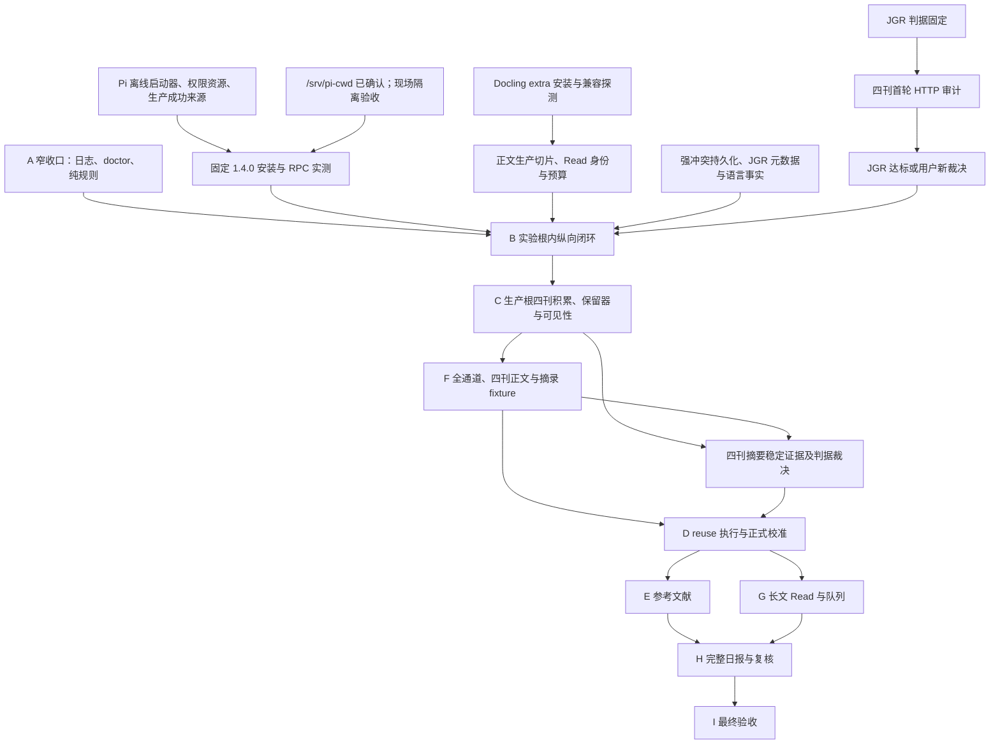

# 文档统一迁移台账（#113）

## 基线与范围

基线：`91e5d02e199f1921ca8afd2b7bdb8f257e6264f3`（开工时 main）。
依据 [Issue #113](https://github.com/MeteoBoy4/PaperRadar/issues/113)。本台账是迁移完成后冻结的记录，不进入 scope 绑定，不作为规范来源。

整理范围：`intent/draft.md`、`README.md`、`GLOSSARY.md`（只检查）、全部 `docs/adr/*.md`、全部 19 份 `docs/contracts/*.md`、`docs/verification/stage-a-closure.md`、`AGENTS.md`、`docs/agents/documentation.md`、`docs/agents/issue-tracker.md` 与新增文档。

原字节不动：`docs/verification/` 中除 `stage-a-closure.md` 外的既有文件；`verification-runs/`、`intent/discussions/`、`intent/review/`、`intent/archived_discussions/`、`examples/`、`fixtures/`、`tests/`、`src/`、`.agents/skills/` 的全部既有文件。scope 文件仅允许实际文档变更所需哈希重绑。

## 迁移单元

以下记录已实施单元；其余规格、ADR、Contract、README 迁移仍在进行，不构成全票完成证明。

### M001

源：`intent/draft.md`，基线行 1729。处置：移动。

去处：[docs/roadmap.md#模块图](../../docs/roadmap.md#模块图)。

原文（逐字）：

````text

````

新文：

````text
依赖图、模块状态与当前前沿见[路线图](../docs/roadmap.md#模块图)。
````

细节核对：原图 19 节点、21 条边在路线图保留；仅新增状态着色。

### M002

源：`intent/draft.md`，基线行 1823。处置：状态外移。

去处：[docs/roadmap.md#收口安排](../../docs/roadmap.md#收口安排)。

原文（逐字）：

````text
[阶段 A 收口清单](../docs/verification/stage-a-closure.md) 保留上述原实施/测试/DoD 的稳定序号、
历史证据与后续责任。A1–A10 通过不等于完整 A 通过。本 Markdown 是过渡清单；A 真正收口时
由收口实现票产出机器可读阶段结论，I 聚合。首张 A 收口实现票须确定新增能力 required 组与
全量 pytest 的验收登记规则，后续沿用；本票不新增组、测试分母或通过字段。
````

新文：

````text
A 真正收口时由收口实现票产出机器可读阶段结论，I 聚合。收口责任与验收登记安排见
[路线图](../docs/roadmap.md#收口安排)。
````

细节核对：机器可读结论与 I 聚合要求保留规格；过渡安排移入路线图，将“上述”明确为“规格 §11 A”、“本 Markdown”明确为“该收口清单”、“本票”明确为“#111”，防止迁移改变指代；数字、情态、顺序和全部登记约束不变。

### M003

源：`docs/contracts/read-validation.md`，基线行 8。处置：改写。

去处：[docs/contracts/read-validation.md#当前交付与命名](../../docs/contracts/read-validation.md#当前交付与命名)。

原文（逐字）：

````text
#93 已交付 `paper_radar.reading` 的权威 Pydantic 结构及 Read 自有七类价值词汇，
经现有 contracts 服务生成、导出和只读检查。仅通过 Schema 不表示已通过证据业务接收。
#94 已交付原始字节与可靠文本上下文的纯验证、数值 v1 和警告三视图。
#95 已接通表格、公式区域源字符与不可靠字符的字段矩阵；#96 已交付 single/reduce
模式与同正文 map 证据允许集合检查；#97 已交付显式 Read 配置准入与历史比较。
#98 已验证历史配置与候选原字节的非空隔离恢复，固定上下文由测试常量重建；
独立必需 A9、同次可信终态与固定范围由 #99 交付。

````

新文：

````text
`paper_radar.reading` 提供权威 Pydantic 结构及 Read 自有七类价值词汇，
经现有 contracts 服务生成、导出和只读检查。仅通过 Schema 不表示已通过证据业务接收。
公共能力包括原始字节与可靠文本上下文的纯验证、数值 v1 和警告三视图，
表格、公式区域源字符与不可靠字符的字段矩阵，single/reduce
模式与同正文 map 证据允许集合检查，以及显式 Read 配置准入与历史比较。
历史配置与候选原字节具有非空隔离恢复验证，固定上下文由测试常量重建；
独立必需 A9 绑定同次可信终态与固定范围。

````

细节核对：能力和边界逐项原位保留，#93–#99 交付出处移入相关依据行；数值 v1、single/reduce、固定上下文及 A9 同次范围未变。

### M004

源：`docs/contracts/read-validation.md`，基线行 45。处置：改写。

去处：[docs/contracts/read-validation.md#字段闭集](../../docs/contracts/read-validation.md#字段闭集)。

原文（逐字）：

````text
逐项检查，不能套用摘要层输入不足短语。结构类型/评分/必填性由 #93 交付；
有意义文本、重复检测、条件非空及上下文业务规则由 #94 交付。
````

新文：

````text
逐项检查，不能套用摘要层输入不足短语。结构校验涵盖类型/评分/必填性；
业务校验涵盖有意义文本、重复检测、条件非空及上下文业务规则。
````

细节核对：结构/业务校验职责原位保留；#93/#94 出处移至相关依据行。

### M005

源：`docs/contracts/read-validation.md`，基线行 79。处置：改写。

去处：[docs/contracts/read-validation.md#消费上下文与错误边界源字符与-reduce-已交付](../../docs/contracts/read-validation.md#消费上下文与错误边界源字符与-reduce-已交付)。

原文（逐字）：

````text
`output_invalid` 或消耗模型预算。本票不引入预算或接收器。
````

新文：

````text
`output_invalid` 或消耗模型预算。此校验边界不提供预算或接收器。
````

细节核对：仅调整位置性措辞；数字、枚举、条件、否定、情态及顺序保留。

### M006

源：`intent/draft.md`，基线行 800。处置：改写。

去处：[intent/draft.md#410-read-agent](../../intent/draft.md#410-read-agent)。

原文（逐字）：

````text
以下是 Read 的结构定义；#93 已实现单一权威 Pydantic Schema 并导出 Read v1 Frozen Contract，#94–#96 已交付给定只读证据上下文的纯业务验证器，#97–#99 已接通显式配置、隔离恢复与独立离线验收。可行性研究使用的临时 Read Schema 不取得生产权威资格。单次调用及 map/reduce 的生产目标仍由 Python 编排并通过 §7.7 的隔离 Pi 会话执行；分块、输入证据选择和最终引用检查由 PaperRadar 控制，不新增 Agent evidence 查询或 PDF 工具。
````

新文：

````text
以下是 Read 的结构定义（依据 #93–#99）；应使用单一权威 Pydantic Schema 并导出 Read v1 Frozen Contract，并提供给定只读证据上下文的纯业务验证器，以及显式配置、隔离恢复与独立离线验收。可行性研究使用的临时 Read Schema 不取得生产权威资格。单次调用及 map/reduce 的生产调用由 Python 编排并通过 §7.7 的隔离 Pi 会话执行；分块、输入证据选择和最终引用检查由 PaperRadar 控制，不新增 Agent evidence 查询或 PDF 工具。
````

细节核对：只将交付时态改为规格要求，保留各 issue 依据；全部字段、枚举、数字、条件、否定与职责边界原位保留。对应已完成范围见路线图 A2/A9；B 未完成见模块状态。

### M007

源：`intent/draft.md`，基线行 1202。处置：改写。

去处：[intent/draft.md#73-期刊信誉](../../intent/draft.md#73-期刊信誉)。

原文（逐字）：

````text
A2-07（#22）已通过公共 check/compile/load 登记该集合，不执行论文匹配或破同。
刊号接受带或不带连字符的 ASCII 八位写法与末位小写 x，不接受首尾空白；
编译后统一为带连字符、大写 X 的形式。`issns` 可包含本条 ISSN-L，但其自身列表
不得重复。完整快照内期刊按规范 `issn_l` 排序，附加 `issns` 也排序；精确原始字节
仍保留，等价写法改动也须新建版本。#23 的六阶段投影与基线均排除期刊材料；
期刊配置变化只影响完整快照与登记身份。
````

新文：

````text
期刊集合通过公共 check/compile/load 登记（依据 #22），不执行论文匹配或破同。
刊号接受带或不带连字符的 ASCII 八位写法与末位小写 x，不接受首尾空白；
编译后统一为带连字符、大写 X 的形式。`issns` 可包含本条 ISSN-L，但其自身列表
不得重复。完整快照内期刊按规范 `issn_l` 排序，附加 `issns` 也排序；精确原始字节
仍保留，等价写法改动也须新建版本。六阶段投影与基线均排除期刊材料（依据 #23）；
期刊配置变化只影响完整快照与登记身份。
````

细节核对：只将交付时态改为规格要求，保留各 issue 依据；全部字段、枚举、数字、条件、否定与职责边界原位保留。对应已完成范围见路线图 A2/A9；B 未完成见模块状态。

### M008

源：`intent/draft.md`，基线行 1325。处置：改写。

去处：[intent/draft.md#77-pi-rpc-适配边界](../../intent/draft.md#77-pi-rpc-适配边界)。

原文（逐字）：

````text
Issue #26 的配置切片已开放 settings 的 adapters 三槽、Pi YAML 与独立系统 Prompt
登记/回放，以及具名只读 adapter 语义和消费者依赖。字段、路径和固定 V1 策略见
[适配器配置契约](../docs/contracts/adapter-config.md)。没有 adapter 的旧快照保持
原身份和含义；该配置切片不执行 RPC 或安装程序。统一阶段投影、校准基线及 diff
联动已由 #23 接入单快照重建与只读 diff；不能把 adapter 分量身份冒称为完整基线
或执行就绪证明。
````

新文：

````text
适配器配置应支持（依据 #26） settings 的 adapters 三槽、Pi YAML 与独立系统 Prompt
登记/回放，以及具名只读 adapter 语义和消费者依赖。字段、路径和固定 V1 策略见
[适配器配置契约](../docs/contracts/adapter-config.md)。没有 adapter 的旧快照保持
原身份和含义；配置编译不执行 RPC 或安装程序。统一阶段投影、校准基线及 diff
联动应通过单快照重建与只读 diff 提供（依据 #23）；不能把 adapter 分量身份冒称为完整基线
或执行就绪证明。
````

细节核对：只将交付时态改为规格要求，保留各 issue 依据；全部字段、枚举、数字、条件、否定与职责边界原位保留。对应已完成范围见路线图 A2/A9；B 未完成见模块状态。

### M009

源：`intent/draft.md`，基线行 1363。处置：改写。

去处：[intent/draft.md#78-pi-固定版本供给](../../intent/draft.md#78-pi-固定版本供给)。

原文（逐字）：

````text
Issue #26 只冻结适配器配置事实并接入版本登记和快照；本节的下载、安装、激活、权限隔离和 RPC 验收由后续执行器与供给任务实施，不在配置编译中安装程序或新增无人消费的执行资源字段。普通离线测试使用固定供给清单、临时文件和 fake RPC/进程接口，无 Pi、Node、网络或模型凭据前置；真实安装与 RPC 验收由显式命令另行运行。
````

新文：

````text
适配器配置编译只冻结（依据 #26）适配器配置事实并接入版本登记和快照；本节的下载、安装、激活、权限隔离和 RPC 验收由执行器与供给任务实施，不在配置编译中安装程序或新增无人消费的执行资源字段。普通离线测试使用固定供给清单、临时文件和 fake RPC/进程接口，无 Pi、Node、网络或模型凭据前置；真实安装与 RPC 验收由显式命令另行运行。
````

细节核对：只将交付时态改为规格要求，保留各 issue 依据；全部字段、枚举、数字、条件、否定与职责边界原位保留。对应已完成范围见路线图 A2/A9；B 未完成见模块状态。

### M010

源：`intent/draft.md`，基线行 1830。处置：改写。

去处：[intent/draft.md#阶段-bjgr-feed-第一条真实纵向闭环](../../intent/draft.md#阶段-bjgr-feed-第一条真实纵向闭环)。

原文（逐字）：

````text
本阶段是 [ADR-0036](../docs/adr/0036-isolate-stage-b-read-experiment.md) 的受限实验，整条链
从 Feed 导入到最小日报均运行于显式实验数据根。目标是验证生产接口的真实单篇接线，
不授予正常生产消费、正式校准或自动 Read 资格；以下均为待实现责任。
````

新文：

````text
本阶段是 [ADR-0036](../docs/adr/0036-isolate-stage-b-read-experiment.md) 的受限实验，整条链
从 Feed 导入到最小日报均运行于显式实验数据根。目标是验证生产接口的真实单篇接线，
不授予正常生产消费、正式校准或自动 Read 资格。
````

细节核对：只将交付时态改为规格要求，保留各 issue 依据；全部字段、枚举、数字、条件、否定与职责边界原位保留。对应已完成范围见路线图 A2/A9；B 未完成见模块状态。

### M011

源：`intent/draft.md`，基线行 1599。处置：状态外移。

去处：[docs/roadmap.md#read-恢复证据范围](../../docs/roadmap.md#read-恢复证据范围)。

原文（逐字）：

````text
#98 已以两份历史配置和中/英文、single/reduce 四份候选原字节验证上述隔离恢复与
再次搬迁。消费上下文由固定测试常量重建，不属于恢复产物，也不证明真实 PDF、
evidence-map 或正文选择；范围见 [Read 恢复说明](../docs/contracts/read-validation.md#恢复范围98)。
````

新文：

````text
恢复验证的既有证据范围见[路线图](../docs/roadmap.md#read-恢复证据范围)。
````

细节核对：恢复证据数量、上下文来源与未证明边界保留；相对链接按新位置调整，将“上述隔离恢复”改为“[规格 §9.1](../../intent/draft.md#91-本机一致性快照)所述隔离恢复”，明确原指代。

### M012

源：`docs/adr/0036-isolate-stage-b-read-experiment.md`，基线行 34。处置：改写。

去处：[docs/adr/0036-isolate-stage-b-read-experiment.md#未豁免条件与证明边界](../../docs/adr/0036-isolate-stage-b-read-experiment.md#未豁免条件与证明边界)。

原文（逐字）：

````text
证明范围只覆盖冻结样本与纵向链，不证明四刊正文质量、通用 Docling、正常生产 Read、校准或完整阶段 A。本次仅记录规范，未实现以上能力；阶段责任与历史证据见 [A 收口清单](../verification/stage-a-closure.md)。
````

新文：

````text
证明范围只覆盖冻结样本与纵向链，不证明四刊正文质量、通用 Docling、正常生产 Read、校准或完整阶段 A。阶段责任与历史证据见[路线图](../roadmap.md#module-b)。
````

细节核对：证明范围逐字原位保留；仅规范、未实现的状态见路线图 B 未成形及下方 #111 记录。阶段 A 收口证据由路线图继续链接。

### M013

源：`README.md`，基线行 637。处置：合并。

去处：[docs/roadmap.md#阶段-a-收口与-b-前置111目标规格](../../docs/roadmap.md#阶段-a-收口与-b-前置111目标规格)。

原文（逐字）：

````text
## 阶段 A 收口与 B 前置（#111，目标规格）

[主方案 §11](intent/draft.md#十一九阶段实施与验收) 是统一阅读入口，与 GLOSSARY、ADR、
Contract 共同约束；[A 收口清单](docs/verification/stage-a-closure.md) 逐项区分历史离线证据与
剩余责任，A1–A10 通过不等于完整 A 通过。

B 按 [ADR-0036](docs/adr/0036-isolate-stage-b-read-experiment.md) 在独立实验数据根完成
固定 JGR 纵向链，结果不复用、不提升，暴露清单由 C 跨库导入排除正式校准。四刊先做首轮
摘要审计；JGR 至少 5 篇固定成员、各有已交付路线取得非疑似截断主摘要方可继续 B，其他刊
在 C/F 补跑，最迟 D 正式预热冻结/首个批次前逐刊收口。B 的 PDF 最低路径为人工合法附加，
TDM/授权/渲染留 F，单篇质量不豁免。真实冻结材料留本机，CI 仅用合成/脱敏材料。

A 窄收口负责日志、基础/配置 doctor 与 eligibility/visibility 纯规则；B 前置交付
Docling extra 兼容验证、首次 Pi 1.4.0 供给/生产接收、Feed/语言事实、正文与 Read 身份/预算。
安装探测与离线工程可并行，首次真实消费须先满足相应入口。以上均未因本文更新而交付或验收，
A4 1.3.0 历史材料、A2 示例和历史结论保持不变；未来 Pi 升级仍走 §7.8。

````

新文：

````text
V1 目标与判据见[规格](intent/draft.md)，当前前沿、阶段状态与后续责任见[路线图](docs/roadmap.md)。

````

细节核对：使用说明不变。状态与并行安排在路线图保留，规范内容合并至既有等价正文：规格 §11 B 的入口条件、实验数据根、最低 PDF 路径与本机材料要求，以及 ADR-0036 的“B 整条 Feed→Screening→人工决定→PDF→正文→Read→最小日报都在显式实验数据根内”“旧实验结果只作历史回查，不复用、不提升、不提供提升入口”“JGR 入口判据在审计前固定为 selected 至少 5 篇”“最迟 D 正式预热冻结/首个校准批次前四刊逐刊证明稳定”“普通离线测试仅用合成或脱敏材料”；未来升级保留规格 §7.8。数字、条件、否定与责任无变化，路线图通过链接引用，不复述目标规则。

### M014

源：`intent/draft.md`，基线行 6。处置：链接修正。

去处：[intent/draft.md#paperradar-第一版方案](../../intent/draft.md#paperradar-第一版方案)。

原文（逐字）：

````text
> 本文是第一版范围和验收依据；与早期设想冲突时，以本文、根目录 CONTEXT.md 和已记录 ADR 为准。
````

新文：

````text
> 本文是第一版范围和验收依据；与早期设想冲突时，以本文、根目录 GLOSSARY.md 和已记录 ADR 为准。
````

细节核对：git 提交 c8cf6b1ad700a3348ea416bd1d2b9b351f1048d1 显示 CONTEXT.md → GLOSSARY.md 为 100% 重命名；只修正文档名，权威关系保持。

### M015

源：`intent/draft.md`，基线行 7。处置：合并。

去处：[docs/adr/0026-control-pi-through-a-bounded-rpc-adapter.md](../../docs/adr/0026-control-pi-through-a-bounded-rpc-adapter.md)。

原文（逐字）：

````text
> 2026-10-11：按 Pi 可行性研究 §5 及用户决策更新模型适配边界（ADR-0026）。这是 V1 目标规格；本次仅更新文档，既有代码、配置文件、已登记版本和 Frozen Contract 未作修改，不表示 Pi 接入已交付。
````

新文：

````text

````

细节核对：裁决/规则合并至所链现有正文，原文完整保存在本项；对应状态与日期移至路线图“文首记录的状态与出处”。逐项核对：§5、“我的决策”及有界 RPC；当次仅文档，代码/配置/登记版本/Frozen Contract 不变。

保留处 `docs/adr/0026-control-pi-through-a-bounded-rpc-adapter.md` 当前第 3 行：

```text
2026-10-11：用户接受 [Pi 可行性研究](../../intent/discussions/pi-agent-contract-feasibility.md) §5 及其中“我的决策”，Python 主程序通过 RPC 控制本机 Pi 子进程，作为 V1 的有界 LLM/Agent adapter，取代原 PydanticAI 调用实现选择。Pi 负责固定模型的结构输出调用，PaperRadar 的权威 Pydantic Schema 与业务规则决定能否接收；建议、决定、任务资格、校准、证据构造与持久化继续由确定性程序控制。采用 RPC 是为了让 Python 明确控制隔离、取消、预算与完成边界；代价是需要锁定并管理 Node/Pi 子进程、事件协议和显式运行资源。

V1 首次使用 `prompt_only`，严格接收最终 assistant 的纯 JSON 文本；专用提交工具作为已验证可行的备用升级，能力可共存于适配器层，按阶段版本化配置选择，但每次运行只有一个权威通道，不自动切换或双通道竞争。提交工具的 TypeBox 参数 Schema 从 Pydantic JSON Schema 导入，仍由 Python 权威校验，成功才返回 validated artifact 并终结 run。提交工具不因参数带 Schema 就成为 provider 原生 `json_schema`；其配置协议名称与映射需在启用升级前明确定义，V1 默认验收不要求启用它。
```

历史状态逐项另见[路线图状态出处表](../roadmap.md#文首记录的状态与出处)。

### M016

源：`intent/draft.md`，基线行 8。处置：合并。

去处：[intent/draft.md#78-pi-固定版本供给](../../intent/draft.md#78-pi-固定版本供给)。

原文（逐字）：

````text
> 2026-10-12：按 Issue #26 的供给方案及补强意见明确 Pi 固定版本供给、执行核对与恢复要求（§7.8）；仍是目标规格，不表示安装、RPC 或校准验收已通过。
````

新文：

````text

````

细节核对：裁决/规则合并至所链现有正文，原文完整保存在本项；对应状态与日期移至路线图“文首记录的状态与出处”。逐项核对：固定版本供给、执行核对与恢复要求；当次不证明安装/RPC/校准通过。

保留处 `intent/draft.md` 当前第 1290 行：

```text
V1 使用项目管理的独立 Pi 安装，依据 [Issue #26 的供给方案](https://github.com/MeteoBoy4/PaperRadar/issues/26#issuecomment-6116780168)及[补强意见](https://github.com/MeteoBoy4/PaperRadar/issues/26#issuecomment-6116941170)固定程序、依赖与校验依据。默认安装位置为 `.tools/pi/`；安装的生命周期独立于个人交互使用的 Pi，日常 `pi update` 不得改动或清理项目所用版本。不能把 PATH 中的 `pi`、个人安装的可变入口或可能被个人更新清理的 release 路径作为固定供给。

供给与执行必须满足：
```

历史状态逐项另见[路线图状态出处表](../roadmap.md#文首记录的状态与出处)。

### M017

源：`intent/draft.md`，基线行 9。处置：合并。

去处：[intent/draft.md#78-pi-固定版本供给](../../intent/draft.md#78-pi-固定版本供给)。

原文（逐字）：

````text
> 2026-10-18：按用户裁决补充 §7.8「供给与升级决策」：每次升级新建适配器声明版本、不承诺脱网重建、不支持预发布/四段版本、保留当前与最近三个旧安装、行为影响判定为供给清单必填项；仍是目标规格，不表示供给、RPC 或校准验收已通过。
````

新文：

````text

````

细节核对：裁决/规则合并至所链现有正文，原文完整保存在本项；对应状态与日期移至路线图“文首记录的状态与出处”。逐项核对：D1–D5：新声明版本、无脱网重建承诺、三段正式版本、当前与最近三个旧安装、行为影响判定必填；当次不证明验收。

保留处 `intent/draft.md` 当前第 1317 行：

```text
1. **D1：每次升级都新建适配器声明版本。** 不允许“仅审计版本升级”复用原语义材料并原地改写 `pi_version`：Pi 版本变化必须创建新的 `adapters/<version>.yaml`，经公共 check/compile 登记并更新三槽 selector；已登记声明同键换字节由版本登记拒绝。语义载荷是否变化仍按实际行为判断，纯传输升级不改变阶段投影与校准基线，但不得据此放宽本条。第二版若引入受控迁移，须另行修订本决策与适配器配置契约。
2. **D2：不承诺脱网重建执行环境。** V1 不把预存 npm 包与 Node 制品作为交付或验收要求，也不提供“离线安装 Pi”的能力承诺；供给、doctor 与恢复流程统一按“需要联网的显式供给”表述，材料不齐时报告缺项，不隐式联网补齐。历史事实、配置与报告的脱网回放仍不依赖 Pi 安装（§9.2）。
3. **D3：不支持预发布与四段版本号。** `pi_version` 保持严格三段非负整数，不接受前导零、预发布、构建元数据或范围表达；不为跟进预发布版放宽配置校验或新增字段。上游仅有预发布版时，V1 停在已固定的正式版本，不以近似版本或运行时探测代替固定身份。
```

保留处 `intent/draft.md` 当前第 1318 行：

```text
2. **D2：不承诺脱网重建执行环境。** V1 不把预存 npm 包与 Node 制品作为交付或验收要求，也不提供“离线安装 Pi”的能力承诺；供给、doctor 与恢复流程统一按“需要联网的显式供给”表述，材料不齐时报告缺项，不隐式联网补齐。历史事实、配置与报告的脱网回放仍不依赖 Pi 安装（§9.2）。
3. **D3：不支持预发布与四段版本号。** `pi_version` 保持严格三段非负整数，不接受前导零、预发布、构建元数据或范围表达；不为跟进预发布版放宽配置校验或新增字段。上游仅有预发布版时，V1 停在已固定的正式版本，不以近似版本或运行时探测代替固定身份。
4. **D4：保留当前与最近三个旧安装。** 同时保留当前激活版本和最近三次激活的旧版本，最多四棵安装树；清理只能由用户显式发起，先出计划再按计划执行，普通运行、doctor、备份、恢复与升级均不自动删除。永不进入清理：当前激活版本、仍被在途进程或租约引用的版本、最近一次通过验收的版本；与上述上限冲突时保留保护对象并报告超限，不自动突破保护。供给材料、校验依据与验收事实独立于安装树永久保留（§6），清理不改写历史事实、不写 enable 或校准事件、不刷新 attempt 预算。清理入口随供给命令族在后续执行器任务定义，V1 必须提供“计划 + 执行”两步能力。该上限是固定 V1 策略，不开放为配置项。
```

保留处 `intent/draft.md` 当前第 1319 行：

```text
3. **D3：不支持预发布与四段版本号。** `pi_version` 保持严格三段非负整数，不接受前导零、预发布、构建元数据或范围表达；不为跟进预发布版放宽配置校验或新增字段。上游仅有预发布版时，V1 停在已固定的正式版本，不以近似版本或运行时探测代替固定身份。
4. **D4：保留当前与最近三个旧安装。** 同时保留当前激活版本和最近三次激活的旧版本，最多四棵安装树；清理只能由用户显式发起，先出计划再按计划执行，普通运行、doctor、备份、恢复与升级均不自动删除。永不进入清理：当前激活版本、仍被在途进程或租约引用的版本、最近一次通过验收的版本；与上述上限冲突时保留保护对象并报告超限，不自动突破保护。供给材料、校验依据与验收事实独立于安装树永久保留（§6），清理不改写历史事实、不写 enable 或校准事件、不刷新 attempt 预算。清理入口随供给命令族在后续执行器任务定义，V1 必须提供“计划 + 执行”两步能力。该上限是固定 V1 策略，不开放为配置项。
5. **D5：行为影响判定是供给清单的必填项。** 每份供给清单必须记录本次升级的行为影响判定（无行为变化 / 可能改变行为 / 无法判定）、判定依据与可回查的证据引用（如固定事件样例对比、验收记录、上游变更说明），由执行升级的用户填写并随清单冻结；后两者一律按“可能影响”处理。该字段进入供给清单规范载荷与 `supply_id`（§6），仍属执行审计身份，不进入适配器语义载荷。系统不得依据版本号、树哈希或 diff 自动判定，也不得用该字段替代语义身份更新与校准分级。
```

保留处 `intent/draft.md` 当前第 1320 行：

```text
4. **D4：保留当前与最近三个旧安装。** 同时保留当前激活版本和最近三次激活的旧版本，最多四棵安装树；清理只能由用户显式发起，先出计划再按计划执行，普通运行、doctor、备份、恢复与升级均不自动删除。永不进入清理：当前激活版本、仍被在途进程或租约引用的版本、最近一次通过验收的版本；与上述上限冲突时保留保护对象并报告超限，不自动突破保护。供给材料、校验依据与验收事实独立于安装树永久保留（§6），清理不改写历史事实、不写 enable 或校准事件、不刷新 attempt 预算。清理入口随供给命令族在后续执行器任务定义，V1 必须提供“计划 + 执行”两步能力。该上限是固定 V1 策略，不开放为配置项。
5. **D5：行为影响判定是供给清单的必填项。** 每份供给清单必须记录本次升级的行为影响判定（无行为变化 / 可能改变行为 / 无法判定）、判定依据与可回查的证据引用（如固定事件样例对比、验收记录、上游变更说明），由执行升级的用户填写并随清单冻结；后两者一律按“可能影响”处理。该字段进入供给清单规范载荷与 `supply_id`（§6），仍属执行审计身份，不进入适配器语义载荷。系统不得依据版本号、树哈希或 diff 自动判定，也不得用该字段替代语义身份更新与校准分级。

```

保留处 `intent/draft.md` 当前第 1321 行：

```text
5. **D5：行为影响判定是供给清单的必填项。** 每份供给清单必须记录本次升级的行为影响判定（无行为变化 / 可能改变行为 / 无法判定）、判定依据与可回查的证据引用（如固定事件样例对比、验收记录、上游变更说明），由执行升级的用户填写并随清单冻结；后两者一律按“可能影响”处理。该字段进入供给清单规范载荷与 `supply_id`（§6），仍属执行审计身份，不进入适配器语义载荷。系统不得依据版本号、树哈希或 diff 自动判定，也不得用该字段替代语义身份更新与校准分级。

## 八、CLI、任务与运行语义
```

历史状态逐项另见[路线图状态出处表](../roadmap.md#文首记录的状态与出处)。

### M018

源：`intent/draft.md`，基线行 11。处置：合并。

去处：[docs/adr/0030-paper-version-identity-and-source-observations.md](../../docs/adr/0030-paper-version-identity-and-source-observations.md)。

原文（逐字）：

````text
> 2026-10-22：按 Issue #67 用户 D1–D4、N1/N2 裁决同步论文版本身份、Feed 回摆和冲突边界，见 [ADR-0030](../docs/adr/0030-paper-version-identity-and-source-observations.md) 与 [论文事实 Contract](../docs/contracts/paper-facts.md)。该语义由 #68 完成文档同步，#69–#75 已实现并注册 A6 离线论文事实底座；真实来源、parser/live 与完整阶段 A 仍未验收。旧固定提交正文不能覆盖后续裁决。
````

新文：

````text

````

细节核对：裁决/规则合并至所链现有正文，原文完整保存在本项；对应状态与日期移至路线图“文首记录的状态与出处”。逐项核对：D1–D4/N1/N2、身份/Feed 回摆/冲突；A6 离线底座已注册，真实来源/parser/live/完整 A 未验。旧固定正文不覆盖后续裁决。

保留处 `docs/adr/0030-paper-version-identity-and-source-observations.md` 当前第 3 行：

```text
状态：已接受语义；#69–#74 已落地身份、Feed、四源仲裁、版本关系、输入映射及组合隔离恢复，#75 注册独立 A6 验收。依 [#67](https://github.com/MeteoBoy4/PaperRadar/issues/67) 用户 D1–D4 与 N1/N2 裁决，DOI 与版本一对一，Feed 回摆仅推进 last_seen，强身份冲突整笔拒绝业务事实，关系冲突保留观察/关系并等待合并。具体目标边界以 [论文事实 Contract](../contracts/paper-facts.md) 为准。

2026-10-28：#111 将首次真实 Feed 导入前置移到 B，B 先交付 JGR 所需的强冲突观察持久化与 parser 固定样本/字段损失回归，C 扩展四刊。以下“阶段 C”保留当时的延期依据，现行最迟点是首次真实导入；实验根同样不得豁免，见 [ADR-0036](0036-isolate-stage-b-read-experiment.md)。历史 A6 证据和未验证来源假设不改写。
```

历史状态逐项另见[路线图状态出处表](../roadmap.md#文首记录的状态与出处)。

### M019

源：`intent/draft.md`，基线行 13。处置：合并。

去处：[docs/contracts/screening-tasks.md](../../docs/contracts/screening-tasks.md)。

原文（逐字）：

````text
> 2026-10-23：按 Issue #76 用户 D1–D4 裁决同步 §8.5：Screening 预算按 Paper/阶段/指纹，当前适用性完全派生，同指纹跨版本可复用。A7 暂不交付 screening CLI 或 paper trace 组合；语言事实生产来源仍待裁决（后于 2026-10-27 由 Feed 归属裁决，见 ADR-0035），详见 [ADR-0031](../docs/adr/0031-screening-budget-and-derived-applicability.md) 与 [任务 Contract](../docs/contracts/screening-tasks.md)。#77–#80 已交付严格 JSON、任务登记、原子领取、租约、失败结算与 boundary 原始候选成功/派生三值适用性；value 成功接收由 #81 交付，显式 retry 与版本化共享查询由 #82 交付；#83 补齐完整历史隔离恢复，#84 注册独立必需 A7 组并纳入可信终态；仍只证明 boundary/value 离线 test 执行边界，不证明真实模型或完整阶段 A。
````

新文：

````text

````

细节核对：裁决/规则合并至所链现有正文，原文完整保存在本项；对应状态与日期移至路线图“文首记录的状态与出处”。逐项核对：预算/派生三值适用性及 boundary/value、retry、查询、历史恢复/独立 A7；仅离线 test，screening CLI/paper trace 组合及真实模型/完整 A 未验。语言来源后由 ADR-0035 裁决。

保留处 `docs/contracts/screening-tasks.md` 当前第 34 行：

```text
| 预算范围 | 同库 `(paper_id, stage, fingerprint)` | 规范输入、首次上下文、至多一个筛选制品 |
| 任务代际 | 预算范围 + generation | 第 0 代由首个请求创建；每代最多两次 attempt；显式 retry 追加下一代 |
| 请求 | scheduled 的完整业务依据，或 manual/retry 的显式 request_id | 来源、调度日或 request_id、version/revision/snapshot；多个请求可共用任务 |
```

保留处 `docs/contracts/screening-tasks.md` 当前第 65 行：

```text
只有《大气科学》（`dqkx` current Feed）取 `true`，AIES、JGR 与 QJRMS 取 `false`。它是来源级约定，
不由题名文本、字符集或语言检测判断，`false` 只表示非中文。没有首发 Feed 归属的 Paper
（仅人工 DOI/URL/PDF 加入）没有该事实，不得默认 `false`，也不得为其登记 value 任务，直到另行裁决；
```

历史状态逐项另见[路线图状态出处表](../roadmap.md#文首记录的状态与出处)。

### M020

源：`intent/draft.md`，基线行 15。处置：合并。

去处：[docs/adr/0026-control-pi-through-a-bounded-rpc-adapter.md](../../docs/adr/0026-control-pi-through-a-bounded-rpc-adapter.md)。

原文（逐字）：

````text
> 2026-10-24：按 #85 D1–D4/P3 裁决固定 A8 离线调用描述与版本准入；语义取预算首次
> snapshot，执行审计取回执 snapshot；最终模型不符由 A7 接收器裁决，Pi 零 token
> 报告保留未知，并接受下述常量执行 cwd 的有限外发例外。真实 Pi/模型仍未验收。
````

新文：

````text

````

细节核对：裁决/规则合并至所链现有正文，原文完整保存在本项；对应状态与日期移至路线图“文首记录的状态与出处”。逐项核对：首次 snapshot 语义/回执 snapshot 审计、A7 最终模型裁决、零 token 未知及 cwd 外发例外；真实 Pi/模型未验。

保留处 `docs/adr/0026-control-pi-through-a-bounded-rpc-adapter.md` 当前第 15 行：

```text
2026-10-24：按 #85 D1–D4/P3 裁决补充：A8 封闭协议档案仅登记 1.4.0，构造期拒绝
其他版本而不领取。调用语义取预算首次 snapshot，执行审计版本取本次回执 snapshot，
两者同阶段投影相等才可组合。完整协议中的最终模型观察交由 A7 判 `model_mismatch`，
```

保留处 `docs/adr/0026-control-pi-through-a-bounded-rpc-adapter.md` 当前第 19 行：

```text
token 均未知，否则输入为 input+cacheRead+cacheWrite，输出为 output；这是 Pi 报告的
总提示量，非独立测量或计费量。prepare 拒绝复用现有 TaskReason，不扩展 A7 词汇。

```

历史状态逐项另见[路线图状态出处表](../roadmap.md#文首记录的状态与出处)。

### M021

源：`intent/draft.md`，基线行 19。处置：合并。

去处：[docs/adr/0032-relax-paper-acquisition-without-evading-access-controls.md](../../docs/adr/0032-relax-paper-acquisition-without-evading-access-controls.md)。

原文（逐字）：

````text
> 2026-10-25：按用户裁决放宽摘要与全文获取方式（§4.3、§4.8、§11 阶段 F、§13、§15，
> [ADR-0032](../docs/adr/0032-relax-paper-acquisition-without-evading-access-controls.md)）：
> 明确区分正常自动化访问与访问控制规避，允许正常请求头、受控浏览器渲染、出版者官方 API
> 及合法补充渠道，审慎允许本人授权会话，禁止验证码破解、指纹伪造、代理轮换、付费墙绕过与
> 未授权批量下载。「不绕过访问控制」「403 不解释为非开放获取」和人工 PDF 队列保持；
> 具体策略可按四刊真实审计结果在新 Issue 中调整，不在票面永久固化。
> 本次只更新文档与 A9 scope 登记的两份文档哈希，未修改业务代码、配置或 Frozen Contract。
````

新文：

````text

````

细节核对：裁决/规则合并至所链现有正文，原文完整保存在本项；对应状态与日期移至路线图“文首记录的状态与出处”。逐项核对：§4.3/§4.8/§11 F/§13/§15；合法自动化与访问规避边界。策略可按真实审计另票调整；当次只改文档与两份 A9 文档哈希，业务代码/配置/Frozen Contract 不变。

保留处 `docs/adr/0032-relax-paper-acquisition-without-evading-access-controls.md` 当前第 3 行：

```text
PaperRadar 第一版把摘要与全文获取的约束从“只走最少几条无会话通道”改为“正常自动化访问允许、访问控制规避禁止”的两分边界。允许如实标识的正常请求头（`User-Agent`、`Referer`、`Accept` 等，可使用工具自身的默认浏览器 `User-Agent`，但不以伪造或轮换 `User-Agent` 通过限制）、受控浏览器渲染（Playwright 等执行 JavaScript 读取公开页面）、出版者官方 API 与合法申请的 token，以及按站点规则、官方配额与 `robots` 或服务条款设置的频率、超时、退避与重试；摘要与全文位置可按需通过 Crossref、DataCite、Unpaywall、OpenAlex 与合法开放仓储补充。本人合法持有的机构账号、登录会话或订阅权限改为“审慎允许”：默认关闭、用户显式启用、凭据只存文件系统凭证区（0600）、单篇按需、遵守出版方条款、访问依据记为 `licensed`、不批量下载且不分发受限全文。破解或自动求解验证码、伪造浏览器或 TLS 指纹、轮换代理 IP 逃避封禁或限流、绕过付费墙及其他明确的访问控制、未授权批量下载受限全文仍然禁止，并且不因引入渲染通道而放宽：出现验证码或明确的挑战页即记 `access_blocked_403`/`rate_limited` 并进入人工 PDF 队列。

这个划分替换的是“反爬”这一含混标签：判断标准不是用什么工具，而是请求是否试图改变来源对自己身份、权限或频率的判断。渲染公开页面、带官方 token 调用 API、按配额退避都不改变来源的判断，属于正常自动化访问；破解验证码、伪造指纹、轮换代理、对无权内容实施技术绕过则在改变判断，属于规避。付费墙边界因此不再等同于“只取开放获取”：本人订阅权限覆盖的内容属于已授权内容，而绕过访问控制取得同一内容仍然禁止。
```

历史状态逐项另见[路线图状态出处表](../roadmap.md#文首记录的状态与出处)。

### M022

源：`intent/draft.md`，基线行 27。处置：合并。

去处：[docs/contracts/fixture-audit.md#103-已交付的取得边界](../../docs/contracts/fixture-audit.md#103-已交付的取得边界)。

原文（逐字）：

````text
> A10 #103 已交付计划—有界 HTTP/未安装通道—原子结算—只读查询与基本恢复工程；四刊选样、摘要矩阵、resume/replay 和独立验收尚待后续票。当前只跑离线子集，不构成四刊 live 或完整阶段 A 验收。
````

新文：

````text

````

细节核对：裁决/规则合并至所链现有正文，原文完整保存在本项；对应状态与日期移至路线图“文首记录的状态与出处”。逐项核对：计划/有界 HTTP/未安装通道/原子结算/只读查询/基本恢复；当时四刊选样/矩阵/resume/replay/独立验收待续，后由 #104–#108 收口；不证明 live/完整 A。

保留处 `docs/contracts/fixture-audit.md` 当前第 54 行：

```text
`acquire_source(plan_id, request_key=..., request=SourceRequest(...), contact_email=...)` 持有非阻塞计划锁，先提交 started，再在事务外调通道执行器、发布有资格保留的完整 source_snapshot，最后在短事务追加结算。请求身份包含规范请求的策略、通道、来源与条件引用；同键异内容拒绝，已完成精确调用只重放旧结果。未结算请求数为未知，不记零；本票没有隐式补跑。`audit_execution` 可由后续整轮驱动持有，同一个 guard 传给各路线，读取不取锁。

默认注册表只有 SourceHTTPExecutor；测试可显式注入执行器。未注册通道为 channel_not_installed，已注册却未执行可记 not_attempted，均不算失败。事实中的 access_basis=open、credential_class=null，请求头只记类别。无浏览器/凭据实现，不导入 playwright/selenium，不改依赖或 lockfile。外部 Pydantic 输入须重新准入；model_copy 不授予有效性，序列化 warning 不能输出原值。
```

历史状态逐项另见[路线图状态出处表](../roadmap.md#文首记录的状态与出处)。

### M023

源：`intent/draft.md`，基线行 29。处置：合并。

去处：[docs/contracts/fixture-audit.md#pdf-字节事实与-backend-期望102](../../docs/contracts/fixture-audit.md#pdf-字节事实与-backend-期望102)。

原文（逐字）：

````text
> 2026-10-26：#102 交付本机 PDF 字节及独立 backend 期望登记。当前样本通过显式替换
> 追加选择；旧字节和期望保留，新 SHA 不继承旧 backend 结果。此项只验证给定字节与
> 期望形状/引用，不下载 PDF、不运行 Docling，不表示四刊正文或完整阶段 A 已验收。
````

新文：

````text

````

细节核对：裁决/规则合并至所链现有正文，原文完整保存在本项；对应状态与日期移至路线图“文首记录的状态与出处”。逐项核对：本机 PDF 字节/backend 期望与显式替换，旧字节/期望保留，新 SHA 不继承结果；不下载/不运行 Docling，不证明四刊正文/完整 A。

保留处 `docs/contracts/fixture-audit.md` 当前第 90 行：

```text
首次取得形成 PDF 当前选择；再次选择必须显式 `replaces=当前 pdf_id` 及非空
`replacement_reason`。替换只在同一 `(purpose, journal, key)` 下追加，旧字节与旧期望
保持可查；悬空、跨对象、过期或循环关系拒绝。相同样本的 `request_key` 绑定完整取得
```

历史状态逐项另见[路线图状态出处表](../roadmap.md#文首记录的状态与出处)。

### M024

源：`intent/draft.md`，基线行 33。处置：合并。

去处：[docs/contracts/fixture-audit.md](../../docs/contracts/fixture-audit.md)。

原文（逐字）：

````text
> 2026-10-26：#104 交付四刊固定选样与原位暂停继续，成员由整份冻结 Feed、显式身份和类别依据支撑；不按摘要成败换样。仅离线工程子集，真实四刊审计、摘要矩阵、全路线 resume/replay 与独立 A10 仍待后续收口。
````

新文：

````text

````

细节核对：裁决/规则合并至所链现有正文，原文完整保存在本项；对应状态与日期移至路线图“文首记录的状态与出处”。逐项核对：四刊固定选样/原位继续、整份 Feed/显式身份/类别、不按成败换样；当时后续矩阵/回放/独立门禁待续，后由 #105–#108 收口；真实审计未验。

保留处 `docs/contracts/fixture-audit.md` 当前第 3 行：

```text
本 Contract 落实 #100 评论裁决；权威注册格式为 `paper_radar.fixture_audit.models.FixtureDeclaration`，不加入 `CONTRACT_NAMES` 或五份 Frozen Contract。#101 交付声明登记、只读历史与基本恢复；#102 交付本机 PDF 字节及 backend 期望登记；路线执行、选样、矩阵及独立 A10 验收按 #103–#108 后续交付。当前不代表真实来源、Docling、模型或完整阶段 A 通过。

## 声明与身份
```

历史状态逐项另见[路线图状态出处表](../roadmap.md#文首记录的状态与出处)。

### M025

源：`intent/draft.md`，基线行 35。处置：合并。

去处：[docs/contracts/fixture-audit.md](../../docs/contracts/fixture-audit.md)。

原文（逐字）：

````text
> 2026-10-26：#105 交付显式 audit run、固定适用摘要矩阵、主区块解析、截断信号、逐字段 A6 仲裁及真实分母；复用选样已取得材料与原时间。complete 仅表示终态齐备，普通查询不输出原摘要。仅验证离线行为子集与基本恢复；四刊 live、全路线 resume/replay、混合历史闭包和独立 A10 门禁仍待后续票。
````

新文：

````text

````

细节核对：裁决/规则合并至所链现有正文，原文完整保存在本项；对应状态与日期移至路线图“文首记录的状态与出处”。逐项核对：audit run、适用矩阵/主区块/截断/A6仲裁/真实分母、复用材料及原时间；complete 仅终态、查询不输出原摘要；当时回放/混合闭包/门禁待续，后由 #106–#108 收口。

保留处 `docs/contracts/fixture-audit.md` 当前第 234 行：

```text
complete 仅表示四刊选样已结算且固定成员应有路线均有终态；不足样本、全无摘要、受阻与
来源稳定性各自披露。暂时受阻的选样或未结算成员使状态为 partial。不会生成 Paper、
metadata_ready、metadata_unobtainable、人工队列、Screening 或门禁事件。完整候选优先、
```

保留处 `docs/contracts/fixture-audit.md` 当前第 194 行：

```text
字面 Abstract/摘要标签时只消费该标签后、下一个附加标签前的主区块，之前段落单列前置区块。
dqkx Feed 只取 p 内正文，p 外引文尾行不参与仲裁。Significance Statement、Plain Language
Summary、Key Points 及 abstract-en 只保存存在与定位；已知附加 class/id 也从主容器排除。
```

历史状态逐项另见[路线图状态出处表](../roadmap.md#文首记录的状态与出处)。

### M026

源：`intent/draft.md`，基线行 37。处置：合并。

去处：[docs/contracts/fixture-audit.md](../../docs/contracts/fixture-audit.md)。

原文（逐字）：

````text
> 2026-10-26：#106 交付显式 audit resume、冻结版本只读 replay、仅服务 API 的新 parser 追加解释与字段差异；两类必要真实进程、事务故障和基本恢复按离线子集验证。默认回放重建 v1，新解释缺运行时只证明声明/引用/差异闭包，不能宣称已重解析。四刊 live、完整混合历史闭包及独立 A10 门禁仍待后续票。
````

新文：

````text

````

细节核对：裁决/规则合并至所链现有正文，原文完整保存在本项；对应状态与日期移至路线图“文首记录的状态与出处”。逐项核对：audit resume、冻结 v1 replay、服务 API 新 parser/差异；两类真实进程/事务故障/基本恢复离线验证，无运行时不宣称重解析；当时完整混合闭包/门禁待续，后由 #107/#108 收口。

保留处 `docs/contracts/fixture-audit.md` 当前第 253 行：

```text
| `replay_audit_interpretation(..., parser=...)` | 只读，显式匹配该解释声明的运行时 | 可取得材料按该注入解析器重解析；失败仍只有执行事实 |

resume 在网络或写入前核对原计划代码声明及 acquisition/channels/http/parser/sampling/category/
```

保留处 `docs/contracts/fixture-audit.md` 当前第 43 行：

```text
`fixture register FILE --database DB --data-root ROOT` 显式写登记，不迁移；`fixture check FILE --database DB` 只读比对；`fixture list --database DB [--history]` 与 `fixture show RECORD_ID --database DB` 只读数据库历史，源文件可不存在。共同支持 --json；帮助为中文并说明副作用、配额及示例，无网络/数据库/凭据访问、不创建目录。审计入口最终为 audit run/resume/list/show/replay，未实现的命令不提前注册。

未发布的本批唯一 revision 为 `a1001_fixture_audit`，基于 `a704_screening_retry`；本批只追加实际用到的表，种子由显式 register 写入。各票如需调整该未发布 revision，必须从 a704 重建临时库验证，不能声称原地修补中间库；一旦发布或用于真实库，不再改写。现有配置/论文/Screening 身份不变。前七票只声明行为子集通过，最后 #108 完成 scope 重绑与完整门禁。
```

历史状态逐项另见[路线图状态出处表](../roadmap.md#文首记录的状态与出处)。

### M027

源：`intent/draft.md`，基线行 39。处置：合并。

去处：[docs/contracts/fixture-audit.md](../../docs/contracts/fixture-audit.md)。

原文（逐字）：

````text
> 2026-10-26：#107 交付已完成审计的单刊 Feed/整计划 abstract_audit 引用、不可变完整汇总边界，以及真实 a704 五类非空升级和活跃 WAL 混合历史隔离恢复子集。恢复仍不联网、不自动继续；声明缺失单列 source_missing，合法未引用制品保留。未执行四刊 live，完整门禁与 scope 重绑由 #108 收口。
````

新文：

````text

````

细节核对：裁决/规则合并至所链现有正文，原文完整保存在本项；对应状态与日期移至路线图“文首记录的状态与出处”。逐项核对：单刊 Feed/整计划 abstract_audit、不可变汇总、真实 a704 五类非空升级/活跃 WAL 恢复；不联网/不自动继续，source_missing 单列、未引用制品合法；当时完整门禁由 #108 收口。

保留处 `docs/contracts/fixture-audit.md` 当前第 9 行：

```text
逻辑样本身份为 `(purpose, journal, key)`，其中 `abstract_audit` 固定 `journal=null` 表示整计划，其余用途必须给出四刊之一，key 必须显式给定，DOI/handle/数组下标/路径不能代替。四用途 `feed/abstract_audit/references/pdf`，三种依据 `historical_declaration/synthetic/acquired` 分开。引用及声明原字节在短事务内原子登记。初次登记选择当前项，后续只按显式 `replaces` 及非空原因替换同逻辑样本；禁止悬空、跨用途/期刊/key、分叉与循环。时间和版本字符串排序不参与选择。list 默认当前项，show 可查任何旧记录，history 投影保留完整历史。check 只对源文件与登记字节比较，分别报告 source_missing / unregistered / drift / byte_verified，不切换选择。

参考文献期望保留出版者/Crossref 计数与历史风险；PDF 声明保留 DOI/handle、候选、版式与已知失败，不填假哈希、假许可或 parser 结果。历史说明与 2026-10-25 只读预检注记分开。acquired 证据只能由实际取得入口核验；文件声明自报哈希或尚未完成审计引用不能升级成真实证据。feed/abstract_audit 的 acquired 注册只引用完成计划、汇总哈希与 Feed 快照，不复制审计权威事实。
```

保留处 `docs/contracts/fixture-audit.md` 当前第 94 行：

```text
完整未引用制品，不能补出成功取得事实。

`register_pdf_backend(PdfBackendRegistration | Path)` 另行追加期望，必须绑定准确的
```

历史状态逐项另见[路线图状态出处表](../roadmap.md#文首记录的状态与出处)。

### M028

源：`intent/draft.md`，基线行 41。处置：合并。

去处：[docs/verification/a10-requirements.md](../../docs/verification/a10-requirements.md)。

原文（逐字）：

````text
> 2026-10-26：#107 补齐已完成审计的整计划/四刊 fixture 引用、不可变汇总边界与非空混合历史隔离恢复。
> #108 接入独立 required A10、完整任务图需求台账、真实执行回执及十四份同次证据；直接前置为
> A1、完整 A2、A3、A6，其他必需组仍决定总门禁。只交付 HTTP 离线工程，四刊实际审计、
> 稳定性/B阻断判据、完整摘要优先/额外区块的Screening语义、A6来源假设、AMS403策略、
> 渲染/授权/正文/PDF/Docling/生产导入/NAS与完整阶段A仍未验；合法未来通道按新策略补跑。
````

新文：

````text

````

细节核对：裁决/规则合并至所链现有正文，原文完整保存在本项；对应状态与日期移至路线图“文首记录的状态与出处”。逐项核对：A10 完整需求台账/真实回执/十四份同次证据，直接前置 A1/完整 A2/A3/A6；其他必需组仍决定总门禁。仅 HTTP 离线，未验范围见路线图继承缺口。

保留处 `docs/verification/a10-requirements.md` 当前第 1 行：

```text
# A10 规格覆盖与证明边界

本材料保留 #100–#108 的693个原库存ID与原文；37份完整Issue/body/comment快照嵌入 a10_coverage.json，其中新增13份完成/补修回帖只列操作证据。验收执行不访问GitHub，源原文SHA与台账最终由scope固定；不把网页后续变化静默算作本次范围。
```

历史状态逐项另见[路线图状态出处表](../roadmap.md#文首记录的状态与出处)。

### M029

源：`intent/draft.md`，基线行 47。处置：合并。

去处：[docs/adr/0035-feed-derived-original-title-language-fact.md](../../docs/adr/0035-feed-derived-original-title-language-fact.md)。

原文（逐字）：

````text
> 2026-10-27：按用户裁决固定原题名语言事实的生产来源为首发 Feed 归属映射 v1：只有《大气科学》current Feed
> 取中文原始题名（`true`），AIES、JGR、QJRMS 取非中文（`false`）；不由题名文本或语言检测判断，`false` 只表示
> 非中文，无 Feed 归属的论文没有该事实且不得登记 value 任务。详见
> [ADR-0035](../docs/adr/0035-feed-derived-original-title-language-fact.md)。本次只更新文档与 scope 绑定，
> 未实现自动派生或生产接线。
````

新文：

````text

````

细节核对：裁决/规则合并至所链现有正文，原文完整保存在本项；对应状态与日期移至路线图“文首记录的状态与出处”。逐项核对：首发 Feed 归属 v1，只有《大气科学》中文；不做语言检测、false 仅非中文、无归属不得 value；当次只改文档/scope，自动派生/生产接线未交付。

保留处 `docs/adr/0035-feed-derived-original-title-language-fact.md` 当前第 16 行：

```text
该事实是**来源级约定**，不是逐篇文本判定：由 Paper 的首发 Feed 所属期刊按封闭表决定，
不由题名、字符集、语言检测器或模型判断。

```

保留处 `docs/adr/0035-feed-derived-original-title-language-fact.md` 当前第 22 行：

```text
| Artificial Intelligence for the Earth Systems | `aies` | `https://journals.ametsoc.org/journalissuetocrss/journals/aies/aies-overview.xml` | `false` |
| Journal of Geophysical Research: Atmospheres | `jgr` | `https://agupubs.onlinelibrary.wiley.com/action/showFeed?jc=21698996&type=etoc&feed=rss` | `false` |
| Quarterly Journal of the Royal Meteorological Society | `qjrms` | `https://rmets.onlinelibrary.wiley.com/feed/1477870x/most-recent` | `false` |
```

保留处 `docs/adr/0035-feed-derived-original-title-language-fact.md` 当前第 30 行：

```text
- 没有首发 Feed 归属的 Paper（仅经人工 DOI、URL 或 PDF 加入）没有该事实：不得默认
  `false`，也不得为其登记 value 任务，直到另行裁决。
- 归属由 Paper 的 Feed 发现事实确定。先经人工入口加入、后由 Feed 发现时，Feed 归属确立
```

历史状态逐项另见[路线图状态出处表](../roadmap.md#文首记录的状态与出处)。

### M030

源：`intent/draft.md`，基线行 53。处置：合并。

去处：[docs/adr/0036-isolate-stage-b-read-experiment.md](../../docs/adr/0036-isolate-stage-b-read-experiment.md)。

原文（逐字）：

````text
> 2026-10-28：按 [Issue #111 正文及后续用户确认](https://github.com/MeteoBoy4/PaperRadar/issues/111)
> 同步阶段 A 收口与 B/C/F 前置。七项初始确认来自该票 Further Notes，
> [固定提交的讨论文件](https://github.com/MeteoBoy4/PaperRadar/blob/212e312/intent/discussions/阶段A剩余工作.md)
> 只作非规范背景。本文是后续规格的统一阅读入口，与 GLOSSARY、ADR、公共 Contract 共同约束；
> 冲突须报告并由用户裁决。B 采用独立实验数据根，实验结果不复用、不提升；JGR 摘要入口判据、
> 首次 Pi 1.4.0 目标、`/srv/pi-cwd`、Docling extra 与 CLI 归属见 §11、
> [ADR-0036](../docs/adr/0036-isolate-stage-b-read-experiment.md) 和
> [阶段 A 收口清单](../docs/verification/stage-a-closure.md)。本次仅改目标文档与必要 scope 绑定，
> 不表示这些新能力或任何 live 验收已经交付；历史 A1–A10 证明范围保持不变。
````

新文：

````text

````

细节核对：裁决/规则合并至所链现有正文，原文完整保存在本项；对应状态与日期移至路线图“文首记录的状态与出处”。逐项核对：七项初始确认与后续评论；实验根不复用不提升、JGR入口、Pi1.4.0、/srv/pi-cwd、Docling extra及CLI归属；当次只改目标文档/scope，历史A1–A10证明不变。

保留处 `docs/adr/0036-isolate-stage-b-read-experiment.md` 当前第 8 行：

```text
- B 整条 Feed→Screening→人工决定→PDF→正文→Read→最小日报都在显式实验数据根内。根级标记随备份/隔离恢复保留；实验命令显式选择该根，普通生产 run-due、报告及消费查询拒绝它，初始化生产根不接纳实验根。真实执行来源、实验用途与质量资格是三个独立判断，生产执行来源不授予正常消费资格。
- 不在 A7 `(paper_id, stage, fingerprint)` 中增加用途维度，也不以请求来源/标签变化重置预算。实验根只绑定冻结样本；不开放任意 Paper 的“忽略 fixture”开关。准入绑定论文/版本、Feed、PDF 内容、配置与质量证据，任务、正文、分析和最小报告的引用链可回查。
- 旧实验结果只作历史回查，不复用、不提升、不提供提升入口。四刊 fixture 后来通过也不自动开启 Read/reuse 或提升旧结果。长期生产库由 C 初始化；日后同论文从正常入口重新处理、使用独立预算，不能拷贝实验成功/任务来补位。
```

保留处 `docs/adr/0036-isolate-stage-b-read-experiment.md` 当前第 10 行：

```text
- 旧实验结果只作历史回查，不复用、不提升、不提供提升入口。四刊 fixture 后来通过也不自动开启 Read/reuse 或提升旧结果。长期生产库由 C 初始化；日后同论文从正常入口重新处理、使用独立预算，不能拷贝实验成功/任务来补位。
- B 导出以强标识（DOI 与版本关联）固定的已暴露论文清单；C 在保留器启用前导入生产库，机械排除正式校准。备份/恢复、重复发现、版本变化及未来合并均不得丢失排除依据，不能仅靠临时 paper ID。
- B 保存两阶段 Screening 输出与人工决定，可展示无自动决定权的实验筛选建议；`out_of_scope` 仍停止 value。实验材料不流入普通生产建议/自动决定链；ReadAnalysisOutput 的必填 `next_action` 保留。最小报告使用最终 report run/entry 契约、可重建、标注实验范围且遵守五项/全文三项容量，不进入普通日报候选。
```

保留处 `docs/adr/0036-isolate-stage-b-read-experiment.md` 当前第 26 行：

```text
四刊首轮摘要审计仍先执行；JGR 入口判据在审计前固定为 selected 至少 5 篇，以 A10 矩阵为分母，失败/受阻不剔除，每篇至少一条已交付路线得到非 `suspected_truncated` 的主区块摘要。任一不满足阻断 B 并交回用户；其他刊不足留 C/F 补跑，不代表 A 完成。生产须复用审计版本化规则，或经 `reinterpret_audit` 追加生产解析器解释并审查差异，B 样本本身也须经生产取得完整摘要。B 只用主区块，附加区块留 C 裁决。最迟 D 正式预热冻结/首个校准批次前四刊逐刊证明稳定，四刊阈值与是否一律非截断仍待用户事先裁决，见 [主方案 §4.3/§11](../../intent/draft.md)。

真实 Profile、固定模型及认证、外发确认、合法 PDF、生产 Pi 隔离均不豁免。首次供给目标为 Pi 1.4.0，A8 离线档案不证明生产兼容，A4 1.3.0 spike 不充当兼容证据，未来升级仍走 §7.8。#111 最新评论已确认本机 cwd 为 `/srv/pi-cwd`，白名单仅此常量，无默认值显式提供；无 `.pi/`、AGENTS.md、CLAUDE.md、其他项目资源及实际 OS 隔离仍须在首次发送 prompt 的 live 探测前验证。doctor 对缺失、不符或未验收给出阻断原因。
```

历史状态逐项另见[路线图状态出处表](../roadmap.md#文首记录的状态与出处)。

### M031

源：`intent/draft.md`，基线行 65。处置：合并。

去处：[docs/contracts/read-validation.md](../../docs/contracts/read-validation.md)。

原文（逐字）：

````text
> 2026-10-24：#92 最终裁决已同步 §4.10：Read 自有冻结词汇、正文消费身份三元组、
> 窄受限矩阵、阿拉伯数字检查与三种警告视图。#93 已交付 Read v1 结构与冻结材料；
> #94/#95 已交付给定源字符的离线证据/数值校验，#96 已交付 reduce 允许集合，
> #97 已交付配置准入，#98 已验证配置/候选原字节的非空隔离恢复；独立必需 A9 已由 #99 接入同次门禁与可信终态，
> 不表示真实 Read 或完整阶段 A 已验收，详见 [Read Contract](../docs/contracts/read-validation.md)。
````

新文：

````text

````

细节核对：裁决/规则合并至所链现有正文，原文完整保存在本项；对应状态与日期移至路线图“文首记录的状态与出处”。逐项核对：Read自有词汇/身份三元组/窄矩阵/阿拉伯数字/三种警告视图、配置/恢复/独立 A9；不证明真实Read/完整A。

保留处 `docs/contracts/read-validation.md` 当前第 8 行：

```text
`paper_radar.reading` 提供权威 Pydantic 结构及 Read 自有七类价值词汇，
经现有 contracts 服务生成、导出和只读检查。仅通过 Schema 不表示已通过证据业务接收。
公共能力包括原始字节与可靠文本上下文的纯验证、数值 v1 和警告三视图，
```

保留处 `docs/contracts/read-validation.md` 当前第 41 行：

```text
`item`、`how_to_reuse`、`evidence`。正文身份、provenance、verified、诊断、mode、
Rank、Topic、紧急性和流程决定属于程序边界，不是模型输出字段。

```

保留处 `docs/contracts/read-validation.md` 当前第 188 行：

```text
数值规则 v1 只提取阿拉伯数字（含全角），中文数字不提取、不产生警告。边界显式按
拉丁字母/数字/小数点定义，不能用会漏掉 CJK 邻接数值的通用单词边界。
ERA5、CMIP6、PM2.5、CO2、O3、H2O 等拉丁字母直连标识符以及封闭图/表/式/节/
```

保留处 `docs/contracts/read-validation.md` 当前第 10 行：

```text
公共能力包括原始字节与可靠文本上下文的纯验证、数值 v1 和警告三视图，
表格、公式区域源字符与不可靠字符的字段矩阵，single/reduce
模式与同正文 map 证据允许集合检查，以及显式 Read 配置准入与历史比较。
```

历史状态逐项另见[路线图状态出处表](../roadmap.md#文首记录的状态与出处)。

### M032

源：`docs/contracts/config-snapshots.md`，基线行 5。处置：改写。

去处：[docs/contracts/config-snapshots.md#历史配置快照发现与引用27](../../docs/contracts/config-snapshots.md#历史配置快照发现与引用27)。

原文（逐字）：

````text
本票仅扩展 #23 的 CLI 输入与快照发现，不表示完整 A2 或阶段 A 已完成。
````

新文：

````text
本边界提供 CLI 输入与快照发现，不证明完整 A2 或阶段 A 通过。
````

细节核对：只改当前边界措辞，#23/#27 出处见相关；不证明范围原位保留。

### M033

源：`docs/contracts/adapter-config.md`，基线行 4。处置：改写。

去处：[docs/contracts/adapter-config.md#pi-rpc-适配器配置](../../docs/contracts/adapter-config.md#pi-rpc-适配器配置)。

原文（逐字）：

````text
本票只登记配置事实，不安装 Pi/Node、不执行 RPC、不检查凭据或 provider 参数
````

新文：

````text
此配置边界只登记配置事实，不安装 Pi/Node、不执行 RPC、不检查凭据或 provider 参数
````

细节核对：仅将本票改为此配置边界；否定与能力范围不变。

### M034

源：`docs/contracts/config-projections.md`，基线行 159。处置：改写。

去处：[docs/contracts/config-projections.md#diff-结果与-cli](../../docs/contracts/config-projections.md#diff-结果与-cli)。

原文（逐字）：

````text
保存快照不是启用；完整校准变更审计、minor/major 分级、门禁与自动运行由后续流程接入。
````

新文：

````text
保存快照不是启用；本边界不提供完整校准变更审计、minor/major 分级、门禁与自动运行，校准审计、分级与门禁由[路线图 D](../roadmap.md#module-d)承接，自动运行由[路线图 I](../roadmap.md#module-i)承接。
````

细节核对：快照不等于启用及未提供能力保留；依规格 §11 D/I，校准审计、分级与门禁责任归 D，自动运行责任归 I。

### M035

源：`README.md`，基线行 12。处置：改写。

去处：[docs/contracts/read-validation.md#当前交付与命名](../../docs/contracts/read-validation.md#当前交付与命名)。

原文（逐字）：

````text
#93 已冻结 [Read 权威结构](docs/contracts/read-validation.md)，包含全部 18 个必填字段、
严格独立评分与 Read 自有价值词汇。#94 已交付原始 bytes 与只读可靠文本上下文的
公共校验、逐条数值诊断和带来源的警告视图；#95 已按字段接通受限证据矩阵，
#96 已交付同正文 reduce 允许集合，#97 已交付显式配置准入。
#98 已验证两份历史配置与四份候选原始字节的非空隔离恢复；固定消费上下文由测试
常量重建，范围见 [Read 恢复说明](docs/contracts/read-validation.md#恢复范围98)。
独立 A9 由 #99 推进，离线校验不授予生产 Read 或校准资格。
````

新文：

````text
[Read 权威结构与校验](docs/contracts/read-validation.md)提供全部 18 个必填字段、
严格独立评分与 Read 自有价值词汇，接收原始 bytes 与只读可靠文本上下文，
提供逐条数值诊断、带来源的警告视图、受限证据矩阵及同正文 reduce 允许集合检查，
支持显式配置准入。历史配置与候选原始字节的隔离恢复范围见
[Read 恢复说明](docs/contracts/read-validation.md#恢复范围98)。离线校验不授予生产 Read 或校准资格。
````

细节核对：现在时保留全部可用能力；#93–#99 出处已在 Read Contract 相关和路线图文首记录表。两份配置、四份候选、固定测试上下文的证据边界保留于路线图 Read 恢复证据范围及 Contract 恢复范围。

## 发现

| 编号 | 基线位置 | 发现 | 处理 |
| --- | --- | --- | --- |
| F01 | README.md:12 与 audit run/resume 使用说明 | “真实网络来源尚未实现”的范围与已有联网审计命令存在歧义 | 待记录并报告，未改变原文 |
| F02 | docs/contracts/paper-facts.md:248 | 历史“待实现单一枚举”与现状混写，但原因目录及指引被测试读取 | 原字节保留；整理时标明嵌入历史内容 |
| F03 | docs/contracts/adapter-config.md:57–59 与 ADR-0026/0036 | 具体 cwd 待确认的历史表述与 #111 已确认 `/srv/pi-cwd` 不同步 | 路线图按较新裁决记已确认值，现场隔离仍未验；原 Contract 待整理 |

## 检查结果

本节为进行中记录，不宣称完成验收。

- 初稿模块图：独立审阅确认原 19 个节点和 21 条边保全。
- 初稿承接表：独立审阅确认 45 条 I/T/D 下一责任原文完整；新增模块索引与冻结基线行链接，尚待整体复审。
- 初始 scope 审计：退出 0，`issues=[]`、`affected_groups=[]`；当前新增规范及路线图不加入绑定。
- 删除行、细节计数、全部链接、完整语义复审及文档迁移后的仓库一致性检查尚未完成。
- 指定 pytest 子集：`tests/test_paper_inputs.py`、`tests/test_check_compatibility.py`、`tests/test_a9_integrity.py`、`tests/test_a10_integrity.py`、`tests/test_verification_scope_audit.py`，统一使用 `uv run --offline --locked pytest`：291 passed（43.06s）。
- 规范部分独立 Standards / Spec 审阅均 0 项；路线图仍缺各模块具体依据/完成判据指针，不能作全票完成结论。
- 未运行完整离线门禁；未执行 live。

### 本组迁移复核（M001–M005）

- 两名未参与改写的审阅者分别审查规格/收口安排与 Read Contract；指代漂移和完整删除行两项发现均修复，复审零未决。该结论仅覆盖本组。
- 机械检查：本组删除的非空行逐字出现在台账；规格标题序列保持，Read Contract 既有标题保持；83 行 US/ID/TD 覆盖表逐字一致。
- `stage-a-closure.md` 仅新增文首冻结说明，剩余正文与表格字节和基线完全相同。
- scope：实际改动 `intent/draft.md`、`docs/contracts/read-validation.md`，重绑 A9 对两者的引用、A10 对规格及 A9 scope 的引用。未变更测试计数、格式或历史证据。最终审计退出 0，`issues=[]`、`affected_groups=[]`。
- 指定五个 pytest 文件在本组改动后 291 passed（43.52s）；未运行完整离线门禁或 live。
- 路线图补齐 19 节点的规格/ADR/Contract 与完成判据入口；独立复核通过。
- 尚待完成：规格文首及正文交付日志、全部 ADR/Contract/README 整理、全量细节计数/链接检查和整票语义审阅。本台账仍为进行中记录。

### 本组迁移复核（M006–M014）

- 两名未参与改写的审阅者分别检查规格与 README/ADR。Read 恢复指代及 README 目标复述两项发现均已修复，复审零未决；仅适用于本组。
- 删除非空行逐字覆盖检查通过；规格与 Contract 既有标题、收口表原字节、GLOSSARY 和测试导航均保持。
- 现行规格/ADR/Contract/README/GLOSSARY/路线图/agents 文档的初步数字、代码、issue/ADR/章节及英文标识符集合检查，仅发现旧名称 CONTEXT；经历史确认后在文档规范保留旧名映射。此检查尚未替代完整 URL/相对目标及逐标记计数检查。
- A8/A9/A10：只重绑 README、规格和 ADR-0034 的实际字节变化与 scope 传递下游；最终审计退出 0、issues 和 affected_groups 均为空。
- 指定五文件加受影响的 `tests/test_a8_integrity.py`：427 passed（62.95s）。未运行完整离线门禁或 live。
- 整票仍待完成：规格文首日志及其余交付叙述、全部存量 ADR/Contract 统一、README 其余状态句、全量标记计数/链接检查、台账按源位置排序及最终独立语义审阅。

### 本组迁移复核（M015–M035）

- 规格文首 17 条日志原文逐字登记；保留目标用户、核心目标、规范关系，增加规格/状态分离约定。裁决与规则合并至既有正文，每条附保留处行号及逐字引句；历史状态按原记录日期索引于路线图。
- 三份配置 Contract 与 README Read 入口改为现状描述，完整证明边界保留，issue 出处有相关依据和路线图索引。
- 两位独立审阅者提出的代码块空行、A7 未交付/未验区分、JGR 判据/达标证据区分、合并引句及 D/I 责任归属均已修复并复审关闭；该结论仅覆盖本组。
- 当前全部已修改既有文档的删除非空行均在台账逐字可见；本批涉及文档与台账的相对链接/锚点检查零错误。
- 直接 scope 漂移仅 README、规格、config-projections 与 config-snapshots；按 A8→A9→A10 重绑直接引用和传递 scope，最终审计退出 0、issues=[]、affected_groups=[]。
- 指定五文件及 A8 integrity 回归：427 passed（63.13s）；未运行完整离线门禁或 live。
- 尚待完成：规格其余交付叙述、剩余 ADR/Contract/README 状态整理、完整标记集合与计数/冻结文件/链接检查、台账排序及全票独立语义审阅。
