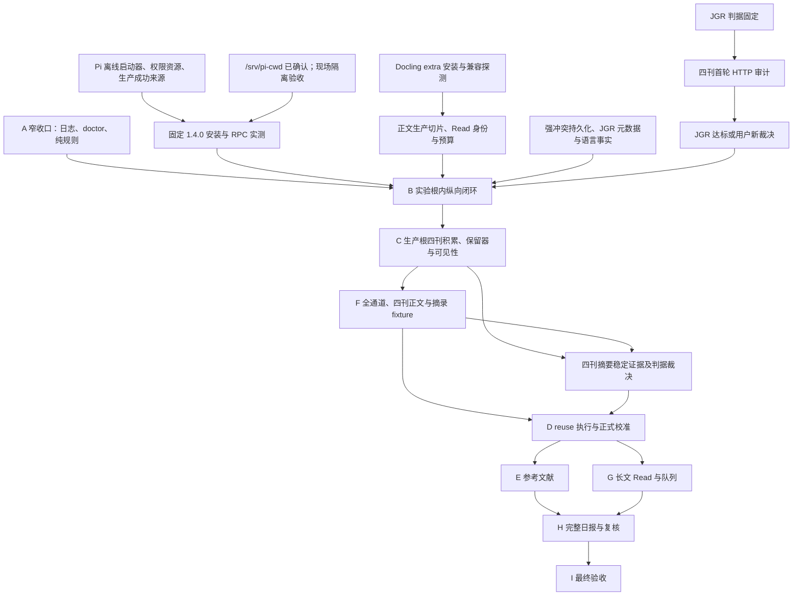

# 文档统一迁移台账（#113）

## 基线与范围

基线：`91e5d02e199f1921ca8afd2b7bdb8f257e6264f3`（开工时 main）。
依据 [Issue #113](https://github.com/MeteoBoy4/PaperRadar/issues/113)。本台账是迁移完成后冻结的记录，不进入 scope 绑定，不作为规范来源。

整理范围：`intent/draft.md`、`README.md`、`GLOSSARY.md`（只检查）、全部 `docs/adr/*.md`、全部 19 份 `docs/contracts/*.md`、`docs/verification/stage-a-closure.md`、`AGENTS.md`、`docs/agents/documentation.md`、`docs/agents/issue-tracker.md` 与新增文档。

原字节不动：`docs/verification/` 中除 `stage-a-closure.md` 外的既有文件；`verification-runs/`、`intent/discussions/`、`intent/review/`、`intent/archived_discussions/`、`examples/`、`fixtures/`、`tests/`、`src/`、`.agents/skills/` 的全部既有文件。scope 文件仅允许实际文档变更所需哈希重绑。

## 迁移单元

以下记录已实施单元；其余规格、ADR、Contract、README 迁移仍在进行，不构成全票完成证明。

### M001

源：`intent/draft.md`，基线行 1729。处置：移动。

去处：[docs/roadmap.md#模块图](../../docs/roadmap.md#模块图)。

原文（逐字）：

````text

````

新文：

````text
依赖图、模块状态与当前前沿见[路线图](../docs/roadmap.md#模块图)。
````

细节核对：原图 19 节点、21 条边在路线图保留；仅新增状态着色。

### M002

源：`intent/draft.md`，基线行 1823。处置：状态外移。

去处：[docs/roadmap.md#收口安排](../../docs/roadmap.md#收口安排)。

原文（逐字）：

````text
[阶段 A 收口清单](../docs/verification/stage-a-closure.md) 保留上述原实施/测试/DoD 的稳定序号、
历史证据与后续责任。A1–A10 通过不等于完整 A 通过。本 Markdown 是过渡清单；A 真正收口时
由收口实现票产出机器可读阶段结论，I 聚合。首张 A 收口实现票须确定新增能力 required 组与
全量 pytest 的验收登记规则，后续沿用；本票不新增组、测试分母或通过字段。
````

新文：

````text
A 真正收口时由收口实现票产出机器可读阶段结论，I 聚合。收口责任与验收登记安排见
[路线图](../docs/roadmap.md#收口安排)。
````

细节核对：机器可读结论与 I 聚合要求保留规格；过渡安排移入路线图，将“上述”明确为“规格 §11 A”、“本 Markdown”明确为“该收口清单”、“本票”明确为“#111”，防止迁移改变指代；数字、情态、顺序和全部登记约束不变。

### M003

源：`docs/contracts/read-validation.md`，基线行 8。处置：改写。

去处：[docs/contracts/read-validation.md#当前交付与命名](../../docs/contracts/read-validation.md#当前交付与命名)。

原文（逐字）：

````text
#93 已交付 `paper_radar.reading` 的权威 Pydantic 结构及 Read 自有七类价值词汇，
经现有 contracts 服务生成、导出和只读检查。仅通过 Schema 不表示已通过证据业务接收。
#94 已交付原始字节与可靠文本上下文的纯验证、数值 v1 和警告三视图。
#95 已接通表格、公式区域源字符与不可靠字符的字段矩阵；#96 已交付 single/reduce
模式与同正文 map 证据允许集合检查；#97 已交付显式 Read 配置准入与历史比较。
#98 已验证历史配置与候选原字节的非空隔离恢复，固定上下文由测试常量重建；
独立必需 A9、同次可信终态与固定范围由 #99 交付。

````

新文：

````text
`paper_radar.reading` 提供权威 Pydantic 结构及 Read 自有七类价值词汇，
经现有 contracts 服务生成、导出和只读检查。仅通过 Schema 不表示已通过证据业务接收。
公共能力包括原始字节与可靠文本上下文的纯验证、数值 v1 和警告三视图，
表格、公式区域源字符与不可靠字符的字段矩阵，single/reduce
模式与同正文 map 证据允许集合检查，以及显式 Read 配置准入与历史比较。
历史配置与候选原字节具有非空隔离恢复验证，固定上下文由测试常量重建；
独立必需 A9 绑定同次可信终态与固定范围。

````

细节核对：能力和边界逐项原位保留，#93–#99 交付出处移入相关依据行；数值 v1、single/reduce、固定上下文及 A9 同次范围未变。

### M004

源：`docs/contracts/read-validation.md`，基线行 45。处置：改写。

去处：[docs/contracts/read-validation.md#字段闭集](../../docs/contracts/read-validation.md#字段闭集)。

原文（逐字）：

````text
逐项检查，不能套用摘要层输入不足短语。结构类型/评分/必填性由 #93 交付；
有意义文本、重复检测、条件非空及上下文业务规则由 #94 交付。
````

新文：

````text
逐项检查，不能套用摘要层输入不足短语。结构校验涵盖类型/评分/必填性；
业务校验涵盖有意义文本、重复检测、条件非空及上下文业务规则。
````

细节核对：结构/业务校验职责原位保留；#93/#94 出处移至相关依据行。

### M005

源：`docs/contracts/read-validation.md`，基线行 79。处置：改写。

去处：[docs/contracts/read-validation.md#消费上下文与错误边界源字符与-reduce-已交付](../../docs/contracts/read-validation.md#消费上下文与错误边界源字符与-reduce-已交付)。

原文（逐字）：

````text
`output_invalid` 或消耗模型预算。本票不引入预算或接收器。
````

新文：

````text
`output_invalid` 或消耗模型预算。此校验边界不提供预算或接收器。
````

细节核对：仅调整位置性措辞；数字、枚举、条件、否定、情态及顺序保留。

## 发现

| 编号 | 基线位置 | 发现 | 处理 |
| --- | --- | --- | --- |
| F01 | README.md:12 与 audit run/resume 使用说明 | “真实网络来源尚未实现”的范围与已有联网审计命令存在歧义 | 待记录并报告，未改变原文 |
| F02 | docs/contracts/paper-facts.md:248 | 历史“待实现单一枚举”与现状混写，但原因目录及指引被测试读取 | 原字节保留；整理时标明嵌入历史内容 |
| F03 | docs/contracts/adapter-config.md:57–59 与 ADR-0026/0036 | 具体 cwd 待确认的历史表述与 #111 已确认 `/srv/pi-cwd` 不同步 | 路线图按较新裁决记已确认值，现场隔离仍未验；原 Contract 待整理 |

## 检查结果

本节为进行中记录，不宣称完成验收。

- 初稿模块图：独立审阅确认原 19 个节点和 21 条边保全。
- 初稿承接表：独立审阅确认 45 条 I/T/D 下一责任原文完整；新增模块索引与冻结基线行链接，尚待整体复审。
- 初始 scope 审计：退出 0，`issues=[]`、`affected_groups=[]`；当前新增规范及路线图不加入绑定。
- 删除行、细节计数、全部链接、完整语义复审及文档迁移后的仓库一致性检查尚未完成。
- 指定 pytest 子集：`tests/test_paper_inputs.py`、`tests/test_check_compatibility.py`、`tests/test_a9_integrity.py`、`tests/test_a10_integrity.py`、`tests/test_verification_scope_audit.py`，统一使用 `uv run --offline --locked pytest`：291 passed（43.06s）。
- 规范部分独立 Standards / Spec 审阅均 0 项；路线图仍缺各模块具体依据/完成判据指针，不能作全票完成结论。
- 未运行完整离线门禁；未执行 live。

### 本组迁移复核（M001–M005）

- 两名未参与改写的审阅者分别审查规格/收口安排与 Read Contract；指代漂移和完整删除行两项发现均修复，复审零未决。该结论仅覆盖本组。
- 机械检查：本组删除的非空行逐字出现在台账；规格标题序列保持，Read Contract 既有标题保持；83 行 US/ID/TD 覆盖表逐字一致。
- `stage-a-closure.md` 仅新增文首冻结说明，剩余正文与表格字节和基线完全相同。
- scope：实际改动 `intent/draft.md`、`docs/contracts/read-validation.md`，重绑 A9 对两者的引用、A10 对规格及 A9 scope 的引用。未变更测试计数、格式或历史证据。最终审计退出 0，`issues=[]`、`affected_groups=[]`。
- 指定五个 pytest 文件在本组改动后 291 passed（43.52s）；未运行完整离线门禁或 live。
- 路线图补齐 19 节点的规格/ADR/Contract 与完成判据入口；独立复核通过。
- 尚待完成：规格文首及正文交付日志、全部 ADR/Contract/README 整理、全量细节计数/链接检查和整票语义审阅。本台账仍为进行中记录。
