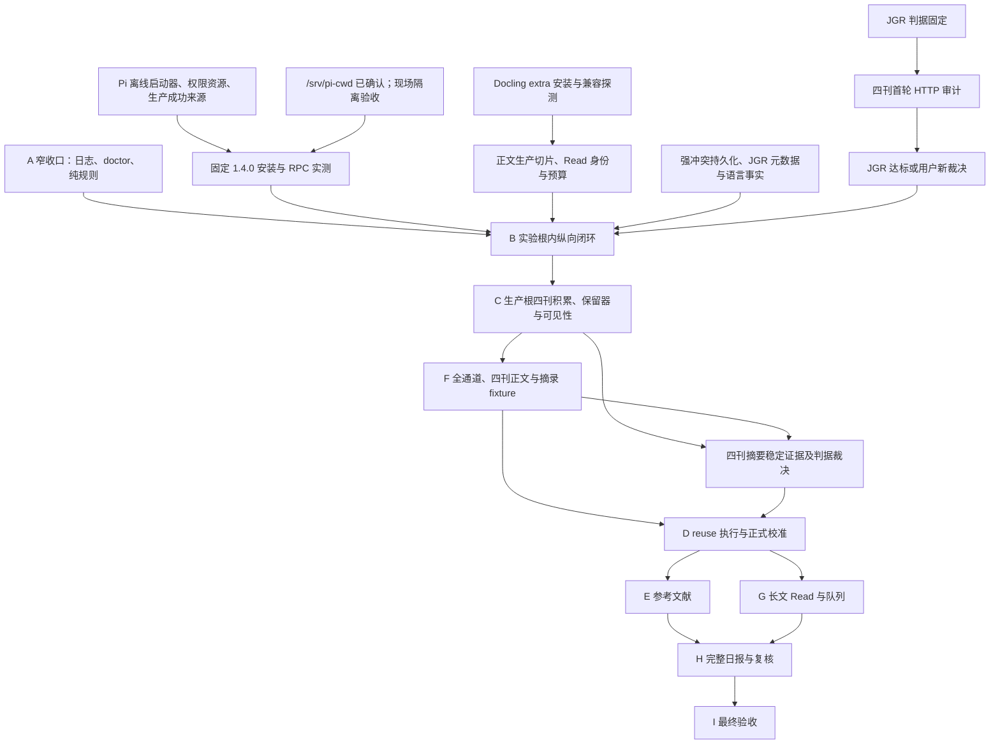

# 文档统一迁移台账（#113）

## 基线与范围

基线：`91e5d02e199f1921ca8afd2b7bdb8f257e6264f3`（开工时 main）。
依据 [Issue #113](https://github.com/MeteoBoy4/PaperRadar/issues/113)。本台账是迁移完成后冻结的记录，不进入 scope 绑定，不作为规范来源。

整理范围：`intent/draft.md`、`README.md`、`GLOSSARY.md`（只检查）、全部 `docs/adr/*.md`、全部 19 份 `docs/contracts/*.md`、`docs/verification/stage-a-closure.md`、`AGENTS.md`、`docs/agents/documentation.md`、`docs/agents/issue-tracker.md` 与新增文档。

原字节不动：`docs/verification/` 中除 `stage-a-closure.md` 外的既有文件；`verification-runs/`、`intent/discussions/`、`intent/review/`、`intent/archived_discussions/`、`examples/`、`fixtures/`、`tests/`、`src/`、`.agents/skills/` 的全部既有文件。scope 文件仅允许实际文档变更所需哈希重绑。

## 迁移单元

以下记录已实施单元；其余规格、ADR、Contract、README 迁移仍在进行，不构成全票完成证明。

### M001

源：`intent/draft.md`，基线行 1729。处置：移动。

去处：[docs/roadmap.md#模块图](../../docs/roadmap.md#模块图)。

原文（逐字）：

````text

````

新文：

````text
依赖图、模块状态与当前前沿见[路线图](../docs/roadmap.md#模块图)。
````

细节核对：原图 19 节点、21 条边在路线图保留；仅新增状态着色。

### M002

源：`intent/draft.md`，基线行 1823。处置：状态外移。

去处：[docs/roadmap.md#收口安排](../../docs/roadmap.md#收口安排)。

原文（逐字）：

````text
[阶段 A 收口清单](../docs/verification/stage-a-closure.md) 保留上述原实施/测试/DoD 的稳定序号、
历史证据与后续责任。A1–A10 通过不等于完整 A 通过。本 Markdown 是过渡清单；A 真正收口时
由收口实现票产出机器可读阶段结论，I 聚合。首张 A 收口实现票须确定新增能力 required 组与
全量 pytest 的验收登记规则，后续沿用；本票不新增组、测试分母或通过字段。
````

新文：

````text
A 真正收口时由收口实现票产出机器可读阶段结论，I 聚合。收口责任与验收登记安排见
[路线图](../docs/roadmap.md#收口安排)。
````

细节核对：机器可读结论与 I 聚合要求保留规格；过渡安排移入路线图，将“上述”明确为“规格 §11 A”、“本 Markdown”明确为“该收口清单”、“本票”明确为“#111”，防止迁移改变指代；数字、情态、顺序和全部登记约束不变。

### M003

源：`docs/contracts/read-validation.md`，基线行 8。处置：改写。

去处：[docs/contracts/read-validation.md#当前交付与命名](../../docs/contracts/read-validation.md#当前交付与命名)。

原文（逐字）：

````text
#93 已交付 `paper_radar.reading` 的权威 Pydantic 结构及 Read 自有七类价值词汇，
经现有 contracts 服务生成、导出和只读检查。仅通过 Schema 不表示已通过证据业务接收。
#94 已交付原始字节与可靠文本上下文的纯验证、数值 v1 和警告三视图。
#95 已接通表格、公式区域源字符与不可靠字符的字段矩阵；#96 已交付 single/reduce
模式与同正文 map 证据允许集合检查；#97 已交付显式 Read 配置准入与历史比较。
#98 已验证历史配置与候选原字节的非空隔离恢复，固定上下文由测试常量重建；
独立必需 A9、同次可信终态与固定范围由 #99 交付。

````

新文：

````text
`paper_radar.reading` 提供权威 Pydantic 结构及 Read 自有七类价值词汇，
经现有 contracts 服务生成、导出和只读检查。仅通过 Schema 不表示已通过证据业务接收。
公共能力包括原始字节与可靠文本上下文的纯验证、数值 v1 和警告三视图，
表格、公式区域源字符与不可靠字符的字段矩阵，single/reduce
模式与同正文 map 证据允许集合检查，以及显式 Read 配置准入与历史比较。
历史配置与候选原字节具有非空隔离恢复验证，固定上下文由测试常量重建；
独立必需 A9 绑定同次可信终态与固定范围。

````

细节核对：能力和边界逐项原位保留，#93–#99 交付出处移入相关依据行；数值 v1、single/reduce、固定上下文及 A9 同次范围未变。

### M004

源：`docs/contracts/read-validation.md`，基线行 45。处置：改写。

去处：[docs/contracts/read-validation.md#字段闭集](../../docs/contracts/read-validation.md#字段闭集)。

原文（逐字）：

````text
逐项检查，不能套用摘要层输入不足短语。结构类型/评分/必填性由 #93 交付；
有意义文本、重复检测、条件非空及上下文业务规则由 #94 交付。
````

新文：

````text
逐项检查，不能套用摘要层输入不足短语。结构校验涵盖类型/评分/必填性；
业务校验涵盖有意义文本、重复检测、条件非空及上下文业务规则。
````

细节核对：结构/业务校验职责原位保留；#93/#94 出处移至相关依据行。

### M005

源：`docs/contracts/read-validation.md`，基线行 79。处置：改写。

去处：[docs/contracts/read-validation.md#消费上下文与错误边界源字符与-reduce-已交付](../../docs/contracts/read-validation.md#消费上下文与错误边界源字符与-reduce-已交付)。

原文（逐字）：

````text
`output_invalid` 或消耗模型预算。本票不引入预算或接收器。
````

新文：

````text
`output_invalid` 或消耗模型预算。此校验边界不提供预算或接收器。
````

细节核对：仅调整位置性措辞；数字、枚举、条件、否定、情态及顺序保留。

### M006

源：`intent/draft.md`，基线行 800。处置：改写。

去处：[intent/draft.md#410-read-agent](../../intent/draft.md#410-read-agent)。

原文（逐字）：

````text
以下是 Read 的结构定义；#93 已实现单一权威 Pydantic Schema 并导出 Read v1 Frozen Contract，#94–#96 已交付给定只读证据上下文的纯业务验证器，#97–#99 已接通显式配置、隔离恢复与独立离线验收。可行性研究使用的临时 Read Schema 不取得生产权威资格。单次调用及 map/reduce 的生产目标仍由 Python 编排并通过 §7.7 的隔离 Pi 会话执行；分块、输入证据选择和最终引用检查由 PaperRadar 控制，不新增 Agent evidence 查询或 PDF 工具。
````

新文：

````text
以下是 Read 的结构定义（依据 #93–#99）；应使用单一权威 Pydantic Schema 并导出 Read v1 Frozen Contract，并提供给定只读证据上下文的纯业务验证器，以及显式配置、隔离恢复与独立离线验收。可行性研究使用的临时 Read Schema 不取得生产权威资格。单次调用及 map/reduce 的生产调用由 Python 编排并通过 §7.7 的隔离 Pi 会话执行；分块、输入证据选择和最终引用检查由 PaperRadar 控制，不新增 Agent evidence 查询或 PDF 工具。
````

细节核对：只将交付时态改为规格要求，保留各 issue 依据；全部字段、枚举、数字、条件、否定与职责边界原位保留。对应已完成范围见路线图 A2/A9；B 未完成见模块状态。

### M007

源：`intent/draft.md`，基线行 1202。处置：改写。

去处：[intent/draft.md#73-期刊信誉](../../intent/draft.md#73-期刊信誉)。

原文（逐字）：

````text
A2-07（#22）已通过公共 check/compile/load 登记该集合，不执行论文匹配或破同。
刊号接受带或不带连字符的 ASCII 八位写法与末位小写 x，不接受首尾空白；
编译后统一为带连字符、大写 X 的形式。`issns` 可包含本条 ISSN-L，但其自身列表
不得重复。完整快照内期刊按规范 `issn_l` 排序，附加 `issns` 也排序；精确原始字节
仍保留，等价写法改动也须新建版本。#23 的六阶段投影与基线均排除期刊材料；
期刊配置变化只影响完整快照与登记身份。
````

新文：

````text
期刊集合通过公共 check/compile/load 登记（依据 #22），不执行论文匹配或破同。
刊号接受带或不带连字符的 ASCII 八位写法与末位小写 x，不接受首尾空白；
编译后统一为带连字符、大写 X 的形式。`issns` 可包含本条 ISSN-L，但其自身列表
不得重复。完整快照内期刊按规范 `issn_l` 排序，附加 `issns` 也排序；精确原始字节
仍保留，等价写法改动也须新建版本。六阶段投影与基线均排除期刊材料（依据 #23）；
期刊配置变化只影响完整快照与登记身份。
````

细节核对：只将交付时态改为规格要求，保留各 issue 依据；全部字段、枚举、数字、条件、否定与职责边界原位保留。对应已完成范围见路线图 A2/A9；B 未完成见模块状态。

### M008

源：`intent/draft.md`，基线行 1325。处置：改写。

去处：[intent/draft.md#77-pi-rpc-适配边界](../../intent/draft.md#77-pi-rpc-适配边界)。

原文（逐字）：

````text
Issue #26 的配置切片已开放 settings 的 adapters 三槽、Pi YAML 与独立系统 Prompt
登记/回放，以及具名只读 adapter 语义和消费者依赖。字段、路径和固定 V1 策略见
[适配器配置契约](../docs/contracts/adapter-config.md)。没有 adapter 的旧快照保持
原身份和含义；该配置切片不执行 RPC 或安装程序。统一阶段投影、校准基线及 diff
联动已由 #23 接入单快照重建与只读 diff；不能把 adapter 分量身份冒称为完整基线
或执行就绪证明。
````

新文：

````text
适配器配置应支持（依据 #26） settings 的 adapters 三槽、Pi YAML 与独立系统 Prompt
登记/回放，以及具名只读 adapter 语义和消费者依赖。字段、路径和固定 V1 策略见
[适配器配置契约](../docs/contracts/adapter-config.md)。没有 adapter 的旧快照保持
原身份和含义；配置编译不执行 RPC 或安装程序。统一阶段投影、校准基线及 diff
联动应通过单快照重建与只读 diff 提供（依据 #23）；不能把 adapter 分量身份冒称为完整基线
或执行就绪证明。
````

细节核对：只将交付时态改为规格要求，保留各 issue 依据；全部字段、枚举、数字、条件、否定与职责边界原位保留。对应已完成范围见路线图 A2/A9；B 未完成见模块状态。

### M009

源：`intent/draft.md`，基线行 1363。处置：改写。

去处：[intent/draft.md#78-pi-固定版本供给](../../intent/draft.md#78-pi-固定版本供给)。

原文（逐字）：

````text
Issue #26 只冻结适配器配置事实并接入版本登记和快照；本节的下载、安装、激活、权限隔离和 RPC 验收由后续执行器与供给任务实施，不在配置编译中安装程序或新增无人消费的执行资源字段。普通离线测试使用固定供给清单、临时文件和 fake RPC/进程接口，无 Pi、Node、网络或模型凭据前置；真实安装与 RPC 验收由显式命令另行运行。
````

新文：

````text
适配器配置编译只冻结（依据 #26）适配器配置事实并接入版本登记和快照；本节的下载、安装、激活、权限隔离和 RPC 验收由执行器与供给任务实施，不在配置编译中安装程序或新增无人消费的执行资源字段。普通离线测试使用固定供给清单、临时文件和 fake RPC/进程接口，无 Pi、Node、网络或模型凭据前置；真实安装与 RPC 验收由显式命令另行运行。
````

细节核对：只将交付时态改为规格要求，保留各 issue 依据；全部字段、枚举、数字、条件、否定与职责边界原位保留。对应已完成范围见路线图 A2/A9；B 未完成见模块状态。

### M010

源：`intent/draft.md`，基线行 1830。处置：改写。

去处：[intent/draft.md#阶段-bjgr-feed-第一条真实纵向闭环](../../intent/draft.md#阶段-bjgr-feed-第一条真实纵向闭环)。

原文（逐字）：

````text
本阶段是 [ADR-0036](../docs/adr/0036-isolate-stage-b-read-experiment.md) 的受限实验，整条链
从 Feed 导入到最小日报均运行于显式实验数据根。目标是验证生产接口的真实单篇接线，
不授予正常生产消费、正式校准或自动 Read 资格；以下均为待实现责任。
````

新文：

````text
本阶段是 [ADR-0036](../docs/adr/0036-isolate-stage-b-read-experiment.md) 的受限实验，整条链
从 Feed 导入到最小日报均运行于显式实验数据根。目标是验证生产接口的真实单篇接线，
不授予正常生产消费、正式校准或自动 Read 资格。
````

细节核对：只将交付时态改为规格要求，保留各 issue 依据；全部字段、枚举、数字、条件、否定与职责边界原位保留。对应已完成范围见路线图 A2/A9；B 未完成见模块状态。

### M011

源：`intent/draft.md`，基线行 1599。处置：状态外移。

去处：[docs/roadmap.md#read-恢复证据范围](../../docs/roadmap.md#read-恢复证据范围)。

原文（逐字）：

````text
#98 已以两份历史配置和中/英文、single/reduce 四份候选原字节验证上述隔离恢复与
再次搬迁。消费上下文由固定测试常量重建，不属于恢复产物，也不证明真实 PDF、
evidence-map 或正文选择；范围见 [Read 恢复说明](../docs/contracts/read-validation.md#恢复范围98)。
````

新文：

````text
恢复验证的既有证据范围见[路线图](../docs/roadmap.md#read-恢复证据范围)。
````

细节核对：恢复证据数量、上下文来源与未证明边界保留；相对链接按新位置调整，将“上述隔离恢复”改为“[规格 §9.1](../intent/draft.md#91-本机一致性快照)所述隔离恢复”，明确原指代。

### M012

源：`docs/adr/0036-isolate-stage-b-read-experiment.md`，基线行 34。处置：改写。

去处：[docs/adr/0036-isolate-stage-b-read-experiment.md#未豁免条件与证明边界](../../docs/adr/0036-isolate-stage-b-read-experiment.md#未豁免条件与证明边界)。

原文（逐字）：

````text
证明范围只覆盖冻结样本与纵向链，不证明四刊正文质量、通用 Docling、正常生产 Read、校准或完整阶段 A。本次仅记录规范，未实现以上能力；阶段责任与历史证据见 [A 收口清单](../verification/stage-a-closure.md)。
````

新文：

````text
证明范围只覆盖冻结样本与纵向链，不证明四刊正文质量、通用 Docling、正常生产 Read、校准或完整阶段 A。阶段责任与历史证据见[路线图](../roadmap.md#module-b)。
````

细节核对：证明范围逐字原位保留；仅规范、未实现的状态见路线图 B 未成形及下方 #111 记录。阶段 A 收口证据由路线图继续链接。

### M013

源：`README.md`，基线行 637。处置：合并。

去处：[docs/roadmap.md#阶段-a-收口与-b-前置111目标规格](../../docs/roadmap.md#阶段-a-收口与-b-前置111目标规格)。

原文（逐字）：

````text
## 阶段 A 收口与 B 前置（#111，目标规格）

[主方案 §11](intent/draft.md#十一九阶段实施与验收) 是统一阅读入口，与 GLOSSARY、ADR、
Contract 共同约束；[A 收口清单](docs/verification/stage-a-closure.md) 逐项区分历史离线证据与
剩余责任，A1–A10 通过不等于完整 A 通过。

B 按 [ADR-0036](docs/adr/0036-isolate-stage-b-read-experiment.md) 在独立实验数据根完成
固定 JGR 纵向链，结果不复用、不提升，暴露清单由 C 跨库导入排除正式校准。四刊先做首轮
摘要审计；JGR 至少 5 篇固定成员、各有已交付路线取得非疑似截断主摘要方可继续 B，其他刊
在 C/F 补跑，最迟 D 正式预热冻结/首个批次前逐刊收口。B 的 PDF 最低路径为人工合法附加，
TDM/授权/渲染留 F，单篇质量不豁免。真实冻结材料留本机，CI 仅用合成/脱敏材料。

A 窄收口负责日志、基础/配置 doctor 与 eligibility/visibility 纯规则；B 前置交付
Docling extra 兼容验证、首次 Pi 1.4.0 供给/生产接收、Feed/语言事实、正文与 Read 身份/预算。
安装探测与离线工程可并行，首次真实消费须先满足相应入口。以上均未因本文更新而交付或验收，
A4 1.3.0 历史材料、A2 示例和历史结论保持不变；未来 Pi 升级仍走 §7.8。

````

新文：

````text
V1 目标与判据见[规格](intent/draft.md)，当前前沿、阶段状态与后续责任见[路线图](docs/roadmap.md)。

````

细节核对：使用说明不变。状态与并行安排在路线图保留，规范内容合并至既有等价正文：规格 §11 B 的入口条件、实验数据根、最低 PDF 路径与本机材料要求，以及 ADR-0036 的“B 整条 Feed→Screening→人工决定→PDF→正文→Read→最小日报都在显式实验数据根内”“旧实验结果只作历史回查，不复用、不提升、不提供提升入口”“JGR 入口判据在审计前固定为 selected 至少 5 篇”“最迟 D 正式预热冻结/首个校准批次前四刊逐刊证明稳定”“普通离线测试仅用合成或脱敏材料”；未来升级保留规格 §7.8。数字、条件、否定与责任无变化，路线图通过链接引用，不复述目标规则。

### M014

源：`intent/draft.md`，基线行 6。处置：链接修正。

去处：[intent/draft.md#paperradar-第一版方案](../../intent/draft.md#paperradar-第一版方案)。

原文（逐字）：

````text
> 本文是第一版范围和验收依据；与早期设想冲突时，以本文、根目录 CONTEXT.md 和已记录 ADR 为准。
````

新文：

````text
> 本文是第一版范围和验收依据；与早期设想冲突时，以本文、根目录 GLOSSARY.md 和已记录 ADR 为准。
````

细节核对：git 提交 c8cf6b1ad700a3348ea416bd1d2b9b351f1048d1 显示 CONTEXT.md → GLOSSARY.md 为 100% 重命名；只修正文档名，权威关系保持。

## 发现

| 编号 | 基线位置 | 发现 | 处理 |
| --- | --- | --- | --- |
| F01 | README.md:12 与 audit run/resume 使用说明 | “真实网络来源尚未实现”的范围与已有联网审计命令存在歧义 | 待记录并报告，未改变原文 |
| F02 | docs/contracts/paper-facts.md:248 | 历史“待实现单一枚举”与现状混写，但原因目录及指引被测试读取 | 原字节保留；整理时标明嵌入历史内容 |
| F03 | docs/contracts/adapter-config.md:57–59 与 ADR-0026/0036 | 具体 cwd 待确认的历史表述与 #111 已确认 `/srv/pi-cwd` 不同步 | 路线图按较新裁决记已确认值，现场隔离仍未验；原 Contract 待整理 |

## 检查结果

本节为进行中记录，不宣称完成验收。

- 初稿模块图：独立审阅确认原 19 个节点和 21 条边保全。
- 初稿承接表：独立审阅确认 45 条 I/T/D 下一责任原文完整；新增模块索引与冻结基线行链接，尚待整体复审。
- 初始 scope 审计：退出 0，`issues=[]`、`affected_groups=[]`；当前新增规范及路线图不加入绑定。
- 删除行、细节计数、全部链接、完整语义复审及文档迁移后的仓库一致性检查尚未完成。
- 指定 pytest 子集：`tests/test_paper_inputs.py`、`tests/test_check_compatibility.py`、`tests/test_a9_integrity.py`、`tests/test_a10_integrity.py`、`tests/test_verification_scope_audit.py`，统一使用 `uv run --offline --locked pytest`：291 passed（43.06s）。
- 规范部分独立 Standards / Spec 审阅均 0 项；路线图仍缺各模块具体依据/完成判据指针，不能作全票完成结论。
- 未运行完整离线门禁；未执行 live。

### 本组迁移复核（M001–M005）

- 两名未参与改写的审阅者分别审查规格/收口安排与 Read Contract；指代漂移和完整删除行两项发现均修复，复审零未决。该结论仅覆盖本组。
- 机械检查：本组删除的非空行逐字出现在台账；规格标题序列保持，Read Contract 既有标题保持；83 行 US/ID/TD 覆盖表逐字一致。
- `stage-a-closure.md` 仅新增文首冻结说明，剩余正文与表格字节和基线完全相同。
- scope：实际改动 `intent/draft.md`、`docs/contracts/read-validation.md`，重绑 A9 对两者的引用、A10 对规格及 A9 scope 的引用。未变更测试计数、格式或历史证据。最终审计退出 0，`issues=[]`、`affected_groups=[]`。
- 指定五个 pytest 文件在本组改动后 291 passed（43.52s）；未运行完整离线门禁或 live。
- 路线图补齐 19 节点的规格/ADR/Contract 与完成判据入口；独立复核通过。
- 尚待完成：规格文首及正文交付日志、全部 ADR/Contract/README 整理、全量细节计数/链接检查和整票语义审阅。本台账仍为进行中记录。

### 本组迁移复核（M006–M014）

- 两名未参与改写的审阅者分别检查规格与 README/ADR。Read 恢复指代及 README 目标复述两项发现均已修复，复审零未决；仅适用于本组。
- 删除非空行逐字覆盖检查通过；规格与 Contract 既有标题、收口表原字节、GLOSSARY 和测试导航均保持。
- 现行规格/ADR/Contract/README/GLOSSARY/路线图/agents 文档的初步数字、代码、issue/ADR/章节及英文标识符集合检查，仅发现旧名称 CONTEXT；经历史确认后在文档规范保留旧名映射。此检查尚未替代完整 URL/相对目标及逐标记计数检查。
- A8/A9/A10：只重绑 README、规格和 ADR-0034 的实际字节变化与 scope 传递下游；最终审计退出 0、issues 和 affected_groups 均为空。
- 指定五文件加受影响的 `tests/test_a8_integrity.py`：427 passed（62.95s）。未运行完整离线门禁或 live。
- 整票仍待完成：规格文首日志及其余交付叙述、全部存量 ADR/Contract 统一、README 其余状态句、全量标记计数/链接检查、台账按源位置排序及最终独立语义审阅。
